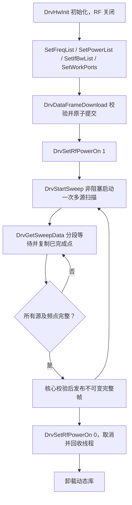

# TDC1VN10 单板模拟驱动

本模块按 `demo/DrvDeviceBoardApi.h` 的九个函数签名实现独立动态库 `tdc1vn10_drv_sim`。当前开发以 VN10 接口为基准；旧 TDC1VN08 模拟驱动仍位于 `VnaNativeSimulator`，统一命名为 `tdc1vn08_drv_sim`，原有函数签名和黄金数据合同保持不变。

VN08 和 VN10 有同名但不同签名的导出函数，必须明确选择接口版本。服务默认使用 VN10；在程序旁的 `vnapro.yml` 中设置 `driver.board: tdc1vn08` 并指定对应 `driver.library`，才能选择旧库和旧适配器。CLion 和部署路径的具体设置见[模拟驱动切换](../docs/模拟驱动切换.md)。不能只把 VN08 的 DLL 文件名替换成 VN10 DLL。未来 VN08 驱动向新接口靠齐后，可继续使用 VN10 接口适配器；这里的选择表示接口合同，不自动探测板卡型号。

## 调用流程



四个 Set 函数复制调用者数组，只改变待提交配置。三个逐点数组必须非空且长度相等；工作端口必须非空、范围合法且无重复。供应接口的 Set 返回 `void`，无效项记录在暂存状态，由 Download 报告失败，不能悄悄继续使用旧项。Download 失败保留已提交配置；扫描运行时拒绝提交。成功 Start 使用独立快照，后续 Set 不改变当前扫描。

Start 只安排后台采集，不在调用线程同步生成全部数据；前一次扫描完成前再次 Start 返回忙。Get 支持分段、重复读取同一扫描，等待至请求范围全部完成后才复制；错误或取消不写输出。等待者绑定本次扫描对象，不能因下一次 Start 而读入另一轮数据。多次调用组成的 Set/Download/Start 工作流仍由调用方串行协调，互斥锁不代替业务事务。

RF 关闭会取消扫描、通知等待者，并在返回前回收后台线程。**卸载动态库前必须先调用 `DrvSetRfPowerOn(0)`，且等待其他驱动调用退出。** Windows DLL 卸载时不能依赖静态析构等待线程。核心适配器在同一个工作线程完成取数、关闭 RF，再释放库。

## 模拟器约定

数据排列按本次提供的驱动说明：先 P1 的全部请求频点，再 P2 等工作源端口；每个频点的接收顺序为 A1/B1 到 A4/B4，每个 AXPN/BXPN 按实部、虚部排列。修正后的供应头明确频率数组为 `uint64_t[]`、功率数组为 `double[]`、`DrvSetIfBwList` 的 IFBW 数组为 `uint32_t[]`；已确认功率单位 dBm、有效范围为闭区间 `[-120,100]`。供应头仍未定义厂商错误码及 `EXPORT_API` 链接约定。

| 项目 | 本项目约定 |
| --- | --- |
| 导出 | 九个未修饰的 C 链接名称，平台默认调用约定 |
| 原生端口 | 0～3；核心物理端口 1～4 在适配器转换 |
| frequency | uint64，非零整数 Hz |
| IFBW | uint32，非零整数 Hz；逐元素复制，不按 uint64 数组解释 |
| power | double，有限 dBm，范围 `[-120,100]`，保留负数和小数 |
| 逐点数组 | 相同的 N 个元素；核心 powerDbm 为空时下发 N 个 0 dBm |
| IQ | `[工作源端口列表顺序][请求范围内频点][接收0～3][A实,A虚,B实,B虚]` |
| Get 范围 | start_index 从 0 起；fNum 为频点数量，跨全部工作源端口 |
| dataLen | double 元素容量，至少 `fNum × 源数 × 16` |
| 错误码 | 见 `include/vna_board/board_api_contract.h`，不解释真实厂商错误 |
| 内存 | 完整 IQ 上限 64 MiB，并检查乘法和 int 容量 |

接收槽位始终为四端口。二端口仪器配置只开放端口 1、2，核心和服务按接收掩码判断有效测量。多源拆包位于 C++ 设备适配器；WebUI、SCPI、测量和显示域继续使用相同的完整帧。

每次分段 Get 的输出都重新按源端口分块：例如请求频点 64～127、工作端口 P1/P2，输出是 P1 的这 64 点，再 P2 的这 64 点，不是完整多端口数组的一段连续切片。后台内部可以按频点计算并发布完成进度，ABI 输出顺序与内部缓存布局分开处理。

两工作端口、两频点的确定示例：`P1(f1)、P1(f2)、P2(f1)、P2(f2)`，每包 16 个 double，共 64 个 double。每包保留接收端口 1～4 的 A/B；没有激励端口 P3、P4 的频点段。`board_contract` 用两个不连续频点及反向工作端口顺序核对独立的固定 IQ 字面量。

服务使用 `driver.type: simulator` 时，通过 `vnapro.yml` 的 `driver.simulator.mode`、`seed` 和 `noiseAmplitude` 配置模拟信号。`hardware` 或省略类型时不执行模拟配置。`noiseAmplitude` 是无单位的相对扰动系数，允许 `[0, 1]`；默认 `0.002` 保留原有噪声，`0.004` 将同种子、同扫描编号的 IQ 扰动放大两倍。它不是 dB 值，也不承诺真实仪器的噪声分布。VN10 各分量的扰动按对应波的幅度缩放，复数整体偏差可能大于单个分量系数。

单独加载模拟驱动时，缺省采用确定的 golden 模式；内部环境桥接对应 `VNAPRO_SIM_MODE`、`VNAPRO_SIM_SEED`、`VNAPRO_SIM_NOISE_AMPLITUDE`。噪声幅度接受小数和科学计数法，未设置或空值采用 `0.002`；空白、非有限数、尾随内容、越界数值和下溢为零的非零数值导致初始化失败，原状态保留。噪声模式的幅度为 `0` 时与 golden 数据完全一致。golden 模式继续忽略噪声种子和幅度。

模式、种子和幅度只在初始化时读取并冻结，运行中修改环境不会改变扫描；相同配置重新初始化可以复现首帧，读取同一扫描的任意分段保持一致。功率和 IFBW 暂不模拟真实物理响应。

## 构建与验证

只使用 C++14 和系统线程库，不下载第三方库。独立构建：

```powershell
cmake -S VnaBoardSimulator -B build-vn10 -G Ninja -DCMAKE_BUILD_TYPE=Debug -DCMAKE_CXX_COMPILER=I:/mingw64/bin/g++.exe
cmake --build build-vn10 --parallel
cmake -E chdir build-vn10 ctest --output-on-failure
```

根目录构建后启动：

```powershell
.\build\bin\vna_server.exe
```

服务不接受命令行参数。部署时在程序旁的 `vnapro.yml` 设置 `driver.board` 和 `driver.library`，驱动库与程序放在同一目录。Windows MinGW 库名为 `libtdc1vn10_drv_sim.dll`；Linux 为 `.so`，macOS 为 `.dylib`。接口选错时在绑定必需符号阶段失败，不调用同名异签名函数。

测试覆盖供应头独立类型/符号合同、负数/小数功率及范围边界、uint32 IFBW 的拷贝/非零/长度校验、暂存配置、原子组帧、异步与部分取数、缓冲边界、取消、环境模式、动态导出、核心双/四端口完整帧及 HTTP/SCPI 一致性。真实接口没有取消、超时或扫描状态查询：硬件 Get 若一直不返回，软件不能保证 Stop/Close 立即完成。
