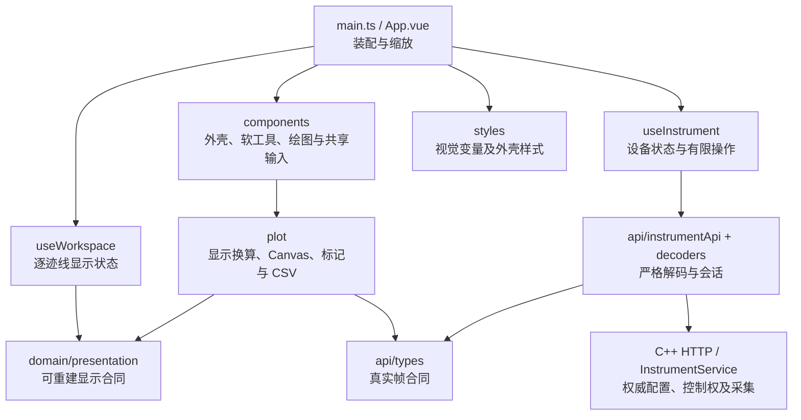

# VnaPro Web 前端

独立的 Vue 3 + TypeScript + Vite 工程，用于验证模拟器的真实采数、配置更新和控制竞争。界面参考 ZNB8 的仪器布局，显示本项目的 RAW A/B 接收波；界面风格不代表具备罗德硬件或完整 ZNB 功能，SCPI 仍使用已实现的 Keysight 命令子集。

## 安装、构建与运行

需要 Node.js ≥ 22.13 和 npm。在本目录执行；Windows PowerShell 使用 `npm.cmd`，其他环境可使用 `npm`：

```powershell
npm.cmd ci
npm.cmd test
npm.cmd run build
```

`package-lock.json` 固定依赖。`npm run build` 先执行 `vue-tsc --noEmit`，再生成 `dist/index.html` 和 `dist/assets`。随后回到仓库根目录构建并运行 C++ 服务，默认访问 [http://127.0.0.1:8080](http://127.0.0.1:8080/)；完整命令见 [根 README](../README.md)。部署时将整个 `dist` 目录交给服务的 `--web-root`，并用 `--driver` 指定部署后的模拟 DLL 绝对路径。浏览器运行静态产物，不需要安装 Node.js。

开发时保持 C++ 服务运行在 `127.0.0.1:8080`，另外执行：

```powershell
npm.cmd run dev
```

访问 [开发页面](http://127.0.0.1:5173/)；Vite 对 `/api` 的请求代理到 `127.0.0.1:8080`，无需跨域配置。`vite.config.ts` 的开发端口固定为 5173。`npm run preview` 仅预览构建的静态页面，没有 `/api` 代理，完整采数验收应从 C++ 服务加载 `dist`。

## 目录与依赖

```text
WebUI/
├─ package.json / package-lock.json  依赖与开发、测试、构建脚本
├─ vite.config.ts                   开发代理及 ES2022 构建
├─ tsconfig*.json                   产品与测试的类型检查配置
├─ index.html / src/main.ts         Vue 挂载入口
├─ src/
│  ├─ App.vue                       装配、软工具路由、画布缩放、下载
│  ├─ api/
│  │  ├─ types.ts                   设备快照、帧、操作的类型合同
│  │  ├─ decoders.ts                严格校验 JSON、身份、频轴和数组
│  │  └─ instrumentApi.ts           HTTP、请求超时、session、requestId
│  ├─ composables/
│  │  ├─ useInstrument.ts           轮询、租约、操作完成与设备读回
│  │  └─ useWorkspace.ts            活动迹线及逐迹线可重建显示状态
│  ├─ domain/presentation.ts        格式、刻度、标记、布局及迹线颜色
│  ├─ components/
│  │  ├─ instrument/               工具栏、硬键、菜单状态栏、图标
│  │  ├─ softtools/                配置、接收波、扫描、迹线、系统面板
│  │  ├─ diagrams/                 图布局、迹线条、Canvas 容器、标记读数
│  │  └─ shared/FrequencyField.vue  数值与 Hz/kHz/MHz/GHz 单位输入
│  ├─ plot/
│  │  ├─ traceMath.ts              RAW 显示换算、刻度、最近实际频点
│  │  ├─ canvasRenderer.ts         坐标投影、网格、曲线与参考标记
│  │  ├─ formatting.ts             数值、频率和单位文本
│  │  ├─ exportCsv.ts               当前真实显示帧的 CSV
│  │  └─ index.ts                   绘图模块对组件的接口
│  └─ styles/                      tokens、外壳和软工具样式
├─ test/                           设备状态/竞争与绘图/CSV 合同测试
├─ scripts/test.mjs                编译测试，再用 Node 测试运行器执行
└─ dist/                           构建产物；不提交到 Git
```

依赖向下收敛：组件通过事件交给 `App` 装配，设备写入走 `useInstrument → InstrumentApi`；显示设置走 `useWorkspace`。绘图模块只处理已获得的数据，不调用驱动或启动采集。



## 状态与竞争处理

`api` 只负责传输和解码。run/revision/frame/operation 的 uint64 身份保留为十进制字符串，避免 JavaScript 精度丢失；频轴、有效位及实虚部长度不符合合同时拒绝该响应。token 由服务签发，保存在当前页面的 `sessionStorage`；不会在前端自行生成控制权。

`useInstrument` 维护一个不重叠的轮询周期。在线约每 200 ms 读取状态及帧，断线后约每 1 s 重试；一个周期完成后再调度下一次。控制权空闲时初次连接尝试取得租约，持权页面每 10 s 续租服务的 30 s 租约。释放意图立即停止续租，旧的持权响应不能让页面重新自动抢占。

配置与测量定义携带 `expectedRevision`，修改限制在 HOLD。写入返回 HTTP 202 仅表示受理：保留 operationId 和受理时的原始 token，观察到完成后再次读取权威状态，再更新生效配置。释放或换 token 后也按原 token 观察已受理操作；遇到不确定的网络失败不会自动重发写入。停止界面轮询只终止 HTTP 观察，不宣称取消设备已接受的任务。

`useWorkspace` 仅保存活动迹线、布局，以及每条迹线的 Format/Scale/M1/可见性。它不复制设备配置或采集状态机；改变显示设置不会增加仪器 revision 或重复触发扫描。配置输入是草稿，轮询不能覆盖尚未应用的编辑。

Scale 和 Marker 输入按活动迹线及已应用显示设置同步；200 ms 帧轮询即使返回新的对象，也不能重置用户尚未应用的刻度或频率草稿。

## 操作与显示

基准画布为 1280 × 800。工具栏高 42 px，底部菜单状态栏高 32 px；主区 848 px、软工具 272 px、右侧两列硬键 160 px。软工具的标签列在右侧，宽 70 px，文字横排。视口改变时整体等比缩放；按 Esc 收起软工具，主区扩大到 1120 px，点击硬键重新打开。

1. 在 Setup 或底栏取得控制权；若 SCPI 或另一页面持权，本页可只读查看。
2. 在 HOLD 下打开 Start/Stop/Center/Span 或 Power/Bw/Avg，编辑频率、点数和 IFBW，Apply 后等待设备完成及读回。
3. Meas 添加 a/b 接收波，指定接收端口和激励端口；定义改变后重新采集。
4. Sweep 的 Single sweep 采一帧并进入 HOLD；Continuous 连续采集，Hold 等待当前完整帧收尾。Manual trigger 仅在实际 MAN 触发并已 armed 时启用。
5. 点击图内迹线条选择当前迹线。Format、Scale、Marker、Trace Config 只改变该迹线的显示。
6. 在 File/Print、Tools 或工具栏导出当前显示的 CSV。

图窗采用 10 × 10 网格，网格铺满绘图区，仅留 1 px 边线；纵轴数值和单位叠在网格内，频率 Start/Stop 显示在 22 px 黑色通道行。迹线条紧凑排列，当前迹线选中呈蓝底；每条可见迹线保留自己的参考虚线与右侧同色向左三角。当前坐标所对应迹线的 Ref 虚线及对齐刻度用浅灰强调；其他叠加迹线的参考虚线使用自己的颜色。M1 使用小填充三角，右上角紧凑读数用圆点指示活动标记。靠近顶部时三角反向、文字移到下方；频率端点处目标向内收，尖点仍对应真实采样位置，单击不会跳频。

刻度文字直接叠在绘图区，不添加半透明背景。Canvas 位图按最终屏幕尺寸和设备像素比生成，显示边界也对齐到物理像素，避免非整数缩放时再次插值；绘图偏移补偿保持样本和 M1 在原绘图区的实际位置。网格、边线和参考虚线占 1 个物理像素，曲线保持 1 个屏幕 CSS 像素宽，不因选中或整机缩放加粗。视口尺寸或设备像素比变化时重新绘制，包括 HOLD 状态。曲线保留真实样本及无效点断线，不通过平滑或滤波改变采集数据。

图窗右上角的 `▼ 图号` 菜单支持 All Diagrams（每条接收波一个图窗，最多四个）、Maximized（当前迹线独占主区，保留原图号）、Overlay All（同窗叠加）和 Add Marker（当前迹线的 M1）。工具栏最大化按钮切换 All Diagrams/Maximized；菜单支持方向键、Home/End、Enter、Esc 和外部点击。只有真实定义的测量才生成图窗，不额外填充空窗。配色按每个图窗重新开始：独立图窗的首条为绿色，叠加时按绿、黄、青、紫区分；这是本项目选定配色，ZNB 手册允许用户配置颜色和字体。

初始对数刻度按手册示例采用 −90…10 dB、10 dB/div、Ref 0 dB 在第 9 格。Autoscale 才放大实际数据的细小变化；极小变化采用 `Δ` 刻度，迹线条和刻度提示保留真实 Ref。Scale 的参考位置从底部 0 到顶部 10；M1 点击/拖动或在 Marker 中输入频率，始终落在 API 返回的最近实际频点。聚焦图区后，←/→ 移动一点，Shift 移动十点，Home/End 到两端。六种格式为 dB Mag、Lin Mag、Phase、Real、Imag、Real/Imag；dB 参考 1 a.u.，不标成 dBm 或校准 S 参数。

所有图来自一个完整帧。无帧仍显示网格；断线、配置已变或新 run 尚未发布数据时保留旧帧并明确标记。旧帧的频轴和点数来自该帧，IFBW 显示 `—`，因为该 API 帧不携带采集带宽，不能用新配置冒充旧数据的带宽。

Web 最多返回 2001 个均匀选取的真实点，并显示原始/展示点数。M1 和 CSV 使用这些实际展示点，不重建被省略的点。CSV 记录帧身份、抽样信息、有效位、可见迹线的真实 Re/Im 与格式值；SCPI 读取完整扫描数组。校准、S 参数、Smith/Polar、多标记、RF 开关、预设等尚未实现，相关入口禁用。

## 验证与界面依据

`npm test` 的 18 项合同测试覆盖严格解码、uint64 身份、202 等待/读回、旧响应与不确定写入竞争、释放后禁止续租、原 token 观察、过期租约以及实际频点标记、无效点断线、格式单位、Autoscale、参考位置、网格满幅、Marker 四角真实尖点和 CSV 来源；另检查三种视口缩放与三种 DPR 组合的位图尺寸、样本投影和物理像素对齐。`npm run build` 负责全部 Vue/TypeScript 类型检查和生产构建。实际 HTTP/SCPI、静态部署与浏览器交互另由根目录服务集成测试和真实页面验收验证。

2026-10-10 的绘图复验使用独立模拟服务、seed 42 的 401 点噪声帧，覆盖 1280 × 800 / DPR 1、1440 × 900 / DPR 1、1024 × 640 / DPR 1、1280 × 800 / DPR 1.25 和 DPR 2。四图窗的网格横截面均为 1 列物理像素，颜色保持 `#4b5f6c`；刻度背景透明，HOLD 下改变视口仍正确重画。M1 与实际曲线样本的最大差为 0.042 个物理像素；显示操作未触发设备配置或扫描写入，冻结帧保持一致，页面无脚本错误。

布局依据为 [ZNB Getting Started v70，第 37–40 页](https://scdn.rohde-schwarz.com/ur/pws/dl_downloads/pdm/cl_manuals/getting_started/1316_0062_01/ZNB_GettingStarted_en_70.pdf#page=37) 的工具栏、硬键、软工具及底部菜单，以及 [ZNB User Manual v74，第 90、94、803 页](https://scdn.rohde-schwarz.com/ur/pws/dl_downloads/pdm/cl_manuals/user_manual/1173_9163_01/ZNB_UserManual_en_74.pdf#page=90) 的迹线、参考线、标记和逐图配色规则。[参考图档案](../docs/reference/znb8/README.md) 保存 PDF 原始嵌入图、完整页面和网上实机照片，并注明来源及固件差异。参考项目 `I:\ai\cc\VectorNetworkAnalyzer\frontend` 只作只读比较，主要核对其网内刻度、紧凑迹线条及 Marker 布局；未移植其设备状态和通信逻辑。参考图片不作为页面资源发布，界面使用 VnaPro 自有文字与图标。
