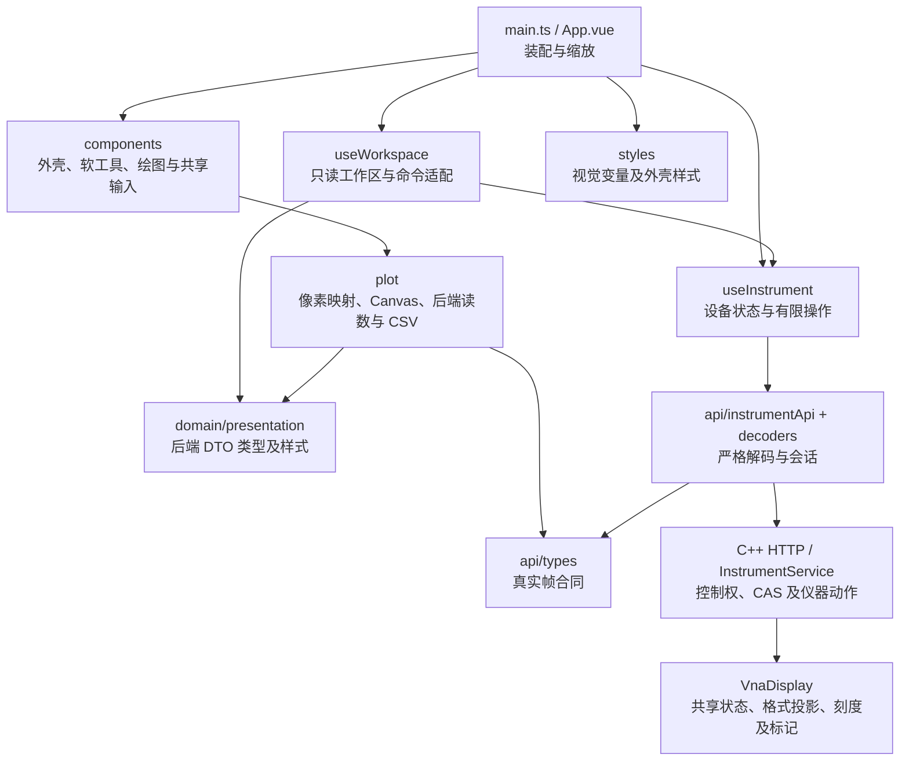

# VnaPro Web 前端

独立的 Vue 3 + TypeScript + Vite 工程，用于仪器采数、配置、校准及控制竞争。界面参考 ZNB8 的仪器布局，显示 RAW A/B 接收波和按配置端口数支持的完整 S 矩阵：四端口为 S11～S44 共 16 项，二端口为四项；所有测量均可选择 Smith、Polar 和 Inv Smith。Cal 提供任意一个物理端口的 OSM 和任意两个物理端口的 TOSM，使用理想 50 Ω 标准模型；每条迹线按后端实际校正结果显示 Cal / Cal Off，原始接收波保持 RAW。界面风格不代表具备罗德硬件或完整 ZNB 功能，SCPI 使用项目已实现的命令子集。完整数学、协议和使用边界见[校准接入与使用](../docs/校准接入与使用.md)。

后端依据 `driver.type` 回报 `NativeSimulator` 或 `HardwareDriver`，硬键栏和工具栏提示读取该状态，不固定标注模拟器。前端不控制噪声；模式、种子和相对幅度只在 C++ 启动配置中用于模拟驱动，真实类型完全忽略模拟配置。

## 安装、构建与运行

需要 Node.js ≥ 22.13 和 npm。首次在本目录安装依赖并运行测试；Windows PowerShell 使用 `npm.cmd`，其他环境可使用 `npm`：

```powershell
npm.cmd ci
npm.cmd test
```

`package-lock.json` 固定依赖。回到仓库根目录构建 `vna_server`，CMake 会自动执行前端构建检查，需要更新时调用 `npm run build`：先执行 `vue-tsc --noEmit`，再生成 `dist/index.html` 和 `dist/assets`。成功后将完整 `dist` 内容复制到**项目根目录的 `release/WebUI`**，并汇总服务、驱动、运行库和配置。部署时复制整个 `release` 目录，直接启动其中的程序，无需指定资源路径或安装 Node.js；默认访问 [http://127.0.0.1:8080](http://127.0.0.1:8080/)。完整步骤见 [自动生成发布目录](../README.md#自动生成发布目录)。

修改页面后直接构建 `vna_server`。源码、public 资源、Vite/TypeScript 配置、包清单或依赖锁变化会重新构建；前端产物缺失、损坏也会重新生成。输入和产物未变化时跳过 npm 构建，仅同步发布文件。类型检查或构建失败会阻止打包。共享 `dist` 的前端生成和复制使用锁串行执行。该流程不自动安装或下载 npm 依赖，缺少 `node_modules` 时需首次执行 `npm ci`；公司离线环境应预先准备依赖。仍可单独执行 `npm run build` 进行前端开发验证。SCPI 专用构建可配置 `-DVNAPRO_BUNDLE_WEBUI=OFF`，并在程序旁的 `vnapro.yml` 中设置 `server.webEnabled: false`。

服务无参数启动，固定读取自身目录的 `vnapro.yml`。`server.ip`、`server.webPort` 和可选的 `server.webIp` 决定 Web 监听地址，`server.webRoot` 指定静态目录，相对路径以程序所在目录为基准。发布包默认加载同目录的 `WebUI`；开发 `bin` 的默认目录不存在时继续使用源码目录的 `WebUI/dist`，填写其他静态目录不回退。驱动、噪声、仪器能力和日志共用这份配置；字段见[网络与驱动配置](../README.md#网络与驱动配置)，修改后重启生效。已有发布配置会保留，对照 `vnapro.example.yml` 合并新增字段。

开发时保持 C++ 服务运行在 `127.0.0.1:8080`，另外执行：

```powershell
npm.cmd run dev
```

访问 [开发页面](http://127.0.0.1:5173/)；Vite 对 `/api` 的请求代理到 `127.0.0.1:8080`，无需跨域配置。改变 C++ 配置中的 Web 地址或端口时，开发代理的目标也需同步调整；发布页面使用同源 API，无需另配代理。`vite.config.ts` 的开发端口固定为 5173。`npm run preview` 仅预览构建的静态页面，没有 `/api` 代理，完整采数验收应从 C++ 服务加载 `dist`。

## 目录与依赖

```text
WebUI/
├─ package.json / package-lock.json  依赖与开发、测试、构建脚本
├─ vite.config.ts                   开发代理及 ES2022 构建
├─ tsconfig*.json                   产品与测试的类型检查配置
├─ index.html / src/main.ts         Vue 挂载入口
├─ src/
│  ├─ App.vue                       装配、软工具路由、画布缩放、下载
│  ├─ api/
│  │  ├─ types.ts                   设备快照、帧、操作的类型合同
│  │  ├─ decoders.ts                设备状态、真实频轴和数组校验
│  │  ├─ displayDecoders.ts         显示状态、格式投影和标记合同校验
│  │  ├─ calibrationTypes.ts        校准会话、集合、命令和标准预览合同
│  │  ├─ calibrationDecoders.ts     校准身份、集合及标准预览边界校验
│  │  ├─ decodeValues.ts            共享 JSON 基础校验
│  │  └─ instrumentApi.ts           HTTP、请求超时、session、requestId
│  ├─ composables/
│  │  ├─ useInstrument.ts           轮询、租约、操作完成与设备读回
│  │  └─ useWorkspace.ts            后端工作区只读适配与命令发送
│  ├─ domain/
│  │  ├─ presentation.ts           格式、刻度、标记、布局及迹线颜色
│  │  ├─ measurements.ts           测量菜单标识及状态文本
│  │  ├─ calibration.ts            校准类型、端口、标准接线及状态文本
│  │  └─ sweep.ts                  服务端能力范围内的扫描草稿校验
│  ├─ components/
│  │  ├─ instrument/               工具栏、硬键、菜单状态栏、图标
│  │  ├─ softtools/                配置、测量、扫描、迹线、校准向导、系统面板
│  │  ├─ diagrams/                 图布局、迹线条、Canvas 容器、标记读数
│  │  └─ shared/FrequencyField.vue  数值与 Hz/kHz/MHz/GHz 单位输入
│  ├─ plot/
│  │  ├─ traceMath.ts              后端投影适配、刻度像素映射
│  │  ├─ canvasRenderer.ts         坐标投影、网格、曲线与参考标记
│  │  ├─ smithMath.ts              Γ 像素投影、屏幕命中、读数格式化
│  │  ├─ smithRenderer.ts          圆形 Smith 网格、曲线与缩放
│  │  ├─ formatting.ts             数值、频率和单位文本
│  │  ├─ exportCsv.ts               当前真实显示帧的 CSV
│  │  └─ index.ts                   绘图模块对组件的接口
│  └─ styles/                      tokens、外壳和软工具样式
├─ test/                           设备状态/竞争与绘图/CSV 合同测试
├─ scripts/test.mjs                编译测试，再用 Node 测试运行器执行
└─ dist/                           构建产物；不提交到 Git
```

依赖向下收敛：组件通过事件交给 `App` 装配，设备写入走 `useInstrument → InstrumentApi`；仪器显示命令同样经 `useWorkspace → useInstrument → InstrumentApi` 写入 C++ 后端。`useWorkspace` 不保存权威状态；绘图模块消费后端格式投影与标记读数，只做像素映射、网格和文本格式化。



## 状态与竞争处理

`api` 只负责传输和解码。run/revision/frame/operation 的 uint64 身份保留为十进制字符串，避免 JavaScript 精度丢失；频轴、有效位及实虚部长度不符合合同时拒绝该响应。每条测量和帧迹线必须明确携带 `kind`、`unit`、`calibration`，并与 `parameter` 及端口一致：RAW 为 `receiver / a.u. / raw`，S 参数为 `sParameter / 1 / uncalibrated` 或 `calibrated`。缺失或矛盾的元数据直接拒绝，不在前端猜测单位或校准状态。状态必须携带 `capabilities`：端口数、最小/最大频率与扫描点数；配置、S 参数和 RAW 端口选择由能力约束。默认仪器为四端口、10 MHz–8 GHz、201 点；二端口配置只显示端口 1、2。token 由服务签发，保存在当前页面的 `sessionStorage`；不会在前端自行生成控制权。

`useInstrument` 维护一个不重叠的轮询周期。在线约每 200 ms 读取状态及帧，断线后约每 1 s 重试；一个周期完成后再调度下一次。控制权空闲时初次连接尝试取得租约，持权页面每 10 s 续租服务的 30 s 租约。释放意图立即停止续租，旧的持权响应不能让页面重新自动抢占。

配置与测量定义携带逻辑 `expectedRevision`。`canConfigure` 和 `canChangeMeasurements` 均允许在 Ready/Running 下提交配置或测量目录修改；CONT 中可编辑频率、点数与 IFBW，前端不自行 Hold/Resume，后端在完整帧边界切换采集计划。两类写操作仍要求控制权，且已有受理操作、只读或故障状态不允许重复写入。写入返回 HTTP 202 仅表示受理：保留 operationId 和受理时的原始 token，观察到完成后再次读取权威状态，再更新生效配置。释放或换 token 后也按原 token 观察已受理操作；遇到不确定的网络失败不会自动重发写入。停止界面轮询只终止 HTTP 观察，不宣称取消设备已接受的任务。

状态的 `revision` 是逻辑配置 CAS 版本，`acquisitionRevision` 是已提交的采集计划版本，`display.revision` 是共享仪器显示版本，`calibration.revision` 是独立校准版本。帧携带实际采集 `revision`、计算时的 `measurementRevision`、`displayRevision` 和 `calibrationRevision`；这些身份及 runId、服务 current 状态全部匹配后才显示 CURRENT。校准变更的受理操作要等对应版本的帧投影读回后完成反馈；HOLD 下也遵循该校准版本门禁。迟到响应保留旧版本并标记 PREVIOUS CAL，不把旧投影冒充新校准；Autoscale 同样拒绝旧校准投影。旧服务完整缺少校准字段时保持只读兼容，并禁用 Cal 能力入口。

`status.display` 返回活动测量、显示集合、布局和每条迹线的 Format/Scale/标记集合/可见性及 `allowedFormats`。每条迹线的 `markers` 保存 M1～M10，`activeMarkerId` 标识活动成员；旧 `marker` 字段由后端从活动成员派生，前端不另存一份仪器状态。`display.diagrams` 返回全部显式图窗、各窗迹线顺序与主坐标迹线，`selectedDiagram` 表示当前图窗；删除后图号可重排，前端不缓存固定图号，也不按格式创建或拆分图窗。`useWorkspace` 仅适配这些读回值，没有本地默认迹线、目录 watch 修复或乐观修改。动作写入 `POST /api/v1/display`，携带 `requestId` 和 `expectedDisplayRevision`，经同一控制租约与操作完成机制执行；`canEditDisplay` 允许 CONT 中操作，旁观窗口禁写但同步显示。刷新重建页面继续读取已有仪器显示状态；不宣称进程重启后的磁盘持久化。

测量目录、显示集合和显式图窗均最多 128 项，这是项目资源预算，不是 ZNB 最大容量。Diagram 菜单 Add Trace 使用 `/api/v1/measurement-actions/add` 添加默认 S21/dB Mag 迹线；单端口时为 S11。工具栏 Trc+ 单击复制活动迹线；将 Trc+ 或 Trace Config 的 Add Trace 拖放到现有图窗，打开 New Trace 参数矩阵，点击参数后以同一个 add 事务提交 `parameter`、目标图窗和打开时的双 CAS。C++ 统一命名、创建、显示和选中，关闭弹框不写设备。当前拖放只覆盖现有图窗，原机边缘分割区域另行规划。Add Trace + Diagram 在同一后端事务中创建新图窗和默认迹线。Trace Config 的 Add Trace 使用 `/api/v1/measurement-actions/clone` 复制活动定义及显示设置；编号由后端选取最小空闲 `Trc<n>`，新增不会替换之前的迹线。图窗右键动作携带目标 `diagram`，不通过浏览器连续发两次写请求实现组合操作。

标题根据实际字体的完整标题宽度与容器可用宽度计算等宽自然槽，优先完整显示信息，不固定三列或四列。同一图窗内统一名称、测量量、格式字段宽度，再由最长可见标题确定槽宽；不跨图窗统一，不使用 `1fr` 把标题拉伸到铺满图窗，单条、两条标题也保留自然槽宽，余宽留空。标题条目与点击区域占满自己的槽位，活动蓝底不随选中文字长短缩短，测量量仍保持独立色块。空间减少时先完整换行；只有整个标题区连一条完整标题都放不下，才按 Ref、Scale Div、RAW 类型、格式的顺序整字段隐藏，放宽后恢复，不把数值截成省略号。全部标题使用相同字段集合以保持对齐，悬停仍可查看完整信息。此隐藏顺序与精确阈值是项目取舍，手册只规定缩小图窗时隐藏部分字段、放大或最大化后恢复。隐藏阈值由实际字体、完整文本和字段内边距测量得出，不能只看一个固定 diagram 像素数。标题自然显示全部行，不用 84 像素上限和内部滚动条截断，不删除迹线或改变归属。当前色板为八色循环，每个图窗重新开始；具体 RGB 是项目参考配色，不宣称完整还原原机出厂色序。标记符号和整行读数使用同一所属迹线颜色，多迹线读数增加 Trc 归属列；每迹线仍独立使用 M1～M10。

`Display` 提供全局 Info Table 的 Show 和 Bottom/Left/Right；默认隐藏、Bottom。Marker 信息字段可按迹线拖入 Table，或用字段右键 `Show Info in Table`；拖回图窗、右键 `Show Info in Diagram` 及 Display 的 In Diagram 同样提交后端动作。Table 采用无列头的信息字段块，行顺序为活动圆点、M 编号、Trc 名、频率及响应值；没有在前端重算 Marker 值。全局 Table 读取全部保存图窗，Maximized 不删除其他字段。

相关设置由 `status.display.infoTable`、`annotations`、`diagrams[].markerInfoVisible` 及 `presentations[name].markerInfoLocation` 读回。Marker Info 控制所属图窗字段显隐，Active Trace Only 根据全局活动迹线过滤；Marker Stimulus Info 仅控制 Marker 频率，不改变 Channel footer。Font Size 为后端保存的 80%～170%（默认 100%），应用于标题、通道列表和信息字段。隐藏 Table 保留迁移归属，移动不自动开启容器；页面先开启 Table 再允许迁入，刷新和观察窗口读取同一状态。

图内信息字段不设置内部滚动条；密集内容由用户迁入独立 Table。Table 底部最大高度为工作区 35%，左右布局基准 300 px、最大宽度 40%，溢出内容在 Table 滚动；这些 CSS 范围是项目像素布局，不是原机配置。原机确切标题列数、自动密度算法及隐藏后自动恢复规则没有明确证据。容量、色数及标题密度见[迹线与标记核对](../docs/research/ZNB8迹线与标记行为核对.md)，本期合同见[Info Table 核对](../docs/research/ZNB8信息表与标题排版核对.md)和[操作验收](../docs/InfoTable操作验收.md)。独立 Info Window、Bandfilter 和 Reference/Delta 信息仍未实现。

Delete Diagram 使用 `/api/v1/measurement-actions/delete-diagram` 原子删除该图窗及其迹线定义，不能删除最后一个图窗；Delete Trace 不能删除最后一条迹线，并清理因删除变空的图窗。Overlay All 和 Split All 分别发送 `overlay`、`split` 显示命令，由 C++ 合并全部迹线到目标图窗或为每条迹线创建独立图窗。前端不自行命名、分配容量或改变归属。默认帧请求采用后端已提交显示集合；S 参数请求发送规范参数文本，由后端解析接收端与源端，Center/Span 请求只发送原始意图。

图窗管理位于 Display → Diagrams：Active Diagram 选择已保存的图窗，Add Trace + Diagram 创建默认迹线及新图窗，Delete Diagram 删除当前图窗及其全部所属迹线和标记。Trace Config 的 Add Trace + Diagram 则复制活动迹线的测量量、格式、刻度和标记到新图窗；Add Trace 在源迹线同图复制。两种新增入口遵循 ZNB 的不同语义，不新增独立空白图窗按钮。图窗编号、新迹线名称、活动选择及归属均由 C++ 分配和保存。

Trace Config → Diagram 可将已有活动迹线移入另一图窗，提交 `select` 命令的 traceName 和 diagram；后端原子移动并激活目标，保留原来的格式、刻度与标记，不修改采集计划。移动后为空的源图窗继续保留，可再次填入迹线或删除。下拉在请求期间维持设备读回值，操作完成后由共享快照更新，观察窗口和刷新读取同一归属。删除图窗连续重编号；若删除活动图窗，优先回退到第一剩余图窗及其主迹线，这是项目确定性选择规则。最后图窗、最后测量与过期版本由后端保护，失败不会部分删除。

全局只有一个活动图窗，每个非空图窗仍保存自己的 `primaryMeasurement`：当前图窗的主迹线标题为蓝色，其他图窗记住的主迹线为灰色。各窗坐标和曲线置顶依据本窗主迹线；点击恢复该迹线后由 C++ 更新全局选择。删除活动迹线或解除其显示关联优先留在当前图窗，使用其剩余主迹线；原图被删除时采用回退图窗保存的主迹线，不覆盖其他图窗的活动记忆。局部主迹线被删时采用图内第一剩余成员，这是项目回退规则，手册未明确下一条或上一条的算法。默认按每图成员顺序循环配色，删除前面的成员后后续成员换色符合 ZNB 出厂行为；格式、刻度与 Marker 仍按名称保存，不随颜色重新分配。依据与边界见[图窗活动迹线及删除核对](../docs/research/ZNB8图窗活动迹线与删除行为核对.md)。

标记请求使用 `action:"marker"`、`markerAction:"update" | "add" | "select" | "allOff"`。update 可附 `markerId`（1～10）及启停、频率、原始下标、步进或离散模式；select 必须指定编号并启用该成员，add 由后端分配最小空闲编号，allOff 关闭当前迹线所有成员并保留属性。Remove Marker 等同于针对活动编号的 update enabled:false，关闭后仍保留位置和 Discrete 设置，可再次启用。除 update 外不混入位置或状态更新，位置操作携带 acquisitionRevision。SCPI 的 `CALC1:MARK1`～`MARK10:STAT/X/Y/DISC` 和 `CALC1:MARK:AOFF` 操作同一后端集合，缺省 MARKer 编号为 1，查询不读取浏览器临时预览。

Scale 和 Marker 输入按活动迹线、活动标记编号及已应用显示设置同步；200 ms 帧轮询即使返回新的对象，也不能重置用户尚未应用的刻度或频率草稿。

工具栏和 Scale 面板的 Autoscale 发送一次后端操作，并附 `acquisitionRevision`；后端使用完整原始帧计算并提交刻度。随后噪声帧不会改变已保存范围。格式值、无穷/未定义状态和 Smith 半径适配由后端提供，前端不执行复数幅度、相位、阻抗换算或频点吸附。极小范围的 `Δ` 仅是坐标标签显示方式。

## 校准操作与状态

Cal → Start Cal → Start (Manual)… 打开两步设置弹框：Ports and Type、Connectors and Cal Kits。蓝色端口块选择实际物理端口，类型矩阵只允许单端口 Refl OSM 和双端口 TOSM；其余类型禁用。第二步按端口列展示只读的 Ideal 50 Ω 标准模型，机械 Connector/Gender、导入 Cal Kit、Sliding Match 尚未实现，不能据这些界面位置推断能力。双端口可选 Isolation，未测隔离时明确假定串扰为零。

Start 后进入正常仪器工作区的 Calibration 采集阶段：上方同时显示当前标准的 dB Mag 与 Phase，下方按端口排列 Open、Short、Match 和 Through 标准按钮。尚未采集时只显示网格与连接提示；采集成功后通过只读 `GET /api/v1/calibration/preview?sessionId=…&stepId=…` 显示服务保存的未经校正标准及后端 dB/Phase 投影，不生成典型标准曲线。两图共用真实频轴、有效位与采样身份，最多显示 2001 个真实点并保留原采样索引；浏览器只做像素映射。迟到、步骤或会话不符、校准版本不符的预览直接丢弃。DUT 的测量目录、图窗、刻度和标记仍由原工作区保存，校准图不改写它们，采集工作区期间也不能从隐藏的 DUT 图导出 CSV 或修改显示。

每次标准按钮操作由服务端取得完整新扫描，前端不拼接 Single/Hold，不上传显示抽取后的迹线当标准。HTTP 202 期间不显示成功；读回步骤的 captured/runId/frameSeq 后才显示完成勾选，可逐项重测。状态栏区分创建会话、采集具体标准和应用校准；单项采集完成不表示整个校准已应用。Restart Sweep on Std. Meas. 固定 On，Continuous Cal Sweeps 固定 Off；Abort 禁用，因为本版不能中止已受理的扫描。全部必需标准采集完成后输入集合名称并 Apply，只有服务端求解成功才生成并启用集合。

校准收集期间禁用普通扫描和配置/目录变更；草稿向导冻结打开时的采集版本，会话阶段防止对已替换的 sessionId 提交。已保存标准的预览读取失败可用“重新读取预览”只读重试，不重新采集。全零 dB、未定义相位及没有有效样本的标准保留空曲线并显示对应说明。Cancel 丢弃工作会话并保持 HOLD；故障后仍可在持有控制租约且无待处理操作时发 Cancel，其他校准动作继续受健康状态门禁约束。无控制权时 Close 仅关闭向导并明确保留服务端会话，不能伪装为已取消。服务端结束会话后整段向导关闭，不重新打开第一步。

Use Cal 显示 User Cal Active、实际端口覆盖、不适用原因及 Cal Manager。User Cal Active 的有效 On 状态同时要求 enabled 和 compatible；请求 On 但配置不兼容时显示 Off 和未生效原因，可清除启用请求。Cal Manager 的 Use Set 只选择集合并保留启停意图，Import 只加入服务端内存池，不暗中启用。选择兼容集合后通过 User Cal Active 启用；删除当前集会停用。集合摘要展示自身校准频率范围、点数、IFBW 与 Isolation 假设，不拿当前扫描设置替代旧集合属性。Export/Import 使用 VnaPro schema 1 JSON，重启后可导入恢复；不兼容 SNA/ZNB 专有 `.cal` 文件。

按实际帧迹线判断 Cal / Cal Off：全局 User Cal On 不表示所有端口都校正，例如 P2/P4 集不覆盖 S21。RAW 不应用误差校准。浏览器只显示后端的复数结果、格式投影和标记；SCPI SDATA 使用同一校正路径，RDATA 可读取未经校正结果。模拟器没有物理换接标准的模型，noise 变化导致的可解集合也只验证流程，不能作为实机精度依据。

## 操作与显示

全部图窗排列尺寸来自 C++ 的 `display.gridColumns/gridRows`，前端不自行计算列数；整组矩阵在同屏显示，最大化后返回恢复保存的矩阵。窄窗整项隐藏通道底部中间的点数 / IFBW，保留起止频率。

基准画布为 1280 × 800。工具栏高 42 px，底部菜单状态栏高 32 px；主区 848 px、软工具 272 px、右侧两列硬键 160 px。软工具的标签列在右侧，宽 70 px，文字横排。视口改变时整体等比缩放；按 Esc 收起软工具，主区扩大到 1120 px，点击硬键重新打开。

新服务启动后已有活动迹线 `Trc1 / S21`，使用仪器配置的完整频段、默认 201 点；单端口配置使用 S11。无已恢复状态的新服务器默认自动启动 CONT；`instrument.sweep.defaultSweepMode` 可设为 HOLD，此时等待 Single sweep 或 Continuous 才获得曲线。服务领域初始化仍为 HOLD，服务器在监听前应用配置的启动模式。浏览器刷新读取已有设备目录和配置，不重新创建 RAW a1,1，也不覆盖其他客户端已选择的测量。

1. 在 Setup 或底栏取得控制权；若 SCPI 或另一页面持权，本页可只读查看。
2. 在 CONT 或 HOLD 下设置通道采集参数：Start/Stop/Center/Span 硬键打开 `Stimulus → Stimulus` 的频率设置；`Channel → Sweep → Sweep Params` 设置 `Number of Points`；`Channel → Power / Bw / Avg → Bandwidth` 设置 `IF Bandwidth`，软工具标题为 `Pwr Bw Avg`。每页保留独立输入草稿，Apply 只发送本页字段并等待后端完成及读回，切换菜单或帧轮询不会清除尚未应用的草稿。允许 Start = Stop，或把 Span 设为 0，进行 CW 定频采样；返回频轴允许同一频率重复。
3. Meas 的 S-Params 页保留 S11/S12/S21/S22 四个快捷按钮，点击上方参数编号按钮（例如 21）打开 S-Parameters 矩阵弹框：四端口 4×4 共 16 按钮，二端口 2×2 共 4 按钮。点击参数即提交，成功读回后关闭，取消不修改。选择修改活动迹线的测量量，不创建新名称或图窗；All S-Params 先弹出删除确认：Yes 在 C++ 一次替换全部旧定义和图窗，四端口建立 16 条迹线 / 4×4 图窗、二端口 4 条 / 2×2；No / X / Esc 不写设备。扫频与触发配置保持，新迹线对角反射使用 Smith、其余传输使用 dB Mag，圆图半径为 1、矩形默认 −90…10 dB，Marker 关闭。Sij 在激励源 j 的同帧波量上计算 `bi/aj`，例如 S34 使用源 4 的 `b3/a4`，不能颠倒接收端与源端。Wave 页提供六个标准两端口波量快捷选择；More Wave Quantities 可按仪器能力指定完整 a/b 接收与源端口。二端口不提供 S33/S44 等选项，HTTP/SCPI 绕过界面的越界请求仍由 C++ 拒绝。CONT 中可以直接切换测量量；已有计划覆盖时复算同一完整帧，缺少源或接收机时由后台在完整帧边界更新计划，保持 CONT 和 runId。菜单依据见[四端口原机核对](../docs/research/ZNB8四端口S参数菜单核对.md)。
4. Sweep 硬键默认打开 `Sweep Params`；在 `Sweep Control` 页签中，Single sweep 采一帧并进入 HOLD，Continuous 连续采集，Hold 等待当前完整帧收尾。`Trigger` 页签和 Trigger 硬键显示触发源及 Manual trigger；仅在实际 MAN 触发并已 armed 时允许手动触发。
5. 点击可见曲线或上方迹线标题选择当前迹线；点击空白区只激活图窗及其上次活动迹线，不启用或移动 Marker。Format、Scale、Marker 改变后端共享显示设置。Trace Config 管理测量目录和共享 Display 集合，Add Trace 由后端复制并命名，Delete 删除定义；全部仪器写动作要求控制权，CONT 中仍可执行。另一观察窗口及 SCPI 能读取相同状态。`Marker → Markers` 用 Mkr 1～10 选择/启用普通标记，Add Marker 新增下一空闲成员，On 单独关闭当前标记，All Off 关闭活动迹线全部标记。点击图上符号或右上角读数行只选择所属迹线和活动 Marker，保留坐标；从 Marker 符号开始拖动才提交位置变化。
6. 在 File/Print、Tools 或工具栏导出当前显示的 CSV。

点数与 IF 带宽菜单位置依据 [ZNB8 官方手册核对](../docs/research/ZNB8点数与中频带宽菜单核对.md)。本项目保留 Apply / Reload 作为草稿提交与重读交互，这组按钮并非原机软工具的复刻。CONT 下配置修改由后端在完整帧边界执行，并复核控制权及版本；功率、数字 IF 滤波器和平均尚未实现，不提供可操作的占位控件。

图窗采用 10 × 10 网格，网格铺满绘图区，仅留 1 px 边线；纵轴数值和单位叠在网格内，普通刻度使用 `#4b5f6c`，如 `10dB` 不增加数值与单位之间的空格。频率 Start/Stop 显示在基准 20 px 黑色通道行，`Bw` 使用实际 IFBW，扫频点数使用真实配置或当前帧；不填充未实现的 Pwr。基准 18 px 迹线条紧凑排列，如 `Trc1 S21 dB Mag 10 dB/ Ref 0 dB`，当前迹线选中呈 `#0d75bf` 蓝底。图内文字使用 Tahoma/Arial 近似参考截图，未确认原机字体。每条可见迹线保留自己的参考虚线与右侧同色向左三角；当前坐标所对应迹线的 Ref 虚线及对齐刻度用浅色 `#dbe2e6` 强调，其他叠加迹线的参考虚线使用自己的颜色。普通标记使用带编号的小填充三角；图内或 Info Table 按已启用成员显示读数，使用实心 `#323f48` 背景，整行跟随迹线色，圆点指示活动标记。频率以工程单位显示六位小数，对应的实际采样索引不变，高精度提示仍可读取。靠近顶部时三角反向、文字移到下方；频率端点处目标向内收，尖点仍对应真实采样位置，单击不会跳频。

刻度文字直接叠在绘图区，不添加半透明背景。Canvas 位图按最终屏幕尺寸和设备像素比生成，显示边界也对齐到物理像素，避免非整数缩放时再次插值；绘图偏移补偿保持样本和标记在原绘图区的实际位置。网格、边线和参考虚线占 1 个物理像素，曲线保持 1 个屏幕 CSS 像素宽，不因选中或整机缩放加粗。视口尺寸或设备像素比变化时重新绘制，包括 HOLD 状态。曲线保留真实样本及无效点断线，不通过平滑或滤波改变采集数据。

图窗右上角 `▼ 图号` 菜单提供 All Diagrams、Maximized、Overlay All、Split All、Add Trace、Add Trace + Diagram、Delete Diagram 和 Add Marker。All Diagrams 显示所有后端图窗，Maximized 只放大当前图窗且保留完整迹线归属。Split All 为每条迹线创建独立图窗，不限为四个；所有图窗在同一工作区内按后端行列数排列，不出现图窗滚动条。小图窗按像素间距减少刻度文字，保留参考刻度及原有十格网格；最大化后恢复完整刻度文字。Overlay All 允许矩形与圆图共窗，可见格式所需背景同时显示，轴刻度仍由图窗主迹线决定，每条迹线按自己的格式投影。矩形背景只画一次，圆图按格式与最终半径去重；先画全部背景，再画迹线，避免背景覆盖曲线。此去重规则是项目像素合同，手册第 796 页原图确认矩形与 Smith 背景并存。无帧时仍从后端呈现快照显示背景；隐藏某格式的最后一条迹线时移除该格式背景，无可见迹线时保留主坐标背景。切换 Format 不创建、删除或移动图窗。工具栏最大化按钮切换 All Diagrams/Maximized；菜单支持方向键、Home/End、Enter、Esc 和外部点击。活动曲线最终绘制、活动标记在更高像素层显示，标题和目录顺序不改变。配色按每个图窗重新开始并循环使用颜色，颜色数量不限制迹线数量；这是本项目选定配色，ZNB 手册允许用户配置颜色和字体。

初始对数刻度按手册示例采用 −90…10 dB、10 dB/div、Ref 0 dB 在第 9 格。Autoscale 才放大实际数据的细小变化；极小变化采用 `Δ` 刻度，迹线条和刻度提示保留真实 Ref。Scale 的参考位置从底部 0 到顶部 10；释放 Marker 拖动和方向键请求后端使用完整原始帧选择离散频点，并携带目标 markerId；普通图窗单击不发送位置命令。在 Marker 中输入频率则遵循该成员的后端 Discrete 模式。聚焦图区后，←/→ 移动一点，Shift 移动十点，Home/End 到两端。Format 菜单包含十三种原机格式：dB Mag、Phase、Smith、Polar、SWR、Unwr Phase、Lin Mag、Log Mag、Real、Imag、Inv Smith、Delay、Delay Derivation；旧 Real/Imag 仅保留协议兼容。Log Mag 刻度使用正幅值 min/max，每格跨度为 decade，Ref 与刻度标签仍为正幅值；非正幅值保留读数，但不绘制不存在的对数坐标。Delay 的单位为 s，Delay Derivation 为 s²；RAW dB 参考 1 a.u.，S 参数为 `20 log₁₀ |S|`，线性幅度和实虚部使用无量纲单位 `1`，相位使用度数。RAW 迹线条保留 RAW 标签；S 参数按后端结果显示 Cal / Cal Off，完整状态在测量提示及可访问文本中保留。无量纲 S 参数校准不改变其单位，不标成 dBm。

复数点的 `valid` 表示后端采样或比值计算有效，与当前格式能否给出有限显示值不同。有效的 `0+0i` 在线性幅度下为 0，dB 为 −∞，相位未定义；相位曲线留空，标记显示 `—`，CSV 保留实虚部 0 和 `valid=true`、显示值留空。这些格式结果及状态由 C++ 后端投影返回，浏览器不重复计算。

Smith、Polar 和 Inv Smith 可用于所有复数测量。S21 与 RAW 的圆图显示复数 Re/Im；只有反射 S 参数提供具有物理意义的归一化阻抗或导纳。Inv Smith 改用导纳网格，不翻转复数迹线。圆心是复数 0；超出单位圆的值保留真实坐标，不钳制或误标无效。宽屏、窄窗和非整数缩放保持圆形。Scale 的 Outer Magnitude 控制显示半径，最小为 0.01；Autoscale 根据有效点适配一次并固定半径，后续帧不能改变它。圆图为活动坐标时，各圆图迹线、标记及命中采用活动圆图半径；矩形网格下的圆图迹线使用自己的保存半径。所有刻度与格式修改均由 C++ 保存，格式变化不改变图窗归属，也不承诺恢复旧格式刻度。

Smith / Inv Smith 的单位圆屏幕半径小于文字尺寸的 12 倍时，只显示 `0、1、∞、±1` 坐标文字，放大后恢复完整文字；仅减少标签密度，网格、曲线、标记位置和后端半径保持。这是项目可读性规则，不宣称原机采用同一阈值。

Polar 的默认标记读数为幅值 `|z|` 与相位（度），曲线位置仍采用复数 Re/Im。后端分别下发 `markerValues/markerSecondaryValues/markerValueStates/markerSecondaryStates`，拖动直接读取这组幅相投影，不在浏览器执行 hypot 或 atan2。零幅值保留 0，未定义相位显示 `—`；该点仍可在圆心选中。旧响应完整缺少四数组时保留曲线，拖动不借用旧标记的读数；尚未提供单独 Marker Format 的显式设置。

曲线点击只做屏幕几何拾取，读取与绘图共用的后端投影，不计算测量值或保存选中状态。项目采用 6 CSS px 容差，先选择最近线段，同距时活动曲线及后绘制曲线优先；隐藏曲线、无效断点和裁剪外区域不参与。该点击曲线交互有 Keysight 官方依据，像素算法属于项目规则，不能称为 ZNB 原机命中算法，详见[点击交互核对](../docs/research/ZNB8图窗点击交互核对.md)。

Smith 图的普通曲线点击选择迹线，背景点击不改 Marker。已有 Marker 专用拖动按屏幕距离命中渲染点，再通过 `sampleIndexes` 发送其原始索引和 markerId；实际标记计算由后端执行。方向键发送原始点 step，Home/End 发送完整帧两端索引，抽取不改变移动单位。各标记的独立读数可落在展示数组以外或两个原始频点之间。Γ 与归一化阻抗均读取后端值，不假定物理参考阻抗；校准状态取自对应迹线，选择 Smith 格式本身不启用校准。

标记拖动期间按浏览器绘制帧同步更新三角形和对应的右上角 X/Y 读数行，多次指针事件合并为一帧一次更新，不逐事件写仪器或重画曲线；其他编号保留自己的读数。预览读取同一个已下发采样点的后端格式投影，不在前端重算 S 参数、dB、相位或阻抗。CONT 中固定本次手势的几何、读数和原始采样索引，正常采集轮询继续。松手仅提交目标编号一次后端命令，预览保留到完成读回，失败恢复后端位置；Esc、指针取消或捕获丢失、失去写权限及格式/坐标几何改变会撤销未提交的拖动。临时预览仅属于本页，正式位置仍由 C++ 保存，另一窗口、刷新及 SCPI 读取同一已提交状态。显示数组抽点时，预览取已下发点，松手后 C++ 仍在完整帧吸附到更精确的位置。

Smith 的 Γ 和归一化阻抗均由后端随正常帧下发，拖动期间直接选点显示，不新增预览请求。需重新编译并重启服务以提供逐点阻抗数组；旧服务缺少数组时仍可预览 Γ，阻抗显示无效状态，不能冒用之前标记的数值。

所有图来自一个完整帧。无帧仍显示网格；断线、配置已变或新 run 尚未发布数据时保留旧帧并明确标记。旧帧的频轴和点数来自该帧，IFBW 显示 `—`，因为该 API 帧不携带采集带宽，不能用新配置冒充旧数据的带宽。

Web 单条最多返回 10001 个真实点，总迹线采样预算为 40004（2026-10-14 更新）；常用一至四条迹线保留全部扫频点，请求 N 条时共同绘图点数不超过 `min(10001, floor(40004 / N))`，仅超预算时抽点并保留端点，画面显示原始/展示点数。该限制是本项目资源策略，不是 ZNB 的原机显示规则。曲线和 CSV 使用这些真实展示点及其原始索引；所有标记使用后端完整帧结果，不受显示抽取限制。CSV 保存 calibrationRevision，逐行区分 raw、uncalibrated、calibrated。参考波过小或无效时，后端将对应 S 参数点标为无效；图线断开、标记显示 Invalid point，前端不补造比值。SCPI 读取完整扫描数组。Reference/Delta/Coupled 标记、RF 开关和预设尚未实现，相关入口禁用。普通多标记的交互依据见[ZNB8 官方行为核对](../docs/research/ZNB8迹线与标记行为核对.md)，不宣称完整标记能力 1:1。

CSV 使用 schema 4，记录采集、目录、显示版本、抽取信息及后端 Re/Im、格式投影。追加 `source_index,display_state,secondary_state`；移除前端计算的逐点归一化阻抗列。`display_value` 与 `display_imaginary` 直接使用后端 primary/secondary 投影，Smith 对应 Γ 实虚部；负无穷写为 `-Infinity`，未定义留空并保留状态。原始有效位与格式状态分离。读取旧格式的程序必须检查 schema/表头。

## 验证与界面依据

2026-10-14 校准第二轮验收通过前端 **284 项**及 Vue/TypeScript 检查。设置弹框和采集工作区逐页对照 [ZNB User Manual v74，第 580、582、585 页](https://scdn.rohde-schwarz.com/ur/pws/dl_downloads/pdm/cl_manuals/user_manual/1173_9163_01/ZNB_UserManual_en_74.pdf#page=580) 的原始嵌入图，核对类型矩阵、端口列、双图与标准 dock 的区域组织。真实模拟服务验收未测空图、Open/Through 保存身份与正确 S 参数、取消后的 DUT 工作区恢复及控制权释放。窄屏采集工作区沿用整体仪器画布缩放，保留所有区域，但不据此声称适合移动触控；前两步弹框按屏宽适配。校准件物理模型、其他方法、可配置标准迹线菜单及独立 Cal Manager 原机表格仍有能力或布局差异，不宣称整套 ZNB 1:1。

`npm test` 覆盖严格解码、uint64 身份、202 等待与权威读回、控制租约、旧响应及不确定写入竞争；共享工作区的两个观察器与刷新、所有动作不乐观改状态、后端 displayRevision 竞争、格式投影及完整帧标记读数、原始 sampleIndexes 与 CSV schema 4 均有回归。渲染测试覆盖网格/标记几何、非方形 CSS 缩放与 DPR、屏幕命中及无效断线。格式数学、Autoscale 和标记插值移至 C++ VnaDisplay 的测试职责；前端用与原始复数刻意不同的投影验证没有本地重算。`npm run build` 负责 Vue/TypeScript 类型检查和生产构建。HTTP/SCPI 共享状态与真实浏览器另由集成测试验收。

2026-10-13 的 All S-Params 验收通过前端 **251 项**、CTest **53 项**及生产构建。确认框默认聚焦 No；打开不写入，取消或销毁使旧确认意图失效，重新打开不能借用旧回调。提交携带打开时的目录 / 显示双版本，等待终态及权威读回，失败保留原因。实际二端口为四图、四端口为十六图，刷新与最大化切换保持 C++ 保存的矩阵；紧凑图窗按像素间距减少刻度文字，放大后恢复，不改变后端刻度或采集数据。

同日混合背景及整组格式补充验收：前端 **262 项**、CTest **53 项**及生产构建通过。实际主窗口同图叠加 Smith 与 dB Mag，切换活动迹线仍保留两个背景，轴刻度按主迹线改变；恢复原活动迹线后，原有 11 条定义 / 9 条显示迹线、Marker 与显示槽均保留。隔离二 / 四端口服务经确认后显示对角 Smith、非对角 dB Mag，刷新保持；SCPI 格式、Marker 读数与 HTTP 复数及阻抗投影另用同一 HOLD 完整帧的原始波独立计算核对，驱动未改。

通道菜单测试执行真实 `ChannelSettingsSofttool.vue` 的 setup，覆盖三页字段隔离、原始 Center/Span 意图、轮询保留草稿、控制权/待处理操作限制、CONT 配置提交与无效点数拒绝，以及异步提交期间新编辑不会被读回覆盖。

标记回归覆盖每帧事件合并、释放单次提交、取消及失败恢复、冻结 Smith 原始索引和屏幕几何。实际客户端另验证显示操作状态先到、旧投影晚到时仍保持提交等待，直到匹配版本的投影读回；投影读取失败只重试读取，不重复写命令。无帧、空显示集合及 HOLD 保留旧采集帧仍可完成显示设置。

2026-10-12 的菜单与拖动复验通过 72 项前端回归和生产构建。隔离 TDC1VN10 噪声模拟服务中，点数单独改为 401 后 IFBW 仍为 1 kHz，再单独设置 IFBW 为 10 kHz；菜单草稿切换保留并提示旧配置版本。真实浏览器验证矩形与 Smith 拖动，CONT 下 Smith 一次手势使显示版本从 6 增至 7，runId 和采集版本均保持 3；M1 从 5.902625 GHz 改到 1.048700 GHz，独立只读窗口及刷新保持同一位置。

同日补充右上角实时读数回归后，前端 97 项与 C++ 39 项测试通过，生产构建通过。真实组件在 pointermove 后、松手前验证 X/Y 和三角形同步，未调用提交入口且正式 Marker 未变。浏览器对数图预览读数从 `4.005000 GHz / −26.3456 dB` 改到 `5.962550 GHz / −26.1355 dB`；Smith 预览同时更新 Γ 与阻抗，松手后正式频率为 `1.088650 GHz`，显示版本仅从 6 增至 7，runId 保持 1。

2026-10-10 的绘图复验使用独立模拟服务、seed 42 的 401 点噪声帧，覆盖 1280 × 800 / DPR 1、1440 × 900 / DPR 1、1024 × 640 / DPR 1、1280 × 800 / DPR 1.25 和 DPR 2。四图窗的网格横截面均为 1 列物理像素，颜色保持 `#4b5f6c`；刻度背景透明，HOLD 下改变视口仍正确重画。M1 与实际曲线样本的最大差为 0.042 个物理像素；显示操作未触发设备配置或扫描写入，冻结帧保持一致，页面无脚本错误。

布局依据为 [ZNB Getting Started v70，第 37–40 页](https://scdn.rohde-schwarz.com/ur/pws/dl_downloads/pdm/cl_manuals/getting_started/1316_0062_01/ZNB_GettingStarted_en_70.pdf#page=37) 的工具栏、硬键、软工具及底部菜单，以及 [ZNB User Manual v74，第 90、94、803 页](https://scdn.rohde-schwarz.com/ur/pws/dl_downloads/pdm/cl_manuals/user_manual/1173_9163_01/ZNB_UserManual_en_74.pdf#page=90) 的迹线、参考线、标记和逐图配色规则。[参考图档案](../docs/reference/znb8/README.md) 保存 PDF 原始嵌入图、完整页面和网上实机照片，并注明来源及固件差异。参考项目 `I:\ai\cc\VectorNetworkAnalyzer\frontend` 只作只读比较，主要核对其网内刻度、紧凑迹线条及 Marker 布局；未移植其设备状态和通信逻辑。参考图片不作为页面资源发布，界面使用 VnaPro 自有文字与图标。
