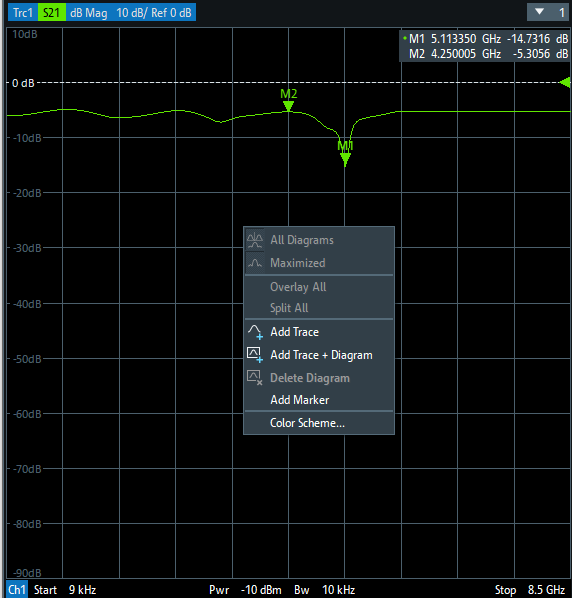
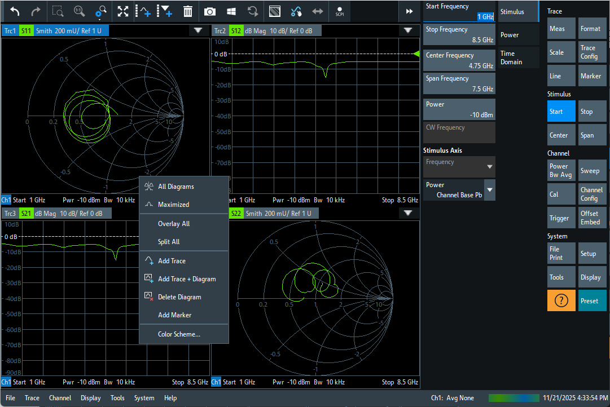
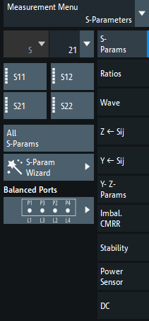

# ZNB8 界面参考档案

本目录保存可核对的官方手册原图、完整页面和公开实机照片，供 VnaPro 前端比对布局。它们是设计参考，不进入 `WebUI/public` 或产品构建。归档日期：2026-10-10。

复刻必须先固定软件版本和显示配置。ZNB8 的外观会随固件、颜色方案、字体大小、软工具开关和图窗布局改变，不存在从所有照片共同推出的一套唯一配色。本项目以 Getting Started v70 / User Manual v74 的灰色软件外壳为主要视觉基线；旧蓝色界面照片只辅助核对结构。资料中的 S 参数、Smith 图和校准状态属于原机示例，不能作为 VnaPro 已实现这些测量功能的依据。

## 来源与版本

| 资料 | 型号与版本 | 用途 |
| --- | --- | --- |
| [官方 Getting Started v70](https://scdn.rohde-schwarz.com/ur/pws/dl_downloads/pdm/cl_manuals/getting_started/1316_0062_01/ZNB_GettingStarted_en_70.pdf) | 2026 年版权，封面适用型号包含 ZNB8 两端口、四端口；文档版本 70 | 整页软件布局、工具栏、硬键、软工具和拖动 trace 示例 |
| [官方 User Manual v74](https://scdn.rohde-schwarz.com/ur/pws/dl_downloads/pdm/cl_manuals/user_manual/1173_9163_01/ZNB_UserManual_en_74.pdf) | [官方手册入口](https://www.rohde-schwarz.com/nl/manual/rs-znb-user-manual_78701-29151.html?change_c=BE)标注 v74、FW V4.25、2026-07-21；封面适用型号包含 ZNB8 | 单图窗、trace/marker/channel 信息条、颜色配置 |
| [官方历史 ZNB8 产品图](https://cdn.rohde-schwarz.com/pws/product/z_1/znb/ZNB8-Vector-network-analyzer_46216_01b_w1280_hX.jpg) | 面板可读为 ZNB8 四端口、9 kHz–8.5 GHz；固件未知 | 旧版实机界面结构。当前 bargains 网页已经更换产品内容，不能用它证明这张旧图；出处仅记录官方历史 CDN 地址 |
| [eBay ZNB8 实机照片](https://www.ebay.com/itm/256873950534) | 面板可读为 ZNB8 四端口、9 kHz–8.5 GHz；固件未知 | 上下两图窗的真实使用状态；[原始图片地址](https://i.ebayimg.com/images/g/9bEAAOSw5kdn5qR5/s-l1600.jpg) |
| [官方 ZNB 系列产品图](https://www.rohde-schwarz.com/products/test-and-measurement/vnas/rs-znb-vector-network-analyzer_63493-11648.html) | 面板频段为 100 kHz–43.5 GHz，属于原 ZNB 系列，**不是 ZNB8**；固件未知 | 辅助核对同系列软工具、叠加 trace、marker 布局，不能证明 ZNB8 型号专属能力 |

实机照片上的屏幕时钟分别显示 2013、2023 年，不等于固件版本或照片拍摄日期。本目录没有把 ZNB3000、ZNA、ZVB 的照片混入 ZNB8 主基线。

另查到 R&S 署名的 [2011 年 ZNB 操作界面文章](https://www.microwavejournal.com/articles/11119-new-network-analyzer-generation-sets-the-pace)，其中 Figure 1 是无机壳的 GUI 特写，文章介绍了软工具隐藏与拖动 trace 的操作。其原图服务器返回 HTTP 403，因此只保留来源链接，没有归档这张图，也没有绕过访问限制。

## 优先核对这三张原图

**单 Cartesian 图窗，572×598，User Manual v74 第 90 页。** 网格从左边缘附近开始，Y 轴文字在网格内部，黑色 channel 信息条位于底部。截图中间的右键菜单是示例操作状态，不应出现在默认界面。



**完整四图窗界面，1081×722，Getting Started v70 第 37 页。** 四窗里含 Smith 示例；只用来核对布局、间隔、颜色和控件位置，不代表 VnaPro 应显示假 Smith 数据。



**多 trace 信息条，693×51，User Manual v74 第 91 页。** 多条 trace 紧密排列，活动条为蓝色，测量量小色块和曲线颜色对应。


## 原图索引

`manual/` 导出 PDF 内嵌图像的原生像素，不放大、不重绘、不美化。这里的像素尺寸是文档内嵌图片尺寸，不能当成仪器物理显示器分辨率。

| 文件 | 像素 | 内容 / 来源页 |
| --- | --- | --- |
| [gs-v70-p037-main-quad.png](manual/gs-v70-p037-main-quad.png) | 1081×722 | 完整四窗界面 / GS 37 |
| [gs-v70-p038-toolbar.png](manual/gs-v70-p038-toolbar.png) | 574×30 | 工具栏 / GS 38 |
| [gs-v70-p039-hardkeys.png](manual/gs-v70-p039-hardkeys.png) | 115×545 | 虚拟硬键 / GS 39 |
| [gs-v70-p040-softtool.png](manual/gs-v70-p040-softtool.png) | 249×396 | Lines 软工具，内容在左、标签列在右 / GS 40 |
| [gs-v70-p046-add-trace.png](manual/gs-v70-p046-add-trace.png) | 805×589 | 添加 trace 拖动目标 / GS 46 |
| [gs-v70-p047-figure-1.png](manual/gs-v70-p047-figure-1.png) | 501×371 | 拖动分窗示例，含高亮目标 / GS 47 |
| [gs-v70-p047-figure-2.png](manual/gs-v70-p047-figure-2.png) | 409×317 | New Trace 对话框 / GS 47 |
| [gs-v70-p048-marker-placement.png](manual/gs-v70-p048-marker-placement.png) | 511×360 | Marker 放置 / GS 48 |
| [gs-v70-p048-marker-strip.png](manual/gs-v70-p048-marker-strip.png) | 505×68 | Marker 信息条 / GS 48 |
| [um-v74-p090-single-cartesian.png](manual/um-v74-p090-single-cartesian.png) | 572×598 | 单 Cartesian 图窗 / UM 90 |
| [um-v74-p091-trace-strip.png](manual/um-v74-p091-trace-strip.png) | 693×51 | 多 trace 信息条 / UM 91 |
| [um-v74-p092-marker-symbol.png](manual/um-v74-p092-marker-symbol.png) | 248×347 | Marker 符号 / UM 92 |
| [um-v74-p094-marker-info-1.png](manual/um-v74-p094-marker-info-1.png) | 276×160 | Marker 信息字段 / UM 94 |
| [um-v74-p094-marker-info-2.png](manual/um-v74-p094-marker-info-2.png) | 264×191 | Marker 信息字段变化 / UM 94 |
| [um-v74-p095-marker-table.png](manual/um-v74-p095-marker-table.png) | 456×111 | Marker 表格 / UM 95 |
| [um-v74-p099-channel-info.png](manual/um-v74-p099-channel-info.png) | 470×102 | 多 channel 信息条 / UM 99 |
| [um-v74-p288-meas-softtool.png](manual/um-v74-p288-meas-softtool.png) | 211×453 | 完整 Meas 软工具：S 参数矩阵、右侧类别 / UM 288 |
| [um-v74-p289-sparams-controls.png](manual/um-v74-p289-sparams-controls.png) | 211×321 | S-Params 控件局部 / UM 289 |
| [um-v74-p299-ratios-softtool.png](manual/um-v74-p299-ratios-softtool.png) | 211×260 | Ratios 快捷测量与 More Ratios / UM 299 |
| [um-v74-p302-wave-softtool.png](manual/um-v74-p302-wave-softtool.png) | 212×342 | Wave 快捷测量与 More Wave Quantities / UM 302 |
| [um-v74-p303-more-wave-dialog.png](manual/um-v74-p303-more-wave-dialog.png) | 410×463 | 任意波量对话框：波类型、接收端口、源端口 / UM 303 |
| [um-v74-p802-color-scheme-dialog.png](manual/um-v74-p802-color-scheme-dialog.png) | 485×525 | 颜色方案和 Trace Colors per Diagram 开关 / UM 802 |
| [um-v74-p803-limit-trace-example.png](manual/um-v74-p803-limit-trace-example.png) | 395×346 | 限值失败曲线示例、刻度与 marker 排列 / UM 803 |

`pages/` 保留 GS 37、38、39、40、48 页和 UM 90、94 页的整页渲染，方便核对图注和上下文；不是裁切原图的替代品。

| 联网原图 | 像素 | 证据级别 |
| --- | --- | --- |
| [official-znb8-front.jpg](web/official-znb8-front.jpg) | 1280×720 | 官方历史 ZNB8 图；机壳、旧软件外观的辅助证据 |
| [ebay-znb8-4port-lab.jpg](web/ebay-znb8-4port-lab.jpg) | 1382×699 | 确认 ZNB8 的真实实验室照片；有透视与摄影缩放 |
| [official-znb-family-43ghz-front.jpg](web/official-znb-family-43ghz-front.jpg) | 1024×576 | 原 ZNB 系列辅助图，明确不是 ZNB8 |

## 主绘图区可执行核对项

以下几何和像素读数取自归档原图的观察，属于对截图的测量，不是官方 UI API 或物理分辨率声明。

1. **网格贴近图窗边缘。** UM 90 原图中网格约为 x=6..570、y=28..578，左侧没有一条独立的宽刻度栏；把 Y 值和单位放到网格内侧。
2. **底部只保留 channel 信息条。** UM 90 底条约 19 px，黑底白字，蓝色 `Ch1` 小块；Start/Stop 位于两端，不另加中间频率刻度带。
3. **Trace 信息条紧凑。** 活动 trace 使用蓝色条，测量量用曲线同色小块，后接格式、每格尺度和 Ref。多 trace 在顶部排列，避免额外大标题、圆角卡片和左侧列表。
4. **Marker 靠近曲线，读数聚于上方。** 符号是小实心向下三角及同色 M1/M2 文字；频率与读数用紧凑信息字段，不采用悬浮大卡片。位置要随真实测量点变化。
5. **Ref 在右边缘。** 小实心三角朝左，颜色跟随 trace；参考线为细虚线，位置来自每条 trace 的 Reference/Position。
6. **网格、曲线和字体要细。** 原图网格主要为 1 px 蓝灰线；文字约 11–12 px，trace strip 约 18–20 px 高。四窗只留细分隔，不额外留大块 padding。
7. **颜色按配置解释。** UM 803 明确出厂启用 `Trace Colors per Diagram`：每窗第一条用色 1、第二条用色 2，依次循环；关闭后按全局创建顺序循环。GS 37 和 UM 90 的绿色测量量色块可读为 `#60e600`，UM 91 则出现 `#ffff26` 黄色。不能据此宣称第一至第四条永远是固定四种颜色。
8. **外壳控件让位给主图。** GS 37 的工具栏约 39 px、状态/菜单底栏约 30 px；软工具标签位于内容右侧，文字正常横排。显示面积、细线和紧凑信息条的改进优先于装饰效果。

2026-10-11 用户补充的单图窗截图与本目录 UM 90 原图对应。本轮实现按它调整：18 px 活动迹线条、20 px 底部通道行、`#0d75bf` 活动蓝底、`#4b5f6c` 普通刻度、`#dbe2e6` 参考刻度、实心 `#323f48` 标记读数框。普通刻度采用 `10dB` 连续格式；标题保留 `Trc1 S21 dB Mag 10 dB/ Ref 0 dB` 紧凑信息，未校准状态在全局状态及迹线提示中可见。字体选用 Tahoma/Arial 近似截图，手册没有确认原机字体名称，不将近似当作实机字体结论。通道行以真实 Start/Stop、扫频点数及 `Bw`（IFBW）替代原图示例数据；当前默认是 10 MHz–8 GHz、201 点、1 kHz，未实现源功率配置，因此不复制截图中的 `Pwr −10 dBm`。

## Meas 交互依据

2026-10-11 补充核对。下述交互来自上述官方 User Manual v74 和 Getting Started v70，参考图保留原生像素；不以其他项目实现替代原机依据。



- **Meas 修改活动 trace 的测量量。** UM 289 明确说明 S11/S12/S21/S22 控件作用于活动 trace。GS 47 还区分“点击测量软键修改活动 trace”和“拖动测量软键创建新 trace”。选择 S 参数不要求输入新名称，也不要求先新增 trace。
- **布局为左侧测量控件、右侧类别标签。** UM 288 原图上方为 `Measurement Menu` / `S-Parameters`；S 矩阵第一行为 S11、S12，第二行为 S21、S22。右侧可见 `S-Params`、`Ratios`、`Wave`，其余类别是原机已实现的更多能力。
- **Wave 快捷选择与任意端口选择分开。** UM 302 提供 a1/source 1、b1/source 1、b2/source 1、a2/source 2、b2/source 2、b1/source 2 六个快捷选择；`More Wave Quantities` 在 UM 303 的对话框中指定 a/b、接收端口和源端口。任意波量端口范围覆盖仪器所有端口；这与当前实现的 RAW 能力相对应。
- **新增、显示与删除 trace 属于 Trace Config。** UM 448 中 `Add Trace` 复制活动 trace，放在相同图窗并自动命名 `Trc<n>`；`Add Tr+Diag` 放入新图窗；`Show` 和 `Delete Trace` 也属于这个软工具。名称编辑不是 Meas 的常规前置步骤。
- **原机的 All S-Params 表示完整矩阵。** UM 290 说明它创建完整 S 参数和 n×n 图窗；单个四端口 DUT 是 16 项，不能用四项 S11/S12/S21/S22 冒充四端口完整矩阵。当前产品的单参数选择已覆盖四端口全部 16 项，二端口只提供四项。Meas 仍保留四个快捷键，通过上方选择器提供全部合法参数；原机整组创建事务另行规划，不能与单迹线修改混淆。详见[四端口菜单核对](../../research/ZNB8四端口S参数菜单核对.md)。
- **标准 Preset 的默认测量为 S21。** GS 61、UM 68 明确给出 S21、dB Mag 和全仪器频段；UM 880 指出 Preset 后为单图窗、活动 trace `Trc1`。这些段落没有给两端口与四端口不同的默认 S 参数，因此不据此猜测型号差异。UM 810 / 1577 的 `Start in Preset` 还说明正常启动可以恢复上次保存状态，不能把 Preset 默认解释为每次打开浏览器都应覆盖正在使用的测量。

本项目应以能力约束交互：支持的测量控件直接修改活动 trace；未实现的 Ratios、平衡端口、向导等能力不可呈现为可执行动作。波量 dBm 显示依赖绝对幅度/功率定义，当前 RAW 显示保持真实数据单位，不因复刻原机界面而增加未经实现的功率换算。

## 可复现与完整性

- [manual-manifest.json](manual-manifest.json)：原图的官方 PDF 地址、页码、PDF 对象名、尺寸和 SHA-256。
- [page-manifest.json](page-manifest.json)：完整页面的来源、页码、尺寸和 SHA-256。
- [web-manifest.json](web-manifest.json)：下载原图地址、来源页、型号依据、固件限制、尺寸和 SHA-256。
- [source-manifest.json](source-manifest.json)：两个输入 PDF 的来源地址和 SHA-256。完整 PDF 未重复纳入仓库。

将上述两个官方 PDF 下载到同一目录，用 Python 3、`pypdf` 和 Pillow 执行：

```powershell
python docs/reference/znb8/extract_manual_images.py C:/path/to/reference-pdfs
```

脚本重新导出内嵌图；若输入目录同时存在脚本列出的整页 PNG，也复制完整页面。它仅服务文档整理，不属于前端或采数运行时依赖。图片版权归各来源所有，使用时应保留来源信息；当前保存在参考目录中，未嵌入产品界面。
