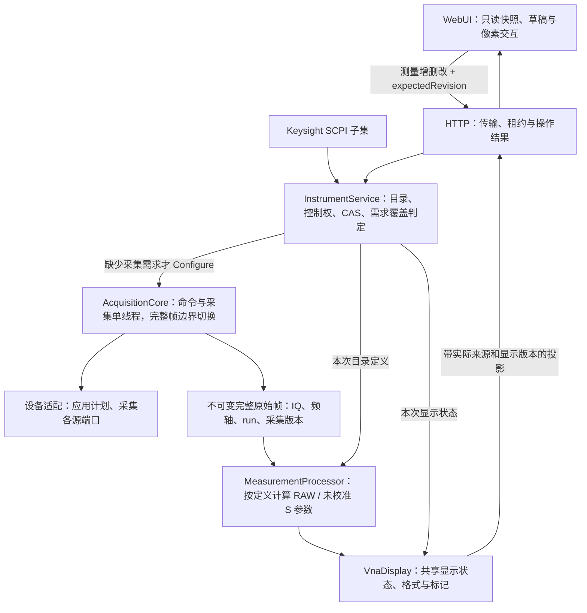
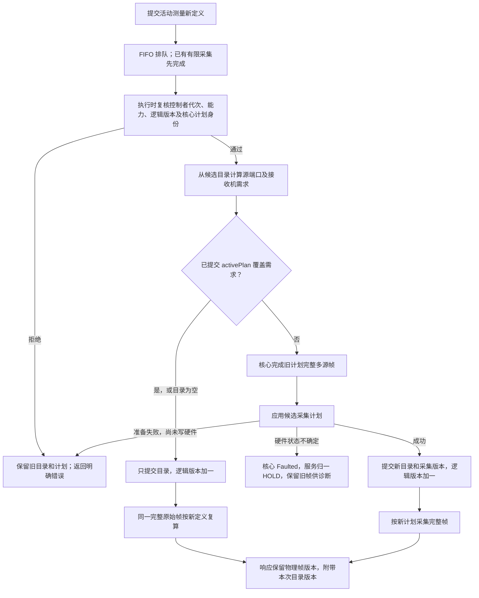

# 商用网分实时迹线与分层审视

日期：2026-10-11。范围：活动测量切换、迹线目录增删、连续采集中的计划更新；校准不在本次范围内。

后续更新（2026-10-12）：物理扫频参数同样允许 CONT 下修改，并通过核心完整帧边界提交；早期“物理配置仍要求 HOLD”的测试记录属于历史结果。当前合同见[服务设计](../网分服务与远程控制设计.md)，新的受控回归为 `live_configuration`。显示设置已迁入 C++ 显示域，本地界面状态表不再作为当前实现说明。

## 结论及官方依据

要求用户先 HOLD 才能修改活动迹线，是本项目服务入口的过度限制。现有 WebUI、InstrumentService、AcquisitionCore、设备适配的分层可以保留；需要修正的是把测量目录变化与物理扫频配置放在同一个 HOLD 门禁下的职责混淆。

- [R&S ZNB User Manual v74，第 77–79 页](https://scdn.rohde-schwarz.com/ur/pws/dl_downloads/pdm/cl_manuals/user_manual/1173_9163_01/ZNB_UserManual_en_74.pdf#page=77) 区分 trace 设置与 channel 设置；测量量改变可引发扫描初始化，初始化期间仍可继续修改设置。用户无需手动 HOLD，但不能据此推断仪器内部完全没有重新准备过程。
- [同一手册，第 87–88 页](https://scdn.rohde-schwarz.com/ur/pws/dl_downloads/pdm/cl_manuals/user_manual/1173_9163_01/ZNB_UserManual_en_74.pdf#page=87) 将通道采集处理与迹线显示处理分开；第 289 页的 Meas 作用于活动迹线。
- [Keysight Measurement Parameters](https://helpfiles.keysight.com/csg/NA520xA/S1_Settings/Measurement_Parameters.htm) 提供已有测量的 Change Measurement，并说明正向/反向测量由仪器自动切换源和接收机。S21→S12 并不总是仅改显示公式，因为源端口从 1 变成 2。

以下覆盖判定、双版本与 FIFO 实现是本项目根据现有核心能力作出的工程设计，不是对厂商内部实现的声明。

## 三类修改及责任

| 修改 | 所属责任 | 当前执行方式 |
| --- | --- | --- |
| Format、Scale、Marker、Display、活动迹线选择 | VnaDisplay 共享显示域 | 经服务控制权与显示 CAS 提交，不写硬件；CONT 下可写，只读观察者只查询 |
| S11/S12/S21/S22、RAW 波量、添加或删除测量 | InstrumentService 测量目录 | 验证权限、能力及逻辑 CAS，串行提交；CONT 无需先 HOLD |
| 起止频率、扫频点数、IFBW | InstrumentService 物理扫频配置 | Ready/Running 下受理，核心完整帧边界成功下发后提交，不要求先 HOLD |

设备和采集计划只有核心工作线程写入。服务层目录只由服务执行线程提交。前端不负责 Stop/Configure/Start，也不补造 S 参数或采集帧。

## 实时修改活动测量

`activePlan_` 是最后成功下发的实际计划。覆盖判定比较频轴、IFBW、表数据、接收机掩码和有序源端口集合。S 参数需求包括对应源端口的入射参考接收机。删除或收缩目录保留已下发的需求集合，避免无谓重配；后续物理配置可重新构造计划。

新增需求复用已有 `Core.Configure` 能力，在完整多源帧之间执行，不调用 Stop/Start，不改变 CONT/MAN 模式、runId，也不重置帧序号。MAN 已布防时修改定义不自动触发。有限 SING/Trigger 任务中的修改可排队，待有限操作完整结束后执行；更新本身不会重新启动单次扫描。

## 版本与数据竞争

| 字段 | 含义 | 何时改变 |
| --- | --- | --- |
| status.revision / expectedRevision | 逻辑配置与测量目录 CAS 版本 | 成功物理配置或目录增删改 |
| status.acquisitionRevision | 服务确认的核心采集计划版本 | 成功下发新计划 |
| frame.revision | 此原始帧实际使用的采集计划版本 | 随新计划帧发布，旧帧不改标 |
| frame.measurementRevision | 本次响应计算所用目录版本 | 用新的目录投影原始帧时 |
| runId / frameSeq | 采集运行及完整帧身份 | 原有核心规则；测量修改不重启运行 |

前端只有在 `frame.revision == status.acquisitionRevision`、`frame.measurementRevision == status.revision`、run 匹配、服务确认 current 且配置有效时，才标记当前帧。异步响应可能跨目录提交：即使物理帧版本相同，旧目录响应也不能冒充新定义。保留旧响应时图表继续使用该响应自己的测量元数据，并显示旧帧状态。

服务在驱动调用前拒绝逻辑版本耗尽；核心保留既有采集版本及帧序号溢出检查。HTTP 用十进制字符串传递身份，CSV 注释保留物理与目录两种版本。原始 IQ 不因目录修改而原地变更。

## 验证证据

- 真实红测试复现：CONT 中 S21→S11 被 `Configuration requires HOLD` 拒绝；修复后同一原始帧可读出独立核对的 S11 复比值。
- `live_measurement` 包含 10 组受控回归：同帧复算、新源帧边界、单独扩展接收机、旧 IQ 深不可变、准备失败继续 CONT、增删不重配、权限/CAS/两端口、MAN 不触发、物理配置 HOLD、SING 排队更新。
- HTTP 阻塞关卡回归验证帧身份与实际值；真实网络同时核对 RAW 与 S 参数的复比值、连续帧推进和旧 CAS 拒绝。
- 前端回归分别覆盖 CONT 写入、只读与待完成操作门禁、两种版本的迟到响应配对。完整测试及浏览器实测记录见[模拟设备采集验收](../模拟设备采集验收.md)。
