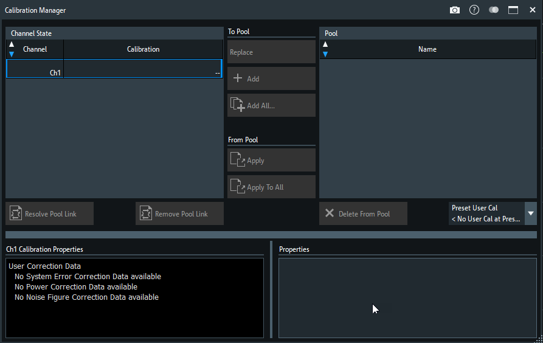
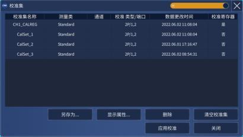

# 商用网分校准集管理界面对照

核对日期：2026-10-16。本记录区分商用原机已核验行为与 VnaPro 的设计建议，不把建议写成原机功能。本轮只调查界面与交互，不改变校准算法、持久化格式或测量策略。

## 结论与当前截图的问题

用户截图中，205 套校准集被放进狭窄侧栏的原生白色选择框，列表只能显示少量候选，长名称被截断；通道当前状态、候选选择、详细属性和管理动作又纵向堆叠，导致整体滚动，底部操作离开视野。这是信息结构和承载空间的问题，单纯更换颜色或圆角不能解决。

已核验的 R&S ZNB 采用两层：`Use Cal` 侧栏负责启停与进入管理，独立的 `Calibration Manager` 宽对话框负责查看通道应用关系、浏览池内候选和读属性。它并没有把整个校准池管理器塞进 `Use Cal` 侧栏。[官方手册 v74，第 652–656 页](https://scdn.rohde-schwarz.com/ur/pws/dl_downloads/pdm/cl_manuals/user_manual/1173_9163_01/ZNB_UserManual_en_74.pdf#page=652)

| 商用参考 | 已核验的管理结构 | 值得借鉴之处 |
| --- | --- | --- |
| R&S ZNB v74 | `Use Cal` 侧栏入口 + 独立管理器；左通道、右池、中间动作、下方属性。 | 当前使用与池内候选明确分离。 |
| Keysight NA520xA 官方帮助 | 独立 `Cal Set Selection` 多列表格 + 属性对话框。 | 行选中与当前应用用不同标识；列表可按列排序。 |
| 思仪 3674 用户手册 A.6 | 独立校准集宽表 + 属性对话框。 | 名称、应用通道、类型/端口等并列，底部集中管理动作。 |

表中原机事实分别见下文官方来源；三者共同支持“轻侧栏入口 + 宽管理窗口”的方向。搜索与适用性筛选是 VnaPro 针对 205 套集的设计建议，不冒充这些原图已有能力。

## R&S ZNB：商用原图与实际分工

基线是 `R&S ZNB User Manual 1173.9163.02 ─ 74`，不是校准采集向导。第 580、582、585 页的标准采集流程不能作为 Cal Manager 管理界面的证据。

上图来自官方 PDF 第 655 页的内嵌原图 `I1.png`，原始尺寸 893 × 564，无重绘、裁剪或 AI 生成。整页原件在 `reference/analysis/vnapro-calibration/znb/page-655.png`，对应 PDF 为同目录的 `ZNB_UserManual_en_74.pdf`。[官方第 655 页](https://scdn.rohde-schwarz.com/ur/pws/dl_downloads/pdm/cl_manuals/user_manual/1173_9163_01/ZNB_UserManual_en_74.pdf#page=655)

### 侧栏：启停与入口

`Use Cal` 页提供 `User Cal Active`、其他校正开关和 `Manage Cals` 分组。`Cal Manager` 按钮打开独立管理对话框；还有 `Recall Last Cal Set` 和 `Remove all Cal Data`。`User Cal Active` 只在活动通道有有效系统误差校正时可用；关闭后，迹线状态显示 `Cal Off`。这支持把“当前校正是否生效”与“浏览池中哪个候选”分开表达。[官方第 652–654 页](https://scdn.rohde-schwarz.com/ur/pws/dl_downloads/pdm/cl_manuals/user_manual/1173_9163_01/ZNB_UserManual_en_74.pdf#page=652)

### 管理器：通道、池和属性并列

| 区域 | 原图及说明能确认的内容 | 对 VnaPro 的启发 |
| --- | --- | --- |
| 左上 `Channel State` | `Channel` 与 `Calibration` 两列，显示各通道及当前校准；工厂校正显示为 `--`。 | 当前通道绑定独立显示，不能让候选高亮冒充“已使用”。 |
| 右上 `Pool` | 名为 `Name` 的池列表，代表保存的校准集。 | 让长名称占据足够宽度；不要放入只有约 260 像素宽的原生多行选择框。 |
| 两表中间 | `To Pool` 与 `From Pool` 动作分组：保存/替换与应用分开。 | 将读入已有集与保存当前校准明确命名，避免都叫笼统的“Add”。 |
| 左下 | 所选通道的 `Calibration Properties`。 | 随通道选择展示当前使用集的属性。 |
| 右下 | 所选池项目的 `Properties`。 | 随候选选择展示详情，不立即改变通道校准。 |
| 列表下方 | 删除、解除池关联、预置校准选择等动作。 | 将操作与所属对象放在同一区域；删除和应用应能区分。 |

布局、列名和区域位置依据[官方第 655 页原图](https://scdn.rohde-schwarz.com/ur/pws/dl_downloads/pdm/cl_manuals/user_manual/1173_9163_01/ZNB_UserManual_en_74.pdf#page=655)；属性及关联规则依据[第 656 页](https://scdn.rohde-schwarz.com/ur/pws/dl_downloads/pdm/cl_manuals/user_manual/1173_9163_01/ZNB_UserManual_en_74.pdf#page=656)。

### 可以确认的操作语义

| 原机动作 | 官方定义 |
| --- | --- |
| `Add` / `Add All` | 将所选通道 / 所有通道的校正数据复制进池，产生新成员。 |
| `Replace` | 用新校正数据覆盖某个池成员。 |
| `Apply` / `Apply to All` | 将所选池成员赋给所选通道 / 表中全部通道。 |
| 修改池名称 | 直接修改 `Pool` 对应名称单元格。 |
| `Delete from Pool` | 删除池文件；任何已打开 recall set 正在使用的校准不能删除。 |
| `Resolve Pool Link` | 解除池关联，但保留该通道的独立校准数据。 |
| `Remove Pool Link` | 解除关联并移除该通道校准。 |
| `Preset User Cal` | 指定用户预置时启用的池成员。 |

这些是 R&S 原机语义，不代表 VnaPro 当前具备相同功能。`Apply` 后池关联会影响覆盖更新，官方明确有覆盖警告；当前 VnaPro 的 JSON 导入/导出和删除当前集行为仍以项目服务合同为准，不能为了外观照搬而改变。[官方第 655–656 页](https://scdn.rohde-schwarz.com/ur/pws/dl_downloads/pdm/cl_manuals/user_manual/1173_9163_01/ZNB_UserManual_en_74.pdf#page=655)

### 未能据此声称的功能

- 该图可确认 `Channel/Calibration` 与 `Name` 列，不能据此声称原机池列表已有“频率、点数、IFBW、日期、类型”等多列。这些信息可在属性区表达；给 VnaPro 添加这些列是项目设计选择。
- 表头附近可见上下三角形图标，但本轮没有实机操作和明确规则说明，不能从图标推断任意列排序、默认排序或自然数字排序规则。
- 此管理器原图和对应说明没有搜索框、条件筛选器、批量多选或分页证据。205 套集需要搜索是 VnaPro 的使用场景推导，不是“R&S 原机也这样做”的事实。
- 图中的 `Add/Replace` 是通道与池之间的数据管理，不等同于从外部文件导入/导出。不能把第 652 页上半部的 `Import File` 当作校准池导入；那里处理的是功率计传输系数文件。

以上边界依据[官方第 652 页上下文](https://scdn.rohde-schwarz.com/ur/pws/dl_downloads/pdm/cl_manuals/user_manual/1173_9163_01/ZNB_UserManual_en_74.pdf#page=652)和[第 655–656 页](https://scdn.rohde-schwarz.com/ur/pws/dl_downloads/pdm/cl_manuals/user_manual/1173_9163_01/ZNB_UserManual_en_74.pdf#page=655)实际核验范围。

### 资料来源与复核

2026-10-16 通过官方 CDN URL 重新取得 PDF：HTTP 200、`application/pdf`、23,030,027 字节，SHA-256 为 `874901ee4e880dbca9a606406df448494f610233f0cd3b6a61244464b19fdccd`。与现有本地 PDF 及 `docs/reference/znb8/source-manifest.json` 相同；本轮实际查看了第 652、655 页截图，并读取第 655–656 页原文。网页检索工具不能展开该整本 PDF，因此使用同源原件交叉核验，未引用第三方手册站转述。

官网当前还提供 ZNB3000 v08 / FW V4.25 和 ZNA v41 / FW V3.20+ 手册入口；本轮没有把其当前版本号当作布局已经复核的证据，不宣称三款全部逐屏一致。[ZNB3000 官方手册入口](https://www.rohde-schwarz.com/au/manual/rs-znb3000-user-manual_78701-1545988.html)、[ZNA 官方手册入口](https://www.rohde-schwarz.com/uk/manual/rs-zna-user-manual_78701-601863.html)

## Keysight：多列表格与应用状态消歧

参考范围为 [NA520xA 官方帮助：Using Calibration Sets](https://helpfiles.keysight.com/csg/NA520xA/S3_Cals/Cal_Sets.htm#context)，不扩称全部 Keysight 型号和固件完全一致。其 [Cal Set Selection 原图](https://helpfiles.keysight.com/csg/NA520xA/assets/images/CalSetSelectionDialog.png)是独立宽窗口，列包含名称、测量类、使用通道、校准类型/端口、修改日期；底部放通道选择、当前校准集、`Select / Unselect / Edit / Close`。官方说明支持点击列头排序，蓝色表示浏览选中，虚线框表示当前通道正在使用；二者不能混为一谈。

不兼容项目的 `Select` 禁用；`Edit` 集中属性、复制和删除。另有[属性原图](https://helpfiles.keysight.com/csg/NA520xA/assets/images/CalSetProperty.png)展示详细刺激参数。官方有“保持通道设置并在可行时插值 / 改用校准集设置”的选择；这是商用参考能力，VnaPro 当前未实现插值，不能照抄成可用选项。[同页官方说明](https://helpfiles.keysight.com/csg/NA520xA/S3_Cals/Cal_Sets.htm#context)

这里可借鉴多列、状态消歧和明确应用动作；未取得搜索或过滤器证据，不将其写成原机已有功能。

## 思仪 3674：独立校准集管理表

来源为官方《3674 系列矢量网络分析仪用户手册》A.6 / 2023.6；官网发布页日期为 2024-05-28。以下是该版本的真实设计，不宣称最新固件逐屏一致。[官方发布页](https://www.ceyear.com/network_analyzer-185?act=95&type=file)、[官方手册 PDF](https://www.ceyear.com/Cn/Skippower/downloadFile/mid/36/id/1040)

上图是 §7.4 图 7.18，印刷第 227 页 / PDF 第 231 页，原始内嵌 JPEG 410 × 231；手册原图分辨率有限，未放大重画。可确认宽表包含“校准集名称、测量类、通道、校准类型/端口、数据更改时间、校准寄存器”六列；正文将通道列解释为当前使用该集的通道。底部集中“另存为、显示属性、删除、清空校准集、应用校准、关闭”。[官方手册，PDF 第 231 页](https://www.ceyear.com/Cn/Skippower/downloadFile/mid/36/id/1040#page=231)

属性另开窗口，包含名称/描述、GUID、修改时间、激活通道、点数、频段、扫描类型、IFBW、功率和阻抗。正文及图 7.21、7.22说明应用时的激励匹配选择，应用后显示通道且动作变成“取消应用”。这些都将“查看候选”与“实际用于测量”分开。[官方手册，印刷第 228–230 页 / PDF 第 232–234 页](https://www.ceyear.com/Cn/Skippower/downloadFile/mid/36/id/1040#page=232)

本轮实际查看图 7.18、7.19、7.21、7.22。官方 PDF SHA-256 为 `a3c06e18c777fa07b75a1312aa047c352da811ca84b492649c0ab523f54a322d`；上图是 PDF 第 231 页 `/IM2200` 原始图像，SHA-256 为 `81f40ac5f765b8c8c8cd1026de9cecdbf0c5db6878ddc25c16e11ea1196050b8`。没有把项目自身的旧截图当作商用网分截图。

## 对 VnaPro 的建议：属于项目设计

1. `Cal / Use Cal` 保留简洁侧栏，只显示 Ch1、当前集名称、校正状态和 `Cal Manager…` 入口。当前集状态以服务端读回为准。
2. 点击入口打开宽管理对话框；把候选列表、详细属性和操作移出侧栏，列表自身滚动，主要动作保持可见。
3. 对 205 套集增加名称搜索；可再按端口、方法或兼容状态筛选。搜索不修改池、选择或激活状态；这是针对本项目数据量的改进。
4. 列表至少清楚显示名称和“当前使用 / 仅选中”区别。现有 `CalibrationSetSummary` 已有名称、方法、端口、兼容状态、起止频率、点数及 IFBW，可用紧凑列加详情区承载，避免重复大标题和过长说明把操作推到下方。该摘要没有日期、备注或校准寄存器字段，不添加伪造的日期、占位描述或寄存器状态来模拟商用表格。
5. 候选选择只更新详情；显式点击 `应用到 Ch1` 后，等待服务操作成功再更新当前状态。显示失配原因，不用禁用按钮的灰色独自解释全部状态。
6. 导入、导出、删除继续调用既有服务操作；不因本次布局调整增加自动加载、自动激活、插值或校准算法变化。不为模仿商用图额外添加“清空全部”按钮；未实现的原机功能不提供可误触的仿制按钮。

这些建议参考 R&S 的任务分层，并针对 VnaPro 的四端口、长名称和大池场景调整；不是原机界面的逐像素复刻方案。
