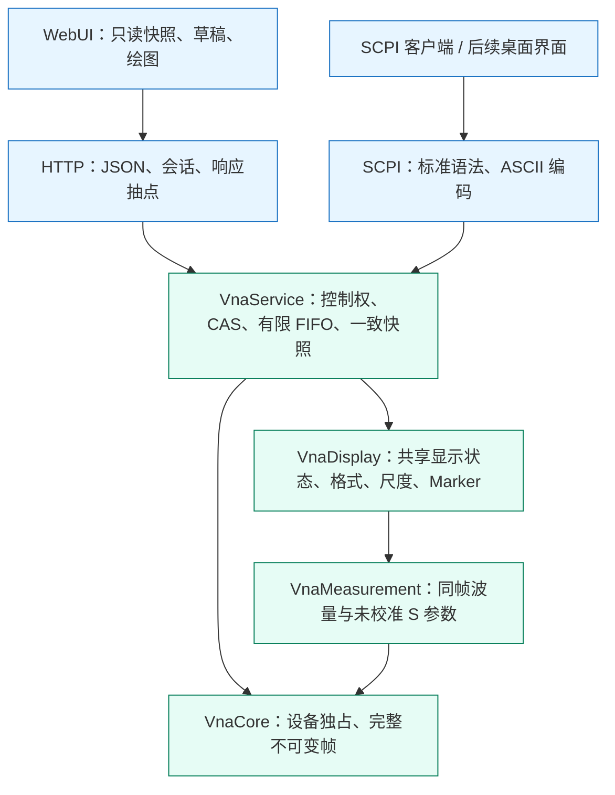
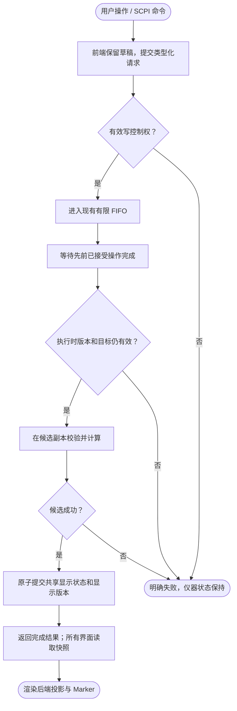

# 共享显示域设计

## 目标与边界

仪器的测量选择、显示集合、布局、可见性、格式、矩形尺度、Smith 半径、每迹线标记集合、Info Table 及信息显示设置均由 C++ 管理。
HTTP、SCPI 和后续桌面界面通过同一套接口操作，刷新页面和新观察窗口读取相同状态。
状态属于正在运行的服务；本期不包含进程重启后的磁盘恢复。

“前端只显示”指前端不拥有仪器状态、不实现控制规则或测量计算。
前端仍需要绑定只读响应来绘图，并维护尚未提交的输入、软工具导航、焦点、窗口尺寸与像素坐标。
CSV 只序列化后端投影和原始下标，前端不重新计算测量值或阻抗。

## 分层结构

`VnaDisplay` 不依赖 HTTP、SCPI、YAML、浏览器或 `VnaService`，不新建线程、租约和队列。
`InstrumentService` 按值持有 `DisplayWorkspace`，全部读写仍由现有服务执行器完成。
Core 的只读完整帧通过共享所有权保持有效，显示计算不会修改原始采集数据。

| 文件 | 职责 |
| --- | --- |
| `VnaDisplay/include/vna_display/display_workspace.h` | 显示状态、相关枚举和命令；工作区公共接口 |
| `VnaDisplay/src/display_workspace.cpp` | 原子提交、显示属性、选择与目录协调 |
| `VnaDisplay/include/vna_display/diagram_collection.h`、`src/diagram_collection.cpp` | 显式图窗、归属、主迹线及稳定局部槽编号 |
| `VnaDisplay/include/vna_display/marker_collection.h`、`src/marker_collection.cpp` | 每迹线十个普通标记、活动编号及新增/选择/关闭事务 |
| `VnaDisplay/include/vna_display/trace_projection.h` | 投影结果、特殊数值状态及 Marker 读数 |
| `VnaDisplay/src/trace_projection.cpp` | 十三种常规格式、圆图原坐标、默认标记读数及反射阻抗/导纳 |
| `VnaDisplay/src/trace_sequence_formatter.h/.cpp` | 完整频轴相位展开、群延迟与角频率二阶导数 |
| `VnaDisplay/src/scale_calculator.h/.cpp` | 尺度参数联动及一次 Autoscale |
| `VnaDisplay/src/marker_resolver.h/.cpp` | 原始点、复数插值、CW、后端步进和边界校验 |
| `VnaService/src/instrument_display.cpp` | 控制任务、共享快照及当前完整帧上下文 |
| `VnaServer/src/web/display_json.h/.cpp` | 显示协议转换；无测量算法 |
| `VnaServer/src/scpi/scpi_display_adapter.h/.cpp` | Keysight 显示命令适配；无第二份状态 |
| `WebUI/src/composables/useWorkspace.ts` | 只读派生视图及命令转发 |

## 写操作活动图

DISPLAY 不要求 HOLD，不调用 Configure、Stop 或 Start，不重置 runId 或 frameSeq；CONT 期间 frameSeq 仍随正常采集推进。
SING/Trigger 尚未完成时允许受理显示写，按同一个 FIFO 等待先前有限帧终结。
排在当前 DISPLAY 后面的未来采集不能反向阻止本次 Autoscale 使用已有完整帧。
观察者只读；写控制权释放时，已接受操作仍须完成。

## 一致性与数据合同

| 身份 | 作用 |
| --- | --- |
| `status.revision` / `frame.measurementRevision` | 物理配置与测量目录的逻辑 CAS |
| `status.acquisitionRevision` / `frame.revision` | 已下发的真实采集计划 |
| `status.display.revision` / `frame.displayRevision` | 格式、布局、刻度和 Marker 等显示状态 |
| `runId` / `frameSeq` | 运行轮次与完整帧序号 |

所有 uint64 身份在 JSON 中使用十进制字符串。前端同时匹配以上版本及运行轮次，拒绝把旧投影套上新标题。
显示版本耗尽时明确失败，不回绕；无变化操作不增加版本。
`selectedMeasurement` 只有 `DisplayState` 一份权威值，测量目录设置不再保存可写副本。
`status.display.diagrams` 是 C++ 保存的显式图窗状态的只读快照，包含图号、有序成员、局部 `traceSlots` 和主坐标迹线；
扁平 `displayedNames` 仅由图窗派生，不是另一份可写归属。
图窗增删、Overlay / Split 和最大化由显示域编排，格式修改不重新分组，前端只映射为绘图组件。
测量目录、显示集合和图窗各最多 128 项，这是本项目资源预算，不是 ZNB 的硬件上限。
Split All 为每条已显示迹线创建独立图窗；Overlay All 将全部已显示迹线合入一窗，允许不同坐标格式共窗。
局部槽身份支持稀疏编号，删除成员不压缩其他槽号；图号在原生删除图窗后连续重编号。
显示槽编号、图窗数量和物理端口数量是三个独立概念，新增第五条不能覆盖第四槽。

目录提交前，服务在任务候选中执行 Reconcile，并检查显示版本能否提交。
同名设置保留，已删除名称移除；Smith 允许全部受支持复数测量，不能因传输参数而强制回到矩形格式。
测量量改变采用该量默认格式；格式改变采用目标默认尺度，同格式请求保持自定义尺度和显示版本。
目录和显示候选一起提交，避免硬件成功后再发现显示提交失败。
Clone 的名称分配、定义及显示设置复制、追加显示和选择由后端完成，两个 CAS 同时校验。
新名字按 ZNB 规则选择最小未占用的 `Trc<n>` 正整数，删除后允许复用。
Trace Config 的 Clone 复制活动迹线的格式、刻度、可见性及标记集合；初始曲线重合属于复制设置的正常结果。
Diagram 菜单的 Add 则新增默认 S21 / dB Mag 迹线，单端口为 S11；新增或复制可以在同一事务创建目标图窗。

HTTP 单条最多传输 2001 个绘图点，总迹线采样预算为 8004。
请求 N 条迹线时，每条使用不超过 `min(2001, floor(8004 / N))` 的共同抽点数量并保留频轴端点；
格式计算、Autoscale 和 Marker 均使用完整原始帧，此预算不限制 SCPI 完整数组读取。
`sampleIndexes` 标识每个传输点的原始下标；Marker 单独返回坐标、原始下标、复数、格式值与阻抗状态，
即使该点不在传输数组中也能显示。键盘一步对应一个原始点；CW 用下标区分同频采样。
默认 Marker 频率输入使用复数线性插值；展开相位和频率导数改为插值同一完整帧的序列投影，不能对单个复数求导。
离散模式和原始下标选择使用真实采样点。
合法频率可在首帧前保存；超出已提交频段的输入原子拒绝。

每条迹线独立保存 M1～M10 的 `markers` 集合和 `activeMarkerId`；编号范围固定为 1～10。
状态和投影中的旧 `marker` 字段均由集合的活动成员派生，不能单独写入或成为第二份权威状态。
Add Marker 启用最小空闲编号并激活；编号选择启用并激活对应成员；关闭当前标记和 All Off 保留位置及离散模式，删除迹线才丢弃集合。
`MarkerAction::SELECT` 同时导航到标记所属迹线及图窗：在同一候选事务内先完成标记校验和选择，再更新图窗主迹线、活动图窗与全局活动测量，只提交一次显示版本。非法编号或图窗导航失败时整个候选丢弃，不留下部分标记或选择变化。UPDATE、ADD、ALL_OFF 不隐式导航，SCPI 查询仍只读取状态。
拖动、频率输入和查询均针对明确编号，不能让后续活动编号变化把操作应用到其他标记。

## 信息字段与标题排版

`DisplayState.infoTable` 是全局屏幕容器，保存 `visible=false` 和 `position="bottom"`，位置可选 Bottom/Left/Right。
`annotations` 保存全局 `activeTraceOnly=false`、`stimulusInfoVisible=true` 和百分比 `fontScale=100`，合法字号范围为 80～170。
每个 `DisplayDiagram.markerInfoVisible` 默认开启；每迹线 `markerInfoLocation` 独立保存 Diagram/Table，默认 Diagram。
Marker 启停和坐标、信息字段的显隐及其容器归属是不同状态，不能相互替代或由浏览器本地保存。

Table 由全部已保存图窗构造信息字段，Maximized 不移除其他图窗已迁移字段；隐藏迹线或关闭所属图窗 Marker Info 时隐藏其信息。
Active Trace Only 依据全局 `selectedMeasurement` 过滤 Table 和图内字段，不是各窗 `primaryMeasurement`。
图窗局部 `primaryMeasurement` 与全局活动测量分别保存：前者控制本窗坐标、标题记忆高亮及曲线置顶，当前图窗显示蓝色标题，其余图窗显示灰色记忆标题。删除或解除活动成员时先使用当前图窗的有效主迹线，图窗删除后使用协调后回退图窗的已保存主迹线，不将全局平铺目录首项写回其他图窗。局部主迹线失效时采用第一剩余成员，属于项目确定性回退规则；其他迹线的格式、尺度和 Marker 属性按名称保留。
Marker Stimulus Info 只控制 Marker 信息的频率，通道行的 Start/Stop、点数和带宽保持；Font Size 对标题、通道行和信息字段统一生效。
Table 与图内共用后端投影及前端手势预览，点击行提交所属迹线和明确 markerId，不因重复 M1 编号误选其他迹线。

Show/Hide 仅改 Table 容器，不自动修改字段位置；隐藏后保留归属，再次显示恢复。字段移动不自动 Show，页面先开启 Table 再允许迁入。
返回图内可拖放、使用字段右键菜单或 Display 设置，所有入口发送同一后端动作并等待完成读回。
这些显隐与归属独立规则是项目合同，已核对手册没有明确自动迁移或隐藏恢复行为，不称为原机算法。

前端按实际字体完整标题宽度和可用容器宽度排列等宽列，不固定三列或四列；窄窗省略次要标题字段，不删除迹线或改变后端归属。
Table 是无列头的信息字段容器，标记行使用同迹线色，并列出 M 编号、Trc 名、频率和响应值。大量字段在 Table 内滚动，图内信息字段不设置内部滚动条。
Table 当前底部最大高度为工作区 35%，左右布局基准 300 px、最大宽度 40%；这些 CSS 像素规则不进入仪器配置，也不是已核验的原机比例。
原机事实与未确定细节见[Info Table 与标题排版核对](research/ZNB8信息表与标题排版核对.md)，用法见[操作验收](InfoTable操作验收.md)。

Marker 拖动使用前端暂时的像素和读数预览，每屏幕帧最多更新一次，不修改共享显示状态或正式 Marker。
三角形和右上角 X/Y 共用同一个已下发采样点，读取 C++ 格式投影，不在浏览器重算测量值、插值或阻抗，也不逐次发送预览请求。
CONT 期间冻结本次手势的几何、读数和原始索引，避免新帧改变 Smith 命中目标或把不同帧的像素与读数拼在一起。
松手仅提交一次命令并保留预览，待后端操作完成及权威状态读回后清除；失败恢复后端位置。
前端在显示操作完成后额外读回与状态 `displayRevision` 一致的投影，再结束提交等待；避免周期轮询较早返回的旧投影使标记短暂回弹。
已有旧采集帧不要求采集版本或运行轮次相同，其新鲜度继续由帧状态标识；无采集帧或空显示集合允许只确认状态。
投影读取失败或版本未配对时继续观察原操作，不重发写命令；只有操作查询本身的 404 才判定结果已过期。
取消手势、失去指针捕获或写权限、改变格式或坐标几何时撤销拖动，不发送位置命令。
临时预览不向其他窗口传播；提交后的标记位置由既有 HTTP/SCPI 共享状态传播。矩形图预览使用已下发显示点，正式位置仍由 C++ 在完整原始帧吸附。

Smith 投影额外下发 `impedanceRealValues`、`impedanceImagValues`、`impedanceStates`；Inv Smith 对应下发 `admittanceRealValues`、`admittanceImagValues`、`admittanceStates`。
相应格式的数组与曲线使用同一抽点索引且同长；只有反射 S 参数返回有效归一化阻抗或导纳，传输量和 RAW 不提供负载物理解释。
开路、短路奇点、溢出和无效输入保留明确状态，不以有限值代替；非对应格式的数组为空。
旧服务整体缺少这些字段时仍可显示已有复数预览，但物理读数显示未提供，不能将正式旧 Marker 的值拼到新采样点上。

Polar 的曲线保持 Re/Im；默认标记读数为幅值与相位（度）。后端另发 `markerValues`、`markerSecondaryValues`、`markerValueStates`、`markerSecondaryStates` 供拖动预览，Polar 下同抽点数组等长，其他格式为空。
正式标记与预览使用同一 MarkerValue 转换；零幅值是有效 0，相位独立标为未定义。HTTP 沿用 finite / negativeInfinity / undefined 三类投影状态，不输出 NaN/Infinity；前端不执行 hypot 或 atan2。

Log Mag 保留原幅值并使用对数坐标，区别于 dB Mag。Delay 为 `-dφ/dω`，单位 s；Delay Derivation 为 `-d²φ/dω²`，单位按量纲为 s²。
当前使用完整非均匀频轴的中心与边界有限差分，无效段断开；尚无厂商 Aperture Points 回归窗口，不宣称相同噪声平滑行为。

Autoscale 在命令执行时读取最新当前完整帧，仅计算并保存一次范围或半径。
HTTP 检查 acquisitionRevision，不要求页面旧 frameSeq 等于当前序号，避免 CONT 下持续发生冲突。
负无穷 dB、零幅度相位未定义、无效样本及开路阻抗都有明确状态，JSON 不输出 NaN/Infinity。

## HTTP 与 Keysight 命令

`GET /api/v1/status` 返回 `display`；默认 `GET /api/v1/frame` 读取后端显示集合。
`POST /api/v1/display` 携带 `requestId`、`expectedDisplayRevision`、`action` 及相应参数，
复用既有租约、幂等记录、202 操作查询及完成读回。
支持 select、displayed、layout、diagramSelect、overlay、split、format、scale、autoscale、smithRadius、visible、marker、infoTable、displayAnnotations、markerInfo、markerInfoLocation。
Scale 可输入 perDivision/referenceLevel/referencePosition 或 min/max，联动由 C++ 完成。

`infoTable` 接受 enabled/position 至少一个；`displayAnnotations` 接受 activeTraceOnly/stimulusInfoVisible/fontScale 至少一个。
这两者为全局设置，不接受 traceName 或 diagram。`markerInfo` 接受 enabled 和可选 diagram，`markerInfoLocation` 接受 traceName 与 location（diagram/table）。
参数类型、作用域、字号范围和目标名称均在后端校验；失败不得部分提交。不为这些原生显示设置自创或混入 R&S SCPI。

`action:"marker"` 使用 `markerAction:"update" | "add" | "select" | "allOff"`；缺省为 update。
update 可带 `markerId`（1～10）及 enabled、frequencyHz、sampleIndex、step、discrete；省略编号则作用于执行时的活动标记。
select 必须给出 markerId，并在同一后端事务中启用/选择该标记、激活其所属迹线和图窗；add 由后端分配编号；allOff 关闭活动迹线全部标记。
add、select、allOff 不混入位置或启停更新；改变位置仍须提交 acquisitionRevision，失败不部分修改集合或活动编号。

`POST /api/v1/measurement-actions/add`、`clone`、`delete-diagram` 同时检查逻辑与显示 CAS；新增或复制可带 `diagram` / `newDiagram`，Clone 可指定 sourceName。

Add 还可带 `parameter`，例如 `S44` / `S3_4`；C++ 在候选内解析并检查启动端口能力，一次提交自动命名、目录、默认显示设置、图窗归属及选中。没有该字段仍使用默认 S21（单端口 S11）。Clone 不接受参数覆盖；非法参数、二端口越界和任何一项过期 CAS 均无残留。New Trace 弹框冻结打开时的双版本和目标图号，等待期间不写正式目录；取消不会创建默认迹线。
原生 Delete Diagram 删除图及其迹线定义，保护最后图窗和最后测量；Delete Trace 删除独占成员时清理其空图窗。
Display 的新增图窗入口使用默认迹线，Trace Config 的新增图窗入口复制活动迹线；普通复制未指定目标时使用源迹线归属图窗，显式目标优先。Trace Config 的 Diagram 下拉沿用 `select` 的 traceName/diagram 合同，归属、活动迹线和图窗在一个显示事务中改变。移动保留空源图窗；原生删除活动空图窗也须同步回退图窗的主迹线，不能只修改图号而留下跨图的活动选择。前端下拉不持久化未读回的选择。
测量定义和原位更新可直接提交标准 `parameter:"Sij"`；`i` 为接收端口、`j` 为激励源。物理测量模块支持端口 1～4，服务按启动 `instrument.portCount` 再准入：四端口全部 16 项、二端口仅四项。前端选择器读取后端 capabilities；非法创建或更新不得改变目录、显示、配置版本或采集模式。该能力配置不修改模拟驱动物理端口及 IQ 格式。
配置接受 centerHz/spanHz，不能与 startHz/stopHz 混用；频段联动及能力校验由后端完成。

SCPI 使用正式 `CALC1:FORM`、`CALC1:PAR:SEL`、`CALC1:MARK<n>:STAT/X/Y/DISC`（n 为 1～10）、`CALC1:MARK:AOFF`、
`DISP:WIND<w>:STAT/SIZE/CAT?`、`TRAC<t>:FEED/DEL/SEL/STAT` 和 `Y[:SCAL]:PDIV/RLEV/RPOS/AUTO`。
本期通道固定为 1，w、t 的项目预算为 1～128，局部槽支持稀疏编号；每迹线十个普通标记。
SCPI 窗口 OFF 和槽 DEL 仅解除显示关联，不删除测量定义；最后图窗 OFF 是当前子集的保护限制。这与原生 Delete Diagram / Delete Trace 的目录事务有区别。
Marker 查询直接读取同一后端集合及完整帧投影，缺省 MARKer 编号为 1，AOFF 为只写。
CALC:FORM 仅登记已核验的十项 PNA 格式；Log Mag、Delay Derivation、Inv Smith 仍只由 Web 合同开放，不自创 SCPI 名称。
POL/SMIT 的 SCPI Marker Y 按 PNA 返回 Re,Im，不能将原生 Polar 默认幅相读数代入该查询。
Reference、Delta、Coupled 尚未实现；不把 Web 实虚叠加映射为 Keysight COMP，不支持的窗口、编号、格式及 FAST 明确拒绝。
界面数量、命名和标记菜单依据见[ZNB8 迹线与标记行为核对](research/ZNB8迹线与标记行为核对.md)，不宣称完整厂商功能兼容。
兼容依据：[Keysight Format](https://helpfiles.keysight.com/csg/NA520xA/Programming/GP-IB_Command_Finder/Calculate/Format_Calc.htm)、
[Display](https://helpfiles.keysight.com/csg/NA520xA/Programming/GP-IB_Command_Finder/Display.htm)、
[Marker](https://helpfiles.keysight.com/csg/NA520xA/Programming/GP-IB_Command_Finder/Calculate/Marker.htm)。

## 验收

后端验证 Web↔SCPI、独立观察器及刷新、控制权、排队 CAS、目录协调、CONT 不重启、
固定 Autoscale、有限帧屏障、10001→2001 抽点、CW 原始下标、插值与特殊数值。
前端验证严格解码、只读快照、命令完成后读回、并行响应版本配对、草稿和租约生命周期，
以及像素命中、CSV 对后端投影的直接序列化。实际浏览器另验证两个窗口和刷新后的同一状态。
