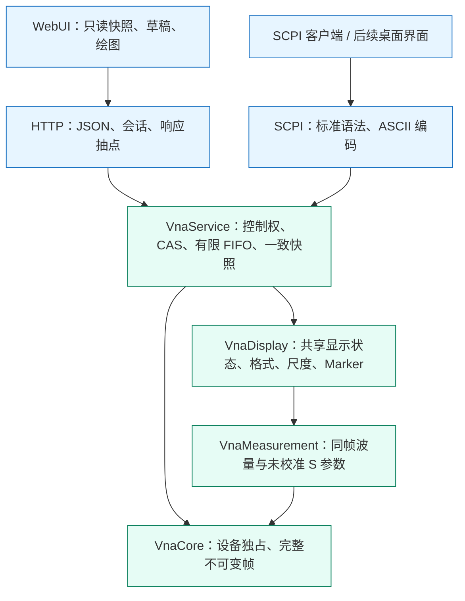

# 共享显示域设计

## 目标与边界

仪器的测量选择、显示集合、布局、可见性、格式、矩形尺度、Smith 半径和 M1 均由 C++ 管理。
HTTP、SCPI 和后续桌面界面通过同一套接口操作，刷新页面和新观察窗口读取相同状态。
状态属于正在运行的服务；本期不包含进程重启后的磁盘恢复。

“前端只显示”指前端不拥有仪器状态、不实现控制规则或测量计算。
前端仍需要绑定只读响应来绘图，并维护尚未提交的输入、软工具导航、焦点、窗口尺寸与像素坐标。
CSV 只序列化后端投影和原始下标，前端不重新计算测量值或阻抗。

## 分层结构

`VnaDisplay` 不依赖 HTTP、SCPI、YAML、浏览器或 `VnaService`，不新建线程、租约和队列。
`InstrumentService` 按值持有 `DisplayWorkspace`，全部读写仍由现有服务执行器完成。
Core 的只读完整帧通过共享所有权保持有效，显示计算不会修改原始采集数据。

| 文件 | 职责 |
| --- | --- |
| `VnaDisplay/include/vna_display/display_workspace.h` | 显示状态、相关枚举和命令；工作区公共接口 |
| `VnaDisplay/src/display_workspace.cpp` | 原子提交、显示槽、选择与目录协调 |
| `VnaDisplay/include/vna_display/trace_projection.h` | 投影结果、特殊数值状态及 Marker 读数 |
| `VnaDisplay/src/trace_projection.cpp` | dB/线性/相位/实虚/Smith 及归一化阻抗 |
| `VnaDisplay/src/scale_calculator.h/.cpp` | 尺度参数联动及一次 Autoscale |
| `VnaDisplay/src/marker_resolver.h/.cpp` | 原始点、复数插值、CW、后端步进和边界校验 |
| `VnaService/src/instrument_display.cpp` | 控制任务、共享快照及当前完整帧上下文 |
| `VnaServer/src/web/display_json.h/.cpp` | 显示协议转换；无测量算法 |
| `VnaServer/src/scpi/scpi_display_adapter.h/.cpp` | Keysight 显示命令适配；无第二份状态 |
| `WebUI/src/composables/useWorkspace.ts` | 只读派生视图及命令转发 |

## 写操作活动图

DISPLAY 不要求 HOLD，不调用 Configure、Stop 或 Start，不改变 runId 和 frameSeq。
SING/Trigger 尚未完成时允许受理显示写，按同一个 FIFO 等待先前有限帧终结。
排在当前 DISPLAY 后面的未来采集不能反向阻止本次 Autoscale 使用已有完整帧。
观察者只读；写控制权释放时，已接受操作仍须完成。

## 一致性与数据合同

| 身份 | 作用 |
| --- | --- |
| `status.revision` / `frame.measurementRevision` | 物理配置与测量目录的逻辑 CAS |
| `status.acquisitionRevision` / `frame.revision` | 已下发的真实采集计划 |
| `status.display.revision` / `frame.displayRevision` | 格式、布局、刻度和 Marker 等显示状态 |
| `runId` / `frameSeq` | 运行轮次与完整帧序号 |

所有 uint64 身份在 JSON 中使用十进制字符串。前端同时匹配以上版本及运行轮次，拒绝把旧投影套上新标题。
显示版本耗尽时明确失败，不回绕；无变化操作不增加版本。
`selectedMeasurement` 只有 `DisplayState` 一份权威值，测量目录设置不再保存可写副本。
`status.display.diagrams` 由 C++ 只读派生，明确图号、迹线分组和主坐标迹线；
单图、混合 Smith 分组、网格与最大化都由显示域编排，前端只映射为绘图组件。

目录提交前，服务在任务候选中执行 Reconcile，并检查显示版本能否提交。
同名设置保留，已删除名称移除；不再适用的 Smith 回到原笛卡尔格式。
目录和显示候选一起提交，避免硬件成功后再发现显示提交失败。
Clone 的名称分配、定义复制及选择由后端完成，两个 CAS 同时校验。

HTTP 最多传输 2001 个绘图点，但格式计算、Autoscale 和 Marker 均使用完整原始帧。
`sampleIndexes` 标识每个传输点的原始下标；Marker 单独返回坐标、原始下标、复数、格式值与阻抗状态，
即使该点不在传输数组中也能显示。键盘一步对应一个原始点；CW 用下标区分同频采样。
默认 Marker 频率输入使用复数线性插值；离散模式和原始下标选择使用真实采样点。
合法频率可在首帧前保存；超出已提交频段的输入原子拒绝。

Autoscale 在命令执行时读取最新当前完整帧，仅计算并保存一次范围或半径。
HTTP 检查 acquisitionRevision，不要求页面旧 frameSeq 等于当前序号，避免 CONT 下持续发生冲突。
负无穷 dB、零幅度相位未定义、无效样本及开路阻抗都有明确状态，JSON 不输出 NaN/Infinity。

## HTTP 与 Keysight 命令

`GET /api/v1/status` 返回 `display`；默认 `GET /api/v1/frame` 读取后端显示集合。
`POST /api/v1/display` 携带 `requestId`、`expectedDisplayRevision`、`action` 及相应参数，
复用既有租约、幂等记录、202 操作查询及完成读回。
支持 select、displayed、layout、format、scale、autoscale、smithRadius、visible、marker。
Scale 可输入 perDivision/referenceLevel/referencePosition 或 min/max，联动由 C++ 完成。

新增 `POST /api/v1/measurement-actions/clone`；测量定义也可直接提交 `parameter:"S21"`。
配置接受 centerHz/spanHz，不能与 startHz/stopHz 混用；频段联动及能力校验由后端完成。

SCPI 使用正式 `CALC1:FORM`、`CALC1:PAR:SEL`、`CALC1:MARK1:STAT/X/Y/DISC`、
`DISP:WIND1:TRAC<n>:Y[:SCAL]:PDIV/RLEV/RPOS/AUTO` 及迹线 SEL/STAT。
本期只有通道 1、窗口 1、四个有序显示槽及 M1；布局是该工作区的呈现方式。
不把 Web 实虚叠加映射为 Keysight COMP，不支持的窗口、Marker、格式及 FAST 明确拒绝。
兼容依据：[Keysight Format](https://helpfiles.keysight.com/csg/NA520xA/Programming/GP-IB_Command_Finder/Calculate/Format_Calc.htm)、
[Display](https://helpfiles.keysight.com/csg/NA520xA/Programming/GP-IB_Command_Finder/Display.htm)、
[Marker](https://helpfiles.keysight.com/csg/NA520xA/Programming/GP-IB_Command_Finder/Calculate/Marker.htm)。

## 验收

后端验证 Web↔SCPI、独立观察器及刷新、控制权、排队 CAS、目录协调、CONT 不重启、
固定 Autoscale、有限帧屏障、10001→2001 抽点、CW 原始下标、插值与特殊数值。
前端验证严格解码、只读快照、命令完成后读回、并行响应版本配对、草稿和租约生命周期，
以及像素命中、CSV 对后端投影的直接序列化。实际浏览器另验证两个窗口和刷新后的同一状态。
