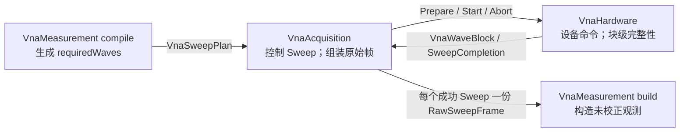
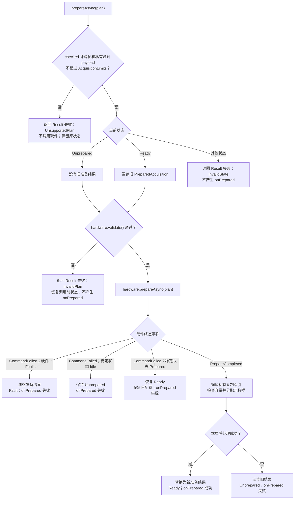
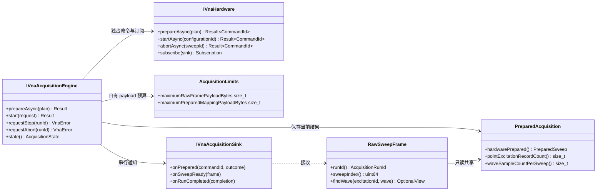
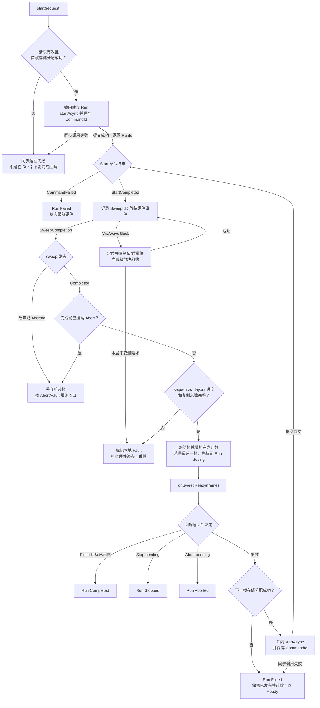
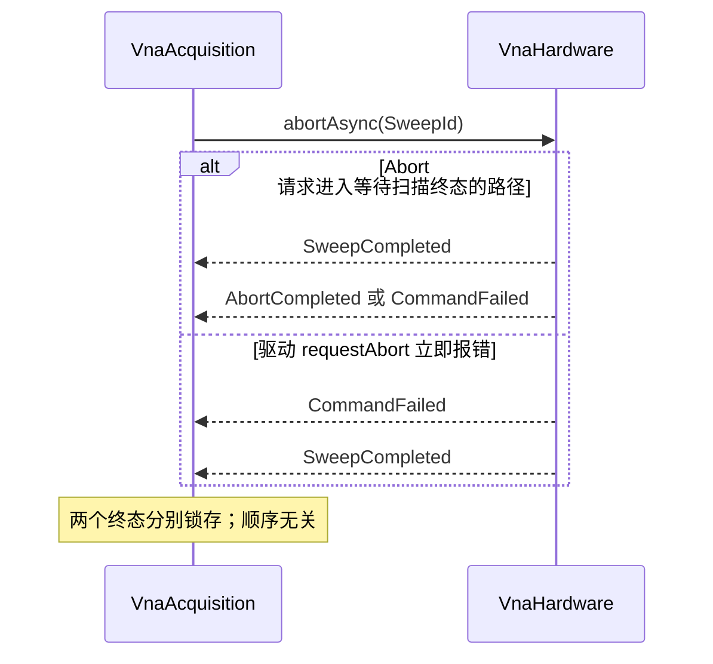

# VNA 原始波采集层软件设计

| 项目 | 内容 |
| --- | --- |
| 文档状态 | V1 评审稿 |
| 文档版本 | 0.13 |
| 目标语言 | C++17 |
| 下层依赖 | `VnaHardware` `f09a5eb`；本层实现 `97fc1f8`；本机基准 `09c7de8`；大形状验证 `8aa41a8` |
| 建议模块名 | `VnaAcquisition` |
| V1 范围 | 单设备、单活动 Sweep、原始波成帧、有限/连续执行 |

## 1. 结论和边界

这一层不应继续叫“测量核心层”。它既不计算 S 参数，也不做校准、平均或 Trace 处理；更准确的
中文名是“原始波采集层”，模块名为 `VnaAcquisition`。“原始波”指尚未做用户校准、比值、平均和
Trace 处理的端口复数波，不是 ADC/IF 原始采样。

它的职责可以压缩为一句话：

> 接受一份已展开的 `VnaSweepPlan`，驱动 `VnaHardware` 完成一个或多个 Sweep，并把分批到达的
> `VnaWaveBlock` 组装成逐 Sweep、不可变的 `RawSweepFrame`。



| 本层负责 | 本层不负责 |
| --- | --- |
| 直接接收和 Prepare `VnaSweepPlan` | 从 Trace、校准方法或 UI 状态推导计划 |
| 单设备、单活动 Sweep | 多设备同步和多 Channel 调度 |
| Single/Finite/Continuous 执行 | 跨 Sweep 平均和统计 |
| 把临时波块复制成完整原始帧 | S 参数、Ratio 或其他派生量计算 |
| 原样保存复数波和质量位 | 校准、校正、去嵌和重归一化 |
| Stop、Abort 和唯一 Run 终结 | Trace 格式、平滑、时域和 Marker |

`VnaHardware` 的 `FrameTracker` 负责权威的块布局、点范围、重复、顺序和完整覆盖检查。
本层不复制第二套 `FrameTracker`、coverage bitmap、块队列或 completion fence；但由于入口是公开
`IVnaHardware` 接口，每 Sweep 保留一个全局连续 sequence、每 layout 一个下一期望偏移和复制总数。
这是 `O(L)` 的层边界防御，不改变 Hardware 的完整性权威。

## 2. 必要术语

| 术语 | 含义 |
| --- | --- |
| Sweep | 按当前计划完成全部点和激励的一次硬件扫描 |
| Run | 一次用户 Start；可包含一个、有限多个或持续多个 Sweep |
| 点表 | `VnaSweepPlan::points`；数组顺序就是采集顺序 |
| `pointIndex` | 点在当前 `PreparedSweep.effectivePlan.points` 中的位置，从 0 开始 |
| `PointId` | 上层给点的身份；在一份 effective plan 内唯一，不要求等于 `pointIndex` |
| IFBW | 中频带宽；是接收机测量设置，不是显示带宽 |
| dwell | 在该点额外停留的时间 |
| 激励 | 一个点上的源状态，以及同时要求取得的波 |
| `ExcitationId` | 一份 plan 内的激励布局身份；它不是数组下标，也不代表固定源状态。同一 ID 跨点复用时只保证 `requiredWaves` 及其顺序一致；该点实际源、功率和相位仍以 effective plan 为准 |
| `VnaWaveKey` | 一条直接波的身份 `(WaveKind, PortId)`；例如 `(Outgoing, 3)` 表示 `b3` |
| `Incident, port=i` | 相对于端口参考方向的入射波 `a_i` |
| `Outgoing, port=i` | 相对于端口参考方向的出射波 `b_i` |
| 波序列 | 同一 `ExcitationId` 布局下，一种波沿适用点排列成的一条连续序列 |
| `LayoutId` | Prepare 后由硬件分配，用于解释块中各波位置；它不是数组下标，也不要求连续或有序 |
| `CommandId` | 一条异步硬件命令的身份，用于匹配完成或失败事件 |
| `ConfigurationId` | 一次成功 Prepare 的身份；后续 Prepare 成功、断线或 Fault 后旧值过期 |
| `SweepId` | 一次硬件 Sweep 的身份 |
| `AcquisitionRunId` | 一次本层 Run 的身份 |
| `sweepIndex` | Run 内第几个 Sweep，从 0 开始；不表示平均 |
| 原始帧 | 一个成功 Sweep 的完整波结果，尚未经过用户校准和通道处理 |

硬件事件里的 `expectedFrameCount`/`receivedFrameCount` 使用“点 × 激励记录”计数。这里的
“frame”不是本文的 `RawSweepFrame`，也不是波数量；例如 101 点、每点两个激励，计数为 202。

“Raw”也不表示 ADC/IF 采样。`VnaHardware` 当前交付的是硬件定义数据阶段的每点复数波；其
单位、参考阻抗、参考平面和工厂归一化边界仍需由硬件数值契约说明。

标识符都只有明确的局部作用域：`PointId`、`ExcitationId` 可由上层在另一份计划中复用；
`pointIndex`、`LayoutId` 只能在所属 `PreparedAcquisition` 内解释，不能跨 Prepare 保存；
`sweepIndex` 只能和其 `AcquisitionRunId` 一起使用。这里不再增加新类型，只禁止脱离所属对象
缓存裸索引。

## 3. 输入和 Prepare

### 3.1 直接复用 VnaSweepPlan

不再定义 `NetworkMeasurementRequest` 或另一个同构 Request。本层直接接收已有
`VnaSweepPlan`，避免维护两套点、源和波定义。

产品的线性/对数/分段点表由未来 Channel 或校准工作流展开；`VnaMeasurement` 网络测量层只把
观测定义编译为 `requiredWaves` 并生成提交给本层的完整计划。

点表示例：

```text
points[0] = { pointId=10, frequency=1 MHz, IFBW=1 kHz, 激励 P1/P2 }
points[1] = { pointId=20, frequency=2 MHz, IFBW=1 kHz, 激励 P1/P2 }
```

`sources` 表示该激励中真正开启的源，不是结果幅度，也不是旧稿中未定义的 `sourceLevels`：

```text
sources = [{ port=P1, power=-10 dBm, phase=0° }]
```

### 3.2 任意直接波

端口 1 激励时若需要全部二端口波：

```text
ExcitationId = 1
sources       = [P1]
requiredWaves = [a1, a2, b1, b2]
```

端口 2 激励可再请求：

```text
ExcitationId = 2
sources       = [P2]
requiredWaves = [a1, a2, b1, b2]
```

因此 `a2@Src1`、`b1@Src2` 或校准 Thru/Isolation 所需波都可以直接采集，不从 S 参数反推。
准确承诺是“计划模型可以表达任意端口波，最终以设备 Prepare 接纳为准”，不能承诺每台设备
都实际拥有全部接收机通道。

### 3.3 Prepare 的唯一事实源

```text
VnaSweepPlan
    └─ hardware.prepareAsync()  权威接纳
            └─ PreparedSweep
```

本层可在提交前调用 `hardware.validate()` 做快速同步拒绝，但不新增第二个公开 Validate API；
只有 `PrepareCompletedEvent` 才能建立新配置。失败时不得从请求伪造有效布局。

重新 Prepare 必须保留当前硬件实现的准确语义：

1. 首次 Prepare 失败：本层保持 `Unprepared`。
2. 已经 `Ready` 时，若 `hardware.prepareAsync()` 在命令准入阶段同步拒绝，驱动尚未被调用；本层
   返回该错误、不产生 `onPrepared()`，旧 `PreparedAcquisition` 和旧 `ConfigurationId` 继续有效。
3. 命令已准入后若收到 `CommandFailedEvent`，以 Hardware 状态为权威：仍为 `Prepared` 才保留旧
   配置；进入 `Idle` 表示驱动 Prepare 已触及设备且旧代次无法证明有效，本层清空结果并回到
   `Unprepared`；进入 `Fault` 则清空结果并进入 `Fault`。
4. 硬件 Prepare 成功，但本层随后编译复制索引或分配元数据失败：硬件新配置已经替代旧配置，
   本层必须清空旧准备结果、回到 `Unprepared` 并报告 Prepare 失败；之后允许再次 Prepare。

Prepare 不属于 Run，所以 Prepare 失败只通过 `onPrepared()` 报告，不能产生 `Run Failed`。



## 4. 准备结果和原始帧

### 4.1 PreparedAcquisition

`PreparedAcquisition` 是只读对象，公开部分只提供：

```cpp
class PreparedAcquisition final {
public:
    const PreparedSweep& hardwarePrepared() const noexcept;
    std::size_t pointExcitationRecordCount() const noexcept;
    std::size_t waveSampleCountPerSweep() const noexcept;

private:
    // 仅实现可见：按 LayoutId 排序的复制索引、适用 pointIndex 和目标偏移。
};
```

内部索引在 Prepare 冷路径生成：

- 一个 `LayoutId` 对应一个激励布局。
- 每个布局保存它实际出现的全局 `pointIndex`，支持并非每点都有该激励的稀疏计划。
- 同一布局的 `pointIndices` 按升序只保存一次，供该激励的全部波共享；不能为每条波复制一份。
- 波块到达时，先按 `LayoutId` 找复制索引，再用块的 `firstPointIndex` 找紧凑局部偏移。
- `firstPointIndex` 始终是 effective plan 的全局索引，不是稀疏序列的局部下标；一个硬件块只
  能覆盖连续全局点，遇到稀疏孔洞必须由硬件拆块。
- 目标偏移预先计算；热路径不查字符串、不构造 S 参数，也不逐点查 Map。

每 Sweep 的可变组帧存储除 values/quality 外，只分配长度为 `L` 的
`nextExpectedPointOffsets`，并保留一个 `nextBlockSequence`。它们用于拒绝来自非当前 Hardware
实现的重放、重叠、乱序和 sequence 缺口；不是长度为点数的覆盖表。

两个私有名称只描述紧凑存储，不是新的领域对象：`PreparedLayoutMapping` 每个有效 layout 一项，
保存 LayoutId、ExcitationId、共享 pointIndices 及其波描述符范围；`PreparedWaveMapping` 每条
“layout × wave”序列一项，保存 VnaWaveKey 和帧内目标起始偏移。热路径只在这两个已排序数组和
共享 pointIndices 上查找。

这些复制索引不得作为公开可变 `vector` 暴露，否则上层会依赖内部存储布局。
`PreparedAcquisition` 不可变；旧帧持有其只读引用，所以重新 Prepare 后旧帧仍可解释。

### 4.2 RawSweepFrame

帧的稳定复数类型直接使用当前硬件 API 已有的 `std::complex<double>`，不依赖尚未实现的类型：

```cpp
using AcquisitionRunId = std::uint64_t;

struct RawWaveSeriesView {
    const std::uint32_t* pointIndices;
    const std::complex<double>* values;
    const std::uint32_t* quality;
    std::size_t size;
};

class RawSweepFrame final {
public:
    AcquisitionRunId runId() const noexcept;
    std::uint64_t sweepIndex() const noexcept;
    SweepId hardwareSweepId() const noexcept;
    const PreparedAcquisition& prepared() const noexcept;
    std::optional<RawWaveSeriesView> findWave(
        ExcitationId excitationId,
        VnaWaveKey wave) const noexcept;

private:
    std::shared_ptr<const PreparedAcquisition> prepared_;
    std::vector<std::complex<double>> values_;
    std::vector<std::uint32_t> quality_;
};
```

`pointIndices[i]` 用于定位 `prepared().hardwarePrepared().effectivePlan.points[pointIndices[i]]`，
由此可取得对应 `PointId` 和频率；`values[i]`、`quality[i]` 与它一一对应。View 不拥有内存，
其有效期不超过所属帧。找不到指定 excitation 或 wave 时，`findWave()` 返回 `nullopt`。

帧不提供 `Sij()`、`ratio()`、校准或显示格式接口。

### 4.3 完整性和质量位不是同一件事

硬件 `SweepTerminationReason::Completed` 表示计划中的点×激励记录结构完整，但样本仍可能带
Missing、Overload、Unlocked 等非 `Valid` 质量位。本层原样保存 `WaveQuality` 位，不把异常
样本改成零，也不因个别质量位自动把完整 Sweep 改成 DataLoss。

### 4.4 最小对象关系



## 5. 最小公开接口

```cpp
struct AcquisitionLimits {
    // values + quality + 每 layout 组帧进度的 Sweep 组帧预算；必须大于零。
    std::size_t maximumRawFramePayloadBytes;
    // 本层私有持久映射的逻辑 payload；必须大于零，不含 PreparedSweep 和分配器开销。
    std::size_t maximumPreparedMappingPayloadBytes;
};

enum class AcquisitionRunMode : std::uint8_t {
    Finite,
    Continuous
};

struct AcquisitionRunRequest {
    AcquisitionRunMode mode{AcquisitionRunMode::Finite};
    std::uint32_t sweepCount{1};
};

enum class AcquisitionState : std::uint8_t {
    Unprepared,
    Preparing,
    Ready,
    Running,
    Fault
};

enum class AcquisitionRunTermination : std::uint8_t {
    Completed,
    Stopped,
    Aborted,
    Failed
};

struct AcquisitionRunCompletion {
    AcquisitionRunId runId;
    AcquisitionRunTermination termination;
    std::uint64_t completedSweepCount;
    std::optional<VnaError> error;
};

class IVnaAcquisitionSink {
public:
    virtual ~IVnaAcquisitionSink() = default;
    virtual void onPrepared(
        CommandId commandId,
        Result<std::shared_ptr<const PreparedAcquisition>> outcome) = 0;
    virtual void onSweepReady(
        std::shared_ptr<const RawSweepFrame> frame) = 0;
    virtual void onRunCompleted(
        const AcquisitionRunCompletion& completion) = 0;
};

class IVnaAcquisitionEngine {
public:
    virtual ~IVnaAcquisitionEngine() = default;
    virtual Result<CommandId> prepareAsync(VnaSweepPlan plan) = 0;
    virtual Result<AcquisitionRunId> start(
        AcquisitionRunRequest request) = 0;
    virtual VnaError requestStop(AcquisitionRunId runId) = 0;
    virtual VnaError requestAbort(AcquisitionRunId runId) = 0;
    virtual AcquisitionState state() const = 0;
};

Result<std::unique_ptr<IVnaAcquisitionEngine>> createAcquisitionEngine(
    std::shared_ptr<IVnaHardware> hardware,
    IVnaAcquisitionSink& sink,
    AcquisitionLimits limits);
```

- Single 就是 `Finite + sweepCount=1`。
- Finite 要求 `sweepCount >= 1`；Continuous 忽略该字段。
- 每个成功 Sweep 发布一帧，本层永远不把 N 个 Sweep 合成一帧。
- 每个 Run 恰好产生一次 `onRunCompleted()`。
- `prepareAsync()` 只有返回成功才会产生一次对应 `onPrepared()`；状态或快速校验失败不产生回调。
- `requestStop()`/`requestAbort()` 返回 `None` 只表示请求被本层接纳，最终结果仍看 Run 完成。

`AcquisitionLimits` 是部署配置，不是端口数、点数或波数硬编码。进入状态锁前，先对本地 plan 做
无副作用的 checked 求和和字节预检；超过单帧或私有映射 payload 预算时，本层不调用硬件，返回
`UnsupportedPlan`。随后在命令事务内检查状态、调用 `hardware.validate()` 并提交 Prepare。硬件
成功 Prepare 后再用 effective plan 复核一次，以防请求与有效结果出现未预期差异。

工厂要求两项预算都大于零，否则创建失败。这里的 mapping payload 只计本层为布局寻址和目标偏移
新增的逻辑 element bytes，不是进程 RSS 上限；它明确排除 `PreparedSweep`、allocator rounding、
capacity 余量和控制块。Prepare 峰值内存还受 §8.3 的独立门禁约束。

`prepareAsync()` 只允许从 `Unprepared` 或 `Ready` 调用。状态检查和写入 `Preparing` 在同一锁内
完成，所以两个线程并发 Prepare 时只有一个会成功取得 `CommandId`；本层始终只有一个 pending
Prepare。

`start()` 的成功返回也是事务边界。首个帧缓冲分配、RunId、Running 状态、硬件 Start 提交和
pending CommandId 必须全部建立后才能返回成功；此前任何校验、分配或同步调用异常都返回失败，
不生成 RunId，也不产生 `onRunCompleted()`。一旦返回 RunId，后续任何失败都必须产生唯一 Run
完成。Continuous 的后续帧分配或 Start 提交失败时，保留已经发布的计数并以 `Failed` 收口。

### 5.1 所有权和回调契约

工厂只接受已经连接、处于硬件 `Idle` 且尚无订阅者的对象。Engine 持有硬件对象和它的唯一
`Subscription`；存活期间，其他模块不得直接调用该硬件的 Connect、Prepare、Start、Abort 或
Disconnect 命令。调用方保证传入的 Sink 比 Engine 活得更久。

发现、Open、Connect 在创建 Engine 前完成；正常 Disconnect 在 Run 和 pending 命令都终结、
Engine 销毁并同步退订后完成。创建该硬件对象的 `VnaHardwareManager` 必须比 Engine 活得更久，
Engine 存活期间不得调用 Manager `shutdown()`。

活动 Run、pending 命令、在途回调或并发公开方法调用存在时析构 Engine 都是调用方错误。不得在
任何 Acquisition Sink 回调内部销毁 Engine；应在回调返回后由外部执行器完成销毁。进入
`Fault` 后的恢复方式是等待已有操作收口、销毁 Engine，再由外层 Disconnect/Connect 后重建。

所有上层 Sink 回调具有同一契约：

- 在该设备的硬件事件线程上串行调用，不额外切换线程。
- 调用时不持有 Engine 状态锁；Sink 可以重入 Engine，仍受正常状态规则约束。
- Engine 捕获所有 Sink 异常，记录诊断且不允许异常越过硬件回调边界；该次通知不重试。
- 普通计算和 UI 更新不得阻塞回调；`onSweepReady()` 只允许为“交给有界下游队列”而等待。

Engine 在 `onSweepReady()` 返回后才检查 Stop/Abort 并决定是否启动下一 Sweep。Engine 不保留
历史帧；回调后只释放自己的引用。若下游队列已满，允许 `onSweepReady()` 阻塞，由此自然暂停
下一 Sweep，这就是 V1 的 Sweep 级反压点。下游不得用“快速返回 + 无界队列”绕过反压；它持有
的帧数量和内存仍由该层自己的有界策略负责。

### 5.2 命令提交和回调线性化

硬件命令入队后可能立刻在其他线程完成。因此 Prepare、Start、Abort 都必须在同一个 Engine
状态锁事务中完成：

```text
检查状态 -> 建立本地上下文 -> 调用 hardware.*Async() -> 保存返回 CommandId -> 解锁
```

硬件事件处理也取得同一把锁。这样即使 Actor 已经完成，事件线程也只能在 pending ID 保存后
继续。同步调用抛异常时，事务回滚到调用前状态；不能留下“有状态、无 CommandId”的半个操作。

本层不增加第二条事件队列，所以终态回调可能在公开异步方法解锁后、该方法返回到调用者之前
发生。调用方必须使用回调携带的 CommandId/RunId 关联结果，不能假定“先收到返回值，后收到
回调”。

`StateChangedEvent` 只锁存硬件状态并阻止不再安全的新命令，不直接完成 Prepare 或 Run。当前
硬件总是先发布 Prepared/Fault 状态，再发布权威的 Command/Sweep 终态；本层必须等匹配终态
收口，避免重复完成。

调用上层 Sink 前，必须先在锁内提交最终 `AcquisitionState`、清除 active/pending 并设置
exactly-once 标志，再解锁调用 Sink。因此 `onPrepared()` 成功回调中看到 `Ready`，
`onRunCompleted()` 中看到最终 `Ready` 或 `Fault`，且可按正常状态规则重入下一操作。

为了让上述保证在并发公开调用下仍成立，Engine 在锁内提交终态时同时登记回调交付门禁。从终态
提交到对应 `onPrepared()`/`onRunCompleted()` 返回，其他线程调用 `state()`、Prepare、Start、
Stop 或 Abort 会等待；正在执行终态回调的硬件事件线程可以穿过门禁重入 Engine。终态回调不得
同步等待另一个需要调用 Engine 才能完成的线程，否则会形成应用层环形等待。

Engine 对每一个 `IVnaHardwareEventSink` override 建立最外层异常边界，覆盖内部索引编译、帧冻结、
对象分配、诊断和上层 Sink 调用；任何异常都不能逃回 `VnaEventDispatcher`，否则硬件会永久停用
唯一订阅。可收口的内部异常转为本地 `Failed/Fault`，并继续排空相应硬件终态。

## 6. 执行、Stop 和 Abort

### 6.1 一次 Sweep



硬件把 WaveBlock 和 SweepCompletion 放在同一 FIFO 中，所以完成事件到达时，先前块回调已经
结束。本层只在以下条件都成立时发布帧：

1. completion 的 `SweepId` 等于当前 Sweep。
2. `reason == Completed`。
3. `expectedFrameCount == prepared.pointExcitationRecordCount()`。
4. `receivedFrameCount == expectedFrameCount`，且等于本层复制的点×激励记录数。
5. 复制样本总数等于 `prepared.waveSampleCountPerSweep()`。
6. 全局 block sequence 从 0 连续，且每 layout 的下一期望偏移恰好等于该 layout 点数。
7. 复制过程没有布局、范围、容量或异常错误。
8. 当前 Sweep 没有在完成事件前接纳 Abort。

任何条件失败都丢弃当前缓冲。Hardware 已经证明逐点覆盖完整；本层的 `O(L)`
进度仅用来守住公开接口边界，不维护第二份 bitmap。

调用 `onSweepReady()` 前是帧的提交线性化点：一旦回调开始，该帧已发布，不能再撤回。若它是
Finite 的最后一帧，本层在回调前先把 Run 标为 closing；回调内的 Stop/Abort 返回
`InvalidState`，随后仍发布 `Run Completed`。若后面还有 Sweep，回调内的 Stop/Abort 只决定
是否启动下一 Sweep，不影响刚发布的帧。

`completedSweepCount` 始终等于已经进入 `onSweepReady()` 的帧数；已发布帧的 `sweepIndex` 必须
连续为 `[0, completedSweepCount)`。只有 `Failed` 终态携带非空 `error`，Completed、Stopped、
Aborted 的 `error == nullopt`。Sink 在提交线性化点之后抛异常不会回退计数。

### 6.2 Stop

- 当前 Sweep 已启动：等待它自然完成；成功帧照常发布，然后 Run 以 `Stopped` 结束。
- Start 命令已发出但尚无 `SweepId`：记录 Stop；Start 成功后仍让该 Sweep 自然完成。
- 正处于两次 Sweep 之间：设置 Stop，由当前硬件事件回调在返回上层 Sink 后以 `Stopped` 收口，
  不再 Start。
- External Trigger 下自然完成可能无限等待；Stop 没有时间上限保证。要立即终止只能使用设备
  支持的 Abort。

### 6.3 Abort

- 活动 Sweep 或已发出的 Start 需要硬件中止；此时若 `supportsAbort == false`，
  `requestAbort()` 同步返回 `UnsupportedPlan`，Run 不受影响。
- 若当前还在等待 `StartCompletedEvent`，只记录 abort-pending；取得 `SweepId` 后立即发
  `abortAsync()`。
- 若正处于两次 Sweep 之间，不需要硬件 Abort 能力；设置 Abort，由当前硬件事件回调在返回
  上层 Sink 后以 `Aborted` 收口，已经发布的早先帧不受影响。
- Abort 在活动 Sweep 上被本层接纳后，该 Sweep 尚未发布的组装帧一律丢弃。

当前硬件对一次已发出的 Abort 使用“扫描终态”和“Abort 命令终态”两个事件。正常中止通常先
收到 SweepCompleted；驱动的 `requestAbort()` 立即报错时，则可能先收到 CommandFailed：



因此 `ActiveSweep` 要分别记录“扫描已终结”和“Abort 命令已终结”，不能依赖到达顺序。只有
两者都到达，才清除 pending `CommandId` 并发布 Run 完成。若 Start 在取得 `SweepId` 前失败，
本层没有发出硬件 Abort 命令，不等待不存在的 Abort 终态，Run 直接 `Failed`。

- Sweep 为 `Aborted` 且 AbortCompleted：Run 为 `Aborted`。
- 连接丢失、超时、DataLoss 或 HardwareFault：Run 为 `Failed`。
- Abort 命令失败或扫描实际没有以 Aborted 结束：Run 为 `Failed`。

最后一种情况下，若扫描实际 `Completed`，硬件仍处于 Prepared，本层在报告 `Failed` 后回到
`Ready`；若扫描是故障终态，则进入 `Fault`。

### 6.4 竞态线性化

公开命令和硬件事件在同一个 Engine 状态锁上确定先后：

- RunId 不匹配、Run 已终结，或 Finite 最后一帧已经标记 closing 时，Stop/Abort 返回
  `InvalidState`。
- 当前 Sweep 已结束且 Run 仍有后续 Sweep 时，`onSweepReady()` 内的 Stop/Abort 可以被接纳，
  只阻止下一次 Start。
- Stop 先被接纳时，当前 Sweep 正常完成后为 `Stopped`。
- 第一次 Stop 设置标志；重复 Stop 返回 `None`，不产生新动作。
- Abort 可以升级先前的 Stop；Abort 一旦接纳，后续 Stop 或重复 Abort 都返回 `None`，不降级、
  不再发送第二条硬件 Abort 命令。
- `StartCompletedEvent` 只在 `CommandId` 匹配后写入 `SweepId`。
- Prepare、Start、Abort 的完成或失败事件都必须匹配各自 pending `CommandId`。

`requestStop()`/`requestAbort()` 只在线程安全状态中写入请求或提交硬件命令，永不在调用者线程
直接触发 Sink；所有 `onRunCompleted()` 仍由硬件事件线程串行发出。

这些 ID 足以处理本层竞态，不再引入公开的 Generation、Revision 或 Epoch。

### 6.5 故障排空和异常事件

当前 `VnaHardware` 还有一条罕见但合法的启动失败路径：Host sweep 路由注册失败时，硬件会先
进入 Fault 并发布 `SweepCompletion`，之后才发布 Start 的 `CommandFailed`；此时本层尚未收到
`StartCompleted`，因而不知道该 `SweepId`。

V1 兼容规则是：存在 pending Start、尚无 SweepId 时收到的唯一一条 completion 先锁存、丢弃
所有帧并等待匹配的 Start `CommandFailed`，由后者把 Run 收口为 `Failed`；不能把它当成另一
Run 的事件。若随后反而收到 StartCompleted、出现第二条 completion，或没有 pending Start，
则是协议故障。

除已定义的 Abort 尾随事件和上述 pre-start completion 外，未知 CommandId、SweepId 或重复终态
都使本层进入协议 Fault，阻止新命令并安全排空当前操作，不能只记录日志后继续。

本层在活动 Sweep 中发现映射、容量或内部异常时，立即停止复制并丢弃帧。设备支持 Abort 时，
Engine 内部只发一次 Abort 以缩短排空时间，但最终 Run 仍报告最初的本地 `Failed`，不改写为
`Aborted`；不支持 Abort 时只能等待硬件自然终结，External Trigger 下可能没有时间上限。

从分层角度，更简单的长期修复是让 `VnaHardware` 保证“StartCompleted 后才能有
SweepCompletion；否则只发 Start CommandFailed”。在该下层契约修正前，上述兼容路径和测试
不能删除。

## 7. 状态和故障映射

| 情况 | 本层结果和后续状态 |
| --- | --- |
| Finite 全部 Sweep 成功 | Run `Completed`，回 `Ready` |
| Stop 后当前 Sweep 成功 | 发布当前帧，Run `Stopped`，回 `Ready` |
| 硬件实际 Aborted | 丢帧，Run `Aborted`，回 `Ready` |
| Start 命令失败且硬件仍 Prepared | Run `Failed`，回 `Ready` |
| ConnectionLost/Timeout/DataLoss/HardwareFault | 清准备结果，Run `Failed`，进 `Fault` |
| 本层布局/范围/计数不变量破坏 | 排空硬件终态、丢帧、Run `Failed`，进本地 `Fault` |
| Sink 回调抛异常 | 截断并记录，不改变采集状态，不重试通知 |

本层内部组装错误即使碰巧伴随硬件 `Completed`，也不能继续复用同一映射；进入本地 `Fault`
可避免重复发布错位数据。恢复按 §5.1 销毁并重连。

## 8. 性能设计

设一个 Sweep 返回 `M` 个复数波样本，本层时间和帧内存都是 `O(M)`。每个样本只复制一次。
不做 Ratio、幅相转换、校准矩阵、跨 Sweep 累加、字符串 Map 或逐点对象分配。

`onWaveBlock()` 热路径只做：

1. 核对 `SweepId`。
2. 由 `LayoutId` 和 `firstPointIndex` 定位目标。
3. 核对全局 sequence 和该 layout 的下一期望偏移。
4. checked 计算复制后记录数和样本数。
5. 批量复制全部波的值和质量位。
6. 仅在所有 `copyWaveTo()` 成功后提交 sequence、layout 偏移和复制总数。
7. 返回，使硬件块租约立即归还。

该回调不得分配内存、格式化日志、调用外部 Sink 或执行任何测量数学。帧存储在 Start 当前
Sweep 之前按 Prepare 的样本数分配；V1 只承诺 `onWaveBlock()` 零动态分配，不承诺未经基准
证明的“每 Sweep 零分配”。若分配确实成为瓶颈，可在不改变公开 API 的前提下增加内部池。

### 8.1 当前性能边界

`VnaWaveBlock` 已提供批量复制 API：

```cpp
void VnaWaveBlock::copyWaveTo(
    std::size_t waveIndex,
    std::complex<double>* destinationValues,
    std::uint32_t* destinationQuality,
    std::size_t pointCount) const;
```

它由硬件层一次检查范围并在内部紧循环复制，既隐藏 ABI 存储，也不要求帧依赖新的复数类型。
采集层热路径使用该接口，不再为每个样本重复跨公开边界调用 `value()`/`quality()`。

Simulator 的局部速度门禁已经明确：10–30 kHz IFBW 不得被固定批次延迟拖慢；单激励、零 dwell
时每点逻辑窗口分别为 100 us 和 33.334 us。300 点、`B=2` 的集成测试会完整交付 150 个波块，
并以宽松墙钟上限拦截旧版每批 20 ms 的人为节流。这个门禁证明模拟链路没有固定节流，但 IFBW
不能单独代表真机 Sweep/s；真机仍受点数、激励数、滤波器阶数、源/LO 切换和传输影响。

除§8.4 已建立的本机吞吐外，长稳验收还需记录 `onWaveBlock()` P50/P99、Sweep 分配次数、
硬件完成到下一 Sweep 的间隙，以及 Continuous 长时间 CPU/RSS/丢数情况。

### 8.2 参数化容量验证用例

先采用下面一组容量验证参数，但它只是测试数据，不是产品限制或生产常量：

| 参数 | 验证值 |
| --- | ---: |
| 设备端口数 | 4 |
| Sweep 点数 | 10,000 |
| 每点激励数 | 4 |
| 每激励波数 | 4 |
| 验证用池 slot 数 | 2（配置项，不是生产硬编码） |

当前本机吞吐基准令四个激励分别只开启源端口 P1/P2/P3/P4，每个激励请求
`a(src)/b(src)/a(neighbor)/b(neighbor)` 四条波。测试生成器应接收端口数、激励列表和波键列表作为
参数，不能把这组键写进生产代码。为避免错误实现碰巧借自然顺序通过，正确性用例还应使用
非连续乱序 `ExcitationId`（例如 `40/10/30/20`）和不同波排列。
假硬件返回另一组非连续乱序 `LayoutId`，并在部分点改变 `excitations` 容器顺序。`PointId` 也
使用确定性的非连续乱序值且不等于 `pointIndex`，但 effective plan 的 points 数组顺序不变。

生产代码必须从 `PreparedSweep.effectivePlan` 和 `layouts` 计算实际数量。不能出现
`kPortCount = 4`、`kMaximumPoints = 10000` 或“每个激励固定四波”之类的实现常量。稀疏激励或
不同布局波数下，应使用以下求和形式：

```text
pointExcitationCount = Σ points[i].excitations.size()
waveSampleCount      = Σ points[i].excitations[j].requiredWaves.size()
```

本用例每点结构相同，所以可以简化核算：

| 项目 | 公式 | 结果 |
| --- | --- | ---: |
| 点×激励记录数 `R` | `10,000 × 4` | 40,000 |
| 复数波样本数 `M` | `R × 4` | 160,000 |
| 值数组 | `M × sizeof(std::complex<double>)`，当前工具链为 16 B | 2,560,000 B（2.441 MiB） |
| 质量位数组 | `M × sizeof(std::uint32_t)` | 640,000 B（0.610 MiB） |
| 单帧纯数据载荷 | 值数组 + 质量位数组 | 3,200,000 B（3.052 MiB） |
| 组帧预算 | 纯数据 + `4 × sizeof(std::size_t)` 进度偏移 | 3,200,032 B（当前 64 位工具链） |
| Prepare 点索引 | `10,000 × 4 × sizeof(std::uint32_t)` | 160,000 B（0.153 MiB） |

单帧载荷不包括 `vector`/`shared_ptr` 控制对象、分配器开销和 `PreparedSweep.effectivePlan`。
后者包含嵌套点、激励、源和波容器，应另外实测 Prepare 的耗时、分配次数和峰值内存，不能用上表
代替。

160,000 B 的点索引成立的前提是：4 个 layout 各保存一份 10,000 点索引，并由同一 layout 的
4 条波序列共享。若错误地给 16 条波序列各复制一份，会膨胀为 640,000 B，参数化测试必须断言
索引总项数恰好为 40,000。

160,000 B 只是完整 prepared mapping 的一个子项。V1 私有映射只保留按 `LayoutId` 排序的布局
描述符、每布局共享的 `pointIndices` 和每条波的目标描述符，不预建逐点对象或额外 copy-range
数组。统一的 `checkedPreparedMappingPayload()` 按下式计算：

```text
R = Σ 每点激励数
L = 有效 layout 数
S = Σ layouts[i].waveKeys.size()

mappingPayload = R × sizeof(uint32_t)
               + L × sizeof(PreparedLayoutMapping)
               + S × sizeof(PreparedWaveMapping)
```

所有乘法和加法都受检；以后增加任何持久查找数组时必须同时扩展该 helper。requested plan 预检、
effective plan/layout 权威复核以及“恰好等于/少 1 B”单测共用这一个函数，不能维护三套公式。
`PreparedLayoutMapping` 的具体 `LayoutId` 要到 Prepare 后才能填入，但其数量可以由 requested plan
中的不同 `ExcitationId` 预先计算。

所有容量运算必须逐步执行 checked multiply/add，并在分配前同时检查：

- 点数可由 `std::uint32_t pointIndex` 表示。
- 点×激励数、样本数和字节数均可由 `std::size_t` 表示。
- 点×激励数没有超过 `pointIndices` 容器的 `max_size()`；布局表、波描述符及其字节数也分别做
  checked 运算和 `max_size()` 检查。
- 样本数没有超过 values/quality 容器各自的 `max_size()`。
- `valuesBytes + qualityBytes + layoutCount × sizeof(std::size_t)` 不溢出，且不超过
  `AcquisitionLimits.maximumRawFramePayloadBytes`。这个限额约束组帧期峰值；发布帧只保留 values/quality。
- pointIndices、布局表和波描述符的 payload 求和不溢出，且不超过
  `AcquisitionLimits.maximumPreparedMappingPayloadBytes`。
- 每条波序列的 destination offset/end 使用 checked add，并满足 `end <= waveSampleCount`；块范围
  用减法证明有效，不能先计算可能溢出的 `first + count`。

设 `S = slotCount`，`B = PreparedSweep.report.waveBlockPointCapacity`。容量验证采用 `S=2`，本用例
每个布局 4 波，则硬件块池的纯数据载荷为：

```text
S × B × 4 × (sizeof(VnaComplex64V1) + sizeof(uint32_t))

S=2 时 = 160 × B bytes
```

例如 `B=10,000` 时为 1,600,000 B（1.526 MiB）。当前 Simulator 的 `B=2`，两槽池载荷仅
320 B，但会交付 `4 × ceil(10,000 / 2) = 20,000` 个波块；该配置适合暴露事件和逐元素访问
开销，不能代表真机批量大小或吞吐。

批大小的参数化单元测试由假硬件按对应 B 切块；Simulator 集成测试仍使用其实际 `B=2`。至少覆盖：

| `B` | 2 槽池 payload | 4 个 dense layout 的块数 | 每 layout 最后一块点数 |
| ---: | ---: | ---: | ---: |
| 64 | 10,240 B（0.010 MiB） | 628 | 16 |
| 256 | 40,960 B（0.039 MiB） | 160 | 16 |
| 1,024 | 163,840 B（0.156 MiB） | 40 | 784 |
| 4,096 | 655,360 B（0.625 MiB） | 12 | 1,808 |
| 10,000 | 1,600,000 B（1.526 MiB） | 4 | 10,000 |

`S=2、B=10,000` 时，一个 acquisition 发布帧加硬件池的纯 payload 为 4,800,000 B
（4.578 MiB）；组帧期再加 32 B 进度偏移和 160,000 B 共享 pointIndices 子项，为
4,960,032 B（4.730 MiB）。这不是完整内存总量：还未包含其余 mapping
描述符、effective plan、硬件 FrameTracker、对象和 allocator 开销，也未包含上层持有的旧帧。

这组参数应放入可继续增加行的表驱动/参数化测试。至少验证：

- Prepare 成功并得到 4 个稳定激励布局。
- 一个 Sweep 恰好处理 40,000 条点×激励记录和 160,000 个样本。
- 帧包含 16 条“激励×波”序列，每条 10,000 点，首/中/尾值与质量位正确。
- 假硬件按 `(ExcitationId, VnaWaveKey, PointId)` 而非容器下标生成可区分的复数哨兵值和质量模式；
  结合乱序 ID、各布局不同的波键顺序和容器顺序，既能发现维度转置，也能发现 `id-1`、把
  `port-1` 错当 `waveIndex`，或把 LayoutId 当数组下标的隐藏硬编码。
- 单帧 payload 的实测值与上述动态 `sizeof` 公式一致。
- 当前目标工具链断言 `sizeof(std::complex<double>) == 16`；生产计算仍使用 `sizeof`，不写字面量。
- `onWaveBlock()` 内无动态分配，完成后只发布一帧且没有 DataLoss。
- 相邻边界用例分别减少和增加一个点/激励/波，用来发现把验证值写死的实现。
- 用可配置假硬件再生成 2 端口和 8 端口的合法计划，确认没有隐藏的四端口常量。
- 用相同计划参数化 `slotCount=1/2/4/8`，验证数据结果不变、PoolBytes 严格按公式变化，并记录
  Acquire 等待 P99；这些 slot 数只用于基准选择默认值。

“四端口、每激励四波”只验证容量和映射，不等价于完整四端口网络测量。完整 S 矩阵、校准或
任意直接波显示应另设语义用例。例如一种常见网络 observation 计划会为源 `j` 请求
`a_j + b1/b2/b3/b4` 共 5 波，而“保留全部直接波”会请求 `a1..a4 + b1..b4` 共 8 波。最终集合
由上层测量/校准模型和设备 Prepare 结果决定；本层不能从本容量用例反推固定波集合。

### 8.3 VnaHardware 容量与性能门禁状态

本次配套实现已关闭三个可由代码证明的下层问题：

1. `slotCount` 从受信配置读取，生产样例为 2；Hardware 按实际
   `slotCount × Wmax × waveBlockPointCapacity × bytesPerWaveSample` checked 计算，并在建池前执行
   64 MiB 总载荷门禁。测试配置可独立选择槽位数，不改变数据语义。
2. Hardware 在命令准入、驱动结果转换和存储前后分别核算 fully-expanded requested/effective plan、
   layouts 和 warnings。宿主持有容器的 `capacity()` 计入 16/32 MiB 逻辑预算；Prepare 事件只共享
   不可变 snapshot，排队及回调中的旧代次合计另受 32 MiB 滞留预算约束。
3. `FrameTracker` 和波池在 Prepare 冷路径构建；同一配置重复 Start 只执行 `resetForSweep()`，
   Continuous 不再逐 Sweep 深拷贝 effective plan/layouts 或重建池。

这些限制证明资源增长有界，但不证明生产吞吐已经达标。逻辑 payload 不含 allocator rounding、
线程栈、驱动 SDK 缓冲、日志和调用方延长的帧寿命；产品仍需给出目标 Sweep/s、“硬件完成到下一
Sweep”P99 间隙、CPU 和 RSS 预算，并在最终部署镜像和真机上做峰值与长期基准。

### 8.4 本机目标场景吞吐基线

本项目将当前开发机作为 Simulator 的目标运行场景。测试形状为 10,000 点、每点 4 个串行
激励、每激励 4 条波，即 40,000 条“点×激励”记录、160,000 个复样本和 3,200,000 B
有效帧载荷。波集合是 `a(src)/b(src)/a(neighbor)/b(neighbor)`；它与其他同形状四波计划的
载荷相同，但 Simulator 的具体计算成本可能不同。

以下是 2026-08-24 在同一本机独立执行 3 次后的保守包络：延迟取三次最大值，吞吐取三次最小值。
10/30 kHz 每次预热 1 帧、采样 9 帧；10 MHz 压力场景每次预热 3 帧、采样 30 帧。

| IFBW | Simulator 逻辑时间 | P50 墙钟上界 | P95 墙钟上界 | P95 墙钟/逻辑上界 | P50 完整计划点/s 下界 | P50 点×激励/s 下界 | P95 有效载荷下界 |
| ---: | ---: | ---: | ---: | ---: | ---: | ---: | ---: |
| 10 kHz | 4,000.000 ms | 4,000.139 ms | 4,000.207 ms | 1.000052 | 2,499.91 | 9,999.65 | 0.762900 MiB/s |
| 30 kHz | 1,333.360 ms | 1,333.449 ms | 1,333.523 ms | 1.000122 | 7,499.35 | 29,997.41 | 2.288493 MiB/s |

“完整计划点/s”是点表的完成速率；四个激励串行时，它等于“点×激励/s”除以 4。
不区分这两个口径会把 10 kHz IFBW 下约 2,500 完整点/s 误报成 10,000 完整点/s。
按 P95 延迟反算的保守吞吐为：

| IFBW | 完整计划点/s 下界 | 点×激励/s 下界 | 复样本/s 下界 |
| ---: | ---: | ---: | ---: |
| 10 kHz | 2,499.871 | 9,999.484 | 39,997.936 |
| 30 kHz | 7,498.935 | 29,995.742 | 119,982.966 |

10 MHz 只用来把 Simulator 逻辑等待压缩到远小于软件处理时间，以观察当前 `B=2`、20,000 个块的
端到端压力上限；它不是产品 IFBW 承诺。

| 10 MHz 端到端压力指标 | P50 保守值 | P95 保守值 |
| --- | ---: | ---: |
| 墙钟延迟 | ≤ 68.389 ms | ≤ 72.047 ms |
| 复样本吞吐 | ≥ 2.340 Msample/s | ≥ 2.221 Msample/s |
| 有效载荷吞吐 | ≥ 44.624 MiB/s | ≥ 42.358 MiB/s |

另外的组帧核心基准使用 4 个 `B=10,000` 热块，每次预热 20 帧、采样 400 帧。它是批量复制上界
诊断，不是 `B=2` 的 Simulator 端到端吞吐。

| 组帧核心 | P50 延迟上界 | P95 延迟上界 | P50 载荷吞吐下界 | P95 载荷吞吐下界 |
| --- | ---: | ---: | ---: | ---: |
| copy-only | 0.166833 ms | 0.199258 ms | 18,292 MiB/s | 15,315 MiB/s |
| allocate+copy+freeze | 0.192709 ms | 0.233777 ms | 15,836 MiB/s | 13,054 MiB/s |

测试环境为 MacBookPro17,1、Apple M1（4 性能核 + 4 能效核）、16 GB 内存、arm64、macOS 26.6.1
（25G76）、Apple Clang 17.0.0 和 CMake 4.4.2。构建为 Release，关闭 GTest/sanitizer 和运行日志，
`slotCount=2`；测试时使用电池供电，低功耗模式关闭。可复现命令为：

```bash
cmake -S . -B build/local-throughput-release \
  -DCMAKE_BUILD_TYPE=Release \
  -DVNA_BUILD_TESTS=OFF \
  -DVNA_BUILD_BENCHMARKS=ON
cmake --build build/local-throughput-release --parallel
./build/local-throughput-release/benchmarks/VnaLocalThroughputBenchmark
```

端到端计时从 `engine.start(Finite, 1)` 前立即开始，在 `onSweepReady()` 入口第一行取结束时间。
它包括每 Sweep 组帧分配、Simulator 计算和逻辑等待、Hardware 事件/池、20,000 个块、批量复制、
完整性检查和帧冻结；不包括发现、Connect、Prepare、预热、日志、主线程唤醒、下游消费和
Run-completion 回调。

本机目标的稳定回归门禁定为：

- 10/30 kHz 端到端 P95 墙钟/逻辑时间 `<= 1.01`。
- 10 MHz 压力管线 P95 有效载荷 `>= 40 MiB/s`。
- 完整帧 allocate+copy+freeze P95 有效载荷 `>= 12,000 MiB/s`。
- 所有场景必须无 `DataLoss`、无 `benchmark_failed` 并完成全部预定帧。

与门禁阈值相比，三次保守实测值在 10 MHz 压力管线上高约 5.9%，在完整帧组装上高约
8.8%；10/30 kHz 墙钟/逻辑时间门禁则留出 1% 调度余量。当前 10/30 kHz 每轮只有
9 个有效样本，所以 P95 是本机回归基线，不是生产尾延迟 SLA。
Simulator 的 `ceil(1e9/IFBW)` 每激励逻辑时间是最低阶时间带宽模型，不是所有 VNA 的普适
物理下限；真机还受滤波器阶数/误差、源/LO 切换、传输和驱动 SDK 影响。

## 9. 明确不在本层的概念

### 9.1 Point Detector

本文把 ZNB v7.4 §4.3.5.3 的 Detector settings 称为 Point Detector。Normal 不额外归约；
非 Normal 模式在同一 Sweep point 的 Detector Meas Time 内归约多份有效结果。它不是跨
Sweep Average。

当前 `VnaHardware` 每点只提供一个最终复数波，没有子结果、detector mode、observation time 或
capability。本层既没有足够输入，也不应解释幅度/相位，所以 V1 不定义 Point Detector 类型。
将来需要时，应先由硬件 capability/plan/Prepare 表达，并由设备、驱动或接收机处理生成点值；
`VnaAcquisition` 仍只复制结果。商用品语义和手册依据见配套设计评审。

### 9.2 校准、平均和 Trace

本层只保证：

```text
每个成功 Sweep -> 一份独立 RawSweepFrame
```

后续 [`VnaMeasurement` 网络测量层](./网络测量层软件设计.md) 从直接波构造所需 observation，
并按测量量选择校正分支；Channel Sweep Average、校准标准归约和 Trace 处理分别由所属层确定
数据阶段。本层不假设任何校准与平均的交换律，也不设计这些算法的类和状态机。

## 10. 测试和编码门禁

### 10.1 必测行为

- `PointId != pointIndex`、稀疏激励、块从稀疏序列中部开始时仍映射正确。
- 每激励请求 `a1/a2/b1/b2` 时，值、波身份和质量位逐样本不变。
- 完整帧可以合法包含非 `Valid` 质量位。
- 首次 Prepare 失败、重 Prepare 失败保留旧配置、本层后处理失败清空旧配置。
- Finite(1/N)、Continuous、Stop 和 External Trigger 等待语义。
- Abort 不支持、Start 前 pending、双事件顺序、Abort 命令失败和故障终态。
- 每个 Run 恰好一个完成事件；Abort 的尾随命令事件不会被误判为未知。
- 任一 Sink 回调抛异常时，硬件订阅仍工作且异常不越过边界。
- 活动 Run 析构前置条件和 Fault 后重建流程。
- §8.2 的 4 端口/10,000 点/4 激励/4 波参数化容量、批大小和哨兵映射用例。
- 两项 Acquisition payload 预算分别在恰好等于需求时通过，少 1 B 时在调用硬件前失败。
- 下游有界队列深度为 1、慢消费者持帧时 RSS 有界，Stop 仍可接纳且回调释放后正确收口。
- 硬件终态抢在公开方法返回前、StartCompleted 前置 completion，以及未知/重复事件的故障注入。
- 假硬件绕过 Hardware `FrameTracker` 直接注入块重放、重叠、layout 乱序和 sequence 缺口；
  Acquisition 必须全部拒绝、不发布帧并以 `ProtocolError` 收口。
- 大点数、多波、长时间 Continuous 的吞吐、分配次数和内存基准。
- Simulator 在 10 kHz 和 30 kHz IFBW 下按最低阶 `ceil(1e9/IFBW)` 模型累计计时，
  300 点扫描不得出现固定批次节流；
  1 Hz 等待中的 Abort 必须在 500 ms 内完成且不得提交待完成批次。

当前 Debug、UBSan 以及 LLVM 22 ASan+LeakSanitizer+UBSan 三类构建均已通过全部
104/104 个 CTest 用例，其中包含上述 4 种 Acquisition 边界非法块。§8.4 的 4P/10k 端到端
形状和吞吐已实测；§8.2 中带乱序 ID、波顺序和点容器顺序的 10k 大形状正确性用例也已通过。

### 10.2 编码门禁

| 优先级 | 项目 | 关闭条件 |
| --- | --- | --- |
| P0 | Acquisition 自有容量 | 已实现 checked 帧/映射预算和精确边界测试；部署值仍需按目标 RSS 确认 |
| P0 | Hardware 池策略 | 已实现可配置 slotCount、checked 总字节门禁和固定槽位池；本机 `slotCount=2` 基线通过，真机 P99 待测 |
| P0 | Prepared plan 聚合内存 | 已实现 requested/prepared/pending/event-retained 聚合预算；Prepare 峰值 RSS 待测 |
| P0 | 数据面性能 | 固定槽位移动交付和批量 `copyWaveTo()` 已实现；本机目标通过，真机 CPU/吞吐待验收 |
| P0 | Continuous 下层复用 | 已复用 immutable prepared、FrameTracker 和波池；完成间隙 P99 待测 |
| P1 | 真机波数值契约 | 定义单位、参考阻抗/平面、相干和工厂归一化边界 |

Point Detector、多 Channel 调度、校准、平均和 Trace 不是本层编码门禁。它们属于后续能力或模块。

## 11. 实现顺序

1. 只读 `PreparedAcquisition` 和单 Sweep 组装。
2. Prepare 三种失败语义、硬件终态映射和唯一 RunCompletion。
3. Finite/Continuous、Stop 和 Abort 双事件收口。
4. 故障注入与正确性测试。
5. 已用本机实测关闭批量复制吞吐门禁；内部帧池仅在后续 CPU/分配数据证明必要时增加，
   不预先增加多 Sweep pipeline 或通用 QoS。
