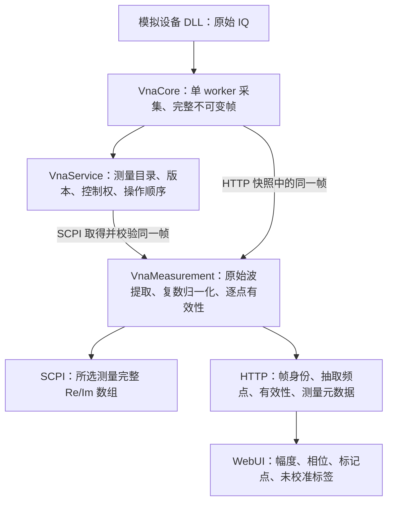
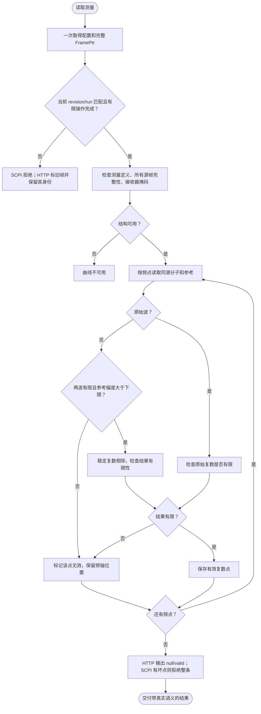

# 未校准 S11 / S21 测量

日期：2026-10-11。交付范围：模拟后台、同源复数比值、Web 与 Keysight SCPI 已核验命令子集。原始 A/B 接收波仍可单独查看。

## 波量与结果合同

端口编号从 1 开始。`aN` 是端口 N 的参考接收波，`bN` 是端口 N 的测试接收波；两者遵循当前模拟 profile 的同一幅度约定，原始单位为 a.u.。在端口 1 激励的同一扫描点，计算：

| 测量 | 分子 | 参考 | 结果单位 | 状态 |
| --- | --- | --- | --- | --- |
| S11 | b1 | a1 | 无量纲 `1` | 未校准 |
| S21 | b2 | a1 | 无量纲 `1` | 未校准 |
| aN / bN | 原始波 | 无 | a.u. | 原始 |

比值包含幅度与相位，不能用幅度相除替代复数相除。S21 的参考是源端口的 a1，不能改为接收端口的 a2。比值阶段不引入参考阻抗换算，也没有去嵌入、参考面移动或误差项校正。真实板卡的接收器映射、波量归一化和非激励端口匹配条件尚未核验，不能把模拟 profile 的比值约定直接用于真板；当前服务仍拒绝非本项目模拟器身份。

对数显示为 `20 log10(|S|)`，相位为 `atan2(Im, Re)` 的角度，主值范围 −180°…180°；零幅度的对数/相位显示遵循绘图模块的无效显示合同。原始波对数显示的参考仍为 `1 a.u.`。前端只做显示换算，不重复计算 S 参数。

## 分层与文件组织



```text
VnaMeasurement/
├── include/vna_measurement/
│   ├── measurement.h          测量定义及 Kind；原始波和 S 参数共用
│   ├── trace_result.h         复数点、错误原因及曲线结果
│   └── measurement_processor.h  无状态计算入口及参考幅度下限
├── src/
│   ├── measurement.cpp        参数编码与支持范围校验
│   └── measurement_processor.cpp  帧检查、波量提取及稳定复数除法
└── tests/                     独立数值与畸形帧测试
VnaService/include/vna_service/measurement.h  引用领域测量类型
VnaService/src/instrument_service.cpp        编排及查询准入
VnaServer/src/scpi/scpi_engine.cpp           Keysight 参数映射
VnaServer/src/web/http_api.cpp               JSON 适配
WebUI/                                      严格解码与仪器显示
```

测量模块依赖核心公开的帧数据类型，没有驱动调用、线程、全局可变状态或协议依赖。服务依赖测量模块；HTTP 与 SCPI 使用同一 `MeasurementProcessor::Calculate`。简单结构体和枚举按职责放在同一个类型头中，行为类单独文件，不增加 PImpl 或插件注册层。

## 处理活动图



参考幅度下限固定为 `1e-12 a.u.`，幅度等于下限也无效。它是模拟波量归一化的数值保护，不能称为设备噪声底、动态范围或测量不确定度。未采集参考接收器、缺失或重复源端口、源与计划不匹配、IQ 长度错误都导致整条曲线不可用；NaN、Inf、参考过小或最终结果溢出仅标记对应点。

计算对乘积及求和采用尾数/二进制指数形式，避免有限输入在分母平方或分子乘积阶段提前溢出；最终不能表示为有限 double 的比值仍无效。结果不修改原始帧，原始 NaN/Inf 保留供诊断。没有用零值填补测量失败，也没有夹紧参考波后生成虚假比值。

## 并发与版本

1. 配置及测量定义只能在 HOLD 下修改，保留控制者、expectedRevision 和执行时复核。
2. S21 的采集计划同时启用接收端口 2 和参考端口 1；按所有需求源端口完成整轮后才发布。
3. 每次计算只读一个保留的不可变完整帧；分子、参考、频轴、runId、revision、frameSeq 均来自该帧。采集线程发布下一帧不会改变已保留帧。
4. SCPI 在一次 `ReadView` 上检查状态和身份后计算。配置更新但没有新帧、有限采集未完成、故障或已关闭时，RDATA 不能返回旧数据。
5. HTTP 可以观察旧帧，但 `current=false`，其频轴和身份仍属于旧帧。前端禁止把它当成当前配置的采集结果。
6. 一条查询内结果一致；连续模式的多条独立查询可能跨帧。需要多曲线同轮验证时，单次完成或 HOLD 收尾后读取。HTTP 单个 frame 响应中的多条曲线共享一个快照。

首版按需计算，没有结果缓存，因此无需缓存淘汰、跨版本失效或写锁。后续增加 S12/S22 时扩充领域支持范围和源需求，再扩展对应验收；校准应作为明确的独立处理阶段增加，不能只修改标签。

## 远程合同

Keysight 官方 `CALCulate:PARameter[:DEFine]:EXTended` 支持 S 参数字符串，包括单数字端口的下划线形式。本项目开放 `S11`、`S1_1`、`S21`、`S2_1`，保持参数大小写规则；目录统一返回 `S11` / `S21`。a/b 原始波参数保持现有合同。[官方测量定义](https://helpfiles.keysight.com/csg/N52xxB/Programming/GP-IB_Command_Finder/Calculate/Parameter.htm)

```text
SENS1:SWE:MODE HOLD;*OPC?
CALC1:PAR:DEF:EXT "Reflect","S11"
CALC1:PAR:DEF:EXT "Transmit","S21"
TRIG:SOUR IMM
SENS1:SWE:MODE SING;*OPC?
SYST:ERR?
CALC1:PAR:SEL "Reflect"
CALC1:DATA? RDATA
CALC1:PAR:SEL "Transmit"
CALC1:DATA? RDATA
```

`RDATA` 是所选测量未校正的复数数据，每点 Re/Im 两个数；它可以是接收波，也可以是已定义的 S 参数比值。`SDATA` 是误差项路径的数据，不是 S 参数的同义词，本版继续拒绝 SDATA，避免暗示已实现校正。[官方数据访问合同](https://helpfiles.keysight.com/csg/N52xxB/Programming/GP-IB_Command_Finder/Calculate/Data.htm)

不支持的 S12/S22 或错误参数记录标准 `-224`；当前配置没有完整帧、曲线结构不可用或任意无效点时，RDATA 记录 `-230`，不输出部分数组。失败查询不生成数据响应，随后用独立程序消息 `SYST:ERR?` 读取错误。

HTTP 创建示例：

```json
{"requestId":"add-s21","expectedRevision":"2","name":"Transmit","kind":"sParameter","receiverKind":"b","receiverPort":2,"sourcePort":1}
```

`kind` 缺省仍按原始 `receiver` 处理。服务端响应对每条测量/曲线明确输出 `kind`、`unit`、`calibration`：原始波为 `receiver` / `a.u.` / `raw`，S 参数为 `sParameter` / `1` / `uncalibrated`。HTTP 的逐点数组、2001 点/4 条展示上限和控制租约保持既定合同；前端严格验证元数据与端口、参数一致。

## 数值验收

- 测量模块：独立构造已知复数反射、直通、衰减与延迟；检查幅相、同源性、缺参考、畸形帧、非有限输入、极端数值和参考下限。
- 服务：检查计划自动采集参考、S21 使用 a1、坏点整条拒绝、配置变更后拒绝旧帧、非法定义不提交。
- HTTP：已知 S11 复数比值、元数据、零参考的 null/valid 表示及错误队列隔离。
- 实际 DLL→Core→服务→网络：从独立审核的 golden IQ 字面量用 Python 复数运算得预期 S11/S21；对比 HTTP 和 SCPI，容差 `1e-12`，并证明错误的 b2/a2 不会通过。
- 噪声与连续模式：单 HTTP 快照中的 S21 与该帧 b2/a1 一致；多个完整帧推进且结果改变，HOLD 后 HTTP 与 SCPI 一致。
- WebUI：严格元数据解码、测量选择、无量纲显示、相位和导出合同，并做实际页面交互验证。

上述测试证明软件比值、帧一致性与错误处理，不构成射频硬件校准准确度验收。

2026-10-11 验证结果：Windows MinGW/GCC 10.3 全量 19 项 CTest 通过（20.64 秒）；WSL/GCC 13.3 全目标 ThreadSanitizer 同样 19 项通过（12.99 秒），无数据竞争报告。前端 26 项合同测试、TypeScript 检查及生产构建通过。真实 Chromium 页面已验证创建 S11/S21、dB/相位/M1、连续帧推进到 HOLD、CSV schema 2，以及 Span=0 CW 采集；控制台无 warning/error。用户 CLion 的 `cmake-build-debug` 运行目标也已成功重新构建。
