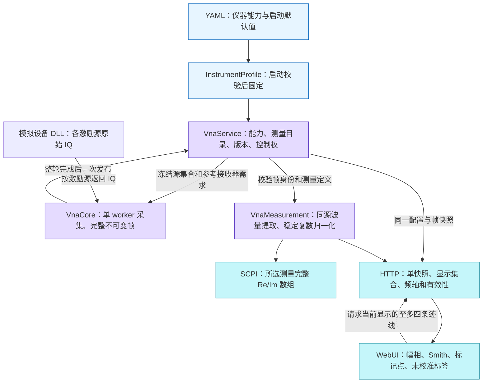
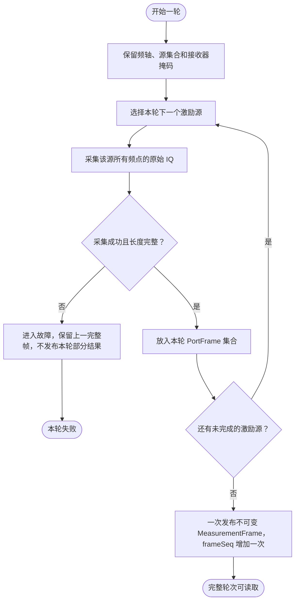
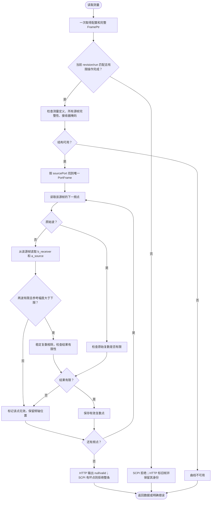

# 未校准双端口 S 参数与 Smith 显示

日期：2026-10-11。交付范围：模拟后台、S11/S21/S12/S22 同源复数比值、反射参数 Smith 显示、Web 与 Keysight SCPI 已核验命令子集。原始 A/B 接收波仍可单独查看，校准保持独立的后续工作。

## 波量与结果合同

端口编号从 1 开始。`aN` 是端口 N 的参考接收波，`bN` 是端口 N 的测试接收波；两者遵循当前模拟 profile 的同一幅度约定，原始单位为 a.u.。对于 `Sij`，先找到激励端口 j 对应的 `PortFrame`，再取其中同一扫描点的 `bi/aj`：

| 测量 | 激励源 | 分子 | 同源参考 | 结果单位 | 状态 |
| --- | --- | --- | --- | --- | --- |
| S11 | 端口 1 | b1 | a1 | 无量纲 `1` | 未校准 |
| S21 | 端口 1 | b2 | a1 | 无量纲 `1` | 未校准 |
| S12 | 端口 2 | b1 | a2 | 无量纲 `1` | 未校准 |
| S22 | 端口 2 | b2 | a2 | 无量纲 `1` | 未校准 |
| aN / bN | 定义的源端口 | 原始波 | 无 | a.u. | 原始 |

比值包含幅度与相位，不能用幅度相除替代复数相除。参考始终是激励源对应的 `a_source`：S21 使用源 1 帧的 a1；S12 使用源 2 帧的 a2。不能取目标接收端的其他 a 波，也不能从另一激励源或另一轮扫描借参考。

比值阶段不引入参考阻抗换算，也没有去嵌入、参考面移动或误差项校正。真实板卡的接收器映射、波量归一化和非激励端口匹配条件尚未核验，不能把模拟 profile 的比值约定直接用于真板；当前服务仍拒绝非本项目模拟器身份。

对数显示为 `20 log10(|S|)`，相位为 `atan2(Im, Re)` 的角度，主值范围 −180°…180°；零幅度的对数/相位显示遵循绘图模块的无效显示合同。原始波对数显示的参考仍为 `1 a.u.`。前端只做显示换算，不重复计算 S 参数。

## 仪器能力与双端口范围

启动时从 `config/vnapro.yml` 读取 `InstrumentProfile`，默认配置为 4 端口，支持频段为 10 MHz～8 GHz。默认扫描覆盖该频段，采用 201 点、IF BW 1 kHz；扫描点数可在 2～10001 之间配置。端口数量、频率上下限及默认扫描设置经过一致性检查后固定；HTTP `capabilities`、SCPI 频率 MIN/MAX 和服务写入校验使用同一份能力数据。

全新服务默认只创建并选择 `Trc1/S21`，单端口配置回退为 `Trc1/S11`，初始 HOLD 且没有已完成帧。浏览器只读取实际服务目录，刷新不会重置已定义测量或发起采集。S21 是 [ZNB 官方 Preset 示例的默认测量，第 68 页](https://scdn.rohde-schwarz.com/ur/pws/dl_downloads/pdm/cl_manuals/user_manual/1173_9163_01/ZNB_UserManual_en_74.pdf#page=68)，本项目将它作为新服务初始测量，不据此假定每次打开浏览器都执行 Preset。

| 配置 | 原始 a/b 波可用端口与激励源 | 本轮 S 参数 |
| --- | --- | --- |
| 1 端口 | 端口 1 | S11 |
| 2 端口 | 端口 1～2 | S11、S21、S12、S22 |
| 4 端口 | 端口 1～4 | 仍为端口 1/2 组成的四个 S 参数 |

4 端口配置增加原始接收波范围，不代表已实现完整四端口 S 矩阵；S31、S13、S33 等仍不在本轮范围。每个测量的源端和接收端都必须落在实际配置的端口数量内。频率端点及其联动端点必须共同合法，失败候选不改变配置和版本。历史黄金向量测试显式使用 1 Hz～1 GHz 的测试 profile，不放宽正式配置来迁就旧测试。

## 分层与文件组织



```text
VnaMeasurement/
├── include/vna_measurement/
│   ├── measurement.h          测量定义及 Kind；原始波和 S 参数共用
│   ├── trace_result.h         复数点、错误原因及曲线结果
│   └── measurement_processor.h  无状态计算入口及参考幅度下限
├── src/
│   ├── measurement.cpp        参数编码与支持范围校验
│   └── measurement_processor.cpp  帧检查、波量提取及稳定复数除法
└── tests/                     独立数值与畸形帧测试
VnaService/include/vna_service/measurement.h  引用领域测量类型
VnaService/include/vna_service/instrument_profile.h  启动能力与默认设置
VnaService/src/instrument_service.cpp        编排及查询准入
VnaServer/src/scpi/scpi_engine.cpp           Keysight 参数映射
VnaServer/src/web/http_api.cpp               JSON 适配
VnaServer/src/web/frame_selection.cpp        HTTP 显示集合解析与校验
WebUI/src/plot/smithMath.ts                  反射投影、归一化阻抗和二维标记吸附
WebUI/src/plot/smithRenderer.ts              圆形网格和复数曲线绘制
WebUI/                                      严格解码与仪器显示
```

测量模块依赖核心公开的帧数据类型，没有驱动调用、线程、全局可变状态或协议依赖。服务依赖测量模块；HTTP 与 SCPI 使用同一 `MeasurementProcessor::Calculate`。简单结构体和枚举按职责放在同一个类型头中，行为类单独文件，不增加 PImpl 或插件注册层。

## 处理活动图

一轮双端口四参数测量需要先后扫描源 1 和源 2。下图中的发布点是整轮完成处：



读取结果时，每条测量只在已保留的同一个完整帧中取波量：



参考幅度下限固定为 `1e-12 a.u.`，幅度等于下限也无效。它是模拟波量归一化的数值保护，不能称为设备噪声底、动态范围或测量不确定度。未采集参考接收器、缺失或重复源端口、源与计划不匹配、IQ 长度错误都导致整条曲线不可用；NaN、Inf、参考过小或最终结果溢出仅标记对应点。

计算对乘积及求和采用尾数/二进制指数形式，避免有限输入在分母平方或分子乘积阶段提前溢出；最终不能表示为有限 double 的比值仍无效。结果不修改原始帧，原始 NaN/Inf 保留供诊断。没有用零值填补测量失败，也没有夹紧参考波后生成虚假比值。

## 并发与版本

1. 配置及测量定义只能在 HOLD 下修改，保留控制者、expectedRevision 和执行时复核。
2. 计划合并所有测量的源端口集合；每个 S 参数同时启用目标接收端和源端参考接收器，即 `receiverMask |= 1U << (sourcePort - 1U)`。仅 S22 时只需源 2 和接收器 2；S12 必须另启用接收器 1。全部四参数的源集合为 `{1,2}`、接收器掩码为 `0b0011`。
3. 每次计算只读一个保留的不可变完整帧；分子、参考、频轴、runId、revision、frameSeq 均来自该帧。采集线程发布下一帧不会改变已保留帧。
4. SCPI 在一次 `ReadView` 上检查状态和身份后计算。配置更新但没有新帧、有限采集未完成、故障或已关闭时，RDATA 不能返回旧数据。
5. HTTP 可以观察旧帧，但 `current=false`，其频轴和身份仍属于旧帧。前端禁止把它当成当前配置的采集结果。
6. 一条查询内结果一致；连续模式的多条独立查询可能跨帧。需要多曲线同轮验证时，单次完成或 HOLD 收尾后读取。HTTP 单个 frame 响应中的多条曲线共享一个快照。
7. 源 1 与源 2 是同一轮内先后采集，完整帧保证身份和配置一致，不表示两个源同时采样。加入反向参数会增加每轮扫描耗时，增加多少取决于实际驱动。

结果按需计算，没有结果缓存，因此无需缓存淘汰、跨版本失效或写锁。反向参数复用已有多源完整帧机制，不引入额外采集线程。校准应作为明确的独立处理阶段增加，不能只修改标签。

活动迹线通过 `UpdateMeasurement` 原位替换同名定义，保留目录数量、位置和选择，成功时 revision 只增加一次；配置失败、旧版本、错误控制者或非 HOLD 状态都不提交候选。满 32 项目录仍可修改已有测量，不采用先删后加。旧完整帧继续保留原身份，不能根据新定义把它解释为当前数据。

## 远程合同

Keysight 官方 `CALCulate:PARameter[:DEFine]:EXTended` 支持 S 参数字符串，包括单数字端口的下划线形式。本项目开放 `S11`、`S21`、`S12`、`S22` 及 `S1_1`、`S2_1`、`S1_2`、`S2_2`，保持参数大小写规则；目录统一返回紧凑名称。a/b 原始波参数保持现有合同。[官方测量定义](https://helpfiles.keysight.com/csg/NA520xA/Programming/GP-IB_Command_Finder/Calculate/Parameter.htm)

```text
SENS1:SWE:MODE HOLD;*OPC?
CALC1:PAR:DEF:EXT "Reflect","S11"
CALC1:PAR:DEF:EXT "Transmit","S21"
CALC1:PAR:DEF:EXT "ReverseTransmit","S1_2"
CALC1:PAR:DEF:EXT "ReverseReflect","S22"
TRIG:SOUR IMM
SENS1:SWE:MODE SING;*OPC?
SYST:ERR?
CALC1:PAR:SEL "Reflect"
CALC1:DATA? RDATA
CALC1:PAR:SEL "Transmit"
CALC1:DATA? RDATA
CALC1:PAR:SEL "ReverseTransmit"
CALC1:DATA? RDATA
CALC1:PAR:SEL "ReverseReflect"
CALC1:DATA? RDATA
```

`RDATA` 是所选测量未校正的复数数据，每点 Re/Im 两个数；它可以是接收波，也可以是已定义的 S 参数比值。`SDATA` 访问误差项处理后的数据位置，Keysight 在 correction OFF 时也允许它返回未校正数据。因此，本版拒绝 SDATA 是当前命令子集的实现范围，不是标准规定未校准数据必须拒绝；后续实现校准和校正状态时再扩展该路径。[官方数据访问合同](https://helpfiles.keysight.com/csg/NA520xA/Programming/GP-IB_Command_Finder/Calculate/Data.htm)

不支持的 S13/S31、错误大小写或畸形参数记录标准 `-224`；语法合法但超过配置端口能力的原始波定义记录 `-222`，拒绝后不改变配置版本。当前配置没有完整帧、曲线结构不可用或任意无效点时，RDATA 记录 `-230`，不输出部分数组。失败查询不生成数据响应，随后用独立程序消息 `SYST:ERR?` 读取错误。

HTTP 创建示例：

```json
{"requestId":"add-s12","expectedRevision":"2","name":"ReverseTransmit","kind":"sParameter","receiverKind":"b","receiverPort":1,"sourcePort":2}
```

`kind` 缺省仍按原始 `receiver` 处理。服务端响应对每条测量/曲线明确输出 `kind`、`unit`、`calibration`：原始波为 `receiver` / `a.u.` / `raw`，S 参数为 `sParameter` / `1` / `uncalibrated`。前端严格验证元数据与端口、参数一致。

Meas 的测量按钮修改活动迹线，不创建新名称；这对应 [ZNB User Manual v74 第 289 页](https://scdn.rohde-schwarz.com/ur/pws/dl_downloads/pdm/cl_manuals/user_manual/1173_9163_01/ZNB_UserManual_en_74.pdf#page=289) 的活动 trace 合同。HTTP 使用 `PUT /api/v1/measurements/{name}`，名称只在编码后的路径中，正文必须给出 requestId、expectedRevision、kind、receiverKind、receiverPort、sourcePort，不能含 name。受理返回 202/operationId，须等待真实完成后读回；不存在的测量明确拒绝，不隐式新增。完整更新与重试合同见[服务设计](网分服务与远程控制设计.md#6-web-接口与仪器面板)。

Add Trace 在 Trace Config 中复制活动测量定义并生成未使用的 `Trc<n>`，显示和删除也归该工具。Ratios 及原机 All S-Params 的完整 n×n 矩阵尚未实现，不将端口 1/2 的四参数选择器称为完整四端口 S 矩阵；RAW 的全部配置端口范围保持可用。

测量目录最多 32 项，单个 HTTP frame 响应最多返回 4 条曲线、2001 个显示点；采集仍覆盖整个测量目录。显示集合与采集目录分别管理：

```text
GET /api/v1/frame
GET /api/v1/frame?trace=ReverseReflect&trace=ReverseTransmit
GET /api/v1/frame?display=none
```

不带查询参数时保留前四条目录项的兼容行为。显式 `trace` 可重复最多四次，响应按请求顺序返回，因此显式创建原始波测量 DefaultA 并另建四个 S 参数时，也可以显示目录第五项 S22；此例中的 DefaultA 不是生产默认测量。轨迹名称按 UTF-8 百分号编码传递；未知名称、重复名称、超过四条或非法查询返回 400。`display=none` 在已有完整帧时返回 `traces=[]`，保留频轴、抽取点信息及 revision/runId/frameSeq；没有完整帧时仍返回明确的无帧状态。选择显示集合只读一个服务快照，不触发采集、不修改测量定义和配置版本。

## Smith 反射显示

Smith 格式仅接受 S11/S22。图中 Γ 是该反射参数的未校准复数值，横轴为实部，纵轴为虚部；S12/S21 继续使用幅度、相位等格式，原始 a/b 波不投影为反射参数。

网格是归一化阻抗网格，标记读数采用 `z = (1 + Γ) / (1 - Γ)`。`z` 无量纲，当前没有物理参考阻抗 Z0，不输出 Ω，也不默认套用 50 Ω。匹配点 Γ=0 显示 z=1，短路点 Γ=−1 显示 z=0，开路点 Γ=1 显示无穷；无法表示的结果明确标记，不能伪造有限值。它是对当前未校准复数结果的数学投影，不代表 DUT 的已校准物理阻抗。

绘制时保持圆形网格，补偿非方形视口、屏幕像素密度和 CSS 缩放。超过单位圆的合法反射值保留原值，坏点形成间断。二维标记吸附到实际显示采样点，不沿曲线插值补造数据。Autoscale 按当前有效帧一次调整显示半径，后续采集帧沿用该半径；再次点击才重新适配。

## 数值验收

- 测量模块：独立构造已知复数反射、直通、衰减与延迟；a2 与本源 a1、另一源 a2 故意不同，打乱源帧顺序，检查四参数同源性、缺参考、畸形帧、非有限输入、极端数值和参考下限。
- 服务：检查参考接收器按源自动启用、仅 S22 的掩码为 2、四参数共享双源完整轮次、坏点整条拒绝、配置变更后拒绝旧帧、越界定义不提交；核心原有第二源失败不发布部分帧的测试继续适用。
- HTTP：复数比值、元数据、零参考的 null/valid 表示、错误队列隔离，以及目录第五项选择、显示顺序和空显示集合的身份保留。
- 实际 DLL→Core→服务→网络：从独立审核的 golden IQ 字面量用 Python 复数运算得预期四参数；对比 HTTP 和 SCPI，容差 `1e-12`，并证明错误参考或跨源参考不会通过。
- 噪声与连续模式：保留单 HTTP 快照中 S21 与 b2/a1 的独立核对，增加四参数在双源完整帧中共同推进和变化；HOLD 后核对 HTTP、SCPI 及各源原始波的比值。
- WebUI：严格元数据解码、测量/显示选择、幅相和导出合同；Smith 匹配、开路、短路、复数投影、坏点、圆形网格、二维标记及一次 Autoscale，并做实际页面交互验证。

上述测试证明软件比值、帧一致性与错误处理，不构成射频硬件校准准确度验收。

历史 S11/S21 验收记录（2026-10-11）：Windows MinGW/GCC 10.3 全量 19 项 CTest 通过（20.64 秒）；WSL/GCC 13.3 全目标 ThreadSanitizer 同样 19 项通过（12.99 秒），无数据竞争报告。前端 26 项合同测试、TypeScript 检查及生产构建通过。真实 Chromium 页面已验证创建 S11/S21、dB/相位/M1、连续帧推进到 HOLD、CSV schema 2，以及 Span=0 CW 采集；控制台无 warning/error。用户 CLion 的 `cmake-build-debug` 运行目标也已成功重新构建。

### 本轮四参数与 Smith 验收（2026-10-11）

Windows 全量 **22/22 CTest 通过（22.68 秒）**。WSL/GCC 13.3 全目标 ThreadSanitizer 全量为 **21/22**，唯一失败来自 Unicode 拒绝测试的诊断类别断言；将预期改为 YAML 实际返回的 `unicode` 后，配置测试 **1/1 通过（0.58 秒）**，非法输入仍被拒绝，各次运行未报告数据竞争。此记录不等同于一次完整 22/22 TSAN 复验。WebUI **49/49 测试**、TypeScript/Vue 类型检查和生产构建通过。

实际启动 4 端口和 2 端口配置，核对默认 **10 MHz～8 GHz、201 点**，以及 2 端口对源/接收端 3/4 的拒绝。四个 S 参数共享完整帧，CONT 帧序号 **9→3168**；S12 一次 Autoscale 后刻度固定，S22 Smith 半径固定。导出 **804 个数据行（4×201）**，用独立复数运算校验 Γ 和无量纲 z；CW 的 End/Home 导航选中样本 **5→1**。浏览器交互期间无 warning/error。

完整证据、TSAN 失败项修正范围、HTTP 第五项与空显示集合验收见[模拟设备采集验收](模拟设备采集验收.md#2026-10-11四参数smith-与-yaml-配置最终验收)。历史 golden 结果保留，以上验证没有引入校准或物理 Z0。
