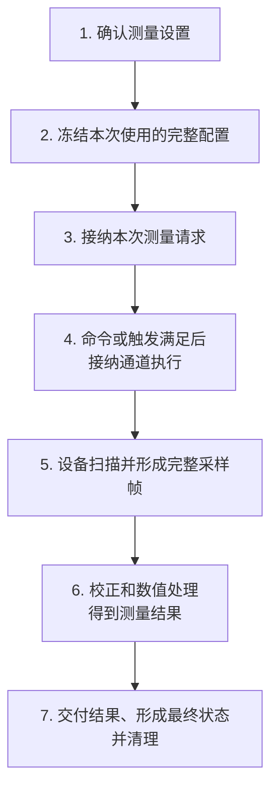
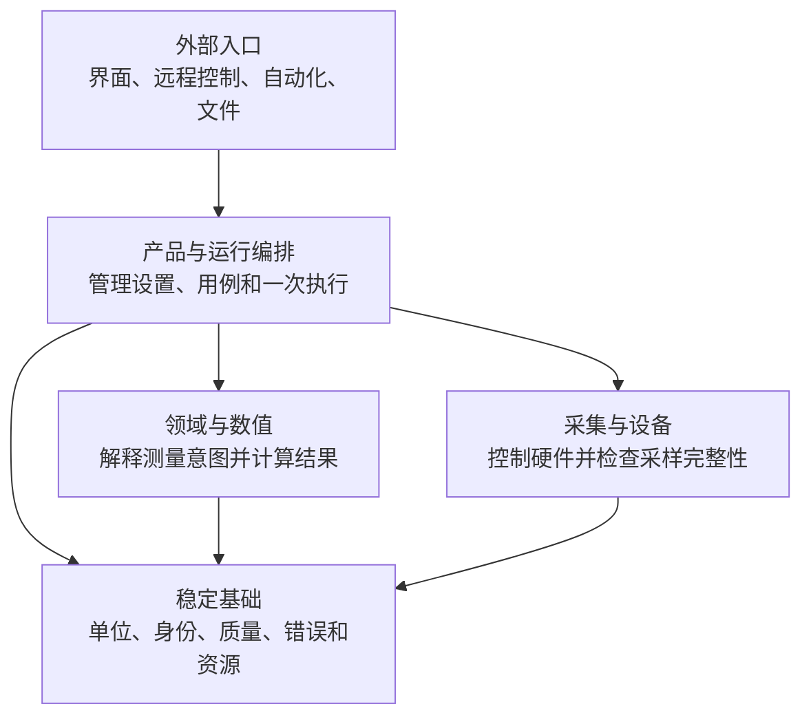
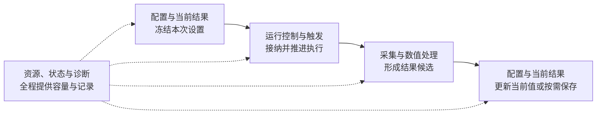

# 架构设计 00：十分钟读懂整体架构

> [返回文档入口](../README.md) · 按需专题：[总体架构与分层](./01-总体架构与分层.md) · [核心业务流程](./03-核心业务流程.md)

本篇只讲一件事：**一份测量设置怎样变成一份可信结果**。第一次阅读不需要先懂类、接口、线程或恢复协议。

## 1. 先跟完一次测量

假设用户接好被测件，把频率设为 1 MHz～3 GHz，然后按下“单次测量”。

### 1.1 遇到这些词时怎样理解

| 文档用词 | 白话含义 |
| --- | --- |
| 测量通道 | 一组一起生效的扫描、触发、平均、测量量和校准设置 |
| 当前设置修订 | 某次有效编辑后形成的完整设置版本；形成后不再改写 |
| 已生效的可执行配置 | 设备计划和数值处理计划已经完整准备好，并确认适用于某版设置 |
| 本次测量配置快照 | 启动时冻结的“设置 + 可执行配置 + 校准等引用”；后续编辑不改变本次测量 |
| 完整采样帧 | 完整性、顺序和来源都已检查的一次采样数据 |
| 测量结果 | S11、S21 等数值数据，不是“成功、停止、失败”这些操作状态 |
| 完成 | 数据处理、结果交付和资源清理都结束；不只是设备停止扫描 |

### 1.2 七步主线

三个地方最容易理解错：

1. **第 2 步不是复制几项参数。** 它冻结完整设置及与之匹配的可执行配置。用户随后继续编辑，不会让正在运行的数据“换一套解释”。
2. **第 3、4 步是两次不同接纳。** 第 3 步确认系统能承担这次测量；第 4 步在命令、外部触发或自由运行条件满足后，再确认目标通道有容量执行。容量不足时明确拒绝，不先创建半个任务长期等待。
3. **第 7 步不是“设备停了就算完成”。** 已接纳数据还要校验、计算并交付。计划内结果都有明确去向，资源也清理完，整次操作才结束。

任何失败都必须有可查询结论。触发被拒绝、驱动失联、采样不完整或用户停止，都不能让界面永久停在“进行中”。

## 2. 为什么不是一条简单流水线

真实仪器除了“采样 → 计算”，还要处理并发编辑、触发、容量限制、驱动故障、结果保存和重启恢复。因此系统分成五个责任块：

箭头表示源码使用关系，不是运行顺序，也不表示一块就是一个进程。

| 责任块 | 负责什么 | 不负责什么 |
| --- | --- | --- |
| 外部入口 | 把不同格式的请求翻译成同一套产品操作 | 自己拼接硬件调用或另建业务规则 |
| 产品与运行编排 | 管设置、启动、触发、停止、完成和结果选择 | 实现驱动细节或校准数学 |
| 领域与数值 | 把测量意图变成采集/处理要求，并完成校正和计算 | 修改用户会话或直接访问设备 |
| 采集与设备 | 隔离驱动、执行设备计划并检查采样完整性 | 认识迹线窗口或决定产品工作流 |
| 稳定基础 | 统一单位、身份、数值含义、质量和错误 | 承担具体业务流程 |

这五块展开后才是 L0–L8。第一次阅读先记住责任，不必背层号。

## 3. 四类运行职责

四类运行职责回答“运行中的某类事实由谁负责”。它们不是四个模块、四个进程或四条线程；同一个模块可以参与多类职责，但同一份可变事实只能有一个负责方。

### 3.1 配置与当前结果：这次以哪版设置为准

- **负责**：当前设置、可供运行冻结的设置修订，以及每个测量量或迹线的实时当前结果。
- **交给下一环节**：本次测量配置快照。
- **失败时**：设置不完整、配置不适用或引用失效，启动会明确拒绝。
- **不负责**：直接控制设备、计算 S 参数或决定队列容量。

### 3.2 运行控制与触发：现在能不能执行

- **负责**：接纳启动请求、等待命令或触发、检查执行容量、停止和最终执行状态。
- **交给下一环节**：已获准的通道测量任务。
- **失败时**：容量不足、取消或超时都会形成明确结论。
- **不负责**：保存大数组、修改当前设置或实现数值算法。

### 3.3 采集与数值处理：已接纳的数据怎样走完

- **负责**：执行设备计划、检查采样完整性、完成校正和数值处理。
- **交给下一环节**：不可修改的结果候选及其质量、来源。
- **失败时**：在接纳前拒绝，或对已接纳工作施加背压并给出失败结论；不能无限缓存。
- **不负责**：重新选择目标通道或改写用户设置。

### 3.4 资源、状态与诊断：容量够不够、故障怎样查

- **负责**：记录容量、时间、状态、来源和安全事实，并确保资源最终归还。
- **交给其他职责**：可用容量、诊断和可追溯记录。
- **失败时**：账目不平、来源不明或责任无法证明，局部隔离并禁止伪装成功。
- **不负责**：另造业务流程或代替运行控制决定最终状态。

一次测量中，四类职责按下面方式接力：

实时当前结果、历史结果和校准工作流证据可以有不同交付结论。只有计划内交付都已明确结束，运行控制才能形成最终状态；其余资源清理完成后，才对外报告完成。

详细触发与状态见[04 运行时与触发](./04-运行时与触发.md)，容量和故障处理见[05 资源与故障恢复](./05-资源与故障恢复.md)。

## 4. 四条最重要的红线

### 4.1 用户想做什么，与设备实际做了什么，必须分开

用户设置说明期望；设备实际计划说明硬件最终接受了什么。二者共用一个可变对象时，设备量化后的频率、点数和带宽就无法追溯。

### 4.2 所有入口必须走同一套产品用例

界面、远程命令、自动化和文件恢复可以有不同格式，但不能各自直接控制硬件或维护一套业务状态。

### 4.3 设备停止不等于整次测量完成

停止采样后，已接纳数据仍可能在校验、计算或交付。只有这些责任全部结束，本次测量才能关闭。

### 4.4 驱动断开不等于仪器已物理停止

关闭或隔离驱动进程，只能证明旧软件不能继续控制设备，不能证明扫描、触发或射频输出已经安全停止。

拿不到设备状态回读、硬件看门狗/互锁或独立安全控制通道提供的后置状态证据时，必须把设备标为“物理状态不可知”并禁用。只有安全重连或复位后重新验证，或者完成有记录的现场确认，才能恢复使用。详见[资源与故障恢复 §3.3](./05-资源与故障恢复.md#33-已接纳工作只有三种资源结局)。

另有三条工程边界同样必须保留：纯数值核心不访问设备和文件；第三方驱动按可能崩溃或永久阻塞来隔离；商用仪器资料只用于确认可观察行为，不能据此猜测厂商内部类和线程。

## 5. 不要把三张地图混成一张

| 地图 | 回答的问题 | 例子 |
| --- | --- | --- |
| 源码分层 | 代码可以依赖谁 | 设置在应用层维护，计算在数值层完成 |
| 运行职责 | 运行中的某类事实由谁负责 | 设置版本、完成判断和容量账各有负责方 |
| 产品对象 | 对象怎样关联和独立演进 | 删除显示窗口不删除测量量；设置、校准和结果分别保存 |

三张地图描述同一个系统的不同问题。源码依赖见[01 总体架构与分层](./01-总体架构与分层.md)，产品对象见[02 产品对象与关系](./02-产品对象与关系.md)。

## 6. 读完本篇只需记住

- 测量主线是“冻结完整配置 → 接纳请求 → 触发后执行 → 采集与计算 → 交付结果并清理”。
- 五个责任块约束源码放在哪里；四类运行职责约束运行事实由谁负责。
- 用户设置与设备实际执行分开、所有入口共用用例、设备停止不等于完成、软件隔离不等于物理停止，这四条不能破坏。

下一步建议：[01 总体架构与分层](./01-总体架构与分层.md) · [02 产品对象与关系](./02-产品对象与关系.md) · [04 运行时与触发](./04-运行时与触发.md)。
