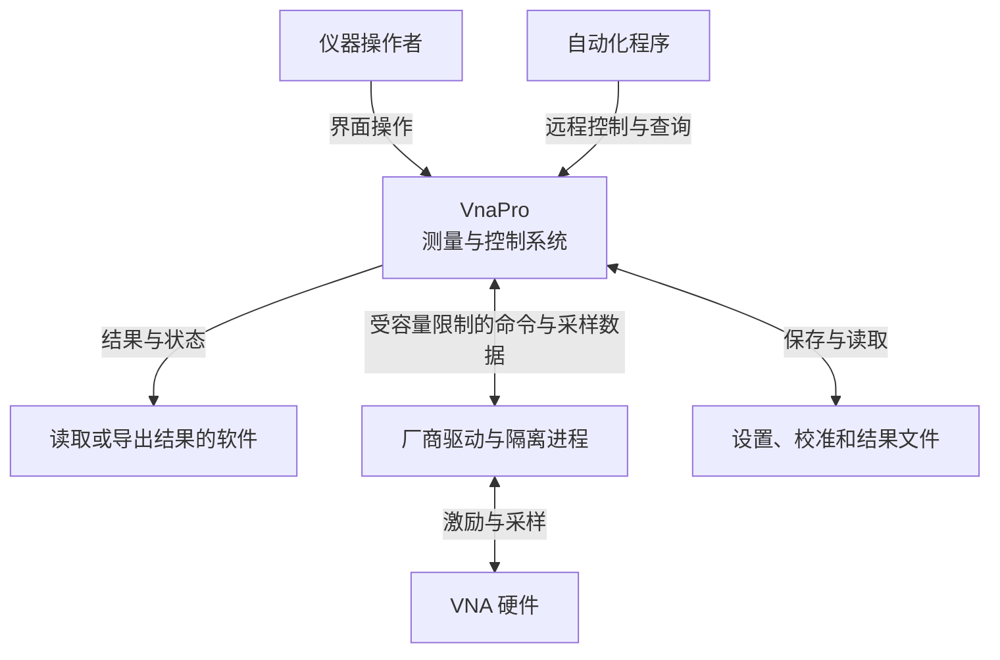
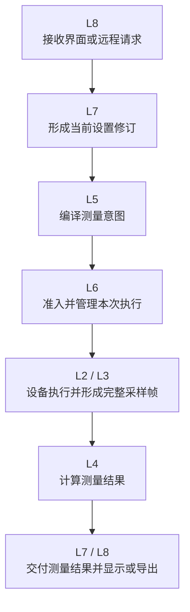
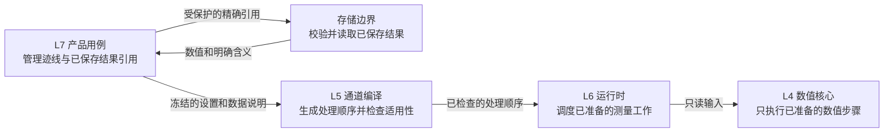

# 架构设计 01：总体架构与分层

> [返回文档入口](../README.md) · 入门总览：[十分钟读懂整体架构](./00-十分钟读懂整体架构.md) · 相关专题：[产品对象与关系](./02-产品对象与关系.md)

本篇解释系统管到哪里、L0–L8 各自负责什么，以及源码依赖怎样受控。类、字段、完整状态转移、并发协议和恢复记录属于详细设计。

## 1. 先记住四个结论

- L0–L8 是**源码依赖层**，不是九个开发阶段，也不是九步运行顺序。
- L0 是最稳定的底座；数字越大通常越靠近用户入口。
- 一次用户场景会纵向穿过多层，所以不能采用“开发完一层，再开始下一层”的交付方式。
- 商用仪器的可观察行为是产品基线；开源代码和逆向观察提供工程证据，但都不能替代架构判断。

层名中的软件术语按下面理解即可：

| 术语 | 在本文中的含义 |
| --- | --- |
| 公共契约 | 各层共同遵守的单位、身份、数据含义和错误定义 |
| 适配 | 把一种设备或外部格式翻译成系统统一形式 |
| 编译 | 把用户设置转换成经过检查的采集要求和处理顺序，不是生成机器代码 |
| 运行时 | 管理一次测量何时开始、推进、停止和完成 |
| 应用用例 | 用户可发起的一项完整产品操作，例如启动、保存或召回 |

## 2. VnaPro 管到哪里

从边界图只需得到三点：

1. 界面、远程控制和自动化只是不同入口，必须观察到同一套产品行为。
2. 驱动、设备和文件都可能超时、损坏或失败，不能当作永远可靠的内存调用。
3. VnaPro 必须同时保存当前设置修订、设备实际执行信息和测量结果来源，才能解释一次测量。

## 3. 先看一次扫描怎样穿过各层

用户修改频率并启动单次扫描时，主要协作路径如下：

这是一条**场景活动路径**，不是源码依赖图。L0 没画在路径里，因为所有步骤都在使用它的单位、身份、质量和错误语义；L1 由 L2 通过驱动边界间接使用。

同一个场景同时跨越入口、应用、领域、运行时、设备和数值层，这就是整体设计必须先于逐层开发的原因。

## 4. L0–L8 的职责与禁区

| 大块 / 层 | 白话职责 | 明确不能负责 |
| --- | --- | --- |
| 稳定基础 / **L0 公共契约** | 统一单位、身份、数据质量、错误和资源含义 | 界面、文件、设备实现或业务流程 |
| 采集与设备 / **L1 驱动边界** | 包装厂商开发包，并隔离可能崩溃或永久阻塞的第三方驱动 | 测量通道、迹线和校准工作流 |
| 采集与设备 / **L2 硬件适配** | 管理设备会话与能力，形成设备计划并记录硬件实际接受的设置 | 产品设置所有权和数值算法 |
| 采集与设备 / **L3 采集与组帧** | 检查采样块缺失、重复和乱序，形成不可变完整采样帧 | 迹线显示、用户校准和窗口刷新 |
| 领域与数值 / **L4 数值核心** | 对已准备好的数值步骤和只读数据做确定计算 | 产品迹线身份、保存结果读取、处理顺序生成和长生命周期流程 |
| 领域与数值 / **L5 通道编译** | 把通道、测量量和迹线设置转成采集要求与处理顺序，并按设备实际条件判断校准是否适用 | 保存结果读取、引用保护、运行状态和产品事务 |
| 产品与运行编排 / **L6 运行时** | 统一处理启动、触发、执行前容量检查、调度、停止和完成 | 修改产品设置和实现数值算法 |
| 产品与运行编排 / **L7 应用用例** | 管理当前设置、迹线和结果引用，统一编排设置、保存、召回与结果选择 | 绕过运行时直接操纵硬件，或自行实现数值算法 |
| 外部入口 / **L8 外部适配器** | 把界面、远程命令、自动化协议和文件格式翻译为应用用例 | 另建业务规则或直接修改运行时状态 |

层表读法是“这一层为什么存在、什么绝不能进入这里”，不是让团队按 L0、L1、L2 的顺序把产品做完。

### 数值、通道编译与产品引用怎样交接

迹线处理最容易把产品身份、存储引用和数值计算混在一起。正确边界如下：

从左到右有三条不可越过的界线：

- 结果版本引用、保存操作和读取失败由 L7 与存储基础设施处理，不进入数值核心；
- 迹线之间的依赖、处理顺序、数据含义和资源上界由 L5 一次准备好，不由 L4 或工作线程临时拼接；
- L4 只看到已经准备好的计算步骤、数值含义和只读数据，不知道数据属于哪条产品迹线，也不知道来自哪个已保存结果版本。

## 5. 源码依赖怎样受控

依赖规则的目标，是让设备、数值和产品逻辑可以独立变化、独立测试。

1. 外层可以使用更稳定的内层能力；内层不能反向认识外层产品概念。
2. L0 不依赖任何业务、界面、文件或设备实现。
3. L1–L3 不出现测量通道编号、迹线编号、窗口号或远程命令。
4. L4 不做输入输出，不认识产品迹线身份或结果版本引用，也不依赖界面框架、数据库、文件系统、存储库实现或厂商驱动。
5. L5 自己定义纯编译输入；L7 把产品对象翻译为这份不可变快照。L5 不能引用 L7 类型，也不能查询存储库、取得保留责任或修改产品状态。
6. L6 可以调度设备和处理能力，但不依赖 L7 的具体实现。
7. L8 只调用 L7 用例，不能绕过应用边界直接控制 L6 或 L2。

跨层协作不是“谁需要谁就引用谁的类”。

当内层需要把结果交回外层时，只声明一个很小的交付边界，再由系统装配接上外层实现。这样 L6 可以发布实时结果，但仍不认识 L7 的产品对象。

精确交付边界属于[详细设计](../详细设计/README.md)。

依赖不要求每次只跨相邻一层。高层可以查询稳定的低层能力，但低层仍不能认识高层对象。

两个判断例子：

- 硬件适配返回设备实际采用的频点：**合理**。设备事实由 L2 产生，产品层只读取。
- 硬件适配根据迹线编号决定采样：**不合理**。迹线是产品显示概念，不应进入设备边界。

层也不等于进程或线程。L1 使用独立驱动隔离进程，是为了限制第三方故障；这不改变源码依赖方向。

## 6. 同一系统需要三张地图

**源码分层**

- 回答“代码可以依赖谁”。例如 L7 管设置，L5 做编译，L4 做计算。
- 不决定线程数量和一次运行何时完成。

**运行职责**

- 回答“某类运行事实由谁负责”。例如设置修订、完成判断和容量账各有唯一负责方。
- 不决定类放在哪一层，也不决定产品对象怎样一起保存。

**产品对象**

- 回答“对象怎样关联、删除和独立演进”。例如测量通道包含测量量，删除迹线不删除测量量，设置、校准和测量结果各有生命周期。
- 不决定代码依赖方向、线程和调度方式。

三张地图不能合成一张“万能架构图”。混在一起后，静态依赖、运行行为和产品一致性都会失去可验证边界。产品对象详见 [02 产品对象与关系](./02-产品对象与关系.md)。

## 7. 证据怎样使用

“以商用网分为准”是以商用仪器**可观察行为**为产品基线，不是照搬手册目录、命令树、动态库名称或猜测出的内部类。

| 证据来源 | 可以支持 | 不能据此断言 |
| --- | --- | --- |
| ZNB、ZNBT、SNA 手册与实机记录 | 测量通道、迹线、触发、校准、状态和数据访问行为 | 厂商内部怎样分层、用哪些类或线程 |
| SNA 二进制逆向观察 | 依赖、导入导出、调用边界和兼容风险 | 原产品设计一定合理，或 VnaPro 必须照搬 |
| 固定版本开源代码 | 数值算法、完整性检查、有界缓冲和故障处理机制 | 商用仪器的产品语义和对象边界 |
| VnaPro 当前代码 | 已实现能力、迁移成本和需要兼容的接口 | 现有三层天然合理 |
| 本项目架构推断 | 在产品行为和工程约束下选择内部层次与所有权 | 这些推断就是 ZNB/SNA 的私有实现事实 |

完整证据、版本、缺口和取舍见[架构依据与取舍矩阵](../架构依据与取舍矩阵.md)。

尚未采集的实机命令记录必须标为“待验证”，不能冒充已经通过的兼容证据。已开发部分的差距和整改顺序见[现有三层架构审计与整改方案](../现有三层架构审计与整改方案.md)。

## 8. 读完本篇只需记住

- L0–L8 约束源码依赖，不是开发顺序或运行时序。
- 一次可交付场景会纵向穿过多层；按场景形成闭环，再逐步替换旧实现。
- 商用品行为、逆向、开源和现状代码各有证据边界，任何单一来源都不能直接决定架构。

相关专题：[02 产品对象与关系](./02-产品对象与关系.md) · [03 核心业务流程](./03-核心业务流程.md) · [06 架构约束与验收索引](./06-架构约束与验收索引.md)。
