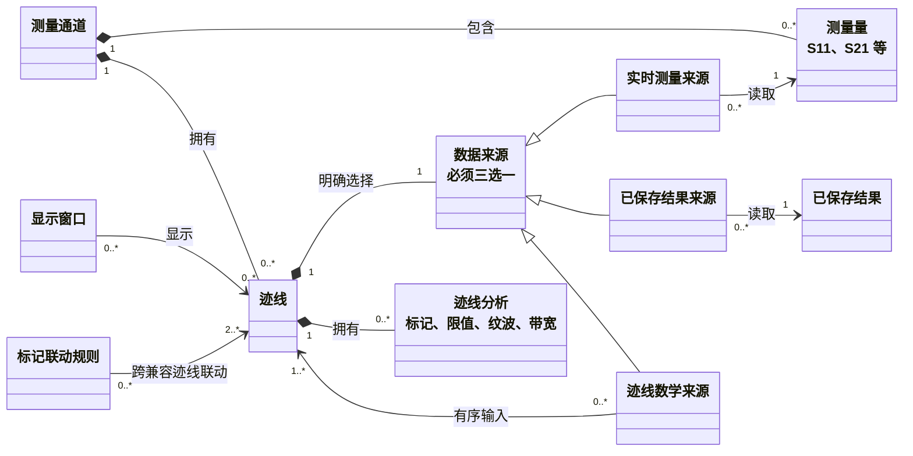
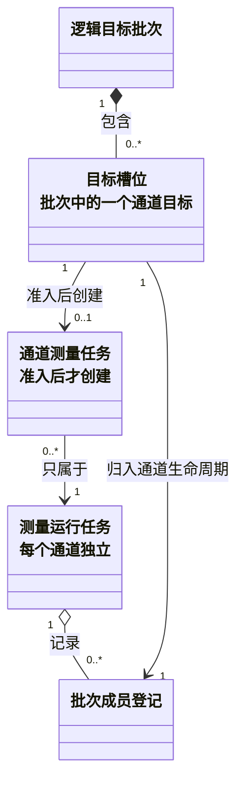
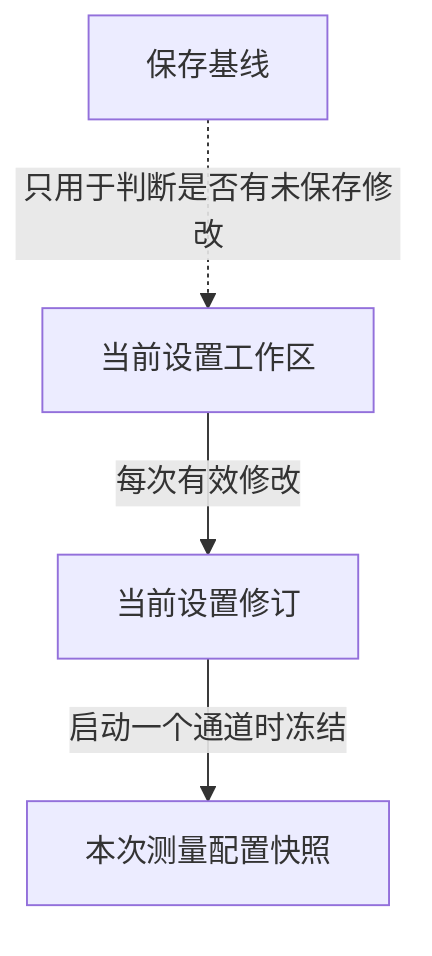
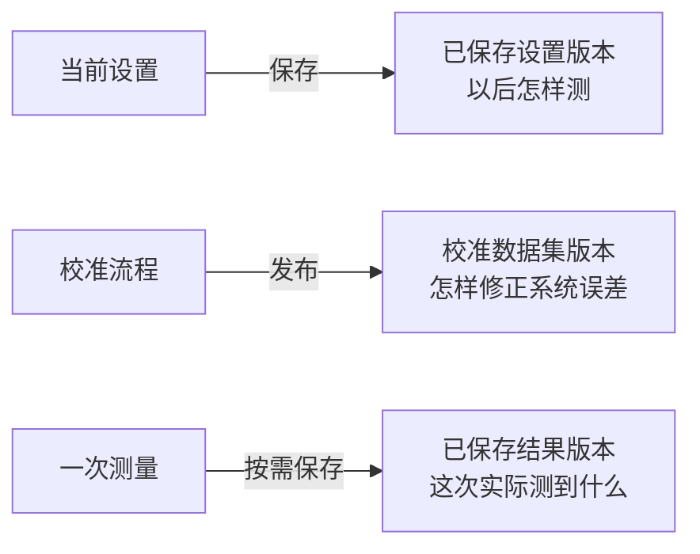
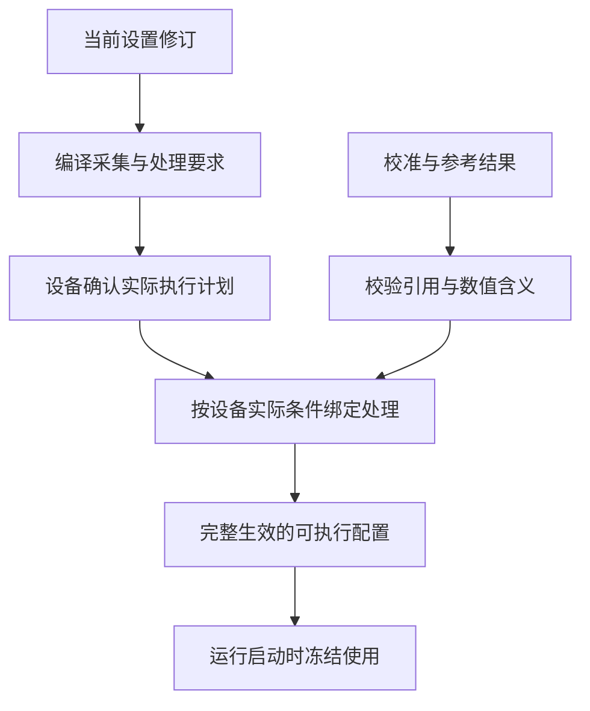

# 架构设计 02：产品对象与关系

> [返回文档索引](../README.md) · 相关专题：[总体架构与分层](./01-总体架构与分层.md) · [核心业务流程](./03-核心业务流程.md)

本篇只回答四个问题：用户在操作哪些对象、这些对象怎样关联、哪些内容分别保存，以及设置怎样变成可运行配置。接口、字段、并发和恢复协议不在本篇展开。

## 先记住五件事

1. **测量通道决定“怎样测”**：频率、功率、触发和平均等设置属于测量通道。
2. **测量量决定“测什么”**：例如 S11 是端口 1 的反射，S21 是从端口 1 到端口 2 的传输。
3. **迹线决定“显示哪份数据、怎样处理”**，显示窗口只决定“在哪里显示”。
4. **运行只使用完整生效且适用于本次设置的配置**；测量中途继续编辑，不会改变已经开始的测量。
5. **设置、校准和结果分别保存**；三者生命周期不同，不能互相替代。

## 1. 测量通道、测量量、迹线与显示窗口

### 1.1 对象划分

四个对象分别回答四个问题：

| 产品对象 | 回答的问题 | 典型内容 |
| --- | --- | --- |
| 测量通道（Channel） | 怎样测？ | 频率、功率、触发、平均和校准选择 |
| 测量量（Measurement） | 测什么？ | S11、S21 等网络参数 |
| 迹线（Trace） | 使用哪份数据、怎样处理？ | 实时测量、已存结果、迹线数学、格式和判定 |
| 显示窗口 | 在哪里、怎样显示？ | 坐标、布局、可见性和显示样式 |

这四个对象必须分开。否则删除一条显示迹线可能误删测量量，关闭窗口也可能错误停止设备。

它们是 VnaPro 为统一商用品外部行为建立的产品模型，不是对 ZNB 或 SNA 内部类结构的猜测。

### 1.2 产品对象关系图

每条迹线始终属于一个测量通道，但它的数据可以来自本通道测量量、已保存结果或其他迹线。**对象归属和数据来源不是一回事。**

一条迹线必须明确选择一种来源：

| 来源 | 必须满足 |
| --- | --- |
| 实时测量量 | 指明测量量和读取位置 |
| 已保存结果 | 指明不可修改的结果版本，并验证数值含义和频率轴 |
| 迹线数学 | 指明全部输入迹线，且处理关系无环 |

标记联动是跨迹线关系，不属于任意单条迹线的组合成员。删除迹线时，影响清单必须同时处理引用它的联动规则。

### 1.3 用户能观察到的规则

- 删除显示窗口，只删除显示关系；迹线、测量量和测量通道都保留。
- 删除迹线，会删除该迹线自己的标记、判定和显示关系，但不删除测量量。
- 删除仍被引用的迹线、测量量或测量通道，默认拒绝并列出影响；只有用户确认完整清单后才能级联删除。
- 隐藏迹线、关闭窗口或断开客户端，都不等于停止测量。
- 空测量通道可以保存和编辑，但不能运行；加入至少一个有效测量量并通过检查后才恢复运行资格。

标记、限值检查、纹波和带宽属于迹线分析，窗口只保存它们的显示方式。因此隐藏限值线不会停止限值检查。

修改迹线分析时遵守三条规则：

1. **不重扫设备**：直接用合适的当前迹线结果重新计算。
2. **没有数据就明确提示**：显示“暂无可判定输入”，不等待未来扫描。
3. **跨通道不冒充同步**：显示每个输入来自哪次测量，不把不同时刻的数据伪装成同步采集。

进一步阅读：

- 完整删除清单、引用保护和后台处理：[产品对象删除与后台处理详设](../详细设计/04E-产品对象删除与后台处理.md)；
- 迹线分析的编译和重算：[通道编译详设](../详细设计/02C-通道编译绑定与失效.md)。

### 1.4 多通道目标不是一个父任务

一次命令或外部触发可以选中多个通道。这里要分开两个概念：

- **逻辑目标批次**回答“这次事件选中了哪些目标”；
- **测量运行任务**回答“某一个通道当前处于什么测量生命周期”。

因此，一个逻辑目标批次可以跨越多个通道的测量运行任务，不能强行挂在某一个通道任务下面。

| 图中名称 | 白话含义 |
| --- | --- |
| 目标槽位 | 逻辑批次中某一个被选中的通道位置 |
| 批次成员登记 | 把这个位置归入对应通道生命周期的关系 |
| 测量运行任务 | 某通道从开始、等待到保持或停止的完整运行生命周期 |
| 通道测量任务 | 触发条件和容量检查都通过后，才创建的一次实际执行工作 |

一个逻辑目标批次被接纳后，每个目标槽位都恰好通过一份批次成员登记进入自己的通道生命周期。该槽位执行获准后，最多创建一个通道测量任务。

逻辑批次只负责目标集合和整体报告，不拥有各通道的运行状态。

路由和准入与物理执行方式是两件事。同一台商用仪器可以用仪器原生通道序列执行多个通道。

真正跨多台设备同步时，才需要独立的多设备同步能力和实机证明。详细规则见[运行时与触发](./04-运行时与触发.md)。

### 1.5 对应详设

- 对象结构、设置事务和显示关系：[应用会话与事务详设](../详细设计/04A-应用会话与事务.md#91-仪器会话instrumentsession)；
- 精确删除协议：[产品对象删除与后台处理详设](../详细设计/04E-产品对象删除与后台处理.md)。

## 2. 当前设置与运行中的设置

用户编辑的是仪器会话中的“当前设置”。已经开始的测量使用启动时冻结的版本，两者不能共享一份随时变化的对象。

四个名字的区别如下：

| 名称 | 用途 |
| --- | --- |
| 当前设置工作区 | 用户此刻看到并继续编辑的完整设置 |
| 当前设置修订 | 一次有效修改形成的不可修改版本，供运行引用 |
| 保存基线 | 最近一次明确保存或召回成功的比较基准 |
| 本次测量配置快照 | 某通道启动时冻结的设置、可执行配置、校准和结果引用 |

当前设置修订覆盖完整工作区；本次测量配置快照按通道形成。多通道触发可以从同一设置修订选择多个通道，但每个通道仍有自己的快照、准入结论和生命周期。

用户修改频率或测量量后：

1. 当前设置形成新修订；
2. 系统重新判断既有可执行配置是否仍适用；
3. 已接纳的测量继续使用启动时冻结的配置；
4. 新配置完整生效后，后续测量才使用新设置；失败时明确显示“暂不可运行”。

精确并发校验见[应用会话与事务详设](../详细设计/04A-应用会话与事务.md)；运行冻结规则见[测量生命周期详设](../详细设计/03B-测量生命周期与完成.md#84-通道运行实例vnarunengine)。

## 3. 设置、校准与结果分别保存

已保存设置、已发布校准数据集和已保存结果用途不同：

- **设置版本**保存怎样测、怎样处理和怎样显示，默认不包含测量结果。
- **校准数据集版本**保存误差模型、适用的设备实际条件和来源，可被多个通道引用。
- **结果版本**保存数值、质量、数值含义，以及本次使用的设置、设备实际条件和校准来源。

三者发布后都不原地修改。新编辑、重新校准或重新测量会产生新版本，旧版本继续用于追溯。

“实时当前结果”是会话内可替换的最新合适结果，不等于已保存历史。系统只有在下面三项都满足时才更新它：

| 检查 | 不满足时 |
| --- | --- |
| 属于同一通道阶段、测量量或迹线，并位于同一读取位置 | 不更新当前结果 |
| 测量、处理和校准条件兼容 | 不用旧条件结果覆盖新设置 |
| 完成顺序没有倒退 | 较早测量晚完成时不覆盖更新结果 |

只改变窗口布局不会使数值结果失效；改变扫描频率会。实时当前更新和历史保存分别给出结论，一方成功不能掩盖另一方失败。

进一步阅读：

- 设置保存与召回：[D4B 保存、召回与运行切换](../详细设计/04B-保存召回与运行切换.md)；
- 校准发布：[D4C 校准工作流](../详细设计/04C-校准工作流.md)；
- 历史结果保存和恢复：[D4D 持久化结果与恢复](../详细设计/04D-持久化结果与恢复.md)。

从校准目录移除一个版本，只表示以后不能再新选用它；已有引用仍受保护。

- 目录移除：[D4E 校准数据集的目录移除](../详细设计/04E-产品对象删除与后台处理.md#914-校准数据集的目录移除)；
- 物理回收：[D4D 反向引用与物理回收](../详细设计/04D-持久化结果与恢复.md#954-反向引用发布记录与物理回收)。

## 4. 从用户设置到可执行配置

用户请求不等于设备实际执行。设备可能量化频率、点数或带宽，因此必须先取得设备真正接受的条件，再按这些条件完成校准绑定和数值处理。

这条链有四条红线：

1. 数值处理、校准适用性和结果解释都使用设备实际值，不能回头使用请求值猜测。
2. 校准条件缺失、版本无法识别或适用规则不明确时，拒绝绑定；V1 不做校准范围外推。
3. 准备或绑定失败时，不暴露半份新配置；已经接纳的旧测量继续使用它冻结的旧配置。
4. 只复用设备计划不等于整份可执行配置可复用；处理和校准仍要按当前设置重新检查。

频率、功率、接收机、分段扫描或物理触发方式变化，通常需要重新准备设备。只改窗口布局或不增加输入需求的后处理时，设备计划可能继续使用，但新处理配置仍要完整生效后才能供后续测量使用。

- 设备预备和实际参数：[公共契约、驱动、硬件与采集详设](../详细设计/01-公共契约与硬件采集.md)；
- 数值处理、通道编译与校准适用性：[数值处理与通道编译详设](../详细设计/02-数值处理与通道编译.md)。

相关专题：[03 核心业务流程](./03-核心业务流程.md) · [04 运行时与触发](./04-运行时与触发.md) · [05 资源与故障恢复](./05-资源与故障恢复.md)。
