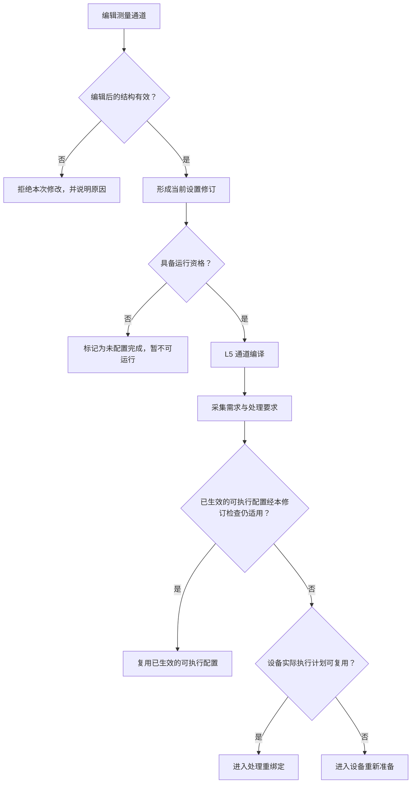
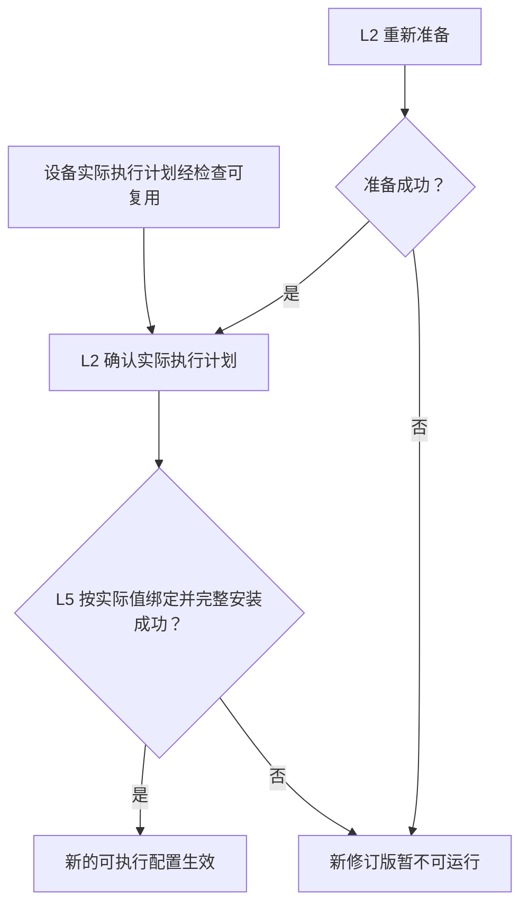
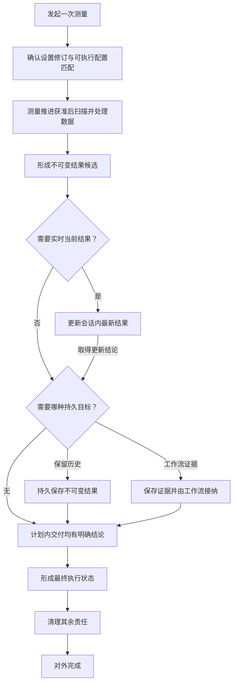
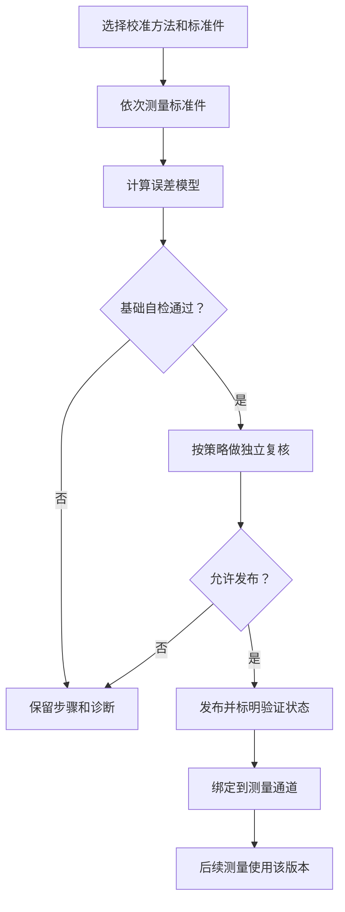
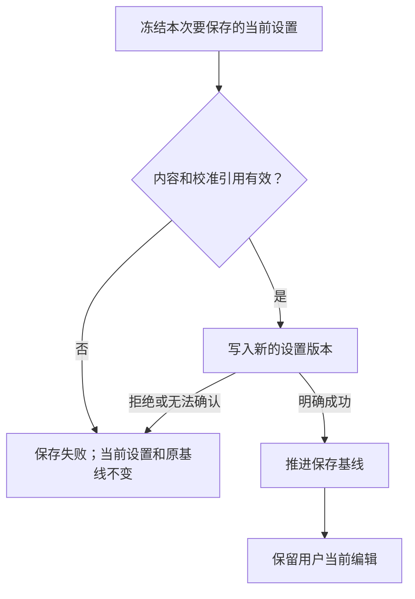
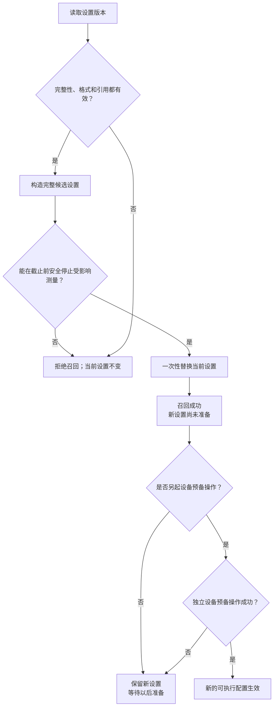

# 架构设计 03：核心业务流程

> [返回文档索引](../README.md) · 相关专题：[产品对象与关系](./02-产品对象与关系.md) · [运行时与触发](./04-运行时与触发.md)

本篇只描述用户能够观察到的五条主流程：设备预备、一次测量、校准、保存和召回。

第一次阅读只看每节的结论和活动图即可。内部运行对象、字段和恢复协议统一从节末进入详细设计。

| 想了解什么 | 直接阅读 |
| --- | --- |
| 设置怎样变成设备可执行配置 | [1. 设备预备](#1-设备预备) |
| 一次测量何时才算完成 | [2. 一次测量](#2-一次测量) |
| 校准怎样采集、验证和发布 | [3. 校准](#3-校准) |
| 保存期间继续编辑会怎样 | [4. 保存当前设置](#4-保存当前设置) |
| 召回为何与设备预备分开 | [5. 召回设置](#5-召回设置) |

## 1. 设备预备

### 1.1 设备预备结论

提交设置后，系统先形成采集和处理要求，再让设备确认实际可执行值，最后按这些实际值绑定数值处理。

任一步失败都不能暴露半份新配置，也不能破坏已接纳测量正在使用的旧配置。没有明确复用结论时，新设置不能启动。

### 1.2 设备预备活动

先判断既有方案能复用到什么程度：

“结构有效”和“现在可以测量”是两个判断。

空通道可以形成合法设置，但暂不进入设备预备。对象关系、参数范围或引用本身不合法时，才拒绝本次修改。

不能复用整份可执行配置时，再形成一份完整的新配置：

### 1.3 实际值与失败规则

“用户请求值”和“设备实际值”不能混为一谈。例如设备可能把请求频率落在它支持的步进上，或根据带宽调整采样方式。L5 的处理与校准绑定必须使用 L2 返回的实际值，不能回头使用原请求猜测。

完整复用与设备侧复用是两件事：

- 既有**已生效的可执行配置**只有经过本修订的适用性检查后，才能直接复用。
- 只有**设备实际执行计划**可复用时，仍要由 L5 按该实际执行计划重新绑定处理，并安装完整的新配置。
- 改变激励、接收机、分段扫描或物理触发方式时，通常需要 L2 重新准备。

新的可执行配置生效前，新的测量请求不会看到半成品，已经开始的测量也不会中途切换。失败时，上一版已生效的可执行配置继续保护已接纳测量；新修订则明确标为暂不可运行。

### 1.4 对应详设

设备预备、失败后的明确结论和采集契约见[公共契约、驱动、硬件与采集](../详细设计/01-公共契约与硬件采集.md)；实际值绑定与校准兼容见[数值处理与通道编译](../详细设计/02-数值处理与通道编译.md)。

## 2. 一次测量

### 2.1 单次测量结论

一次测量从“设置修订与已生效的可执行配置相互匹配”开始，经过测量推进、设备扫描、数据处理和结果交付。测量推进可以来自命令、合格的外部触发或自由运行调度。结果交付分为三类：

- **实时当前结果**：更新会话内有界缓冲中的最新有效测量，不写历史存储。
- **历史结果**：只在用户、记录任务或自动化明确要求保留时，发布为不可修改的历史版本。
- **工作流证据**：用于校准标准件采集等需要跨命令、跨重启继续的步骤，由对应工作流接管。

实时当前更新可以和一次历史保存或工作流证据保存同时发生，但两者分别给出结论，不承诺同时成功或同时失败。任何一步失败都必须留下明确的操作结论，而不是让界面无限等待。

### 2.2 单次测量活动

### 2.3 完成与失败规则

界面按钮、可编程仪器标准命令（SCPI）和自动化接口都执行同一套测量语义，不能各自拼接硬件调用。

测量启动时冻结本次使用的设置、可执行配置和校准引用。用户随后编辑设置，不会改变已经开始的测量，也不会重新解释已经接收的数据。

实时当前结果只有在“属于同一对象和读取位置、数值条件兼容、完成顺序没有倒退”时才更新。较早测量晚完成，或设置变化使原条件失效时，旧结果不能覆盖新结果。

实时当前更新、历史保存和工作流证据分别给出结论。历史保存失败不能撤销已经合法显示的实时结果，也不能被一个模糊的“测量成功”掩盖。

计划内结果都有明确去向后，运行形成最终执行状态；其余资源清理完成后，才对外报告完成。精确父子生命周期见[运行时与触发](./04-运行时与触发.md)。

### 2.4 对应详设

- 触发、停止、完成和资源上限：[运行时、触发与调度详设](../详细设计/03B-测量生命周期与完成.md#84-通道运行实例vnarunengine)
- 实时当前结果：[保存、召回与运行切换详设](../详细设计/04B-保存召回与运行切换.md#934-会话内实时当前结果)
- 历史结果和工作流证据的保存与恢复：[持久化结果与恢复详设](../详细设计/04D-持久化结果与恢复.md#955-持久交付的唯一提交与恢复协议)

## 3. 校准

### 3.1 校准结论

校准不是夹在采集与数值处理之间的新层，而是一条跨越采集、计算、验证、发布和通道绑定的业务流程。

所有候选都必须通过证据完整性、数值稳定性和适用范围检查；只有当前验证策略允许发布的版本，才能在标明验证状态后用于后续测量。

先用一端口开路、短路、负载（SOL）校准理解主线：依次测三个已知标准件，求出误差模型，做基础自检，再用独立参考检查关键数值，最后决定是否发布。

### 3.2 校准活动

### 3.3 发布与失败规则

用户先选择端口、校准方法和标准件，再按引导完成每一步标准件测量。采集得到的数据必须带有完整的数值含义和质量信息，校准计算不能自行猜测标准件或访问设备。

> **基础检查失败，任何策略都不能发布。** 证据不完整、数值不稳定或适用范围不成立，都属于基础检查失败。

基础自检与独立复核不是同一件事。前者检查本次候选自身是否成立；只有它通过后，产品才根据所选策略处理独立复核。

这里的“独立”是指使用不依赖本次候选生成过程的参考结果再次检查关键数值，而不是把同一套计算重复运行一遍：

| 独立复核策略 | 复核缺失或失败 | 允许发布时的验证状态 |
| --- | --- | --- |
| 必需 | 不发布 | 已验证 |
| 提示 | 可以发布，但必须带警告 | 有警告 |
| 不执行 | 不运行独立复核 | 未验证 |

不能发布时，系统保留已完成步骤和诊断，用户可以重新测量某一步。允许发布也不等于隐去风险：界面、远程控制和文件都必须带出同一个验证状态，不能把“警告”或“未验证”伪装成“已验证”。

发布和绑定是两个动作：发布让校准数据集版本成为可引用资源，绑定才表示某个测量通道选择使用它。后续设置变化若超出适用范围，系统必须明确提示不兼容，不能静默套用。

### 3.4 对应详设

校准数学、标准件模型和兼容判定见[数值处理与通道编译详设](../详细设计/02-数值处理与通道编译.md)；校准步骤、重试、发布和绑定见[校准工作流详设](../详细设计/04C-校准工作流.md#94-校准工作流calibrationworkflow)。

## 4. 保存当前设置

### 4.1 保存结论

保存明确成功会产生一个新的、不可修改的设置版本。保存过程中用户可以继续编辑；保存完成只推进“已保存基线”，绝不把正在编辑的当前设置改回旧内容。

内容检查失败或保存被明确拒绝时，当前设置和原有基线都保持不变。

### 4.2 保存活动

### 4.3 保存基线与失败规则

保存开始时先取得一份一致的当前设置，之后写文件不再反复读取用户仍在编辑的可变设置。因此，用户不必等待磁盘写入完成才能继续修改。

普通编辑不会阻止正在进行的保存。假设开始保存时是版本 A，写文件期间用户编辑成版本 B：保存完成后，文件和保存基线都是 A，当前设置仍是 B，并继续显示“有未保存修改”。

异常情况只看三个用户可观察后果：

| 保存期间发生什么 | 当前设置 | 保存基线与文件版本 |
| --- | --- | --- |
| 用户继续普通编辑 | 保留最新编辑 | 成功保存开始时的快照，并把它作为新基线 |
| 更晚的保存、召回或关闭先完成 | 服从更晚操作 | 较早写成的文件可保留为独立版本，但不能让基线倒退 |
| 内容无效或保存被拒绝 | 保持不变 | 原基线不变，不产生新版本 |
| 保存结果暂时无法确认 | 保持不变 | 原基线不变；后续只确认原操作，不能猜测成功或另建操作 |

最后一行的后台确认和重复执行防护属于恢复协议，见本节详设入口。

设置版本默认保存怎样测、怎样处理和怎样显示，不把测量结果混在里面。它引用的校准数据集版本必须在保存时可验证，不能把缺失引用悄悄解释成“未启用校准”。

### 4.4 对应详设

一致快照、并发保存、版本引用和文件恢复见[保存、召回与运行切换详设](../详细设计/04B-保存召回与运行切换.md#93-保存召回与运行切换事务)。

## 5. 召回设置

### 5.1 召回结论

召回先完整检查候选设置，再在安全停止受影响测量后，一次性替换当前设置。替换成功就是召回操作的成功边界；新设置先以“尚未准备”发布。

用户若选择立即准备设备，系统在召回成功后另起一次设备预备操作。设备预备失败会让新设置明确标为暂不可运行，但不回滚已成功的召回，也不把召回最终执行状态改写为失败。

### 5.2 召回活动

### 5.3 切换与失败规则

召回不是把文件中的对象逐个覆盖到当前会话。系统会先完成格式迁移、内容校验和外部校准引用检查，得到一份完整候选；候选不完整时，整次召回失败。

替换当前设置前，系统会停止接纳受影响的新测量，并在明确截止时间内让已接纳测量结束或安全中止。无法证明可以安全替换时，召回失败且当前设置保持不变，不能无限等待。

替换发生时，当前设置、保存基线和后续运行所用修订版一起切换，不会暴露一半新、一半旧的状态。

设备准备属于替换后的独立动作，因为真实设备副作用不能假装随设置一起回滚。设备准备失败时，产品设置仍然可查询，并明确显示尚未形成已生效的可执行配置。

外部命令如果要求“召回后继续等待设备准备”，也必须分别报告召回与准备结果。只有真机命令记录验证后，才能声明兼容 ZNB/SNA 的该项行为。

若用户希望打开引用缺失的旧文件进行人工修复，应使用独立的离线导入流程；它不能偷偷替换当前设置，也不能把缺失校准改写成“关闭校准”。

### 5.4 对应详设

召回的验证、替换边界、设备准备和失败恢复见[保存、召回与运行切换详设](../详细设计/04B-保存召回与运行切换.md#93-保存召回与运行切换事务)。

更精确的内部运行对象、状态和停止截止点见[运行时与触发](./04-运行时与触发.md)；资源与恢复责任见[资源与故障恢复](./05-资源与故障恢复.md)。本篇不重复这些协议。
