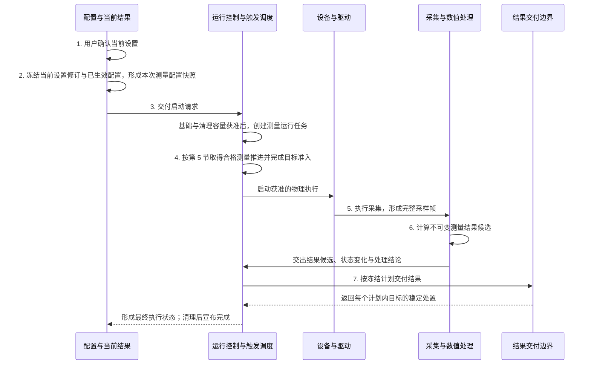
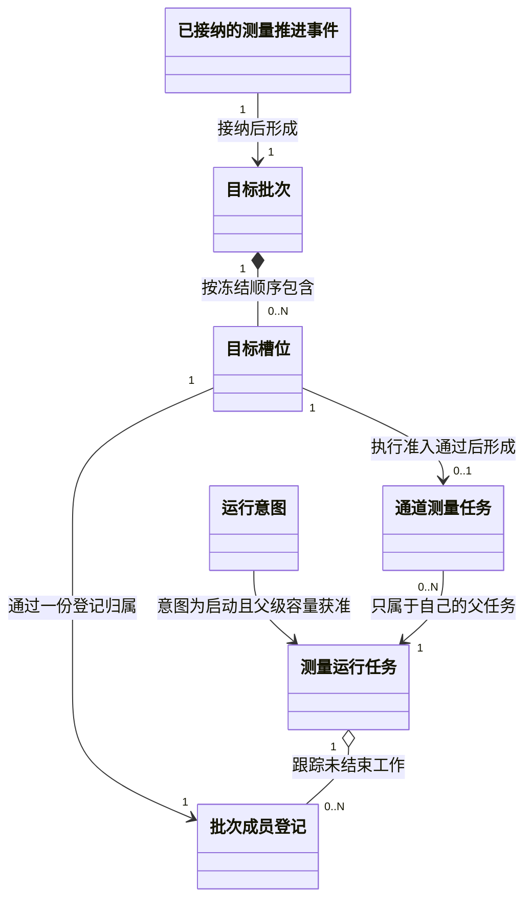
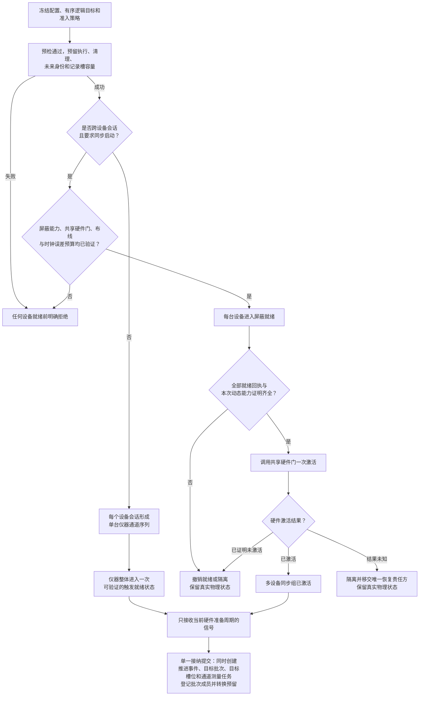
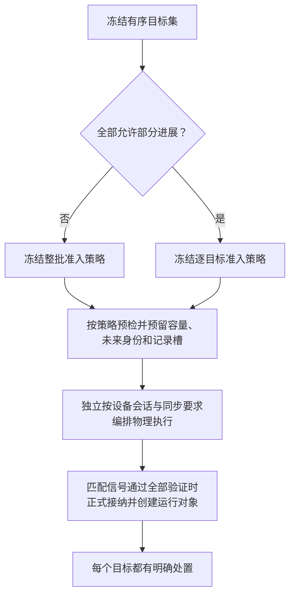
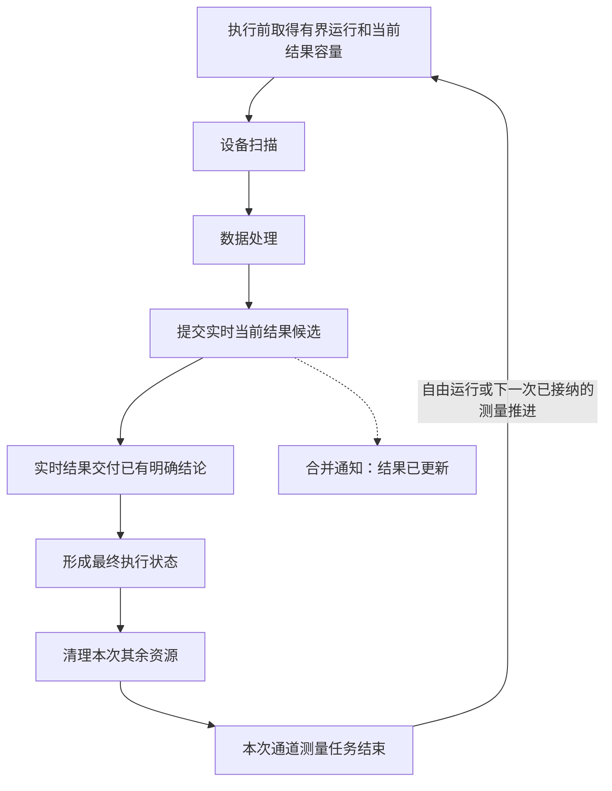
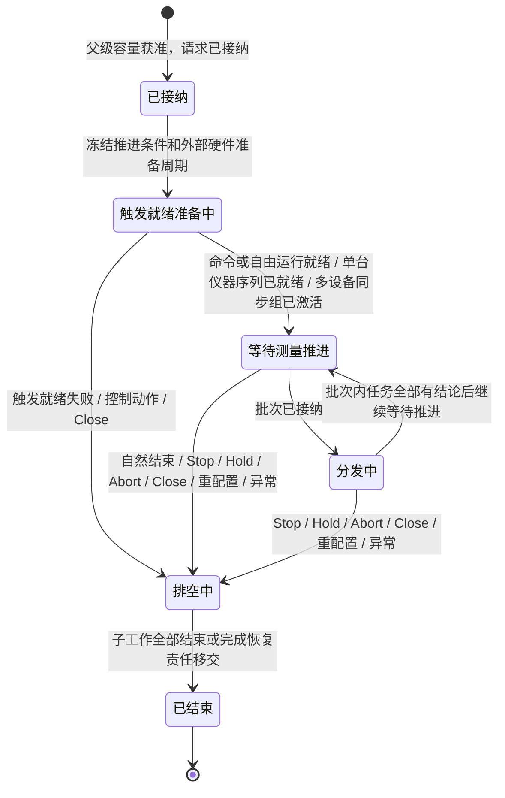
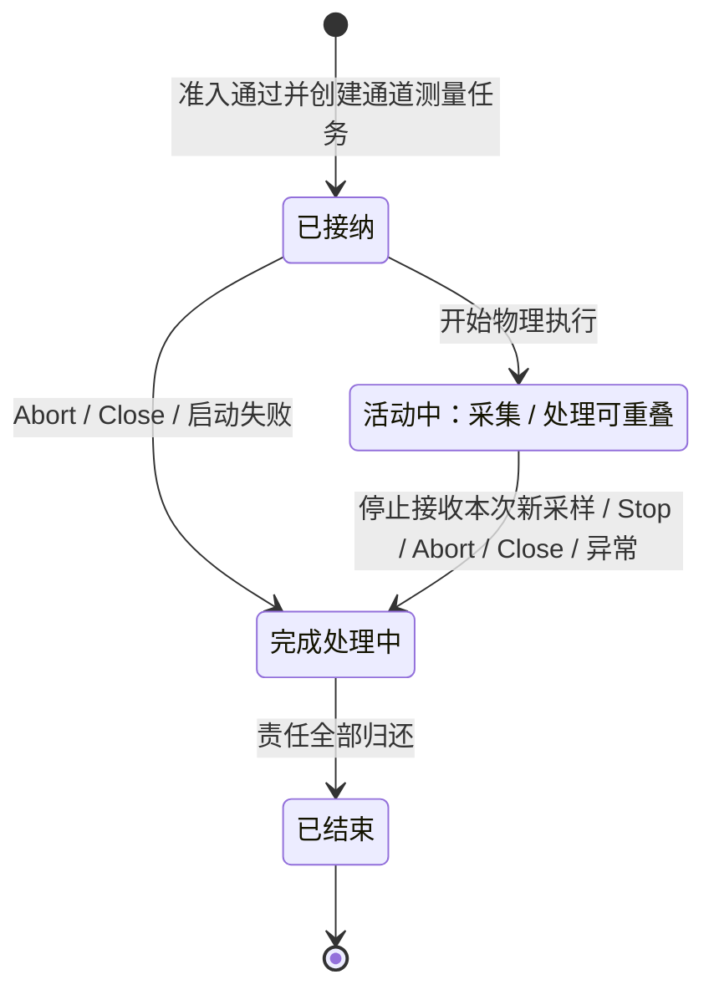
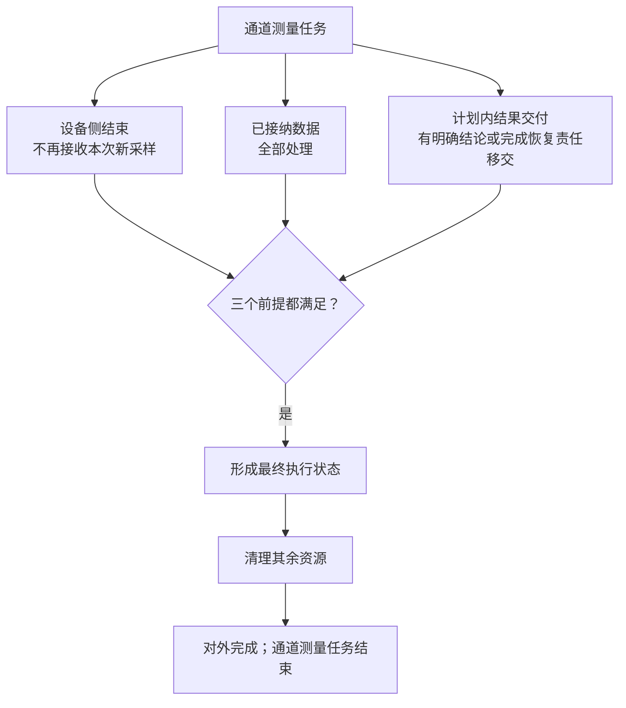

# 架构设计 04：运行时与触发

> [返回文档索引](../README.md) · 相关专题：[核心业务流程](./03-核心业务流程.md) · [资源与故障恢复](./05-资源与故障恢复.md)

本文只回答两件事：一次测量怎样形成可信测量结果，多个测量通道（Channel）怎样在同一台仪器内顺序执行，或在多台设备间安全同步。

资源、关闭和故障恢复见[资源与故障恢复](./05-资源与故障恢复.md)；精确对象基数、完整状态机和并发规则见[运行时、触发与调度详设](../详细设计/03-运行时触发与调度.md)。

## 1. 30 秒摘要

- 产品状态保存用户“想测什么”，运行时只接收按目标通道形成的本次测量配置快照。
- 运行控制与触发调度负责“本次能不能测、何时测、由谁测”，采集与数值处理负责“怎样从采样得到结果”。
- 一次测量推进通过准入后形成不可改写的目标批次，再为每个获准通道建立通道测量任务；资源不足也必须留下明确处置。
- “这次选了哪些通道、是整批还是逐个准入”是逻辑路由问题；“同一台仪器内执行，还是多台设备同步启动”是物理执行问题。两者必须分开决定。
- 测量推进方式只有命令触发、外部边沿、外部电平门和自由运行四种；前面板手动、远程触发命令和外部 TTL 电气输入只是入口来源，不能暗中创造第五种方式。
- 外部触发前，设备必须先进入可验证的触发就绪状态（也称“布防”）。同一设备会话中的多通道由仪器自身序列执行；只有跨设备会话且要求同步启动时，才需要每台设备屏蔽就绪和真实硬件组门。
- 采集结束只代表设备可继续工作，不代表测量结果已经完成。
- 结果交付分为实时当前、保留历史和工作流证据；连续扫描默认只更新实时当前结果，不把磁盘和结果存储库放在实时热路径上。
- 停止、保持、中止和关闭走独立高优先级控制通道，先在可验证的时间上限内关闭新接纳，再处理完已经接纳的工作。

如果只想建立整体认识，依次阅读第 2、3、4、7 节即可。决策、证据和验收入口集中在[架构约束与验收索引](./06-架构约束与验收索引.md)。

## 2. 一次单次扫描（Single Sweep）的七步主线

编号与[十分钟总览的七步](./00-十分钟读懂整体架构.md#12-七步主线)完全一致。本节只从运行责任角度展开，不把保存恢复协议塞进正常主线。

图中第 4 步只表示“已经取得一次合格的测量推进”；命令、自由运行和外部触发怎样取得它，统一见[第 5 节](#5-触发布防与运行模式)，这里不重复展开。

图中的“结果交付边界”按冻结计划落到三种明确目标：

- **实时当前结果**保存在会话内的定额内存中，不是已保存结果。
- **保留历史**和**工作流证据**属于 L7 应用边界，只在本次明确要求时启用。
- 三类目标各自返回稳定处置；需要跨故障继续的持久目标可以移交给唯一恢复责任方。

结果协调属于“运行控制与触发调度”职责，不是第五类职责。采集与数值处理只交出不可变结果候选、需要保存的状态变化，以及采集或逐项处理结束结论；它不直接写会话当前值或结果存储库。

实时结果更新与历史或证据保存之间没有跨存储原子性。实时结果已合法更新后，后续历史保留失败不撤销它；最终执行状态分别报告测量和保存目标的结论。

资源、状态与诊断职责在第 4–7 步提供资源额度、时钟、来源和诊断，但不改写配置、运行控制或测量数据事实。

三条规则不能破坏：

1. 第 2 步之后不再读取持续变化的当前设置；运行只读取由当前设置修订和目标通道已生效的可执行配置等引用组成的本次测量配置快照。
2. 第 3 步先为基础工作和后续清理取得容量，获准后才创建等待测量推进的测量运行任务。

   - **命令触发和自由运行**：可以按软件顺序接纳。
   - **同一设备会话的外部触发**：先预留有上限的执行、清理、未来身份和记录槽容量，再让仪器整体进入触发就绪状态；此时尚未创建已接纳的测量推进事件、目标批次、目标槽位或通道测量任务。只有与当前准备周期匹配的物理信号到达后，才正式接纳并创建这些运行对象。仪器按已验证的通道或测量序列执行，不为每个逻辑通道伪造独立的硬件就绪状态。
   - **多个设备会话且要求同步启动**：先证明每台设备能被物理屏蔽，再让全部设备屏蔽就绪；只有本次就绪证据齐全时，才可由真实硬件组门一次激活。
   - **多个设备会话但不要求同步**：各设备会话分别执行自己的单台仪器序列，必须明确告知用户它们不具有同步启动保证。
   - **明确禁止**：不得先接收边沿，再补做触发就绪准备；不得因为“目标数量大于一”就假定需要多设备同步，也不得用软件循环开关冒充硬件组门。
3. 会话内存负责实时当前值，历史保留和工作流证据各负责自己的持久目标；运行控制与触发调度只根据已冻结目标汇总运行结论，它们不能互相代替。

配置怎样形成已生效的可执行配置，见[产品对象与关系 §4](./02-产品对象与关系.md#4-从用户设置到可执行配置)。

- 会话实时结果见 [D4B 会话内实时当前结果](../详细设计/04B-保存召回与运行切换.md#934-会话内实时当前结果)。
- 历史或证据保存的恢复分支见 [D4D 持久化结果与恢复](../详细设计/04D-持久化结果与恢复.md#955-持久交付的唯一提交与恢复协议)。

## 3. 四类运行职责分别回答什么

这四类职责不是四个进程或四个目录。这样划分只为保证每类运行事实都有且只有一个权威写入者。

### 3.1 配置与当前结果：用户想测什么、结果要交给谁

- **收到**：用户编辑、保存、召回或测量请求，以及本次是否要求实时当前、保留历史或工作流证据。
- **决定**：当前设置修订是否有效，并为每个结果输出冻结交付目标、所属对象、读取位置和兼容条件。
- **交出**：按目标通道形成的本次测量配置快照，以及本次不得在运行中改写的结果交付计划。
- **失败时**：保持上一份有效状态并明确拒绝；不直接启动硬件。

### 3.2 运行控制与触发调度：本次能否执行、何时结束

- **收到**：各目标通道的本次测量配置快照、命令或自由运行条件、各设备会话的就绪结论、多设备同步组的硬件激活结论、与当前硬件准备周期匹配的外部信号，以及执行前容量检查结果。
- **决定**：哪些通道属于这次逻辑推进，采用整批还是逐个准入，各目标映射到单台仪器序列还是多设备同步组，以及测量推进是否接纳、何时停止和最终结论。
- **交出**：已获准的采集与处理上下文，以及最终运行状态。
- **失败时**：先通过高优先级控制通道关闭新接纳，再处理完已经接纳的工作；不保存大数组或执行校准数学。

### 3.3 采集与数值处理：采样怎样变成结果

- **收到**：已获准的采集、组帧和处理上下文。
- **决定**：数据是否完整、每个纯处理阶段是否成功；有状态处理只根据给定的累计状态计算本次变化。
- **交出**：不可变测量结果候选、需要保存的状态变化或明确失败；不直接保存扫频平均或迹线最大/最小保持状态。
- **失败时**：对上游施加背压，并处理完已经接纳的数据；不修改产品设置或重新选择目标。

### 3.4 资源、状态与诊断：容量是否够、事实能否追溯

- **收到**：容量请求，以及其他三类运行职责产生的状态、时间和来源事件。
- **决定**：资源额度是否授予，诊断和审计记录是否完整。
- **交出**：有上限的资源额度、统一时间关系、来源和故障观察。
- **失败时**：拒绝新接纳或隔离无法证明安全的范围；不签发设备执行权，也不改写最终执行状态。

一次扫描先由配置与当前结果职责交出本次测量配置快照和交付计划，运行控制与触发调度创建测量运行任务并完成目标准入。采集与数值处理只形成测量结果候选、需要保存的状态变化，以及采集或逐项处理结束结论；运行控制中的结果协调器再调用本次计划启用的交付边界，并汇总稳定处置。

计划内结果都有明确结论，或已移交给唯一恢复责任方后，运行控制与触发调度才形成最终执行状态；其余资源清理完才宣布完成。资源、状态与诊断职责贯穿观察并提供额度。

同一模块可以参与多类职责，但同一份可变事实只能有一个写入者。

扫频平均（Sweep Average）和迹线最大/最小保持（`Trace Hold` / `Max Hold` / `Min Hold`）的累计状态，由 **L6 当前运行周期内存状态存储**唯一更新：

- L4 数值处理只计算状态变化；
- L6 状态存储按同一作用域的先后次序更新累计值，运行调度只在更新确认后推进模式计数；
- L4 和 L7 不得另存一份累计状态；
- 需要跨重启继续的校准等工作流状态由 L7 的持久工作流存储维护，不与普通扫频状态共用存储。

这份内存状态存储属于“运行控制与触发调度”职责。“资源、状态与诊断”职责只为它分配容量并观察水位，不写入平均或迹线最大/最小保持累计值。

怎样保护已生效的可执行配置、目标怎样取得使用权、资源额度怎样记账，属于详细协议，不在架构正文命名内部凭证。

### 3.5 为什么标记与判定不属于运行时

标记、标记联动、限值检查、纹波和带宽，都是“对已有迹线做分析”。即使仪器已停止扫描，用户也应能移动标记、修改限值线并立即看到新结果。因此，这些操作不启动设备、不停止当前测量，也不创建通道测量任务。

一次分析只使用开始时看到的那组迹线；中途到达的新迹线留给下一次分析。所需迹线不齐时，显示“暂不可判定”，不用旧值冒充新结论；旧分析迟到时，不得覆盖用户已经改过的设置或更新的迹线结果。

具体的一致性、容量和并发处理见 [D4A 产品分析服务](../详细设计/04A-应用会话与事务.md#产品分析服务提交主动刷新与迟到结果)。

## 4. 运行对象：一次推进怎样分给各通道

“某个通道已经启动”不等于“它已在这次推进中获准执行”。一个全局或多通道触发可以同时选中多个通道，而每个通道仍有自己的测量运行任务。下图先表达逻辑归属；设备怎样执行见[5.2 节](#52-逻辑批次怎样映射到物理执行拓扑)。

- **运行意图**：当前测量通道希望启动、保持还是停止；“启动请求”只是改变这项意图的输入消息，不是一个长寿命运行对象。
- **测量运行任务**：一个通道从准备、等待测量推进到最终结束的一次启动工作。它可以跨多次推进，但不拥有其他通道的任务。
- **已接纳的测量推进事件**：一个触发或自由运行节拍经过来源、能力和目标准入后形成的事实。
- **目标批次**：这次推进选中的有序逻辑目标集。它可以跨多个通道的测量运行任务，不归其中某一个父任务所有。没有可路由目标时，也必须给出明确的空批次结论。
- **目标槽位**：批次中的一个固定位置，指向一个确切通道。槽位顺序冻结后不再变化。
- **批次成员登记**：把一个目标槽位连到该通道唯一的测量运行任务，让停止或删除通道时不会遗漏这份未结束工作。
- **通道测量任务**：目标槽位通过执行准入后形成的逻辑工作。一个槽位最多形成一个任务；被拒绝的槽位不创建任务，但仍留下明确处置。任务只属于该槽位对应的父任务。

物理采集与通道测量任务不是固定一对一。同一台仪器可以用一次就绪或启动执行多个通道步骤；一个通道测量任务也可以包含多个采集步骤。精确身份、回收顺序和并发约束见[运行时详设 §8.1–8.2](../详细设计/03A-运行对象职责与端口.md#81-六个运行对象)。

## 5. 触发、布防与运行模式

精确协议把“设备已为本次外部触发做好准备”称为布防（`Arm`）。为了让网分用户先看懂行为，本篇正文优先写“进入触发就绪状态”。

先记两条选择规则：**外部物理信号只能在硬件已被证明进入触发就绪状态后接收；只有全部目标都明确允许部分进展时，才可逐个准入。**

### 5.1 四种测量推进方式与入口来源

测量推进方式是闭集。入口来源只说明命令或电气信号从哪里进入，不能改变运行语义。

表中的 SCPI 是“可编程仪器标准命令”；`*TRG` 是它的触发命令。GET 指 GPIB 的“组执行触发”，不是网络请求；API 指应用编程接口；外部 TTL 指仪器连接器上的 TTL 电平数字触发输入。

| 测量推进方式 | 常见入口来源 | 一次接纳代表什么 | 必须先证明什么 |
| --- | --- | --- | --- |
| 命令触发（Command Trigger） | 前面板手动、SCPI `*TRG`、GPIB 组执行触发（GET）、原生 API | 一个已接纳命令推进一个逻辑单位 | 协议、设备、作用域和执行粒度都支持 |
| 外部边沿（Edge Pulse） | 外部 TTL 电气输入 | 设备进入触发就绪状态后，一个合格边沿推进一个逻辑单位 | 设备输入、极性/滤波和本次硬件触发就绪状态均已验证 |
| 外部电平门（Level Gate） | 外部 TTL 电气输入 | 有效电平允许继续；无效电平在下一单位边界暂停 | 设备支持电平资格判断，且本次硬件已进入触发就绪状态 |
| 自由运行（Free Run） | 内部调度器或设备内部节拍 | 在有容量时自动推进 | 设备与兼容方案明确支持该模式 |

是否支持某种测量推进方式，必须同时检查推进方式、入口来源、设备能力、协议方案、作用范围和执行粒度。

未知组合直接拒绝：外部 TTL 电气输入不能被当成命令触发；`*TRG` 和 GET 只有在对应协议入口已实现并验证时才可使用；不支持电平门的设备也不能自动退化成边沿触发。

表中的“推进”都以输入已经通过忙时处置和完整准入为前提。输入到达不等于必然执行。

#### 忙时输入处置

前一个逻辑测量单位仍在执行时，新命令或边沿只能按已经冻结的产品方案进入以下一种处置：

| 处置 | 对用户和运行时的含义 |
| --- | --- |
| 有界排队（Queue） | 在预先分配的有限队列中等待；队列满时明确拒绝或记录丢弃，不能继续扩容 |
| 明确拒绝（Reject） | 不形成测量推进事件，并返回可观察的忙或资源不足结论 |
| 合并或忽略（Coalesce / Ignore） | 只保留方案明确允许的一个待处理意图，或明确忽略本次输入；不能把多个输入伪装成已经执行 |

具体处置由设备能力和兼容方案在启动前冻结，同一运行周期内不能临时改变。ZNB、SNA 的忙时跳过或忽略行为，只有取得精确命令记录和实物验证后才能写入对应兼容方案；没有证据时，默认使用有界排队或明确拒绝，禁止无界积压。

### 5.2 逻辑批次怎样映射到物理执行拓扑

目标数量不能用来判断物理拓扑。两个通道可能是同一台网分里的内部序列，也可能分别属于两台需要同步启动的设备。因此，系统先选定逻辑目标和准入策略，再按设备会话与同步要求编排物理执行。

| 物理执行拓扑 | 何时使用 | 对设备的承诺 | 必需证据 |
| --- | --- | --- | --- |
| 单台仪器通道序列（`SingleInstrumentSequence`） | 一个设备会话内的一个或多个通道；跨设备但不要求同步时，每个设备会话各形成一个 | 仪器整体只进入一次触发就绪或启动一次，再按自身通道/测量序列执行 | 精确型号、固件和选件的兼容方案，以及实机命令记录 |
| 多设备同步组（`MultiDeviceSynchronizedGroup`） | 目标跨多个设备会话，并明确要求在给定时间误差内同步启动 | 每台设备都保持屏蔽就绪（`MaskedReady`），全部证明齐全后才由共享硬件门一次激活 | 屏蔽能力、共享硬件门与布线、参考时钟或时钟映射、触发偏斜与设备延迟/抖动上限、产品允许误差，以及本次就绪/激活证明 |

单台仪器序列不为每个逻辑通道伪造独立的屏蔽就绪，也不需要多设备组激活协议。但是，仪器序列的触发作用域、通道顺序和测量粒度必须经兼容方案与实机记录共同验证；不能验证时，在启动设备前拒绝。

以外部触发为例，可观察顺序如下：

从预留成功到匹配物理信号到达之间，已接纳的测量推进事件、目标批次、目标槽位和通道测量任务数量都必须为零。匹配信号到达后，由一次不可分割的接纳提交同时创建这些对象、登记批次成员并把预留转成交付给任务的资源；提交中间状态不能被观察。预留只保证信号到达后有能力登记和收尾，不能冒充已经接纳。

就绪是硬件事实，不是界面显示“Ready”或软件中的布尔开关。硬件已确认就绪、但稳定证明尚在返回途中时，同一准备周期内已经到达的信号必须保留。早于就绪生效点或属于旧周期的信号，不能留到下一周期补触发。

多设备同步组中，只有硬件组触发开关、共享触发分配器或系统可控触发源，才能承诺“全部屏蔽就绪后一次激活”。激活动作还必须由兼容方案明确区分：是打开硬件门后等待下一次外部输入，还是由受控触发源立即发出一次同步触发；两者不能共用含糊语义。

共享硬件门只证明设备受同一激活条件控制，不自动证明采样在允许误差内同步。只有参考时钟或经过验证的时钟域映射、触发路径偏斜、各设备从触发到采集的延迟与抖动上限，以及产品允许误差能够闭合时，才允许使用“同步组”名称。否则最多只能描述为共同触发，不能把不同设备结果标成同步或时间可比；V1 不开放这条降级路径。

全部就绪回执和本次动态能力证明只授权调用硬件门，不等于硬件已经成功激活。调用后必须得到“已激活、已证明未激活或结果未知”之一。证据不足时关闭这条路径；若设备已经屏蔽就绪，则先撤销就绪或隔离。物理结果无法确认时，保留“已启动、未启动或未知”的真实状态，隔离成功不能冒充“从未启动”。

ZNB、SNA 手册中的全局/通道触发作用域和仪器内部测量序列，只支持“单台仪器通道序列”的可观察行为，不能当成多设备原子同步证据。

多设备路径保持关闭，直到精确型号、固件、选件、物理布线、共享门、参考时钟或时钟映射、偏斜/延迟/抖动误差预算、故障注入和实机交互记录全部齐备。证据边界见[商用品触发行为](../架构依据/01-商用品行为证据.md#触发的可观察语义)。

来源记录、硬件执行权、故障恢复和电平门重新进入就绪状态等实现协议，统一在 [D3C 触发与多通道调度](../详细设计/03C-触发多通道调度与验证.md#85-触发与多通道调度)与 [D1B 硬件布防和控制合同](../详细设计/01B-驱动边界与硬件.md#331-硬件布防与高优先级控制合同)维护。

### 5.3 运行模式与推进方式对照表

表中的“一个单位”是完整逻辑计数单位，通常是一次完整扫描；按点、分段或局部执行时，要等所有组成部分跨过同一计数边界才算一个单位。

#### 单次（Single）

| 推进方式 | 怎样推进 | 何时结束 |
| --- | --- | --- |
| 命令触发 | 一个被准入的命令执行 1 个单位 | 该单位完成后自然结束 |
| 外部边沿 | 第一个被准入且与当前硬件准备周期匹配的边沿执行 1 个单位 | 该单位完成后结束并撤销触发就绪状态 |
| 外部电平门 | 有效电平允许执行 1 个单位；持续高电平不重复开始 | 该单位完成后结束 |
| 自由运行 | 立即执行 1 个单位 | 该单位完成后自然结束 |

#### 分组 N 次（Group N）

| 推进方式 | 怎样推进 | 何时结束 |
| --- | --- | --- |
| 命令触发 | 每个被准入的命令推进 1 个单位 | 第 N 个单位完成后自然结束 |
| 外部边沿 | 每个被准入且匹配当前硬件准备周期的边沿推进 1 个单位，并按设备能力重新进入触发就绪状态 | 第 N 个单位完成后结束 |
| 外部电平门 | 有效时连续推进；无效时在下一单位边界等待，恢复有效后继续 | 第 N 个单位完成后结束 |
| 自由运行 | 连续推进 | 第 N 个单位完成后自然结束 |

#### 连续（Continuous）

| 推进方式 | 怎样推进 | 何时结束 |
| --- | --- | --- |
| 命令触发 | 每个被准入的命令推进 1 个单位，命令之间等待 | 不按次数结束 |
| 外部边沿 | 每个被准入且匹配当前硬件准备周期的边沿推进 1 个单位，并重新进入触发就绪状态 | 不按次数结束 |
| 外部电平门 | 有效时连续推进；无效时在下一单位边界等待，恢复有效后继续 | 不按次数结束 |
| 自由运行 | 有容量时连续推进 | 收到控制动作、发生失败、关闭或重配置时结束 |

电平无效造成的是“等待信号源”，不是运行保持（`Hold`），不会自行形成停止或运行保持状态。它也与迹线最大/最小保持这类数值处理状态无关。

连续模式永远不能用临时扫描次数、平均次数或队列位置推断自然结束。表中是 VnaPro 自身的运行规则；只有手册证据和仪器契约测试齐备后，才能声明相应商用品兼容行为。

### 5.4 目标怎样冻结

- 命令触发或自由运行接纳时，一次性记下来源、当时的路由和有序目标集；外部触发则在发出第一条触发就绪请求前冻结这些信息，只有与当前硬件准备周期匹配的物理信号才能形成测量推进事件。
- 每个目标记录来源当前设置修订，并形成自己的本次测量配置快照；其中已经冻结已生效的可执行配置和测量结果身份，共享设备不合并生命周期。
- 目标批次只说明“哪些通道同属这次逻辑推进”，不表示它们属于同一设备，也不自动承诺同步。物理执行拓扑必须另行编排。
- 目标集冻结后不能增删。若停止先关闭触发准入，不再形成新批次；若批次先被接纳，停止必须等它留下的工作得到处置。
- 执行前先保证批次和每个目标的处置都可记录；资源不足必须表现为明确拒绝，不能让目标无记录消失。

### 5.5 两种批次准入策略

本节只决定“候选目标应该整批成功，还是允许部分成功”，不决定“设备怎样启动”。对外部触发，就绪前只冻结准入策略并预留有界容量、未来身份和记录槽；此时不创建已接纳的测量推进事件、目标批次、目标槽位或通道测量任务。只有匹配当前硬件准备周期的物理信号也通过验证后，才正式接纳测量推进并创建这些运行对象。设备拓扑则独立按 [5.2 节](#52-逻辑批次怎样映射到物理执行拓扑)编排。

**整批准入（Atomic Admission）**

- 用于单次、有限分组、校准采集，以及任何要求整体一致的批次。
- 在第一条触发就绪请求或硬件启动命令前，整批预留全部目标在最坏情况下所需的执行容量、设备使用权、未来身份、记录槽和故障后清理能力；任一项不足时，零目标进入触发就绪、零目标启动，整批拒绝。对外部触发，这次预留不创建正式运行对象。
- 例：同一台网分的通道 1 和通道 2 都做单次扫描。通道 2 容量不足时，两者都不启动；两者预留成功时，由一个单台仪器通道序列进入触发就绪，不会因为有两个目标就进入多设备路径。匹配信号到达后才正式接纳。

“整批”只修饰**准入**。它不能证明多台设备会同步启动；多设备同步组还必须单独通过 5.2 节的物理能力和本次证据检查。第一个物理副作用发生后，系统也不声称可以回滚现实世界；各目标的真实结果必须分别保留。

**逐目标准入（Per-target Admission）**

- 只用于所有目标都明确允许部分进展的实时连续测量。
- 按冻结顺序逐个检查并预留完整执行容量；当前候选目标容量不足时只拒绝该目标，不回滚已经预留成功的目标。使用外部触发时，这仍只是就绪前预留，匹配信号到达后才正式接纳。
- 例：两个实时预览通道都允许部分进展。通道 1 预留成功、通道 2 容量不足时，通道 2 明确拒绝；若使用外部触发，只有匹配信号到达后，通道 1 才正式接纳并继续。

逐目标准入不是资源不足时的自动降级。只要目标中混入单次、有限分组、校准采集或未授权部分进展的连续模式，就只能预先选择整批准入，或者直接拒绝。明确要求多设备同步启动的目标也不能逐个准入，否则“允许部分进展”会直接破坏同步承诺。

运行时发现冻结信息与预先结论不符时，必须在正式接纳前整批拒绝；已接纳的测量推进事件、目标批次、目标槽位和通道测量任务都不能创建，也不能临时改变策略。

容量取得、移交和归还顺序只在[运行时详设 §8.5.6](../详细设计/03C-触发多通道调度与验证.md#856-目标批次与逐目标准入)维护。

### 5.6 模式计数、处理状态与方案边界

Single 在每个必需序列完成 1 个完整逻辑单位后自然结束；Group(N) 在每个必需序列完成 N 个后自然结束；Continuous 没有次数型自然终点。

扫频平均和迹线最大/最小保持遵循第 3 节的唯一写入规则。处理算子只根据给定状态计算变化；L6 状态存储确认这次变化后，调度才把完整逻辑单位计数加一。这样不会出现处理层和运行时各自更新累计状态的双写。

另外保留两条架构边界：设备能同时保留几份方案必须来自能力声明，不能由调度猜测；目标批次冻结后不得在批次内重新准备或交换方案。能力不足时在启动任何目标前拒绝，换方案则在批次外完成。

### 5.7 连续扫描的实时热路径

连续扫描默认只要求“实时当前结果”。每个目标在启动设备前已经取得一份有界结果缓冲；数值处理完成后，按对象、读取位置、兼容条件和顺序更新会话内当前结果。

通知可以合并或迟到，不参与通道测量任务的完成判断。主路径仍要经过结果交付结论、最终执行状态和资源清理，不能在更新实时当前结果后直接宣布任务结束。

这条热路径不访问结果存储库，不写持久日志，不产生历史版本或恢复记录。

普通扫频平均和迹线最大/最小保持的状态属于当前运行周期（`RuntimeEpoch`），由 L6 的有界内存状态存储唯一保存和更新。测量运行任务只预算所需容量、持有状态引用，并消费已经确认的状态变化，不保存另一份状态值。

进程重启后，新运行周期从空状态重新起算。

界面和外部客户的通知可以合并。读者过慢时，只限制该读者、要求重新同步或断开，不能为每次扫描无限排队。缓冲不足时，在下一个目标准入前施加背压或按已冻结策略明确跳过，不能在扫描中临时扩容。

用户需要以后精确读取某份当前结果时，发起独立的“保存当前结果”操作。该操作冻结当前结果的一致读取，用新的保存责任发布历史版本，不重新打开产生它的旧通道测量任务。

## 6. 生命周期、控制优先级与恢复边界

### 6.1 测量运行任务与通道测量任务的阶段

架构层只需要看清阶段和停止语义，不需要记住全部内部状态。

运行保持（`Hold`）是测量通道的产品期望状态，不是测量运行任务内的可恢复暂停阶段。`Hold` 先关闭新的测量推进，再排空已接纳批次，最后让旧测量运行任务以明确终态结束。之后的 `Continue` 或新的 `Initiate` 必须创建全新的测量运行任务；不重开旧任务，也不复用旧任务身份。

进入触发就绪状态（详设精确动作 `Arm`），表示测量运行任务已经完成接收触发前的准备。对外部触发，还必须取得驱动或硬件给出的可验证就绪证明。

触发就绪准备失败时，父任务直接进入排空并形成失败状态。外部电平门无效时表现为“等待信号源”，不是运行保持，也不结束父生命周期。

### 6.2 高优先级控制通道

| 控制动作 | 是否接收新工作 | 已接纳工作怎样处理 |
| --- | --- | --- |
| 停止（Stop） | 不再接收 | 正常排空，保留已产生结果，随后结束测量运行任务 |
| 运行保持（Hold） | 不再接收 | 正常排空已接纳批次并结束旧测量运行任务；产品期望状态留在 Held，继续时创建新任务 |
| 强制中止（Abort） | 不再接收 | 请求在途工作尽快终止，并在规定容量和时间上限内处理完 |
| 关闭 / 重配置（Close / Reconfigure） | 不再接收 | 处理完旧测量运行任务；新配置只能创建新的测量运行任务 |

停止、运行保持、强制中止和关闭不与普通测量推进事件、数据块、结果通知共用排队次序。它们进入预留的高优先级控制通道；数据队列满载也不能阻塞控制动作。

仲裁顺序从安全故障或隔离开始，依次为关闭、强制中止、停止/运行保持、重配置/撤销触发就绪、进入触发就绪/启动和命令触发。优先级只决定尚未提交的动作，不能撤销已接纳批次或已经发生的物理边沿。

控制响应必须有三个可验证的时间上限：

1. 关闭本地新接纳和外部输入；
2. 取得驱动的控制确认；
3. 在安全处置期限内得到两种结论之一：设备给出可验证的物理静止证据，或物理状态仍不可知但相关设备会话已进入禁止复用的隔离状态。

隔离驱动宿主只能证明旧软件不再发命令或发布回调，不能单独证明设备已停止扫描、撤防或进入射频安全状态。任何一步超时都记录为控制命令超时；无法得到物理证据时必须保留“物理状态不可知”并禁止相关设备复用，不能伪造“已经停止”。这些上限来自已冻结的设备能力和已生效的可执行配置，必须在队列饱和、设备无响应测试中量化验证。

### 6.3 并发故障怎样确定主因，以及 R2 能承诺什么

并发失败的“主因”不能取决于哪个线程先回调。系统先按因果关系判断；没有因果先后时，再按一组稳定优先级选择。

相同输入无论线程和队列怎样交错，都必须形成相同主因和最终执行状态。控制命令失败另行记录，不能遮蔽原始设备或处理失败。精确比较顺序属于详细设计。

R2 的整批准入只适用于运行时、可执行配置登记和资源账本仍在同一进程、可以一次提交的情况。未来若将参与者拆到不同进程，必须先增加持久化的一致性与恢复协议；在该协议实现前，跨进程整批准入保持关闭。

完整父子状态机、确定性根因候选和竞态规则只在[运行时详设 §8.3–8.4](../详细设计/03B-测量生命周期与完成.md#83-测量运行任务生命周期initiation)维护。

## 7. 采集完成不等于整次测量完成

一次通道测量任务先让设备侧、数据处理和本次已冻结的结果交付都得到稳定结论，再形成最终执行状态，最后清理其余资源：

只有硬件确认的正常采集终态或有效物理静止证据成立后，设备才可以服务下一次采集；软件合成终态、Host 隔离或物理状态不可知不允许设备复用。已进入处理管线的数据仍要排空。结果交付不再默认等于保存：

- **只有实时当前目标**：候选已更新当前结果、已被更新结果取代，或因已提交的停止、重配置、召回、关闭而失效，都属于明确结论。它不等待存储库或磁盘。
- **要求保留历史**：已接纳才算该目标成功；明确拒绝使该目标失败；结论未知时，必须先移交给唯一恢复责任方继续确认同一保存请求。
- **要求工作流证据**：证据持久且对应工作流明确接纳后，该步骤才成功；实时预览不能替代证据接纳。

建立本次运行、更新实时当前、保留不可变历史、接纳工作流证据是四项独立责任。前一项完成不代表其他项也已完成，任何一项失败也不撤销另一项已经形成的事实。

历史或证据保存的迟到确认和决定重放只在 [D4D 持久化结果与恢复](../详细设计/04D-持久化结果与恢复.md#955-持久交付的唯一提交与恢复协议)维护。

## 8. 相关专题

- 资源为什么必须有上限、操作何时才算真正完成：[资源与故障恢复](./05-资源与故障恢复.md)
- 精确对象、完整状态机、触发路由与并发截止点：[运行时、触发与调度详设](../详细设计/03-运行时触发与调度.md)
- Save、Recall：[D4B 保存、召回与运行切换](../详细设计/04B-保存召回与运行切换.md)
- 实时当前结果：[D4B 保存、召回与运行切换](../详细设计/04B-保存召回与运行切换.md#934-会话内实时当前结果)
- 历史结果与工作流证据恢复：[D4D 持久化结果与恢复](../详细设计/04D-持久化结果与恢复.md)
- SCPI 等外部协议如何观察完成：[D5A 外部适配器](../详细设计/05A-外部适配器.md)
- 决策、证据边界与 16 个架构验收门：[架构约束与验收索引](./06-架构约束与验收索引.md)
