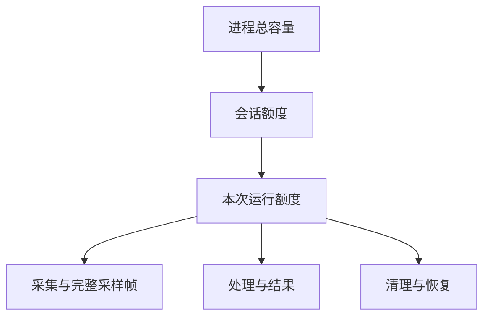
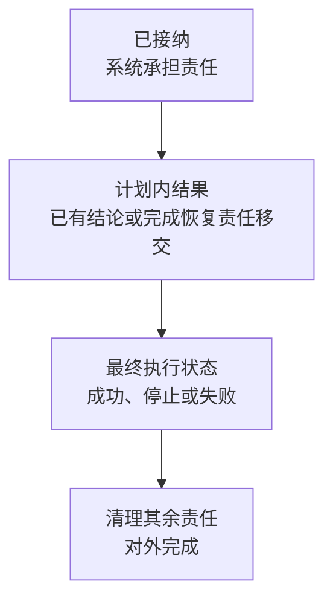
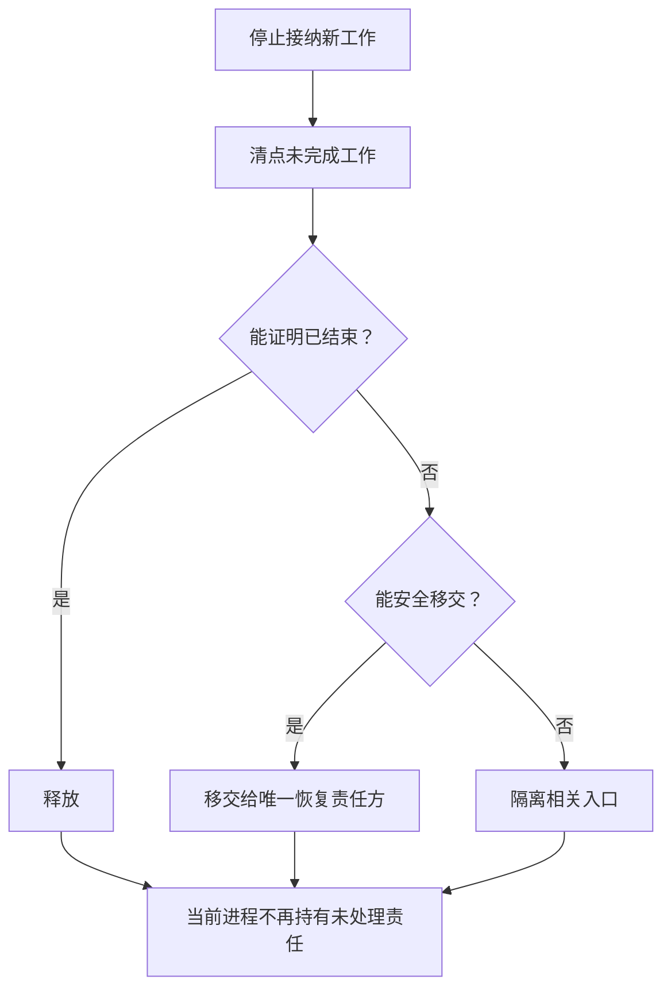

# 架构设计 05：资源与故障恢复

> [返回文档索引](../README.md) · 相关专题：[运行时与触发](./04-运行时与触发.md) · [架构约束与验收索引](./06-架构约束与验收索引.md)

本篇回答三个问题：资源为什么不会无限增长、一次操作什么时候才真正完成、关闭或重启时怎样处理遗留责任。字段、内部凭证、重放记录和竞态协议属于详细设计。

## 1. 30 秒摘要

- 新工作在排队、占用内存或产生外部副作用前，必须先证明已为最坏情况预留足够容量。
- 已生效的可执行配置“能否继续被使用”和系统“还剩多少容量”是两类事实，不能用同一把锁或同一份账代替。
- 本次计划内的结果必须有明确结论，或已移交给唯一恢复责任方，才能形成最终执行状态；实时当前结果不需要跨重启恢复，历史结果和工作流证据才需要恢复记录。
- 关闭只等待当前进程不再持有未处理责任：工作已经释放、完成恢复责任移交，或相关入口已经隔离；不等待无响应的外部系统恢复。
- 重启先接管遗留责任，再开放不受影响的新业务；永久故障只关闭必要范围。
- “旧软件已隔离”和“设备物理已静止”是两个不同结论。前者不能代替设备状态回读、硬件互锁或独立安全通道给出的物理证据。

## 2. 先理解三条可靠性规则

架构层不要求先记内部凭证名，只需理解下面三件事。

### 2.1 已生效的可执行配置不能被提前撤走

测量运行任务在等待测量推进时，已生效的可执行配置仍可能被后续通道测量任务使用；通道测量任务获准后，又需要一份只属于该任务的配置使用权。等待推进和正在执行的任务都结束后，这份配置才可以退役。

应用层负责记录哪些任务仍可使用这份配置。资源容量统计只能核对数量，不能据此授予设备使用权。

### 2.2 每项工作都有资源上限

队列项、完整采样帧、处理中间数据、结果、外部流和恢复记录都计入容量。容量不足时要在接纳前等待或拒绝，不能先创建不完整的任务再无限占用资源。

### 2.3 结果交付先有结论，再确定最终状态

运行只等待启动时已经确定的结果去向：

- 只要求实时当前结果时，结果已经更新、已被更新结果取代，或因已提交的停止、重配置、召回、关闭而失效，都表示这项结果工作已经结束。
- 要求保留历史时，存储方接纳保存请求才算成功；明确拒绝表示失败；暂时无法确认时，必须先由唯一恢复责任方接管对原保存请求的后续确认。
- 要求工作流证据时，证据已经保存并被对应工作流明确接纳，该步骤才成功。

历史结果或工作流证据的保存请求必须已经成功、明确失败，或已移交给唯一恢复责任方，才能形成最终执行状态；不能拖到清理阶段再决定。

最终执行状态确定后，只清理设备使用权、资源额度、观察者通知等其余责任。对外所说的“操作完成”默认还要等这些清理结束。

## 3. 有界资源与背压

### 3.1 资源只向下划分，不凭空产生

从上到下读，下级额度都来自上级；图只表达容量分配，不表达设备调用顺序。

多个测量通道可以共享同一设备。每个目标通道的本次测量配置快照若分别确认同一份已生效的可执行配置适用，也可以共同引用这份配置。

但是，每个目标的队列、数据、测量结果和恢复容量仍要分别记账。共享执行能力不等于共用一份无法追责的资源账户。

### 3.2 接纳前可以拒绝，接纳后必须给出结论

- 接纳前发现容量不足，按已冻结策略等待或明确拒绝。
- 接纳后即使用户断开、设备失败或某项历史结果、工作流证据保存变慢，系统也必须给原工作一个结论。
- 下游变慢时，上游停止接收或降低在途数量，这就是背压；设备回调不能永久等待慢客户端。
- 连续测量也只能维持固定数量的在途工作和实时结果缓冲。不要求保存历史结果或工作流证据时，磁盘占用、历史版本和恢复记录必须与扫描次数无关。

多通道批次的资源后果沿用[运行时与触发 §5.5](./04-运行时与触发.md#55-两种批次准入策略)：整批准入在任一目标容量不足时零目标启动；逐目标准入只拒绝当前不足的目标。策略资格不在本篇重新定义。

### 3.3 已接纳工作只有三种资源结局

| 去向 | 白话含义 | 何时可重新使用原容量 |
| --- | --- | --- |
| 释放 | 原工作已经结束，资源确实归还 | 释放完成且重复释放不会增加容量后 |
| 移交 | 原责任方不再负责，已经明确登记的新责任方独立继续 | 由新责任方完成并释放后 |
| 隔离 | 暂时无法证明安全结束，关闭相关使用入口 | 恢复或人工确认安全后 |

“业务失败”不是第四种资源去向。失败后仍要释放、移交或隔离，否则每次失败都可能永久泄漏容量。

对设备还要在“隔离”中再分两层：

- **软件已围栏**：旧主进程或驱动宿主不再能发命令、接纳工作或向新代发布回调。
- **物理已静止**：设备状态回读、硬件看门狗/互锁，或独立安全控制通道已证明扫描结束、触发撤防，且设备兼容配置要求的射频安全后置条件成立。

只有软件围栏而缺少物理证据时，状态必须是“物理状态不可知，设备已隔离”。它可以让旧软件责任收口，但不能让该设备会话或已生效可执行配置重新被使用。

## 4. 已接纳、结果处置、最终执行状态和清理完成

以界面或远程命令发起一次测量为例：

1. **已接纳**：系统已经登记这项工作；调用者断开也不会让它无记录消失。
2. **计划内结果已有结论**：实时当前结果已更新，或有明确的被更新结果取代、失效结论；本次若还要求历史结果或工作流证据，保存请求已经接纳、明确拒绝，或已由唯一恢复责任方接管后续确认。
3. **最终执行状态**：在上一步成立后，测量成功、停止或失败才可以确定，之后不能改写。
4. **清理完成**：设备使用权、资源额度和必须送达的通知等其余工作已经处理完，界面和远程协议才可报告真正完成。

接纳前检查失败时直接返回拒绝，不创建空操作。查询进度所用的外部标识只用于找到这些时刻，不拥有运行、测量结果或资源。

远程控制的等待、设备清除和响应顺序见[适配器详设](../详细设计/05A-外部适配器.md#101-scpi)。

## 5. 关闭：逐项释放、移交或隔离

关闭和重启恢复按同一规则处理未完成工作：能证明已经结束就释放，能安全继续就移交，否则隔离受影响的最小范围。

关闭开始前就要预留完成必要清理所需的最低容量；新操作被接纳时，也同时预留它的清理记录容量。容量不足可以拒绝新业务，不能让已经存在的会话因为临时内存不足而无法关闭。

外部工作永久阻塞时，原会话只等待确认当前进程已经释放责任、完成移交或隔离相关入口；它不跟随后台恢复循环，也不等待无响应的外部系统恢复。

## 6. 重启恢复：只接管必须跨重启继续的工作

| 关闭 | 重启恢复 |
| --- | --- |
| 面对当前进程正在持有的责任 | 面对上次崩溃留下的责任 |
| 停止接纳新工作，逐项释放、移交或隔离 | 继续停止接纳新业务，扫描并由唯一恢复责任方接管遗留责任 |
| 当前进程不再持有未处理责任后即可结束会话 | 遗留责任已经完成移交并完成必要对账后，按受影响范围开放新业务 |

任何在崩溃时仍活动的测量运行任务都以“已中断”终态结束，产品期望状态回到 `Ready`。`Initiate`、`Restart`、`Stop`、`Hold` 和 `Abort` 都不跨重启重放；需要再次运行时，必须由用户或自动化发出新命令。

测量运行任务“已中断”是业务结论，不是设备“已物理停止”的结论。驱动宿主中独立于可能阻塞的厂商工作线程的安全控制环，必须监视主进程心跳租约。租约过期后，它在预先声明的硬上限内，按设备能力尝试撤防、停止、强制中止和射频安全动作。只有独立状态回读、设备硬件看门狗/互锁或独立安全控制通道证明后置条件时，才可记为物理已静止；命令 ACK、厂商工作线程退出或驱动宿主被终止都不够。

如果主进程长期不重启，仍由存活的驱动宿主安全环执行上述尝试。如果驱动宿主也已死亡或失联，只有事先经验证的设备硬件看门狗或互锁能提供物理证据；否则必须保留物理状态不可知并隔离设备。没有实机能力和后置条件证据的兼容配置，不得声称已进入射频安全状态。

实时当前结果只属于当前会话和本次运行。进程重启后它为空，旧实时结果和默认实时平均/保持状态不恢复，也不从历史索引猜测“当前结果”。已崩溃的连续测量启动不自动复活；用户或自动化需要重新启动。

所有已经产生持久或外部副作用、但尚无稳定结论的操作，都必须按各自唯一责任协议跨重启恢复；只更新实时当前结果的普通连续测量不跨重启恢复。历史结果或工作流证据保存、测量通道删除和校准数据集目录移除都是这一规则的具体实例。下面以结果保存方在写入时永久无响应为例：

1. 原测量任务不能猜测保存成功，也不能永远等待。
2. 系统先让唯一恢复责任方接管“继续确认原保存”的责任；原测量任务以失败的最终执行状态进入清理。
3. 关闭只等待确认移交已经完成，不等待结果保存方恢复。
4. 重启后由唯一恢复责任方接管原请求；对应保存入口保持关闭，设备查询和其他不受影响的业务可以按安全结论开放。
5. 后台以后只继续确认原请求，不能另建一次保存来猜测结果。

这里的启动恢复底线只适用于必须跨重启收口的持久工作或外部工作流：第一次可能产生外部副作用之前，负责接管未决工作的恢复责任方已经建立，并已为最坏情况预留足够容量。普通扫描和只更新实时当前结果的连续测量不建立这类恢复记录。

恢复记录、重复执行防护和结果确认顺序，分别见 [D4D 历史与证据保存恢复协议](../详细设计/04D-持久化结果与恢复.md#955-持久交付的唯一提交与恢复协议)和 [D4E 删除后台处理状态查询](../详细设计/04E-产品对象删除与后台处理.md#915-删除后台处理状态查询)。

## 7. 永久故障只关闭必要范围

恢复期间的准入限制必须带明确范围，不能把一个对象的故障写成整个系统的全局停机：

| 无法证明安全的事实 | 默认关闭范围 | 仍可继续 |
| --- | --- | --- |
| 某驱动宿主已软件围栏，但设备物理状态不可知 | 该宿主代次、设备会话、物理设备及引用它的可执行配置 | 其他已独立证明安全的设备、已保存结果查询 |
| 某设备会话的物理静止或独占使用权无法证明 | 该设备会话、物理设备及引用它的可执行配置 | 其他设备、离线编辑 |
| 某个结果存储库无法接收新的历史结果或工作流证据 | 向该存储库发起的新保存操作 | 实时当前结果、设备查询、其他存储库 |
| 某产品会话的设置/运行责任 | 该会话的相关新用例 | 其他会话与离线文件或已保存数据 |
| 跨会话资源所有权记录损坏 | 依赖该记录才能证明唯一责任的操作 | 经独立证明不依赖该记录的功能 |

只有最后一行才可能要求在进程级停止接纳新工作，而且必须说明具体损坏的是哪一项跨会话资源所有权记录。超时、单条记录损坏或一个后端不可达，都不足以自动升级为全局停机。

### 驱动或设备永久阻塞

- 先围栏旧软件，再按已证明的安全能力尝试撤防、停止、中止和射频安全动作。缺少物理后置条件证据时，隔离相关驱动宿主代次、设备会话、物理设备和已生效的可执行配置，拒绝新的相关准备与采集。
- 主进程查询、保存、关闭和其他设备不应被一起拖死。
- 只能通过显式安全重连/复位后重新验证物理状态，或有审计记录的现场人工确认，才能解除该设备隔离；重启主进程、重建内存对象或取得新进程锁都不够。

### 文件或历史、证据保存不可达

- 只停止向对应存储库发起新的历史结果或工作流证据保存；预留容量已满时，明确拒绝新的同类操作。
- 实时当前结果、不需要保存的查询、其他目标和其他会话继续工作。

### 外部客户端过慢或断开

- 限制对应连接和流窗口，必要时丢弃预览、取消流或断开连接。
- 已完成的测量、历史结果和其他客户端不受影响。

### 无法确认某项资源由谁负责

- 隔离受影响的具体资源和相关准入入口，等待恢复或人工确认。
- 不能“先释放再说”；所有权清楚的其他资源仍可使用。

## 8. 本篇刻意不展开

- 完整运行状态、并发截止点和内部方案使用凭证：[D3 运行时、触发与调度](../详细设计/03-运行时触发与调度.md)
- 保存和召回事务：[D4B 保存、召回与运行切换](../详细设计/04B-保存召回与运行切换.md)
- 历史结果和工作流证据的恢复协议：[D4D 持久化结果与恢复](../详细设计/04D-持久化结果与恢复.md)
- 资源账本和清理记录：[D5B 共享基础服务](../详细设计/05B-共享基础服务.md)；外部协议：[D5A 外部适配器](../详细设计/05A-外部适配器.md)
- 决策证据与阻断性验收：[06 架构约束与验收索引](./06-架构约束与验收索引.md)

这些规则支持商用品的可观察行为，但不推断 ZNB 或 SNA 的内部实现。外部兼容结论以用户手册和可重复行为记录为准；开源代码和逆向分析只在登记过的证据边界内解释机制。

## 9. 架构评审时问五个问题

1. 新工作产生可见对象或外部副作用前，是否已为最坏情况预留足够容量？
2. 已生效的可执行配置使用权和资源容量是否各有唯一负责方？
3. 形成最终执行状态前，本次确定的实时当前结果、历史结果或工作流证据是否都有明确结论，或已移交给唯一恢复责任方；最终状态确定后还剩哪些清理工作？
4. 关闭遇到永久阻塞时，能否移交或局部隔离，而不是无限等待？
5. 重启时能否先接管旧责任，再开放不受影响的新业务？

任一问题无法回答，都说明可靠性边界尚未形成。
