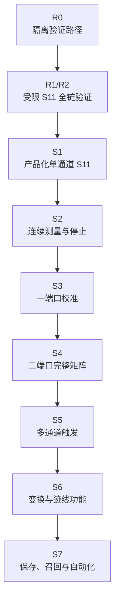
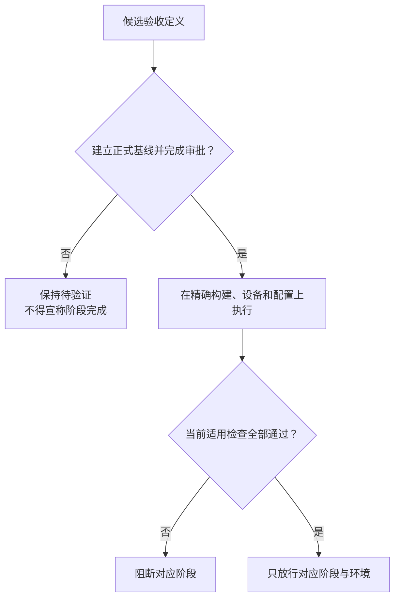

# 架构设计 06：架构约束与验收索引

> [返回文档索引](../README.md) · 本篇用于架构评审，不是首次阅读入口。第一次了解系统请先看[十分钟总览](./00-十分钟读懂整体架构.md)。

本篇只保留三类评审信息：不能破坏的边界、现有代码向目标分层的迁移方向，以及各阶段必须证明的结果。精确测试、版本、证据登记和并发协议统一放在详细设计中。

## 1. 不可破坏的边界

| 必须守住的边界 | 违反后的直接后果 |
| --- | --- |
| 设备与采集代码不认识测量通道、迹线、显示窗口或外部命令 | 产品概念渗入底层，设备复用和多通道编译失效 |
| 界面、远程控制、自动化和文件恢复只调用同一套应用用例 | 不同入口会产生相互矛盾的状态和错误行为 |
| 用户设置、设备实际执行计划和处理计划分开保存，完整组合后才能运行 | 设备量化或拒绝设置后，结果无法解释 |
| 纯数值核心不依赖界面、文件、数据库、线程或厂商驱动 | 数值正确性会被输入输出和生命周期问题污染 |
| 队列、任务、数据和结果都有容量上限，并有唯一归还责任 | 慢客户端、连续测量或故障会造成资源无限增长 |
| 第三方驱动与主应用隔离；驱动故障不能拖死主应用 | 一个不可控驱动会扩大为整机失效 |
| 显示样式不进入数值计划；修改标记、限值、纹波和带宽不触发设备重扫 | 显示操作会错误改变测量行为 |
| 商用品行为、开源机制、逆向观察和本项目推断分别标记 | 未验证推断会被误写成 ZNB/SNA 的事实 |

跨通道迹线分析只能使用一组明确冻结的当前结果，并显示各输入来源。它不能把不同时刻完成的数据冒充同步采集。

具体编译和并发规则见[通道编译详设](../详细设计/02C-通道编译绑定与失效.md)与[应用事务详设](../详细设计/04A-应用会话与事务.md)。

## 2. 现有代码怎样归入目标分层

当前代码已有驱动、硬件、采集和测量三个主要模块，但职责仍有交叉。整改原则是保留可验证能力，拆出错误归属的责任，而不是把现有目录原样提升为架构层。

| 现有资产 | 目标归属 | 整改结论 |
| --- | --- | --- |
| `sdk/VnaDriver` | L1 驱动边界 | 保留厂商接口封装，补独立驱动隔离 |
| `modules/VnaHardware` | L2 硬件适配 | 保留设备能力；公共单位、身份、质量和错误迁到 L0 |
| `modules/VnaAcquisition` | L3 采集与组帧 | 保留采样完整性；触发和测量生命周期迁到 L6 |
| `modules/VnaMeasurement` | L4 数值核心与 L7 产品对象 | 拆开纯数值计算和产品测量对象 |

目标架构还需补齐四组责任：

- **L0 公共契约**：统一单位、身份、数值含义、质量和错误；
- **L4/L5 数值与通道编译**：把网络模型、校准、变换和迹线数学与产品状态分开；
- **L6 运行时**：统一接管启动、触发、调度、停止和有界完成；
- **L7/L8 产品与入口**：统一设置事务、保存召回、结果选择，以及界面和远程协议映射。

这不是一层一个库、一层一条线程，也不是要求先完成 L0 再开发 L1。精确构建目标、依赖白名单和禁止依赖由[依赖验收详设](../详细设计/05C-依赖验收与竞态.md#12-依赖与编码门禁)维护。

最低静态约束只有三条：

1. L0–L7 不依赖界面、远程协议或文件格式的具体类型；这些映射只属于 L8。
2. L4 不做输入输出；L1–L3 不引入测量通道或迹线对象；L6 不依赖 L7 的具体实现。
3. 厂商应用二进制接口（ABI）只允许 L1 调用；L2 只能通过 L1 使用设备能力。

## 3. 开发按纵向切片推进

纵向切片是一个能产生用户结果、同时验证跨层责任的最小交付。它与“先写完一层，再写下一层”不同。

产品化之前，先用受限的 S11 验证骨架证明各层接缝能协作。该骨架只用于内部验收，不能进入产品构建，也不能因为本地跑通就宣称阶段完成。

| 阶段 | 用户或验收人员可观察的结果 | 离开阶段前必须证明 |
| --- | --- | --- |
| R0 | 产品构建无法到达验证骨架 | 骨架与生产路径已机械隔离 |
| R1/R2 | 受限入口得到一条 S11 | 数值含义和设备实际值贯穿全链；驱动阻塞不拖死主应用；停止、失败和慢消费都有明确结论 |
| S1 | 界面可查询单通道、未启用校正的 S11 | 结果可追溯，当前适用验收门全部通过 |
| S2 | 连续刷新并能可靠停止 | 长时间运行资源有界，停止不泄漏责任 |
| S3 | 完成一端口开路、短路、负载校准 | 失败不污染已发布校准版本 |
| S4 | 得到二端口完整 S 参数矩阵 | 多激励步骤完整，迹线数量不决定物理扫描次数 |
| S5 | 支持多通道触发 | 触发来源、目标选择和物理执行方式分开，停止不复活旧任务 |
| S6 | 支持变换、迹线数学和迹线判定 | 处理顺序可验证，显示不渗入数值层，非法组合在运行前拒绝 |
| S7 | 支持保存、召回和自动化 | 新旧设置、结果和外部命令顺序一致且可恢复 |

模拟器和测试替身用于验证 VnaPro 自身契约，不能替代真实驱动、真实模拟通路或 ZNB/SNA 的实机行为对照。

## 4. 架构决策导航

先读自然语言结论；只有需要追踪依据时，才查决策编号和[架构依据与取舍矩阵](../架构依据与取舍矩阵.md#5-决策反向索引)。

| 主题 | 评审级结论 | 决策编号 |
| --- | --- | --- |
| 三张地图 | 源码分层、运行职责和产品对象关系不能混成一张图 | `DEC-RUN-ORTHO-001`、`DEC-LAYER-PURECORE-001` |
| 设置到执行 | 用户设置、设备实际执行计划和处理计划分开，完整组合后才运行 | `DEC-ACQ-PARTIAL-001`、`DEC-NUM-SPAN-001` |
| 数值含义 | 每个数值阶段都说明物理量、校正状态、参考面和读取位置 | `DEC-NUM-SCHEMA-001`、`DEC-DATA-ACCESS-001` |
| 产品对象 | 测量通道、测量量、迹线和显示窗口分开；删除显示不删除测量量 | `DEC-OBJ-001`、`DEC-OBJ-MEAS-001` |
| 保存版本 | 设置、校准和结果有独立生命周期 | `DEC-PERSIST-001`、`DEC-RESULT-PROV-001` |
| 驱动故障 | 第三方驱动进入独立故障域 | `DEC-DRIVER-ISOLATION-001` |
| 运行完成 | 采集结束不等于测量完成；队列、数据、任务和交付都必须有界 | `DEC-RUN-ORTHO-001`、`DEC-RES-BOUND-001` |
| 迹线分析 | 改标记、限值、纹波和带宽只重算当前迹线结果，不启动硬件 | `DEC-RUN-ORTHO-001`、`DEC-RES-BOUND-001` |
| 触发 | 触发来源、目标、准入和执行进度分别表达，并保留时钟关系 | `DEC-TRG-CARD-001`、`DEC-TRG-MODEL-001`、`DEC-TRG-CLOCK-001` |
| 保持与继续 | V1 每个通道至多有一个活动测量运行任务；保持结束旧任务，继续创建新任务 | `DEC-RUN-SINGLE-LIVE-001` |
| 外部协议 | 所有外部入口共用应用用例和统一状态语义 | `DEC-SCPI-ORDER-001`、`DEC-STATUS-001`、`DEC-SCPI-DCL-STATUS-001` |

这些结论是 VnaPro 的设计，不声称复刻厂商内部实现。

## 5. 商用品、开源与逆向证据边界

证据按下面顺序使用：

1. ZNB/ZNBT 与 SNA 手册和可重复实机记录，定义需要兼容的外部行为；
2. SNA 逆向观察，只证明清单中登记的二进制边界和耦合现象；
3. 固定版本的 LibreVNA、NanoVNA 等开源代码，提供算法、缓冲和测试机制参考；
4. VnaPro 当前代码，只说明已有能力和迁移约束；
5. 满足上述事实的内部结构，才是 VnaPro 自己的架构选择。

不能从命令树、动态链接库名称、组件对象模型对象或开源目录反推出内部所有权。商用品和开源机制冲突时，以已复核的商用品外部行为为准；没有实机记录的差异保持“待验证”。

## 6. 阶段、切片与十六个阻断性验收门

架构层只说明“什么风险会阻断交付”。验收范围怎样登记、证据怎样绑定、检查怎样执行，统一查[验收详设](../详细设计/05C-依赖验收与竞态.md#验收范围规范登记表scoperegistry)。

当前状态必须如实理解：文档中的 19 个范围都只是候选定义，正式发布范围为 0，有效通过记录为 0。因此 R0、R1、R2 和 S1–S7 都不能宣称完成。

| 验收门类别 | 白话目的 | 首次阻断阶段 |
| --- | --- | --- |
| 类型、全链与失效 | 每段数据含义明确；真实公共边界可走通；故障后有唯一结论 | R1/R2 |
| 运行安全 | 资源有上限，并发不双持，失败后责任不丢失 | R2 |
| 结果溯源 | 结果能说明来源，以及为何仍适合当前设置 | S1 |
| 触发 | 路由、准入、进度和关闭都不多做、不少做 | S1，后续在 S2/S5 扩展 |
| 数值 | 校准、矩阵和变换分别由独立基准证明 | S3 |
| 原生协议、会话与文件 | 外部命令顺序稳定；保存、召回和文件失败不产生半状态 | S7 |

厂商兼容声明是额外条件。只有精确型号、固件、选件、运行配置和证据版本都经过实机验证，才能声明对应兼容。

触发、远程命令、设备清除/状态和召回必须分别验证；一项记录不能替另一项，也不能把 ZNB 与 SNA 合并成一个全局结论。

当前唯一状态见[商用品行为证据](../架构依据/01-商用品行为证据.md#兼容性验收门的唯一状态与断言)。

验收门与架构决策、内部缺口的映射见[决策与验收映射](../架构依据/04-决策与验收映射.md#验收门到决策与内部缺口的唯一映射)。

## 7. 评审时只问这八个问题

1. 新能力属于哪一层，依赖方向是否仍然正确？
2. 它修改的运行事实由谁唯一负责？
3. 哪些产品对象必须一起成功或一起失败？
4. 当前数值代表什么物理量，经过了哪一步处理？
5. 队列、数据和结果最多占用多少资源，超限时怎样处理？
6. 设置变化后，哪些执行配置、校准关系和结果必须失效？
7. 依据来自商用品行为、逆向观察、开源机制，还是本项目推断？
8. 它属于哪个纵向切片，用什么端到端证据证明完成？

如果答案只能是“以后在代码里处理”，说明架构边界还没有形成。
