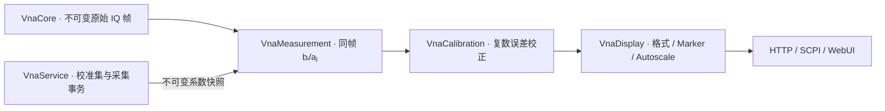

# 校准接入与使用

支持理想 50 Ω 机械校准：任意一个物理端口的 OSM/OSL、任意两个物理端口的 TOSM/SOLT，以及完整 P1～P4 的四端口 TOSM。二/四端口可选实测隔离。四端口需要逐口 O/S/M 和全部六对理想匹配互易 THRU，共 18 次标准连接；启用隔离时再测六对。未参与当前连接的端口须匹配终端。当前不使用减少 THRU 次数的补边、未知 THRU 或非理想校准件模型，不能把仅 P2/P4 的双端口集当成完整四端口校准。证据见[四端口实现依据](research/四端口TOSM实现依据.md)。

先行方案位于 `reference/analysis/vnapro-calibration/implementation-plan.md`，原程序分析位于 `reference/analysis/sna`。实现保留原校准公式、系数角色和数组顺序，以及原始归一化之后、显示之前的接入位置；原 MFC 界面和驱动调用没有搬入产品。

## 分层与处理顺序



`VnaCalibration` 只拥有数学和系数，不依赖设备、服务、JSON 或界面。`VnaMeasurement::Calculate()` 接受可选校准数据，在提取原始比值之后校正；双端口联合读取同一帧四项 S 参数，保留模型耦合。原始 A/B 波不变，未覆盖的 S 参数保持未校准。逐点奇异、非有限或无效参考波返回明确错误，不以夹紧值伪装有效数据。

服务发布 `shared_ptr<const CalibrationData>`。HTTP 曲线、SCPI SDATA、Marker 和 Autoscale 使用同一数值路径，`FrameContext` 携带同一校准快照。格式及圆图解释由 `VnaDisplay` 负责，界面不计算或保存自己的误差系数。

`CalculateMany()` 在帧内复用双端口四项或四端口 16 项联合结果。四口模型按 `S=A*inverse(I+match⊙A)` 一次校正完整矩阵，A 为逐格去偏置、除跟踪后的原始矩阵，不以六次双端口校正代替。HTTP 每四条一批后立即投影，无跨帧全局缓存。

## Web 操作

1. 取得控制权，先设置频率范围、点数及 IFBW，再按右侧 **Cal**。
2. 选择 **Start (Manual)…**，在紧凑配置窗口中确认端口拓扑与 Type，再确认各端口理想 50 Ω 校准件。
3. 单端口连接 Open、Short、Match/Load；双端口需要两端各三项标准及 Thru；四端口选全四口 TOSM，需要四口各三项及全部六对 Thru。选择 Isolation 时，每个要求的端口对另接匹配负载测隔离。
4. Start 后进入校准工作区：上方为所选标准的 dB Mag / Phase 双图，下方按端口显示紧凑标准按钮。每连接一个标准，点击对应按钮。曲线只来自该标准的已确认原始测量，未采集时为空；成功状态来自服务读回。所有必需项成功后才允许 **Apply**。
5. Apply 成功后生成内存校准集并启用。使用 **Use Cal → Cal Manager** 选择已有集，**User Cal Active** 控制启停，Export/Import 保存或恢复 JSON。

按右侧 **Cal**，在 Cal / Use Cal 页的 **Current Cal Set · Ch1** 查看服务端当前集名称、方法及端口；工具栏只显示仪器标识。停用或扫描条件不兼容时，校准页仍保留集名称并显示 Cal Off，长名称完整换行显示。

Cal Manager 的 **Available Cal Sets** 是池内候选列表；仅浏览候选不会替换通道当前集，必须点击 **Use Set** 并等待服务成功读回。这里参考 ZNB 的 Channel State 与 Pool Name 分离设计，不把池内选中项当成已应用校准。[ZNB 用户手册 v74 第 655 页](https://scdn.rohde-schwarz.com/ur/pws/dl_downloads/pdm/cl_manuals/user_manual/1173_9163_01/ZNB_UserManual_en_74.pdf#page=655)

Begin 时服务只保存一次进入校准前的 Trigger Source 与 Sweep Mode，再切到 MANUAL/HOLD。每次标准经过 Stop、计划准备、新 MANUAL run、Trigger、完整帧身份校验及最终 Stop，不复用旧帧或已校正曲线，也不覆盖已保存模式。Apply 或正常 Cancel 后恢复原模式：IMM/CONT 自动连续扫描，MAN 保持对应模式布防，原 HOLD 仍暂停。操作结果和 OPC 等实际核心恢复完成后才成功；恢复启动失败返回失败并保留有效新集。收集期间拒绝扫描设置及其他运行请求；取消等待已经接收的采集终结，故障后取消只清理会话并保持 HOLD，不自动重启。

原活动集在采集期间保留，只有新集完整求解成功才替换。缺少标准、奇异或无效样本不会生成成功集，失败的求解继续保留会话供重采；此时尚不恢复扫描。控制者关闭当前会话向导会取消采集并恢复原模式；观察者或旧会话的 Close 只关闭窗口，不更改服务会话。

Cal / Cal Off 是逐迹线状态：全局启用 P2/P4 集时，S22、S24、S42、S44 可校正，S21 仍为 Cal Off；原始 A/B 保留 RAW。

预览按 session、步骤、校准版本及保存的 run/frame 身份变化读取，同值状态轮询不会清空曲线或重复下载标准。收集期间仍轮询权威状态和操作结果，但暂停隐藏 DUT 完整矩阵的请求，保留原 DUT 快照；退出收集后恢复正常曲线读取。

## 兼容性与保存

校准集严格匹配设备身份、完整实际 Hz 轴、IFBW 和逐点 dBm 功率。功率使用有限 double，允许 −120～100 dBm，保留负数与小数。改变这些条件时保留集但停止套用；恢复原条件可重新适用。只增加源或接收机需求不改变物理刺激，不使已有集失效。首版不插值，频轴必须严格递增，CW 或取整后重复频点不支持校准。

VN10 当前接口没有唯一设备序列号，返回的 TDC1VN10 标识只能区分接口类型，无法区分两块同型板卡。使用者必须确认校准文件来自同一实际仪器及同一连接路径；字符串匹配不能证明实机身份相同。原程序 DSP 缓冲到模型输入的完整比例/固件处理也尚需实测对照，不能把纯算法一致性当成整机接入逐位复现。

每通道最多保存 256 集、512 MiB 系数及元数据，所有通道合计最多 1 GiB；超限拒绝整个操作，删除返还预算。字节数按保存对象、名称、身份、频轴、功率和全部复数系数计算，不是进程 RSS 上限。108 套 880 点 SI 加 96 套 4000 点 TDR 的四口数组可容纳；204 套全部使用 4000 点会超限。导入只加入池，必须选择兼容集并显式启用。删除当前集会停用。导入验证版本、端口、轴及系数形状、有限数、跟踪项数值可用性；不接受原软件专有文件。

`server.calibrationStore` 默认 `calibration`，相对程序目录解析，也可使用绝对路径；空字符串关闭持久化。Ch1 完成、导入、删除和选择/激活经异步保存后才提交，HTTP operation 和 `*OPC?` 都等待这一屏障；写入失败报错并保留原池。每集保存为独立不可变 JSON，以原子替换的 `channel-1.json` manifest 发布 ID、文件引用、完整性摘要及选择。首次写系数前先发布空池基线；崩溃留下但未提交的文件在恢复时清理。重复激活复用系数文件；损坏、缺文件或摘要不符会阻止启动，不能作为空池继续运行。文件锁及 manifest 冲突检查防止多个进程静默覆盖，运行实例应使用独立存储目录。

当前服务器只持久化并启动恢复 Ch1 校准池和选择，保持校正关闭；重新设置匹配刺激后需显式激活。扫描设置、测量目录及未完成的标准采集会话不跨重启恢复；其他逻辑通道及其校准仍为进程内状态。`*RST` 保留校准池。存储文件整体备份应在服务停止后复制目录，单集交换继续使用正式 Export/Import。

删除逻辑 Ch1 不删除磁盘校准池；重启创建默认 Ch1 时仍会恢复它。要持久删除校准集，应先在 Ch1 使用校准集 Delete。保存失败保证原池与选择保留；若操作已扩展采集端口需求，采集配置版本和旧帧有效性可能已改变，应重新采集。大量导入还受 HTTP 重试正文 64 MiB、128 条操作记录及 60 秒历史预算约束；收到 `429 retry_history_full` 或 `429 operation_limit` 后等待历史过期，保持控制租约并用相同正文及 requestId 重试。

大池在监听前完整解析和校验系数，启动日志报告恢复数量及耗时。2026-10-16 的同机 Windows Debug 隔离副本中，205 套 800 点、约 160 MiB JSON 的读取解析从 40.43 秒降到 7.37 秒，随后完整校验及冻结约 1.09 秒。Windows 数字转换使用独立 C locale，异常、范围错误及非正规数回退原 classic stream；其他平台沿用原流。负零、严格 JSON 语法及原边界接受规则保留，未改文件格式。该实测不代表冷盘或其他机器的时限，复跑方法见[VNB 模拟联调](VNB模拟联调.md)。

入池的三条路径（导入、恢复、标准求解完成）均完整验证并冻结系数；求解返回成功但实际校正会溢出的系数也拒绝发布。激活只复查元数据、数组形状及当前仪器约束，服务仍精确核对当前设备、频轴、IFBW 和功率，不重复逐点执行校正矩阵验证。205 集池中纯服务热 ACT 的同机均值：800/4000/6700 点分别从 5.54/26.26/43.87 毫秒降到 0.36/0.17/0.18 毫秒；高点数池为 204 套 800 点加一套目标点数，不能解释为 205 套全高点数。这里不含 TCP、真实保存及采集，原始测量的 16S 校正仍需计算。

### 高点数与后续插值

按四口每点 96 个 double 系数、频轴及功率约 784 字节计算，205 套全 4000 点约 613 MiB，全 6700 点约 1027 MiB，均超过当前每通道 512 MiB。按现有元数据规模，单通道最多约 171 套 4000 点或 102 套 6700 点；108 套 880 点 SI 加 96 套 6700 点 TDR 也约 552 MiB，不能按现预算全驻留。JSON 文件大小、逻辑池预算与进程内存不同，当前恢复还会保留存储侧和工作区两份系数；不能把逻辑预算当作 RSS 上限。

本轮保留启动预加载，首次激活不另读系数文件。把解析推迟到 ACT 会使首次切换付出单集加载成本；4000/6700 点同机单集读取解析分别约 191/319 毫秒，不能据此承诺整轮测试时间不变。未来若需要超过现预算，应分别定义持久化库存、驻留工作集和派生插值缓存的容量及淘汰规则，不能仅延迟读取就绕过当前逻辑容量限制。

插值尚未启用，当前仍拒绝跨轴激活。后续方案应在切换前按目标完整 Hz 轴一次生成可共享的误差项数据，供同帧全部 16 项使用；缓存键包含源集及其内容版本、完整目标轴和算法版本，设备、IFBW、功率等兼容条件仍独立核对。只缓存派生结果，不覆盖原校准数据，不外推；算法、相位处理和误差门槛需先用独立模型及实测数据验收，再测首次生成、缓存命中及 204 路整轮增量。CableTest 将 800 个原始点重采样到 4000 个分析点，与仪器实际改成 4000 个扫频点是不同需求，不能据分析点数直接推定校准集必须增大。

一/二端口导出使用 `schema: 2`；四端口使用 `schema: 3`、`method: "fourPort"`、`port1:1,port2:4`（覆盖全部物理口）。`id` 保持十进制字符串，`powerDbm` 为与频轴等长的逐点 JSON 数字数组。四口 `onePortTerms`/`twoPortTerms` 为空，`fourPortTerms` 每频点 96 个实数：按 S11、S12、…、S44 逐格存 offset/match/tracking 的实部/虚部，即 48 个复数存储槽；无隔离时 12 个非对角 offset 固定为零，实际拟合 36 个复数误差项。所有功率必须有限且处于 −120～100 dBm。旧 `schema: 1` 仅接受全零 `powerRaw` 并迁移为 0 dBm，其他旧编码拒绝。

复数按实部/虚部连续存储，单端口每点 6 个数；双端口每点 24 个数，按原程序顺序：

```text
Df, Sf, Rf, Xr, Lr, Fr, Xf, Lf, Ff, Dr, Sr, Rr
```

未采集隔离时 Xf/Xr 必须为零。服务生成新 ID，不沿用文件 ID。校准 HTTP 请求和导出上限为 32 MiB，解析节点预算覆盖四口最大 10001 点；普通控制请求仍为 16 KiB。浏览器解析文件后提交紧凑 JSON，导出可采用缩进格式。

所有 HTTP 会话保留的精确请求重试指纹合计最多 64 MiB，满额时新写入返回 429；已有请求仍可幂等读取。操作完成 60 秒后释放指纹正文、保留请求 ID 的过期记录并返回 410，控制者持续续租也能回收预算。导入在受理入队时冻结内容，不允许外部可写别名改动已受理系数。

## HTTP 与 SCPI

观察者可读取 `GET /api/v1/calibration`、`GET /api/v1/calibration/sets/{id}`。租约控制者通过 `POST /api/v1/calibration` 执行动作，使用既有 operation 查询和 requestId 重试机制：

`GET /api/v1/calibration/preview?sessionId={id}&stepId={step}` 只读返回该会话已保存标准的原始复数值、dB/Phase 投影、冻结频轴/IFBW及 runId/frameSeq；对完整序列做后端投影并返回全部原始频点（最多 10001 点），dB 与 Phase 共用连续原始采样索引，不均匀抽点。未采集、未知标准或旧会话返回 available=false，无占位曲线。预览不会修改 DUT 目录、显示状态、系数或采集核心。

| action | 额外字段 |
| --- | --- |
| begin | method=`onePort`/`twoPort`/`fourPort`, port1, port2（单端口为 0，四口固定 1/4）, includeIsolation |
| capture | sessionId, stepId（服务返回的步骤 ID） |
| finish | sessionId, name（可选） |
| cancel | sessionId |
| enable | enabled |
| select / delete | setId |
| import | data（一/二口 schema 2、四口 schema 3 对象；schema 1 仅兼容全零功率） |

请求须带 requestId 和 expectedRevision；这里是独立**校准版本**，不是扫描/显示版本。ID/版本均为十进制字符串，空闲 sessionId/selectedSetId 为 `"0"`。重试返回原操作，新请求的过期版本拒绝。Cancel 是同会话屏障，允许不大于当前版本的旧版本，以取消已排队采集；不得取消其他会话。帧返回 calibrationRevision，前端据此拒绝过期投影。

校准 SCPI 是项目新增子集，界面参考 ZNB 并不表示完整罗德协议兼容。支持短名和对应完整头名（含 COLLECT/COLLECTION）：

```text
SENS1:CORR:COLL:METH:DEF OSM,1
SENS1:CORR:COLL:ACQ OPEN,1;*OPC?
SENS1:CORR:COLL:ACQ SHORT,1;*OPC?
SENS1:CORR:COLL:ACQ MATCH,1;*OPC?
SENS1:CORR:COLL:SAVE 'Port 1';*OPC?
SENS1:CORR?
CALC1:DATA? SDATA
CALC1:DATA? RDATA
SENS1:CORR OFF
```

每次 ACQ 前必须实际换接标准；`*OPC?` 只表示操作终结，还需检查 `SYST:ERR?`。双端口使用 `METH TOSM,2,4,ON`（最后一项默认 OFF），Thru/Isolation 使用 `ACQ THRU,2,4` / `ACQ ISOLATION,2,4`。`COLL:STAT?` 返回 IDLE/READY/BUSY，`COLL:ABOR` 取消。`CSET:CAT?` 返回真实 ID/名称对，`CSET:ACT?` 保留当前选中集的带引号 ID 读回（未选中为 `"0"`），客户端可用目录映射原始名称；`CSET:DEL` 按 ID 删除。

四端口项目语法为 `SENS1:CORR:COLL:METH TOSM,1,2,3,4[,ON]`，端口顺序必须为 1、2、3、4，四口能力不足时拒绝。逐口执行 `ACQ OPEN,p`、`ACQ SHORT,p`、`ACQ MATCH,p`，再对 `(1,2)/(1,3)/(1,4)/(2,3)/(2,4)/(3,4)` 执行 `ACQ THRU,p,q`；开启隔离时还须逐对 `ACQ ISOLATION,p,q`，最后 `COLL:SAVE 'name';*OPC?`。缺任何标准、求解失败或坏帧均不生成成功集；每次 ACQ 都触发新完整扫描。此扩展不宣称思仪或罗德完整远程校准协议兼容。

`SENS1:CORR:CSET:ACT '实际校准集名称',0;*OPC?` 按名称原样匹配并原子选择、启用已有真实系数；数字、反斜杠、逗号和分号均只作为名称内容，大小写敏感。名称中的引号使用重复引号转义。单参数 ID 形式继续可用，成功时也启用校正。名称不存在或重名、系数无效、设备身份或当前频轴/点数/IFBW/功率不匹配时通过错误队列拒绝，原选择和激励保持；不插值、不改扫频范围，也不生成默认系数。第二参数目前只支持 `0`，请求其他模式明确报错。`*OPC?` 后仍需检查 `SYST:ERR?` 和 `CORR?`；`ACT?` 表示选择，`CORR?` 表示当前实际可用的校正状态。

`RDATA` 返回未校正的所选复数测量；`SDATA` 在活动集适用且覆盖测量时返回校正值，否则返回未校准值。原始接收波两者一致。任一点无效时 SCPI 拒绝整条数组，HTTP 保留逐点有效性。

自动化严格读取使用 `CALC1:DATA:MSD? '1,2,...,16'`：序号按目标通道测量定义顺序，响应为 trace-major，每点实部/虚部。它要求活动校准兼容且覆盖全部请求项；缺失、关闭、不兼容或仅单/双端口部分覆盖时返回 `-230`，不退回 RDATA。`FORM REAL,64;:FORM:BORD SWAP` 使用小端 IEEE 定长块及单个 LF，`FORM ASCII` 恢复文本；最大 10001 点完整四口 payload 为 2,560,256 字节。

## 验证与边界

四口本轮实现、91 项后端/546 项前端验证及独立模拟服务诊断入口见[VNB 模拟联调](VNB模拟联调.md)。

`calibration_math` 使用 20 组原机器码固定黄金向量及异常合同；`calibration_processing` 验证处理位置、反序/非连续端口及 RAW/覆盖边界；`service_calibration` 验证独立标准、新扫描身份、队列/取消、兼容性、池容量及失败保旧集。`calibration_protocol` / `calibration_integration` 联合验证 HTTP/SCPI、RDATA/SDATA、所有权/CAS及 201/10001 点文件往返。

真实浏览器验证了向导、采集读回、Apply、Use Cal 和端口覆盖。默认模拟器没有换接标准的物理模型：固定 golden 数据可能奇异，noise 变化也可能完成求解，两者都不能评估校准精度。没有通过界面自动替换信号来制造标准。

当前没有真实硬件标准/DUT 数据，不能承诺硬件精度或逐位一致。相对奇异阈值为 `1e-12`，错误返回替代原程序的极大值/夹紧及逆矩阵失败后继续输出策略。四口实现已用原数值核、原程序完整 18 标准机械校准链的非单位系数黄金向量，以及独立合成标准/DUT 验证，依据见[实现证据](research/四端口TOSM实现依据.md)。这些证据覆盖软件求解和校正合同，不代表完整复刻原程序应用流程。尚未接入 ECal 设备、TRL、非理想机械件频率模型、跨轴插值及原厂文件格式。
