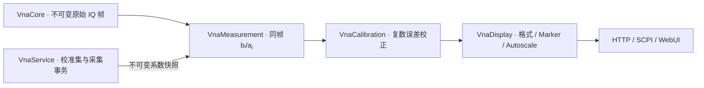

# 校准接入与使用

首版支持理想 50 Ω 机械校准：任意一个物理端口的 OSM/OSL，以及任意两个物理端口的 TOSM/SOLT，双端口可选实测隔离。四端口仪器可选 P2/P4 等端口对，但不代表完整四端口耦合校准。

先行方案位于 `reference/analysis/vnapro-calibration/implementation-plan.md`，原程序分析位于 `reference/analysis/sna`。实现保留原校准公式、系数角色和数组顺序，以及原始归一化之后、显示之前的接入位置；原 MFC 界面和驱动调用没有搬入产品。

## 分层与处理顺序



`VnaCalibration` 只拥有数学和系数，不依赖设备、服务、JSON 或界面。`VnaMeasurement::Calculate()` 接受可选校准数据，在提取原始比值之后校正；双端口联合读取同一帧四项 S 参数，保留模型耦合。原始 A/B 波不变，未覆盖的 S 参数保持未校准。逐点奇异、非有限或无效参考波返回明确错误，不以夹紧值伪装有效数据。

服务发布 `shared_ptr<const CalibrationData>`。HTTP 曲线、SCPI SDATA、Marker 和 Autoscale 使用同一数值路径，`FrameContext` 携带同一校准快照。格式及圆图解释由 `VnaDisplay` 负责，界面不计算或保存自己的误差系数。

`CalculateMany()` 在帧内复用同一双端口四项联合结果；HTTP 每四条一批后立即投影，既减少重复归一化/十二项校正，也避免一次保留整个目录的完整复数数组。无跨帧全局缓存。

## Web 操作

1. 取得控制权，先设置频率范围、点数及 IFBW，再按右侧 **Cal**。
2. 选择 **Start (Manual)…**，在紧凑配置窗口中确认端口拓扑与 Type，再确认各端口理想 50 Ω 校准件。
3. 单端口连接 Open、Short、Match/Load；双端口需要两端各三项标准及 Thru。选择 Isolation 时，另连接两端匹配负载采集隔离。
4. Start 后进入校准工作区：上方为所选标准的 dB Mag / Phase 双图，下方按端口显示紧凑标准按钮。每连接一个标准，点击对应按钮。曲线只来自该标准的已确认原始测量，未采集时为空；成功状态来自服务读回。所有必需项成功后才允许 **Apply**。
5. Apply 成功后生成内存校准集并启用。使用 **Use Cal → Cal Manager** 选择已有集，**User Cal Active** 控制启停，Export/Import 保存或恢复 JSON。

图窗上方常驻 **Ch1 · Cal On/Off** 和当前校准集名称；点击可直接打开 **Use Cal**。Cal 与 Use Cal 页顶部的 **Current Cal Set · Ch1** 显示同一服务端当前集、方法及端口，停用或扫描条件不兼容时仍保留集名称并显示 Cal Off。长名称在工具栏省略，悬停及校准页可查看全文。

Cal Manager 的 **Available Cal Sets** 是池内候选列表；仅浏览候选不会替换通道当前集，必须点击 **Use Set** 并等待服务成功读回。这里参考 ZNB 的 Channel State 与 Pool Name 分离设计，不把池内选中项当成已应用校准。[ZNB 用户手册 v74 第 655 页](https://scdn.rohde-schwarz.com/ur/pws/dl_downloads/pdm/cl_manuals/user_manual/1173_9163_01/ZNB_UserManual_en_74.pdf#page=655)

Begin 时服务只保存一次进入校准前的 Trigger Source 与 Sweep Mode，再切到 MANUAL/HOLD。每次标准经过 Stop、计划准备、新 MANUAL run、Trigger、完整帧身份校验及最终 Stop，不复用旧帧或已校正曲线，也不覆盖已保存模式。Apply 或正常 Cancel 后恢复原模式：IMM/CONT 自动连续扫描，MAN 保持对应模式布防，原 HOLD 仍暂停。操作结果和 OPC 等实际核心恢复完成后才成功；恢复启动失败返回失败并保留有效新集。收集期间拒绝扫描设置及其他运行请求；取消等待已经接收的采集终结，故障后取消只清理会话并保持 HOLD，不自动重启。

原活动集在采集期间保留，只有新集完整求解成功才替换。缺少标准、奇异或无效样本不会生成成功集，失败的求解继续保留会话供重采；此时尚不恢复扫描。控制者关闭当前会话向导会取消采集并恢复原模式；观察者或旧会话的 Close 只关闭窗口，不更改服务会话。

Cal / Cal Off 是逐迹线状态：全局启用 P2/P4 集时，S22、S24、S42、S44 可校正，S21 仍为 Cal Off；原始 A/B 保留 RAW。

预览按 session、步骤、校准版本及保存的 run/frame 身份变化读取，同值状态轮询不会清空曲线或重复下载标准。收集期间仍轮询权威状态和操作结果，但暂停隐藏 DUT 完整矩阵的请求，保留原 DUT 快照；退出收集后恢复正常曲线读取。

## 兼容性与保存

校准集严格匹配设备身份、完整实际 Hz 轴、IFBW 和逐点原始功率编码。改变这些条件时保留集但停止套用；恢复原条件可重新适用。只增加源或接收机需求不改变物理刺激，不使已有集失效。首版不插值，频轴必须严格递增，CW 或取整后重复频点不支持校准。

VN10 当前接口没有唯一设备序列号，返回的 TDC1VN10 标识只能区分接口类型，无法区分两块同型板卡。使用者必须确认校准文件来自同一实际仪器及同一连接路径；字符串匹配不能证明实机身份相同。原程序 DSP 缓冲到模型输入的完整比例/固件处理也尚需实测对照，不能把纯算法一致性当成整机接入逐位复现。

最多保存 16 个服务内存集。重启不自动恢复或启用；导入只加入池，必须选择兼容集并显式启用。删除当前集会停用。导入验证版本、端口、轴及系数形状、有限数、跟踪项数值可用性；不接受原软件专有文件。

`schema: 1` 文件用十进制字符串表示 `id` 和 `powerRaw`，保持 uint64 精度。复数按实部/虚部连续存储，单端口每点 6 个数；双端口每点 24 个数，按原程序顺序：

```text
Df, Sf, Rf, Xr, Lr, Fr, Xf, Lf, Ff, Dr, Sr, Rr
```

未采集隔离时 Xf/Xr 必须为零。服务生成新 ID，不沿用文件 ID。校准 HTTP 请求和导出上限为 8 MiB，解析节点预算按最大 10001 点设置；普通控制请求仍为 16 KiB。浏览器解析文件后提交紧凑 JSON，导出可采用缩进格式。

所有 HTTP 会话保留的精确请求重试指纹合计最多 64 MiB，满额时新写入返回 429；已有请求仍可幂等读取。操作完成 60 秒后释放指纹正文、保留请求 ID 的过期记录并返回 410，控制者持续续租也能回收预算。导入在受理入队时冻结内容，不允许外部可写别名改动已受理系数。

## HTTP 与 SCPI

观察者可读取 `GET /api/v1/calibration`、`GET /api/v1/calibration/sets/{id}`。租约控制者通过 `POST /api/v1/calibration` 执行动作，使用既有 operation 查询和 requestId 重试机制：

`GET /api/v1/calibration/preview?sessionId={id}&stepId={step}` 只读返回该会话已保存标准的原始复数值、dB/Phase 投影、冻结频轴/IFBW及 runId/frameSeq；对完整序列做后端投影并返回全部原始频点（最多 10001 点），dB 与 Phase 共用连续原始采样索引，不均匀抽点。未采集、未知标准或旧会话返回 available=false，无占位曲线。预览不会修改 DUT 目录、显示状态、系数或采集核心。

| action | 额外字段 |
| --- | --- |
| begin | method=`onePort`/`twoPort`, port1, port2（单端口为 0）, includeIsolation |
| capture | sessionId, stepId（服务返回的步骤 ID） |
| finish | sessionId, name（可选） |
| cancel | sessionId |
| enable | enabled |
| select / delete | setId |
| import | data（schema 1 对象） |

请求须带 requestId 和 expectedRevision；这里是独立**校准版本**，不是扫描/显示版本。ID/版本均为十进制字符串，空闲 sessionId/selectedSetId 为 `"0"`。重试返回原操作，新请求的过期版本拒绝。Cancel 是同会话屏障，允许不大于当前版本的旧版本，以取消已排队采集；不得取消其他会话。帧返回 calibrationRevision，前端据此拒绝过期投影。

校准 SCPI 是项目新增子集，界面参考 ZNB 并不表示完整罗德协议兼容。支持短名和对应完整头名（含 COLLECT/COLLECTION）：

```text
SENS1:CORR:COLL:METH:DEF OSM,1
SENS1:CORR:COLL:ACQ OPEN,1;*OPC?
SENS1:CORR:COLL:ACQ SHORT,1;*OPC?
SENS1:CORR:COLL:ACQ MATCH,1;*OPC?
SENS1:CORR:COLL:SAVE 'Port 1';*OPC?
SENS1:CORR?
CALC1:DATA? SDATA
CALC1:DATA? RDATA
SENS1:CORR OFF
```

每次 ACQ 前必须实际换接标准；`*OPC?` 只表示操作终结，还需检查 `SYST:ERR?`。双端口使用 `METH TOSM,2,4,ON`（最后一项默认 OFF），Thru/Isolation 使用 `ACQ THRU,2,4` / `ACQ ISOLATION,2,4`。`COLL:STAT?` 返回 IDLE/READY/BUSY，`COLL:ABOR` 取消。`CSET:CAT?` 返回 ID/名称，`CSET:ACT` 选择，`CSET:DEL` 删除。

`RDATA` 返回未校正的所选复数测量；`SDATA` 在活动集适用且覆盖测量时返回校正值，否则返回未校准值。原始接收波两者一致。任一点无效时 SCPI 拒绝整条数组，HTTP 保留逐点有效性。

## 验证与边界

`calibration_math` 使用 20 组原机器码固定黄金向量及异常合同；`calibration_processing` 验证处理位置、反序/非连续端口及 RAW/覆盖边界；`service_calibration` 验证独立标准、新扫描身份、队列/取消、兼容性、池容量及失败保旧集。`calibration_protocol` / `calibration_integration` 联合验证 HTTP/SCPI、RDATA/SDATA、所有权/CAS及 201/10001 点文件往返。

真实浏览器验证了向导、采集读回、Apply、Use Cal 和端口覆盖。默认模拟器没有换接标准的物理模型：固定 golden 数据可能奇异，noise 变化也可能完成求解，两者都不能评估校准精度。没有通过界面自动替换信号来制造标准。

当前没有真实标准/DUT 数据，不能承诺硬件精度或逐位一致。相对奇异阈值为 `1e-12`，错误返回替代原程序的极大值/夹紧策略。尚未接入 ECal 设备、TRL、多端口联合校准、非理想机械件频率模型、跨轴插值及原厂文件格式。数学接口接受一般复数标准，后续标准模型或硬件采集策略可复用同一系数发布路径。
