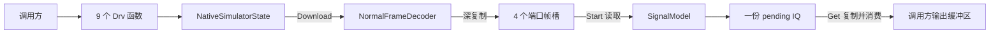
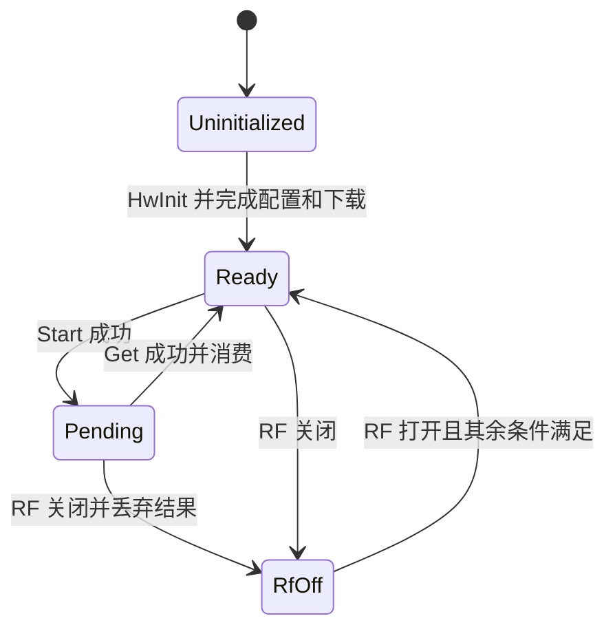

# VNA 原生模拟模块开发文档

`VnaNativeSimulator/` 提供 TDC1VN08 旧接口的原生驱动替身，动态库及 CMake target 名为 `tdc1vn08_drv_sim`，无需单板和厂商动态库。它导出 9 个 `Drv*` 函数，支持下载正常扫频帧、启动扫描和读取固定布局的 IQ，用于验证接口、调用顺序及内存使用。

本文面向需要阅读、调试或修改模拟器的开发者。范围和验收要求见[硬件模拟方案](硬件模拟方案.md)；构建入口见[模块 README](../VnaNativeSimulator/README.md)，与 VN10 之间的运行切换见[模拟驱动切换](模拟驱动切换.md)。模拟器的错误码和状态规则是本项目约定，不能据此推断厂商硬件行为。当前不实现 Driver、HAL、S 参数、校准、DYN 和快扫。

## 1 阅读代码的顺序

建议先看合同和一轮扫频，再沿着导出层进入内部实现。下表路径相对于 `VnaNativeSimulator/`。

| 顺序 | 文件 | 阅读重点 |
| --- | --- | --- |
| 1 | `include/vna_native/native_api_contract.h` | 9 个符号、函数签名、错误码、端口和长度常量 |
| 2 | `tests/native_contract/native_normal_sweep_test.cpp` | `ConfigureNormalSweep` 和 `RunFourPortSweep` 展示完整调用流程 |
| 3 | `src/native_sim/native_function_exports.cpp` | C 导出、签名断言、异常边界及单例转发 |
| 4 | `src/native_sim/native_simulator_state.h/.cpp` | 配置状态、按端口保存的帧和待读取结果 |
| 5 | `src/native_sim/normal_frame_decoder.h/.cpp` | 数组长度检查、字段解析和自有快照 |
| 6 | `src/native_sim/signal_model.h/.cpp` | 确定性 IQ 公式及输出索引 |

NativeSimulatorState 直接声明互斥锁、帧槽和 pending 状态，不使用 Impl。NativeSimulatorSnapshot 作为该类的状态视图放在同一头；NormalFrameInput/NormalFramePoint 与 NormalFrameSnapshot 按正常帧职责共用 normal_frame_snapshot.h。NativeFrameSlot、NativePendingSweep 有独立的整对象 Swap 行为，各自保留 .h/.cpp；不是把每个简单结构体、枚举都拆成独立文件。



`tdc1vn08_drv_sim_core` 是内部实现的对象库，由动态库和内部单元测试复用。`tdc1vn08_drv_sim_contract_tests` 不链接该对象库或模拟动态库，而是通过 `dlopen`/`dlsym` 加载实际产物，避免静态链接掩盖符号或动态加载问题。

## 2 完成一轮正常扫频

推荐顺序为：初始化 → 打开 RF → 设置接收位图 → 设置正常模式 → 下载帧 → Start → Get。下载本身只要求已初始化和帧合法；RF、接收配置及正常模式在 Start 时检查。

| 接口 | 用途及约束 |
| --- | --- |
| `DrvHwInit()` | 初始化或复位；清空全部帧和 pending，RF 关闭，接收和模式恢复为未配置 |
| `DrvSetRfPowerOn(enabled)` | 只接受 0 或 1；关闭 RF 会清除 pending，保留下载帧和配置 |
| `DrvActivateRxLink(bitmap)` | 只接受 1～`0xF`；bit0～bit3 对应四个接收端口 |
| `DrvSetFastSweepMode(mode)` | 只支持 0；仍须显式调用，默认值为 0 不等于已经配置 |
| `DrvDataFrameDownload(N, param, paramLen, table, tableLen)` | 下载单个激励端口的正常帧，成功后可以修改或释放输入数组 |
| `DrvStartSweep(N, sourcePort)` | 端口为 0～3，N 必须匹配该端口帧；同步生成 IQ 后返回 |
| `DrvGetSweepData(N, iq)` | N 必须匹配 pending；调用方提供至少 `16N` 个可写 `double` |
| `DrvGetIDN(buffer, capacity)` | 返回 `VnaPro,NativeSimulator,4PORT,1.0`；容量不足时截断并以 NUL 结束，返回码 7 |
| `DrvCheckSweepPortPower(bitmap, check, indices, capacity)` | 不属于扫频主链；初始化且参数有效时清零输出，再返回码 5 |

IDN 和功率检查也要求初始化。功率检查要求 `check` 非空；`capacity > 0` 时 `indices` 必须可写相应数量的 `uint16_t`，容量为 0 时允许为空。位图同样只接受 1～`0xF`。

### 最小调用示例

下面是直接链接模拟动态库的 C++14 示例，保存为 `sweep_example.cpp` 即可使用。运行时解析函数表的示例见 `tests/native_contract/native_library_probe.cpp`，该加载器属于测试代码。

```cpp
#include <cstdint>
#include <iostream>

#include "vna_native/native_api_contract.h"

bool Check(std::uint32_t status)
{
    if (status != VnaNative::DRV_SIM_OK) {
        std::cerr << "Drv error: " << status << '\n';
        return false;
    }
    return true;
}

int main()
{
    const std::uint32_t pointCount = 2U;
    // quick；每点依次为频率高字、低字、激励端口、link、IFBW、dynamic。
    // 两个频率原始值为 1000000000 和 5294967296，不声明物理单位。
    std::uint32_t parameters[13] = {
        0U,
        0U, 1000000000U, 0U, 0U, 1000U, 0U,
        1U, 1000000000U, 0U, 0U, 1000U, 0U
    };
    double powerTable[18] = {0.0};
    double iq[32] = {0.0};

    if (!Check(DrvHwInit()) || !Check(DrvSetRfPowerOn(1U)) ||
        !Check(DrvActivateRxLink(0xFU)) || !Check(DrvSetFastSweepMode(0U))) {
        return 1;
    }
    if (!Check(DrvDataFrameDownload(pointCount, parameters, 13U, powerTable, 18U)) ||
        !Check(DrvStartSweep(pointCount, 0U)) || !Check(DrvGetSweepData(pointCount, iq))) {
        return 1;
    }
    std::cout << "A1 = " << iq[0] << " + " << iq[1] << "i\n";
    return 0;
}
```

在 Linux/macOS 的模块目录中，完成第 7 节构建后执行：

```bash
c++ -std=c++14 sweep_example.cpp -I include -L build -ltdc1vn08_drv_sim \
  -Wl,-rpath,"$PWD/build" -o sweep_example
./sweep_example
```

## 3 帧格式和 IQ 布局

### 输入帧

N 是频点数，必须大于 0。所有长度参数的单位都是数组元素个数：`paramDataLen = 1 + 6N`，`tableDataLen = 9N`。调用期间，输入指针必须有效且真实容量满足声明长度。

`paramData[0]` 是整帧的 `quick`，必须为 0。第 i 个频点从 `base = 1 + 6*i` 开始，i 从 0 起：

| 相对 base 的偏移 | 字段 | 当前处理 |
| --- | --- | --- |
| 0 | 频率高 32 位 | 与低字拼成完整 `uint64_t` |
| 1 | 频率低 32 位 | `frequencyRaw = (uint64_t(high) << 32) \| low` |
| 2 | `sourcePort` | 0～3，整帧所有点必须相同 |
| 3 | `dynamicLinkConfig` | 必须为 0 |
| 4 | `ifBandwidthRaw` | 原样保存，不参与当前 IQ 公式 |
| 5 | `dynamicEnabled` | 必须为 0 |

频率和 IFBW 使用原始整数，单位及硬件量程待确认，不能在解析器中自行换算。长度计算先提升到 64 位，再检查 ABI 的 `uint32_t` 上界和本机 `size_t` 字节容量，最后才读取数组或分配快照。

`tableData` 每点有九个 `double`，其物理含义尚未确认。解码器深复制全部 `9N` 项，接受 NaN 和正负无穷，不做范围判断，也不通过功率表改变 IQ。只检查 IQ 结果无法证明功率表已经复制，需使用内部快照测试逐项验证。

### 输出布局

每点恰好输出 16 个 `double`，按频点优先、端口从 1 到 4 的顺序排列，每个端口四项为 `A.real, A.imag, B.real, B.imag`。RI 指实部、虚部，不能按幅度、相位解释。

| 观察端口标签 | 点内偏移 | 四个值 |
| --- | --- | --- |
| 1 | 0～3 | A1 实部、A1 虚部、B1 实部、B1 虚部 |
| 2 | 4～7 | A2 实部、A2 虚部、B2 实部、B2 虚部 |
| 3 | 8～11 | A3 实部、A3 虚部、B3 实部、B3 虚部 |
| 4 | 12～15 | A4 实部、A4 虚部、B4 实部、B4 虚部 |

对频点 i、从 0 起的观察端口 r，四项的首地址索引为 `16*i + 4*r`。原生激励端口也从 0 起，公式中的标签从 1 起；二者转换为 `sourceLabel = sourcePort + 1`。

接收位图是 Start 的配置前置条件，但当前不会裁剪或清零未激活端口的数据，合法位图始终得到完整的 16 值布局。`DrvGetSweepData` 没有容量参数，无法检查真实分配长度；非空指针和 N 正确并不足以保证缓冲区安全。

## 4 状态和结果生命周期

`NativeSimulatorState::Instance()` 提供动态库内的单设备上下文。四个 `downloadedFrames_` 槽按激励端口保存帧，同端口新下载替换旧帧，不同端口互不覆盖。`pendingSweep_` 在整个设备中只有一份。



图中的 Ready 表示 Start 所需条件都已满足。任意状态调用 `HwInit` 都会清空帧和结果，回到已初始化但尚未配置的状态，需重新配置和下载。

Start 在持锁期间调用 `SignalModel` 生成完整 IQ，成功返回时结果已经在内存中，不存在后台采集或等待完成的过程。已有 pending 时再次 Start 返回状态错误，即使切换激励端口也不能覆盖它。

Get 成功后复制结果并消费 pending；第二次 Get 返回状态错误。空指针、点数不匹配等可检测错误不会写入 IQ 或消费结果，修正参数后可以重试。pending 存在时下载新帧只替换帧槽，已生成的 IQ 保持原结果；下一次 Start 才使用新帧。

同一互斥锁保护配置、帧和 pending，覆盖解析、生成及读取过程。它保证单次状态访问串行化，但一组 Download/Start/Get 调用不是不可打断的事务；其他线程的复位或关闭 RF 可以发生在这些调用之间。调用方需协调完整测量流程。

### 临时对象和异常边界

解码器先建立 `candidate` 快照，信号模型先建立输出向量，状态层再建立待提交的帧槽或 pending。只有全部操作成功，才通过不抛异常的 `Swap` 替换正式状态。这使分配失败或提交前故障不会留下半帧、半份 IQ 或被破坏的旧帧。

状态层把内部异常转换为 `DRV_SIM_INTERNAL_ERROR`。导出层仍有 `catch (...)`，用于兜住取得单例等发生在状态方法之外的异常，避免异常跨越 C ABI。

`FailureInjector` 只供内部测试使用，分别在帧提交前和 pending 提交前抛异常，验证旧状态可用。它在锁内调用，不能回调同一个状态对象，否则可能再次获取同一把锁而死锁。测试通过 `SnapshotForTest`、`CopyFrameForTest` 检查内部状态，不增加生产导出符号。`HwInit` 不会移除测试注入器，测试需要显式清除。

## 5 IQ 数值如何生成

`SignalModel::Generate` 只使用完整 64 位频率原始值和激励端口；IFBW、接收位图、功率表、时间和调用次数均不改变结果。

频率先经过两轮无符号 64 位混合，乘法按模 `2^64` 回绕；取结果高 53 位除以 `2^53`，得到 `[0, 1)` 的因子 x。这样频率高位也参与模型，但不承诺任意两个频率都产生不同的因子，更不表示物理响应。

令观察端口标签 r、激励端口标签 s 均取 1～4：

```text
A_r = complex(1.0 + 0.1*r + 0.01*s, 0.001*x)
H_rs = complex((r == s ? 0.20 : 0.02*r*s) + 0.001*x, 0.005*(r-s))
B_r = H_rs * A_s
```

B 的乘法使用激励端口参考波 `A_s`。代码显式展开复数乘法：实部为 `hReal*aReal - hImag*aImag`，虚部为 `hReal*aImag + hImag*aReal`，然后写入对应 RI 槽位。

固定预期值保存在 `tests/golden_iq_vectors.h`，内部单元测试与动态加载测试共同使用。它包含低 32 位相同而高 32 位不同的频率，能检出忽略高字的回归。黄金向量用于独立锁定公式，不能在测试运行时调用生产公式来重算；跨编译器数值比较使用 `1e-12` 误差。

## 6 错误码和定位方法

| 值 | 错误码 | 首先检查 |
| --- | --- | --- |
| 0 | `DRV_SIM_OK` | 成功 |
| 1 | `DRV_SIM_INVALID_ARGUMENT` | 空指针、零点数、长度、端口范围、整帧端口一致性 |
| 2 | `DRV_SIM_NOT_INITIALIZED` | 是否调用 `DrvHwInit` |
| 3 | `DRV_SIM_RF_DISABLED` | Start 前是否打开 RF |
| 4 | `DRV_SIM_INVALID_STATE` | 接收和模式是否配置、该端口帧和点数、pending 是否存在 |
| 5 | `DRV_SIM_NOT_SUPPORTED` | 非零快扫或动态字段，或者调用功率检查 |
| 6 | `DRV_SIM_SIZE_OVERFLOW` | 元素数、ABI 长度上界和字节数溢出 |
| 7 | `DRV_SIM_BUFFER_TOO_SMALL` | IDN 容量是否包含末尾 NUL |
| 8 | `DRV_SIM_INTERNAL_ERROR` | 内部分配、故障注入或不变量检查失败 |

检查顺序是合同的一部分：需要指针、长度或点数的接口先做内存形状检查，再判断初始化，再检查字段和状态。比如未初始化时传空 IQ 指针返回 1；传合法指针和点数返回 2。帧内端口错误优先于“不支持”字段，不能为了减少循环随意合并检查。

Start 的状态检查按初始化、端口、RF、接收和模式配置、帧与 pending 的顺序执行。定位复合错误时，按实现的第一个失败检查解释返回码，不把它理解成所有错误的汇总。

IDN 容量不足和有效功率检查会在非零返回码下写入输出，不能一概认为失败返回时所有缓冲区都不变。悬空指针、虚假容量或调用期间并发修改输入不属于接口能检测的错误，调用方必须保证这些内存前置条件。

## 7 构建测试和修改入口

### 构建和验证

使用 CMake 3.13 以上、C++14 编译器以及线程、动态加载和 `nm` 工具。在 Linux/macOS 的 `VnaNativeSimulator/` 目录执行：

```bash
cmake -S . -B build -DCMAKE_BUILD_TYPE=Debug
cmake --build build --parallel
cmake -E chdir build ctest --output-on-failure
```

Windows MinGW 模拟 DLL 已补齐构建、动态加载合同测试和 PE 导出检查；合同探针在 Windows 使用 `LoadLibraryEx`/`GetProcAddress`，在 POSIX 使用 `dlopen`/`dlsym`。Windows 构建示例见模块 README。真实厂商 Windows 驱动的调用约定仍须独立验证；若使用 WSL，其构建目录必须与 Windows IDE 的构建目录分开。

| CTest 名称 | 验证内容 | 对应源码 |
| --- | --- | --- |
| `native_unit` | 签名、初始化和状态、帧深复制、错误优先级、异常提交、IQ 黄金向量和并发访问 | `tests/native_unit/` |
| `native_contract` | 运行时解析并调用 9 个符号、正常扫频、错误路径、输出 canary 和固定 IQ | `tests/native_contract/` |
| `native_export_symbols` | 实际动态库只导出允许的 9 个生产符号 | `cmake/CheckNativeExports.cmake`、`cmake/tdc1vn08_drv_sim.map` |

只跑某组可使用 `cmake -E chdir build ctest -R '^native_unit$' --output-on-failure`，替换名称即可；改动对外合同后应跑全部三组。

ASan、UBSan、TSan 分别使用 `build-asan`、`build-ubsan`、`build-tsan`，只开启对应的 `VNA_SIM_ENABLE_ASAN`、`VNA_SIM_ENABLE_UBSAN`、`VNA_SIM_ENABLE_TSAN` 选项，构建和测试命令相同。完整命令见模块 README。发布前仍要求 GCC 7.3 的全量验证，其他编译器通过不替代该兼容性门禁。

### 按变更类型找入口

| 要修改的内容 | 实现入口 | 同步验证和文档 |
| --- | --- | --- |
| 帧字段解析或深复制 | `NormalFrameDecoder` | 解码单测、状态快照和动态下载测试；同步输入帧说明 |
| 调用顺序或结果消费 | `NativeSimulatorState` | 状态、异常注入和动态 Start/Get 测试；同步状态规则 |
| IQ 数值或排列 | `SignalModel` | 独立计算并审查固定黄金向量，覆盖高频率字和四端口；同步公式或布局 |
| 对外签名或符号 | `NativeApiContract`、导出层 | 签名单测、动态加载及符号允许表；先核对冻结 ABI，更新设计说明 |
| 构建参数或平台支持 | `CMakeLists.txt`、`cmake/` | 全目标构建和三组测试；同步 README 安装与构建步骤 |

新增能力应先明确外部合同和可验证的行为，再修改状态或模型。内部测试接口继续保持隐藏；`demo/` 是只读参考，不编入生产目标。保持 C++14 基线，注释重点解释约束、索引和设计原因，避免为直观赋值逐行复述代码。
