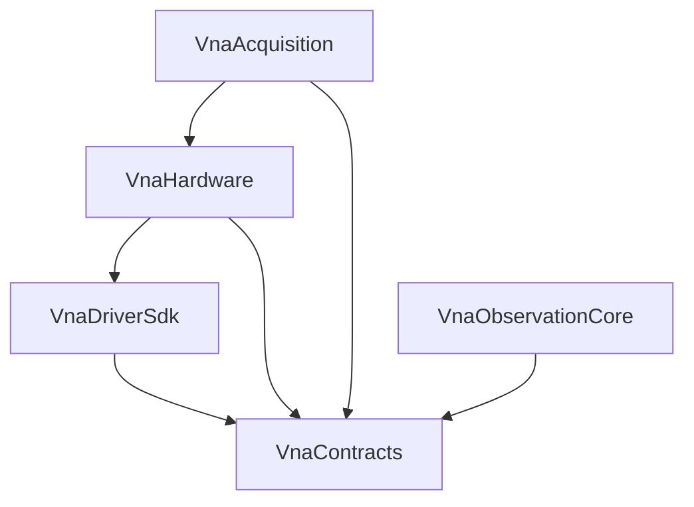

# 现有三层审计 04：跨层 P0 问题

> [返回审计入口](../现有三层架构审计与整改方案.md) · 上一篇：[VnaMeasurement 审计](./03-VnaMeasurement审计.md) · 下一篇：[整改路线与验收](./05-整改路线与验收.md)

本篇只回答三个问题：

1. 当前代码哪里证明存在问题；
2. 继续开发会造成什么后果；
3. 目标设计必须满足什么原则。

字段、状态机、持久化记录和逐点故障测试只在下列详细设计中维护：

- [D1：公共契约与硬件采集](../详细设计/01-公共契约与硬件采集.md)
- [D2：数值处理与通道编译](../详细设计/02-数值处理与通道编译.md)
- [D3：运行时触发与调度](../详细设计/03-运行时触发与调度.md)
- [D4A：应用会话与事务](../详细设计/04A-应用会话与事务.md)
- [D4E：产品对象删除与后台处理](../详细设计/04E-产品对象删除与后台处理.md)
- [D4B：保存召回与运行切换](../详细设计/04B-保存召回与运行切换.md)
- [D4C：校准工作流](../详细设计/04C-校准工作流.md)
- [D4D：持久化结果与恢复](../详细设计/04D-持久化结果与恢复.md)
- [D5：适配器横切与验证](../详细设计/05-适配器横切与验证.md)

## 1. 四个跨层 P0

P0 说明某项能力目前不得进入生产路径或发布，不等于禁止所有与它有关的验证代码。在四项 P0 关闭前，只允许运行受限的 S11 纵向验证骨架（S11-WS），且必须同时满足：

- 只由不可安装的专用验证目标组装，默认产品构建无法达到该路径；
- 只支持一个测量通道、一次内部立即触发和未绑定用户校准的 S11；
- 只使用模拟器或可注入故障的驱动测试替身；真实驱动只能在为关闭驱动门禁而建立的隔离一致性环境中使用；
- 结果只作验证证据，不进入产品当前结果、历史、文件、导出或公开协议；
- 能力清单之外的请求在任何设备、文件或网络副作用前拒绝。

S11-WS 通过只证明层间接缝已被实际消费，不能作为任何 P0 的通过记录。具体执行限制见[整改路线与验收](./05-整改路线与验收.md#1-立即整改批次)。

### 1.1 波形只有复数，没有可执行数值契约

**当前证据**

- `sdk/VnaDriver/include/VnaDriverSdk/VnaDriverAbi.h:93` 只注释“单位与归一化另行约定”，ABI 没有对应描述结构。
- `modules/VnaHardware/include/VnaSweepPlan.h:17-27` 的波键只有 Incident/Outgoing 与端口。
- `modules/VnaMeasurement/src/ObservationBuilder.cpp:196-214` 在不知道归一化、参考路径和相干组的情况下直接做复数除法。

**影响**

Simulator 内自洽不代表真机可校准。不同驱动可能输出不同物理量或修正状态；把它们统一叫 a/b 会产生“数值正常、物理含义错误”的隐蔽故障。

**修复原则**

1. 公共契约必须能机器检查每段数据的物理量、修正状态、参考面、相干关系和读取位置。
2. 驱动在准备完成后报告实际数值 Schema；采集帧只引用已经冻结的 Schema。
3. 数值绑定必须逐区间验证兼容性，不能用第一点或整条序列的单一标签掩盖分段变化。
4. 不同归一化、非相干或区间覆盖不完整时，在计算前拒绝。

权威合同与验收见 [D1](../详细设计/01-公共契约与硬件采集.md) 和 [D2](../详细设计/02-数值处理与通道编译.md)。

### 1.2 允许量化却不能回传实际值

**当前证据**

- `modules/VnaHardware/include/VnaSweepPlan.h:56-60` 暴露 `allowQuantization`。
- `modules/VnaHardware/src/DriverModuleAdapter.cpp:22-37` 把请求计划原样放入 effective plan。
- `modules/VnaHardware/src/DriverResultValidation.cpp:277-286` 因 ABI 无实际值通道而拒绝驱动量化。
- `modules/VnaMeasurement/src/MeasurementBindingValidation.cpp:64-99` 对频率、IFBW、驻留等使用完全相等。

**影响**

公开能力无法兑现。若继续严格相等，真机常见量化不能接入；若直接放宽，又会把请求轴误当实际轴，导致校准、Marker 和结果来源错误。

**修复原则**

1. 用户扫描意图、采集需求和设备实际执行方案是三个不同对象。
2. ABI v2 必须回传实际值以及请求到实际值的映射；后续数值链只使用实际值。
3. 旧 ABI 只允许精确、不量化的受限配置，不能用于生产用户校准。
4. 没有可信能力资料的旧驱动只允许发现和目录查询。

权威合同与验收见 [D1](../详细设计/01-公共契约与硬件采集.md)。

### 1.3 驱动可无限阻塞关闭

**当前证据**

- `modules/VnaHardware/src/VnaHardwareDiscovery.cpp:143-204` 只在驱动模块之间检查 deadline；同步 Discover 本身不能被抢占。
- `modules/VnaHardware/src/VnaSessionShutdown.cpp:25-74` 对 Actor/Worker 使用无截止时间 `join()`，而 Worker 可能仍阻塞在第三方驱动调用中。

**影响**

一个故障插件可以让进程无法停止、升级或恢复；上层再增加协调器也无法抢占已经阻塞的进程内调用。

**修复原则**

第三方驱动进入独立 Driver Host；控制调用有截止时间和存活检测。超时后隔离对应会话并终止 Host，主应用仍能关闭或继续服务其他设备。进程内配置只允许经过认证的驱动。

权威合同与验收见 [D1](../详细设计/01-公共契约与硬件采集.md) 和 [D5](../详细设计/05-适配器横切与验证.md)。

### 1.4 通道测量任务责任重复

**当前证据**

- `modules/VnaAcquisition/include/VnaAcquisition.h:23-38` 已定义 Finite/Continuous、RunId、Stop/Abort 和 Run terminal。
- `modules/VnaAcquisition/src/VnaAcquisitionPublication.cpp:97-163` 在 Sweep 回调返回后自行提交下一 Sweep。
- 当前代码没有贯穿等待测量推进、执行和排空期的测量运行任务责任方。

**影响**

若直接在 Acquisition 上再加 Runtime，有限/连续、测量推进、停止和完成会同时被 L3 与 L6 改写，形成双状态机、双终态和循环调用；等待推进时也没有可被精确停止的父对象。

**修复原则**

1. L3 只拥有一次物理执行和组帧，不再决定有限、连续或下一次扫描。
2. L6 唯一负责测量运行任务、已接纳的测量推进事件、目标批次和通道测量任务。
3. Stop 先关闭新准入，再排空已接纳工作；停止后旧任务不能复活。
4. 通道测量任务建立前，必须为该目标预留最坏情况下所需的资源；容量不足时在接纳前明确拒绝。
5. 采集完成不等于计划内结果已经处理完成；所有计划内结果都有明确结论或已移交给唯一恢复责任方后，通道测量任务才能结束。

运行对象、触发与停止见 [D3](../详细设计/03-运行时触发与调度.md)；结果提交和恢复见 [D4D](../详细设计/04D-持久化结果与恢复.md)；全局资源与竞态验收见 [D5](../详细设计/05-适配器横切与验证.md)。

## 2. 三层之间的结构性问题

### 2.1 通用契约依附 Hardware

`VnaAcquisition.h` 包含 `VnaHardware.h`，`VnaMeasurement.h` 又包含 `VnaAcquisition.h`。上层纯算法为了 Result、ID、WaveKey 和 Error 被迫看见整条底层 API。

目标依赖如下：

公共只读帧视图下沉 L0；L4 只依赖该视图，不包含 Acquisition 头，也不复制一套 DTO。

### 2.2 缺少 Channel 编译与产品对象

当前 `VnaMeasurement` 直接从 Sweep 模板推导波需求，无法表达多测量公共输入、校准额外需求、分段继承、触发粒度和测量通道平均。

整改方向是新增“测量通道定义 → 通道编译 → 采集需求”的边界，而不是把更多字段继续塞进现有 Sweep 计划。硬件只看已经展开的设备计划。

### 2.3 没有端到端终态与预算

三层分别有局部上限，并不能证明系统整体有界。上一批仍在处理、下一批已经采集、客户端又长期保留结果时，峰值没有统一所有者。

L6 与资源账本必须统一回答：一项工作接纳前需要多少容量，责任何时从采集转到处理或结果保留，以及失败后由谁释放、移交或隔离。外部长期保留只能限制后续准入，不能阻止旧通道测量任务得到最终执行状态。权威设计见[资源与故障恢复](../架构设计/05-资源与故障恢复.md)、[D3](../详细设计/03-运行时触发与调度.md)、[D4D](../详细设计/04D-持久化结果与恢复.md)和[D5](../详细设计/05-适配器横切与验证.md)。

## 3. 决策追踪索引

源码行只证明当前实现有什么缺口。外部依据、明确 GAP 和最低验收由[架构依据与取舍矩阵](../架构依据与取舍矩阵.md#5-决策反向索引)维护。

- **数值 Schema、访问点、逐区间语义**：`DEC-NUM-SCHEMA-001`、`DEC-DATA-ACCESS-001`、`DEC-NUM-SPAN-001`、`DEC-NUM-NETMODEL-001`。
- **请求、实际执行与 physical partial**：`DEC-ACQ-PARTIAL-001`、`DEC-NUM-SPAN-001`。
- **Driver 永久阻塞与故障隔离**：`DEC-DRIVER-ISOLATION-001`。
- **采集完整性、运行父子关系与 Trigger**：`DEC-ACQ-COMPLETE-001`、`DEC-RUN-ORTHO-001`、`DEC-TRG-CARD-001`。
- **端到端有界资源**：`DEC-RES-BOUND-001`。
- **Observation/NetworkModel 重定位与纯 Core**：`DEC-NUM-NETMODEL-001`、`DEC-LAYER-PURECORE-001`。
