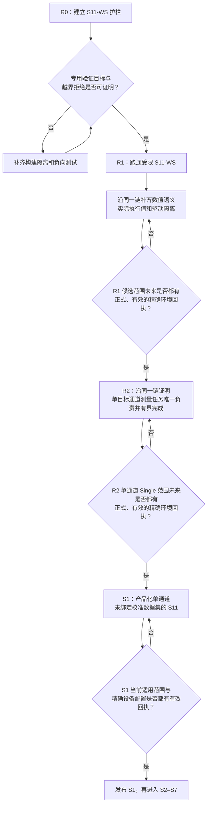

# 现有三层审计 05：整改路线与验收

> [返回审计入口与结论](../现有三层架构审计与整改方案.md) · 上一篇：[跨层 P0 问题](./04-跨层P0问题.md)

本篇是整改顺序的唯一权威入口。它只说明每个阶段做什么、不做什么、何时能进入生产。问题证据从[审计入口的四个阻断问题](../现有三层架构审计与整改方案.md#2-四个必须先关闭的问题)进入。

精确合同和测试分别见：

- [D1](../详细设计/01-公共契约与硬件采集.md)
- [D2](../详细设计/02-数值处理与通道编译.md)
- [D3](../详细设计/03-运行时触发与调度.md)
- [D4A](../详细设计/04A-应用会话与事务.md)
- [D4E](../详细设计/04E-产品对象删除与后台处理.md)
- [D4B](../详细设计/04B-保存召回与运行切换.md)
- [D4C](../详细设计/04C-校准工作流.md)
- [D4D](../详细设计/04D-持久化结果与恢复.md)
- [D5](../详细设计/05-适配器横切与验证.md)

## 1. 立即整改批次

### 1.1 先分清“能验证”和“能发布”

P0 是生产可达性和发布门，不是全面停工令。四个 P0 尚未关闭时，只允许一条受限的 **S11 纵向验证骨架（S11-WS）**。它能从内部验收入口走到一条 S11 验证结果，用来证明各层边界真的能协作；它不是可交付产品。

当前共有 19 个候选验收范围，正式发布为 0，有效通过记录为 0。因此 R0、R1、R2、S1–S7 当前都不能宣称完成；文档定义完整、链接可达或校验器通过只说明候选定义自洽，不是阶段通过证据。

任一 P0 未关闭时，禁止：

- 在默认产品构建中达到 S11-WS；
- 向用户或公开自动化入口暴露该路径；
- 把验证结果写入产品当前结果、历史、文件或导出；
- 使用骨架记录声明某个 P0、厂商兼容域或产品发布已通过。

### 1.2 S11-WS 能力边界

| 维度 | 只允许 | 明确禁止 |
| --- | --- | --- |
| 入口 | 不可安装的内部验收入口，调用与未来 UI 相同的应用用例 | 公开 UI/SCPI、网络监听、厂商兼容命令 |
| 产品形状 | 一个内存会话、一个测量通道、一个 S11 测量量、一条迹线和一个显示窗口绑定 | 多测量通道、多测量量、动态目标集 |
| 扫描与触发 | 单次有限扫描、内部立即触发、最多一个活动测量运行任务和一个通道测量任务 | Continuous、Group、外部触发、点/段/片段粒度 |
| 校准 | 用户校准绑定明确为“未绑定”，结果显示 Cal Off | 创建、求解、绑定或删除校准数据集；用伪造的空校准数据集版本代替“未绑定” |
| 数值 | 入射波与反射波的轴、相干性、参考面和处理状态可检查；工厂/接收机处理状态单独记录 | 把“未绑定用户校准”误写成“没有任何设备或工厂处理” |
| 设备 | 模拟器和可注入故障的驱动测试替身 | 默认产品进程加载真实驱动；绕过隔离边界直接调用厂商库 |
| 结果 | 容量为一的“仅验证”诊断结果 | 产品历史、当前结果、长期结果租约、Save/Recall、文件和导出 |

能力清单之外的任何请求，都必须在设备、文件、网络或产品状态副作用发生前失败关闭。

### R0：安全护栏

R0 把“只能验证”变成机械事实：

1. 权威文档收敛，旧设计不再作为平行事实源。
2. S11-WS 只由独立、不可安装的验证目标组装，默认产品构建不包含该入口。
3. 模拟器、单通道、Single、S11 和未绑定用户校准形成闭合能力清单；其他组合在首次产生副作用前拒绝。
4. 验证输出必须明显标记“仅验证”，不能被产品结果入口接纳。

权威文档当前已经收敛到本路线和相应详设入口，但这只是候选设计的文档状态。只有上述构建隔离和越界拒绝均有正式、可复验的自动证据，且对应范围具备有效回执，R0 才能对实现侧宣称完成；当前尚未达到。

### R1：在同一 S11-WS 上关闭设备与数值 P0

R1 不是“先写完底层契约平台”。它先用模拟器经真实公共边界跑通 S11-WS，随后每次只沿这条链补强一个可验证边界：

1. 从内部验收入口经应用用例、测量通道编译、模拟设备、采集组帧和数值处理，得到容量为一的 S11 验证结果。
2. 沿全链补齐每段波形的物理量、校正状态、参考面、相干关系和读取位置；不兼容时在计算 S11 前拒绝。
3. 把用户请求与设备实际采用的扫描轴、带宽和其他执行值分开；处理、显示与结果来源只使用实际值。
4. 把不可信驱动放入独立故障域，验证阻塞、崩溃、超时和迟到返回都不会拖住主应用。

每个行为变更都必须同时保留 S11-WS 成功全链、对应负向用例和现有三层回归。类型机械迁移可以单独提交，但不算一个产品里程碑。

### R2：让单目标场景中的通道测量任务唯一负责并在上限内完成

R2 只为 S1 所需的单通道 Single 形成生产级运行边界：

1. L3 只执行一次物理采集；L6 唯一负责测量运行任务、触发接纳、通道测量任务、停止和最终执行状态。
2. 建立通道测量任务前就为单个 S11 目标预留采集、处理、结果和清理在最坏情况下所需的容量；不足时不建立不完整的任务。
3. 对等待接纳、执行和数据排空三个时段验证 Stop、Abort、Close、驱动失联、慢消费者和迟到成功。
4. 每项计划内结果必须已经接纳、明确拒绝，或已由唯一恢复责任方接管后续确认；不能用“设备已停止”代替整次测量完成。

R2 不预建 Continuous、多目标整批准入/逐目标准入、Group、点/段/片段触发、多通道责任交接、长期结果租约或多键贡献者。这些能力由首个真正消费它们的后续切片实现并验收。

### S1：首个可发布产品切片

只有 R1、R2 当前适用验收范围和四个 P0 全部有精确环境的有效通过记录，才进入 S1 产品化：

- 把骨架中的最小会话、测量通道、S11 测量量、迹线和显示窗口绑定变成受支持的产品对象；
- 用户校准绑定保持“未绑定”，不建立校准数据集引用；新结果显示 Cal Off；
- 工厂/接收机处理状态必须可解释，不能与用户校准状态混为一谈；
- 接入真实的不可变测量结果、来源记录和当前结果选择，但不提前引入 S7 的 Save/Recall 与文件事务；
- 提供最小产品 UI。如果提前开放公开 SCPI，该命令子集必须有独立协议验收，不得借用 S7 的未来设计声明稳定性或厂商兼容。

S1 通过后直接进入 S2；整改阶段与产品切片保持两套清晰编号。

### S2–S7：按用户能力逐片扩展

- S2 增加 Continuous 和可靠停止。
- S3 增加一端口开路、短路、负载校准。
- S4 增加二端口完整 S 参数矩阵。
- S5 增加多通道、分组、多目标和更细执行粒度。
- S6 增加去嵌、参考面、时域和迹线数学。
- S7 增加保存、召回、文件和完整自动化协议。

每个切片只能在它自己的新能力与仍适用的旧能力全部通过后发布，不得合并跳过。

### 1.3 阶段活动图

## 2. 变更拆分和兼容策略

| 提交组 | 纵向增量 | 回滚点 |
| --- | --- | --- |
| A | R0 构建隔离、S11-WS 能力清单和越界拒绝测试 | 默认产品构建不受影响 |
| B | 最小产品形状经模拟器、采集和数值链得到诊断 S11 | 仅保留失败基线和负向护栏 |
| C | 数值语义与设备实际执行值从驱动边界贯穿到验证结果 | 只允许精确、不量化的旧边界受限回退 |
| D | 独立驱动故障域和阻塞/崩溃/迟到返回全链 | 仅 Simulator 验证配置 |
| E | 通道测量任务唯一责任方、有界准入、Stop/Close 和计划内结果处理 | 旧入口只经兼容外观调用新边界 |
| F | S1 不可变产品结果、当前结果选择和最小 UI | 关闭产品入口后仍可使用 S11-WS 回归 |

机械迁移与行为变更分开提交；但提交组 B–F 的每个行为增量都必须保留同一条 S11-WS 全链证据，不允许以“层内测试已通过”取代。

## 3. 验收矩阵

| 检查 | R0 出口 | R1 早期骨架 | R1 出口 | R2 出口 | S1 发布 |
| --- | --- | --- | --- | --- | --- |
| 骨架隔离与越界拒绝 | 必须通过 | 持续通过 | 持续通过 | 持续通过 | 验证目标仍不进入产品包 |
| Simulator 公共边界全链 | 不要求结果 | 必须产生“仅验证” S11 | 必须保持 | 必须保持 | 必须保持为回归基线 |
| 数值契约与实际执行值 | 阻止生产 | 可以开放，不得伪装通过 | 对应 R1 范围必须通过 | 保持有效 | 精确设备配置仍必须通过 |
| 驱动阻塞与故障隔离 | 真实驱动不可达 | 只用 Simulator/故障替身 | 对应 R1 范围必须通过 | 保持有效 | 精确驱动与运行配置仍必须通过 |
| 通道测量任务唯一责任方 | 阻止生产 | 骨架路径不得双写，但不据此关闭 P0 | 仍阻止生产 | 运行并发与责任归属范围必须通过 | 保持有效 |
| 单目标资源、停止和计划内结果处理 | 不适用 | 只有容量为一的诊断出口 | 不据此发布 | R2 全链、资源、依赖与结果范围必须通过 | 保持有效 |
| S1 产品对象、条件处理、来源与 Single 触发 | 不适用 | 只验证最小形状 | 不适用 | 不得用通用证据代替 | S1 当前范围必须通过 |
| 生产与发布 | 禁止 | 禁止 | 禁止 | 禁止 | 仅全部当前范围通过后允许 |

现有三层的层内验收仍由对应文档维护：

- [VnaHardware 验收](./01-VnaHardware审计.md#5-验收)
- [VnaAcquisition 验收](./02-VnaAcquisition审计.md#5-验收)
- [VnaMeasurement 验收](./03-VnaMeasurement审计.md#5-验收)

阶段与验收门的白话关系只查[架构约束与验收索引 §6](../架构设计/06-架构约束与验收索引.md#6-阶段切片与十六个阻断性验收门)；精确断言、版本和定义哈希仍只查[D5C 验收范围登记表](../详细设计/05C-依赖验收与竞态.md#验收范围规范登记表scoperegistry)。ZNB/SNA 兼容声明另外查[兼容性验收门状态表](../架构依据/01-商用品行为证据.md#兼容性验收门的唯一状态与断言)。

### 3.1 能力范围已经分期，当前缺的是正式基线与证据

[D3 运行时详设](../详细设计/03-运行时触发与调度.md)与 [D5C 验收详设](../详细设计/05C-依赖验收与竞态.md)已把后期能力按阶段分开：R2 只实现并验收单通道 Single；Continuous 属于 S2，Group、多通道、多目标整批准入/逐目标准入和点/段/片段粒度属于 S5，长期结果租约或多键贡献者只在首个实际消费它们的后续切片进入实现。详设可以描述 future capability 的完整合同，但 R2 的代码、候选 scope 和证据都不能提前消费它们。

当前不存在“旧正式范围需要升版或旧有效回执需要迁移”的问题：19 个验收范围仍全是候选定义，正式发布为 0，有效通过记录为 0。眼前工作是按已收窄的 R2 单通道 Single 范围实现并准备可复验证据，再按 [D5C 验收范围登记表](../详细设计/05C-依赖验收与竞态.md#验收范围规范登记表scoperegistry)建立正式发布基线与审批流程；这些前置完成前，不得签发 R2 通过记录或发布 S1。

## 4. 不应做的“整改”

- 不把所有新概念一次性塞进当前扫描计划，也不先创建一个包含所有接口的万能核心库。
- 不把抽取公共类型、建立通用运行框架或迁移目录当作产品里程碑；每个行为增量都要由同一 S11-WS 消费。
- 不在 R2 预建 Continuous、多目标整批准入/逐目标准入、Group、点/段/片段触发、长期结果租约或多键贡献者。
- 不把 S11-WS 通过写成 P0 关闭、产品能力通过、ZNB/SNA 兼容或可发布。
- 不为了零拷贝牺牲生命周期和容量可证明性；先证明有界，再以基准决定优化。
- 不照抄 LibreVNA 的 Qt/SCPI/Calibration 聚合类，也不照抄 SNA 动态库名称作为模块边界。
- 不因 ZNB/SNA 某个产品限制而在领域模型固化 64 个测量通道、固定分段或固定平均阶段；限制应来自设备能力与产品策略。
