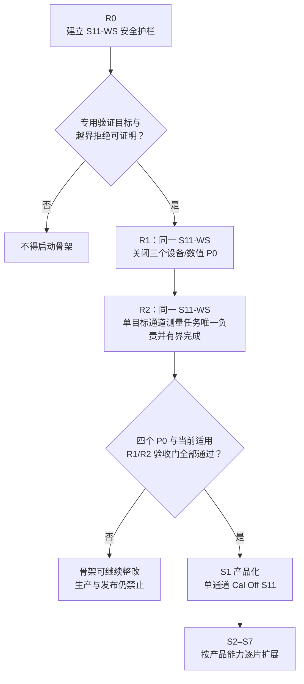

# 现有三层架构审计与整改方案

> [返回文档入口](./README.md)

本页只给出“当前哪里有问题、现在先做什么”。源码证据、单层审计、整改批次和验收分别在链接正文中展开。

审计基线为 Git `427441a`，范围是 `VnaHardware`、`VnaAcquisition` 和 `VnaMeasurement`。

## 1. 一眼看懂当前判定

现有三层并非全部推倒重来：设备访问、采集组帧和部分数值处理都有可迁移资产。真正的问题是四个跨层边界尚未闭合；它们必须阻止不安全能力进入生产和发布，但不应迫使团队先完成整个底层平台再验证产品链。

R0 先把“能验证”与“能发布”机械隔离。R1 在同一条受限 S11 纵向验证骨架（S11-WS）上关闭数值契约、设备实际值和驱动阻塞三个 P0；R2 继续沿同一骨架关闭单目标场景中的通道测量任务责任归属 P0，并证明已接纳工作能在容量和时间上限内完成。四项 P0 与当前适用验收门通过后，才进入 S1 产品化。

风险级别表示生产风险和放行时点：P0 在相关能力进入默认产品构建、公开入口或发布前必须关闭；它不阻止经专用构建目标和能力清单隔离的 S11-WS。P1 在对应产品切片发布前关闭；P2 作为工程一致性和后续扩展门禁。

## 2. 四个必须先关闭的问题

### [数值契约](./现有三层审计/04-跨层P0问题.md#11-波形只有复数没有可执行数值契约)

- **用户后果**：校准、S 参数和导出结果无法证明单位、参考面和处理位置。
- **R1 第一步**：统一数值契约下沉到 L0，采集帧携带可检查语义。

### [实际值回传](./现有三层审计/04-跨层P0问题.md#12-允许量化却不能回传实际值)

- **用户后果**：显示值、校准适用性和结果来源可能与硬件真实执行不一致。
- **R1 第一步**：L2 返回完整设备实际执行计划，后续处理只使用实际值。

### [驱动阻塞](./现有三层审计/04-跨层P0问题.md#13-驱动可无限阻塞关闭)

- **用户后果**：设备故障可能拖死整个应用关闭和重启。
- **R1 第一步**：驱动进入独立故障域，调用有截止和隔离结论。

### [通道测量任务责任重复](./现有三层审计/04-跨层P0问题.md#14-通道测量任务责任重复)

- **用户后果**：触发、停止、完成和重配置竞态会出现两个权威写者。
- **R2 第一步**：L3 收窄为物理采集；L6 唯一负责测量运行任务、已接纳的测量推进事件、目标批次和通道测量任务。

架构决策追踪只在[跨层 P0 的决策索引](./现有三层审计/04-跨层P0问题.md#3-决策追踪索引)维护，本页不重复编号。

## 3. 三个单层怎样处理

### VnaHardware

- **保留**：驱动边界、有界命令队列、设备准备和数据块池。
- **当前问题**：公共语义绑在硬件层，设备调整值和永久阻塞无法安全表达。
- **目标归位**：通用契约拆到 L0，驱动隔离归 L1，设备会话和设备实际执行计划留在 L2。

### VnaAcquisition

- **保留**：单次采集、数据完整性检查、组帧，以及停止后处理完已接纳数据的基础。
- **当前问题**：同时承担连续调度和产品级运行，停止会与未来 L6 出现双权威。
- **目标归位**：L3 只做一次物理采集与组帧，触发、连续调度和父子运行迁到 L6。

### VnaMeasurement

- **保留**：不可变数值绑定、输入检查和部分观测计算。
- **当前问题**：目前只是观测纯核心，却容易被误当成完整网络测量和产品对象层。
- **目标归位**：观测计算重定位到 L4，通道编译归 L5，产品测量对象归 L7。

逐层证据和整改项：

- [VnaHardware 审计](./现有三层审计/01-VnaHardware审计.md)
- [VnaAcquisition 审计](./现有三层审计/02-VnaAcquisition审计.md)
- [VnaMeasurement 审计](./现有三层审计/03-VnaMeasurement审计.md)

## 4. 三层之间还缺什么

- 稳定公共契约目前依附硬件模块，必须形成独立 L0。
- 当前没有把产品测量通道编译成设备要求与处理要求的 L5。
- 当前没有唯一管理测量运行任务、通道测量任务、触发、执行前容量检查和完成判断的 L6。
- 当前没有统一承载产品对象、保存召回和外部入口用例的 L7/L8。

目标依赖和源码证据见[跨层结构性问题](./现有三层审计/04-跨层P0问题.md#2-三层之间的结构性问题)。

## 5. 整改与后续交付

| 阶段 / 切片 | 只做什么 | 可达范围 |
| --- | --- | --- |
| R0 | 建立权威文档、S11-WS 能力清单、不可安装验证目标和越界拒绝 | 只允许隔离验证 |
| R1 | 先跑通受限 S11-WS，再沿同一链关闭数值契约、实际值回传和驱动阻塞 | 骨架可达；生产不可达 |
| R2 | 沿同一 S11-WS 证明单目标场景中的通道测量任务只有一个责任方、资源有上限且计划内结果都有明确结论 | 骨架可达；生产不可达 |
| S1 | 产品化单通道、未绑定校准数据集的 S11（Cal Off） | 所有当前适用验收门通过后可发布 |
| S2–S7 | 依次增加连续测量、校准、二端口、多通道、变换和保存召回 | 每个切片单独验收，不合并跳过 |

## 6. 执行、验收与禁止项

- 具体变更批次、兼容入口和回滚点：[提交组 A–F](./现有三层审计/05-整改路线与验收.md#2-变更拆分和兼容策略)
- 每个阶段的实施目标：[R0/R1/R2 与 S11-WS 路线](./现有三层审计/05-整改路线与验收.md#1-立即整改批次)
- 阶段与验收门的唯一对应：[架构约束与验收索引 §6](./架构设计/06-架构约束与验收索引.md#6-阶段切片与十六个阻断性验收门)
- 阻断性验收条件：[整改验收矩阵](./现有三层审计/05-整改路线与验收.md#3-验收矩阵)
- 看似省事但会扩大风险的做法：[不应做的整改](./现有三层审计/05-整改路线与验收.md#4-不应做的整改)

在 S1 发布前，评审只需追问一句：**这项改动是否只服务受限 S11-WS 且受机械护栏限制，或者直接关闭当前适用验收门？** 若两者都不是，不应进入当前路线。
