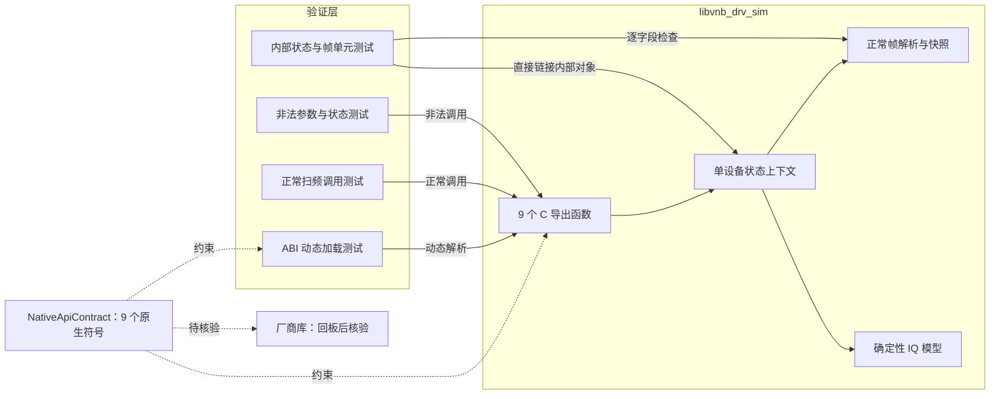
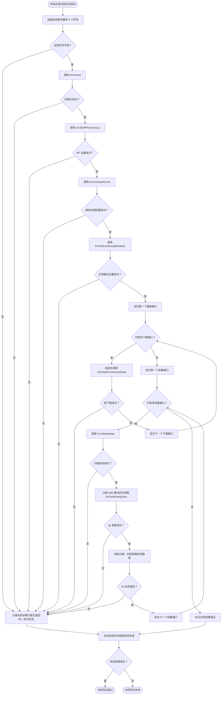

# VNA 原生驱动接口模拟软件设计说明书

## 文档信息

| 项目 | 内容 |
| --- | --- |
| 文档版本 | V2.0 |
| 文档状态 | 待评审 |
| 实施阶段 | 第一阶段：原生接口模拟 |
| 交付产物 | `libvnb_drv_sim` 动态库及原生合同测试 |
| 参考目录 | `demo/`，只读，不纳入生产实现 |
| 目标编译器 | GCC 7.3 |
| 语言基线 | C++14 |
| 更新日期 | 2026-09-22 |

### 变更记录

| 版本 | 日期 | 变更说明 |
| --- | --- | --- |
| V1.0 | 2026-09-22 | 同时描述原生模拟、VnaDriver 和 VnaHal |
| V2.0 | 2026-09-22 | 按实施边界重写；第一阶段仅实现原生接口模拟，移除上层设计要求 |

## 1. 引言

### 1.1 编写目的

本文定义无单板阶段的第一个可交付物：一个与当前底软函数表具有相同符号和函数签名的原生模拟动态库。该动态库用于验证原生调用链、帧格式、缓冲区布局和错误路径，为后续开发 `VnaDriver` 提供稳定、可自动测试的底层替身。

`VnaHal` 属于上层软件，不参与本阶段实现。本文不设计通道、触发、S 参数、校准或测量结果模型。

### 1.2 设计结论

第一阶段的抽象边界就是 9 个 `Drv*` 原生函数。模拟库必须在该边界上替代真实库，而不是增加一套高层虚拟 VNA 接口。

本阶段实现的是“ABI 和已知行为兼容的合同模拟器”，不是物理硬件模型。没有资料支持的硬件行为必须列为回板待确认项，不得通过经验补全后写成厂商规格。

### 1.3 规范用语

- “必须”“不得”表示本阶段强制要求。
- “应”表示默认设计，变更时必须说明原因。
- “可以”表示不影响外部合同的实现选择。
- “模拟器规定”只约束 `libvnb_drv_sim`，不代表厂商库已经确认具有相同行为。

## 2. 参考依据与可信边界

| 参考项 | 可确认内容 | 不能据此确认的内容 |
| --- | --- | --- |
| `demo/DriverManager.h` | 9 个符号名称及函数指针 typedef | 完整可编译实现、POSIX 加载、C 导出和 Windows 调用约定 |
| `demo/VnaHalImpl.cpp` | 正常帧字段排列、长度和参考调用顺序 | 无错误的生产代码、硬件强制状态机和厂商错误码 |
| `demo/VnaHalBase.h` | `tableData` 是底层功率表且每点九项 | 九项含义、单位、范围和生产数据源 |
| 已确认的接口约定 | 每点 16 个 `double`，依次为 A1、B1、A2、B2、A3、B3、A4、B4，每个复数按 RI 排列 | 真板数值范围、噪声、时序和未激活端口行为 |

`demo/` 中存在缺失成员、拼写问题和不完整平台代码，因此只能作为接口意图参考。新实现不得复制其类结构，也不得修改这些文件。

## 3. 第一阶段范围

### 3.1 本期实现

| 交付项 | 内容 |
| --- | --- |
| 原生 ABI 合同 | 9 个函数签名、符号名、导出宏和模拟错误码 |
| 模拟动态库 | 导出全部 9 个原生函数 |
| 正常扫频状态 | 初始化、RF、接收位图、正常模式、帧下载、Start、Get |
| 正常帧解析 | 校验 `quick=0`、`dynamic=0`、`link=0` |
| 帧快照 | 按激励端口把参数解析为自有值对象，并深复制不透明功率表 |
| 确定性 IQ | 每点严格返回 16 个 `double`，无随机噪声 |
| 运行时合同测试 | 使用动态加载实际解析并调用导出符号 |
| 边界与错误测试 | 参数、长度、溢出、顺序、不支持模式和重复读取 |

### 3.2 本期不实现

- `VnaHal` 及其公共 API；
- 生产 `VnaDriver` 和生产 `DriverManager`；
- 通道配置、多通道管理和软件触发；
- IQ 到 C++ 波形对象的解包；
- S 参数计算和测量帧；
- 功率表生成、外部来源接入或九项语义解释；
- 快扫、DYN、校准和平均；
- 真实射频功率、噪声、动态范围和时延模型；
- 厂商动态库切换及真板联调。

测试程序可以包含最小的动态库加载器和函数表，但该代码只用于 ABI 验证，不作为本阶段的生产 `DriverManager`。

### 3.3 交付边界

第一阶段完成后，上层尚不能直接进行 VNA 业务测量。可交付能力是：测试程序能够像未来 Driver 一样加载模拟库，通过原生函数完成一轮正常扫频并取得格式正确的原始 IQ 缓冲区。

## 4. 需求规格

### 4.1 ABI 需求

| 需求 ID | 需求 |
| --- | --- |
| `REQ-ABI-001` | 模拟动态库必须导出函数表中的全部 9 个精确符号名 |
| `REQ-ABI-002` | 返回类型、参数顺序、整数宽度和指针类型必须与已确认 typedef 一致 |
| `REQ-ABI-003` | 导出函数必须采用无 C++ 名称修饰的 `extern "C"` 符号 |
| `REQ-ABI-004` | 默认符号可见性必须隐藏，只显式导出 9 个生产 `Drv*` 符号 |
| `REQ-ABI-005` | `0` 表示成功；模拟器定义的非零错误码不得冒充厂商错误码 |
| `REQ-ABI-006` | C ABI 函数不得向调用方传播 C++ 异常 |

### 4.2 正常扫频模拟需求

| 需求 ID | 需求 |
| --- | --- |
| `REQ-SIM-001` | `DrvHwInit` 必须把模拟器恢复到规定的初始状态 |
| `REQ-SIM-002` | 初始化后 RF 默认关闭，RF 关闭时不得启动扫描 |
| `REQ-SIM-003` | 模拟器必须保存接收位图和正常扫频模式设置 |
| `REQ-SIM-004` | 每个激励端口的下载帧必须保存为不引用调用方内存的独立 owned snapshot |
| `REQ-SIM-005` | Start 的点数和端口必须匹配已下载帧 |
| `REQ-SIM-006` | Get 的点数必须匹配当前待读取扫描，成功读取后必须消费该扫描 |
| `REQ-SIM-007` | 相同帧输入必须产生相同 IQ 输出，不得加入随机噪声 |
| `REQ-SIM-008` | 初始化后，模式 0 必须成功，非零快扫模式必须返回“不支持” |
| `REQ-SIM-009` | 功率检查函数必须导出但不得进入正常流程；初始化后直接调用时清零有效输出并返回“不支持” |
| `REQ-SIM-010` | 调用方满足裸指针和容量前置条件时，对空指针、合同长度错误、非法值和非法状态等可检测错误，模拟器必须稳定失败且不崩溃 |
| `REQ-SIM-011` | 初始化后的 IDN 查询必须返回固定、NUL 终止的字符串，并确定性处理缓冲区不足 |
| `REQ-SIM-012` | 通过内存安全前置检查后，除 `DrvHwInit` 外的其余 8 个导出函数在未初始化时必须返回 `NOT_INITIALIZED` |

### 4.3 数据需求

| 需求 ID | 需求 |
| --- | --- |
| `REQ-DAT-001` | 正常参数表必须满足 `paramDataLen = 1 + 6N` |
| `REQ-DAT-002` | 不透明功率表必须满足 `tableDataLen = 9N` |
| `REQ-DAT-003` | 初始化后的正常帧下载必须满足 `quick=0`、`dynamicLinkConfig=0`、`dynamicEnabled=0` |
| `REQ-DAT-004` | 模拟器必须接受原生激励端口 0～3；接收位图只使用 bit0～bit3，且至少选择一个端口 |
| `REQ-DAT-005` | 每个频点必须按固定顺序写入 16 个 `double` |
| `REQ-DAT-006` | 调用方输入数组在原生函数返回后必须可以立即释放或修改 |
| `REQ-DAT-007` | 所有长度乘加、类型转换和缓冲区大小计算必须先检查溢出 |

### 4.4 非功能需求

| 需求 ID | 需求 |
| --- | --- |
| `REQ-NFR-001` | 生产和测试代码必须符合 C++14，并通过 GCC 7.3 编译 |
| `REQ-NFR-002` | `demo/` 只能读取，不得修改或编入生产目标 |
| `REQ-NFR-003` | 默认构建和全部第一阶段测试不得依赖单板或厂商库 |
| `REQ-NFR-004` | 模拟器必须保护全局设备状态，竞争调用不得产生数据竞争 |
| `REQ-NFR-005` | 测试必须通过运行时动态加载验证 ABI，不能只靠静态链接通过 |
| `REQ-NFR-006` | 同一输入在不同测试运行中必须得到相同输出 |

## 5. 软件结构设计

### 5.1 结构图



结构图只描述第一阶段实现和验证边界。厂商库仅表示未来需要用同一合同核验，不是本期构建依赖。

### 5.2 组件职责

| 组件 | 职责 | 禁止事项 |
| --- | --- | --- |
| `NativeApiContract` | 固化 typedef、符号名、导出宏、端口和布局常量 | 引入 HAL、STL 容器或业务类型到 C ABI |
| 原生导出层 | 参数初检、异常边界、转发到状态上下文 | 实现上层通道、触发或 S 参数逻辑 |
| `NativeSimulatorState` | 保存状态、帧快照和待读取扫描 | 暴露测试专用生产符号 |
| `NormalFrameDecoder` | 校验并复制正常帧 | 解释 `tableData` 九项物理含义 |
| `SignalModel` | 生成可重复的 16 值 IQ 数据 | 加随机噪声或声称具有真实射频精度 |
| 合同测试程序 | 动态加载、调用和验证导出接口 | 充当生产 Driver 或上层应用 |

### 5.3 依赖规则

- 模拟库和合同测试共享 `NativeApiContract.h`。
- 模拟库不得包含 `demo/` 头文件。
- 外部合同测试不得链接 `vnb_drv_sim`，必须只通过运行时解析的函数指针调用至少一条完整正常路径。
- 状态、帧解析和信号模型可以作为内部 C++14 对象测试，但不得额外导出为生产 `Drv*` 符号。
- 第一阶段不得创建 `VnaHal` 源码或以占位类提前固定其接口。

## 6. 原生 ABI 合同

### 6.1 必需符号和签名

| 导出符号 | 函数指针等价签名 | 正常路径 |
| --- | --- | --- |
| `DrvHwInit` | `uint32_t (*)()` | 使用 |
| `DrvGetSweepData` | `uint32_t (*)(uint32_t, double*)` | 使用 |
| `DrvStartSweep` | `uint32_t (*)(uint32_t, uint32_t)` | 使用 |
| `DrvActivateRxLink` | `uint32_t (*)(uint32_t)` | 使用 |
| `DrvSetRfPowerOn` | `uint32_t (*)(uint32_t)` | 使用 |
| `DrvSetFastSweepMode` | `uint32_t (*)(uint32_t)` | 仅使用模式 0 |
| `DrvGetIDN` | `uint32_t (*)(char*, int)` | 独立验证 |
| `DrvCheckSweepPortPower` | `uint32_t (*)(uint32_t, uint32_t*, uint16_t*, uint32_t)` | 不调用，独立验证不支持行为 |
| `DrvDataFrameDownload` | `uint32_t (*)(uint32_t, uint32_t*, uint32_t, double*, uint32_t)` | 使用 |

数组参数在 ABI 上均为指针。尽管下载参数在逻辑上是输入，签名必须保留非 `const` 指针以匹配现有 typedef。

### 6.2 导出规则

`NativeApiContract.h` 必须统一定义：

- 9 个函数指针 typedef；
- 9 个精确符号名常量；
- 平台导出和隐藏宏；
- 模拟错误码；
- 端口数、每点 16 个值等布局常量。

模拟库函数定义必须使用 `extern "C"`。Linux/macOS 使用默认 C 调用约定和显式可见性。Windows 调用约定尚未由厂商正式资料确认，因此 Windows 动态库不属于第一阶段产物；合同头可以预留平台宏，但不得把未经确认的 DLL 当作兼容交付物。

动态加载测试必须按字符串精确查找 9 个符号。任何一个缺失都视为 ABI 测试失败，不允许发布部分函数表。

运行时符号解析只能证明名称存在，不能证明签名正确。`NativeApiContract.h` 必须同时声明导出函数和对应函数指针 typedef；`NativeFunctionExports.cpp` 直接包含该声明定义函数，另用 `static_assert(std::is_same<...>::value, ...)` 或等价编译期赋值逐项校验 9 个签名。运行时测试不得把 `dlsym` 转换成功误写成签名验证。

上述编译期检查只能证明“模拟库实现与本项目合同头一致”，不能证明人工抄录的合同与厂商 ABI 一致。实施前必须把 9 个符号、返回类型和参数类型形成冻结 ABI 清单，逐项对照已确认的 `demo/DriverManager.h` 并留存评审记录；最终仍要在取得正式头文件或真库后闭环验证。

### 6.3 模拟错误码

| 数值 | 符号 | 含义 |
| ---: | --- | --- |
| 0 | `DRV_SIM_OK` | 成功 |
| 1 | `DRV_SIM_INVALID_ARGUMENT` | 指针、端口、位图或值非法 |
| 2 | `DRV_SIM_NOT_INITIALIZED` | 尚未初始化 |
| 3 | `DRV_SIM_RF_DISABLED` | RF 未打开 |
| 4 | `DRV_SIM_INVALID_STATE` | 调用顺序或点数状态不匹配 |
| 5 | `DRV_SIM_NOT_SUPPORTED` | 本期不支持的能力 |
| 6 | `DRV_SIM_SIZE_OVERFLOW` | 长度乘加或分配大小溢出 |
| 7 | `DRV_SIM_BUFFER_TOO_SMALL` | IDN 缓冲区不足 |
| 8 | `DRV_SIM_INTERNAL_ERROR` | 被 ABI 边界捕获的内部异常 |

这些数值只属于模拟器。未来 Driver 对厂商库的非零返回码必须按不透明原始码处理，不能使用本表解释真实硬件错误。

错误判定顺序固定为：先检查无需读取缓冲区内容即可判断、且会影响内存安全的空指针、声明容量、长度和溢出；再检查初始化状态；初始化后再检查值域与帧内容、不支持能力，最后检查操作状态。这样未初始化时不会为验证业务字段而读取调用方数组，同一输入也始终得到同一错误码。

### 6.4 ABI 异常边界

每个导出函数最外层必须捕获所有异常：

- 已知参数或状态错误转换为对应模拟错误码；
- `std::bad_alloc` 转换为内部错误；
- 其他异常转换为内部错误；
- 不在 ABI 中返回 STL 对象、引用、异常对象或内部指针。

### 6.5 裸指针前置条件

原生 ABI 无法验证非空指针是否悬空，也无法验证调用方声明的容量是否真实。所有调用方必须保证：

- 输入缓冲区在函数返回前保持可读，且实际元素数不少于传入长度；
- 输出缓冲区在函数返回前保持可写，且实际容量不少于合同要求；
- IDN 和功率检查的容量参数必须反映真实可写容量；
- 不与原生调用并发释放或修改同一缓冲区；
- 动态库卸载前不存在仍在执行的原生调用。

模拟器只检查空指针、显式长度、数值范围、溢出和内部状态。C++ 异常捕获不能拦截任意非法地址导致的进程级访问错误，因此“不崩溃”不覆盖违反上述前置条件的调用。

## 7. 正常帧数据合同

### 7.1 参数表布局

设频点数为 `N`：

```text
paramDataLen = 1 + 6 * N
tableDataLen = 9 * N

paramData[0] = 0

base = 1 + 6 * pointIndex
paramData[base + 0] = frequencyHigh32
paramData[base + 1] = frequencyLow32
paramData[base + 2] = sourcePort0
paramData[base + 3] = 0
paramData[base + 4] = ifBandwidthRaw
paramData[base + 5] = 0
```

64 位频率字段按下式还原。本阶段只把它作为原始整数，不规定单位：

```text
frequencyRaw = (uint64_t(frequencyHigh32) << 32) | frequencyLow32
```

`sourcePort0` 为 0～3。一个下载帧内所有频点的激励端口必须一致。

### 7.2 正常帧校验

模拟器必须拒绝：

- `N == 0`；
- 任一必需输入指针为空；
- `1 + 6N`、`9N` 或内部字节数计算溢出；
- 传入的 `paramDataLen` 或 `tableDataLen` 与合同长度不一致；
- `paramData[0] != 0`；
- `dynamicLinkConfig != 0`；
- `dynamicEnabled != 0`；
- 原生激励端口不在 0～3；
- 同一帧中激励端口不一致。

快扫、动态 Link 或动态标志非零时返回 `DRV_SIM_NOT_SUPPORTED`；尺寸运算溢出返回 `DRV_SIM_SIZE_OVERFLOW`；其他结构错误返回 `DRV_SIM_INVALID_ARGUMENT`。

当前资料没有确认 IFBW 的合法范围。模拟器保存 `ifBandwidthRaw`，不擅自添加硬件量程限制。

### 7.3 不透明功率表

`tableData` 只确认每个频点包含九个 `double`。模拟器必须：

1. 校验非空指针和 `9N` 长度；
2. 原样深复制全部元素；
3. 不解释索引、单位或特殊值；
4. 不因为 `NaN`、无穷或数值范围而拒绝帧；
5. 不用该表改变第一阶段的 IQ 输出。

正常合同测试使用全零 `tableData`。功率表的生产来源属于后续 Driver 设计，不进入模拟器。

### 7.4 数组生命周期

调用期间，调用方必须保证 `paramData` 至少可读 `paramDataLen` 项、`tableData` 至少可读 `tableDataLen` 项。`DrvDataFrameDownload` 成功返回后，模拟器不得继续引用这些数组。

`paramData` 中会影响 IQ 的频率快照可以通过动态库外部行为验证：下载后修改或释放原数组，Start/Get 仍必须按下载时的频率生成结果。激励端口、IFBW 等其余已解析字段，以及第一阶段模型明确忽略的 `tableData`，不能靠外部 IQ 结果证明已经拥有化；必须在 `NormalFrameDecoder` 或内部状态对象的单元测试中逐字段检查 owned snapshot，并确认调用方数组修改不影响它。不得为此增加生产导出符号。

## 8. IQ 输出合同

### 8.1 缓冲区布局

调用方必须为 `DrvGetSweepData(N, buffer)` 提供至少 `16N` 个 `double`。数据按频点优先排列，每点布局如下：

| 偏移 | 数据 | 偏移 | 数据 |
| ---: | --- | ---: | --- |
| 0 | `A1.real` | 1 | `A1.imag` |
| 2 | `B1.real` | 3 | `B1.imag` |
| 4 | `A2.real` | 5 | `A2.imag` |
| 6 | `B2.real` | 7 | `B2.imag` |
| 8 | `A3.real` | 9 | `A3.imag` |
| 10 | `B3.real` | 11 | `B3.imag` |
| 12 | `A4.real` | 13 | `A4.imag` |
| 14 | `B4.real` | 15 | `B4.imag` |

### 8.2 容量责任

`DrvGetSweepData` 的 ABI 没有缓冲区容量参数，因此模拟器无法判断调用方实际分配长度。调用方必须保证缓冲区在调用期间可写且真实容量不少于 `16N`；测试使用前后 canary 验证模拟器恰好写入 `16N` 个值。

模拟器在写入前必须校验：

- 已存在待读取扫描；
- `N` 与 pending 扫描点数一致；
- 输出指针非空；
- `16N * sizeof(double)` 未溢出。

参数错误时不得部分写入或消费 pending 扫描。成功写入后必须消费 pending 扫描，第二次 Get 返回状态错误。

## 9. 模拟器状态与函数行为

### 9.1 单设备上下文

原生 ABI 没有设备句柄，模拟库内部只维护一个进程内设备上下文：

```text
initialized
rfEnabled
rxConfigured
rxPortBitmap
fastModeConfigured
fastSweepMode
downloadedFrames[4]
pendingSweep
mutex
```

所有状态访问受同一互斥锁保护。导出函数同步执行，不创建后台线程，不调用用户回调。

### 9.2 模拟器规定的状态规则

下列规则用于让无板测试稳定发现错误调用顺序，不表示厂商硬件状态机已经确认：

| 操作 | 前置条件 | 成功后的状态 |
| --- | --- | --- |
| `DrvHwInit` | 无 | 重置全部状态；已初始化；RF 关闭 |
| `DrvSetRfPowerOn` | 已初始化；参数为 0 或 1 | 0 表示关闭，1 表示打开；关闭时清除 pending 扫描 |
| `DrvActivateRxLink` | 已初始化；位图为 1～0xF | 保存位图并标记已配置 |
| `DrvSetFastSweepMode(0)` | 已初始化 | 保存正常模式并标记已配置 |
| `DrvDataFrameDownload` | 已初始化；正常帧合法 | 按帧内激励端口替换对应快照 |
| `DrvStartSweep` | 已初始化、RF 开、接收和模式已配置、端口有同点数帧、无 pending | 生成并保存一份 pending IQ |
| `DrvGetSweepData` | 存在同点数 pending | 写入 `16N` 个值并消费 pending |

重新调用 `DrvHwInit` 必须清除所有已下载帧和 pending 扫描，用于测试恢复到已知初始状态。

### 9.3 九个函数的具体行为

| 函数 | 模拟行为 |
| --- | --- |
| `DrvHwInit` | 重置上下文并返回成功 |
| `DrvGetSweepData` | 校验 pending 和点数，写入固定布局后消费 pending |
| `DrvStartSweep` | 校验状态和端口帧，调用 `SignalModel` 生成 pending |
| `DrvActivateRxLink` | 保存 bit0～bit3；位图为 0 或高位非零时返回参数错误 |
| `DrvSetRfPowerOn` | 0 关闭、1 打开；其他值返回参数错误 |
| `DrvSetFastSweepMode` | 0 成功；非 0 返回不支持且不改变当前模式 |
| `DrvGetIDN` | 初始化后返回固定 IDN `VnaPro,NativeSimulator,4PORT,1.0` |
| `DrvCheckSweepPortPower` | 对有效输出指针清零，然后返回不支持 |
| `DrvDataFrameDownload` | 校验、解析并深复制正常帧 |

`DrvGetIDN` 必须保证容量大于 0 时以 NUL 结束。容量不足时写入可容纳的截断字符串并返回 `DRV_SIM_BUFFER_TOO_SMALL`；空指针或非正容量返回参数错误。

IDN 同样遵循全局错误优先级：空指针或非正容量在初始化前也返回参数错误；指针和容量安全但尚未初始化时返回 `DRV_SIM_NOT_INITIALIZED` 且不写缓冲区，即使该容量不足以容纳完整 IDN。

通过第 6.3 节的内存安全前置检查后，除 `DrvHwInit` 外的其余 8 个函数在未初始化时都返回 `DRV_SIM_NOT_INITIALIZED`。因此非零快扫模式在未初始化时返回“未初始化”，初始化后才返回“不支持”。

`DrvCheckSweepPortPower` 要求 `rfPortBitmap` 为 1～0xF，且 `checkBitmap` 非空；`indexCapacity > 0` 时要求 `overFreqIndex` 非空，容量为 0 时允许其为空。空指针或容量组合非法时优先返回参数错误且不写输出；指针与容量安全但尚未初始化时返回 `DRV_SIM_NOT_INITIALIZED`，不检查位图内容且不写输出；初始化后位图非法时返回参数错误且不写输出。全部有效时，函数将 `*checkBitmap` 置 0，并将 `overFreqIndex[0..indexCapacity)` 清零，再返回 `DRV_SIM_NOT_SUPPORTED`。

## 10. 正常扫频活动设计

### 10.1 活动图



`DrvGetIDN` 和 `DrvCheckSweepPortPower` 不属于正常扫频主链，分别在独立合同测试中验证。

### 10.2 参考调用顺序

```text
OpenDynamicLibrary
  -> resolve all 9 symbols
  -> DrvHwInit
  -> DrvSetRfPowerOn(1)
  -> DrvActivateRxLink(bitmap)
  -> DrvSetFastSweepMode(0)
  -> for each source port: DrvDataFrameDownload
  -> for each source port: DrvStartSweep -> DrvGetSweepData
```

`OpenDynamicLibrary` 在 macOS/Linux 测试中使用 `dlopen` 实现。该顺序来自现有示例和本阶段测试需要；回板后应验证真实底软是否允许或要求其他顺序。

## 11. 确定性 IQ 模型

### 11.1 设计目标

- 能区分频率、激励端口和观察端口；
- 所有正常值有限且可重复；
- 激励端口参考波非零；
- 后续 Driver/HAL 可以用它验证端口方向和复数运算；
- 不模拟噪声、漂移、动态范围或真实器件响应。

### 11.2 建议公式

令波形标签端口 `r,s` 取 1～4，原生激励端口为 `s-1`，64 位频率原始值为 `f`：

```text
z = f
z = (z xor (z >> 33)) * 0xff51afd7ed558ccd
z = (z xor (z >> 33)) * 0xc4ceb9fe1a85ec53
z = z xor (z >> 33)
x = double(z >> 11) / 9007199254740992.0

A_rP_s = complex(
    1.0 + 0.1 * r + 0.01 * s,
    0.001 * x)

H_rs = complex(
    (r == s ? 0.20 : 0.02 * r * s) + 0.001 * x,
    0.005 * (r - s))

B_rP_s = H_rs * A_sP_s
```

`z` 使用无符号 64 位整数，乘法按模 `2^64` 回绕。该混合使用完整 64 位频率原始字段，避免常见整值因简单取模得到相同因子。

`SignalModel` 对四个观察端口依次生成 A、B，并按第 8 章布局写入。接收位图只作为状态保存，不改变固定 16 值布局；真实硬件对未激活端口的行为留待回板验证。

第一阶段模型只使用频率原始值和激励端口；IFBW、接收位图和不透明功率表不改变数值。公式和常量必须集中在 `SignalModel` 中，以黄金向量测试固定。采集次数、系统时间、线程调度和随机数不得参与公式。

同一编译产物的重复结果必须一致。跨编译器黄金值使用绝对或相对误差 `1e-12` 比较，不要求不同标准库的复数乘法结果逐位相同。

## 12. 并发、内存与安全设计

### 12.1 并发

- 原生接口没有设备句柄，模拟库只有一个全局设备上下文。
- 每个导出函数在访问上下文前取得互斥锁。
- 并发调用按锁顺序串行完成，不承诺与真实底软相同的线程模型。
- 第一阶段正常合同测试使用单线程；另设竞争压力测试观察稳定性，并在独立 ThreadSanitizer 构建中检查数据竞争。

### 12.2 内存

- 使用 `std::vector` 和值对象保存下载帧及 pending IQ。
- 不保留调用方数组和 IDN 缓冲区指针。
- 所有乘法在转换为 `size_t` 和分配前检查上界。
- 不使用裸 `new[]`/`delete[]` 管理帧和 IQ。
- 导出层不得向调用方返回内部存储地址。

### 12.3 可恢复性

- 参数错误不得修改已有有效状态。
- 不支持的模式不得修改当前正常模式。
- Get 参数错误不得消费 pending 扫描。
- 成功调用 `DrvHwInit` 后必须回到确定的初始化、RF 关闭状态。
- 所有可能分配内存或执行复杂计算的状态变更必须先在临时对象中完成，全部成功后再以 `swap`、移动或无异常赋值一次性提交。
- 内部异常返回 `DRV_SIM_INTERNAL_ERROR`，并提供强异常保证：调用前已有状态保持不变且仍可继续使用；`DrvHwInit` 始终可用于主动复位。
- 异常路径通过内部依赖注入或测试专用构建验证；测试构建必须复用同一份生产实现，只替换内部故障注入点，不得增加生产导出符号。

## 13. 目录、构建与产物

### 13.1 目录结构

```text
CMakeLists.txt

include/
  vna_native/
    NativeApiContract.h

src/
  native_sim/
    NativeSimulatorState.h
    NativeSimulatorState.cpp
    NormalFrameDecoder.h
    NormalFrameDecoder.cpp
    SignalModel.h
    SignalModel.cpp
    NativeFunctionExports.cpp

tests/
  native_unit/
    NativeApiSignatureTest.cpp
    NativeStateTest.cpp
    NormalFrameDecoderTest.cpp
    SignalModelTest.cpp
  native_contract/
    NativeLibraryProbe.h
    NativeLibraryProbe.cpp
    NativeAbiContractTest.cpp
    NativeNormalSweepTest.cpp

demo/                         # 只读参考，不编入目标
```

第一阶段不创建 `VnaHal/` 或生产 `VnaDriver/`。原生合同和模拟库放在独立目录，不提前锁定后续上层的目录与接口。

### 13.2 构建目标

| 目标 | 类型 | 说明 |
| --- | --- | --- |
| `vnb_drv_sim` | Shared Library | 原生模拟动态库 |
| `vnb_drv_sim_unit_tests` | Test Executable | 链接模拟器内部对象，验证状态、owned snapshot 和信号模型 |
| `vnb_drv_sim_contract_tests` | Test Executable | 不链接模拟库，只按绝对路径动态加载并验证 ABI 与外部行为 |

平台产物示例：

```text
macOS:  libvnb_drv_sim.dylib
Linux:  libvnb_drv_sim.so
```

第一阶段开发平台为 macOS，最终兼容性门禁为 Linux/GCC 7.3。Windows DLL 延后到取得厂商调用约定并单独评审之后，不属于本阶段构建和验收范围。

测试目标必须通过构建系统传入动态库绝对路径，不能依赖当前工作目录碰巧找到库。

### 13.3 C++14 基线

```cmake
set(CMAKE_CXX_STANDARD 14)
set(CMAKE_CXX_STANDARD_REQUIRED ON)
set(CMAKE_CXX_EXTENSIONS OFF)
```

禁止使用结构化绑定、`if constexpr`、内联变量、concept、ranges、coroutine，以及 `std::optional`、`std::variant`、`std::string_view`、`std::filesystem`、`std::span`、`std::jthread` 和 `std::expected`。

macOS 可以使用 AppleClang 开发。发布第一阶段产物前必须在真实 GCC 7.3 环境中以 `-std=c++14 -Wall -Wextra -Wpedantic` 编译模拟库和全部测试。

## 14. 测试设计

### 14.1 ABI 测试

- 动态库可以被平台 API 打开和关闭；
- 9 个符号逐一解析成功；
- 共享声明中的 9 个导出函数地址通过编译期检查匹配合同 typedef；
- 冻结 ABI 清单逐项对照参考 typedef 并留存人工评审记录；
- 运行时解析只验证符号名称和可调用性，不把 `dlsym` 强制转换当作签名证明；
- 使用 `nm` 或平台等价工具枚举本库定义的全局符号，以 9 个 `Drv*` 为允许表；平台必需符号单独列明，不允许泄漏内部 C++ 符号；
- IDN 的正常容量、容量 1、恰为 `strlen`、`strlen+1`、空指针、零容量、负容量及未初始化行为；
- 功率检查的位图、指针、容量、未初始化、零写入和“不支持”行为。

裸指针负向测试只覆盖空指针和可控的长度错误，不主动构造悬空指针或越界缓冲区。

### 14.2 状态与错误测试

- 初始化前调用其他函数；
- 同时存在空指针、错误长度、未初始化和不支持模式时，返回码符合第 6.3 节优先级；
- 初始化后 RF 默认关闭；
- RF 关闭时 Start；
- 接收位图为 0、高位非零、合法位图及内部保存值；
- 未配置接收位图或正常模式时 Start，并通过内部状态单测验证位图和模式保存值；
- 未下载帧、端口不匹配或点数不匹配时 Start；
- 已有 pending 时重复 Start；
- 没有 pending、点数不匹配或重复调用 Get；
- Get 参数失败后 pending 仍可正确读取；
- RF 关闭清除 pending，同端口重新下载原子替换旧帧；
- 非零快扫模式和非零 DYN 字段；
- 重复初始化清空帧和 pending；
- 在 Download 替换与 Start 生成的提交前注入内部异常，验证旧帧或原状态不变、无部分输出且后续调用仍可用；
- 竞争压力调用保持状态合同且不崩溃；
- 独立 ThreadSanitizer 构建不报告数据竞争。

### 14.3 帧与缓冲区测试

- `1+6N`、`9N`、`16N` 的边界和溢出；
- 高频和低频 32 位组合；
- 四个原生激励端口；
- 多端口帧独立保存；
- 帧内端口不一致；
- 下载后修改或释放调用方 `paramData`，外部 Start/Get 行为仍使用原频率快照；
- 内部单元测试逐字段验证已解析参数和 `tableData` 均由 owned snapshot 持有，调用方修改不影响副本；
- 16 个值的 RI、A/B 和端口顺序；
- 输出前后 canary 不被覆盖；
- 同一帧多次重新扫描得到相同数据；
- 选择原始整数值 `1000000000` 与 `2000000000` 等向量，验证完整 64 位混合后数值可区分；测试名称和断言不得声明其物理单位。

### 14.4 工具验证

- `ctest` 执行全部自动测试；
- AddressSanitizer 检查越界和生命周期；
- UndefinedBehaviorSanitizer 检查溢出和非法转换；
- ThreadSanitizer 在独立全量构建中同时插桩动态库和测试程序，零报告作为门禁，且不与 AddressSanitizer 混用；
- 平台符号工具或动态加载测试检查实际导出名；
- GCC 7.3 构建作为最终兼容性门禁。

### 14.5 需求追踪矩阵

| 需求 | 设计章节 | 主要验证 |
| --- | --- | --- |
| `REQ-ABI-001`～`REQ-ABI-004` | 5、6.1、6.2 | 冻结 ABI 清单人工复核、实现与合同头的编译期自洽检查、动态加载及全局符号允许表 |
| `REQ-ABI-005`、`REQ-ABI-006` | 6.3、6.4、12.3 | 错误码、异常注入和异常前后状态一致性测试 |
| `REQ-SIM-001`～`REQ-SIM-003` | 9.1、9.2 | 初始化、RF 及接收位图和模式的内部状态测试 |
| `REQ-SIM-004`～`REQ-SIM-007` | 7、8、9、11 | 深复制、多端口、Start/Get 和黄金向量测试 |
| `REQ-SIM-008`、`REQ-SIM-009` | 9.3 | 快扫模式和功率检查直接合同测试 |
| `REQ-SIM-010` | 9、12 | 非法参数、乱序调用和恢复测试 |
| `REQ-SIM-011`、`REQ-SIM-012` | 6.3、9.3 | IDN 边界、初始化前调用和错误优先级测试 |
| `REQ-DAT-001`～`REQ-DAT-004` | 7、9 | 帧长度、字段、端口和接收位图测试 |
| `REQ-DAT-005`、`REQ-DAT-007` | 8、11 | IQ 布局、canary 和溢出测试 |
| `REQ-DAT-006` | 7.4、14.3 | 频率快照外部行为测试，以及全部解析字段和功率表的内部 owned snapshot 测试 |
| `REQ-NFR-001` | 13.3 | GCC 7.3 全目标编译 |
| `REQ-NFR-002`、`REQ-NFR-003` | 13、15.1 | 相对已确认基线的校验和比较、目标依赖检查和无硬件默认构建 |
| `REQ-NFR-004`、`REQ-NFR-006` | 11、12、14.4 | ThreadSanitizer、竞争压力测试和跨运行黄金向量测试 |
| `REQ-NFR-005` | 14.1 | 运行时动态加载完整路径测试 |

## 15. 实施步骤

### 15.1 合同与构建骨架

1. 在开始实现前冻结用户确认的当前 `demo/` 基线：优先使用基线提交；若仓库仍无可用 `HEAD`，则按路径字典序记录完整文件路径集合、文件总数和逐文件 SHA-256，并由用户确认。验收必须同时比较路径集合与摘要，以发现新增、删除和内容修改；已确认清单不得随实现静默改写。
2. 形成 9 个符号及签名的冻结 ABI 清单，完成与参考 typedef 的逐项人工复核。
3. 创建 `NativeApiContract.h`。
4. 建立共享库、内部单元测试和纯动态加载合同测试目标。
5. 实现测试专用动态加载器。
6. 先完成 9 个符号存在性测试。

### 15.2 状态与帧解析

1. 实现单设备状态和模拟错误码。
2. 实现正常帧长度、字段和溢出校验。
3. 实现按端口持有、与调用方内存无关的 owned frame snapshot。
4. 完成非法参数和非法顺序测试。

### 15.3 IQ 与导出函数

1. 实现确定性 `SignalModel`。
2. 实现 Start/Get 的 pending 语义。
3. 实现其余原生导出函数。
4. 完成正常扫频、IQ 布局和 canary 测试。

### 15.4 兼容性验证

1. 在 macOS 完成常规、ASan、UBSan 和独立 TSan 测试。
2. 在 GCC 7.3 环境完成全量编译和测试。
3. 保存精确编译器版本输出、构建命令和全部测试结果。
4. 将实现后的 `demo/` 路径集合及逐文件摘要与已确认基线比较。
5. 固化验证证据后进入下一阶段评审。

## 16. 第一阶段验收标准

1. 生成可独立动态加载的 `libvnb_drv_sim`。
2. 9 个 `Drv*` 符号全部能按准确名称解析。
3. 冻结 ABI 清单已完成参考 typedef 人工复核；模拟库实现通过合同头编译期自洽检查。
4. 全局符号允许表检查通过，不泄漏内部 C++ 符号或额外生产 `Drv*` 导出。
5. 正常 Init、RF、Rx、FastMode(0)、Download、Start、Get 链路成功。
6. 支持原生激励端口 0～3、非零接收位图和多频点帧。
7. 每点恰好输出 16 个确定性 `double`，布局符合合同。
8. 对可检测的非法参数、非法状态、错误长度和不支持模式稳定失败且不崩溃。
9. owned snapshot 的外部行为与内部逐字段测试全部通过。
10. IDN、功率检查、初始化前 8 个函数和复合错误优先级测试全部通过。
11. 强异常保证和重新初始化恢复测试通过。
12. 相对实施前由用户确认的基线，`demo/` 路径集合和文件摘要均未改变，且未编入目标。
13. 默认构建及全部第一阶段测试不依赖单板或厂商库。
14. macOS 常规、ASan、UBSan、独立全插桩 TSan 均通过，并完成 GCC 7.3/C++14 全目标验证。
15. 需求追踪矩阵中的全部验证项通过并保存结果。
16. 验收不包含 HAL、Driver、S 参数、触发、校准、DYN、快扫或真实射频精度。

## 17. 风险、假设与回板待确认项

| ID | 事实或风险 | 第一阶段处理 | 关闭条件 |
| --- | --- | --- | --- |
| `RSK-001` | `demo/DriverManager.h` 不是完整可编译合同 | 只提取符号名和 typedef | 取得厂商正式头文件或等价 ABI 说明 |
| `RSK-002` | 厂商 C 导出、可见性和 Windows 调用约定未确认 | 模拟库采用明确 `extern "C"` 和默认调用约定 | 在目标平台加载厂商库并核验 |
| `RSK-003` | 厂商非零错误码未知 | 模拟器使用独立错误码，测试不外推到厂商库 | 取得厂商错误码说明 |
| `RSK-004` | `tableData` 九项含义和生产来源未知 | 作为不透明 `9N` 快照 | 确认格式、版本和数据源 |
| `RSK-005` | 多端口下载是否由真板分别保存尚未确认 | 模拟器按端口独立保存 | 回板执行多端口合同测试 |
| `RSK-006` | IQ 槽顺序虽已确认，但现有源码不自描述 | 按已确认的 A1/B1 至 A4/B4 顺序实现 | 用真板黄金数据复核 |
| `RSK-007` | 零接收位图以及未激活端口 IQ 的真板行为未知 | 模拟器拒绝零位图；对合法非零位图仍生成固定 16 值布局 | 回板比较零位图和不同非零位图结果 |
| `RSK-008` | 初始化幂等性、RF 关闭和乱序调用的厂商行为未知 | 使用本文规定的确定性模拟状态机 | 回板逐项合同测试 |
| `RSK-009` | Start/Get 的阻塞、超时和线程安全语义未知 | 模拟器同步执行并用互斥锁保护 | 取得说明或回板测量 |
| `RSK-010` | `DrvGetSweepData` 不带容量参数 | 调用方承担 `16N` 容量责任并做 canary 测试 | ABI 若不变则长期保留该前置条件 |
| `RSK-011` | IDN 截断和功率检查输出的厂商语义未知 | 模拟器定义安全、确定性行为 | 回板直接调用验证 |
| `RSK-012` | 64 位频率字段的单位，以及硬件频率、IFBW、点数和功率范围未知 | 按原始整数保存，不在模拟器中臆造单位或量程 | 获取设备能力或回板边界测试 |
| `RSK-013` | 裸指针 ABI 无法检测悬空指针和虚假容量 | 文档化调用方前置条件，并用正确容量及 canary 测试 | ABI 不变时长期保留该限制 |
| `RSK-014` | 当前仓库没有 `HEAD`，且 `demo/` 已是 `AM` 状态，单靠后续 Git 差异不能证明本阶段未改动参考文件 | 实施前建立用户确认的基线提交，或包含完整路径集合与逐文件 SHA-256 的不可静默改写清单 | 基线固定，并在验收时确认无新增、删除或内容变化 |

`RSK-014` 是开始写实现代码前的入口门禁，未固定基线不得进入实施。其余风险不阻塞原生模拟库开发，但说明模拟器不能作为真实硬件性能或全部行为的证明。

## 18. 后续阶段决策记录

本节仅记录路线，不构成第一阶段实现或验收要求。

### 18.1 第二阶段：VnaDriver

在原生模拟库验收后，再设计和实现生产动态加载、正常帧构造、Download/Start/Get 编排、IQ 解包及错误转换。第二阶段通过本期模拟库完成无板集成测试。

### 18.2 第三阶段：VnaHal

`VnaHal` 属于后续上层软件。其通道、触发、结果所有权、S 参数职责，以及是否感知真实/模拟后端，都必须根据届时的上层需求另行评审；本文不提前固定。

### 18.3 已确认但延期的需求备忘

- 快扫：第一阶段只允许 `DrvSetFastSweepMode(0)`，非零模式不支持。
- 校准：当前不设计接口、状态或数据字段。
- DYN：当前不实现，也不在本文定义 `g` 的来源或计算方式；仅记录用户已经确认的最终应用规则：

```text
g < 1e-20  -> S_final = S_cal
其他情况   -> S_final = S_cal * g
```

该规则只记录 DYN 的最终乘法关系；`S_cal` 的生成属于后续校准设计，不进入第一阶段。
