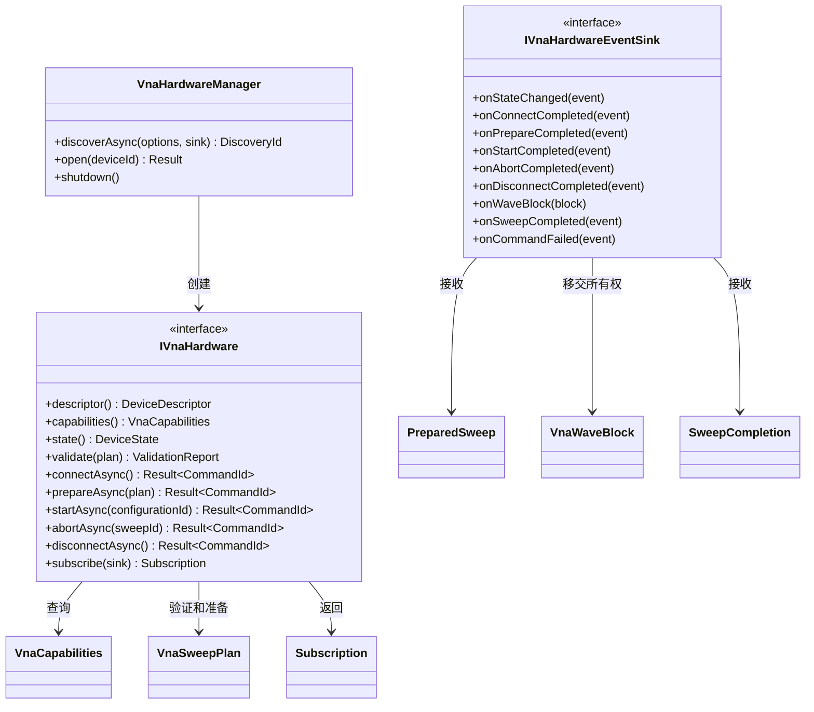
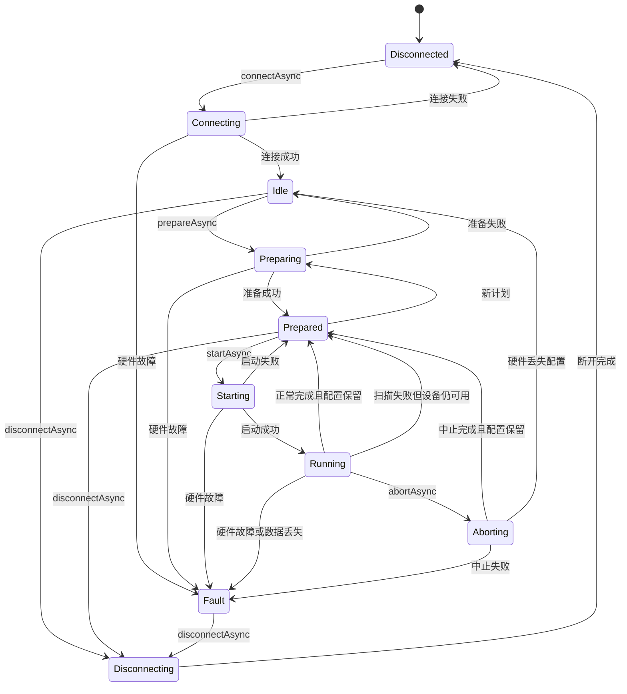
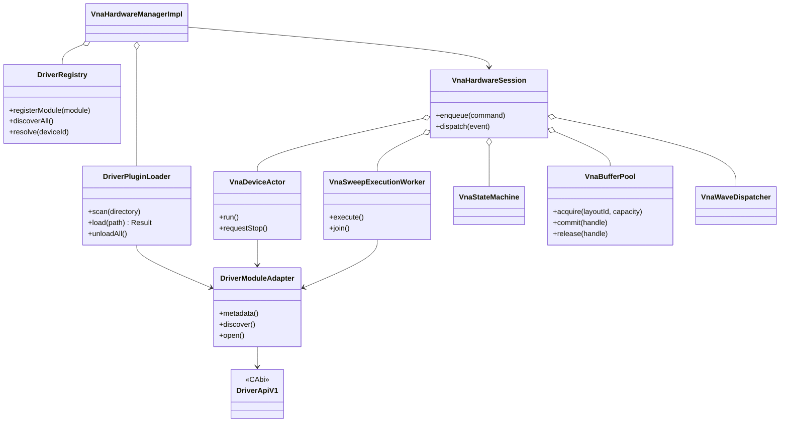
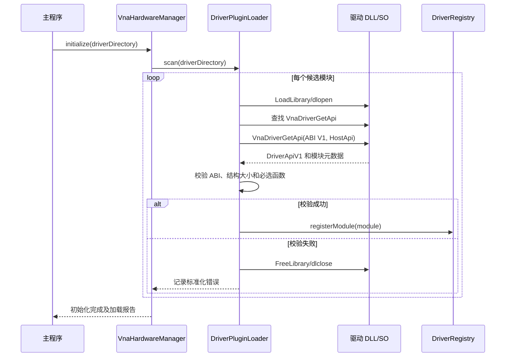
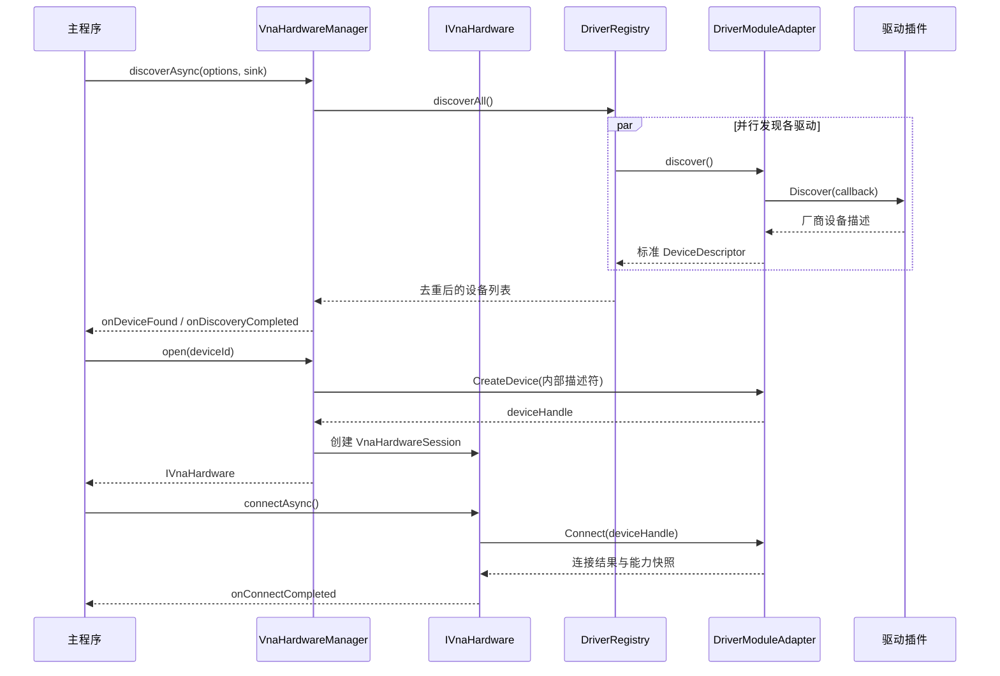
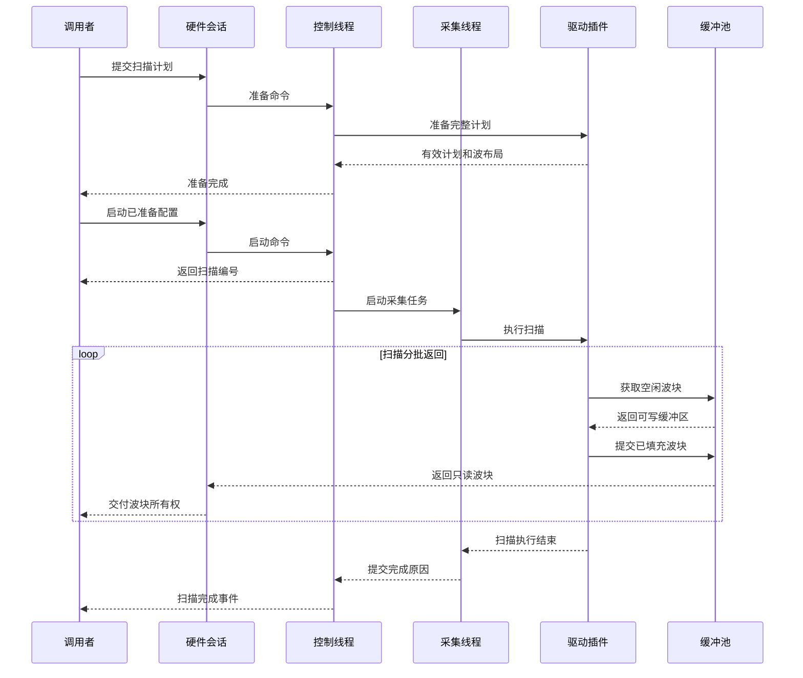
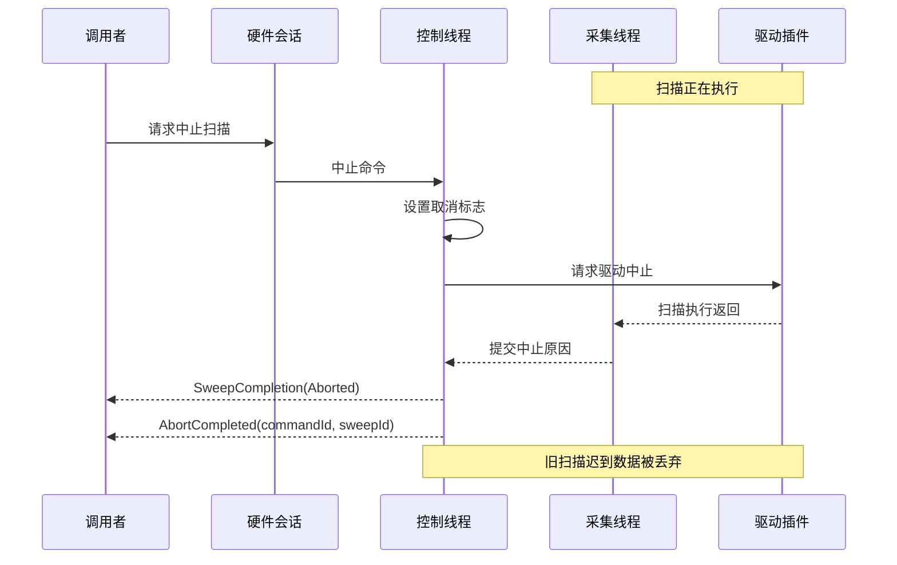

# VNA 硬件适配层软件设计

| 项目 | 内容 |
| --- | --- |
| 文档状态 | 评审稿 |
| 文档版本 | 0.3 |
| 目标语言 | C++17 |
| 生产编译器 | GCC 7.3.0，禁止使用更高版本 GCC 构建生产目标 |
| 测试编译器 | 不受 GCC 7.3 限制，可使用高版本 GCC 构建 GoogleTest |

## 1. 设计结论

主程序直接链接 C++17 实现的 `VnaHardware`，不在主程序与硬件抽象层之间设置
DLL/SO 边界。`VnaHardware` 向主程序呈现一台语义完整的理想多端口 VNA，内部
通过稳定的 C ABI 动态加载实际驱动 DLL/SO。

硬件数据面只输出规范化的入射波和出射波数据 `a/b`。波块交付调用者后即越过本文
边界，硬件层不定义任何后续处理。


当前版本只实现 `VnaDriverSimulator`。插件边界仍保持驱动无关，但公司
VNA 和商用 VNA 驱动不属于本版开发或验收范围，不创建占位目标。

## 2. 目标与非目标

### 2.1 目标

- 用一个理想 VNA 模型屏蔽具体驱动协议和数据布局。
- 支持任意频点表，以及能力允许时每点独立的 IFBW 和功率。
- 扫描开始前完成全部配置，运行中禁止修改配置。
- 支持结果分批返回，不等待完整扫描结束。
- 支持多端口、多个激励状态和 `a1/a2/b1...bN` 波数据。
- 驱动以 DLL/SO 插件交付，主程序不接触驱动类型和厂商协议。
- 数据热路径无逐点内存分配，驱动到硬件抽象层支持零复制提交。
- 生产代码固定使用 GCC 7.3.0 和该版本配套的 libstdc++。

### 2.2 当前版本范围

- 连续波多端口 VNA 测量。
- 任意频点、逐点功率和逐点 IFBW 计划。
- 单源或多源激励状态的抽象表达。
- 仅支持内部触发；模拟器不声明外部触发或逐点驻留时间能力。
- 原始规范化 `a/b` 波采集。
- 流式批次、正常完成、中止、断线和数据丢失处理。
- 以真实 MODULE 形式动态加载的模拟 VNA 驱动。

### 2.3 非目标

- 调用者收到波数据后的任何算法、存储、通信或显示。
- 频谱仪、信号源、VST 等其他仪表。
- 脉冲 VNA、噪声参数、变频器和频偏测量。
- 驱动运行中热卸载。
- 不可信驱动的进程隔离或安全沙箱。
- 公司 VNA 和商用 VNA 驱动的实现、协议联调与验收。
- 外部硬件触发，以及具体仪器的滤波器阶数、源/LO 切换和校准开销；模拟器只实现由 IFBW 和
  点级 dwell 决定的最低阶逻辑时间带宽近似，不把 `1/IFBW` 冒充为真机的普适物理下限。

## 3. 核心原则

### 3.1 理想接口不等于虚构能力

理想硬件接口应能表达 V1 范围内的完整 VNA 语义，但真实设备不必支持全部组合。
每个设备通过 `VnaCapabilities` 描述能力，通过 `validate()` 和 `prepare()` 对具体计划
作权威判断。驱动不得静默量化、填零或伪造缺失的波数据。

### 3.2 主程序看不见驱动

主程序可以看到厂商、型号、序列号、端口数量和物理能力，因为这些属于设备事实。
主程序不能看到以下实现信息：

- DriverId 和插件文件路径。
- DLL/SO 句柄和驱动函数表。
- SCPI、USB、TCP 或厂商 SDK 类型。
- 厂商命令、私有枚举和私有错误对象。
- 驱动专用配置页面或透传命令。

### 3.3 控制面与数据面分离

控制面使用易读的强类型 C++ 对象，负责发现、连接、验证、准备、启动和中止。数据面
使用预编译布局、连续内存、缓冲池和批量提交，禁止按频点创建对象或执行堆分配。

### 3.4 配置与执行分离

`prepare()` 只验证并上传配置，成功后生成不可变 `ConfigurationId`；`start()` 只接受
有效配置并生成新的 `SweepId`。一份配置可以重复执行，每次扫描都有独立 `SweepId`。

## 4. 术语

| 术语 | 定义 |
| --- | --- |
| 理想 VNA | 主程序使用的统一硬件语义模型 |
| 硬件抽象层 | 静态链接到主程序的 `VnaHardware` |
| 驱动插件 | 通过 C ABI 动态加载的 DLL/SO |
| 频点 | 一组频率、IFBW、驻留时间和激励计划 |
| 激励状态 | 在一个频点上同时启用的一组源端口状态 |
| 波 | 与端口关联的规范化入射波 `a` 或出射波 `b` |
| 波帧 | 一个频点、一个激励状态下的相干波数据集合 |
| 波布局 | `prepare()` 后确定的波槽位顺序和数据排列方式 |
| 波块 | 包含多个波帧的连续内存数据块 |
| 工厂归一化 | 将物理接收通道转换为统一波量所需的硬件固有修正 |

## 5. 模块职责

| 模块 | 负责 | 不负责 |
| --- | --- | --- |
| 上层调用者 | 发出理想硬件命令并接收事件和波块 | 驱动加载和厂商协议 |
| `VnaHardware` | 理想接口、插件加载、状态机、ID、缓冲池、顺序和错误 | 波块交付后的处理 |
| `VnaAcquisition` | 将分批 `a/b` 波块组装为逐 Sweep 不可变原始波帧 | 硬件覆盖权威、校准、比值、平均和 Trace |
| 驱动插件 | 发现、连接、计划编译、协议、波映射和质量标志 | 调用者业务逻辑 |
| 厂商传输层 | USB/TCP/SDK 的收发和超时 | 理想 VNA 业务模型 |

## 6. 主程序公开类设计

### 6.1 类图



### 6.2 设备管理器

`VnaHardwareManager` 是主程序进入硬件层的唯一入口。发现操作必须异步执行，因为网络
发现、VISA 枚举和厂商 SDK 探测都可能阻塞。`DeviceId` 由硬件层生成并保持稳定，内部
映射到驱动模块和驱动设备描述符。

```cpp
class VnaHardwareManager final {
public:
    DiscoveryId discoverAsync(
        const DiscoveryOptions& options,
        IVnaDiscoverySink& sink);

    Result<std::shared_ptr<IVnaHardware>> open(
        const DeviceId& deviceId);

    void shutdown();
};
```

`open()` 的资源策略由驱动类型决定。当前 Simulator 对同一 `DeviceId` 允许多次
打开，每次创建独立的虚拟会话，状态、准备配置、扫描和缓冲池互不共享。
这是虚拟设备的明确策略，不是“同一物理设备重复打开”缺陷。

`shutdown()` 是终止整个事件域的同步边界，不是普通异步命令。调用方必须
与新的发现、打开和所有会话 API 调用做外部同步。开始关闭后，已分配的
`CommandId` 不再承诺可观察到终结回调；关闭流程会关闭事件队列、解除等待并
取消正在执行的扫描。`shutdown()` 返回后不再调用任何 Sink，调用方也不得
继续使用管理器或既有会话。

内部关闭顺序为：先封闭事件域并置位取消，再停止并等待 Actor，防止待处理
`Start` 在快照后启动新扫描；然后对 Actor 最终启动的活动 `SweepId` 请求中止，
停止 Worker 并幂等注销 Host API 路由，最后才断开和销毁驱动设备。

### 6.3 理想 VNA 接口

控制命令只负责尝试进入有界命令环，调用线程不会被硬件 I/O 阻塞。返回
`Result<CommandId>` 成功表示命令和关联 payload 已获得处理期容量保留；同步失败不分配
`CommandId`，也不产生完成事件。

```cpp
class IVnaHardware {
public:
    virtual ~IVnaHardware() = default;

    virtual DeviceDescriptor descriptor() const = 0;
    virtual VnaCapabilities capabilities() const = 0;
    virtual DeviceState state() const = 0;

    virtual ValidationReport validate(
        const VnaSweepPlan& plan) const = 0;

    virtual Result<CommandId> connectAsync() = 0;
    virtual Result<CommandId> prepareAsync(VnaSweepPlan plan) = 0;
    virtual Result<CommandId> startAsync(ConfigurationId configurationId) = 0;
    virtual Result<CommandId> abortAsync(SweepId sweepId) = 0;
    virtual Result<CommandId> disconnectAsync() = 0;

    virtual Subscription subscribe(
        IVnaHardwareEventSink& sink) = 0;
};
```

订阅对象销毁后，硬件层必须保证不再调用对应 Sink。回调不得在硬件内部锁持有期间
执行；同一设备的事件严格串行，不同设备可以并行。

在事件域正常存活且订阅有效期间，每个已经准入的异步控制命令最终只产生一个带原
`CommandId` 的成功事件或 `CommandFailedEvent`。`abortAsync()` 只在目标扫描已产生
`SweepCompletion{reason=Aborted}` 后发布 `AbortCompletedEvent`；如果扫描实际以
`ConnectionLost`、`Timeout`、`DataLoss` 或 `HardwareFault` 结束，具体故障优先，
中止命令发布 `CommandFailedEvent`，不得用“已接受中止”覆盖真实终态。
`RequestAbort` 与扫描收尾必须有线性化点：如果扫描已经自然完成，驱动返回
`InvalidState`；`StartCompleted` 和 Worker 进入 `Execute` 之间也允许返回该值，宿主不会
立即结束中止命令，而会等待 Worker 终态。如果返回 OK，则无更具体故障时
`Execute` 必须返回 `Cancelled`。
单生产者在中止被接受前已准入的普通 Commit 最多允许再完成一个在途块；中止成功不承诺撤销
这个块。全扫描最终 Commit 必须先与 `RequestAbort` 在驱动状态锁内竞争准入，随后才在锁外调用
Host API：最终 Commit 先准入时 Abort 返回 `InvalidState`，Abort 先准入时最终块必须 Discard。
宿主仍以 `Execute` 和数据通路的实际结果判定终因，不仅因请求曾返回 OK 就虚报
`Aborted`。
`disconnectAsync()` 成功进入 `Disconnected` 后发布 `DisconnectCompletedEvent`。

每设备命令环在构造时一次性分配。部署值为 8 时，普通 Connect/Prepare/Start 最多占用 7 个
处理期名额，最后 1 个只允许 Abort/Disconnect 使用，避免普通命令洪泛使收口命令无法准入。
Prepare 请求的 fully-expanded payload 还受 32 MiB 处理期聚合预算约束；命令出队但 Actor 尚未
处理完成时仍占用名额和 payload 预算。容量耗尽返回 `ResourceExhausted`。

`validate()` 只使用已缓存的能力快照进行无 I/O 快速检查，不直接调用驱动。涉及厂商
组合约束的权威检查由异步 `prepareAsync()` 完成。

## 7. 扫描计划

### 7.1 核心类型

```cpp
using PointId = std::uint32_t;
using ExcitationId = std::uint16_t;
using PortId = std::uint16_t;

enum class WaveKind : std::uint8_t {
    Incident,
    Outgoing
};

struct VnaWaveKey {
    WaveKind kind;
    PortId port;
};

struct VnaSourcePlan {
    PortId port;
    double powerDbm;
    double phaseDegrees;
};

struct VnaExcitationPlan {
    ExcitationId excitationId;
    std::vector<VnaSourcePlan> sources;
    std::vector<VnaWaveKey> requiredWaves;
};

struct VnaPointPlan {
    PointId pointId;
    double frequencyHz;
    double ifBandwidthHz;
    std::chrono::nanoseconds dwellTime;
    std::vector<VnaExcitationPlan> excitations;
};
```

### 7.2 扫描策略

```cpp
struct SweepPolicy {
    bool allowQuantization{false};
    bool allowMultiplePhysicalSweeps{false};
    bool requirePhaseCoherence{true};
    bool requireAtomicConfiguration{true};
};

struct VnaSweepPlan {
    std::vector<VnaPointPlan> points;
    TriggerConfiguration trigger;
    SweepPolicy policy;
};
```

线性、对数、功率和分段扫描属于主程序生成频点表的方式，不进入硬件抽象层核心模型。
驱动可以在内部把频点表重新编译为线性扫描、分段扫描或硬件点表。

### 7.3 不可变性

- `prepareAsync()` 接收计划副本，调用返回后调用方可以销毁原对象。
- 准备成功后返回 `ConfigurationId`、有效计划和执行报告。
- `Running` 状态拒绝 `prepareAsync()`。
- 新准备成功后，旧 `ConfigurationId` 失效。
- 命令准入阶段同步拒绝时驱动尚未被调用，旧配置保持有效。命令已准入并调用驱动后若 Prepare
  失败，宿主不能证明设备仍保留旧配置，因此使旧代次失效：普通拒绝回到 `Idle`，ABI/协议错误
  进入 `Fault`。
- 断线和重新连接后，全部旧配置失效。
- 禁止驱动在扫描中修改 IFBW、功率或频点。

## 8. 能力、验证和准备

### 8.1 能力模型

```cpp
struct VnaCapabilities {
    std::uint16_t portCount;
    NumericRange frequencyHz;
    NumericRange ifBandwidthHz;
    NumericRange powerDbm;

    std::size_t maxPoints;
    std::size_t maxExcitationsPerPoint;

    NativeSweepModes nativeSweepModes;
    TriggerModes triggerModes;
    WaveCoverage waveCoverage;

    bool perPointIfBandwidth;
    bool perPointPower;
    bool perPointDwell;
    bool simultaneousSources;
    bool supportsAbort;
};
```

能力用于 UI 预约束和快速检查，不能表达所有组合约束。宿主 `validate()` 必须在
跨 ABI 前落实 `perPointIfBandwidth`、`perPointPower` 和 `perPointDwell`：能力为假时，
对应设定在整份扫描计划中必须保持不变。`prepare()` 继续负责驱动组合约束的
权威判断。当前 Simulator 声明逐点 IFBW 和逐点功率，不声明逐点驻留时间；
其触发能力仅为内部触发。

### 8.2 准备结果

```cpp
struct ExecutionReport {
    ExecutionMode executionMode;
    std::uint32_t physicalSweepCount;
    std::size_t waveBlockPointCapacity;
    std::size_t estimatedBytesPerPoint;
    bool quantized;
    bool atomic;
    bool phaseCoherent;
    std::vector<ValidationIssue> warnings;
};

struct PreparedSweep {
    ConfigurationId configurationId;
    VnaSweepPlan effectivePlan;
    std::vector<VnaWaveLayout> layouts;
    ExecutionReport report;
};
```

频率、功率或 IFBW 发生量化时，只有 `SweepPolicy` 允许才可成功，并必须把实际值写入
`effectivePlan`。禁止静默截断和自动降级。
当前 ABI 1.0 的准备结果尚不能返回量化后的实际点表，因此当前版对驱动返回的
`quantized` 结果一律失败关闭为 `ProtocolError`，即使 `allowQuantization` 为真也不例外。
量化成功路径只能在未来 ABI 先补齐 `effectivePlan` 往返契约后启用。

`estimatedBytesPerPoint` 是驱动估算的峰值“复数波值载荷”，当前定义只计算
`VnaComplex64V1` 数组，不包含 `qualityFlags`、块头、容器容量余量和对齐开销。
它用于比较计划的主数据载荷，不能单独作为完整带宽或内存预算。

`waveBlockPointCapacity` 是驱动对本次 prepared plan 给出的硬约束：后续任一
`AcquireWaveBlock(pointCapacity)` 都不得超过它。它不是 Sweep 总点数，也不是一般性能建议；
当前代码中的 `preferredBatchPoints` 应按此语义改名。该值必须大于零，且不超过本次 plan 中
驱动可能提交的最大连续点数。

## 9. 波数据契约

一个波帧表示某个计划频点、某个激励状态下同时采集的波集合。集合内容完全由
`VnaExcitationPlan.requiredWaves` 决定，可以包含任意端口对应的 `a` 或 `b`。硬件层
只保证波帧的语义、完整性、顺序和质量，不定义调用者如何使用这些波。

### 9.1 波量契约

驱动输出的波必须满足：

- 同一波帧中的通道相位相干。
- 已处理接收机固定量程、增益和相位差，使通道比例关系有效。
- 带有参考阻抗和工厂归一化标识。
- 缺失数据标记无效，不得填零。
- 过载、失锁、输出未稳和参考通道过低均带质量标志。

商用仪器的 `a1/a2/b1...bN`、`R/A/B/C/D` 等厂商命名由驱动映射为
`VnaWaveKey{WaveKind, PortId}`。主程序不接触厂商命名。

## 10. 状态机



在事件域正常存活期间，每次扫描必须且只能产生一个 `SweepCompletion`。最后一个
频点不代表扫描完成；正常结束、中止、断线、超时和数据丢失都必须通过明确的
终结原因上报。`shutdown()` 进入后按 §6.2 终止事件观察义务，不要求为关闭中的扫描
继续交付可观察的完成回调。

## 11. 硬件抽象层内部类设计



### 11.1 线程所有权

- 每个已打开设备拥有一个控制 Actor 线程和一个常驻扫描执行 Worker 线程。
- 连接、准备和断开在 Actor 线程串行执行。
- Start 由 Actor 校验状态，再把阻塞式 `Execute` 任务交给扫描执行 Worker。
- 驱动只能在当前设备的 `Execute` 调用链内，由单一生产者串行调用
  `AcquireWaveBlock`、`CommitWaveBlock` 和 `DiscardWaveBlock`；不得从脱离
  `Execute` 生命周期的辅助线程提交数据。
- `Execute` 返回是该 `SweepId` 全部 Host API 缓冲调用的完成屏障。返回后 Worker 才向
  Actor 投递完成消息，由 Actor 更新状态并产生终结事件，因此波块不会晚于完成事件。
- 驱动结果由扫描执行 Worker 提交到每设备 SPSC 队列。
- 事件分发线程只移动 `VnaWaveBlock` 所有权，不解释波数据。
- 扫描运行时，Actor 可以设置取消标志并跨线程调用 `RequestAbort`；驱动只需保证
  `RequestAbort` 与 `Execute` 并发安全；宿主使同一设备的多个 `RequestAbort`
  串行，其他设备函数均不允许并发调用。
- 驱动所有阻塞读必须有有界超时，并响应取消标志。

## 12. 动态驱动 ABI

### 12.1 边界选择

主程序和 `VnaHardware` 使用同一 GCC 7.3 工具链并直接链接，可以使用 C++17 类型。
驱动是独立 DLL/SO，边界必须使用 C ABI，禁止暴露：

- STL 容器、`std::string`、`std::complex` 和 `std::function`。
- C++ 虚类、RTTI 和异常。
- 由一个模块申请、另一个模块释放的内存。
- 编译器相关的枚举大小、位域或未指定对齐结构。

### 12.2 唯一导出符号

```cpp
#ifdef __cplusplus
extern "C" {
#endif

VNA_DRIVER_EXPORT VnaStatus VnaDriverGetApi(
    uint32_t requestedVersion,
    const VnaDriverHostApiV1* hostApi,
    VnaDriverApiV1* driverApi);

#ifdef __cplusplus
}
#endif
```

驱动默认隐藏全部符号，只导出 `VnaDriverGetApi`。

### 12.3 函数表

```cpp
struct VnaDriverApiV1 {
    uint32_t structSize;
    uint32_t abiMajor;
    uint32_t abiMinor;

    VnaStatus (*Create)(const VnaDriverCreateInfoV1*, VnaDriverHandle*);
    void (*Destroy)(VnaDriverHandle);

    VnaStatus (*Discover)(VnaDriverHandle, VnaDeviceFoundCallback, void*);
    VnaStatus (*CreateDevice)(VnaDriverHandle, VnaStringViewV1, VnaDeviceHandle*);
    void (*DestroyDevice)(VnaDeviceHandle);
    VnaStatus (*Connect)(VnaDeviceHandle);
    VnaStatus (*Disconnect)(VnaDeviceHandle);

    VnaStatus (*GetCapabilities)(VnaDeviceHandle, VnaCapabilitiesViewV1*);
    VnaStatus (*Prepare)(VnaDeviceHandle, const VnaSweepPlanViewV1*,
                         VnaPrepareResultViewV1*);
    VnaStatus (*Execute)(VnaDeviceHandle, VnaSweepId,
                         const VnaExecutionContextV1*);
    VnaStatus (*RequestAbort)(VnaDeviceHandle, VnaSweepId);
};
```

当前 ABI 只支持精确的 `1.0`：宿主和驱动对 `abiMajor` 或 `abiMinor` 任一不匹配
都必须拒绝加载，本版不宣称小版本向前或向后兼容。`structSize` 只出现在顶层函数表、
创建信息和跨调用的顶层 View，用于校验调用方可见布局。`VnaStringViewV1`、
`VnaStatusV1`、波值、波键、源、激励、频点和布局元素等叶子结构不带
`structSize`，其 V1 布局冻结。如需引入次版本尾部扩展，必须先单独设计兼容规则并
增加双向契约测试，不能仅依赖 `structSize` 推导兼容。

`Create`、`Destroy`、`Discover`、`CreateDevice`、`DestroyDevice`、`Connect`、
`Disconnect`、`GetCapabilities`、`Prepare` 和 `Execute` 是 V1 必选函数。
`RequestAbort` 只有在能力声明支持硬件中止时必选，否则允许为空。
它是唯一允许在 `Execute` 交接前或与其并发的设备函数，必须与执行收尾线性化；具体故障
优先于取消终态。

### 12.4 Host API

驱动通过 Host API 使用日志、取消状态和硬件层拥有的缓冲池，不直接依赖
`VnaHardware` C++ 类：

```cpp
struct VnaDriverHostApiV1 {
    uint32_t structSize;
    uint32_t abiMajor;
    uint32_t abiMinor;

    void (*Log)(VnaLogLevelV1, VnaStringViewV1 message);
    uint8_t (*IsCancellationRequested)(VnaSweepId sweepId);

    VnaStatus (*AcquireWaveBlock)(
        VnaSweepId sweepId,
        uint32_t layoutId,
        uint32_t pointCapacity,
        VnaBufferHandle* handle,
        VnaMutableWaveBlockViewV1* writableView);

    VnaStatus (*CommitWaveBlock)(
        VnaBufferHandle handle,
        uint32_t firstPointIndex,
        uint32_t pointCount);

    void (*DiscardWaveBlock)(VnaBufferHandle handle);
};
```

`Log` 不得用于逐点日志。驱动获取的 Host API 函数表在模块 `Destroy` 返回前有效。
缓冲区三个回调只允许在当前设备的 `Execute` 调用链内单线程串行调用；`Execute`
返回前必须完成全部 Acquire/Commit/Discard，返回后不得保存句柄、`SweepId` 或另起线程
继续调用。每次 Acquire 成功后必须且只能以一次 Commit 或 Discard 终结；Commit 一旦正常返回，
句柄无论状态码都已交还宿主，驱动不得再 Discard 或访问。宿主以这一返回屏障确定帧覆盖快照和
会话销毁安全。

宿主日志从 `vnapro.conf` 的 `[logging]` 段读取，使用 spdlog 同步多线程循环文件后端。
配置至少包含日志文件、最低级别、刷盘级别、单文件字节上限和历史文件数量；相对日志路径
以配置文件目录为基准。配置缺失、权限不可信或字段非法时，硬件管理器必须失败关闭，不能
静默禁用日志。生命周期、状态迁移、命令失败和数据通路故障必须记录；逐点、逐波和正常批次
提交禁止记录，避免日志格式化进入采集热路径。

### 12.5 ABI 数据类型

ABI 头文件必须同时兼容 C99 和 C++17，只使用 `stdint.h`、`stddef.h`、定长整数、
指针和长度。不得使用 `bool`、C++ 枚举和 `#pragma pack(1)`。

```cpp
struct VnaComplex64V1 {
    double real;
    double imag;
};

struct VnaStringViewV1 {
    const char* data;
    size_t size;
};
```

结构使用自然对齐和显式保留字段，通过 `sizeof`、`alignof`、`offsetof` 契约测试固定
布局，尤其要固定不带 `structSize` 的叶子结构。驱动内部异常必须在模块内捕获
并转换为 `VnaStatus`。

所有 ABI 输入和输出的 `reserved`/`reservedFlags` 在 1.0 中必须为零，未知枚举值、
能力位、执行位和质量标志位都按协议错误拒绝，不得默认映射或原样透传。

### 12.6 内存所有权

| 数据 | 所有者 | 有效期 |
| --- | --- | --- |
| Host API 函数表 | `VnaHardware` | 驱动模块销毁前 |
| 传入 `Prepare` 的计划 View | `VnaHardware` | `Prepare` 调用返回前 |
| 驱动返回的能力和准备结果 View | 驱动 | 当前调用返回前，Adapter 必须复制 |
| Discover 回调参数 | 驱动 | 回调返回前，Registry 必须复制 |
| Acquire 返回的波缓冲 | `VnaHardware` | Commit 或 Discard 前由驱动独占写入 |
| Commit 后的波缓冲 | `VnaHardware` | 驱动不得再访问，由移动句柄管理 |

任何需要跨调用保存的数据都必须由接收方复制到自己的内存。ABI 不提供通用
`Malloc/Free`，避免不同模块堆和运行库混用。

## 13. 插件加载与卸载

### 13.1 加载时序图



插件只从显式配置并规范化后的驱动目录加载，不递归扫描工作目录。单个插件失败不得
影响其他插件加载。

### 13.2 生命周期

卸载顺序固定为：

1. 停止新发现和新设备打开请求。
2. 中止全部运行扫描。
3. 断开设备并等待设备线程退出。
4. 销毁全部驱动设备句柄。
5. 调用驱动模块 `Destroy`。
6. 确认不存在回调和缓冲块引用。
7. 最后调用 `FreeLibrary()` 或 `dlclose()`。

V1 不支持热卸载。程序运行期间已成功加载的插件保持驻留。

## 14. 发现、连接和扫描时序

### 14.1 发现与连接



发现阶段返回的能力可用于设备列表预览；连接成功后读取的能力快照才是本次会话的
权威值。固件升级或硬件选件变化时，连接后的快照可以替换发现阶段快照。

### 14.2 准备、启动和流式数据



### 14.3 中止扫描



`RequestAbort` 返回成功只表示请求已被接受，不是中止命令已完成。上图的
事件顺序是固定契约。若 Worker 最终上报连接丢失、超时、数据丢失或硬件故障，
则先发布带真实原因的 `SweepCompletion`，再为中止 `CommandId` 发布
`CommandFailedEvent`；不发布 `AbortCompletedEvent`。
若 `RequestAbort` 返回 `InvalidState`，它可能处于 Start/Execute 交接前，也可能是扫描已先
越过收尾线性化点；宿主等待 Worker 终态区分两者，不会把自然完成事后改写为
`Aborted`。

## 15. 高性能数据面

### 15.1 预编译波布局

`prepare()` 为每个激励生成稳定布局：

```cpp
struct VnaWaveLayout {
    LayoutId layoutId;
    ExcitationId excitationId;
    std::vector<VnaWaveKey> waveKeys;
};
```

扫描中只携带 `layoutId`，不传字符串、不查 Map、不动态决定波槽位。

### 15.2 连续内存布局

数据使用 wave-major 排列：

```text
a1(p0), a1(p1), a1(p2), ...
b1(p0), b1(p1), b1(p2), ...
b2(p0), b2(p1), b2(p2), ...
```

驱动获得的 C ABI 可写 View 只包含容量和数据指针：

```cpp
struct VnaMutableWaveBlockViewV1 {
    uint32_t structSize;
    uint32_t pointCapacity;
    uint32_t waveCount;
    uint32_t reserved;
    VnaComplex64V1* values;
    uint32_t* qualityFlags;
};
```

提交后，硬件层在内部生成只读块头：

```cpp
struct VnaWaveBlockHeader {
    SweepId sweepId;
    std::uint64_t sequence;
    LayoutId layoutId;
    std::uint32_t firstPointIndex;
    std::uint32_t pointCount;
};
```

`SweepId`、`layoutId` 和全局递增的 `sequence` 由硬件层写入，驱动无权指定。驱动在
Commit 时只提交连续的起始点索引和有效点数。

值地址为 `values[waveIndex * pointCapacity + pointOffset]`。`pointCapacity` 是本次
Acquire 返回的跨距，尾部短批时可小于池的最大批容量，宿主和驱动必须使用同一值。
计划中的频率、IFBW 和功率
不在每个结果中重复传输；只有实际值偏离计划时才通过可选旁路数据报告。

### 15.3 缓冲池所有权


- 缓冲内存由 `VnaHardware` 申请和释放。
- 驱动只获得可写 View 和不透明 BufferHandle。
- Commit 后驱动失去写权限。
- Commit 前宿主检查有效区间内的质量标志；ABI 1.0 未定义位使提交以
  `ProtocolError` 失败，不会泄漏到公开 `VnaWaveBlock`。
- 主程序通过移动语义获得块所有权，不复制波数据。
- 热路径禁止 `new/delete`、日志格式化和逐点回调。
- 厂商 SDK 自有缓冲区允许一次格式化复制进入池，不允许跨模块释放 SDK 内存。

### 15.4 批次与背压

必须区分三个量：Sweep 总点数是一次扫描要完成的点数；`waveBlockPointCapacity` 是驱动一次最多
放进一个波块的连续点数；`slotCount` 是 Hardware 同时允许在途的可复用块数。三者不能混用。

`waveBlockPointCapacity` 由驱动在 Prepare 结果中给出，Hardware 不静默修改，只负责验证并接纳
或拒绝。`slotCount` 属于 Hardware 的资源和背压策略，由部署配置提供；V1 默认值为 2，但测试
必须覆盖 1、2、4、8，最终默认值由吞吐和 P99 等待时间基准决定。1 个 slot 可以正确运行，2 个
slot 允许驱动填充与上层消费重叠，更多 slot 只用于吸收消费抖动，不改变数据语义。

波块池的纯数据载荷只按实际组合计算：

```text
bytesPerWaveSample = sizeof(VnaComplex64V1) + sizeof(uint32_t)

PoolBytes = slotCount
          × Wmax(plan)
          × waveBlockPointCapacity
          × bytesPerWaveSample
```

其中 `Wmax(plan)` 是本次有效布局的最大波数。Hardware 在接纳 Prepare 结果时逐步 checked
multiply，分别检查 values/quality 容器的 `max_size()`，并比较部署配置的
`maximum_wave_pool_payload_bytes`。
超预算时拒绝 Prepare，不能依赖 `bad_alloc`。容量可以大于短计划的实际点数；它描述可复用槽位
上限，不要求每次 Acquire 或每份计划用满。

全局 `maximumBatchPoints` 若保留，只能作为解析异常插件整数的绝对防御上限，不参与正常容量设计；
正常门禁由本次 plan、实际 `waveBlockPointCapacity` 和池总字节共同决定。ABI 1.0 暂不增加批大小
协商：驱动给出容量，Hardware 接受或拒绝。

缓冲耗尽时按顺序处理：

1. 若设备支持暂停或节流，则施加背压。
2. 若无法暂停，在超时前等待空闲块。
3. 超时后中止扫描并报告 `DataLoss`。
4. 绝不静默丢弃原始数据。

Prepared plan 是另一项独立预算。驱动能力中的 `maximumPoints`、
`maximumExcitationsPerPoint` 和 `portCount` 只约束单个维度，不能限制 points、excitations、sources、
requiredWaves、layouts 及 layout waveKeys 的聚合内存。Hardware 必须按部署配置对这些逻辑 element
bytes 逐级 checked add/multiply，并在进入插件和接纳 Prepare 结果时失败关闭；同时基准记录
当前代 snapshot、事件滞留代次、转换期对象和分配器开销造成的峰值 RSS。该预算与波块池预算
互相独立，不能用其中一个替代另一个。

当前实现对 requested plan 使用 16 MiB，对 stored prepared snapshot 使用 32 MiB；宿主持有的
`vector`/`string` 按 `capacity()` 而不是仅按 `size()` 计量。Prepare 事件与会话共享同一
`shared_ptr<const PreparedSweep>`，不再按值复制；已排队及正在执行回调的旧快照合计受 32 MiB
滞留预算约束。会话当前配置最多再持有一代，驱动返回转换期和 allocator 开销仍由峰值 RSS 基准
计量。命令环另按请求计划聚合保留 32 MiB，并保留一个 Abort/Disconnect 槽位。

调用者不得在硬件回调线程执行长时间任务；应尽快接收波块所有权。调用者后续如何处理
波块不属于本文范围，但其处理速度不能反向阻塞设备采集线程。

### 15.5 数据量估算

复数 `double` 占 16 字节。两端口、两个激励、每次包含一个源入射波和两个出射波：

```text
2 × 3 × 16 = 96 字节/频点
```

四端口、四个激励、每次包含四个入射波和四个出射波：

```text
4 × 8 × 16 = 512 字节/频点
```

上述数字与 `estimatedBytesPerPoint` 一样只表示复数波值载荷。处理完整数据面
预算时，还必须另行加入每个波值的 `qualityFlags`、波块头、容量余量和对齐开销。
复数值载荷率使用以下公式：

```text
数据率 = 频点/秒 × 激励数/频点 × 波数量/激励 × 复数字节数
```

## 16. 结果顺序与完整性

- 每次扫描的 `sequence` 从 0 开始严格递增。
- 一个波块只属于一个 `SweepId` 和一个布局。
- `prepare()` 后由 Hardware `FrameTracker` 从 `effectivePlan` 和布局预编译全部合法
  `(layoutId, pointIndex)` 组合，扫描热路径只查询该不可变覆盖表。`FrameTracker` 是
  块覆盖和扫描完整性的权威校验者。
- 每个块的 `[firstPointIndex, firstPointIndex + pointCount)` 必须连续，且范围内每个点
  都对该 `layoutId` 合法。未知布局、越界、跨越布局空洞、重复或与既有块重叠
  都是 `ProtocolError`，不得交付给调用者。
- Hardware 完整性跟踪必须按合法组合保留提交范围；事件入队失败时回滚本次保留，
  避免把未交付块误认为已收到。
- 只有所有合法组合被无重复、无缺口完整覆盖时才能报告 `Completed`。仅比较
  “已收帧数 == 预期帧数”不足以证明完整，执行成功但有缺口时报告 `DataLoss`。
- `VnaAcquisition` 越过公开 `IVnaHardware` 边界时不复制覆盖 bitmap，也不增加块队列。
  它仅保留 `O(L)` 防御状态：一个全局下一 `sequence` 和每个 layout 的下一预期点偏移；
  复制前拒绝断序、重放、重叠和乱序，冻结前逐 layout 确认偏移到达预期终点。`L` 是
  当前 prepared layout 数；这是跨层边界防御，不是第二套完整性权威。
- 必需波缺失时对应帧无效，不允许填入伪造数值。
- 旧扫描批次由硬件层过滤并记录；当前扫描的重复、倒序或重叠批次按协议错误拒绝。
- 扫描完成事件包含预期帧数、接收帧数、丢失帧数和终结原因。
- 缓冲池或事件队列在有界等待后仍无容量，统一使扫描以 `DataLoss` 结束；
  协议截断和驱动结果数组长度不一致使用 `ProtocolError`。

## 17. 错误模型

禁止使用 `bool` 表示失败。公共错误至少包含：

```cpp
enum class VnaErrorCode {
    InvalidState,
    InvalidPlan,
    UnsupportedPlan,
    ConfigurationRejected,
    ConfigurationExpired,
    DeviceNotFound,
    ConnectionFailed,
    ConnectionLost,
    Timeout,
    ProtocolError,
    HardwareFault,
    DataLoss,
    Cancelled,
    DriverLoadFailed,
    DriverAbiMismatch,
    InternalError,
    ResourceExhausted
};
```

`VnaError` 包含标准错误码、设备 ID、命令 ID、扫描 ID、可选厂商错误码和中文无关的
UTF-8 技术描述。UI 文案由主程序根据标准错误码本地化，驱动错误文本只用于诊断。

## 18. 当前版本驱动实现

### 18.1 模拟 VNA

- 必须作为真实 MODULE 动态加载，不能静态编译进硬件层。
- 生成物理自洽但不冒充仪器校准结果的入射波和出射波。
- 仅声明内部触发；不声明或默认接受外部触发。
- 支持逐点 IFBW 和逐点功率；驻留时间字段保留在通用计划中，但模拟器不声明
  逐点驻留时序能力。
- 扫描逻辑时间为
  `sum(point.dwell + excitationCount(point) * ceil(1e9 / point.IFBW_Hz) ns)`。dwell 只计一次；
  同一激励的多源和 required waves 并行，不乘时间。该 `1/IFBW` 项是 Simulator 的最低阶
  逻辑时间模型，不是普适物理下限。
- 每批在 Acquire 前等待累计 `steady_clock` 绝对截止时间；处理已经落后时不追加睡眠，尾批只按
  实际点数计时，最终 Commit 后没有额外延迟。Abort 可唤醒本地等待，宿主取消最长每 10 ms 轮询。
- Prepare 预检同一公式的整次逻辑时间并以 1 小时为 Simulator 策略硬上限；极大 dwell 或窄
  IFBW 计划在占用 Worker 前失败关闭。ABI 1.0 能力表没有总时长上限字段，Prepare 拒绝是该
  策略的权威判定，不把它误报为通用硬件能力。
- 内建 DUT 是四端独立开路：同端口反射接近 1 并包含短参考面延迟、微损耗和频率纹波，跨端口
  有约 -100 dB 的有限隔离泄漏。每个 `a/b` 接收通道按
  `measured = nominal * (1 + relativeNoise) + additiveNoise` 生成结果。
- 每个通道都有独立的复白噪声 `additiveNoise`；只有非零 `nominal` 会产生乘性
  `relativeNoise` 残余 trace noise 贡献，两者复 RMS 均按 `sqrt(IFBW)` 缩放。噪声跨
  Sweep/点/通道变化，同一样本由标识派生种子而可复现。10 kHz 开路 `b/a` 幅度 trace noise
  目标为 0.001 dB RMS。
- 该模型不替代真机滤波器、源/LO 切换、校准、过载、失锁和断线注入；后者不是当前版验收
  前置条件。
- 作为插件 ABI、状态机、缓冲池和性能基准的首个验收驱动。

### 18.2 后续扩展边界

公司 VNA 和商用 VNA 仅作为未来驱动类型，不属于当前版的源码、构建目标、
测试或交付物。将来立项时必须基于实际设备协议、波量定义和部署平台单独设计，
不在本版中以占位类或空插件预留“已实现”外观。

## 19. GCC 7.3 生产约束

### 19.1 工具链规则

- 所有生产目标固定使用 GCC 7.3.0，不得使用更高版本 GCC 生成正式产物。
- `VnaHardware` 和实际驱动插件均受该约束。
- 固定目标三元组、libstdc++、libgcc 和系统运行库基线，不能只记录 `gcc --version`。
- Linux 构建显式固定 `_GLIBCXX_USE_CXX11_ABI=1`。
- 驱动 ABI 为 C，但驱动内部 C++ 运行库仍必须纳入部署工具链审计。
- 正式构建保存编译器完整版本、目标三元组和链接依赖清单。

GCC 7 官方将当时的 C++17 前端和 libstdc++ 支持描述为实验性，因此项目不能把
“设置 C++17”理解为可以使用现代 GCC 中任意可用的 C++17/20 库设施。参考：
[GCC 7 变更说明](https://gcc.gnu.org/gcc-7/changes.html)和
[GCC 7.3 C++ 方言选项](https://gcc.gnu.org/onlinedocs/gcc-7.3.0/gcc/C-Dialect-Options.html)。

### 19.2 允许的基础设施

- `std::thread`、`std::mutex`、`std::condition_variable` 和 `std::atomic`。
- `std::vector`、`std::array`、`std::string`、智能指针和 `std::complex`。
- 经 GCC 7.3 编译门禁验证后的 `std::optional`、`std::variant` 和 `std::string_view`。
- `if constexpr`、结构化绑定和基础 C++17 语言特性。

### 19.3 禁止或主动规避

- `std::filesystem`：使用平台目录枚举和动态库加载封装。
- `std::expected`：项目实现轻量 `Result<T>`。
- `std::span`：项目实现不拥有内存的 `ArrayView<T>`。
- `std::jthread` 和 `std::stop_token`：使用 `CancellationToken`。
- `std::format`：使用 spdlog 的 bundled fmt 能力。
- `std::pmr`、Ranges、协程和 C++17 并行算法。
- `std::bit_cast`、`std::endian`、`std::atomic_ref`、Barrier 和 Latch。
- 依赖高版本 libstdc++ 新符号的预编译第三方二进制。

### 19.4 CMake 编译器门禁

正式生产构建必须拒绝非 GCC 7.3 编译器：

```cmake
if(NOT CMAKE_CXX_COMPILER_ID STREQUAL "GNU")
    message(FATAL_ERROR "Production targets require GCC 7.3.0")
endif()

if(NOT CMAKE_CXX_COMPILER_VERSION MATCHES "^7\\.3(\\.0)?$")
    message(FATAL_ERROR "Production targets require exactly GCC 7.3.0")
endif()

set(CMAKE_CXX_STANDARD 17)
set(CMAKE_CXX_STANDARD_REQUIRED ON)
set(CMAKE_CXX_EXTENSIONS OFF)
```

CMake 在 GCC 7.3 下应选择该编译器支持的 C++17 草案开关，禁止手工混入更高标准。

### 19.5 第三方依赖边界

| 依赖 | 用途 | GCC 7.3 约束 |
| --- | --- | --- |
| spdlog | 生产日志 | 关闭 `SPDLOG_USE_STD_FORMAT`，使用 bundled fmt，必须实编验证 |
| scpi-parser | 当前版本不使用 | 不加入生产构建或门禁 |
| googletest | 单元和契约测试 | 仅测试使用，不受 GCC 7.3 限制，可由高版本 GCC 构建 |

正式工程应只在 `VNA_BUILD_TESTS` 打开时加入 googletest 子目录，避免生产配置无条件
解析和创建测试目标。

### 19.6 两条验证链

不能在同一个 CMake 构建目录里同时使用 GCC 7.3 生产目标和高版本 GCC GoogleTest。
CI 使用两个独立构建目录：

1. **生产编译门禁**：GCC 7.3.0 编译全部生产源和驱动，并运行不依赖 GoogleTest 的
   ABI/加载冒烟程序。
2. **完整测试门禁**：高版本 GCC 重新编译待测源码，使用 GoogleTest 执行单元、契约、
   故障注入和性能测试。

第二条链不能替代第一条链，因为高版本 GCC 测试通过不证明代码可以被 GCC 7.3 编译。

## 20. 文件与构建组织

所有 `.cpp` 和 `.h` 文件使用大驼峰，不使用下划线；`CMakeLists.txt` 是构建系统规定
名称，不受该规则影响。

```text
VnaPro/
  CMakeLists.txt
  cmake/
  third-part/
    archives/

  modules/
    VnaHardware/
      CMakeLists.txt
      include/
        ArrayView.h
        Result.h
        VnaCapabilities.h
        VnaError.h
        VnaHardware.h
        VnaHardwareEvent.h
        VnaHardwareManager.h
        VnaSweepPlan.h
        VnaWaveBlock.h
        VnaWaveData.h
      src/
        DriverModuleAdapter.cpp
        DriverPluginLoader.cpp
        DriverRegistry.cpp
        VnaBufferPool.cpp
        VnaDeviceActor.cpp
        VnaHardwareManager.cpp
        VnaHardwareSession.cpp
        VnaStateMachine.cpp
        VnaWaveDispatcher.cpp
      tests/
        DriverPluginLoaderTest.cpp
        VnaBufferPoolTest.cpp
        VnaStateMachineTest.cpp
    VnaAcquisition/
      # 原始波采集层，详细结构见《原始波采集层软件设计》

  sdk/
    VnaDriver/
      CMakeLists.txt
      include/
        VnaDriverSdk/
          VnaDriverAbi.h
          VnaDriverApi.h
          VnaDriverExport.h

  drivers/
    Simulator/
      CMakeLists.txt
      src/
        SimulatorDevice.cpp
        SimulatorDriver.cpp
        SimulatorWaveModel.cpp
      tests/
        SimulatorDriverTest.cpp

  apps/
    VnaProApp/
    VnaProUi/

  tests/
    DriverIntegration/
      DriverAbiLayoutTest.cpp
      VnaDriverContractTest.cpp

  docs/
    硬件适配层软件设计.md
```

当前代码已实现 `modules/VnaHardware`、`sdk/VnaDriver`、`drivers/Simulator` 以及对应测试；
`modules/VnaAcquisition` 也已在 `97fc1f8` 实现，其详细契约见《原始波采集层软件设计》。
应用和其他未来模块目录只确定仓库归属，不在本文设计内部内容：

| 目录 | 归属 |
| --- | --- |
| `modules/VnaHardware` | 当前硬件抽象层静态库 |
| `modules/VnaAcquisition` | 已实现的原始波采集层，把分批 `a/b` 波块组装为逐 Sweep 不可变原始波帧 |
| `sdk/VnaDriver` | 动态驱动开发使用的稳定 C ABI 头文件 |
| `drivers` | 实际驱动 MODULE，每个驱动独立目录和构建目标 |
| `modules/<FutureModule>` | 后续非 UI 软件模块，每个模块拥有自己的 include/src/tests |
| `apps/VnaProApp` | 最终主程序的组合入口，只负责装配各模块 |
| `apps/VnaProUi` | 独立 Vue3 工程和 UI 构建配置，不放进 C++ `src` |
| `tests/DriverIntegration` | 跨硬件层与驱动插件的集成/契约测试 |
| `docs` | 项目级和各模块设计文档 |

仓库不再设置全局 `src/` 和全局 `include/`。新增软件层时在 `modules` 下建立自己的模块
目录，避免不同层的源码、私有头文件和单元测试混在一起。`VnaHardware/include` 直接存放
该模块的公开头文件，由 CMake target 控制可见范围，不再重复嵌套 `VnaHardware` 目录。
Vue 文件命名遵循 UI 工程规范；大驼峰文件名规则只约束 `.cpp` 和 `.h`。

依赖方向固定为：

```text
apps/VnaProApp ───────> modules/VnaAcquisition
apps/VnaProApp ───────> modules/VnaHardware
modules/VnaAcquisition ──> modules/VnaHardware
modules/VnaHardware ──> sdk/VnaDriver
drivers/* ────────────> sdk/VnaDriver
modules/VnaHardware - -动态加载- -> drivers/*
apps/VnaProUi          不直接依赖 C++ 源码目录
```

实际驱动不链接 `VnaHardware`，只包含 `VnaDriverSdk` 的 C ABI 头文件；`VnaAcquisition`
依赖 `VnaHardware` 的公开头文件，`VnaHardware` 不得反向依赖原始波采集层、主程序或 UI。

CMake 目标：

```cmake
add_library(VnaHardware STATIC ...)
add_library(VnaAcquisition STATIC ...)
add_library(VnaDriverSdk INTERFACE)
add_library(VnaDriverSimulator MODULE ...)
```

驱动目标设置无前缀文件名和隐藏符号，只导出 ABI 入口：

```cmake
set_target_properties(VnaDriverSimulator PROPERTIES
    PREFIX ""
    CXX_VISIBILITY_PRESET hidden
    VISIBILITY_INLINES_HIDDEN YES
)
```

## 21. 测试与验收

### 21.1 驱动契约测试

同一套契约测试加载当前版的 Simulator 插件，并作为未来驱动的入口门禁，验证：

- ABI 版本、结构大小、必选函数和唯一导出符号。
- 所有保留字段、未知枚举/标志位和不支持的外部触发均在宿主/驱动边界失败关闭。
- 发现、打开、连接、准备、执行、中止和关闭生命周期。
- 不支持计划返回明确错误，不静默量化。
- `waveBlockPointCapacity` 为零、超过 ABI 防御上限、无法表示或使 PoolBytes 超过预算时，Prepare
  失败关闭；容量大于短计划的实际点数合法，Hardware 不在 Start 后才依赖分配异常收口。
- `slotCount=0` 的部署配置被拒绝；1、2、4、8 下的数据和终态语义一致。
- 结果 sequence、SweepId、布局和频点顺序。
- 合法布局、连续范围、无重叠且完整覆盖，以及必需波和质量标志。
- 每次扫描恰好一个完成事件。
- `SweepCompletion(Aborted)` 先于 `AbortCompleted`，故障终态不被中止请求覆盖。
- 中止接受/扫描收尾竞态可线性化，自然完成不得事后虚报 `Aborted`。
- 尾部短批的多波跨距和质量标志与 Acquire 返回容量一致。
- 中止后旧数据被过滤，缓冲池或队列耗尽以 `DataLoss` 终结。
- 销毁后不再回调。

### 21.2 状态机测试

- Running 时拒绝 Prepare。
- 旧 ConfigurationId 不能启动。
- 配置可重复启动并生成新 SweepId。
- 断线使配置失效。
- 中止失败进入 Fault。
- 重复中止、重复完成和迟到完成不会产生第二个终结事件。
- disconnect 成功发布带原 `CommandId` 的 `DisconnectCompletedEvent`。

### 21.3 性能测试

当前全量自动化证据已统一为：现代编译器 Debug 104/104、独立 UBSan 104/104，以及
LLVM 22.1.8 ASan + LSan（LeakSanitizer）+ UBSan 104/104；三类 sanitizer 均无报告。

[本机目标吞吐基准](../benchmarks/LocalThroughputBenchmark.cpp) 已在 `09c7de8` 落地。Apple M1 / 16 GB、
Release 下，10,000 点、每点 4 个顺序激励、每激励 4 波的 3,200,000 B 有效帧载荷得到：

- 10 kHz 和 30 kHz IFBW 的 P95 墙钟/逻辑时间均小于 `1.00013`；
- 10 MHz 软件压力管线的 P95 有效载荷吞吐至少 42.358 MiB/s；
- 大块完整帧组装微基准的“分配 + 校验/复制 + 冻结”P95 有效载荷吞吐至少 13,054 MiB/s。

该基准只建立 Simulator 在特定本机与计时边界下的回归基线。它不把 `1/IFBW` 宣称为真机的
普适物理下限，也不能关闭最终部署镜像和真机的生产吞吐、CPU、RSS 与长稳门禁。

模拟驱动以可配置速率产生波块，记录：

- 驱动到硬件层的持续吞吐量。
- 首批延迟以及 P50/P99 批次延迟。
- `Acquire/Commit/WaveBlock` 热路径的内存分配次数，目标为 0。
- 每次 Start 的 `FrameTracker::resetForSweep()`、池复用和完成到下一 Sweep 的耗时；当前实现不再
  深拷贝 effective plan/layout 或重建 tracker/池，基准仍需验证其他控制面分配和 P99 间隙。
- 驱动到调用者的数据复制次数，目标为 0；SDK 格式转换最多 1 次。
- 缓冲池占用峰值和队列高水位。
- `slotCount=1/2/4/8` 的吞吐、Acquire 等待 P99 和 PoolBytes；这些值只用于参数化基准，不是四套
  生产常量。
- CPU 使用率、内存占用和数据丢失情况。

### 21.4 第一阶段验收场景

1. 动态加载模拟驱动。
2. 发现并连接一个模拟四端口 VNA。
3. 准备包含不同频点 IFBW 和功率的计划。
4. 确认计划冻结并获得 ConfigurationId。
5. 启动扫描并分三个波块返回 `a/b` 数据。
6. 验证波值、波槽位、频点索引和质量标志符合模拟模型。
7. 正常完成只产生一个 SweepCompletion。
8. 再次启动同一配置并中止。
9. 验证旧批次被过滤，重复、越界、非法布局和不完整覆盖被拒绝。
10. 关闭设备并安全卸载进程中的全部资源。

## 22. 设计评审

### 22.1 已通过的关键决策

- 硬件抽象层直接链接主程序，只有实际驱动使用 DLL/SO。
- 驱动插件边界采用版本化 C ABI，避免 GCC/libstdc++ C++ ABI 泄漏。
- 硬件结果是规范化 `a/b` 波块。
- 逐点配置通过不可变计划和 Prepare/Start 分离实现。
- 分批结果通过连续 WaveBlock、缓冲池和显式完成事件实现。
- 控制面和数据面分离，调用者实现不进入驱动热路径。
- 生产代码固定 GCC 7.3；GoogleTest 使用独立高版本 GCC 测试链。
- 当前版只交付 Simulator，公司和商用 VNA 驱动不是本版缺陷或验收项。
- ABI 只承诺精确 `1.0`，顶层视图与函数表按 `structSize` 校验，叶子结构冻结。

### 22.2 后续工程化输入

1. **部署工具链**：当前 GCC 7.3.0 编译门禁只验证语法和链接兼容；发布到
   目标设备前还需固定操作系统、CPU、target triple、libstdc++ 和系统运行库。
2. **容量与性能预算**：§15.4 的波池、requested/prepared/pending/event-retained 逻辑预算及
   Continuous 资源复用已经实现。发布前仍需由产品输入目标点速率、首批延迟、完成间隙 P99、
   CPU 和 RSS 预算，并在最终部署镜像与真机上验证这些数值。
3. **真机波量契约**：只在后续启动真机驱动版本时，才需将 `a/b` 单位、参考平面、
   参考阻抗、接收机修正和工厂归一化定义为该版本的前置输入。

### 22.3 风险与控制措施

| 风险 | 影响 | 控制措施 |
| --- | --- | --- |
| GCC 7.3 C++17 标准库实现较早 | 编译或运行行为与现代 GCC 不同 | 生产编译门禁、特性白名单、自有 Result/ArrayView/CancellationToken |
| 驱动崩溃与主程序同进程 | 整个程序退出 | V1 仅加载可信驱动；所有 ABI 入口捕获异常；将来可增加进程隔离 |
| 合法维度组合触发巨量池或 plan 副本 | 内存耗尽、Prepare/Start 抖动 | 池总字节与 prepared plan 聚合预算；checked 算术；Prepare 峰值基准 |
| 波块消费者变慢 | 缓冲耗尽和数据丢失 | 有界池、背压、超时中止、调用者快速接管所有权 |
| DLL/SO 卸载时仍有回调 | 使用已卸载代码导致崩溃 | V1 禁止热卸载，严格关闭顺序和引用计数审计 |
| ABI 版本误配 | 宿主误解释驱动布局 | 精确匹配 1.0、顶层 structSize 检查、叶子布局契约测试 |

### 22.4 评审结论

本设计已按 Simulator-only 当前版收口。模块边界、精确 ABI 1.0、异步命令终结、扫描帧完整性、
固定槽位背压、聚合资源预算和 Continuous 复用均为本版可执行契约。剩余门禁是目标部署与真机的
吞吐、延迟、CPU、RSS 和长稳数值验收；公司/商用驱动、外部触发、具体仪器时序和真机归一化均
属于后续独立版本，不作为当前版缺陷。Simulator 的 `1/IFBW + dwell` 最低阶逻辑时间近似已属于
当前版可执行契约，但它不是真机的普适物理极限。
