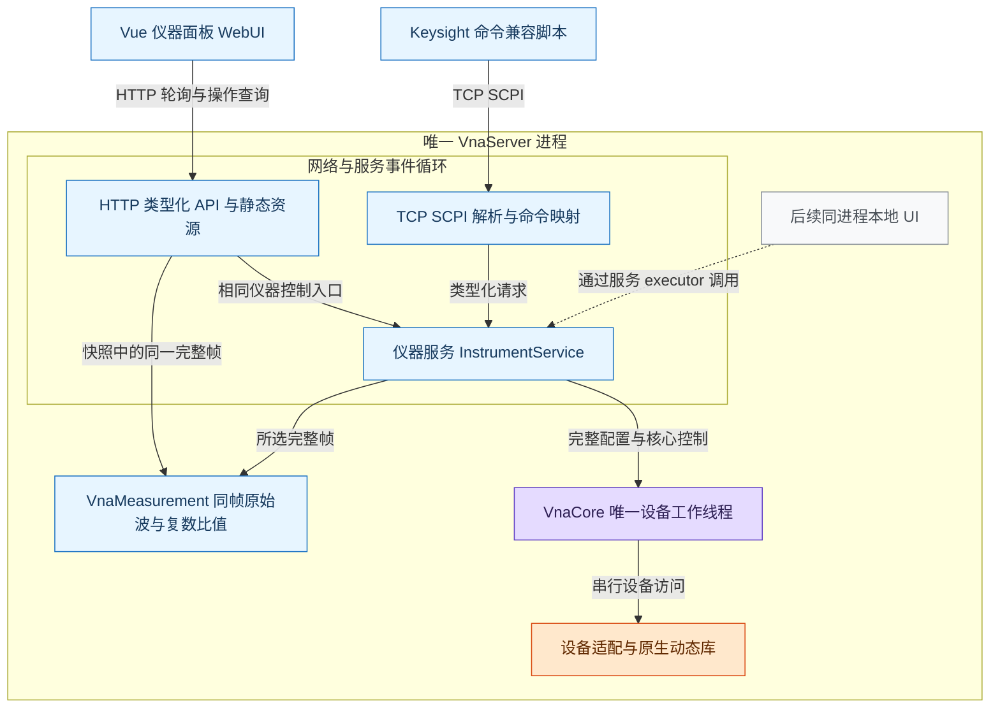
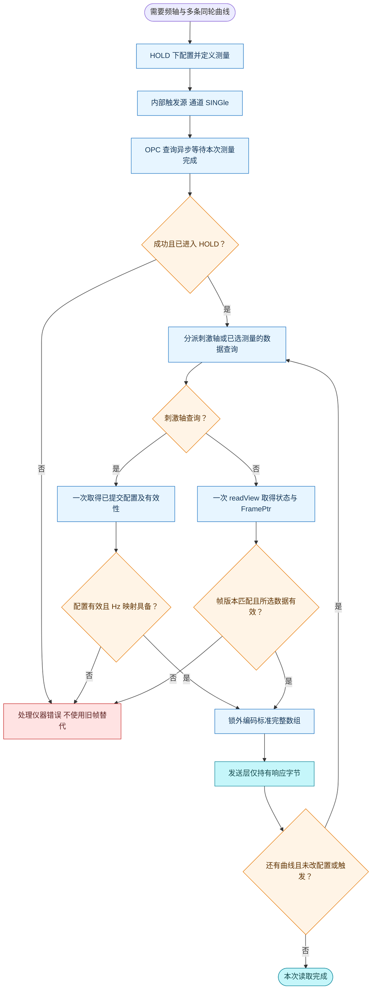
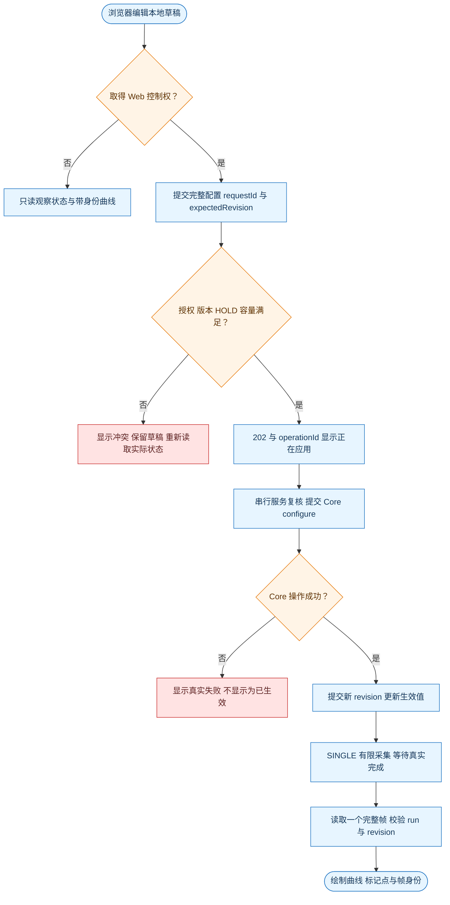

# 网分服务与远程控制设计

设计版本：1.10。日期：2026 年 10 月 11 日。状态：模拟后台、TCP SCPI 和 Vue 仪器面板已实现；支持同帧未校准 S11/S21/S12/S22、Smith、YAML 仪器能力配置及活动迹线测量原位更新，真实硬件及校准仍为规划。

仪器服务统一管理配置、测量定义、触发和请求完成。TCP Socket SCPI 以 Keysight N52xxB PNA/PNA-X 命令集为参照；HTTP 与 Web 界面复用同一服务，WebSocket 留作后续扩展。采集线程、原生接口和完整帧的一致性遵循[网分核心采数更新软件设计](网分核心采数更新软件设计.md)。

## 1 兼容目标与首期范围

### 1.1 命令依据

采用 IEEE 488.2 通用命令、SCPI 语法和 Keysight 已公布的网分命令，不增加项目自定义命令树。每条命令的完整拼写、短名、参数、查询形式和副作用均由官方手册确定，不能只套用一个看起来像 SCPI 的名字。[SCPI-1999](https://www.ivifoundation.org/downloads/SCPI/scpi-99.pdf)、[Keysight 命令入口](https://helpfiles.keysight.com/csg/N52xxB/Programming/GP-IB_Command_Finder/Common_Commands.htm)

Keysight 的测量选择和数据命令属于其网分命令集，不能全部称为 SCPI-1999 规定的通用命令。N52xxB 官方链接目前部分重定向到共享的 NA520xA 帮助，采用其中明确适用于 N522xB/N523xB/N524xB 的条目；不混入 ENA、FieldFox 或其他机型的不同语义。

交付名称为“Keysight N52xxB 已核验命令子集”，不是完整 PNA 仿真。服务身份如实标识 VnaPro 及模拟/真板后台，不能伪造 Keysight 型号、序列号或已安装选件。当前模拟后台已实现下面的首期白名单，支持范围和构建步骤见[项目 README](../README.md)。

### 1.2 首期功能边界

当前支持单仪器、单逻辑通道、一个控制者、正常线性扫频、接收器复数数据、未校准 S11/S21/S12/S22、连续/单次/手动触发、HOLD、操作同步及错误查询。Web 可以多会话观察，写操作与 SCPI 由同一个仪器服务统一仲裁。

先在模拟后台建立明确的物理单位与接收器映射，再连接真实硬件。频率与 IFBW 命令必须以 Hz 表达；表数据来源、单位转换或测量定义未具备时，对应能力不开放，不能以 RAW 参数或自定义命令替代。原生 A/B 不因改了命令名就成为 S 参数。

首期配置和测量定义更新限定在 HOLD 且有限测量操作完成后。PNA 可以在扫描中改激励并中止当前扫描，而核心目前保证旧帧完整结束后切换；因此这部分时序不声称兼容。后续开放运行中改参，需要先增加中止本轮及丢弃未完成帧的合同。[Keysight 扫描与系统命令](https://helpfiles.keysight.com/csg/N52xxB/Programming/GP-IB_Command_Finder/System.htm)

## 2 服务结构与项目组织

### 2.1 服务结构图



实线表示已实现路径，虚线表示后续入口。SCPI 与 HTTP 在同一网络事件循环调用服务，服务状态串行更新；核心线程独占设备，不为每个连接增加采集线程。HTTP 使用非阻塞收发和每 tick 工作预算，测量处理与结果发布继续使用核心已有的不可变完整帧。

### 2.2 模块与文件职责

| 位置 | 文件或目录 | 职责 |
| --- | --- | --- |
| VnaMeasurement | measurement.h/.cpp、trace_result.h、measurement_processor.h/.cpp | 测量定义、逐点有效性及无状态同帧复数归一化 |
| VnaService/include/vna_service | instrument_service.h | 与协议无关的会话、类型化请求及结果入口 |
| VnaService/include/vna_service | measurement.h、operation_result.h、instrument_error.h、data_result.h、instrument_snapshot.h | 测量定义、异步结果、错误队列项、查询数据与状态快照，各有独立职责 |
| VnaService/include/vna_service | instrument_settings.h | InstrumentSettings、ConfigPatch 与 TriggerSource/SweepMode，统一配置职责 |
| VnaService/include/vna_service | service_task.h、service_error_code.h | 值任务及 Kind/Stage、服务错误码 |
| VnaService/src | instrument_service.cpp | 控制权、请求顺序、有限操作跟踪及同名测量原位更新；measurement.h 引用领域测量定义 |
| VnaServer/src | main.cpp | 创建唯一核心并移交服务，装配协议及管理关闭 |
| VnaServer/src | scpi_tcp_server.h/.cpp | SCPI 与 HTTP 共用事件循环、TCP 收发及连接管理 |
| VnaServer/src/scpi | scpi_engine.h/.cpp、scpi_parser.h/.cpp | 程序消息与响应顺序、语法和官方命令映射；登记短名、参数及同步类别 |
| VnaServer/src/scpi | parsed_command.h、scpi_constants.h；ScpiEngine 内部消息/OPC 记录 | 程序单元、标准错误码/预算、响应顺序与同步屏障 |
| VnaServer/src/network | socket_platform.h/.cpp、network_runtime.h/.cpp、socket_poll_set.h/.cpp、socket_owner.h/.cpp | 共用平台收发、网络初始化、select 等待和 Socket 生命周期 |
| VnaServer/src/web | web_endpoint.h/.cpp；类内 HttpConnection | 非阻塞 HTTP、连接状态、请求边界和网络预算 |
| VnaServer/src/web | static_file.h/.cpp | 路径/句柄验证，持有同一文件句柄分块读取 |
| VnaServer/src/web | http_api.h/.cpp、http_types.h | 类型化 API；共享请求/响应/WebOptions；类内会话、重试与操作记录 |
| VnaServer/src/web | json.h/.cpp、json_parser.h/.cpp、json_encoder.h/.cpp | JSON 值、解析与增量编码各自独立 |
| WebUI/src/api | types、decoders、instrumentApi | HTTP 合同、严格解码、会话与请求身份 |
| WebUI/src/composables | useInstrument、useWorkspace | 操作完成/读回/租约，与独立逐迹线显示状态 |
| WebUI/src/components | instrument、softtools、diagrams、shared | 仪器外壳、草稿表单、完整帧与图内迹线 |
| WebUI/src/plot、styles | 显示算法/Canvas/CSV，分层样式 | 纯显示换算、真实频点和视觉布局 |

以上列出已实现文件；NativePlanBuilder、ProfileCatalog 等独立扩展仍未创建。AcquisitionCore、InstrumentService、ScpiEngine、HttpApi 和 WebEndpoint 直接声明状态成员，不再保留 Impl 或转发层。有独立行为和生命周期的类按同名文件组织，简单结构体和枚举按职责放入共享头或所属类；不要求每个数据类型单独一文件，不改变服务的单 executor 约束。

vna_service 静态库仅依赖 vna_core 公开接口，不包含 SCPI、HTTP 或 socket。vna_server 负责协议和网络依赖。错误 FIFO 和仪器状态寄存器由 InstrumentService 管理，ScpiEngine 负责程序消息与响应顺序；协议入口不保存第二份硬件配置或采集状态。完整目录见[核心设计第 2 节](网分核心采数更新软件设计.md)。

## 3 仪器状态与并发规则

### 3.1 控制权及连接寿命

首期 TCP 端点只接纳一个 SCPI 控制连接，连接准入成功时由服务授予控制权；已有控制者或旧会话仍在 RELEASING 时拒绝新控制连接。该连接既能查询也能控制，不要求客户端发送额外的申请/释放命令。

这是服务器连接策略，不是新增的 Keysight 命令。未在参考机型手册中确认的锁命令不加入命令表；前面板 local lockout 也不能替代多客户端仪器控制权。Web 观察不占写控制权，Web 写会话与 SCPI 控制连接使用相同授权代次。[Keysight Local Lockout](https://helpfiles.keysight.com/csg/N52xxB/Programming/GP-IB_Command_Finder/Local_Lockout.htm)

SCPI 断开不自动 Stop 或 Close。已接受操作继续完成，无法交付的响应丢弃；会话进入 RELEASING，关闭新准入并保留原授权代次。已有操作全部终结后才撤销授权并允许接管，新控制者继承当前真实状态，不假设仪器已经停止。

首期 SCPI 请求的接受点为完整 LF/CRLF 程序消息通过 ScpiEngine::submitLine 的长度、单元数、队列及授权准入。该消息中的剩余命令在断线后仍按顺序分派；参数和状态错误依旧写入仪器错误队列。socket 中尚未形成完整消息的字节丢弃。Service 任务随后按执行状态复核准入，不能把 TCP 收到部分字节当作设备操作已成功。

### 3.2 配置、测量与触发模型

服务分别保存 triggerSource、triggerScope、每通道 sweepMode、测量目录和 selectedMeasurement，不能用一个 Running 布尔量表示所有 PNA 触发状态。首期只有通道 1，但通道号仍按官方命令形式解析。

每条参数设置从最新成功提交的 InstrumentSettings 构造候选，经过单位转换、能力校验及表数据准备，生成完整 SweepPlan。核心下发成功后才提交候选及新 revision；失败保留核心 Fault，不能把旧配置显示成硬件仍有效。多条设置先后执行，不能让后一条候选覆盖前一条已成功更新的参数。

| 服务设置或操作 | 核心映射要求 |
| --- | --- |
| sweepMode=HOLD | 禁止接受新扫描；已有完整帧在边界收尾，再完成内部 Stop 屏障 |
| triggerSource=IMM、sweepMode=CONT | 核心连续运行 |
| triggerSource=MAN、sweepMode=CONT | 核心手动运行，等待 INIT 的有限触发 |
| triggerSource=IMM、sweepMode=SING | 采集一次完整逻辑帧，成功后通道转 HOLD |
| MAN 下 INIT:IMM | 单次触发的完成身份必须对应这次逻辑扫描，不是入队成功 |

一次逻辑扫描仍包含全部必要激励端口。定义测量时根据参数取得所需 source/receiver 集合；只切换已有测量的 SEL 不重新采集、不改变硬件配置 revision，也不修改已经发布的帧。增加、删除或修改测量定义会影响采集需求，首期只在 HOLD 执行。

`InstrumentService::UpdateMeasurement(measurement, expectedRevision, owner)` 是与协议无关的配置命令。它从执行时的当前设置构造候选，校验测量种类和配置端口能力，查找并替换同名目录项；名称、位置、目录数量及 selectedMeasurement 保持原值。不存在的名称明确拒绝，满 32 项目录不妨碍更新已有项。它复用 Configure 的控制权、授权代次、HOLD、有限操作和预期版本比较；成功准备并提交核心计划后 revision 只增加一次，失败候选不提交。保留的旧帧随后以旧 revision 标识，完成下一次真实采集前不能作为新定义的当前数据读取。此入口不新增自定义 SCPI 命令。

频率端点联动和 IFBW 量化由服务完成：端点交叉按官方规则联动另一端点；IFBW 按后台的有效值表向上取适用值，查询返回实际生效值，不能回读未下发的申请值。MIN/MAX 使用本后台真实能力，不复制 PNA 型号的硬件范围。[频率](https://helpfiles.keysight.com/csg/N52xxB/Programming/GP-IB_Command_Finder/Sense/Frequency.htm)、[IFBW](https://helpfiles.keysight.com/csg/N52xxB/Programming/GP-IB_Command_Finder/Sense/Sense_Bandwidth.htm)

### 3.3 命令顺序、同步与错误

按程序消息的接收顺序分派，顺序命令完成后才继续；已支持的异步测量分派后登记为 pending，允许后续非屏障命令继续处理。不能统一等到每次测量结束才解析下一条命令。设备状态修改仍在服务 executor 中仲裁，实际 I/O 仍由核心串行执行。

*OPC? 与 *WAI 建立前置有限操作的完成屏障，等待由完成事件推进，不在网络事件循环中阻塞。*OPC? 完成后返回 +1；这不表示所有操作都成功，错误另行查询。连续运行本身不作为永不结束的有限操作；单次测量必须在完整帧发布及对应模式收尾后完成。SINGle;*OPC? 的单次同步用法按官方示例验收，不自行推定所有扫描模式的命令类别。[同步说明](https://helpfiles.keysight.com/csg/NA520xA/Programming/Learning_about_GPIB/Understanding_Command_Synchronization.htm)、[单次触发示例](https://helpfiles.keysight.com/csg/NA520xA/Programming/GPIB_Example_Programs/Triggering_the_PNA_using_SCPI.htm)

SCPI 使用仪器级错误 FIFO，不再按连接隔离 SYST:ERR?。错误队列不因控制连接更换而丢失；Web 请求结果及诊断可独立关联会话，但 Web 不消费仪器 SCPI 错误。*CLS 清除协议错误和事件，不恢复硬件、不清除核心持续故障；*RST 必须实现设备复位与默认状态，不能简单别名到“恢复上次配置”。[通用命令](https://helpfiles.keysight.com/csg/N52xxB/Programming/GP-IB_Command_Finder/Common_Commands.htm)、[错误队列](https://helpfiles.keysight.com/csg/N52xxB/Programming/GP-IB_Command_Finder/System.htm)

操作等待超期不等于取消。网络可关闭超期连接，服务仍跟踪已接受操作，不能释放原生调用正在使用的缓冲或卸载库。队列准入与执行时均核对控制授权代次；配置执行时还复核 expectedRevision、HOLD 和前置有限操作已完成的条件，不能只在 HTTP 准入时检查。断开进入 RELEASING 后，原已接受请求仍用保留代次执行。

### 3.4 命令分派与完成活动图


预解析可提前，但语法错误入队及错误处理也须在其程序消息序号轮到时生效。图中查询不是全部“无副作用”：读取错误、事件寄存器会消费对应协议状态，仍需按顺序执行。异步完成记录独立于输入队列；有限操作失败同样必须终结，不能让 *OPC? 永久等待。

## 4 TCP SCPI 命令合同

### 4.1 语法和响应

默认监听 127.0.0.1:5025，地址与端口可配置。ASCII 程序消息以 LF 结束，接受 CRLF；接收器处理 TCP 分包、粘包和有界消息缓冲。

首期支持正式短名/全名、可选关键字、通道数字后缀、分号复合消息、绝对与相对命令路径、单/双引号字符串、逗号参数、布尔值、指数数值及相应单位后缀。公共星号命令不改变路径，消息终止时路径回到根。关键字大小写不敏感，测量名称保持原样；例如 "wave_a" 与 "Wave_A" 是不同名称。接收器字母按官方规则不区分大小写，内部归一为 aN/bN；不能据此混用物理与逻辑接收器记法。[Keysight 测量参数的 Programming 规则](https://helpfiles.keysight.com/csg/NA520xA/S1_Settings/Measurement_Parameters.htm)

查询按官方类型返回，复合查询的响应单元使用标准分隔和消息结束符；写命令不额外 ACK。移除原设计的失败空行和自定义元数据响应。未实现的 header 进入 -113；不支持的枚举值进入 -224，状态冲突进入 -221。查询失败按错误通道处理，不伪造全零成功数据，客户端处理查询超时后再读取错误或重新建立连接。[Keysight 错误表](https://helpfiles.keysight.com/csg/NA520xA/Support/SCPI_Errors.htm)

原始 TCP Socket 首期通过查询读取状态，不承诺 GPIB SRQ 或 VXI-11/HiSLIP 的事件通道；后续增加其他传输时仍复用同一仪器和命令合同。

### 4.2 首期实现命令

表内大写字母表示正式短名，其余字母补成全名；方括号是可省略的关键字，不是发送内容。首期 cnum=1；其余通道不得自动落到通道 1。命令登记同步保存官方来源及适用模型。

| 命令 | 约定与实现依据 |
| --- | --- |
| *IDN? | 四字段真实服务身份，软件版本在该响应中表达 |
| *CLS | 清协议错误/事件及前置 OPC 挂起状态，不复位设备 |
| *OPC、*OPC?、*WAI | 事件完成、查询完成和分派屏障；同步模块须与状态寄存器一起实现 |
| *ESE、*ESE?、*ESR?、*SRE、*SRE?、*STB? | 按正式位定义实现事件/使能/状态字节，不自创状态字符串 |
| SYSTem:ERRor[:NEXT]?、SYSTem:ERRor:COUNt? | 仪器错误 FIFO 及其条数；无错误返回 0,"No error" |
| SENSe1:FREQuency:STARt / STOP 及查询 | 生效起止频率，Hz；包含端点联动与 MIN/MAX |
| SENSe1:SWEep:TYPE LINear 及查询 | 首期仅正常线性扫频，其余类型明确不支持 |
| SENSe1:SWEep:POINts 及查询 | 实际点数；表数据和输出资源预算同步校验 |
| SENSe1:BANDwidth[:RESolution] / BWIDth[:RESolution] 及查询 | 官方别名，IFBW 单位 Hz，回读量化后的生效值 |
| TRIGger[:SEQuence]:SOURce IMMediate / MANual 及查询 | 内部连续触发源或软件手动触发源，首期不开放外部触发 |
| TRIGger[:SEQuence]:SCOPe ALL / CURRent 及查询 | 首期单通道仍保留正式范围语义 |
| SENSe1:SWEep:MODE HOLD / CONTinuous / SINGle 及查询 | 保持、持续接受触发、一次后 HOLD |
| INITiate:CONTinuous ON / OFF 及查询 | PNA 的触发源选择别名，不能别名到核心 Start/Stop |
| INITiate1[:IMMediate] | MAN 下发送一次触发；首期成功路径限定没有正在执行的测量 |
| CALCulate1:PARameter[:DEFine]:EXTended "name","a1,1" | 定义参考接收器非比值测量；"b1,1" 为测试接收器，源端口为第二项 |
| CALCulate1:PARameter[:DEFine]:EXTended "name","S11" | 定义未校准 b1/a1；S21=b2/a1，S12=b1/a2，S22=b2/a2；分子和参考来自各自源帧，接受 S1_1 / S2_1 / S1_2 / S2_2 |
| CALCulate1:PARameter:SELect "name" 及查询 | 每通道一个全局选定测量；名称区分大小写 |
| CALCulate1:PARameter:CATalog:EXTended? | 按官方目录形式列测量名与参数，不追加项目帧字段 |
| CALCulate1:PARameter:DELete[:NAME] "name" | 删除指定测量，更新采集需求；首期仅在 HOLD |
| FORMat[:DATA] ASCii,0 及查询 | 首期 ASCII 全数组；REAL,32/64 列为后续能力 |
| SENSe1:X[:VALues]? | 返回通道完整刺激轴；线性扫频为 Hz，N 个值 |
| CALCulate1:DATA? RDATA | 返回所选测量的未校正复数，按 Re,Im 排列，共 2N 个值 |

依据分别见[通用命令](https://helpfiles.keysight.com/csg/N52xxB/Programming/GP-IB_Command_Finder/Common_Commands.htm)、[扫描模式](https://helpfiles.keysight.com/csg/N52xxB/Programming/GP-IB_Command_Finder/Sense/Sweep_SCPI.htm)、[触发源与范围](https://helpfiles.keysight.com/csg/N52xxB/Programming/GP-IB_Command_Finder/Trigger_SCPI.htm)、[测量目录和选择](https://helpfiles.keysight.com/csg/N52xxB/Programming/GP-IB_Command_Finder/Calculate/Parameter.htm)、[刺激轴](https://helpfiles.keysight.com/csg/N52xxB/Programming/GP-IB_Command_Finder/Sense/X-Axis.htm)、[数据读取](https://helpfiles.keysight.com/csg/N52xxB/Programming/GP-IB_Command_Finder/Calculate/Data.htm)、[数据格式](https://helpfiles.keysight.com/csg/N52xxB/Programming/GP-IB_Command_Finder/Format_SCPI.htm)。

### 4.3 接收器名称与数据意义

协议使用 Keysight 逻辑接收器 aN/bN：aN 是对应端口的参考接收器，bN 是测试接收器。原生 A1/B1 的实际电气位置由 ReceiverMap 核验后映射，不能仅因名称相似就等同；PNA 的物理 A 是测试接收器，不是本项目入射 A1 的当然对应项。[Keysight 测量参数](https://helpfiles.keysight.com/csg/NA520xA/S1_Settings/Measurement_Parameters.htm)

一个 RDATA 查询只交付所选测量的一条复数曲线，不返回全部原生 16N IQ，也不附加 validity、runId 或 revision。欲读多条曲线，保持同一轮结果后分别选择测量并查询。SDATA 表示所选测量经过误差项路径的复数数据，不是 S 参数的同义词；首期仅实现 RDATA，不虚构校正功能。

未采集或未激活的接收器查询明确失败；任何数值非零、有限或成功 Get 都不能证明其有效。标准数组不得追加自定义有效性列。首期对含无效点的请求不给出有效曲线，记录数据错误；逐点标记和失败详情供内部/Web 诊断，后续采用正式无效数值/状态约定时再增加对应验收。

### 4.4 后续命令的前置条件

| 官方命令或能力 | 开放前必须完成的工作 |
| --- | --- |
| ABORt | 独立中止/丢帧路径，并按触发设置决定恢复；不能映射永久 Stop |
| 测量执行中 INIT:IMM | 实现“中止当前扫描再发触发”，不能悄悄排到旧帧发布之后 |
| *RST、SYSTem:PRESet | 固定默认配置、默认测量及格式复位合同；不得恢复上次配置冒充复位 |
| SOURce 功率及 OUTPut | 核验功率单位、表生成和 RF 开关合同；保持设备线程独占 |
| CALC:DATA? SDATA / FDATA、S12/S22 等测量 | 先具备对应误差项路径、显示格式或反向源采集合同；当前拒绝 |
| FORMat REAL,32/64、FORMat:BORDer | 标准定长二进制块、字节序及混合收发验证 |
| 多通道、外触发、组数、平均、显示窗口、文件状态 | 后端确有对应能力后按同一参考机型扩展 |

ABORt 在 PNA 中停止当前扫描后按触发设置恢复，单次的处理又不同。原生 ABI 没有取消接口，首期不开放 ABORt；内部 Stop 仍用于 HOLD 收尾与生命周期。原生调用若不返回，也不能通过虚报中止完成绕过其寿命。[Keysight ABORt](https://helpfiles.keysight.com/csg/N52xxB/Programming/GP-IB_Command_Finder/Abort.htm)

### 4.5 一次扫描及同帧读取示例

```text
*IDN?
*CLS
SENS1:SWE:MODE HOLD
*OPC?
SENS1:SWE:TYPE LIN
SENS1:FREQ:STAR 1MHZ
SENS1:FREQ:STOP 100MHZ
SENS1:SWE:POIN 201
SENS1:BAND 1KHZ
CALC1:PAR:DEF:EXT "wave_a","a1,1"
CALC1:PAR:DEF:EXT "wave_b","b1,1"
FORM:DATA ASC,0
TRIG:SOUR IMM
SYST:ERR?
SENS1:SWE:MODE SING;*OPC?
SYST:ERR?
SENS1:SWE:MODE?
SENS1:X?
CALC1:PAR:SEL "wave_a"
CALC1:DATA? RDATA
CALC1:PAR:SEL "wave_b"
CALC1:DATA? RDATA
```

客户端立即读取每条查询响应，循环读取错误直至 0，并在错误非零时处理失败；程序示例假定同名测量不存在且后台支持这些物理参数。Hz 和接收器映射必须已验证，数值只是例子，不是硬件能力范围。SING;*OPC? 依据官方单次示例，随后确认 HOLD，读取期间不改配置、不再触发。

## 5 数据一致性与资源控制

### 5.1 同帧读取活动图



单次结束后进入 HOLD，控制权又阻止其他入口改设备，因此已提交刺激轴与该完整帧的频轴一致，多条曲线属于同一轮。测量查询在服务分派时确定 selectedMeasurement，用一次 readView 复制状态与 FramePtr，随后校验和编码都使用这一副本，不能先校验再另取新帧。不引入隐藏的、永久绑定旧帧的 SCPI 会话。连续扫描下多次独立查询可能跨帧，不承诺同轮；需要一致读取时先完成单次或 HOLD 收尾。[Keysight 接收器查询与同步提示](https://helpfiles.keysight.com/csg/N52xxB/Programming/GP-IB_Command_Finder/Calculate/RData.htm)

SENS:X? 从最新成功提交且具备单位映射的配置返回刺激轴，不要求已经采到完整帧，不能从正在编辑的候选配置生成。测量数据查询才校验 activeConfigValid、对应配置/采集需求和帧版本；配置改变而新帧未到、故障或无有效数据时进入数据错误通道。UI 可以显示带身份标记的旧帧，SCPI 不能把旧 revision 当当前测量返回。[Keysight 刺激轴查询](https://helpfiles.keysight.com/csg/N52xxB/Programming/GP-IB_Command_Finder/Sense/X-Axis.htm)

### 5.2 单位及完整数组输出

NativePlanBuilder 保存可审查的后台单位和接收器映射，连同实际 Hz 频轴与表版本冻结到帧对应配置。模拟后台可明确规定自己的测试换算；真板映射不能由模拟约定推定。RAW frequencyRaw 保留 uint64_t 精度，内部/Web 诊断用十进制字符串，不先转换成 JavaScript Number。

标准 SENS:X? 与 CALC:DATA? 没有本项目 offset/count 参数，返回 N 或 2N 个值。资源控制不能通过擅加参数实现：先检查整体可编码大小，再分块编码/发送整个标准响应，保持数字和消息边界。发送任务只有响应字节，不长期持有采集帧；编码使用有界工作量，网络事件循环不被大数组计算阻塞。

| 资源 | 拟定首期策略 |
| --- | --- |
| TCP SCPI 控制连接 | 1；其他观察入口通过服务/Web 扩展 |
| 单个程序消息 | 16 KiB，含有界分号单元数量 |
| 待分派消息与核心控制队列 | 分别有界，满时拒绝或关闭输入；不假报操作已接受 |
| SCPI 错误 FIFO | 32，溢出保留旧错误并设置标准队列溢出项 |
| 单连接输出预算 | 1 MiB，点数/格式准入保证整条响应可完成；慢发送到期关闭连接 |
| SCPI 帧引用 | 单次查询/有界编码持有，完成或失败后释放 |
| Web 帧读取 | 一次读取一个 FramePtr，最多 2001 个真实点和 4 条曲线；编码后只保留响应字节 |

这些是软件预算，不是 PNA 或真板能力范围。后续大数组采用标准二进制块提高效率，不为 SCPI 新造分段数据命令。TCP 的网络超时及断开不改变已经接受的设备操作结果。

## 6 Web 接口与仪器面板

Web 适配直接调用类型化 InstrumentService，不把 JSON 转成 SCPI 字符串。HTTP/1.1 使用 Content-Length 和 Connection: close，静态资源与 API 同源。会话通过 claim 返回的 token 标识，写入及私有操作结果查询带 `X-Vna-Session`；状态和帧可以无 token 观察。HTTP 连接结束不释放写权限，显式释放或 30 秒租约到期进入 RELEASING，等待已接受有限操作终结；连续扫描仍由新控制者 HOLD 或进程关闭收尾。

| 已实现入口 | 合同 |
| --- | --- |
| GET /api/v1/status | 身份、后台、核心状态、故障、pending、实际配置、capabilities、测量目录与控制权；不返回其他会话的 token |
| GET /api/v1/frame | 一次 FramePtr 读取的频轴、多曲线、有效性及帧身份；未采集 available=false，旧数据 current=false |
| POST /api/v1/control/claim | 新会话获取 token，已有会话带 sessionId 续租；与 SCPI 独占互斥 |
| POST /api/v1/control/release | 关闭新写准入并保留授权代次直至已接受任务终结 |
| POST /api/v1/config | `{requestId,expectedRevision,startHz,stopHz,points,ifBandwidthHz}` 完整配置事务，限定 HOLD |
| POST /api/v1/operations | `{requestId,action}`，action 为 single / continuous / hold / trigger；返回 202 与 operationId |
| GET /api/v1/operations/{id} | pending / completed / failed 及真实完成结果；202 只表示接受请求 |
| POST /api/v1/measurements | `{requestId,expectedRevision,name,kind,receiverKind,receiverPort,sourcePort}`；kind 缺省 receiver，sParameter 接受 b1/b2、源 1/2，所有源与接收端口均受 instrument.portCount 限制 |
| PUT /api/v1/measurements/{name} | 原位更新已有测量；名称只在 UTF-8 percent-encoded 路径中，正文为 `{requestId,expectedRevision,kind,receiverKind,receiverPort,sourcePort}` 完整定义，限定 HOLD |
| DELETE /api/v1/measurements/{name} | percent-encoded 名称，body 含 requestId 和 expectedRevision |

例如更新活动 `Trc1` 为未校准 S22：

```text
PUT /api/v1/measurements/Trc1
X-Vna-Session: <控制会话令牌>
Content-Type: application/json

{"requestId":"switch-trc1-s22","expectedRevision":"5","kind":"sParameter","receiverKind":"b","receiverPort":2,"sourcePort":2}
```

正文必须给出 kind 和完整波量/端口定义，不能包含 name，避免把更新解释为重命名或新增。受理后返回 202 与 operationId，再通过操作查询确认 completed/failed；202 不表示更新已经成功。不存在的迹线不会隐式创建，拒绝保留原目录和版本。预期版本在准入和执行时复核；同一 requestId 和相同路径/正文复用原操作，改变内容返回冲突。更新已有项在满目录时仍可执行，新增项继续受 32 项上限约束。

`GET /api/v1/frame?trace=<编码名称>&trace=<编码名称>` 从测量目录按请求顺序选最多四条显示轨迹；无查询参数保留前四项兼容性。未知、空、重复名称、超过四项或其它查询键返回 400。`?display=none` 表示空显示集合，保留真实帧身份和频率轴，仅 traces 为空；不能与 trace 混用。名称采用 UTF-8 percent encoding，选择与序列化使用同一次快照。目录最多 32 项，显示选择不删除目录或修改采集配置，浏览器通过显示代次丢弃迟到的旧集合响应。

`status.capabilities` 返回 portCount、minFrequencyHz、maxFrequencyHz、minSweepPoints、maxSweepPoints，来自不可变 InstrumentProfile；Web 输入、SCPI MIN/MAX 与服务候选执行校验使用同一能力。

Smith 只提供 S11/S22 的 Γ 圆图与归一化阻抗，不假定物理参考阻抗。S12/S21 和 RAW 保留直角坐标格式；混合格式自动分窗。完整波量归一化与 Smith 活动图见[测量设计](未校准S参数测量设计.md)。

revision、runId、frameSeq 等身份用十进制字符串，避免 JavaScript Number 截断。配置一次校验完整候选，执行时再次核对授权代次、expectedRevision 和 HOLD；Core 成功后才提交 revision。重复 requestId 与相同请求复用原操作，内容不同返回 409，不重复下发设备。结果最多保留 128 项，已完成结果按 60 秒期限清理；会话去重最多 32 项。客户端超时不表示取消，应查询原 operationId。

控制权申请在响应和租约时间准备完成后才交接，token 编码失败不取得控制权。写请求先预留操作结果与去重记录，再提交服务；拒绝或提交异常会回滚预留，已接受操作即使响应构造失败也保留去重身份，客户端用相同 requestId 重试不会新增操作。Poll 先完整取得结果，再提交完成状态和完成时间，结果复制失败仍可再次观察，60 秒保留期从成功提交完成结果开始。

帧 API 最多返回 2001 个均匀选取的真实频点（保留端点）和 4 条测量；所有实部、虚部、有效性与频轴从同一帧取得，`originalPointCount`、`displayPointCount`、`decimated` 明示抽点。非法点以 null/valid=false 表示，不伪造零值。配置变化后的旧帧可以带原身份观察，不能标为当前数据；此限流不改变 SCPI 完整数组合同。没有跨请求固定快照句柄，WebSocket 及完整数据导出留作后续。

测量/迹线响应显式包含 `kind`、`unit`、`calibration`；原始波为 receiver/a.u./raw，S11/S21/S12/S22 为 sParameter/1/uncalibrated。Web 与 SCPI 共用纯计算模块，参考过小或非有限的点在 Web 保留其轴位置，在 SCPI 中拒绝整条数组。波量归一化、分层、结构图和处理活动图见[未校准 S 参数测量设计](未校准S参数测量设计.md)。



界面参考 [ZNB8 官方操作布局（第 37 页）](https://scdn.rohde-schwarz.com/ur/pws/dl_downloads/pdm/cl_manuals/getting_started/1316_0062_01/ZNB_GettingStarted_en_70.pdf#page=37) 与 [标记点及绘图示例（第 90 页起）](https://scdn.rohde-schwarz.com/ur/pws/dl_downloads/pdm/cl_manuals/user_manual/1173_9163_01/ZNB_UserManual_en_74.pdf#page=90)：1280×800 整体等比缩放、窄工具栏、黑色网格、图内迹线条、内容右侧横排标签的软工具、分组硬键、底部状态。绘图/软工具/硬键宽度为 848/272/160 px，工具栏 42 px、底栏 32 px。品牌和后台明确为 VnaPro / SIMULATOR，UI 参考不改变 Keysight SCPI 兼容目标。

Meas 按 [ZNB User Manual v74 第 289 页](https://scdn.rohde-schwarz.com/ur/pws/dl_downloads/pdm/cl_manuals/user_manual/1173_9163_01/ZNB_UserManual_en_74.pdf#page=289) 修改活动 trace 的测量量：S-Params 中直接选择端口 1/2 的 S11、S12、S21、S22；Wave 的快捷波量与 More Wave Quantities 也作用于同一迹线，不要求输入新名称或先创建迹线。更新通过上述 PUT 完成并读回；CONT/有限采集期间保留 HOLD 限制，不自动停止设备。右侧类别、矩阵顺序和更多波量对话框的参考原图见[ZNB8 参考档案](reference/znb8/README.md#meas-交互依据)。

新增、显示和删除由 Trace Config 管理。Add Trace 复制活动测量定义，自动取目录内未使用的 `Trc<n>` 名称；创建属于设备配置变更，而图窗切换与可见性只影响本地显示。该职责分配依据 [官方 Trace Config，第 448 页](https://scdn.rohde-schwarz.com/ur/pws/dl_downloads/pdm/cl_manuals/user_manual/1173_9163_01/ZNB_UserManual_en_74.pdf#page=448)。原机 Ratios 和 All S-Params 的完整 n×n 矩阵尚未实现；四端口配置只支持端口 1/2 的四项 S 参数，不把它们称为全部四端口 S 参数。

表单先本地编辑并冻结编辑时版本，操作完成并读回后才确认生效；状态轮询和切换硬键不能覆盖未提交草稿。格式、刻度、参考位置、M1 和可见性按迹线独立保存；默认刻度为 10 dB/div，显式 Autoscale 按点击时当前迹线的显示帧适配一次并保存具体范围，后续采集帧不重算刻度，再次点击才重新适配。显示格式包括对数/线性幅度、相位、实部、虚部与实虚叠加，以及 S11/S22 的 Smith；标记点吸附实际频点，CSV 导出当前展示数组并注明抽点。Cal、Preset、功率和未实现的测量类别不伪装可用。无数据、断线、旧帧与故障显示明确提示；旧帧缺少历史 IFBW，因此不将新配置的 IFBW 误标为旧数据的采集参数。

主图区以归档的 [ZNB 手册原图与实机照片](reference/znb8/README.md) 为视觉基线。10×10 网格铺满图窗，纵轴数值和单位叠在网内；紧凑迹线条、逐迹线参考虚线/三角及右上 Marker 读数对应原图结构，底部 22 px 黑色通道行显示真实 Start/Stop、点数和 IFBW。对数初始范围 −90…10 dB、Ref 0 位于第 9 格；每个独立图窗从第一色重新开始。图窗菜单分别提供全部真实图窗、当前迹线最大化、同窗叠加和 M1，最大化保持图号，未定义的接收器不生成空图窗。这些布局操作不写入设备配置。

前端独立为 Vue 3/TypeScript/Vite 工程：api 封装协议与严格解码；useInstrument 用一个不重叠轮询跟踪设备状态、原 token 的私有操作、续租和完成读回；useWorkspace 只保存本地逐迹线显示；图窗组件使用纯显示算法与 Canvas。受理不明的写请求不自动重发，释放意图立即关闭续租，旧响应不能重新开放写权限。生产部署提供 WebUI/dist，开发使用 5173 的 Vite 同源 API 代理。目录与运行步骤见[前端工程说明](../WebUI/README.md)。

HTTP 最多 8 个连接、8 KiB 请求头、16 KiB body、4 MiB 单响应；拒绝 chunked、路径穿越及超大请求。读写使用非阻塞 socket、超时和每 tick 预算，不让慢客户端阻塞仪器 executor。服务仅面向本机/受信网络，当前 token 用于仪器控制仲裁，不提供用户账号或 TLS。

JSON 输入和输出字符串严格验证 UTF-8，包括不完整序列、过长编码、代理项及超出 Unicode 范围的码点；转义代理对必须配对，重复成员和非有限输入数值拒绝。JsonEncoder 的 Advance 失败后清理部分输出，必须 Reset 后重新编码；Take 只在完整输出后消费一次。StaticFile 持有已验证的同一文件句柄，Open 或 Advance 失败会关闭句柄；推进时必须使用从空串开始且未被外部改动的同一个输出缓冲，不能在失败后接着读半份响应。

## 7 实施顺序与验收

1. 保持单 worker 核心，完成模拟动态库、完整帧和有限命令结果。
2. 实现服务物理配置、测量目录、接收器映射、触发模型及控制授权。
3. 实现 Keysight 命令白名单、完整 SCPI 消息语法、标准错误/同步及 ASCII 数据路径。
4. 用官方风格脚本验证 HOLD、单次完成、原始接收器查询；支持清单和兼容限制随交付发布。
5. 接入同服务的 HTTP 与仪器面板，验证控制权互斥、事务配置、真实帧显示与结果同步。
6. 后续扩展复位、中止、完整多端口 S 矩阵及二进制格式；每项具备完整后端语义后才登记可用。

| 验收场景 | 必须观察到的结果 |
| --- | --- |
| 短名/全名、大小写、可选路径、分号、引号内逗号 | 按官方语法解析，测量名大小写保持 |
| SING;*OPC? 后读取 | 新完整帧已经发布，通道已 HOLD；扫描失败不可替换成旧帧 |
| MAN、CONT 与 INIT:IMM | 每次 INIT 对应一份完整逻辑扫描，屏障前不假报完成 |
| INIT:CONT OFF、ABOR 与 HOLD | 不将三者当作同一个 Stop；未实现中止不能假报成功 |
| HOLD 下依次设置频率、IFBW和点数 | 从最新生效配置构造下一候选，查询返回实际下发值 |
| 扫描中改配置或忙时 INIT | 首期明确报告兼容限制/状态错误，不静默采用不同生命周期 |
| 切换 wave_a / wave_b 后读 RDATA | 仅返回选中曲线的 2N 个数；SEL 不改变完整帧 |
| 频轴与多条曲线读取期间无新触发/配置 | 所有数据属于相同完整帧；连续查询不承诺同帧 |
| 故障、旧 revision 或未激活接收器 | 标准错误通道有诊断，不回送旧曲线或伪有效全零数组 |
| 配置成功但尚未采集时查询 SENS:X? | 可取得已提交刺激轴；RDATA 仍要求匹配的完整帧 |
| SCPI 控制连接断开与重新连接 | 已接受操作终结后才能接管，仪器错误队列继续保留 |
| Web 与 SCPI 同时访问 | 共用配置和写授权；Web 不消费 SCPI 错误 |
| 分包、粘包、复合查询及慢输出 | 响应边界正确，资源有界，网络循环保持可响应 |

命令兼容性由解析、参数、副作用、数据格式和时序共同决定，不能只检查 header 名称。单元测试验证服务模型；TCP 集成测试验证真实收发；参考机型比对记录只覆盖已实现清单，不声称全量 Keysight 兼容。

服务关闭先停止新连接和操作准入，跟踪已接受操作终结，再由生命周期拥有方关闭核心。设备 I/O 收尾和 join 不在网络事件循环中执行，帧与输出引用按所有权释放。

## 8 首期实现记录

全新模拟服务默认配置为 4 端口、10 MHz 至 8 GHz、201 点、IFBW 1 kHz，仅创建并选择未校准 Trc1/S21；单端口能力回退为 Trc1/S11。初始 HOLD 且没有已完成帧，浏览器首次打开或刷新只读取正在运行的服务目录，不覆盖已有用户测量，不模拟 Preset，也不自动采集。S21 的新实例默认依据 [ZNB 官方 Preset 示例，第 68 页](https://scdn.rohde-schwarz.com/ur/pws/dl_downloads/pdm/cl_manuals/user_manual/1173_9163_01/ZNB_UserManual_en_74.pdf#page=68)；该依据不意味着每次打开页面都重置仪器。

支持频段与启动扫描范围一致；能力和默认值通过 config/vnapro.yml 的 instrument 配置并在启动时冻结。端口数可为 1 至 4，点数 2 至 10001、IFBW 档位 10/100/1000/10000/100000 Hz；请求 IFBW 向上取可用档位。范围为本项目模拟能力，不宣称等于 PNA 硬件范围。频点实际按整数 Hz 量化，成功提交的 Hz 轴用于 X 查询和帧一致性校验。

服务任务队列与待分派程序消息各最多 32 项；每消息最多 128 个程序单元；pending *OPC 事件监视最多 32 项；测量目录最多 32 个、名称最多 128 字节。ASCII 编码每 tick 最多 256 个数值，连接待发数据预算 1 MiB，10 秒发送无进展即关闭。MAV 状态同时计入 SCPI 内部响应队列及 TCP 尚未发送的字节。

此前采集验收的 12 项 CTest 在 Windows MinGW/GCC 10.3 及 WSL/GCC 13.3 全目标 ThreadSanitizer 下通过；当时服务/SCPI 含 13 组场景，Web API 含 8 组场景。受控设备验证阻塞测量、断线控制权保留、失败单次、配置等待期间的写入、FIFO、授权代次、严格 CAS 及租约/记录预算，并覆盖 NaN/Inf 的 HTTP 坏点标记和 SCPI 标准数据错误。真实 TCP/HTTP 测试覆盖 32 个接收器测量的独立 golden 逐值比对、四源可重放噪声及三读取者连续帧一致性，保留 2501 点到 2001 点的真实抽点验证。独立网络测试通过受控 shutdown 回调验证有序退出，Python 进程终止仅用于清理，不作为 Windows 有序退出证据。本次 HttpApi 以实际 C++ 分配故障逐点验证 Claim、Single Write 和 Poll，失败后控制权、去重与完成记录正确恢复；恢复旧危险顺序的三份临时副本均被同一行为断言检出。规范整理及行为修复后的正式代码已通过 Windows/WSL ThreadSanitizer 全量各 12 项，随后命名空间统一后的终检另行补记，具体证据与限制见[模拟设备采集验收](模拟设备采集验收.md)。

Vue 重构及主图修正后 TypeScript 检查和生产构建通过，18 项前端合同测试通过。Chromium 使用实际生产产物与独立模拟服务验证：初始无假帧、空频率拒绝提交、草稿跨轮询/切换硬键保持、配置读回、四条真实波形、Single/Continuous/Hold、逐迹线格式及参考位置、M1 吸附/键盘移动、CSV、三布局和图窗菜单、1280×800 基准几何与 1440/1024 窗口缩放、只读接管与断线恢复，未出现浏览器脚本异常。实测图头 24 px、通道行 22 px、纵轴刻度距网内左边 4 px；普通刻度及 Autoscale 的 Δ 刻度各 11 项，四图和最大化均保留正确图号与活动迹线。此历史验收后已新增未校准 S11/S21/S12/S22 及 Smith；ABOR、复位、SDATA、校准及二进制仍未开放；兼容性依据官方合同和软件测试，尚无 Keysight 实机对照验收。运行步骤见[项目 README](../README.md)。

边界交互验收验证 Scale/M1 草稿跨至少三次已完成帧响应不被覆盖；顶部、底部与频率端点的 32×32 标记目标完整可见，SVG 尖点不偏离真实数据点，单击不跳频、拖动吸附实际频点。键盘打开非活动图窗菜单会激活该图，布局切换后焦点返回新菜单按钮；这些检查没有发出设备配置或采集写入。最终像素检查确认四个图窗的 Ref 刻度和 Canvas 虚线均为浅灰 `#dbe2e6`。
