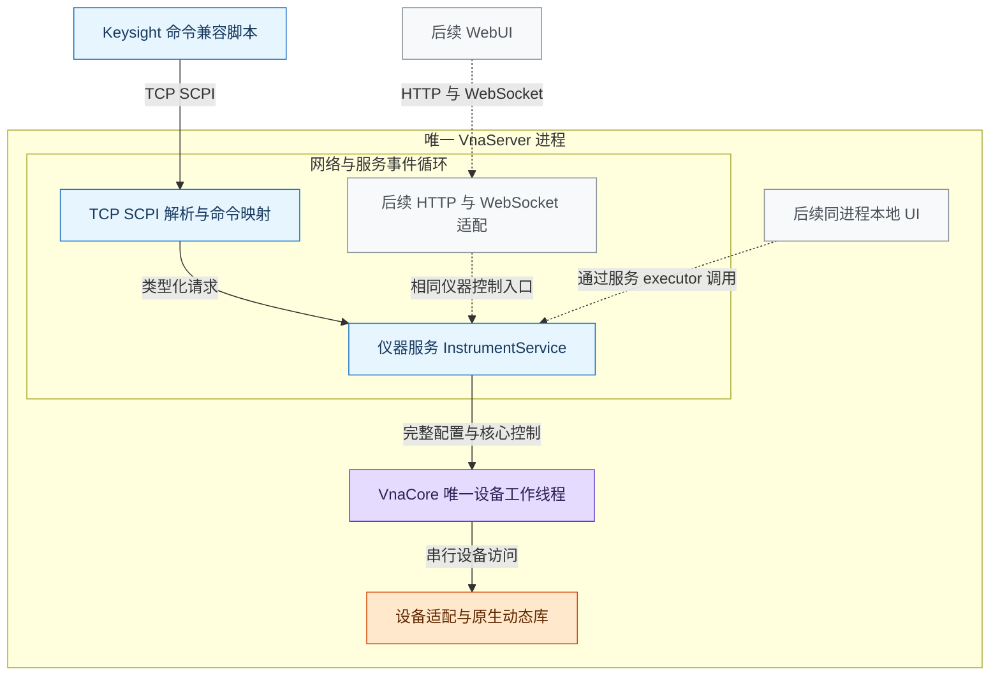
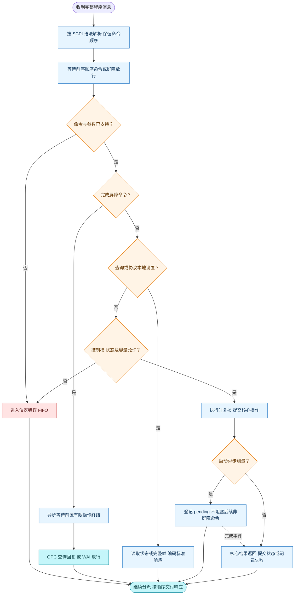

# 网分服务与远程控制设计

设计版本：1.2。日期：2026 年 10 月 9 日。状态：首期模拟后台与 TCP SCPI 已实现；后续 Web、真实硬件及完整测量能力仍为规划。

仪器服务统一管理配置、测量定义、触发和请求完成。首个远程入口采用 TCP Socket SCPI，兼容目标以 Keysight N52xxB PNA/PNA-X 命令集为参照；后续 HTTP/WebSocket 与 Web 界面复用同一服务。采集线程、原生接口和完整帧的一致性遵循[网分核心采数更新软件设计](网分核心采数更新软件设计.md)。

## 1 兼容目标与首期范围

### 1.1 命令依据

采用 IEEE 488.2 通用命令、SCPI 语法和 Keysight 已公布的网分命令，不增加项目自定义命令树。每条命令的完整拼写、短名、参数、查询形式和副作用均由官方手册确定，不能只套用一个看起来像 SCPI 的名字。[SCPI-1999](https://www.ivifoundation.org/downloads/SCPI/scpi-99.pdf)、[Keysight 命令入口](https://helpfiles.keysight.com/csg/N52xxB/Programming/GP-IB_Command_Finder/Common_Commands.htm)

Keysight 的测量选择和数据命令属于其网分命令集，不能全部称为 SCPI-1999 规定的通用命令。N52xxB 官方链接目前部分重定向到共享的 NA520xA 帮助，采用其中明确适用于 N522xB/N523xB/N524xB 的条目；不混入 ENA、FieldFox 或其他机型的不同语义。

交付名称为“Keysight N52xxB 已核验命令子集”，不是完整 PNA 仿真。服务身份如实标识 VnaPro 及模拟/真板后台，不能伪造 Keysight 型号、序列号或已安装选件。当前模拟后台已实现下面的首期白名单，支持范围和构建步骤见[项目 README](../README.md)。

### 1.2 首期功能边界

首期规划单仪器、单逻辑通道、一个 TCP SCPI 控制连接、正常线性扫频、接收器复数数据、连续/单次/手动触发、HOLD、操作同步及错误查询。后续 Web 可以多会话观察，写操作仍由同一个仪器服务统一仲裁。

先在模拟后台建立明确的物理单位与接收器映射，再连接真实硬件。频率与 IFBW 命令必须以 Hz 表达；表数据来源、单位转换或测量定义未具备时，对应能力不开放，不能以 RAW 参数或自定义命令替代。原生 A/B 不因改了命令名就成为 S 参数。

首期配置和测量定义更新限定在 HOLD 且有限测量操作完成后。PNA 可以在扫描中改激励并中止当前扫描，而核心目前保证旧帧完整结束后切换；因此这部分时序不声称兼容。后续开放运行中改参，需要先增加中止本轮及丢弃未完成帧的合同。[Keysight 扫描与系统命令](https://helpfiles.keysight.com/csg/N52xxB/Programming/GP-IB_Command_Finder/System.htm)

## 2 服务结构与项目组织

### 2.1 服务结构图



实线表示首期路径，虚线表示后续入口。服务状态在串行 executor 上更新，首版可复用网络事件循环；核心线程独占设备，不为每个连接增加采集线程。测量处理与结果发布继续使用核心已有的不可变完整帧。

### 2.2 模块与文件职责

| 位置 | 文件或目录 | 职责 |
| --- | --- | --- |
| VnaService/include/vna_service | InstrumentService.h、ServiceTypes.h | 与协议无关的会话、类型化请求及结果入口 |
| VnaService/include/vna_service | InstrumentSettings.h | 以物理单位表达的配置、测量定义和触发设置 |
| VnaService/src | InstrumentService.cpp、ClientSession.h | 控制权、请求顺序、有限操作跟踪、会话寿命 |
| VnaService/src | InstrumentState.h | 最近成功提交配置、测量目录及每通道选择；首版为私有成员类型 |
| VnaService/src | NativePlanBuilder.h/.cpp | 单位与接收器映射、有效表数据，构造完整 SweepPlan |
| VnaService/src | ProfileCatalog.h/.cpp | 后台绑定的启动/默认配置和表版本，不提供远程自定义选择命令 |
| VnaServer/src | main.cpp | 创建唯一核心并移交服务，装配协议及管理关闭 |
| VnaServer/src/scpi | ScpiTcpServer、ScpiSession | TCP 收发、消息缓冲、请求与响应顺序 |
| VnaServer/src/scpi | ScpiParser、ScpiCommandMap | SCPI 语法和官方命令映射；登记短名、参数及同步类别 |
| VnaServer/src/scpi | ScpiStatus.h/.cpp | 仪器 SCPI 错误 FIFO、状态寄存器及标准响应编码 |
| VnaServer/src/web、WebUI | 后续 Web 入口 | 类型化 API、状态显示和带帧身份的快照读取 |

vna_service 静态库仅依赖 vna_core 公开接口，不包含 SCPI、HTTP 或 socket。vna_server 负责协议和网络依赖。ScpiStatus 保存协议要求的寄存器和错误表示，不保存第二份硬件配置或采集状态。完整目录见[核心设计第 2 节](网分核心采数更新软件设计.md)。

## 3 仪器状态与并发规则

### 3.1 控制权及连接寿命

首期 TCP 端点只接纳一个 SCPI 控制连接，连接准入成功时由服务授予控制权；已有控制者或旧会话仍在 RELEASING 时拒绝新控制连接。该连接既能查询也能控制，不要求客户端发送额外的申请/释放命令。

这是服务器连接策略，不是新增的 Keysight 命令。未在参考机型手册中确认的锁命令不加入命令表；前面板 local lockout 也不能替代多客户端仪器控制权。后续 Web 观察不占写控制权，Web 写会话与 SCPI 控制连接使用相同授权代次。[Keysight Local Lockout](https://helpfiles.keysight.com/csg/N52xxB/Programming/GP-IB_Command_Finder/Local_Lockout.htm)

SCPI 断开不自动 Stop 或 Close。已接受操作继续完成，无法交付的响应丢弃；会话进入 RELEASING，关闭新准入并保留原授权代次。已有操作全部终结后才撤销授权并允许接管，新控制者继承当前真实状态，不假设仪器已经停止。

首期 SCPI 请求的接受点为完整 LF/CRLF 程序消息通过 ScpiEngine::submitLine 的长度、单元数、队列及授权准入。该消息中的剩余命令在断线后仍按顺序分派；参数和状态错误依旧写入仪器错误队列。socket 中尚未形成完整消息的字节丢弃。Service 任务随后按执行状态复核准入，不能把 TCP 收到部分字节当作设备操作已成功。

### 3.2 配置、测量与触发模型

服务分别保存 triggerSource、triggerScope、每通道 sweepMode、测量目录和 selectedMeasurement，不能用一个 Running 布尔量表示所有 PNA 触发状态。首期只有通道 1，但通道号仍按官方命令形式解析。

每条参数设置从最新成功提交的 InstrumentSettings 构造候选，经过单位转换、能力校验及表数据准备，生成完整 SweepPlan。核心下发成功后才提交候选及新 revision；失败保留核心 Fault，不能把旧配置显示成硬件仍有效。多条设置先后执行，不能让后一条候选覆盖前一条已成功更新的参数。

| 服务设置或操作 | 核心映射要求 |
| --- | --- |
| sweepMode=HOLD | 禁止接受新扫描；已有完整帧在边界收尾，再完成内部 Stop 屏障 |
| triggerSource=IMM、sweepMode=CONT | 核心连续运行 |
| triggerSource=MAN、sweepMode=CONT | 核心手动运行，等待 INIT 的有限触发 |
| triggerSource=IMM、sweepMode=SING | 采集一次完整逻辑帧，成功后通道转 HOLD |
| MAN 下 INIT:IMM | 单次触发的完成身份必须对应这次逻辑扫描，不是入队成功 |

一次逻辑扫描仍包含全部必要激励端口。定义测量时根据参数取得所需 source/receiver 集合；只切换已有测量的 SEL 不重新采集、不改变硬件配置 revision，也不修改已经发布的帧。增加、删除或修改测量定义会影响采集需求，首期只在 HOLD 执行。

频率端点联动和 IFBW 量化由服务完成：端点交叉按官方规则联动另一端点；IFBW 按后台的有效值表向上取适用值，查询返回实际生效值，不能回读未下发的申请值。MIN/MAX 使用本后台真实能力，不复制 PNA 型号的硬件范围。[频率](https://helpfiles.keysight.com/csg/N52xxB/Programming/GP-IB_Command_Finder/Sense/Frequency.htm)、[IFBW](https://helpfiles.keysight.com/csg/N52xxB/Programming/GP-IB_Command_Finder/Sense/Sense_Bandwidth.htm)

### 3.3 命令顺序、同步与错误

按程序消息的接收顺序分派，顺序命令完成后才继续；已支持的异步测量分派后登记为 pending，允许后续非屏障命令继续处理。不能统一等到每次测量结束才解析下一条命令。设备状态修改仍在服务 executor 中仲裁，实际 I/O 仍由核心串行执行。

*OPC? 与 *WAI 建立前置有限操作的完成屏障，等待由完成事件推进，不在网络事件循环中阻塞。*OPC? 完成后返回 +1；这不表示所有操作都成功，错误另行查询。连续运行本身不作为永不结束的有限操作；单次测量必须在完整帧发布及对应模式收尾后完成。SINGle;*OPC? 的单次同步用法按官方示例验收，不自行推定所有扫描模式的命令类别。[同步说明](https://helpfiles.keysight.com/csg/NA520xA/Programming/Learning_about_GPIB/Understanding_Command_Synchronization.htm)、[单次触发示例](https://helpfiles.keysight.com/csg/NA520xA/Programming/GPIB_Example_Programs/Triggering_the_PNA_using_SCPI.htm)

SCPI 使用仪器级错误 FIFO，不再按连接隔离 SYST:ERR?。错误队列不因控制连接更换而丢失；Web 请求结果及诊断可独立关联会话，但 Web 不消费仪器 SCPI 错误。*CLS 清除协议错误和事件，不恢复硬件、不清除核心持续故障；*RST 必须实现设备复位与默认状态，不能简单别名到“恢复上次配置”。[通用命令](https://helpfiles.keysight.com/csg/N52xxB/Programming/GP-IB_Command_Finder/Common_Commands.htm)、[错误队列](https://helpfiles.keysight.com/csg/N52xxB/Programming/GP-IB_Command_Finder/System.htm)

操作等待超期不等于取消。网络可关闭超期连接，服务仍跟踪已接受操作，不能释放原生调用正在使用的缓冲或卸载库。队列准入与执行时均核对控制授权代次；配置执行时还复核 expectedRevision、HOLD 和前置有限操作已完成的条件，不能只在 HTTP 准入时检查。断开进入 RELEASING 后，原已接受请求仍用保留代次执行。

### 3.4 命令分派与完成活动图



预解析可提前，但语法错误入队及错误处理也须在其程序消息序号轮到时生效。图中查询不是全部“无副作用”：读取错误、事件寄存器会消费对应协议状态，仍需按顺序执行。异步完成记录独立于输入队列；有限操作失败同样必须终结，不能让 *OPC? 永久等待。

## 4 TCP SCPI 命令合同

### 4.1 语法和响应

默认监听 127.0.0.1:5025，地址与端口可配置。ASCII 程序消息以 LF 结束，接受 CRLF；接收器处理 TCP 分包、粘包和有界消息缓冲。

首期支持正式短名/全名、可选关键字、通道数字后缀、分号复合消息、绝对与相对命令路径、单/双引号字符串、逗号参数、布尔值、指数数值及相应单位后缀。公共星号命令不改变路径，消息终止时路径回到根。关键字大小写不敏感，测量名称保持原样；例如 "wave_a" 与 "Wave_A" 是不同名称。接收器字母按官方规则不区分大小写，内部归一为 aN/bN；不能据此混用物理与逻辑接收器记法。[Keysight 测量参数的 Programming 规则](https://helpfiles.keysight.com/csg/NA520xA/S1_Settings/Measurement_Parameters.htm)

查询按官方类型返回，复合查询的响应单元使用标准分隔和消息结束符；写命令不额外 ACK。移除原设计的失败空行和自定义元数据响应。未实现的 header 进入 -113；不支持的枚举值进入 -224，状态冲突进入 -221。查询失败按错误通道处理，不伪造全零成功数据，客户端处理查询超时后再读取错误或重新建立连接。[Keysight 错误表](https://helpfiles.keysight.com/csg/NA520xA/Support/SCPI_Errors.htm)

原始 TCP Socket 首期通过查询读取状态，不承诺 GPIB SRQ 或 VXI-11/HiSLIP 的事件通道；后续增加其他传输时仍复用同一仪器和命令合同。

### 4.2 首期实现命令

表内大写字母表示正式短名，其余字母补成全名；方括号是可省略的关键字，不是发送内容。首期 cnum=1；其余通道不得自动落到通道 1。命令登记同步保存官方来源及适用模型。

| 命令 | 约定与实现依据 |
| --- | --- |
| *IDN? | 四字段真实服务身份，软件版本在该响应中表达 |
| *CLS | 清协议错误/事件及前置 OPC 挂起状态，不复位设备 |
| *OPC、*OPC?、*WAI | 事件完成、查询完成和分派屏障；同步模块须与状态寄存器一起实现 |
| *ESE、*ESE?、*ESR?、*SRE、*SRE?、*STB? | 按正式位定义实现事件/使能/状态字节，不自创状态字符串 |
| SYSTem:ERRor[:NEXT]?、SYSTem:ERRor:COUNt? | 仪器错误 FIFO 及其条数；无错误返回 0,"No error" |
| SENSe1:FREQuency:STARt / STOP 及查询 | 生效起止频率，Hz；包含端点联动与 MIN/MAX |
| SENSe1:SWEep:TYPE LINear 及查询 | 首期仅正常线性扫频，其余类型明确不支持 |
| SENSe1:SWEep:POINts 及查询 | 实际点数；表数据和输出资源预算同步校验 |
| SENSe1:BANDwidth[:RESolution] / BWIDth[:RESolution] 及查询 | 官方别名，IFBW 单位 Hz，回读量化后的生效值 |
| TRIGger[:SEQuence]:SOURce IMMediate / MANual 及查询 | 内部连续触发源或软件手动触发源，首期不开放外部触发 |
| TRIGger[:SEQuence]:SCOPe ALL / CURRent 及查询 | 首期单通道仍保留正式范围语义 |
| SENSe1:SWEep:MODE HOLD / CONTinuous / SINGle 及查询 | 保持、持续接受触发、一次后 HOLD |
| INITiate:CONTinuous ON / OFF 及查询 | PNA 的触发源选择别名，不能别名到核心 Start/Stop |
| INITiate1[:IMMediate] | MAN 下发送一次触发；首期成功路径限定没有正在执行的测量 |
| CALCulate1:PARameter[:DEFine]:EXTended "name","a1,1" | 定义参考接收器非比值测量；"b1,1" 为测试接收器，源端口为第二项 |
| CALCulate1:PARameter:SELect "name" 及查询 | 每通道一个全局选定测量；名称区分大小写 |
| CALCulate1:PARameter:CATalog:EXTended? | 按官方目录形式列测量名与参数，不追加项目帧字段 |
| CALCulate1:PARameter:DELete[:NAME] "name" | 删除指定测量，更新采集需求；首期仅在 HOLD |
| FORMat[:DATA] ASCii,0 及查询 | 首期 ASCII 全数组；REAL,32/64 列为后续能力 |
| SENSe1:X[:VALues]? | 返回通道完整刺激轴；线性扫频为 Hz，N 个值 |
| CALCulate1:DATA? RDATA | 返回所选测量的未校正复数，按 Re,Im 排列，共 2N 个值 |

依据分别见[通用命令](https://helpfiles.keysight.com/csg/N52xxB/Programming/GP-IB_Command_Finder/Common_Commands.htm)、[扫描模式](https://helpfiles.keysight.com/csg/N52xxB/Programming/GP-IB_Command_Finder/Sense/Sweep_SCPI.htm)、[触发源与范围](https://helpfiles.keysight.com/csg/N52xxB/Programming/GP-IB_Command_Finder/Trigger_SCPI.htm)、[测量目录和选择](https://helpfiles.keysight.com/csg/N52xxB/Programming/GP-IB_Command_Finder/Calculate/Parameter.htm)、[刺激轴](https://helpfiles.keysight.com/csg/N52xxB/Programming/GP-IB_Command_Finder/Sense/X-Axis.htm)、[数据读取](https://helpfiles.keysight.com/csg/N52xxB/Programming/GP-IB_Command_Finder/Calculate/Data.htm)、[数据格式](https://helpfiles.keysight.com/csg/N52xxB/Programming/GP-IB_Command_Finder/Format_SCPI.htm)。

### 4.3 接收器名称与数据意义

协议使用 Keysight 逻辑接收器 aN/bN：aN 是对应端口的参考接收器，bN 是测试接收器。原生 A1/B1 的实际电气位置由 ReceiverMap 核验后映射，不能仅因名称相似就等同；PNA 的物理 A 是测试接收器，不是本项目入射 A1 的当然对应项。[Keysight 测量参数](https://helpfiles.keysight.com/csg/NA520xA/S1_Settings/Measurement_Parameters.htm)

一个 RDATA 查询只交付所选测量的一条复数曲线，不返回全部原生 16N IQ，也不附加 validity、runId 或 revision。欲读多条曲线，保持同一轮结果后分别选择测量并查询。SDATA 表示所选测量经过误差项路径的复数数据，不是 S 参数的同义词；首期仅实现 RDATA，不虚构校正功能。

未采集或未激活的接收器查询明确失败；任何数值非零、有限或成功 Get 都不能证明其有效。标准数组不得追加自定义有效性列。首期对含无效点的请求不给出有效曲线，记录数据错误；逐点标记和失败详情供内部/Web 诊断，后续采用正式无效数值/状态约定时再增加对应验收。

### 4.4 后续命令的前置条件

| 官方命令或能力 | 开放前必须完成的工作 |
| --- | --- |
| ABORt | 独立中止/丢帧路径，并按触发设置决定恢复；不能映射永久 Stop |
| 测量执行中 INIT:IMM | 实现“中止当前扫描再发触发”，不能悄悄排到旧帧发布之后 |
| *RST、SYSTem:PRESet | 固定默认配置、默认测量及格式复位合同；不得恢复上次配置冒充复位 |
| SOURce 功率及 OUTPut | 核验功率单位、表生成和 RF 开关合同；保持设备线程独占 |
| CALC:DATA? SDATA / FDATA、S11 等测量 | 先确认测量比值、校准与显示格式；不能直接改名交付 A/B |
| FORMat REAL,32/64、FORMat:BORDer | 标准定长二进制块、字节序及混合收发验证 |
| 多通道、外触发、组数、平均、显示窗口、文件状态 | 后端确有对应能力后按同一参考机型扩展 |

ABORt 在 PNA 中停止当前扫描后按触发设置恢复，单次的处理又不同。原生 ABI 没有取消接口，首期不开放 ABORt；内部 Stop 仍用于 HOLD 收尾与生命周期。原生调用若不返回，也不能通过虚报中止完成绕过其寿命。[Keysight ABORt](https://helpfiles.keysight.com/csg/N52xxB/Programming/GP-IB_Command_Finder/Abort.htm)

### 4.5 一次扫描及同帧读取示例

```text
*IDN?
*CLS
SENS1:SWE:MODE HOLD
*OPC?
SENS1:SWE:TYPE LIN
SENS1:FREQ:STAR 1MHZ
SENS1:FREQ:STOP 100MHZ
SENS1:SWE:POIN 201
SENS1:BAND 1KHZ
CALC1:PAR:DEF:EXT "wave_a","a1,1"
CALC1:PAR:DEF:EXT "wave_b","b1,1"
FORM:DATA ASC,0
TRIG:SOUR IMM
SYST:ERR?
SENS1:SWE:MODE SING;*OPC?
SYST:ERR?
SENS1:SWE:MODE?
SENS1:X?
CALC1:PAR:SEL "wave_a"
CALC1:DATA? RDATA
CALC1:PAR:SEL "wave_b"
CALC1:DATA? RDATA
```

客户端立即读取每条查询响应，循环读取错误直至 0，并在错误非零时处理失败；程序示例假定同名测量不存在且后台支持这些物理参数。Hz 和接收器映射必须已验证，数值只是例子，不是硬件能力范围。SING;*OPC? 依据官方单次示例，随后确认 HOLD，读取期间不改配置、不再触发。

## 5 数据一致性与资源控制

### 5.1 同帧读取活动图


单次结束后进入 HOLD，控制权又阻止其他入口改设备，因此已提交刺激轴与该完整帧的频轴一致，多条曲线属于同一轮。测量查询在服务分派时确定 selectedMeasurement，用一次 readView 复制状态与 FramePtr，随后校验和编码都使用这一副本，不能先校验再另取新帧。不引入隐藏的、永久绑定旧帧的 SCPI 会话。连续扫描下多次独立查询可能跨帧，不承诺同轮；需要一致读取时先完成单次或 HOLD 收尾。[Keysight 接收器查询与同步提示](https://helpfiles.keysight.com/csg/N52xxB/Programming/GP-IB_Command_Finder/Calculate/RData.htm)

SENS:X? 从最新成功提交且具备单位映射的配置返回刺激轴，不要求已经采到完整帧，不能从正在编辑的候选配置生成。测量数据查询才校验 activeConfigValid、对应配置/采集需求和帧版本；配置改变而新帧未到、故障或无有效数据时进入数据错误通道。UI 可以显示带身份标记的旧帧，SCPI 不能把旧 revision 当当前测量返回。[Keysight 刺激轴查询](https://helpfiles.keysight.com/csg/N52xxB/Programming/GP-IB_Command_Finder/Sense/X-Axis.htm)

### 5.2 单位及完整数组输出

NativePlanBuilder 保存可审查的后台单位和接收器映射，连同实际 Hz 频轴与表版本冻结到帧对应配置。模拟后台可明确规定自己的测试换算；真板映射不能由模拟约定推定。RAW frequencyRaw 保留 uint64_t 精度，内部/Web 诊断用十进制字符串，不先转换成 JavaScript Number。

标准 SENS:X? 与 CALC:DATA? 没有本项目 offset/count 参数，返回 N 或 2N 个值。资源控制不能通过擅加参数实现：先检查整体可编码大小，再分块编码/发送整个标准响应，保持数字和消息边界。发送任务只有响应字节，不长期持有采集帧；编码使用有界工作量，网络事件循环不被大数组计算阻塞。

| 资源 | 拟定首期策略 |
| --- | --- |
| TCP SCPI 控制连接 | 1；其他观察入口通过服务/Web 扩展 |
| 单个程序消息 | 16 KiB，含有界分号单元数量 |
| 待分派消息与核心控制队列 | 分别有界，满时拒绝或关闭输入；不假报操作已接受 |
| SCPI 错误 FIFO | 32，溢出保留旧错误并设置标准队列溢出项 |
| 单连接输出预算 | 1 MiB，点数/格式准入保证整条响应可完成；慢发送到期关闭连接 |
| SCPI 帧引用 | 单次查询/有界编码持有，完成或失败后释放 |
| 后续 Web 固定快照 | 每会话 1 份，30 秒过期，总引用预算 64 MiB |

这些是软件预算，不是 PNA 或真板能力范围。后续大数组采用标准二进制块提高效率，不为 SCPI 新造分段数据命令。TCP 的网络超时及断开不改变已经接受的设备操作结果。

## 6 后续 Web 界面规划

Web 适配调用类型化 InstrumentService，不把 JSON 转成 SCPI 字符串。会话通过稳定 token 标识，HTTP 连接结束不释放写权限；显式释放、租约到期或会话失效才进入 RELEASING，等待已有操作终结。

| 入口 | 规划用途 |
| --- | --- |
| GET /api/v1/status、GET /api/v1/config | 核心状态、触发设置、测量定义、pending 与配置有效性 |
| POST /api/v1/control/claim、POST /api/v1/control/release | 与 SCPI 连接准入共用独占写授权 |
| PATCH /api/v1/config | expectedRevision 配置 patch；当前阶段仍限定 HOLD |
| POST /api/v1/operations | 有限测量及已实现控制；准入后 202 与 operationId |
| GET /api/v1/operations/{id} | 完成、失败和超期，不把 202 当作硬件生效 |
| POST /api/v1/snapshots | 显式固定完整帧，返回帧身份与元数据 |
| GET /api/v1/snapshots/{id}/data、DELETE /api/v1/snapshots/{id} | 有界读取与提前释放，不影响标准 SCPI 命令 |
| WebSocket /api/v1/events | 状态/新帧通知，最多保留最新待发通知 |

Web 可返回 channelId、runId、revision、frameSeq、unitKind 和逐点有效性，这是 Web 合同，不追加到 Keysight 数组响应中。快照定时器独立释放过期引用，不在下一次查询时偷偷换成新帧。HTTP 并发依靠操作完成及 expectedRevision，requestId 去重结果有界保留。

WebUI 包含后台身份、以实际单位显示的配置、测量目录、控制权、扫描模式、曲线与故障面板。表单先本地编辑，确认配置成功才显示为生效；未确认物理含义的 RAW 值只用于诊断，不标成已校准结果。

## 7 实施顺序与验收

1. 保持单 worker 核心，完成模拟动态库、完整帧和有限命令结果。
2. 实现服务物理配置、测量目录、接收器映射、触发模型及控制授权。
3. 实现 Keysight 命令白名单、完整 SCPI 消息语法、标准错误/同步及 ASCII 数据路径。
4. 用官方风格脚本验证 HOLD、单次完成、原始接收器查询；支持清单和兼容限制随交付发布。
5. 扩展复位、中止、S 参数、二进制格式及 Web；每项具备完整后端语义后才登记可用。

| 验收场景 | 必须观察到的结果 |
| --- | --- |
| 短名/全名、大小写、可选路径、分号、引号内逗号 | 按官方语法解析，测量名大小写保持 |
| SING;*OPC? 后读取 | 新完整帧已经发布，通道已 HOLD；扫描失败不可替换成旧帧 |
| MAN、CONT 与 INIT:IMM | 每次 INIT 对应一份完整逻辑扫描，屏障前不假报完成 |
| INIT:CONT OFF、ABOR 与 HOLD | 不将三者当作同一个 Stop；未实现中止不能假报成功 |
| HOLD 下依次设置频率、IFBW和点数 | 从最新生效配置构造下一候选，查询返回实际下发值 |
| 扫描中改配置或忙时 INIT | 首期明确报告兼容限制/状态错误，不静默采用不同生命周期 |
| 切换 wave_a / wave_b 后读 RDATA | 仅返回选中曲线的 2N 个数；SEL 不改变完整帧 |
| 频轴与多条曲线读取期间无新触发/配置 | 所有数据属于相同完整帧；连续查询不承诺同帧 |
| 故障、旧 revision 或未激活接收器 | 标准错误通道有诊断，不回送旧曲线或伪有效全零数组 |
| 配置成功但尚未采集时查询 SENS:X? | 可取得已提交刺激轴；RDATA 仍要求匹配的完整帧 |
| SCPI 控制连接断开与重新连接 | 已接受操作终结后才能接管，仪器错误队列继续保留 |
| Web 与 SCPI 同时访问 | 共用配置和写授权；Web 不消费 SCPI 错误 |
| 分包、粘包、复合查询及慢输出 | 响应边界正确，资源有界，网络循环保持可响应 |

命令兼容性由解析、参数、副作用、数据格式和时序共同决定，不能只检查 header 名称。单元测试验证服务模型；TCP 集成测试验证真实收发；参考机型比对记录只覆盖已实现清单，不声称全量 Keysight 兼容。

服务关闭先停止新连接和操作准入，跟踪已接受操作终结，再由生命周期拥有方关闭核心。设备 I/O 收尾和 join 不在网络事件循环中执行，帧与输出引用按所有权释放。

## 8 首期实现记录

默认模拟配置为 1 MHz 至 100 MHz、201 点、IFBW 1 kHz，逻辑接收器测量 DefaultA。可用频率 1 Hz 至 1 GHz、点数 2 至 10001、IFBW 档位 10/100/1000/10000/100000 Hz；请求 IFBW 向上取可用档位。范围为本项目模拟能力，不宣称等于 PNA 硬件范围。频点实际按整数 Hz 量化，成功提交的 Hz 轴用于 X 查询和帧一致性校验。

服务任务队列与待分派程序消息各最多 32 项；每消息最多 128 个程序单元；pending *OPC 事件监视最多 32 项；测量目录最多 32 个、名称最多 128 字节。ASCII 编码每 tick 最多 256 个数值，连接待发数据预算 1 MiB，10 秒发送无进展即关闭。MAV 状态同时计入 SCPI 内部响应队列及 TCP 尚未发送的字节。

8 项 CTest 已在 Windows MinGW/GCC 10.3 下通过，服务/SCPI 测试含 12 组场景，并以受控设备验证阻塞测量、断线控制权保留、失败单次、配置等待期间的写入及 OPC 监视上限。真实 TCP 测试覆盖分包、粘包、复合响应、完整采数、错误跨连接保留、第二控制连接拒绝和大数组；独立网络测试通过受控 shutdown 回调验证有序退出。Python 集成测试的进程终止仅用于清理，不作为 Windows 有序退出证据。

实现保持首期范围：ABOR、复位、S 参数/SDATA、校准、二进制及 Web 暂未开放；兼容性依据官方合同和软件测试，尚无 Keysight 实机对照验收。运行步骤见[项目 README](../README.md)。
