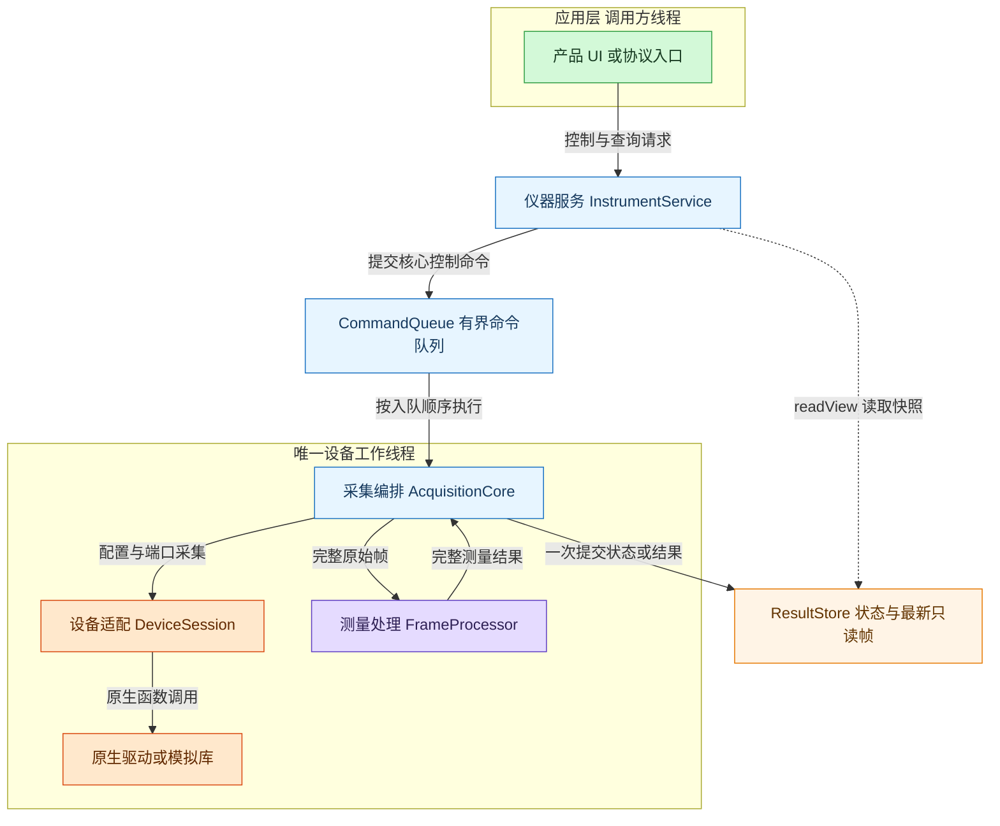
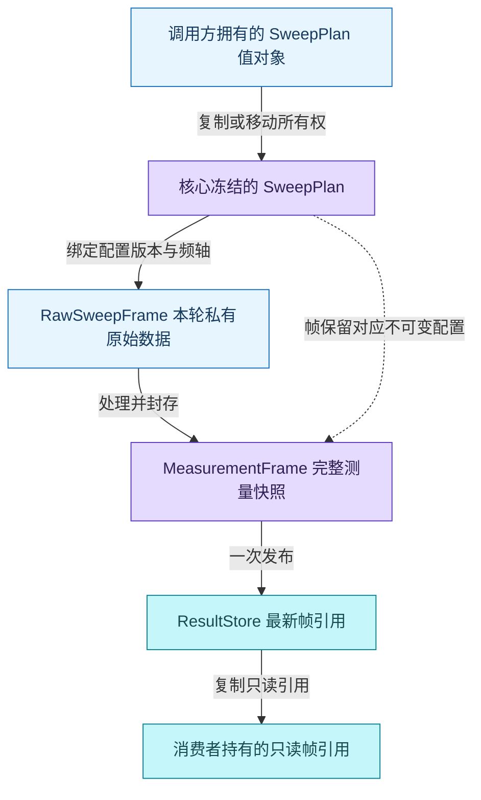
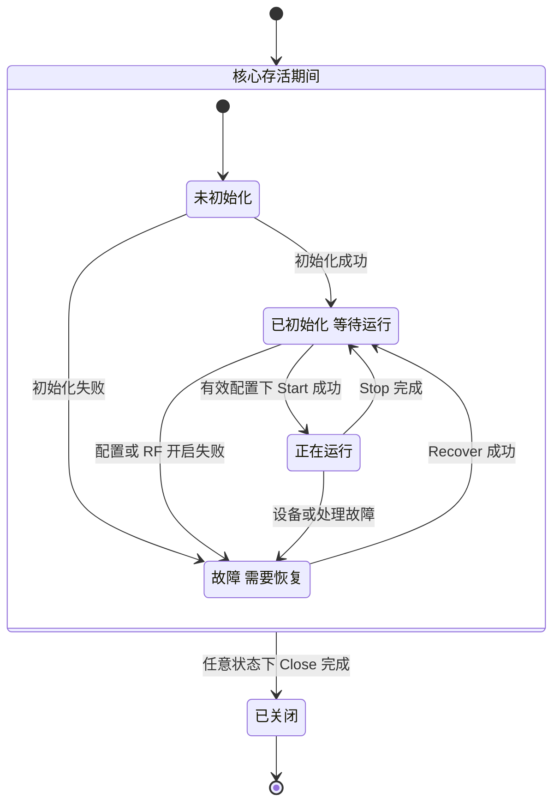
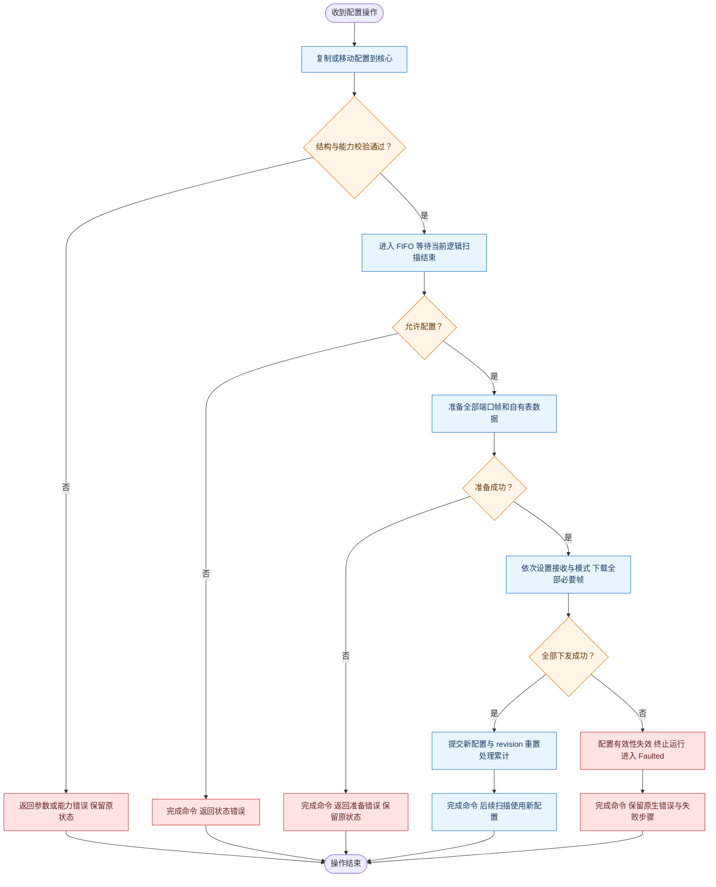
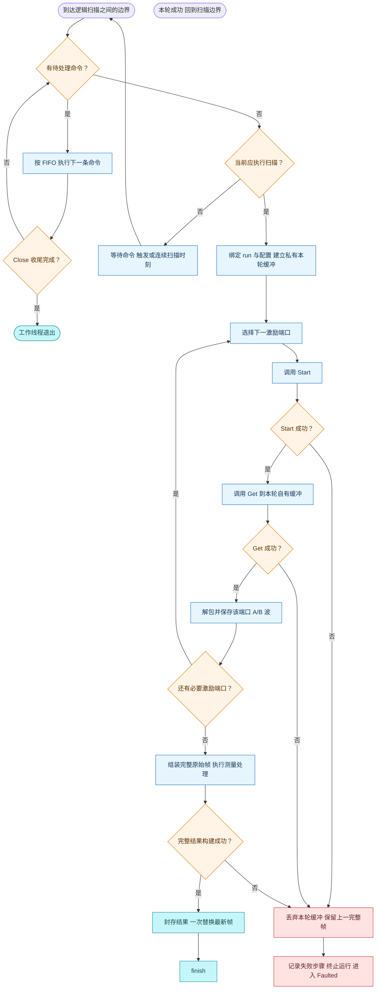
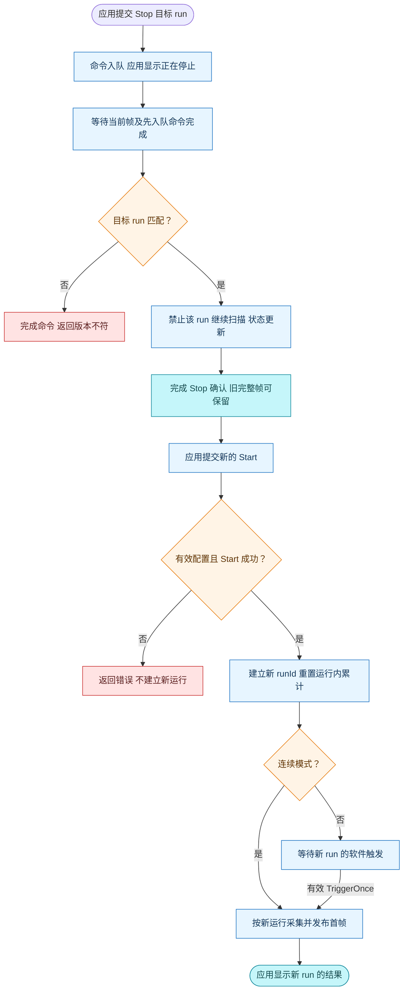

# 网分核心采数更新软件设计

设计版本：1.8。日期：2026 年 10 月 10 日。状态：模拟采集核心、仪器服务、TCP SCPI 和 Vue 仪器面板已实现；本版同步直接状态成员和按职责组织的文件布局，后续扩展仍按本设计评审。

本设计采用一个工作线程独占设备，以冻结的配置完成一轮采集，再一次性发布完整的只读结果。应用层按自己的刷新节奏读取结果，从而避免配置变化、设备调用和曲线刷新相互干扰。

## 1 目标与基本概念

### 1.1 首版范围

首版采用 C++14，支持单设备、单逻辑通道、正常扫频、多个激励端口、连续采集和软件单次触发。先完成原始 A/B 波采集与结果更新闭环；S 参数计算在测量定义确认后接入处理层。校准、平均、动态扩展、快扫、多逻辑通道和数据保存保留明确扩展位置。

产品控制入口统一经过 InstrumentService。TCP Socket SCPI 以 Keysight N52xxB PNA/PNA-X 官方手册为参照，不自创项目命令；HTTP 和 Web 面板复用同一仪器服务与控制权，WebSocket 留作后续扩展。具体会话、兼容范围和数据一致性规则见[网分服务与远程控制设计](网分服务与远程控制设计.md)。实际构建和使用入口见[项目 README](../README.md)。

| 概念 | 含义 | 举例 |
| --- | --- | --- |
| 物理端口 | 仪器的 RF 端口 | 端口 1 至端口 4 |
| 逻辑通道 | 一套独立测量配置及其结果 | 通道 1 使用某组频点、IFBW 和端口 |
| 端口扫描 | 一个激励端口的一次 Start/Get | 激励端口 1，读取各观察端口的 A/B 波 |
| 逻辑扫描 | 同一配置下，全部必要激励端口的端口扫描 | 激励端口 1 和 2 依次采集后形成一帧 |
| 完整帧 | 一轮逻辑扫描的全部必要结果 | 包含本轮两个激励端口的数据和同一频轴 |
| 快照 | 发布后不再修改、可以安全共享的数据对象 | UI 持有上一帧时，下一帧另行构建 |

文档和 UI 使用物理端口 1 至 4；原生 ABI 使用索引 0 至 3，由 DeviceSession 统一转换。逻辑通道编号不代表物理 RF 端口。

逻辑扫描的一致性指同一配置、同一帧身份及完整提交。激励端口仍依次采样，不能把一次提交理解成所有端口同时采样。

### 1.2 现有接口对设计的约束

原生接口采用 Download、Start、Get 的调用链。模拟器在整个设备中只有一份待读取结果，Get 成功后消费该结果；每个频点输出 16 个 double，表示 A1、B1 至 A4、B4 的实部和虚部。接口没有设备句柄、Get 缓冲容量参数、取消接口或逐点流式读取接口。

模拟器的单次原生调用有互斥保护，并不代表完整测量流程不可被其他调用打断；厂商库的线程语义仍待核验。上层必须统一管理配置、RF、复位和采集的顺序。详见[原生接口合同](../VnaNativeSimulator/include/vna_native/native_api_contract.h)和[模拟模块开发文档](模拟模块开发文档.md)。

## 2 分层结构与模块职责

### 2.1 软件结构图



图中的工作线程包含采集编排、设备调用和测量处理。分层划分职责，首版不为每一层建立单独线程。核心内部的常规跨线程共享位置只有命令队列和结果存储。产品 UI 与协议入口统一经过仪器服务，仪器服务只调用核心公开接口，不直接访问队列、处理层或设备层。独立的核心示例和测试可以直接使用核心公开接口。

| 模块 | 核心职责 | 不承担的职责 |
| --- | --- | --- |
| 应用与协议入口层 | 请求解析、提交操作、响应编码、显示状态和绘图 | 原生设备访问、直接修改核心配置 |
| InstrumentService | 控制权、物理配置、测量目录、触发模型、请求完成与快照 | 端口扫描循环、IQ 解包、协议字符串解析 |
| AcquisitionCore | 命令执行、运行状态、触发、端口顺序、配置版本、整帧提交 | 原生数组布局、曲线外观 |
| DeviceSession | 库加载、帧编码、原生调用、IQ 解包、保留原始错误信息 | UI 通知、逻辑通道调度、S 参数计算 |
| FrameProcessor | 从完整 A/B 波生成测量结果及有效性标记 | 设备 I/O、共享结果的逐点修改 |
| ResultStore | 一致保存状态摘要和最新完整帧 | 历史存储、每轮必达的数据队列 |

DeviceSession 在内部以 initialize、applyPlan、acquirePort、shutdown 四类操作隐藏底层细节。acquirePort 封装一次完整的 Start/Get，不把二者分开暴露给应用层。原生适配代码使用现有 NativeApiContract，避免在新模块中复制函数签名。

FrameProcessor 首版可以是普通函数，直接交付具名 A/B 波。设备适配以冻结的原生合同为接口；模拟器已经实现该合同，厂商库通过 ABI 与行为核验后，再由加载不同动态库切换。暂不引入插件注册或通用算法流水线。

### 2.2 数据结构图



SweepPlan 包含 channelId、频点列表、激励端口、接收端口、IFBW 原始值和各激励端口所需表数据。必要处理参数和表版本一并冻结。连续或手动触发模式属于本次运行的控制参数；曲线颜色、显示单位等属于应用层。

服务以 Hz 等正式物理单位表达配置，由经过核验的单位和接收器映射构造核心 SweepPlan。实际物理频轴与转换规则随不可变配置一起冻结，原生 RAW 值仍保留；未核验映射时不经标准命令宣称物理量。服务的 triggerSource 和 sweepMode 与核心 Continuous/Manual 调度模式属于不同层，由服务明确映射，不能直接共用一个 Running 布尔量。

RawSweepFrame 按激励端口保存各观察端口的具名 A/B 复数数组，并记录采集开始和结束时间。MeasurementFrame 保存处理结果、逐点有效性及对应不可变配置。首版结果也可以直接承载解包后的 A/B 波；原始 IQ 不能直接标为 S 参数。

| 帧标识 | 规则 | 用途 |
| --- | --- | --- |
| channelId | 首版固定一个逻辑通道，字段仍保留 | 将来分开保存各通道结果 |
| runId | 每次 Start 成功建立新的递增编号 | 区分停止前后的运行 |
| configRevision | 每次完整配置应用成功后递增 | 防止不同配置或表版本混用 |
| frameSeq | 同一 run 内递增，成功发布时提交 | 消费者判断是否有新帧 |

上述身份均采用 `uint64_t`，上限为 `18446744073709551615`，Web 传输保留十进制字符串。递增前必须检查上限，不能让编号回绕成 0 或复用旧身份。frameSeq 耗尽时在设备采集前进入 Faulted，保留末帧；Recover 后 Start 建立新 runId 并重置运行内帧序号。runId 耗尽时拒绝 Start，configRevision 耗尽时拒绝 Configure 或需要重应用配置的 Recover，拒绝前不调用设备。运行或配置编号耗尽后需重建核心实例。

所有数组由对象自身或它引用的不可变对象拥有。发布后生产者必须放弃可变别名；仅把指针转换成 shared_ptr<const MeasurementFrame>，不能保证底层对象不会再被修改。

### 2.3 项目目录与文件划分

VnaCore、VnaService 和 VnaServer 与 VnaNativeSimulator 并列。公开接口放在 include，私有实现放在 src；有独立行为和生命周期的类使用同名文件，简单结构体和枚举按所属职责收拢，不要求每种数据类型单独一文件。以下为当前已经实现的主要目录，.h/.cpp 表示同名声明和实现。RawSweepFrame、FrameProcessor、SweepFrameCodec、NativePlanBuilder、ProfileCatalog 等后续扩展位置在第 9 节说明。

```text
VnaPro/
├── CMakeLists.txt                         顶层模块装配与构建开关
├── .clang-format                          C++ 自动格式化规则
├── VnaCore/
│   ├── include/vna_core/
│   │   ├── acquisition_core.h               配置、启停、触发和读取快照
│   │   ├── sweep_plan.h                     自有测量配置
│   │   ├── port_frame.h                     一个源端口的完整 IQ
│   │   ├── measurement_frame.h              完整只读帧及 FramePtr
│   │   ├── core_types.h                     状态、模式、CommandResult/Ticket、CoreView
│   │   ├── device_session.h                 设备操作接口与构造注入
│   │   ├── core_command.h                   自有命令、Kind 与完成承诺
│   │   └── frame_layout.h                   端口数及 IQ/帧布局常量
│   ├── src/
│   │   ├── acquisition_core.cpp             唯一工作线程、FIFO 与整帧发布
│   │   └── device/
│   │       ├── plan_preparation_error.h/.cpp  访问硬件前的准备失败
│   │       └── native/
│   │           ├── native_device_session.h/.cpp  原生设备操作与 IQ 转换
│   │           ├── native_library.h/.cpp        动态库生命周期
│   │           ├── native_functions.h          原生 ABI 函数表
│   │           └── download_frame.h            自有下载缓冲及点字段布局
│   └── tests/
│       ├── core_concurrency_test.cpp         FIFO、版本、故障与并发行为
│       ├── native_integration_test.cpp       实际动态库调用与 IQ 验证
│       └── support/
│           ├── controlled_device.h/.cpp     可控阻塞与故障设备
│           ├── fixture.h/.cpp               核心测试生命周期
│           ├── release_gate_on_exit.h         析构释放阻塞门
│           ├── worker_start_on_exit.h         析构启动保留工作线程
│           ├── concurrency_assertions.h/.cpp 断言、计划与采样纯函数
│           └── concurrent_stress_scenario.h/.cpp  提交者/读取者压力场景
├── VnaService/
│   ├── include/vna_service/
│   │   ├── instrument_service.h             与协议无关的控制和快照入口
│   │   ├── measurement.h                   接收器测量定义
│   │   ├── instrument_settings.h            配置、ConfigPatch、触发/扫描枚举
│   │   ├── instrument_snapshot.h            配置、核心视图和授权快照
│   │   ├── operation_result.h               有限操作结果及 Operation
│   │   ├── instrument_error.h               仪器错误项
│   │   ├── data_result.h                    查询结果
│   │   ├── service_task.h                   值任务及 Kind/Stage
│   │   └── service_error_code.h             服务错误码
│   ├── src/
│   │   ├── instrument_service.cpp           配置事务、授权、任务与状态
│   │   └── measurement.cpp                 测量参数编码
│   └── tests/
│       ├── controlled_device.h/.cpp          服务测试受控设备
│       └── fixture.h/.cpp                    服务测试生命周期
├── VnaServer/
│   ├── src/
│   │   ├── main.cpp                        唯一核心装配与进程关闭
│   │   ├── scpi_tcp_server.h/.cpp             SCPI/HTTP 共用事件循环
│   │   ├── scpi_connection.h/.cpp             单连接准入、收发与排空
│   │   ├── listen_options.h                 SCPI/Web 监听配置
│   │   ├── server_defaults.h.in             构建时生成类型化默认路径
│   │   ├── network/
│   │   │   ├── socket_platform.h/.cpp        跨平台 Socket 操作
│   │   │   ├── network_runtime.h/.cpp        网络初始化与对称清理
│   │   │   ├── socket_poll_set.h/.cpp       平台 select 集合与等待
│   │   │   └── socket_owner.h/.cpp           Socket 句柄生命周期
│   │   ├── scpi/
│   │   │   ├── scpi_engine.h/.cpp            请求顺序、命令映射与标准状态
│   │   │   ├── scpi_parser.h/.cpp            SCPI 语法与参数校验
│   │   │   ├── parsed_command.h             解析后的程序单元
│   │   │   ├── scpi_constants.h             标准错误码与协议预算
│   │   │   └── tests/                      命令合同与 NativeFixture
│   │   └── web/
│   │       ├── web_endpoint.h/.cpp           有界非阻塞 HTTP 收发
│   │       ├── static_file.h/.cpp            已验证文件句柄与分块读取
│   │       ├── http_api.h/.cpp               授权、配置版本与有限操作
│   │       ├── http_types.h                 共享请求、响应及 Web 配置
│   │       ├── json.h/.cpp                  JSON 值对象
│   │       ├── json_parser.h/.cpp            有界解析及输入校验
│   │       ├── json_encoder.h/.cpp           按事件循环预算增量编码
│   │       └── tests/web_api_test.cpp         API、授权与帧合同
│   └── tests/                              TCP/HTTP、数值与有序关闭验收及 Client
├── WebUI/
│   ├── package.json、vite.config.ts         Vue/TypeScript/Vite 工程入口
│   ├── src/
│   │   ├── App.vue                         仪器外壳装配与画布缩放
│   │   ├── api/                            HTTP、严格解码与会话 token
│   │   ├── composables/                    操作/读回、租约、迹线显示状态
│   │   ├── domain/                         显示格式、刻度、M1 与可见性
│   │   ├── components/                     instrument / softtools / diagrams
│   │   ├── plot/                           显示算法、Canvas、标记与 CSV
│   │   └── styles/                         视觉变量、外壳与软工具
│   ├── test/                               设备状态与绘图合同
│   └── dist/                               npm 构建产物，不入库
├── VnaNativeSimulator/                     原生 ABI 模拟库及独立合同验收
├── demo/                                   参考草稿
└── docs/                                   设计、使用和验收文档
```

acquisition_core.h 是应用层入口，直接声明 worker、锁、FIFO、设备所有权与发布状态，相关行为在 acquisition_core.cpp 实现；不再保留 Impl、前置声明或转发包装层。对象禁用复制与移动，销毁前停止准入、完成已接受命令并 join。core_types.h 直接定义公共控制状态、模式、结果和视图，core_command.h 将内部命令与 Kind 放在一起；SweepPlan、PortFrame、MeasurementFrame 和多态 DeviceSession 因有独立的共享数据或设备边界职责保留各自头文件。

队列和发布状态由不同 mutex 保护，运行状态只归 worker；读者取得自有快照及共享只读帧。内部命令使用值对象和随命令移动的 promise，避免额外共享所有权。测试从公开构造函数注入受控 DeviceSession，不再使用友元 CoreTestAccess 访问核心内部。

后续 RawSweepFrame 拆入 model，因为采集编排、设备适配和处理都需要它。它只描述自有的端口波数据，不包含原生数组索引或驱动函数。FrameProcessor 因此可以处理已经解包的数据，不依赖设备实现。

DeviceSession 是公开构造注入使用的设备操作接口，NativeDeviceSession 是正式适配实现；tests/support/ControlledDevice 仅供阻塞、故障和时序测试使用。实际模拟库仍通过 NativeDeviceSession 加载，以便集成测试覆盖真实动态加载与编码流程。

NativeLibrary 集中管理 LoadLibrary/dlopen、符号解析和卸载，NativeFunctions 单独声明函数表。后续 SweepFrameCodec 用普通函数集中处理长度检查、正常帧编码、端口编号转换和 IQ 解包，不为每一步再增加 Manager。core_types.h 只放公共核心控制合同；设备函数表、原生错误码、内部命令和算法参数均归各自职责。

InstrumentService 直接保存设置、授权、错误寄存器和任务 FIFO，ServiceTask 按值移动并持有完成承诺。配置相关的 ConfigPatch、TriggerSource 和 SweepMode 与 InstrumentSettings 同处一头，任务 Kind/Stage 与 ServiceTask 同处一头。ScpiEngine、HttpApi 和 WebEndpoint 也直接保存状态；只由该类使用的简单消息、会话或连接记录留在类内，共享 HTTP 值放在 http_types.h。

### 2.4 文件依赖与构建规则

文件依赖方向如下，箭头表示左侧代码使用右侧接口或类型。产品入口只通过服务控制仪器，服务只能使用核心公开接口；私有实现可以依赖公开数据类型，公开头不能反向包含 src。

```text
VnaServer 的 SCPI 或 Web 适配 → include/vna_service 公开接口
InstrumentService           → include/vna_core 公开接口与数据类型
独立的 sweep_console        → include/vna_core 公开接口与数据类型
acquisition_core.cpp          → DeviceSession 接口及生产设备装配
FrameProcessor              → RawSweepFrame、公开配置与结果类型
NativeDeviceSession         → DeviceSession 接口、NativeLibrary、SweepFrameCodec
ControlledDeviceSession     → DeviceSession 接口
NativeLibrary / SweepFrameCodec → NativeApiContract
```

生产构造函数创建 NativeDeviceSession 并将所有权交给 AcquisitionCore；测试构造函数接收受控 DeviceSession 的独占所有权。两个实现都依赖 DeviceSession 接口，接口本身不包含具体实现。FrameProcessor 只依赖原始帧和公开配置、结果类型，不能包含 DeviceSession、NativeLibrary 或 NativeApiContract。

| 构建目标 | 编译与链接关系 |
| --- | --- |
| 顶层 CMake | 装配核心、服务与服务器目标；按集成测试或模拟演示需要加入模拟库构建 |
| vna_core | 一个 C++14 静态库，明确使用 STATIC；公开 include，私有 src；声明线程库与平台动态加载依赖 |
| vna_service | 静态库，链接 vna_core；不包含核心 src，也不依赖 SCPI 或 HTTP 语法 |
| vna_network | 静态库，供 SCPI/Web 共用平台 Socket、网络初始化和句柄生命周期；不访问仪器服务 |
| vna_web | 静态库，链接 vna_service/vna_network；负责 HTTP、静态文件和 JSON 编解码 |
| vna_server | 链接 vna_scpi/vna_web，装配核心；SCPI 与 HTTP 共用服务 executor |
| 独立核心示例 | 链接 vna_core，只取得公开头路径 |
| 核心及适配测试 | 通过公开 DeviceSession 所有权注入构造受控设备；vna_core_test_support 放独立测试类实现，不读取核心内部状态替代行为验证 |
| 服务及 Web 单元测试 | 链接 vna_service_test_support；Fixture 按值持有 Core/Service，设备指针仅借用核心拥有的受控对象 |
| 集成测试 | 链接 vna_core，并把模拟动态库产物路径传给核心；依赖模拟库构建完成 |

现阶段设备适配通过 PRIVATE include 复用 VnaNativeSimulator/include 下的 NativeApiContract，设备函数只经加载后的函数指针调用。vna_core 不直接调用 Drv* 声明，不链接 vnb_drv_sim 或 vnb_drv_sim_core，也不包含 src/native_sim。取得 ABI 头不等于依赖模拟器实现，首版不为此搬迁已有合同。

CMake 仅将公开 include 路径作为 PUBLIC，src 和 ABI 头路径为 PRIVATE；线程与动态加载依赖由核心目标声明，服务或核心示例只需链接 vna_core。静态库所需的平台链接项仍由 CMake 在最终可执行文件链接时处理。WebUI 单独用 npm 构建，通过同源 HTTP 通信，不参与 C++ 核心链接；VnaServer 默认提供 WebUI/dist 的静态资源。仅 SCPI 部署可不构建前端。前端组件、状态与绘图的具体依赖见[前端工程说明](../WebUI/README.md)。

集成测试对模拟库的依赖是构建和运行依赖；核心库本身没有模拟实现的链接依赖。现有 demo 作为参考草稿保留，不直接编入新核心。将来添加 GUI、校准或保存功能时，在对应职责位置增加文件，不把 UI 参数和设备细节重新汇总到 Common.h。

## 3 对外接口与运行状态

### 3.1 控制操作的完成语义

核心启动时由工作线程执行初始化，初始状态为 Uninitialized。普通控制操作非阻塞提交；提交结果包含是否 accepted 及 commandId，接受的命令另有一次性完成结果。所有已接受命令都必须恰好完成一次。

| 操作 | 执行条件 | 成功完成的含义 |
| --- | --- | --- |
| Configure(plan) | 已初始化，Ready 或 Running | 所有必要下发成功，新配置及 revision 已提交 |
| Start(mode) | Ready，存在有效配置 | RF 开启成功，建立新 runId；连续模式开始运行，手动模式等待触发 |
| TriggerOnce(runId, revision) | 手动模式运行，目标版本仍有效 | 对应的一份完整帧已发布，并在完成结果中返回其帧标识 |
| Stop(runId) | 对应 run 有效，或已在故障中终止 | 该 run 的 I/O、处理和发布全部结束；后续不能再发布该 run 的帧 |
| Recover() | Faulted | 重初始化及必要配置恢复成功，回到 Ready，等待显式 Start |
| ReadView() | 对象生命周期内 | 一次取得一致的状态摘要和最新帧引用 |
| Close() | 对象生命周期的拥有方调用 | 关闭准入、完成收尾、工作线程退出并 join |

accepted 仅表示参数已拥有化并进入队列，不能当作配置已应用或停止已完成。Start 完成也不表示已有新帧；应用层需检查最新帧的 runId。重复 Start 返回状态错误，不隐式重启。

命令按入队顺序执行。Stop 前入队的触发先执行；Stop 后执行的触发因运行已结束而失败。触发命令不能用一个布尔量合并。版本不符的延迟触发或停止命令返回明确错误，避免作用于另一轮运行。

未开始运行时 runId 为 0；停止或故障后保留最近一次 runId。对最近一次已经停止的 run，Stop 幂等确认且不清除故障；更老的 runId 明确拒绝。下一次 Start 成功后，最近运行编号随之更新。

readView 返回运行状态、模式、当前 runId、activeRevision、activeConfigValid、正在执行的操作、lastError 及 FramePtr。初始化期间在设备线程缓存底层身份信息，服务查询身份时读取缓存，不从网络线程调用驱动。帧是否属于当前运行和配置，可由版本比较得到；错误状态持续保留，直到明确恢复。

### 3.2 状态转换图



Ready 表示设备已初始化，不一定已经配置；Start 还需 activeConfigValid 为真。Running 的手动模式可以正在等待触发，不必增加单独状态。配置应用成功不改变 Ready 或 Running 状态；整帧发布也不改变 Running。配置应用期间暂停采集，readView 的操作字段表示正在配置。

设备或处理故障终止当前运行。设备状态不确定时 activeConfigValid 置为 false，保留最后完整帧和错误信息。Recover 重新初始化，并完整应用最后一次确认成功的配置；恢复配置成功产生新 revision，没有历史配置时回到未配置的 Ready。恢复不会自动继续采集。

## 4 核心活动流程

### 4.1 配置应用活动图



配置在逻辑扫描之间切换。当前帧继续使用旧配置并完整发布，随后应用新配置；新配置下发完成前，不增加 revision。准备阶段失败且尚未访问硬件时，可以保留旧有效配置并返回错误。

多次原生下发不是硬件事务。某个端口下载失败时，前面的下发可能已经生效，因此不能仅保持旧 revision 就继续采集。首版进入 Faulted，通过 Recover 完整恢复。结构校验包括非空频点、端口与点数一致性、表长度和受检长度运算；未知硬件单位及数值范围不自行推定。

### 4.2 一轮采集活动图



连续模式在处理已到达的命令后开始下一帧。手动模式由 TriggerOnce 命令执行图中 freeze 至 publish 的子流程，发布后完成该命令，再返回等待；失败时也完成该命令的错误结果。执行命令节点可能因此包含一轮扫描。Get 失败后不得使用缓冲中的旧值，也不得发布完成通知。

单个频点的数学结果无效应写入有效性标记，不等同于整帧构建失败。所需端口未完成、数据形状错误或处理异常才阻止整帧发布。核心不把没有激活的接收端口数据默认为有效测量。

空闲和手动等待使用 condition_variable。连续采集支持最小帧间隔，等待期间命令可以唤醒工作线程；模拟器返回很快时也不会无条件忙循环。真实设备的调用耗时大于间隔时，下一帧按实际完成情况调度。

### 4.3 停止与重新开始活动图



Stop 成功是停止屏障：确认后禁止发布该 run 的新帧；此前已经持有的帧继续有效。严格 FIFO 意味着先入队的触发先执行，不在停止时悄悄清空。运行已经因故障终止时，匹配的 Stop 可以确认软件停止，但不能清除 Faulted。

Stop 只停止采集，不隐含 RF 关断。初始化使设备进入已知状态，Start 开启 RF，Close 尝试关闭 RF；这些原生操作都由设备工作线程执行。需要独立 RF 控制时，也应增加核心命令，不能另开线程直接访问驱动。

如果原生调用不返回，Stop 无法完成。软件可显示操作超期，但不能假装已经取消，也不能释放调用仍使用的缓冲或卸载驱动。停止时延由当前逻辑帧采集、处理和发布的剩余耗时、先入队操作及调度开销共同决定；原生阻塞时没有有限时延保证。

## 5 共享数据与应用刷新

### 5.1 所有权与锁

| 对象或资源 | 写入者 | 读取者 | 同步方式 |
| --- | --- | --- | --- |
| 设备会话、函数表、RF 与设备配置 | 工作线程 | 工作线程 | 线程独占 |
| 当前配置、扫描状态、处理累计 | 工作线程 | 工作线程 | 线程独占，外部通过状态快照读取 |
| 采集与处理中的可变缓冲 | 工作线程 | 工作线程 | 本轮私有 |
| 命令队列与准入开关 | 提交方及工作线程 | 工作线程 | 一把队列 mutex 和 condition_variable |
| 状态摘要与最新 FramePtr | 工作线程 | 任意消费者 | 一把发布 mutex |
| 已发布帧及其不可变配置 | 封存后无写入者 | 任意持有者 | 只读共享，引用计数管理生命周期 |

两把锁不嵌套持有。队列锁只保护入队、取出和准入状态；发布锁只保护状态与帧引用的提交、复制。硬件调用、配置复制、整帧计算、绘图和旧帧销毁都在锁外执行。替换旧 FramePtr 时先移出引用，再在锁外释放，避免大数组析构阻塞读取。

首版不设置逐点共享写入，不复用已经发布的可变缓冲，不执行用户回调。命令完成结果在锁外完成；应用层取得快照后，全程使用帧内的频轴和版本。

### 5.2 应用读取规则

产品 UI 可按约 30 Hz 的显示节奏通过仪器服务读取 readView 对应快照。每次首先刷新状态，再比较 runId、configRevision、frameSeq 决定是否重绘。没有新帧时保留旧图；停止、配置切换和重启后，明确标示旧帧来源，不将旧图当作当前配置的新测量。

例如把扫描从 1001 点改成 201 点：当前的 1001 点扫描先完整发布，再应用新配置。新配置生效但首个 201 点结果尚未到达时，UI 可以继续显示旧图并标示旧配置，绘图仍使用旧帧的 1001 点频轴。只有收到新配置的完整帧后，才同时替换数据和频轴。

采集很快而 UI 较慢时，ResultStore 只保留最新帧，允许跳过中间帧。这适用于显示，不满足每轮必存需求。消费者长期持有旧 FramePtr 仍会增加总内存，应在处理结束后释放；最新槽有界并不保证消费者持有的全部帧有界。

### 5.3 队列容量与关闭

正常命令队列设置固定容量，满时返回 QueueFull，并且不创建已接受凭据。首版不丢弃或合并已接受命令。每条命令完成结果由调用方持有，核心不无限保存历史命令记录。

close 是生命周期拥有方调用的阻塞操作。它在队列锁内关闭准入，并使用保留的收尾位置安排内部 Close；先前接受的命令按 FIFO 完成，后续提交立即拒绝。设备故障导致命令无法执行时，也逐条给出失败结果，不能让等待者永久挂起。

工作线程完成最后一次 I/O、RF 收尾和状态提交后退出；外部 close 等待并 join，再释放设备会话和动态库。收尾失败保留具体错误；即使最后进入 Closed，也不能无条件返回成功。不得在超时后 detach 线程并卸载驱动。关闭后，已经取得的帧引用仍然有效。

## 6 错误处理与硬件边界

错误结果至少保留业务分类、失败步骤、原生返回码，以及关联的 commandId、runId 和配置版本。模拟器错误码不能直接解释真板返回码。

| 场景 | 首版行为 |
| --- | --- |
| 参数非法、队列满、版本不符 | 明确拒绝或完成失败，不触碰硬件 |
| 帧编码或分配失败且未访问硬件 | 完成配置失败，原有效配置可保留 |
| 初始化、RF 开启或部分配置下发失败 | 进入 Faulted，设备配置有效性失效 |
| Start/Get 失败 | 丢弃本轮，保留上一完整帧，进入 Faulted |
| 必要结果形状错误或处理异常 | 不发布本轮，保留错误并终止运行 |
| 单点计算无效 | 标记该点无效，其他完整数据仍可交付 |
| 原生操作超期 | 展示正在执行及超期，不承诺硬取消 |

Get 的输出缓冲由 DeviceSession 分配，真实容量不少于 16N 个 double。1+6N、9N、16N 及字节大小计算都检查溢出和 ABI 上限，再进行分配或调用。正常模式的动态字段为零，功率表按当前合同拥有化，不自行解释九项的物理含义。

真板接入前须确认目标平台与厂商调用约定、频率与 IFBW 单位、表数据来源及含义、能力范围、多端口帧存储、未激活端口数据行为、Start/Get 阻塞和取消语义、返回码及复位恢复步骤。当前模拟模块的交付与验收覆盖 Linux/macOS，不能默认已经验证 Windows DLL。这些条件影响设备适配和停止时延，相关已知风险见[硬件模拟方案](硬件模拟方案.md)。

## 7 扩展位置与实施验证

### 7.1 扩展规则

| 后续能力 | 放置位置 | 必须保留的约束 |
| --- | --- | --- |
| 多逻辑通道 | AcquisitionCore 调度及每通道 ResultStore | 同设备串行切换配置，首版可采用顺序轮询 |
| S 参数、校准、平均 | FrameProcessor | 明确 A/B 测量定义；累计随 run 或相关配置变化重置 |
| 动态扩展 | 配置构造、设备适配及测量处理 | 当前帧使用采集时的表，新表在后续扫描边界切换 |
| 快扫、分块读取 | DeviceSession 与数据发布合同 | 底层真实支持后再定义部分数据的版本及完成语义 |
| 保存或每轮必达任务 | 独立有界消费队列 | 明确满队列时暂停采集或报告失败 |
| 处理线程拆分 | AcquisitionCore 内部 | 有界传递不可变原始帧，Stop 等待处理完成，旧版本结果不能越过屏障发布 |
| 多设备 | 设备上下文或独立驱动进程 | 当前无句柄 ABI 下不能靠多建核心对象实现并行设备 |

### 7.2 实施顺序

1. 建立 DeviceSession，复用原生合同，接通模拟库的配置与多端口正常采集。
2. 建立冻结配置、私有 RawSweepFrame 和只读 MeasurementFrame，完成整帧提交与 readView。
3. 加入工作线程、FIFO、运行状态、命令完成结果和 Close 收尾。
4. 接入连续采集、软件触发、配置更新及 UI 读取；随后按已确认测量定义增加算法。
5. 服务建立物理配置与触发模型，再接入 Keysight 官方命令子集；协议兼容与验收见服务设计。

### 7.3 关键验收场景

| 验证场景 | 必须观察到的结果 |
| --- | --- |
| 采集中提交不同点数配置 | 当前完整帧使用旧频轴；配置成功后新帧统一使用新频轴和 revision |
| 修改或释放已提交的调用方配置 | 核心配置及后续结果不受影响 |
| 第二个激励端口读取失败 | 不出现拼接完成帧，保留上一帧及故障信息 |
| 配置下发中途失败 | activeConfigValid 为 false，不能继续按旧 revision 采集 |
| 连续提交两次软件触发 | 两份完整帧依次发布，两个命令各自完成 |
| 触发与 Stop 按不同顺序入队 | 遵循 FIFO；Stop 确认后该 run 不再发布 |
| 停止后立即重新开始 | runId 改变，旧帧不能冒充新运行的首帧 |
| UI 慢读并持有旧快照 | 新帧继续发布，旧帧内容和频轴始终不变 |
| 队列满、故障或关闭 | 不假报接受成功；所有已接受命令恰好完成一次 |
| 原生调用被测试替身阻塞 | Stop 和 Close 不提前成功，缓冲及库保持有效 |

已有模拟库用于端口顺序、布局和配置一致性验证。阻塞、故障和命令时序使用可控的设备测试替身，不修改生产导出 ABI；通过同步门控制时序，避免仅靠 sleep 猜测竞态。C++14 构建和适用平台上的 ThreadSanitizer 检查用于实现验收，不能替代上述逻辑一致性验证。

## 8 仪器服务与远程入口

TCP Socket SCPI 以 Keysight N52xxB PNA/PNA-X 官方命令为参照，不增加项目自定义指令。VnaServer 创建唯一核心，SCPI 与 Web 都经 InstrumentService 操作。SCPI 控制连接通过准入授予控制权，Web 写会话使用同一个授权代次仲裁；只读 Web 请求不占控制权。

服务串行提交配置事务并跟踪有限操作。顺序命令与异步测量分别处理，*OPC? 和 *WAI 建立完成屏障，不统一阻塞所有命令到测量结束。SCPI 错误按仪器 FIFO 和正式状态寄存器表达；网络事件循环不等待设备 I/O 或 join。

标准数据查询返回刺激轴或选定测量的完整数组，不追加帧身份、RAW 分段参数或有效性列。同轮读取采用单次完成后 HOLD，期间不修改配置、不再次触发；连续状态下多个独立查询可能跨帧。显式固定快照、逐点有效性及内部帧身份保留给服务/Web，旧配置帧不能冒充当前 SCPI 数据。

核心在 Running 下完整旧帧后应用配置的能力继续保留；首期 SCPI 配置及测量定义只在 HOLD 执行，以免声称兼容 PNA 的扫描中改参/中止行为。内部 Stop 仍是完整帧边界屏障，不能直接映射到 ABORt 或 INIT:CONT OFF；中止、复位及正式 S 参数各自具备完整语义后才开放。

原生频率、IFBW 和功率表的物理语义未确认前，必须核验映射后才开放对应标准命令，不虚构 Hz、dBm 或校准结果。兼容命令表、接收器映射、活动图和 Web 接口合同见[网分服务与远程控制设计](网分服务与远程控制设计.md)。

## 9 首期实现记录

当前实际源码按 VnaCore、VnaService、VnaServer 三层组织，公开接口直接声明私有状态并通过完整头文件表达依赖。FrameProcessor、NativePlanBuilder、ProfileCatalog 等只在后续扩展说明中出现，不在当前目录树中；首期只有一套模拟 profile，相关小函数先放在所属模块内部，不为尚无独立变化需求的逻辑增加类。

VnaCore 的普通命令队列为 64 项，加一个保留 Close 入口；每帧 IQ 预算 64 MiB。连续采集帧间等待 10 ms，控制命令可唤醒等待。此前采集验收在 Windows MinGW/GCC 10.3 和 WSL/GCC 13.3 全目标 ThreadSanitizer 下均通过 12 项 CTest，未报告数据竞争；当时核心含 11 组门控/并发场景，Web API 含 8 组场景，覆盖完整 IQ golden、帧边界配置切换、旧帧深比较、无效样本及可重放噪声。此历史结论不替代后续变更或 GCC 7.3 等未执行的平台门禁。本次直接成员/按职责收拢及行为修复后的正式代码已通过 Windows 全量 12 项（13.87 秒）和 WSL 全目标 ThreadSanitizer 12 项（9.98 秒），70 个正式头单独 C++14 编译通过且无头文件循环依赖；HttpApi 实际分配故障验证也已通过。命名空间统一后的终检按[模拟设备采集验收](模拟设备采集验收.md)另行补记。此前 Chromium 验证确认 Web 只绘制来自后台的真实数据。

当前服务只允许 VnaPro NativeSimulator 身份的后台。模拟器的整数 Hz、接收器和 opaque 表约定已明确；Web 已接入真实采数、原子配置和控制权仲裁，曲线显示附带完整帧身份。真实硬件、S 参数、校准和二进制格式尚未交付。操作步骤和可运行的单次采数命令见[项目 README](../README.md)。
