# VNA 网络测量层软件设计

| 项目 | 内容 |
| --- | --- |
| 文档状态 | V1 评审稿 |
| 文档版本 | 0.2 |
| 目标语言 | C++17 |
| 生产编译器 | GCC 7.3.0；不得使用更新标准库能力 |
| 模块名 | `VnaMeasurement` |
| 下层依赖 | [`VnaAcquisition` 原始波采集层设计](./原始波采集层软件设计.md) v0.13；实现 `97fc1f8`；主干 `9b12db8` |
| V1 范围 | 测量需求编译、Prepare 结果绑定、直接波与同一激励出现内的复数比值构造 |

## 1. 结论和边界

网络测量层只做一件完整的事：

> 使用同一份不可变测量定义，先推导采集所需的直接波，再把每份 `RawSweepFrame` 确定性转换为
> 一份不可变 `ObservationFrame`。

“同一份定义”是本层成立的关键。若由一个模块决定 `requiredWaves`，另一个模块独立解释
`a/b`，两边很容易在端口、激励或波集合上漂移。V1 因此把冷路径编译和热路径构造放在同一模块，
但用 `compile`、`bind`、`build` 三个同步阶段隔开，不建立新的异步 Engine。

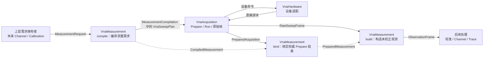

| 本层负责 | 本层不负责 |
| --- | --- |
| 从观测定义推导、合并和排序 `requiredWaves` | 设备发现、连接、Prepare、Start、Stop 或 Abort |
| 复用已有点、源、触发和 Sweep policy 生成 `VnaSweepPlan` | 再做一套波块覆盖检查或 Sweep 状态机 |
| 用 `preparedAcquisition.hardwarePrepared().effectivePlan` 绑定实际布局 | 校准标准采集、误差项求解和校正应用 |
| 构造直接波和同一激励内的复数比值 | 跨 Sweep 平均、统计和历史结果 |
| 传播输入质量位并记录派生计算质量 | 去嵌、重归一化、混模、阻抗等 Channel 变换 |
| 保留点、配置和 Run/Sweep 数据来源 | Trace 格式、时域、平滑、Marker 和 UI |
| 做本层自己的容量和算术门禁 | 多 Channel、多设备调度和通用 QoS |

依赖方向必须保持单向：

```text
未来上层
   ↓
VnaMeasurement
   ↓
VnaAcquisition
   ↓
VnaHardware
   ↓
VnaDriver SDK
```

`VnaMeasurement` 不直接持有 `IVnaHardware`，也不订阅硬件或采集事件。

## 2. 术语和物理边界

| 术语 | 含义 |
| --- | --- |
| 扫描骨架 | 已展开的点、激励、源、触发和 policy；其中 `requiredWaves` 尚未填写 |
| 观测定义 | 一个稳定 `ObservationId`、适用 `ExcitationId` 和有限表达式 |
| 直接波观测 | 输出指定的 `a_i` 或 `b_i`；有效数值原样保留，不可用值规范化为 NaN |
| 波比值观测 | 在同一 `ExcitationId`、同一点上计算两个直接波的复数比值 |
| 测量编译结果 | 生成的 `VnaSweepPlan` 与用于后续绑定的不可变观测定义 |
| 测量绑定结果 | 基于权威 `PreparedAcquisition` 编译出的点索引、依赖和输出偏移 |
| 观测帧 | 与一个成功原始 Sweep 一一对应的未校正网络观测结果 |
| 输入质量 | 由直接波携带的 `WaveQuality` 位；比值分别保留分子和分母的质量 |
| 计算质量 | 本层发现的零分母、非有限输入或非有限结果等派生事实 |

### 2.1 V1 只有两种表达式

V1 只支持：

```text
DirectWave(w)
SameExcitationRatio(numerator, denominator)
```

不引入任意表达式树、字符串公式或插件式数学 DSL。Trace Math、幅相格式和时域变换有不同的数据
阶段、错误语义和性能特征，不能借“通用表达式”提前进入本层。

### 2.2 波比值不自动等于 S 参数

对某个点 `p`，本层只能无条件承诺：

```text
r(p) = numerator(p) / denominator(p)
```

`b_i / a_j` 不能仅凭名字自动升级为最终 `Sij`，原因包括：

1. 当前计划允许一个激励中同时开启多个源。
2. 软件尚未证明除 `a_j` 外其他入射条件满足 S 参数定义。
3. 用户校准、端口匹配校正、参考平面和参考阻抗尚未应用。
4. 多源网络参数需要足够独立的激励并求解 `B = S·A`，不是逐项相除。

因此公开基础类型使用 `WaveRatioExpression`，不定义 `SParameterExpression`。上层可以把某个比值
作为“待校正的 S 参数观测”，但最终 S 参数身份由后续校准/校正层建立。

### 2.3 相干和数值契约边界

V1 比值的两个操作数必须来自同一点上的同一个 `ExcitationId` 出现。不支持跨激励、跨 Sweep 或
跨设备复数运算，因为当前接口没有为这些范围定义足够的相干域、时钟域、时间戳或触发 epoch。

主干 v0.13 已明确：`ExcitationId` 是波布局身份，不承诺不同点上的源端口、功率和相位相同。同一
观测定义仍适用于该 ID 的全部出现位置，但每个输出点的真实源状态必须通过 effective plan 的该次
`points[i].excitations[j]` 解释；本层不得把源设置折叠成 ExcitationId 级常量。

当前驱动 ABI 仍未统一定义波值单位、参考阻抗、参考平面和工厂归一化边界。Simulator 可以用于
验证编译、映射和复数数学，但在真机数值契约关闭前，不能宣称本层输出已经具有跨设备一致的
物理含义，也不能冻结校准 API。

## 3. 结构设计

### 3.1 核心组件

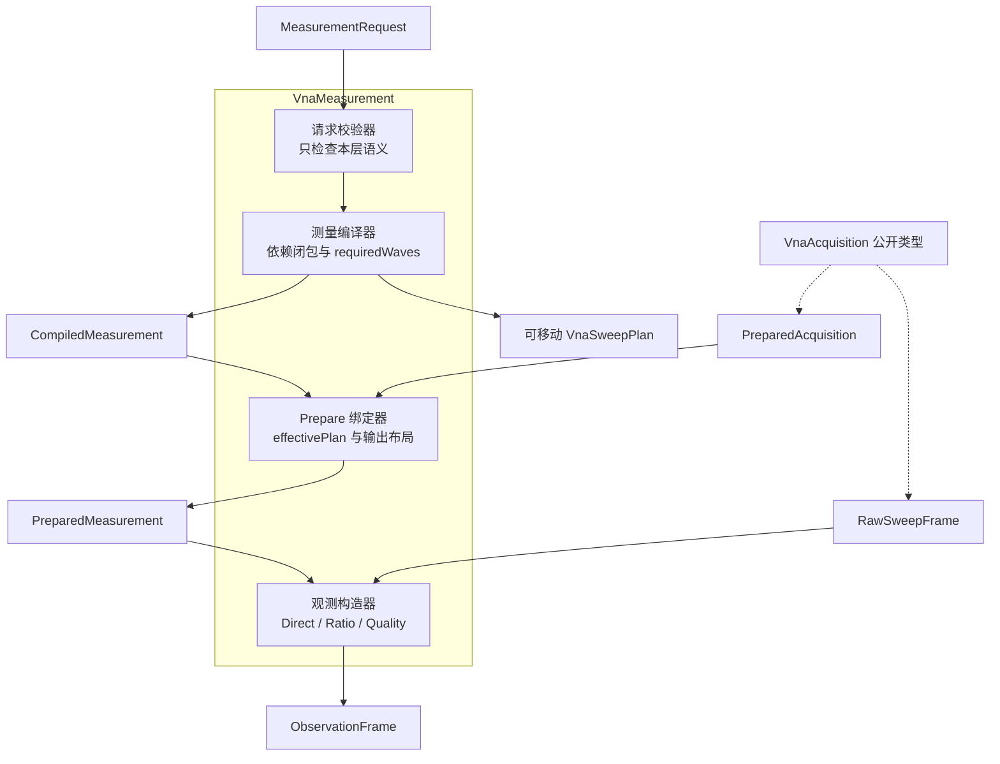

这些组件可以实现为自由函数和私有辅助类。V1 不为它们建立继承接口，因为没有第二种实现、运行期
替换或独立生命周期需求。

### 3.2 核心对象关系

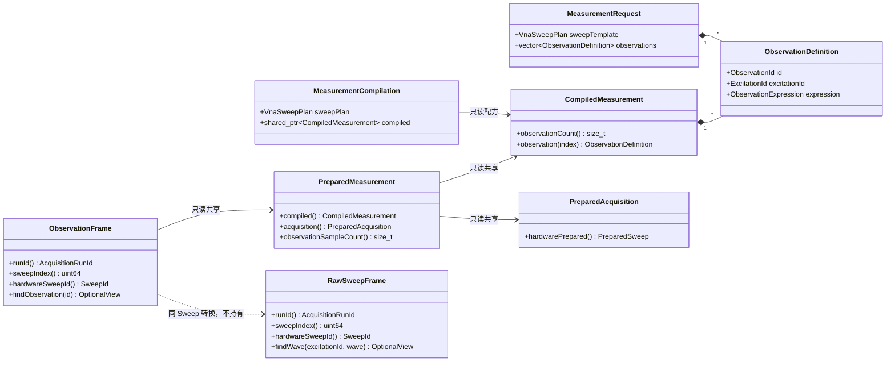

### 3.3 建议目录

```text
modules/VnaMeasurement/
├── include/
│   └── VnaMeasurement.h
├── src/
│   ├── MeasurementCompiler.cpp
│   ├── MeasurementBinder.cpp
│   ├── MeasurementValidation.cpp
│   └── ObservationBuilder.cpp
└── CMakeLists.txt

tests/Measurement/
├── MeasurementCompilerTest.cpp
├── MeasurementBinderTest.cpp
├── ObservationBuilderTest.cpp
├── MeasurementCapacityTest.cpp
├── MeasurementTestSupport.cpp
├── MeasurementTestSupport.h
└── CMakeLists.txt

tests/MeasurementIntegration/
├── MeasurementPipelineTest.cpp
└── CMakeLists.txt
```

单元测试沿用主干现有 `tests/Acquisition` 约定放在顶层 `tests/Measurement`；只有跨
Acquisition/Simulator/协调器的测试进入 `tests/MeasurementIntegration`。只有稳定领域类型和三个
入口函数进入 `include/`；排序键、checked arithmetic、内部映射和输出偏移都留在 `src/`。

## 4. 最小公开数据模型

### 4.1 请求和表达式

```cpp
using ObservationId = std::uint32_t;

struct DirectWaveExpression {
    VnaWaveKey wave{};
};

struct WaveRatioExpression {
    VnaWaveKey numerator{};
    VnaWaveKey denominator{};
};

using ObservationExpression =
    std::variant<DirectWaveExpression, WaveRatioExpression>;

struct ObservationDefinition {
    ObservationId id{0};
    ExcitationId excitationId{0};
    ObservationExpression expression{DirectWaveExpression{}};
};

struct MeasurementRequest {
    VnaSweepPlan sweepTemplate{};
    std::vector<ObservationDefinition> observations{};
};

struct MeasurementLimits {
    // 编译定义、绑定描述符、共享 pointIndices 和输出偏移的逻辑 payload。
    // 不含可移动 sweepPlan、PreparedAcquisition 和分配器开销。
    std::size_t maximumPreparedPayloadBytes{0};
    // values + ObservationSampleStatus + 每帧临时 View 表的逻辑 payload。
    std::size_t maximumBuildPayloadBytes{0};
};
```

扫描骨架直接复用 `VnaSweepPlan`，避免再复制一套点、源、触发和 policy 类型。为了让观测定义成为
波依赖的唯一事实源，传入骨架内所有 `requiredWaves` 必须为空；非空时同步返回 `InvalidPlan`，
既不静默覆盖，也不产生无法解释的额外波。

线性、对数、分段频率如何展开，以及 `PointId`、`ExcitationId` 如何稳定分配，属于未来 Channel
或校准工作流。网络测量层接收已经展开的骨架，不解释 UI 配置。一个 ObservationDefinition
适用于该 ExcitationId 出现的全部点；各点允许具有不同源设置，输出通过 effective plan 保留其
逐出现来源。若两个点需要不同观测集合，上层必须使用不同 ExcitationId，不能在热路径增加逐点
可选表达式。

### 4.2 计算质量

硬件质量和本层计算质量分开保存，避免占用未来驱动可能增加的 `WaveQuality` 位：

```cpp
enum class CalculationQuality : std::uint32_t {
    Valid = 0,
    InputUnavailable = 1U << 0,
    ValueNonFinite = 1U << 1,
    DenominatorNonFinite = 1U << 2,
    DenominatorZero = 1U << 3,
    ResultNonFinite = 1U << 4
};

struct ObservationSampleStatus {
    // Direct 为该波的位；Ratio 为 numerator 的位。
    std::uint32_t numeratorWaveQuality{0};
    // Direct 固定为零；Ratio 为 denominator 的位。
    std::uint32_t denominatorWaveQuality{0};
    // CalculationQuality 的可组合位。
    std::uint32_t calculationQuality{0};
};
```

任一输入质量非零都不等价于结构不完整。完整帧可以包含 Overload、Unlocked、SourceUnsettled、
ReferenceLow 或 Missing；本层分别保留两个输入的事实，也不把整个 Sweep 改判为失败。

### 4.3 不可变结果

```cpp
struct ObservationSeriesView {
    const std::uint32_t* pointIndices{nullptr};
    const std::complex<double>* values{nullptr};
    const ObservationSampleStatus* status{nullptr};
    std::size_t size{0};
};

class CompiledMeasurement final {
public:
    std::size_t observationCount() const noexcept;
    const ObservationDefinition& observation(std::size_t index) const;
};

struct MeasurementCompilation {
    // 调用方把它移动给 IVnaAcquisitionEngine::prepareAsync()。
    VnaSweepPlan sweepPlan{};
    // 不含完整 sweepPlan，只保留观测定义、结构签名、依赖和 Limits。
    std::shared_ptr<const CompiledMeasurement> compiled{};
};

class PreparedMeasurement final {
public:
    const CompiledMeasurement& compiled() const noexcept;
    const PreparedAcquisition& acquisition() const noexcept;
    std::size_t observationSampleCount() const noexcept;
};

class ObservationFrame final {
public:
    AcquisitionRunId runId() const noexcept;
    std::uint64_t sweepIndex() const noexcept;
    SweepId hardwareSweepId() const noexcept;
    const PreparedMeasurement& prepared() const noexcept;
    std::optional<ObservationSeriesView> findObservation(
        ObservationId id) const noexcept;
};
```

`pointIndices[i]` 始终索引
`prepared().acquisition().hardwarePrepared().effectivePlan.points[pointIndices[i]]`。调用者由此取得
权威频率、`PointId`、IFBW 和源设置，不能从请求骨架缓存旧值。

`ObservationSeriesView` 不拥有内存，有效期不得超过所属 `ObservationFrame`。`observation(index)`
要求 `index < observationCount()`；越界属于调用方编程错误并抛 `std::out_of_range`。三个发布
对象的构造函数私有且禁用值复制，只通过 `shared_ptr<const ...>` 共享。

帧持有 `PreparedMeasurement` 的只读共享所有权，但不持有整个 `RawSweepFrame`。因此重新 Prepare
后旧观测帧仍可解释，同时不会因一个小输出长期保留整份原始波数据。

### 4.4 三个公开入口

```cpp
Result<MeasurementCompilation> compileMeasurement(
    MeasurementRequest&& request,
    MeasurementLimits limits);

Result<std::shared_ptr<const PreparedMeasurement>> bindMeasurement(
    std::shared_ptr<const CompiledMeasurement> compiled,
    std::shared_ptr<const PreparedAcquisition> acquisition);

Result<std::shared_ptr<const ObservationFrame>> buildObservationFrame(
    std::shared_ptr<const PreparedMeasurement> prepared,
    const RawSweepFrame& rawFrame);
```

三个入口都是同步操作，不触发采集命令，也不产生回调。`CompiledMeasurement`、
`PreparedMeasurement` 和 `ObservationFrame` 一经发布即不可变。compile 把 `MeasurementLimits`
一并冻结在 `CompiledMeasurement` 内，bind 不允许调用方临时替换成另一组预算。

bind 的任一空 shared pointer、build 的空 Prepared pointer 都同步返回 `InvalidPlan`，不解引用空
对象，也不产生部分结果。

`MeasurementCompilation.sweepPlan` 是短生命周期的可移动提交对象；调用方把它移动给
`prepareAsync()`。`CompiledMeasurement` 不保留嵌套请求计划，只保存 bind 所需的规范化扁平签名：
每个逻辑字段、PointId 顺序、每个点内的 ExcitationId 出现及其源设置、观测定义、波依赖和预算
都进入签名。源设置按点内出现保存，不能按 ExcitationId 合并。
这样既能逐字段证明 Prepared 结果与本次编译相符，也避免每个旧 `ObservationFrame` 间接长期
保留数以万计的嵌套 vector。

compile 只接受右值所有权转移；调用方必须使用 `std::move(request)`，调用后无论成功失败都不得再
依赖 request 内容。函数先读取请求做无副作用的 checked 预检，再在自己的异常边界内生成依赖和
移动计划，避免左值按值传参在预算检查前复制完整嵌套计划。

## 5. 测量需求编译

### 5.1 编译规则

编译器只做本层特有规则，不复制 `VnaHardware::validate()` 的频率、端口、能力和维度校验：

1. 两项 `MeasurementLimits` 必须大于零。
2. 骨架内每个 `requiredWaves` 必须为空。
3. `ObservationId` 必须非零且在当前请求中唯一；定义按 ID 排序形成稳定输出布局。
4. 至少有一个观测定义；完全没有观测的请求没有执行价值。
5. 每个定义引用的 `ExcitationId` 必须至少在一个点中出现。
6. 骨架中出现的每个 `ExcitationId` 都必须至少被一个观测引用；不保留无输出的空激励。
7. 完全相同的 `(ExcitationId, expression)` 只能定义一次；多个上层消费者复用同一
   `ObservationId`。
8. 表达式中的 WaveKind 必须是 Incident/Outgoing，PortId 必须非零；设备端口上限仍由 Hardware
   判定。
9. Direct 产生一个波依赖；Ratio 产生 numerator 和 denominator 两个依赖。
10. Ratio 的两个波天然属于定义携带的同一个 `ExcitationId`；V1 类型不表达跨激励比值。
11. 同一 `ExcitationId` 的全部出现位置取得同一个依赖并集。
12. 每个依赖并集按 `(WaveKind, PortId)` 规范排序：Incident 在前，同类按端口升序。
13. `allowQuantization` 保留骨架策略；V1 bind 仍只接纳 `report.quantized == false` 且与编译签名
    完全一致的结果。当前 Hardware 本来也会在量化结果没有实际点表时失败关闭。
14. 只要存在 Ratio，生成计划就把 `requirePhaseCoherence` 收紧为 true；
    `requireAtomicConfiguration` 保留骨架策略，不从比值语义额外推导。
15. 用 checked add/multiply 计算签名、定义、依赖和预测输出 payload，超预算不生成半成品。

依赖排序不使用请求容器顺序，保证同一语义请求稳定生成相同 `requiredWaves`。编译器不把
`ExcitationId` 或 `PortId` 当数组下标。

### 5.2 编译活动图

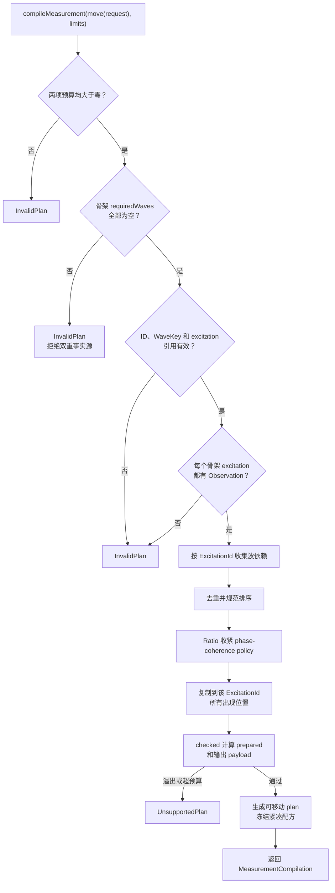

所有同步失败都不调用 `VnaAcquisition`，也不产生硬件副作用。

### 5.3 二端口示例

上层要取得端口 1 激励下的两个待校正网络比值：

```text
Observation 101: excitation=10, Ratio(b1, a1)
Observation 102: excitation=10, Ratio(b2, a1)
```

编译结果只请求：

```text
ExcitationId 10
sources       [P1]
requiredWaves [a1, b1, b2]
```

共同分母 `a1` 只采一次。输出仍叫两个 `WaveRatio`，不会仅凭端口组合把它们标成最终 S11/S21。

完整二端口双向观测再增加端口 2 激励：

```text
Excitation 10 -> Ratio(b1,a1), Ratio(b2,a1)
Excitation 20 -> Ratio(b1,a2), Ratio(b2,a2)
```

编译器分别生成 `[a1,b1,b2]` 和 `[a2,b1,b2]`，不把两个激励的分母混用。

### 5.4 编译错误映射

| 情况 | 错误码 | 副作用 |
| --- | --- | --- |
| 零预算、空观测、重复/零 ObservationId 或重复表达式 | `InvalidPlan` | 无 |
| 骨架已有 requiredWaves | `InvalidPlan` | 无 |
| 引用不存在的 ExcitationId | `InvalidPlan` | 无 |
| 骨架存在没有任何观测的 ExcitationId | `InvalidPlan` | 无 |
| WaveKind 非法或 PortId 为零 | `InvalidPlan` | 无 |
| V1 不支持的表达式或容量 | `UnsupportedPlan` | 无 |
| checked arithmetic 溢出 | `UnsupportedPlan` | 无 |
| 内部分配或不变量异常 | `InternalError` | 无 |

端口越界、频率越界、设备不支持多源等仍由 Acquisition/Hardware 的 Validate 和 Prepare 判定。

## 6. 权威 Prepare 结果绑定

### 6.1 为什么必须单独 bind

`MeasurementCompilation.sweepPlan` 是请求，`PreparedAcquisition.hardwarePrepared().effectivePlan`
才是设备接纳后的唯一事实源。网络测量层必须在 Start 前证明：

- 点和激励身份仍可与编译定义对应；
- 每个观测依赖的波确实存在于 Prepared layout；
- ExecutionReport 明确 `quantized == false`；
- 只要存在 Ratio，Prepare 报告就确认 phase-coherent；
- 稀疏激励的适用 `pointIndices` 已由 effective plan 重新建立；
- 输出样本数和本层私有映射仍在预算内。

不能从请求计划伪造 Prepared 结果，也不能等到第一个 Raw Frame 到达才发现缺波。

### 6.2 绑定活动图

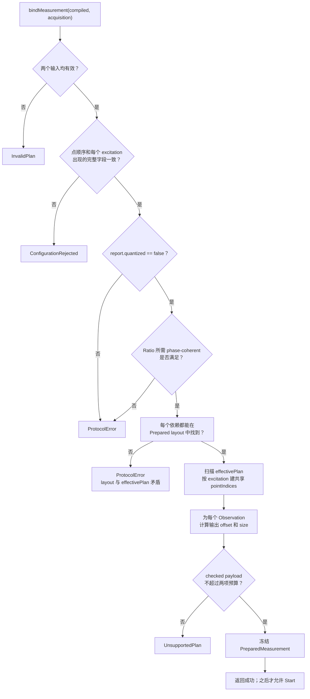

“结构兼容”要求：

- effective plan 与规范化扁平签名逐字段一致，包括点数和顺序、PointId、频率、IFBW、dwell、
  Trigger 和 SweepPolicy；
- 每个 `points[i].excitations[j]` 的位置、ExcitationId、源序列及其端口/功率/相位逐字段一致；
  同一 ExcitationId 在不同点的源设置允许不同，不能先按 ID 合并再比较；
- 每个 excitation 出现的 requiredWaves 有序序列一致，不把序列降格为无序集合；
- V1 不接纳量化后的数值变化；未来若支持量化，必须先增加稳定的请求点到有效点映射契约；
- Binder 防御性地按 WaveKey 建立索引，不把 layout 位置当语义；当前 Hardware 契约仍要求驱动
  返回的 WaveKey 顺序与 effective plan 一致，真实集成路径中的乱序会先被下层拒绝。

bind 只重复检查本层新增的两项数值前提：不接受量化结果，以及 Ratio 必须相位相干。atomic、
`allowMultiplePhysicalSweeps` 和 Direct-only 请求自身的 phase-coherence policy 已由 VnaHardware
在生成 `PreparedSweep` 前权威校验，本层通过 exact effective-plan 签名保留请求但不复制第二套
ExecutionReport policy validator。

### 6.3 绑定失败后的系统状态

`bindMeasurement()` 不拥有 Acquisition 状态。绑定失败不会回滚已经成功的硬件 Prepare，也不会
把 Acquisition 改为 Fault。调用方必须遵守：

```text
Prepare 成功
  -> bind 成功
       -> 才能 Start
  -> bind 失败
       -> 不 Start；诊断并重新编译/Prepare，或销毁当前流程
```

若硬件成功 Prepare 却缺少请求波或改变结构身份，属于接纳结果与测量请求不兼容，返回
`ConfigurationRejected`。若只是本层部署预算不足，返回 `UnsupportedPlan`。

下图是调用方持有的“当前绑定槽”生命周期，不是 `VnaMeasurement` 内部状态机：

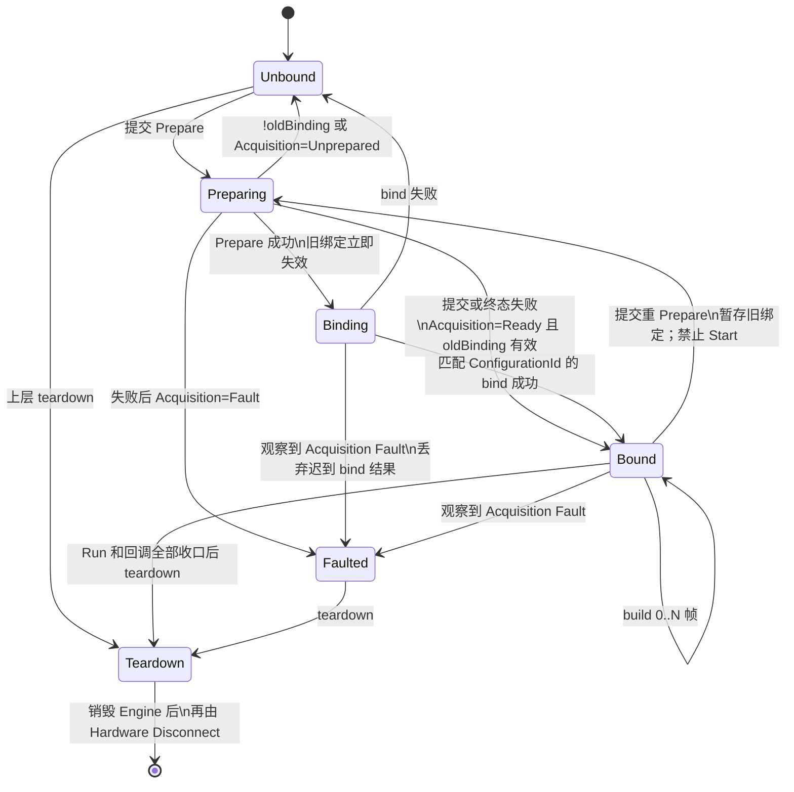

旧 `PreparedMeasurement` 对象仍可解释此前已经发布的旧帧，但新硬件 Prepare 成功后不能再用旧
绑定启动或解释新 Raw Frame。协调器从提交 Prepare 起禁止并发 Prepare/Start；只有匹配 pending
Prepare CommandId、且持有新 ConfigurationId 的 bind 成功后才能原子安装新绑定并开放 Start。
Prepare 失败只有在 Acquisition 明确保留旧配置并回到 Ready 时才恢复旧绑定。Acquisition 没有
Disconnect API；正常断开是先等待 Run/pending/回调收口，销毁 Engine 完成退订，再调用 Hardware
Disconnect。图中的 Faulted 是协调器从失败结果、Run completion 或显式 `state()` 查询观察到的状态。

## 7. 观测帧构造

### 7.1 存储布局

`PreparedMeasurement` 按 `ObservationId` 排序保存描述符。每个描述符记录：

- `ObservationId` 和 `ExcitationId`；
- Direct 的一个 WaveKey，或 Ratio 的 numerator/denominator WaveKey；
- 对应激励共享的 `pointIndices` 范围；
- 输出 values/status 的起始 offset 和 size。

同一激励的 `pointIndices` 只保存一次，供该激励的全部观测共享。每帧连续存储：

```text
values              [Observation 1][Observation 2] ... [Observation N]
status               [Observation 1][Observation 2] ... [Observation N]
Prepared pointIndices ─────────────── 只读共享，不逐帧复制 ───────────────
```

Frame 在进入计算循环前完成 values、status 和“每个不同输入波一项”的临时 View 表分配。先解析
全部不同依赖，再按 Prepared 中的 dependency ordinal 复用 View；逐样本循环不得再分配或调用
`findWave()`。

### 7.2 逐帧构造活动图

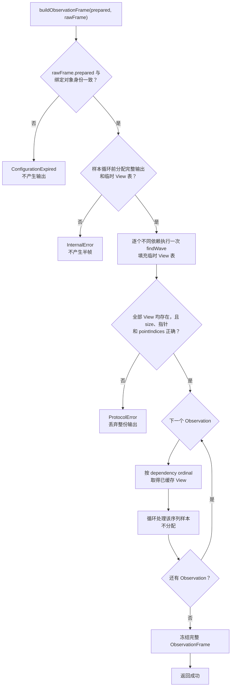

结构性错误和坏样本必须分开：

- 若 `&rawFrame.prepared() != &prepared.acquisition()`，或两者 ConfigurationId 不一致，返回
  `ConfigurationExpired`，不发布结果。
- `findWave(excitationId, wave)` 的返回语义由查询参数建立；`RawWaveSeriesView` 本身不携带 WaveKey
  或 ExcitationId，不能再“反查 identity”。返回空、非零 size 配空指针、size 或 pointIndices
  不一致时返回 `ProtocolError`，不发布半帧。
- 某个输入带质量位、分母为零或数值非有限：帧仍然成功，问题记录在该样本质量中。

本文的“安静 NaN 复数”统一指：

```cpp
const double nan = std::numeric_limits<double>::quiet_NaN();
const std::complex<double> unavailable{nan, nan};
```

### 7.3 DirectWave 规则

对每个样本：

1. `numeratorWaveQuality = waveQuality`，`denominatorWaveQuality = 0`。
2. 输入带 Missing 时输出安静 NaN 复数并增加 `InputUnavailable`；不再检查其占位数值。
3. 只有输入不带 Missing 时才检查有限性；实部或虚部非有限时输出安静 NaN 复数并增加
   `ValueNonFinite`。
4. 其他情况下原样复制复数值；Overload、Unlocked、SourceUnsettled 或 ReferenceLow 仍分别保留。

### 7.4 WaveRatio 规则

对每个样本：

```text
numeratorWaveQuality   = numeratorQuality
denominatorWaveQuality = denominatorQuality
```

计算顺序如下：

| 条件 | 输出值 | CalculationQuality |
| --- | --- | --- |
| 任一输入带 Missing | 安静 NaN 复数 | `InputUnavailable` |
| 可用的 numerator 非有限 | 安静 NaN 复数 | `ValueNonFinite` |
| 可用的 denominator 非有限 | 安静 NaN 复数 | `DenominatorNonFinite` |
| 可用且有限的 denominator 实部和虚部都精确为零 | 安静 NaN 复数 | `DenominatorZero` |
| 可执行除法，但结果非有限 | 安静 NaN 复数 | `ResultNonFinite` |
| 其他 | `numerator / denominator` | `Valid` |

先分别计算：

```text
numeratorAvailable   = numerator 未带 Missing
denominatorAvailable = denominator 未带 Missing
```

只检查可用操作数的数值。多个独立事实可以组合，例如 numerator Missing、denominator 可用且为零
时同时记录 `InputUnavailable | DenominatorZero`；denominator Missing 且占位值为零时只能记录
`InputUnavailable`，不能把占位零当作物理事实。存在任一阻断位时不执行除法。

Overload、Unlocked、SourceUnsettled 或 ReferenceLow 本身不阻断有限且非零的计算，结果仍携带
对应输入质量。下游必须同时查看两个输入质量和计算质量，不能只看复数值。

V1 不自行发明“接近零”的 epsilon。该阈值依赖波单位、归一化、接收机噪声和产品策略；当前可用
事实是精确零、非有限值以及驱动提供的 `ReferenceLow`。

### 7.5 身份和来源

每份 `ObservationFrame` 原样继承：

- `AcquisitionRunId`；
- Run 内连续的 `sweepIndex`；
- 硬件 `SweepId`；
- 绑定的 `PreparedMeasurement` 只读身份。

每次成功调用 `buildObservationFrame()` 都返回一份确定性、完整的 `ObservationFrame`。对每个
Raw Frame 只调用一次并实现 exactly-once 发布，是 §8 的协调层集成不变量，不是无状态函数能
单独强制的行为。本层不合并多个 Sweep，不重编号，也不生成新的 RunId、Revision、Epoch 或
Generation。

## 8. 线程、所有权和集成

### 8.1 不在采集回调线程做 O(N) 计算

`IVnaAcquisitionSink` 在硬件事件线程上收到 `onSweepReady()`。网络测量构造会遍历整帧，不能在
该回调中直接执行，否则一次大 Sweep 的复数除法会阻塞后续硬件事件。

推荐集成方式是由未来上层协调器维护一个预分配 mailbox：

```cpp
struct FrameWork {
    std::shared_ptr<const PreparedMeasurement> prepared;
    std::shared_ptr<const RawSweepFrame> raw;
};
```

Mailbox 包含 `N` 个有界 FrameWork 数据槽和一个不能被 Frame 占用的 Run 终态槽。FrameWork 必须
在 `onSweepReady()` 当场捕获对应 PreparedMeasurement；Worker 禁止读取可能被重 Prepare 替换的
“当前绑定”。

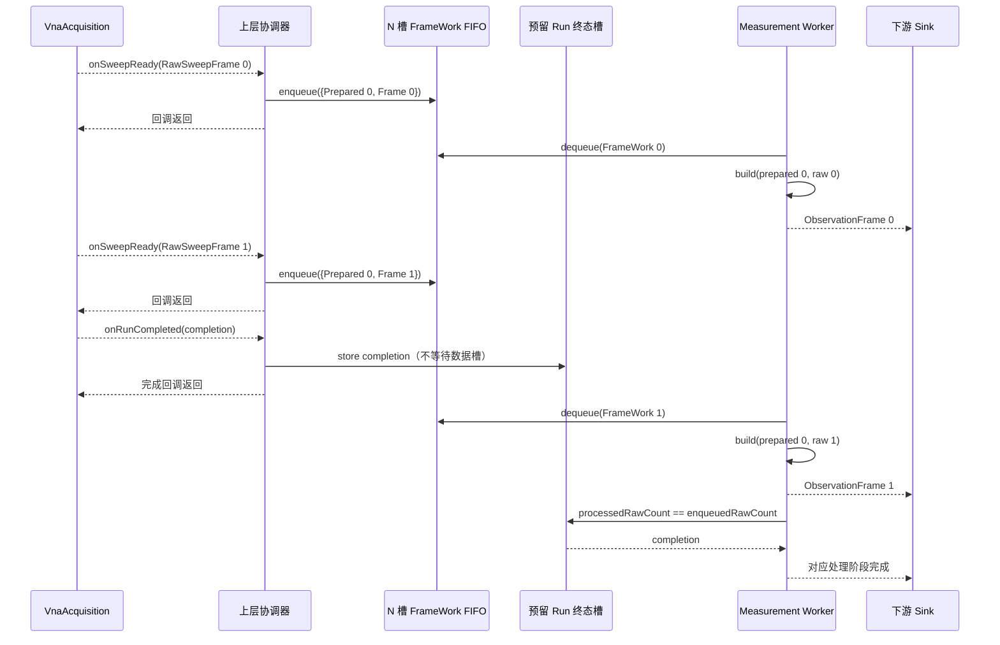

FrameWork FIFO 满时允许 Acquisition 的 `onSweepReady()` 在入队处形成 Sweep 级反压；不允许改用
无界队列。`onRunCompleted()` 只写为当前活动 Run 预留的单终态槽，绝不等待普通数据槽。终态捕获
必须截断异常；若复制诊断字符串失败，至少保留固定大小的 termination、error code、RunId 和计数。

`onRunCompleted()` 先检查 `completion.completedSweepCount == enqueuedRawCount`；不相等时锁存
处理协议错误，但仍以实际 `enqueuedRawCount` 为排空 fence，避免永久等待。Worker 只有在对应
Run 的 `processedRawCount == enqueuedRawCount` 后才消费终态，由此保证所有收到的 Raw Frame
都已处理或明确丢弃。V1 在该终态交付并释放预留槽前禁止启动下一 Acquisition Run；未来若允许
多个在途 Run，必须按最大在途数预留同样数量的终态槽。

这套 Mailbox、Worker 和下游完成屏障属于未来 Channel/协调层，不进入 `VnaMeasurement` 公开
API。本层只提供同步转换，避免又产生一套 Start/Stop/Abort、pending CommandId 和完成竞态。

### 8.2 处理失败和唯一终结

同步 `build()` 不拥有 Run，但上层集成必须为每个 Run 保存：

```text
firstProcessingError
enqueuedRawCount
processedRawCount
publishedObservationCount
stopRequestState
controlRequestError
upstreamCompletion
completionDelivered
```

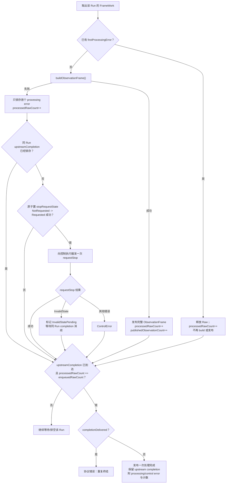

首个 build 错误后，后续同 Run FrameWork 只排空和释放，不能再发布结果。若尚未锁存真实终态，
协调器先用原子 compare/exchange 取得唯一控制请求权，再调用强制存在的 `requestStop()`。V1 自动
错误策略不优先 Abort：Abort 是可选能力，`UnsupportedPlan` 会让 Continuous Run 继续运行，不能
用一个共享 once latch 阻止后续 Stop。

终态可能在检查后提交；最后一帧的 `onSweepReady()` 尚未返回时，下层 Run 已 closing 但
`onRunCompleted()` 还未发出，`requestStop()` 也会返回 `InvalidState`。因此该返回只标记为
`InvalidStatePending`，等待随后同 Run completion 到槽后再判为正常竞态，不能要求控制调用返回时
终态已经存在。其他控制错误只进入 `controlRequestError` 诊断，绝不能据此伪造终态。所有路径都
必须等待真实终态和排空 fence 同时满足。最终处理完成同时保留原始
`AcquisitionRunCompletion` 和可选 processingError：硬件 Completed 不能被改写成硬件 Failed，
但有 processingError 或 controlRequestError 时也不能向下游伪报“整个处理链 Completed”。

单帧实际分配失败只使当前处理 Run 失败，PreparedMeasurement 可供未来 Run 重试；Prepared 身份、
Schema 或内部映射不变量破坏时，协调器隔离该 Prepared/Configuration，不再处理其后续 Run。

这些 latch 和完成对象属于协调层集成契约，不是三个同步函数能够单独保证的行为。

### 8.3 Prepare 终态线性化

`bindMeasurement()` 可能扫描 fully-expanded effective plan 并分配映射。Prepare 提交和
`onPrepared()` 终态都必须归并到同一个串行控制执行器；bind 成功后只安装 Bound，不在硬件事件
回调中执行大映射或递归 Start。

Acquisition 明确允许 `onPrepared()` 在 `prepareAsync()` 返回调用方之前到达，而且 Sink 异常只会
被下层记录，不会重试。协调器必须在调用前建立 provisional
`{attemptGeneration, compiled, oldBinding}`，同时预留一个不能被普通任务占用的
`PreparedEventSlot`。回调把 CommandId 和按值收到的 outcome 移入该槽并发出不分配的唤醒，然后
立即返回；不得依赖可能分配或拒绝的普通 `executor.post()`。

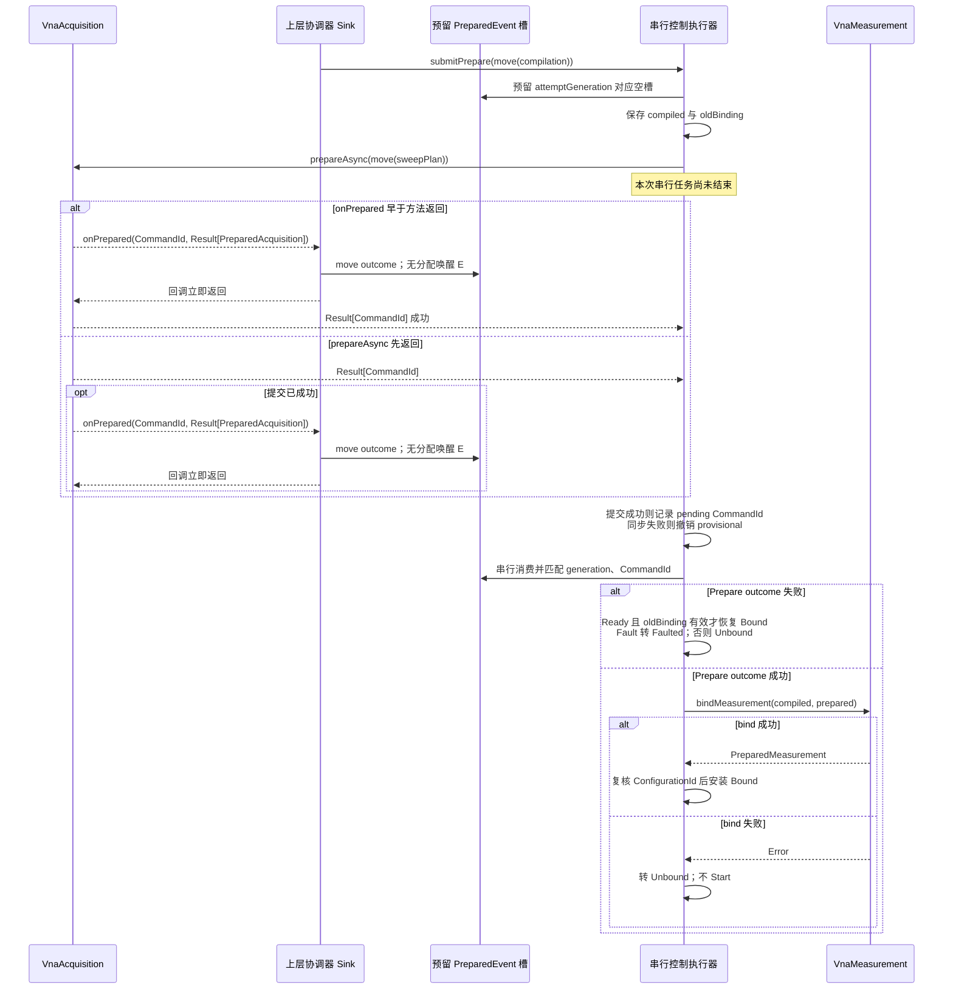

`PreparedEventSlot` 已占用时再次收到回调属于重复终态：保留首个 outcome，锁存固定大小的
`ProtocolError` 并唤醒控制执行器，不能覆盖首个结果。回调最外层必须截断异常；若发生理论上的
move/capture 失败，也要用预留的固定错误字段关闭 provisional，不能静默返回后永久停在 Preparing。

控制执行器消费终态时，CommandId 必须与 pending
`{attemptGeneration, CommandId, compiled}` 匹配；bind 结果安装时还要匹配新 ConfigurationId，并
确认期间未发生 Fault、上层 teardown 或另一条 Prepare。同步提交失败按下层契约不应产生回调；
若槽中已有事件则报告 `ProtocolError`。异步 Prepare 失败时，只有 Acquisition 状态为 Ready 且协调器
仍持有本次调用前的 oldBinding，才恢复旧 Bound；oldBinding 为空时即使 Acquisition 为 Ready 也
保持 Unbound，Unprepared/Fault 分别转 Unbound/Faulted。迟到结果只释放。

`MeasurementCompilation.sweepPlan` 移动提交后不可复用。Prepare 同步或异步失败需要再次
`compileMeasurement()`；上层应保留自己的产品/Channel 配置作为重建请求的事实源，不能把
`CompiledMeasurement` 当成可重试的完整计划。

### 8.4 Start 和早到 Run 事件线性化

主干 v0.13 同样允许 `onSweepReady()` 或 `onRunCompleted()` 在 `start()` 返回 RunId 前到达。安装
Bound 后，协调器仍不能直接裸调 Start；必须先预分配一个 provisional RunIngress：

```text
attemptGeneration
PreparedMeasurement
acceptedRunId（初始为空）
workerGate（初始关闭）
N 个 FrameWork 数据槽
1 个预留 Run 终态槽
enqueuedRawCount / processedRawCount / publishedObservationCount
```

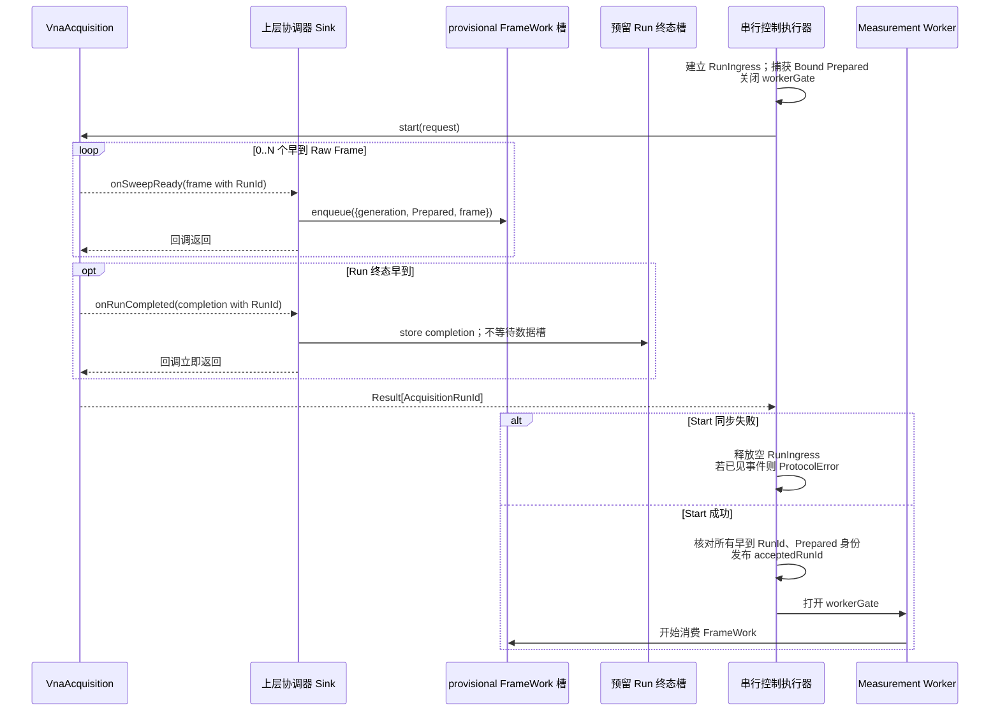

RunIngress 必须在调用 `start()` 前完整分配，不能在第一个回调里临时扩容。早到 Frame 可以在有界
槽满时形成反压，但 workerGate 在返回 RunId 并完成匹配前保持关闭；这样不会为一个尚未被调用方
接纳的 Run 发布观测。Start 同步失败按下层契约不产生任何 Run 回调；若槽中已有 Frame 或终态，
或者早到 payload 的 RunId 与返回值不一致，协调器按 `ProtocolError` 失败关闭并排空，不猜测归属。
V1 继续禁止前一 Run 的处理终态交付前启动下一 Run，因此只需一个 RunIngress。

### 8.5 所有权规则

- `CompiledMeasurement` 只读持有紧凑结构签名、观测定义、依赖和预算，不持有完整请求计划。
- `PreparedMeasurement` 只读共享 `CompiledMeasurement` 与 `PreparedAcquisition`。
- `ObservationFrame` 只读共享 `PreparedMeasurement`，自己拥有 values 和 status。
- `buildObservationFrame()` 只在调用期间借用 `RawSweepFrame`，返回后不保留它。
- 任一旧 Frame 都通过自己的 Prepared 对象解释，不依赖当前最新配置。
- 三个入口不使用全局缓存；不同不可变输入可在不同工作线程并行调用。

### 8.6 下层公开契约门禁

上述集成依赖四条下层语义：回调可能早于公开方法返回、`onSweepReady()` 返回形成 Sweep 级反压、
成功 Raw Frame 先于同 Run 终态、每个已接纳 Run 恰好一个终态。主干实现和 v0.13 设计当前满足，
但 `modules/VnaAcquisition/include/VnaAcquisition.h` 的公开注释尚未完整写出四条语义。协调器实现
合入前应把它们提升为公共头契约并增加确定性 contract tests；不能只依赖当前私有实现时序。

## 9. 容量和性能

### 9.1 容量公式

对每个被观测引用的激励 `e`：

- `R_e`：effective plan 中该激励出现的点数；
- `O_e`：该激励上的观测数；
- `W_e`：编译后该激励需要的不同直接波数。

另定义：

- `P`：点数；
- `X`：全部点中的激励出现次数；
- `S`：全部 `points[i].excitations[j]` 出现中的源条目总数；
- `E`：不同 ExcitationId 数；
- `D = ΣW_e`：不同 `(ExcitationId, WaveKey)` 依赖数；
- `O = ΣO_e`：观测定义数；
- `R = ΣR_e`：共享 pointIndices 总数；
- `T = Σ(R_e × O_e)`：观测样本数。

实现内部定义固定、标准布局的 `FlatPlanHeader`、`FlatPointSignature`、
`FlatExcitationSignature`、`FlatSourceSignature`、`CompiledDependency`、
`PreparedExcitationMapping`、`BoundDependency` 和 `BoundObservation`。唯一
`checkedMeasurementPayload()` helper 按下式计算逻辑 payload：

```text
B_compiled =
    sizeof(FlatPlanHeader)
  + P × sizeof(FlatPointSignature)
  + X × sizeof(FlatExcitationSignature)
  + S × sizeof(FlatSourceSignature)
  + O × sizeof(ObservationDefinition)
  + D × sizeof(CompiledDependency)

B_bound =
    E × sizeof(PreparedExcitationMapping)
  + R × sizeof(uint32_t)
  + D × sizeof(BoundDependency)
  + O × sizeof(BoundObservation)

B_prepared = B_compiled + B_bound

B_frame =
    T × (sizeof(complex<double>) + sizeof(ObservationSampleStatus))

B_scratch = D × sizeof(RawWaveSeriesView)
B_build   = B_frame + B_scratch

N_raw = Σ(R_e × W_e)
B_raw = N_raw × (sizeof(complex<double>) + sizeof(uint32_t))

当前 VnaAcquisition v0.13 的组帧预算：
B_acquisition_assembly = B_raw + E × sizeof(size_t)
```

`B_prepared <= maximumPreparedPayloadBytes`，`B_build <= maximumBuildPayloadBytes`。compile 用请求
数量预检，bind 用 effective plan 复核；两阶段必须调用同一个 helper，不能维护两套公式。

逻辑 payload 明确排除：

- 已移动提交的 `VnaSweepPlan`；
- 下层拥有的 `PreparedAcquisition`；
- `shared_ptr` 控制块、vector 对象本身、allocator 元数据、capacity 余量和对齐后的进程 RSS。

这些排除项仍要进入峰值 RSS 基准，但不进入“恰好等于/少 1 B”的逻辑预算断言。当前建议类型下
每个观测样本为：

```text
16 B complex value + 12 B ObservationSampleStatus = 28 B
```

所有求和、乘法和 offset/end 都必须逐步 checked；不能先执行可能溢出的原生表达式再检查结果。

### 9.2 四端口、10,000 点基线

常见四端口未校正网络观测可在每个源激励 `j` 下请求：

```text
requiredWaves = [a_j, b1, b2, b3, b4]
observations  = [b1/a_j, b2/a_j, b3/a_j, b4/a_j]
```

四个激励、每个 10,000 点时：

| 项目 | 结果 |
| --- | ---: |
| 点×激励记录 | 40,000 |
| 每激励直接波数 | 5 |
| Raw 复数样本数 | 200,000 |
| 发布 Raw Frame 的 values + quality，即 `B_raw` | 4,000,000 B（3.815 MiB） |
| 当前 64 位 Acquisition 组帧预算 | 4,000,032 B（`B_raw + 4×sizeof(size_t)`） |
| Ratio 序列数 | 16 |
| Observation 样本数 | 160,000 |
| Observation values payload | 2,560,000 B |
| Observation status payload | 1,920,000 B |
| Observation 单帧 payload | 4,480,000 B（4.272 MiB） |
| Prepared 共享 pointIndices 子项 | 160,000 B（0.153 MiB） |
| Build scratch | `20 × sizeof(RawWaveSeriesView)` |

这只是容量与映射用例，不证明四端口校准或最终 S 矩阵正确。测试必须参数化端口数、点数、激励和
表达式，不能把 4、10,000 或 16 写成生产常量。主干 `8aa41a8` 的大形状测试是每激励 4 波、
`3,200,032 B` 组帧预算，不能替代这里的 5 波用例；Measurement 集成必须另测
`4,000,032 B` 恰好通过、少 1 B 在 Acquisition Prepare 前失败。

处理期间 Raw Frame 与 Observation Frame 会同时存在。上层峰值内存还必须计入：

```text
输入 FIFO 中 Raw 帧
+ Worker 当前 Raw 帧
+ Worker 正在构造的 Observation 帧
+ 输出队列/消费者持有的 Observation 帧
+ 所有仍被 Frame、队列、当前绑定持有的 PreparedMeasurement / PreparedAcquisition 代次
```

若 `D_in` 是 FrameWork 数据槽数、`D_out` 是输出队列帧数、`H` 是消费者最多持帧数，`C_live` 是
仍被引用的不同 PreparedMeasurement 代次集合，则对同一固定测量形状，处理流水线的测量层逻辑
载荷上界为：

```text
(D_in + 1) × B_raw
+ (D_out + H + 1) × B_frame
+ B_scratch
+ Σ B_prepared(c), c ∈ C_live
```

跨 re-Prepare 允许形状变化时，旧输出帧的 `B_frame` 也不能用当前形状替代。令
`F_live = outputQueue ∪ consumerHeld` 且 `|F_live| <= D_out + H`，此时精确求和写成：

```text
(D_in + 1) × B_raw(activeRun)
+ B_build(activeRun)
+ Σ B_frame(f), f ∈ outputQueue ∪ consumerHeld
+ Σ B_prepared(c), c ∈ C_live
```

部署门禁可用 `maximumRawFramePayloadBytes` 和 `maximumBuildPayloadBytes` 代替各项做保守上界，但要
注明前者包含 Acquisition 组帧进度、后者包含一份 scratch，因此会有意高估。

两个“+1”分别表示 Worker 当前持有的 Raw Frame 和正在构造但尚未入输出队列的 Observation
Frame。旧 ObservationFrame 会保留自己的 PreparedMeasurement，不能只加一份当前
`B_prepared`。单在途处理 Run、单当前 Bound 和本设计的 re-Prepare 规则下，可用保守门禁
`|C_live| <= D_out + H + 2`；实现应按实际不同 shared identity 去重后求和，而不是按帧数重复计算。

`B_prepared` 明确不含下层 `PreparedAcquisition`。每个 live 代次保留的 Acquisition 私有 mapping、
effective plan 和 Hardware prepared snapshot 必须再按下层预算与 RSS 实测计入；不能把
`maximumPreparedPayloadBytes` 当成跨层总上界。PreparedEvent、Run 终态和 provisional RunIngress
的固定控制载荷也另按实际结构计入。以本基线且 `D_in=D_out=H=1` 为例，单纯 Raw 与 Observation
帧载荷上界为
`2×4,000,000 + 3×4,480,000 = 21,440,000 B`；这仍不是 RSS，因为不含下层池、容器和 allocator
开销。

`maximumBuildPayloadBytes` 只限制一份输出及其临时 View 表的逻辑 payload，不是假装覆盖整个
进程 RSS。

### 9.3 复杂度和热路径

| 阶段 | 时间复杂度 | 允许分配 |
| --- | --- | --- |
| compile | `O(P + X + S + O + Σ W_e log W_e)` | 冷路径允许，受预算约束 |
| bind | `O(P + X + S + D + O)` | 冷路径允许，受预算约束 |
| build | `O(T + D × (E + W_max))` | 样本循环前完成有界分配；逐样本循环零分配 |

这里的 `W_max = max(W_e)`。当前 `RawSweepFrame::findWave()` 先线性扫描 excitation layout，再扫描
该 layout 的波，因此 D 次解析不能写成 O(D)。每个依赖仍只调用一次；若下层未来提供 O(1)/O(log N)
查询，再据真实实现收紧复杂度。

build 热路径要求：

1. 每个不同输入波每帧恰好解析一次 `findWave()` 并写入临时 View 表，不能逐观测重复或逐点查找。
2. 不使用字符串 Map、虚调用、逐点对象或格式化日志。
3. 不重复建立硬件/采集层的 coverage bitmap。
4. 每个 Direct 样本复制一次，每个 Ratio 样本做一次复数除法和有限性检查。
5. 输出全部成功后一次冻结；失败不发布部分结果。

### 9.4 网络测量专属性能门禁

主干现有 `>= 40 MiB/s` 压力管线和 `>= 12,000 MiB/s` 组帧门禁只覆盖 Acquisition 的 4 波、
160,000 Raw 样本；不能直接移植为本层结论。本层目标形状是 5 波、200,000 Raw 样本，并新增
160,000 次 Ratio 状态判断/复数除法和 4,480,000 B 输出。

实现验收必须增加独立 `VnaMeasurementBenchmark`，至少分开报告：

- build-only 的 Raw-ready 到 Observation-ready P50/P95/P99；
- 以输入 Raw、输出 Observation 和二者合计三种口径计算的 MiB/s；
- 端到端 Continuous 的队列等待、Sweep/s、零丢帧和完成 fence 延迟；
- 单帧分配次数、样本循环分配次数（必须为 0）、CPU 和峰值 RSS；
- `D_in/D_out/H=1` 及慢消费者下的反压和内存上界。

门禁场景固定为本机基准同类的 4P/10k/4 激励，但使用本层真实 5 波/16 Ratio 配方。合入实现前，
必须先实测该形状并冻结阈值；最低原则是 Measurement Worker 的持续消费速率不低于同一构建、
同一机器上的 5 波 Acquisition 输入速率，且 P99 不导致 FrameWork 队列持续增长。在基准数据产生
前，正确性可以关闭，性能 P1 保持开放，不能引用 4 波门禁宣称本层达标。

## 10. 错误和恢复

本层没有运行状态机。错误只属于一次同步操作：

| 阶段 | 情况 | 返回 | 调用方动作 |
| --- | --- | --- | --- |
| compile | 定义或骨架无效 | `InvalidPlan` | 修正请求 |
| compile/bind | 表达式或 payload 超出 V1 | `UnsupportedPlan` | 缩小计划或调整部署预算 |
| bind | effective plan 与编译语义不兼容 | `ConfigurationRejected` | 不 Start，重新 Prepare 或报告 |
| bind | report.quantized 为真，或 Ratio 所需 phaseCoherent 为假 | `ProtocolError` | 不 Start，隔离该 Prepared/configuration |
| build | Raw Frame 属于另一份 PreparedAcquisition | `ConfigurationExpired` | 丢帧并终止对应上层处理流 |
| build | 依赖 View、size 或 pointIndices 不一致 | `ProtocolError` | 丢帧；协调器 `requestStop` 并排空 |
| 任一阶段 | 实际分配失败 | `InternalError` | 丢弃当前操作；不可变 Prepared 可在未来 Run 重试 |
| 任一阶段 | 本层不变量或无法收口的内部异常 | `InternalError` | 隔离相关 Prepared/configuration，记录诊断 |
| 单个样本 | 输入质量异常、零分母或非有限 | Frame 成功，写质量位 | 下游按质量策略处理 |

`VnaError.description` 用于定位 `observations[i]`、`points[i].excitations[j]` 等路径，但上层分支只看
稳定 `VnaErrorCode`，不解析描述字符串。

build 结构失败后，网络测量层自身无需“恢复”；它没有可变配置。是否 Stop、Abort 或继续采集由
拥有 Run 的上层协调器决定。对于同一 PreparedMeasurement，如果失败表明 Schema 不变量被破坏，
上层不得继续发布后续观测帧。

## 11. 测试和验收

### 11.1 编译测试

- 两个比值 `b1/a1`、`b2/a1` 只生成 `[a1,b1,b2]`。
- Direct 与 Ratio 共享波时正确去重。
- 同一 `ExcitationId` 在稀疏点出现时，每处得到完全相同的规范波顺序。
- PointId、ExcitationId 使用非连续乱序值，不存在 `id - 1` 假设。
- 重复/零 ObservationId、重复表达式、空定义、未知/未被引用的 ExcitationId 和非空骨架
  requiredWaves 被同步拒绝。
- `allowQuantization=true` 原样保留；当前 Hardware 返回未量化结果时可绑定，任何实际量化结果仍
  在下层或 bind 失败关闭，不能静默映射到请求点。
- WaveKind 非法或 PortId 为零同步拒绝；大于设备端口数仍交给 Hardware Validate。
- 骨架的频率、IFBW、dwell、源功率/相位和 Trigger 逐字段保留；Ratio 只收紧
  `requirePhaseCoherence`，其他 SweepPolicy 字段不变。
- 同一 ExcitationId 在不同点使用不同源端口/功率/相位时，签名按每个出现位置保留，不能折叠成
  一个 ID 级源状态。
- 两项预算“恰好等于需求”通过，“少 1 B”在任何下层调用前失败。
- 端口和设备能力错误仍交给 Hardware Validate，Measurement 不维护第二套能力规则。

### 11.2 绑定测试

- PointId 数值非连续且非单调、ExcitationId/LayoutId 乱序时仍按身份绑定；effective points 数组
  顺序必须与请求保持一致。
- 同一激励只在部分点出现时，共享 pointIndices 正确且升序。
- effective plan 与编译期扁平签名逐字段一致；输出帧仍只从 effective plan 读取权威设置。
- Binder 隔离单测使用人工 Prepared 对象打乱 layout 顺序时仍按键绑定；真实 Hardware 集成测试
  断言驱动乱序由下层先拒绝。
- 把另一份频率、功率或任一点源设置不同但 ID 相同的 PreparedAcquisition 传入时绑定失败。
- Ratio 对应 report 的 phaseCoherent=false，或任意 report.quantized=true 时按协议错误失败关闭。
- 缺 layout、缺波、点身份改变、激励集合改变和源端口结构改变时失败关闭。
- Prepared payload 边界恰好等于通过，少 1 B 失败。
- bind 失败不改变 Acquisition 状态，但调用方不会 Start。

### 11.3 构造测试

- 用可配置 Fake Hardware 生成精确 `a1`、`b1`、`b2` 哨兵值，逐点验证 `b1/a1` 和 `b2/a1`；
  精确数学单测不依赖带噪物理模型。
- Simulator 集成逐点比较 Observation Ratio 与同一 Raw Frame 中 numerator/denominator 的直接计算。
  主干 Simulator 已是开路反射、隔离泄漏和确定性接收机噪声模型，禁止继续硬编码旧的 `0.1/0.5`
  常数。
- DirectWave 的可用值和全部 WaveQuality 位逐样本不变。
- Direct 的 numeratorWaveQuality 原样保留且 denominatorWaveQuality 为零。
- Ratio 分别保留 numerator 和 denominator 的全部质量位，不做有损合并。
- Missing 输出安静 NaN 并标记 InputUnavailable，但不使完整 Frame 构造失败。
- 分母精确零、分母非有限、分子非有限和结果溢出分别设置正确 CalculationQuality。
- denominator Missing 且占位值为 0/NaN 时不附加 Zero/NonFinite；numerator Missing 且可用
  denominator 为零时两个独立问题可组合。
- 分子与分母同时非有限、多种 WaveQuality 同时置位时逐位无损；规范 NaN 的实部和虚部都用
  `std::isnan()` 验证。
- ReferenceLow、Overload 等非 Missing 位保留可计算值和输入质量，不使完整 Frame 构造失败。
- 两个输入的 pointIndices 或 size 不一致时整帧失败，不发布已算序列。
- Raw Frame 的 Prepared 身份不匹配时失败。
- runId、sweepIndex、SweepId 和 PointId/频率来源逐字段保持。
- 对同一 Raw Frame 重复调用同步 build 得到内容相同的独立帧，不暗含平均或复用上一 Sweep 数值。
- Sink/消费者长期持有旧 Frame 时，重新 Prepare 不影响旧帧解释。

### 11.4 集成和容量测试

- `compile -> Acquisition Prepare -> bind -> Start -> Raw -> build` 完整闭环。
- Harness 让 `onPrepared()` 早于 `prepareAsync()` 返回：provisional 上下文和串行归并仍只绑定
  一次，不丢失合法回调；同步提交失败时不遗留可启动的 provisional。
- PreparedEvent 预留槽拒绝重复终态且保留首个 outcome；注入普通任务队列分配失败也不丢失
  Prepare 终态。
- 重 Prepare 失败分别覆盖 Acquisition 回到 Ready、Unprepared 和 Fault：只在 Ready 且旧绑定
  仍在时恢复 Bound。
- Harness 在 `start()` 返回前分别注入“早到 Frame + Completed”和“0 Frame 的异步 Failed 终态”；
  RunIngress 在返回 RunId 前不发布，返回后按 payload RunId 正确归属并只终结一次。
- Start 同步失败不产生回调；若故障 Harness 仍注入 Frame/终态，或早到 RunId 与返回值不同，按
  `ProtocolError` 排空且不猜测归属。
- 每个 FrameWork 捕获自己的 PreparedMeasurement；旧帧积压期间重 Prepare 仍按旧配方处理。
- FrameWork 使用有界数据槽，Run 终态使用预留非阻塞槽；最后一帧总在处理完成前交付。
- 协调器对每份成功入队的 Raw Frame 只调用一次 build；重复回调或重复消费按协议错误关闭。
- 输入队列深度 1、慢 Worker/消费者时内存有界且形成预期反压。
- Stop 后已完成 Raw Frame 仍转换；Abort 丢弃的 Raw Frame不产生观测帧。
- build 结构失败时下游收到唯一失败，上层不发布半帧或伪成功完成。
- 首个 build 错误后排空同 Run 后续 FrameWork，最多请求一次 `requestStop`，并在真实 Acquisition
  终态到达后只发布一次包含 processingError 的处理完成。
- 在最后一帧 `onSweepReady()` 尚未返回、终态尚未入槽时让 `requestStop` 返回 `InvalidState`：先
  标记 pending，随后匹配 completion 到达时再按正常竞态收口。
- Hardware 不支持 Abort 的 Continuous Run 发生 build 错误时仍走 `requestStop` 并终结，不因
  `UnsupportedPlan` 和共享 once latch 永久等待。
- 终态完成数与实际入队数不一致时锁存协议错误，但以实际入队数作为 fence，不发生永久等待。
- §9.2 四端口/10,000 点/4 激励/5 波/4 Ratio 参数化用例通过；Acquisition 组帧预算
  `4,000,032 B` 恰好通过、少 1 B 失败。
- 2/4/8 端口、相邻点数和不同 Direct/Ratio 组合使用同一生成器覆盖。
- Continuous 按 §9.4 分别记录 build-only 与端到端吞吐、P50/P95/P99、CPU、RSS、分配数和队列
  等待；不复用 Acquisition 的 4 波门禁冒充结论。

### 11.5 编码门禁

| 优先级 | 项目 | 关闭条件 |
| --- | --- | --- |
| P0（已关闭） | Acquisition 契约 | 主干 `97fc1f8` 已实现 `PreparedAcquisition`、`RawSweepFrame` 和回调门禁 |
| P0 | 需求与配方同源 | requiredWaves 和 build recipe 由同一 ObservationDefinition 生成 |
| P0 | 质量语义 | 两个输入质量无损保留，计算质量和所有异常数值真值表通过 |
| P0 | 容量 | 两项非零预算、全部受检算术和 4P/10k 用例通过 |
| P0（集成） | 有界集成 | Prepare/Run 预留槽、早到回调、Frame 捕获绑定、完成屏障与慢消费者用例通过 |
| P0 | Schema 失败关闭 | 不匹配时无半帧、无旧值复用、无异常越过边界 |
| P1 | 真机数值契约 | 单位、参考阻抗/平面、相干域和工厂归一化边界明确 |
| P1（开放） | 下层头文件契约 | §8.6 四条回调/反压/终态语义进入 `VnaAcquisition.h` 并有 contract tests |
| P1（开放） | 网络测量性能 | §9.4 的 5 波/16 Ratio 专属基准冻结并达到 P99、吞吐、CPU、RSS 和分配门禁 |

## 12. 实现顺序

1. 定义 ObservationId、DirectWave、WaveRatio、Quality、Limits 和不可变结果对象。
2. 实现 compile 的依赖去重、规范排序、模板注入、容量检查和单元测试。
3. 实现 bind 的 effective plan 兼容检查、共享 pointIndices、输出 offset 和边界测试。
4. 实现 DirectWave build，再实现 Ratio 数学与质量真值表。
5. 先用 Fake Hardware 闭合精确 Ratio 真值，再用 Simulator 对同一 Raw Frame 做逐点交叉验证。
6. 完成乱序/稀疏、故障注入、4P/10k 和 checked arithmetic 测试。
7. 由上层增加 PreparedEvent 预留槽、provisional RunIngress、有界 FrameWork mailbox 和 Run 终态
   槽，验证早到回调、完成屏障和长时间 Continuous。
8. 建立 §9.4 专属基准并冻结本机门禁；数据证明需要后才考虑 SIMD、批量数学或帧池，不改变公开
   Schema。

V1 不增加异步 `IVnaMeasurementEngine`、多订阅者分发、通用表达式、结果 cache 或配置 Revision。
如果未来出现跨激励矩阵求解、校准数据归约或多 Channel 调度，应分别建立新模块并重新评审其
相干、数据阶段和生命周期，而不是扩张本层的三个同步入口。
