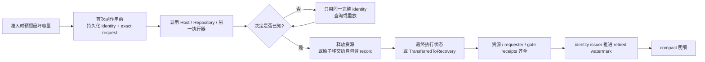

# 详细设计 01A：公共阅读规则与 L0 契约

> **30 秒摘要**：本篇先规定所有详设共同使用的身份、所有权、恢复记录和验证读法，再定义 L0 允许共享的最小类型与数值 Schema；任何业务状态机仍由自己的 owner 文件定义。
>
> **阅读入口**：第一次阅读先看 [§1.2 易混术语速查](#12-易混术语速查)；设计跨进程或可恢复操作时再看 [§1.3 恢复协议](#13-怎样读后文的恢复协议)；实现公共类型时进入 [§2](#2-l0公共契约vnacontracts)。
>
> 连续阅读起点 · [返回 D1 专题导航](./01-公共契约与硬件采集.md) · [返回文档索引](../README.md) · 下一篇：[D1B：驱动边界与硬件](./01B-驱动边界与硬件.md)

本篇承接 [D1 导航](./01-公共契约与硬件采集.md)，保留全局章节号 §1–§2。架构理由和依赖方向以[总体架构与分层](../架构设计/01-总体架构与分层.md)为准。

## 1. 分层总表

| 层 | 主要模块 | 输入 | 输出 | 绝对禁止 |
| --- | --- | --- | --- | --- |
| L0 契约 | `VnaContracts` | 无 | 单位、身份、逐 series/span Schema、Status、Quality、Credit | Qt、SCPI、驱动句柄、业务工作流 |
| L1 驱动边界 | `VnaDriverSdk`、`VnaDriverHost` | 版本化设备命令 | 能力、实际执行计划、波块、终态 | Channel/Trace、未限时阻塞、异常跨 ABI |
| L2 硬件 | `VnaHardware` | `AcquisitionRecipe` | `EffectiveExecutionPlan`、物理执行事件 | 校准/Trace、Continuous 策略、UI 编号 |
| L3 采集 | `VnaAcquisition` | Prepared execution、波块 | 完整 `RawWaveFrame`、Acquisition terminal | 比值、S 参数、跨 Sweep 平均、Channel 调度 |
| L4 数值核心 | ProviderConditioning/Observation/NetworkModel/Calibration/Transform/Trace Core | 带 Schema 不可变帧 | 带 Schema 不可变帧、求解结果 | I/O、线程、回调、文件对话框 |
| L5 Channel | `VnaChannelCore` | Channel intent、能力、CalSet | Recipe、`BoundChannelPlan`、兼容报告 | 设备生命周期、外部命令语法 |
| L6 Runtime | `VnaRuntime` | `InstalledDeploymentDescriptor`、registry Pin/Lease、命令/外部触发/自由运行条件 | `Initiation`、`AdvanceEvent`、`TargetBatch`、有界子 Run、ResultSnapshot、唯一终态 | SOL 步骤、UI/SCPI、持久化策略 |
| L7 Application | `VnaApplication` | 用例命令/查询 | Session 状态、事务、工作流、资源引用 | 直接依赖厂商驱动或 QWidget |
| L8 适配器 | SCPI/UI/Automation/File/Data | 外部协议/交互 | 应用命令、序列化结果 | 直接改 HAL、复制一套业务状态机 |

### 1.1 每层必须回答的七个问题

本文不以“列出一些类名”视为完成设计。实现或评审任一层时，都必须能从对应章节找到以下答案：

| 问题 | 最低要求 |
| --- | --- |
| 职责 | 一句话说明该层解决什么问题，以及明确不解决什么 |
| 输入/输出 | 使用强类型端口、Schema、Handle 和 terminal，不用模糊回调或裸 ID |
| 状态所有者 | 指明谁是唯一写者、哪些只是投影、何时冻结 revision |
| 并发 | 指明串行化边界、锁序/actor、回调线程和允许的流水线并行 |
| 资源 | 所有队列、Frame、Prepared、workspace、结果由谁计费和释放 |
| 错误/恢复 | 指明失败位置、唯一终态、是否可重试、重试是否新建 operation |
| 验证 | 至少包含纯单元、契约、竞态/故障注入和纵向集成中的适用项 |

层只约束依赖方向，不等于部署单元。进程隔离属于故障边界，线程属于并发实现，产品对象属于业务所有权；不能因为名称相同就把三者合并。

### 1.2 易混术语速查

| 不应混同 | 区别 |
| --- | --- |
| ID / Handle / Ticket | ID 只标识；Handle 是进程内 owner/capability，可能 move-only；Ticket 是可序列化查询键 |
| Revision / Generation | Revision 是已提交内容版本；Generation 是一次尝试或竞态代次 |
| Intent / Recipe / EffectivePlan | Intent 是用户目标；Recipe 是请求；EffectivePlan 是硬件承诺的实际执行事实 |
| BoundPlan / Descriptor / InstalledRecord | BoundChannelPlan 是 L5 纯绑定结果；Descriptor 是可序列化部署事实；InstalledRecord 是 L7 私有、唯一拥有 L2 Handle/常驻 Credit 的可执行记录 |
| AdvanceEvent / TargetBatch / Run / Sweep | 输入事实 / 一次事件的完整目标集合 / 成功准入的单目标工作 / 设备物理动作 |
| Eligibility / Readiness / Admission | 路由是否选中 / 当前资源与代次是否可用 / 原子取得资源并创建对象 |
| InitiationPin / child Lease / Credit | 父 Pin 贯穿 WaitingForAdvance/父生命周期；child Lease 属于一个 admitted target 并钉到 ProcessingTerminal；Credit 只是二者及数据资源的可计量容量 |
| Disposition / Provenance / Fence | disposition 是某对象最终如何处置的闭集事实；provenance 是结果可独立解释的来源链；fence 是一组已满足谓词的证明，不是 sleep、时间戳或“当前不忙”猜测 |
| 软件已围栏 / 物理已静止 / 物理状态不可知 | 软件围栏只证明旧进程或宿主不再发命令/回调；物理静止还需设备回读、硬件看门狗/互锁或独立安全通道证明后置条件；只有前者时必须保留物理状态不可知并隔离设备 |
| Quantity / Correction / ReferencePlane / AccessPoint | 数值是什么 / 应用了什么修正 / 位于哪个物理平面 / 从处理链哪里读取 |
| Observation / Network parameter | 波或接收机直接量/比值 / 经拓扑、激励和网络模型证明后的矩阵量 |
| Acquisition / Processing terminal | 设备与组帧已结束 / 全部已接纳数据已有结果处置和状态提交 |

推荐阅读顺序是：先看[六个运行对象](./03A-运行对象职责与端口.md#81-六个运行对象)和[四类运行职责](./03A-运行对象职责与端口.md#82-四类运行职责的实施契约)，再按需要查 L2/L3/L4 契约；竞态证明集中在各状态表和[P0 竞态矩阵](./05C-依赖验收与竞态.md#124-p0-竞态矩阵)，不必先读完所有异常路径。

### 1.3 怎样读后文的恢复协议

后文频繁出现 identity、owner、receipt、retirement 和 compact。它们不是为了堆术语，而是在回答同一个现实问题：**进程可能恰好死在外部副作用已经发生、调用方还不知道结果的那一行。** 任何跨线程、跨进程或跨 Repository 的可恢复操作，都应能映射到下面这条骨架；某一步不适用时可以省略，但不能用“稍后清理”代替。



读每个协议时按以下顺序核对，比从类名猜职责更可靠：

| 核对点 | 必须能回答 | 常见错误 |
| --- | --- | --- |
| 身份 | 哪个完整 identity 标识这次 attempt，谁在首次调用前保存 exact request | 只留裸 UUID；响应丢失后才补身份 |
| 唯一 owner | 此刻谁唯一拥有 Handle、Lease、Pin、Credit 或外部处置责任 | 写了一个 `SomethingOwner` 名称，却没有 durable record |
| 移交 | 哪个 CAS/receipt 同时证明 source 为零、target 已自包含 | source 先清零，再尝试创建 target |
| 恢复 | startup 枚举哪些**全部未退役**记录，terminal 后崩溃时做什么 | 只扫“未终态”，漏掉 terminal→watermark 窗口 |
| 退役 | 谁是公开 watermark 的唯一写者，越过窗口后返回什么 | caller、callee各推进一套水位；compact 后重做副作用 |

三个词尤其不能混用：`BusinessTerminal` 只说明业务结果已经不可改写；`CleanupDone` 说明本 record 的资源动作已经结束；`Retired*Epoch` 才说明重试窗口可被压缩。`TransferredToRecovery` 也不等于资源已释放，只表示责任已经由一份可独立枚举的 target record 接管。后文较长的 fault/Close/unknown-result 段落都只是这张骨架在不同资源上的具体展开。

## 2. L0：公共契约（`VnaContracts`）

### 2.1 职责

L0 只提供各层都无法自行发明第二种语义的基础原语：强类型 ID/Revision、可退役定位符、单位与轴、NumericSchema、不可变借用视图、通用错误和 Credit。它不拥有任何产品工作流，也不声明 Runtime、Result、Calibration、Bind/Unbind、CatalogDelete、Save/Recall 或 ArtifactTransfer 的业务身份。

L1–L3 需要共同穿过 ABI、Hardware 与 Acquisition 的设备身份、Prepare/Start/Execution 身份、有效计划和 RawWaveFrame 契约，也在本篇定义；它们是 D1 的物理执行契约，不是“放进 L0 就自动变成全局业务对象”。

边界规则只有三条：

- L0 可以定义“怎样表达”，不能决定“谁可执行下一步”；状态机、journal、receipt 和恢复责任方 由拥有业务线性化点的详设定义。
- 下层不接收上层可变对象。需要关联时，上层保存强类型映射或在自己的不可变 envelope 中组合，不把 Trigger、Channel、Ticket 等对象塞回 Hardware Frame。
- 同名裸 UUID、单个 `ContentHash` 或通用 `OperationId` 不能代替 owner 定义的完整强类型身份。

### 2.2 最小类型形状与所有权

本节按“通用原语 → 数值 Schema → D1 物理执行 → owner 映射”排列。每个代码块只表达一组相邻概念；实现可以采用等价的普通 `struct`、显式工厂和运行时验证，不要求复制版式。

#### 2.2.1 强类型 ID、版本和可退役定位

```cpp
template<class Tag>
struct StrongId {
    Uuid value;                         // 非零；不同 Tag 不可隐式转换
};

template<class Tag>
struct Revision {
    std::uint64_t value;                // 非零、已提交后单调推进
};

struct RetirableLedgerLocator {
    LedgerKind kind;
    std::uint64_t ledgerEpoch;
    std::uint64_t issuedSequence;
    IssuerIntegrityTag issuerTag;
};

struct CanonicalEnvelopeDigests {
    ContentHash semanticRequestHash;    // 不含本次完整 operation identity
    ContentHash fullOperationEnvelopeHash;
};
```

`RetirableLedgerLocator` 只是 owner ledger 的重试定位和有界退役坐标，不是业务顺序，也不是独立 capability。owner 必须把它与自己的强类型 opaque ID 组合成不可拆身份，并在首次副作用前持久化；L0 不提供可跨协议混用的 `GenericOperationIdentity`。

Revision 表示同一逻辑对象的已提交内容版本；Generation 表示一次尝试、Host 或竞态代次。二者都使用强类型包装，但由各自唯一写者分配，不能互换。

业务 hash、幂等键和跨进程回执统一使用 `vnapro.business-canonical.v1`，不能直接 hash 内存布局、JSON 文本、protobuf 未知字段或容器迭代结果。V1 规范字节固定为：

1. 先写 ASCII domain tag、schema id/version 和字段号；整数使用固定宽度大端补码，枚举使用登记过的无符号数值；
2. 字符串必须是严格 UTF-8 并规范为 NFC，长度按字节写无符号前缀；非法 UTF-8、未登记字段或不支持的 schema version 失败关闭；
3. optional 显式写 `Absent=0 | Present=1`；数组写长度并保持业务规定顺序；set/map 先按元素或 key 的规范字节排序，禁止依赖语言容器顺序；
4. 浮点使用 IEEE-754 binary64 大端位模式。配置字段拒绝 NaN/Inf，并把 `-0` 规范为 `+0`；允许缺失占位的数值载荷必须由 NumericSchema 明确声明，其所有 NaN 规范为一个 quiet-NaN 位型，不能让平台 payload 位漂移；
5. 默认值仍要编码，不能由“省略等于默认”造成两种字节；扩展字段只有在新 schema version 中登记后才能出现；最后对完整字节计算 SHA-256。

每个使用 hash 的 owner 还要列出“进入/排除字段表”。`semanticRequestHash` 排除 operation identity、时间和存储位置；`fullOperationEnvelopeHash` 在相同 semantic bytes 外再纳入完整 operation identity、issuer 和 generation。跨 C++/Python 的 golden vectors必须覆盖 map 顺序、Unicode 等价串、optional/default、大小端、`-0`、NaN、未知字段和版本迁移；任一实现产生不同字节时不得进入外部副作用。

#### 2.2.2 轴、访问点与逐段范围语义（`span`）

```cpp
enum class ProcessingAccessPoint : std::uint8_t {
    RawReceiver, Observation,
    BeforeUserCorrection, AfterUserCorrection,
    TransformedNetwork, ChannelComplex,
    TraceComplex, FormattedTrace
};

enum class NumericSchemaKind : std::uint8_t {
    Wave, Observation, NetworkMatrix, TraceComplex, TraceFormatted
};

enum class AxisDomain : std::uint8_t {
    Frequency, Power, ElapsedTime, Distance, Index
};

enum class AxisGrid : std::uint8_t {
    Linear, Logarithmic, Segmented, ExplicitList, SinglePoint, Derived
};

enum class AxisCoordinateRole : std::uint8_t {
    PrimarySweep, Context, Derived
};

enum class AxisMonotonicity : std::uint8_t {
    StrictIncreasing, NonDecreasing, Unordered, Constant
};

struct AxisDimensionDescriptor {
    AxisDimensionId id;
    AxisDomain domain;
    UnitId unit;
    AxisCoordinateRole role;            // PrimarySweep / Context / Derived
    AxisMonotonicity monotonicity;
};

struct AxisSchema {
    AxisSchemaId id;
    SchemaVersion version;
    AxisGrid grid;
    AxisDimensionId primaryDimensionId;
    ArrayView<const AxisDimensionDescriptor> dimensions;
    std::uint64_t pointCount;
};

struct AxisPoint {
    SegmentId segmentId;
    PointId pointId;
    PointOrdinal ordinal;
    ArrayView<const double> coordinates; // 与 AxisSchema.dimensions 同序
};

struct EffectiveAxisMapping {
    AxisSchemaId requestedAxisSchemaId;
    AxisSchemaId actualAxisSchemaId;
    ContentHash requestedAxisDigest;
    ContentHash actualAxisDigest;
    ArrayView<const PointOrdinal> requestedOrdinalByActualPoint;
};

struct AxisOrdinalRange {
    PointOrdinal beginInclusive;
    PointOrdinal endExclusive;
};

struct SeriesSemantics {
    QuantityDomainId quantityDomainId;
    CorrectionStateId correctionStateId;
    ReferencePlaneId referencePlaneId;
    std::optional<CoherenceGroupId> coherenceGroupId;
    std::optional<AnalogPathFingerprint> analogPath;
};

struct SeriesSemanticsSpan {
    AxisOrdinalRange range;
    SeriesSemantics semantics;
};
```

`AxisSchema` 是轴的唯一判别合同，禁止再由“某个字段是否为零”猜测扫描类型。频率扫描以 Frequency 为主维、Power 为上下文；功率扫描反过来；CW 时间扫描以 ElapsedTime 为主维、Frequency/Power 为上下文；时域和距离轴只能由带算法版本的 Derived schema 产生；复合或分段扫描通过维度表、SegmentId 和显式点序列表示。`requested` 只描述用户意图，Driver Prepare 必须返回 `actual` schema 与 `EffectiveAxisMapping`；L3 及以后只以 actual 轴计算、校准、Marker 和溯源。

`ProcessingAccessPoint`、`CorrectionState`、`ReferencePlaneDescriptor` 和量的数学参考阻抗彼此正交。每个 series 的 spans 必须排序、互不重叠并完整覆盖 actual Axis；衰减器、滤波器、参考路径或 factory correction 改变时必须切 span，不能把整条序列伪装为同质。

#### 2.2.3 四类数值结构描述（`NumericSchema`）

```cpp
struct NumericSchemaHeader {
    NumericSchemaId id;
    NumericSchemaKind kind;
    AxisSchemaId axisSchemaId;
    SchemaVersion schemaVersion;
};

struct CrossSeriesRelationSpan {
    AxisOrdinalRange range;
    WaveSeriesKey lhs;
    WaveSeriesKey rhs;
    CrossSeriesRelationKind kind;
};

struct WaveSeriesDescriptor {
    WaveSeriesKey key;
    ArrayView<const SeriesSemanticsSpan> semanticsSpans;
};
struct WaveSchema {
    NumericSchemaHeader header;
    ArrayView<const WaveSeriesDescriptor> series;
    ArrayView<const CrossSeriesRelationSpan> relations;
};
```

```cpp
struct ObservationSeriesDescriptor {
    ObservationSeriesKey key;
    ArrayView<const SeriesSemanticsSpan> semanticsSpans;
    ArrayView<const WaveSeriesKey> sourceSeries;
};
struct ObservationSchema {
    NumericSchemaHeader header;
    ArrayView<const ObservationSeriesDescriptor> series;
};

struct MatrixSeriesDescriptor {
    NetworkElementKey key;
    ArrayView<const SeriesSemanticsSpan> semanticsSpans;
};
struct NetworkMatrixSchema {
    NumericSchemaHeader header;
    PortTopologyId topologyId;
    ArrayView<const MatrixSeriesDescriptor> series;
};

enum class ComplexStorage : std::uint8_t {
    Float32RealImag, Float64RealImag
};

enum class ComponentOrder : std::uint8_t {
    InterleavedRealImaginary, PlanarRealThenImaginary
};

enum class ScalarStorage : std::uint8_t {
    Float32, Float64
};

enum class FormattedRepresentation : std::uint8_t {
    LinearMagnitude, LogMagnitude, Phase, GroupDelay,
    VSWR, Real, Imaginary, Resistance, Reactance
};

struct ComplexTraceSeriesDescriptor {
    TraceSeriesKey key;
    ArrayView<const SeriesSemanticsSpan> semanticsSpans;
    ComplexStorage storage;
    ComponentOrder componentOrder;      // RealThenImaginary / InterleavedRealImaginary
};
struct ComplexTraceSchema {
    NumericSchemaHeader header;
    ArrayView<const ComplexTraceSeriesDescriptor> series;
};

struct FormattedTraceSeriesDescriptor {
    TraceSeriesKey key;
    ArrayView<const SeriesSemanticsSpan> semanticsSpans;
    FormattedRepresentation representation;
    ScalarStorage storage;              // Float32 / Float64
    UnitId unit;
    std::uint8_t valuesPerPoint;         // V1 必须为 1
};
struct FormattedTraceSchema {
    NumericSchemaHeader header;
    ArrayView<const FormattedTraceSeriesDescriptor> series;
};
```

五种 schema 的 key 不可混用。`WaveSeriesKey` 不能标识 Observation、矩阵元素或 Trace；下游每次类型转换都必须生成匹配载荷的新 schema，并保存 exact upstream schema refs。Complex Trace 的 V1 规范存储固定为实部/虚部，不用幅相隐式编码；Formatted Trace 明确表示法、标量类型、单位和每点值数。SCPI/文件适配器若输出幅相对或其他布局，必须使用带 profile/version 的序列化 schema 转换，不能改写 Core schema。

#### 2.2.4 D1 拥有的物理执行身份与采集帧视图（`Frame`）

D1 在这里定义穿过 Driver/Hardware/Acquisition 端口的六种可退役身份：五种物理操作身份和一种 Execution 身份。每种都是不同强类型，虽然形状相同也不可替换：

```cpp
struct DeviceOpenOperationIdentity {
    DeviceOpenOperationId id;
    RetirableLedgerLocator locator;
};
struct PrepareOperationIdentity {
    PrepareOperationId id;
    RetirableLedgerLocator locator;
};
struct StartOperationIdentity {
    StartOperationId id;
    RetirableLedgerLocator locator;
};
struct ArmOperationIdentity {
    ArmOperationId id;
    RetirableLedgerLocator locator;
};
struct GroupActivationOperationIdentity {
    GroupActivationOperationId id;
    RetirableLedgerLocator locator;
};
struct ExecutionIdentity {
    ExecutionId id;
    RetirableLedgerLocator locator;
};
```

这些 identity 不能互相冒充，含义分别是：

- Start：`CommandTrigger/FreeRun` 的一次 dispatch attempt；
- Arm：`EdgePulse/LevelGate` 的一次硬件布防尝试；
- GroupActivation：S5 多目标硬件组门的一次不可逆调用；
- Execution：Hardware 接纳后新建的物理执行。

`GroupActivationOperationIdentity` 只由 L6 Runtime control executor 从准入时预留的单调身份槽签发，并在第一次 Group Coordinator 调用前持久化。Coordinator 只校验、记录和重放，不得签发替代身份。

它的 hash、响应丢失、恢复和退役合同见[§4.1.5](./01B-驱动边界与硬件.md#415-设备预备与启动的正常路径及调用结果未知prepare--start)。DeviceSession/Host、Prepare generation、slice、arm generation 和其他 terminal 的 owner/重放规则见[§4.1–§4.4](./01B-驱动边界与硬件.md#41-对外端口)。

L3 的 Frame 只保存物理采集事实。Runtime 的 Initiation/AdvanceEvent/TargetBatch/Run 关系由 [D3 §8.1](./03A-运行对象职责与端口.md#81-六个运行对象)在 Frame 外层 envelope 中组合；实时当前结果由 [D4B §9.3.4](./04B-保存召回与运行切换.md#934-会话内实时当前结果)管理，持久结果来源由 [D4D §9.5.5](./04D-持久化结果与恢复.md#955-持久交付的唯一提交与恢复协议)构造。L3 不反向依赖这些上层类型。

```cpp
struct CommandStartEvidence {
    StartOperationIdentity startIdentity;
    HardwareTimestamp hardwareStartTimestamp;
};

struct FreeRunCycleEvidence {
    StartOperationIdentity startIdentity;
    DeviceCycleSequence cycleSequence;
    HardwareTimestamp cycleTimestamp;
};

struct ExternalEdgeEvidence {
    ArmOperationIdentity armIdentity;
    DriverArmGeneration driverArmGeneration;
    HardwareEdgeSequence edgeSequence;
    HardwareTimestamp edgeTimestamp;
};

struct ExternalLevelEvidence {
    ArmOperationIdentity armIdentity;
    DriverArmGeneration driverArmGeneration;
    LevelEvidenceSequence levelSequence;
    HardwareTimestamp activeIntervalStart;
    HardwareTimestamp sampleTimestamp;
};

using PhysicalAdvanceEvidencePayload = std::variant<
    CommandStartEvidence,
    FreeRunCycleEvidence,
    ExternalEdgeEvidence,
    ExternalLevelEvidence>;

enum class PhysicalAdvanceKind {
    CommandStart,
    FreeRunCycle,
    ExternalEdge,
    ExternalLevel
};

struct PhysicalAdvanceEvidence {
    PhysicalAdvanceKind kind;
    ClockDomainId clockDomainId;
    PhysicalAdvanceEvidencePayload payload; // kind 与 payload 必须一致
};

struct PhysicalAcquisitionProvenance {
    DeviceSessionId deviceSessionId;
    HostGeneration hostGeneration;
    PreparedExecutionId preparedExecutionId;
    ExecutionIdentity executionIdentity;
    PhysicalSliceOrdinal physicalSliceOrdinal;
    EffectivePlanRevision effectivePlanRevision;
    SweepId sweepId;
    SequenceKind sequenceKind;
    TriggerGranularity triggerGranularity;
    PhysicalAdvanceEvidence advanceEvidence;
    WaveSchemaId waveSchemaId;
};

class RawWaveFrameView {
public:
    virtual ~RawWaveFrameView() = default;
    virtual const WaveSchema& schema() const = 0;
    virtual AxisView axis() const = 0;
    virtual ComplexSeriesView series(WaveSeriesKey) const = 0;
    virtual QualityView quality(WaveSeriesKey) const = 0;
    virtual const PhysicalAcquisitionProvenance& provenance() const = 0;
};
```

Frame 不伪造一个通用“触发时刻”。命令启动、自由运行周期、外部边沿和外部电平区间的物理含义不同，因而使用 tagged `PhysicalAdvanceEvidence`。这里的 `PhysicalAdvanceKind` 只说明硬件实际怎样开始本次采集，不表达前面板、SCPI、GET、Native API、SourceBinding 或 owner 等入口与路由语义。完整 `MeasurementAdvanceKind/MeasurementAdvanceOrigin`、`AllOf/AnyOf` 匹配输入和跨时钟域映射只保存在 [D3 运行时详设](./03-运行时触发与调度.md)的 L6 运行 envelope；L3 Frame 只记录真正启动该次物理采集的本地证据。

`ArrayView`、`AxisView` 和 `RawWaveFrameView` 都是同步不可变借用；只有 owner/Lease 存活时有效。异步边界必须转移 owning FrameLease 或复制受预算约束的不可变 payload，不能保存裸 view。

#### 2.2.5 业务强类型由所属详设定义

下面的语义没有删除，只是不再在 L0 重复声明字段。调用端必须使用 owner 详设中的完整强类型；本表不是把它们降级为字符串或裸 UUID 的许可。

| 业务身份或契约 | 唯一字段级事实源 | D1 只允许怎样关联 |
| --- | --- | --- |
| Initiation、AdvanceEvent、TargetBatch、Run、Membership、admission guard、ResultObligation | [D3 §8 运行时、触发与调度](./03A-运行对象职责与端口.md#81-六个运行对象) | L6 以强类型 envelope 关联 `ExecutionIdentity`；L2/L3 不解释这些身份 |
| state/result commit、Result provenance/lineage、projection reservation、Repository decision | [D3 §8.4 运行收口](./03B-测量生命周期与完成.md#84-通道运行实例vnarunengine)与 [D4D §9.5.5 持久交付](./04D-持久化结果与恢复.md#955-持久交付的唯一提交与恢复协议) | L3 只交付物理 Frame；Result owner 在上层组合完整来源 |
| Calibration attempt/publication/quarantine | [D4C §9.4 校准工作流](./04C-校准工作流.md#94-校准工作流calibrationworkflow)与 [D4D §9.5.4 发布记录](./04D-持久化结果与恢复.md#954-反向引用发布记录与物理回收) | L4 接收不可变 Evidence/CalSet 数据，不取得 workflow identity 的写权 |
| Bind/Unbind、CatalogDelete、Save/Recall、lineage receipt | [D4A Bind/Unbind 持久责任交接](./04A-应用会话与事务.md#持久操作的责任交接)、[D4E §9.1.4 目录移除](./04E-产品对象删除与后台处理.md#914-校准数据集的目录移除)与 [D4B §9.3 保存、召回与运行切换](./04B-保存召回与运行切换.md#93-保存召回与运行切换事务) | L5 只编译 `UserCorrectionBinding` 快照和兼容结果，不执行 catalog 事务 |
| Artifact import/export、adapter session、resume/sublease、外部 Ticket 观察 | [D5A §10 外部适配器](./05A-外部适配器.md#10-l8外部适配器)与 [D5B §11 共享基础服务](./05B-共享基础服务.md#11-共享基础服务) | Driver/Hardware 不接收 adapter 会话对象或文件工作流身份 |

#### 2.2.6 通用哈希和验证边界

L0 只规定两层信封哈希的算法接口：`semanticRequestHash` 覆盖 owner 定义的 canonical semantic request、排除本次完整 operation identity 与非语义 transport metadata；`fullOperationEnvelopeHash` 再绑定 protocol domain、schema version、完整强类型 identity 和 semantic hash。各 owner 决定哪些字段属于业务语义，并在自己的详设列全；L0 不能替它们提供一份“万能 request hash”。

NumericSchema 的内容哈希只覆盖解释数值所需的规范化字段；产品图、Result compatibility、lineage、artifact 和实时当前的不同哈希边界分别由 [D4A §9.1.1](./04A-应用会话与事务.md#911-当前设置工作区会话与版本workingset--session)、[D4B §9.3.4](./04B-保存召回与运行切换.md#934-会话内实时当前结果)与 [D4D §9.5](./04D-持久化结果与恢复.md#95-存储库)拥有，不能在 L0 合并成一个 `ContentHash`。验证器必须先检查完整强类型 identity，再重算 semantic/full-envelope hash；不能先用裸 hash 命中记录后补验 identity。

### 2.3 错误模型

通用错误只定义稳定类别：`InvalidArgument`、`InvalidState`、`Unsupported`、`IncompatibleDomain`、`ResourceExhausted`、`DeadlineExceeded`、`DataLoss`、`DriverFault`、`Internal`。模块细节放入 `ErrorDetail{component, operationId, fieldPath, vendorCode, message}`。

所有 `std::bad_alloc` 统一映射 `ResourceExhausted`；协议违约和本地 bug 不得都压成 `InternalError`。公开边界不得通过日志代替结果。

### 2.4 身份、生命周期和契约门禁

L0 没有业务状态机，只约束所有 owner 都必须遵守的表示和借用规则：

| 契约 | 通用规则 |
| --- | --- |
| 强类型 ID | 非零、域隔离、不可隐式互换；跨 Session 输入必须验证所属域；opaque ID 不参与 watermark 排序 |
| Revision | 只表示已提交内容版本；一次原子提交至多推进一次，失败不推进 |
| Generation | 表示尝试或竞态代次；只由对应状态机的唯一写者分配 |
| 完整可退役身份 | owner 强类型 opaque ID 与 issuer-authenticated locator 不可拆；首次副作用前持久化 exact request，compact 只能由 issuer watermark 推进 |
| Snapshot / Schema | 不可变、自含解释所需 revision/schema/hash；不得靠“当前对象”补字段 |
| ArrayView / FrameView | 仅在 owning object 或 Lease 存活期间有效；跨异步边界必须显式转移 owner |
| 时间 | 时间戳带 `ClockDomainId`；不同域默认不可比较，除非携带受信相关快照 |
| CreditLease | 至少有 `Acquired → Transferred → Released`，未转移时可 `Revoked`；转移守恒、释放幂等且可诊断重复 |

控制终态不能只靠通用错误码猜测。`Cancelled`、`Stopped`、`Aborted` 属于操作终态；revision 冲突、对象不存在或服务不可用属于稳定原因。跨层端口必须无损携带 `faultScope`、`retryability` 和可选 cause；业务 terminal、cleanup receipt 和 retired watermark 的先后关系由 owner 详设定义。

承诺稳定重试且允许 compact 的协议必须满足：

1. issuer 在 operation 对外可见前分配完整 identity 和 locator；
2. owner 在首次副作用前保存 canonical semantic request 与两个哈希；
3. dedupe/query/retry 先比完整 identity，再比 semantic hash并重算 full-envelope hash；
4. 同 opaque ID 异 locator、同 locator 异 ID、跨 ledger 混用或任一哈希冲突都稳定失败并进入 owner 的收口矩阵；
5. 越过 issuer watermark 后只返回 `ReceiptExpired/OwnerRetired`，绝不重做副作用。

具体 Runtime、ResultCommit、Projection、Calibration、Bind/Unbind、CatalogDelete、Save/Recall 和 ArtifactTransfer 的 identity、journal、receipt、恢复与退役字段，以[§2.2.5 的所属详设链接](#225-业务强类型由所属详设定义)为准。

#### 2.4.1 时限不是裸时间戳

进程内调度可以使用单调时钟，但单调时钟的 epoch 不能穿越进程或主机重启。任何会持久化、跨进程或进入 Driver Host 的时限必须携带完整语义：

```text
DeadlineSpec
  ClockDomainId + ClockEpochId + TickUnit
  origin timestamp + budget duration
  ExpiryPolicy { FailClosed, ClampToRemainingBudget }
  RestartPolicy { NotRestartable, ReconstructFromTrustedWallCorrelation }
  optional TrustedClockCorrelationSnapshotRef
```

- 同一 `ClockDomainId + ClockEpochId` 内才能直接比较 tick；重启后不得拿新 epoch 的单调值与旧值相减。
- 未声明可重建的操作在恢复时立即走稳定超时分支；允许重建时，只能用持久的预算、受信 wall/monotonic 相关快照和已消耗上界计算剩余时间，结果不得大于原预算。
- `StartDeadline`、`ArmDeadline`、`StopDeadline`、`DisarmDeadline`、`AbortDeadline`、`CloseDeadline`、`RevokeDeadline`、控制队列接纳/驱动确认/安全处置决策上界和适配器 Ticket 的时限都是 `DeadlineSpec` 的强类型包装，不得另定义裸整数毫秒。

时限只约束“何时必须得到结论”，不能把结论偷换成物理事实。安全处置时限到达时，合法结果可以是已有 `PhysicalQuiescenceEvidence`，也可以是 `PhysicalStateUnknownQuarantined`；单独的进程退出、连接断开或 `SoftwareFenceEvidence` 不能被时限逼成“物理已静止”。

时限契约测试必须覆盖：同 epoch 临界点、跨 epoch 拒绝、wall clock 向前/向后跳变、Host 重启、预算已耗尽和剩余预算不得变大。

L0 属性测试只覆盖通用性质：ID 域隔离、locator rollover/重启/compact/late duplicate、revision 单调、span 全覆盖、checked-size 溢出、Lease 守恒、Schema 版本兼容，以及“相同语义不同 identity 的 semantic hash 可同而 full-envelope hash 必异”。
