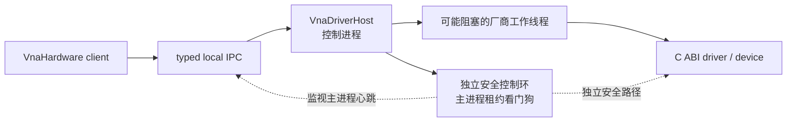
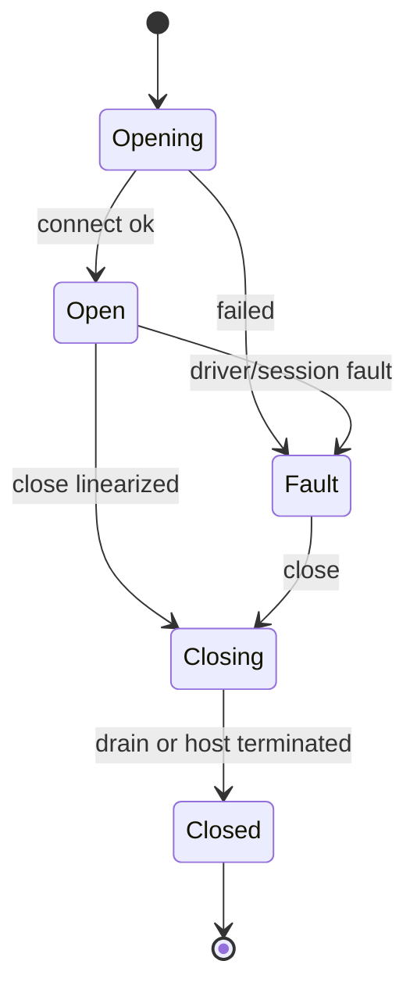

# 详细设计 01B：驱动边界与硬件

> **30 秒摘要**：L1 把不受信或可能永久阻塞的驱动隔离在驱动宿主进程（Driver Host），并由独立安全控制环监视主进程租约；L2 是设备会话、准备、启动、进入触发就绪状态、设备执行和硬件资源的唯一责任方。驱动宿主隔离只证明旧软件已围栏；设备物理静止必须有独立物理证据。
>
> **阅读入口**：驱动提供方先读 [§3](#3-l1驱动-sdk-与驱动宿主driver-host)；Hardware 实现者从 [§4.1 对外端口](#41-对外端口)开始；评审生命周期、竞态和资源释放时重点看 [§4.2–§4.4](#42-四个正交生命周期)。
>
> 上一篇：[D1A：公共阅读规则与 L0 契约](./01A-公共阅读规则与L0契约.md) · [返回 D1 导航](./01-公共契约与硬件采集.md) · 下一篇：[D1C：采集组帧](./01C-采集组帧.md)

本篇承接 [D1A](./01A-公共阅读规则与L0契约.md)，保留全局章节号 §3–§4。公共身份、时限和恢复骨架以 [D1A](./01A-公共阅读规则与L0契约.md) 为准，不在本篇重复定义。

## 3. L1：驱动 SDK 与驱动宿主（`Driver Host`）

### 3.1 驱动二进制接口 v2 必需能力（`ABI v2`）

ABI v1 不再作为泛化生产协议。迁移期只允许通过 `LegacyExactOnlyAdapter` 受限执行，并同时满足：

1. provider 是树内 Simulator/测试实现，或其二进制内容哈希在白名单；
2. 不可变部署 manifest 补齐能力与逐 span `WaveSchema`；
3. `allowQuantization=false`，请求值与 effective 值逐字段完全相同；
4. 结果标记为 `LegacyUncalibrated`。

该驱动兼容配置（profile）禁止生产用户校准、校准数据集发布/绑定，以及依赖真实模拟路径来源记录的变换。没有可信清单（manifest）的 v1 驱动只能登记/发现设备，不能准备或执行。所有泛化真机能力均以 v2 解禁：

| 能力 | v2 约束 |
| --- | --- |
| 能力查询 | 扫描类型、分段、物理 `SequenceKind`/执行粒度、`EdgePulse/LevelGate/FreeRun/CommandTrigger`、物理输入与极性/滤波、电气方案、硬件进入触发就绪状态/自动重新就绪、屏蔽就绪与组触发一次激活能力、信号源/接收机、相干组、中止/期限、控制响应上界，以及主进程租约看门狗、独立安全控制通道、设备硬件看门狗/互锁、可证明的扫描/布防/射频安全后置条件；支持的数值量/结构配置与 `NonDisruptivePrepare/MultiplePreparedHandles` |
| Prepare | 输入展开 Recipe；输出逐点实际频率/功率/IFBW/驻留、实际顺序、物理 Sweep 数、布局和警告 |
| 数值语义 | Prepare 返回逐 `WaveSeriesKey`、逐 Axis span 的 `WaveSchema`，含 Quantity/Correction/ReferencePlane/Coherence/Path；不得只返回 Frame 或整条 series 级域 |
| 执行 | `CommandTrigger/FreeRun` 使用 start；`EdgePulse/LevelGate` 使用 arm。多目标若声称全部就绪前零物理启动，必须具备屏蔽就绪和一次组激活能力；所有块含 execution/sweep/partial/layout/sequence/axis range、质量和可选 CRC |
| 控制 | Stop/Disarm/Abort/Close 走独立高优先级通道；分别声明最大排队、Driver ACK 和安全处置决策上界。后者保证在期限内得到“物理已静止”或“物理状态不可知且已隔离”，不伪造静止 |
| 取消 | `RequestAbort` 幂等；声明是否可抢占以及最大响应时间；超界后先围栏 exact HostGeneration，物理结论仍按独立证据决定 |
| 版本 | `structSize + major/minor + capability bits`；尾字段按 size 兼容，未知必需能力失败关闭 |

`MeasurementAdvanceKind` 是“硬件怎样推进下一个测量单位”的 ABI/运行时闭集：`EdgePulse | LevelGate | FreeRun | CommandTrigger`。L1/L2 的能力查询只按推进方式、物理输入、电气方案、`SequenceKind`、执行粒度和设备代次给出支持结论，不能只给一个总的 `supportsTrigger`。

前面板、SCPI `*TRG`、IEEE-488.2 GET、原生 API、触发来源绑定、唯一责任作用域、目标选择和协议兼容配置都属于 L6/L8 的路由语义，禁止进入 L1/L2 ABI。L6 先按 `MeasurementAdvanceOrigin + TriggerInputExpression + binding/owner/target` 验证产品与协议规则，再把结果映射成窄的物理 `MeasurementAdvanceKind + physical input + selector` 请求；L2 只回显但不解释 `OpaqueAdvanceCorrelationToken`。这样既不能绕过设备能力门，也不会让驱动反向认识 SCPI、界面或运行对象。

驱动只能返回其真实能力。原生接收机兼容配置（Native Receiver Profile）是本产品执行用户校准和完整网络处理的生产门禁，必须在 `AP_RAW_RECEIVER` 输出带逐序列/频段结构的波量和接收机量。只能输出成品 S 参数的外部仪器不允许伪装成原生驱动；它通过能力受限的外部网分适配器从真实后续访问点接入，原始波、重新校准等上游功能明确不可用。

### 3.2 进程隔离



- 第三方/目录加载驱动默认 out-of-process。
- Host 崩溃只使对应 DeviceSession Fault，不破坏应用 Session 和已完成结果。
- 大波块使用受配额的共享内存或固定块池；控制消息与数据块分通道。Stop/Disarm/Abort/Close 使用预留容量的高优先级控制通道，不能排在普通 start、trigger command 或数据描述符之后无界等待。
- Host 在握手时冻结驱动文件哈希、ABI 版本和设备固件版本到 provenance。
- Host 的主进程租约看门狗与厂商工作线程独立；厂商调用永久阻塞时，看门狗仍能围栏旧请求，并且只在设备能力声明存在独立安全路径时尝试撤防、停止、强制中止和射频安全动作。
- 终止 Host、断开 IPC 或回收进程内资源，只产生软件围栏证据。它们不能单独证明设备扫描、触发布防或射频输出已停止。
- 只有公司受信、通过阻塞与关闭认证的驱动允许配置为 in-process。

### 3.3 驱动二进制接口的调用、线程和故障协议

Driver Host 是不可信实现与产品之间的故障边界，不能只约定函数签名。ABI v2 还必须冻结以下调用协议：

| 项目 | v2 规则 |
| --- | --- |
| 函数表 | Host 先校验 `structSize/major/minor/requiredCapabilities`，再保存已协商表；未知必需位拒绝加载 |
| 字符串/数组 | 调用者分配或 driver 分配二选一，逐字段写明 allocator 和释放函数；禁止跨 ABI 直接释放 C++ 对象 |
| 控制调用 | 同一 DeviceSession 由 Host 控制状态机单写；控制入口按 `HostIsolation > Close > Abort > Stop/Hold cutoff > Disarm > Arm/Start > CommandTrigger` 仲裁，driver 不得同步回调进入 Hardware |
| 数据回调 | 只投递有界块描述符；不得在回调中等待消费完成，也不得复用未 ACK 的块 |
| 取消/关闭 | Stop/Disarm/Abort/Close 使用独立高优先级 IPC lane 和预留 command slot；每项返回可重读 ACK。deadline 到期后可围栏并终止故障 Host，但 Host 终止只使软件 Operation 失败，不生成物理静止证据 |
| 共享内存 | 块有唯一持有者、代次、大小、CRC/质量和确认/拒绝回执；宿主进程退出后由内存代理回收 |

#### 3.3.1 硬件布防与高优先级控制合同

外部 TTL 边沿或电平门控不能沿用“先收到触发、再调用 start”的软件触发顺序。L2/Driver Host 必须先为精确执行建立硬件等待态：

```text
HardwareTriggerArmRequest
  ArmOperationIdentity
  DeviceSessionId + HostGeneration
  PreparedExecutionId + EffectivePlanRevision
  ExecutionSelector
  OpaqueAdvanceCorrelationToken
  MeasurementAdvanceCapabilityProofRef
  ExternalTriggerKind           // EdgePulse | LevelGate
  ExternalTriggerInput          // ExternalTTL + physical input identity
  polarity/filter/debounce profile
  ActivationMode               // SingleTargetLive | GroupMaskedReady
  optional ExternalTriggerGroupIdentity
  optional GroupActivationCapabilityDeclarationRef
  ArmWindow                     // OneShot | BoundedCount(N) | DeclaredAutoRearm
  ArmDeadline                   // DeadlineSpec 的强类型包装

HardwareArmedReceipt
  ArmOperationIdentity + ExecutionIdentity
  DeviceSessionId + HostGeneration + DriverArmGeneration
  OpaqueAdvanceCorrelationToken
  ExternalTriggerKind + physical input identity
  MeasurementAdvanceCapabilityProofRef
  ActivationState              // LiveArmed | MaskedReady
  optional ExternalTriggerGroupIdentity
  optional GroupActivationCapabilityDeclarationRef  // MaskedReady 时两者必填
  EvidencePayload              // EdgeArmedPayload | LevelArmedPayload
  ArmWindow + armedAt
  receiptRevision + authenticator

EdgeArmedPayload
  acceptedEdgeSequenceBegin
  ClockDomainId + sequenceQuality

LevelArmedPayload
  required initialLevelSample + sampleTimestamp + ClockDomainId + quality
  levelEvidenceSequenceBegin

ExternalTriggerGroupIdentity
  GroupCoordinatorIdentity + GroupDefinitionOpaqueId + GroupDefinitionRevision
  GroupRetirableLocator

TimingAlignmentProofRef
  TimingAlignmentProofIdentity + TimingAlignmentProofRevision + ContentHash

TimingAlignmentProof
  TimingAlignmentProofRef
  ExternalTriggerGroupIdentity + exact GroupDefinitionRevision
  ordered DeviceTimingBinding[]
    // DeviceSessionId + HostGeneration + PreparedExecutionId + EffectivePlanRevision
  ReferenceTimeBasis
    // CommonReferenceClock{identity, revision, stability/uncertainty bound}
    // | ClockDomainMappingSet{ordered mappings, revision, uncertainty bounds, validity interval}
  ordered TriggerPathTimingBound[]
    // physical output→input path identity + maximum skew + measurement uncertainty
  ordered DeviceAcquisitionTimingBound[]
    // device binding + trigger→acquisition latency bound + jitter bound + uncertainty
  ProductTimingToleranceBudget
  MeasuredTimingEvidenceBundleRef + measuredBundleContentHash + measurementRevision
  combinedWorstCaseError
  validityInterval + ExpirationCondition
  proofConclusion                 // ProvenWithinBudget | NotProvenWithinBudget
  authenticator

GroupActivationCapabilityDeclarationRequest
  ExternalTriggerGroupIdentity + expected GroupDefinitionRevision
  expected CoordinatorGeneration + FencingToken
  SharedActivationGateIdentity + expected AtomicActivationCapabilityRevision
  ActivationSemantics + ordered TargetArmCapabilityBinding[]
  expected PhysicalTopologyRevision + ElectricalProfileRevision
  expected physical input/output mapping
  TimingAlignmentProofRef         // identity + exact revision + content hash
  DeclarationDeadline

GroupActivationCapabilityDeclaration
  GroupActivationCapabilityDeclarationIdentity + DeclarationRevision + ContentHash
  ExternalTriggerGroupIdentity + exact GroupDefinitionRevision
  GroupCoordinatorIdentity + CoordinatorGeneration + exact FencingToken + FencingDomain
  SharedActivationGateIdentity + AtomicActivationCapabilityRevision
  PhysicalTopologyRevision + ElectricalProfileRevision
  ActivationSemantics             // UnmaskAndAwaitExternalInput | EmitOneSynchronizedTrigger
  ordered TargetArmCapabilityBinding[]
    // PreparedExecutionId + HostGeneration + physical input + GroupMaskedReady capability revision
  ordered physical input/output mapping
  TimingAlignmentProofRef         // identity + exact revision + content hash
  MaxTargetCount + ExpirationCondition
  authenticator

GroupTriggerCapabilityProofRequest
  ExternalTriggerGroupIdentity + GroupActivationCapabilityDeclarationRef + declarationContentHash
  CoordinatorGeneration + exact FencingToken
  ordered MaskedReadyReceiptRefs[] + ordered receiptDigests[]
  TimingAlignmentProofRef         // identity + exact revision + content hash
  PreReceiptEvidenceReservationSetDigest
  ordered ReservationReadinessReceiptRefs[] + ordered readinessDigests[]
  ProofDeadline

GroupTriggerCapabilityProof
  GroupTriggerCapabilityProofIdentity + ProofRevision + ContentHash
  ExternalTriggerGroupIdentity + exact GroupDefinitionRevision
  GroupActivationCapabilityDeclarationRef + declarationContentHash
  GroupCoordinatorIdentity + CoordinatorGeneration + exact FencingToken + FencingDomain
  SharedActivationGateIdentity + AtomicActivationCapabilityRevision
  PhysicalTopologyRevision + ElectricalProfileRevision
  ActivationSemantics             // UnmaskAndAwaitExternalInput | EmitOneSynchronizedTrigger
  ordered TargetArmBinding[]      // ExecutionIdentity + Host/Arm generation + MaskedReady receipt digest
  ordered physical input/output mapping
  TimingAlignmentProofRef         // identity + exact revision + content hash
  PreReceiptEvidenceReservationSetDigest + ordered ReservationReadinessDigest[]
  MaxTargetCount + ExpirationCondition
  authenticator

ExternalTriggerGroupActivationRequest
  ExternalTriggerGroupIdentity + GroupActivationOperationIdentity
  GroupActivationSourceRecordRef       // 必须等于 operation identity 中 locator 指向的源记录
  semanticRequestHash + fullOperationEnvelopeHash
  CoordinatorGeneration + FencingToken
  ordered MaskedReadyReceiptRefs[] + ordered receiptDigests[]
  GroupActivationCapabilityDeclarationRef + declarationContentHash
  GroupTriggerCapabilityProofRef + proofContentHash
  TimingAlignmentProofRef         // identity + exact revision + content hash
  PreReceiptEvidenceReservationSetDigest
  ordered PreReceiptEvidenceReservationRefs[]
  GroupActivationRecoveryOwnerIdentity + OwnerEpoch
  ActivationDeadline

ExternalTriggerGroupActivationReceipt
  ExternalTriggerGroupIdentity + GroupActivationOperationIdentity
  CoordinatorGroupActivationDecisionRecordRef
  CoordinatorGeneration + FencingToken + GroupActivationGeneration
  TimingAlignmentProofRef         // identity + exact revision + content hash
  Outcome                         // Activated | ProvenNotActivated | UnknownTransferred
  OutcomePayload
  receiptRevision + authenticator

ActivatedPayload
  physicalActivationPoint + ActivationSemantics
  ActivationSemanticsEvidence              // tagged union；必须与 ActivationSemantics 同分支

ActivationSemanticsEvidence =
  EmitOneSynchronizedTriggerEvidence {
    optional TriggerEmissionTimingEvidence,
    ordered TargetActivationCursorEvidence[],
    optional ordered TargetTriggerArrivalTimingEvidence[] }
  | UnmaskAndAwaitExternalInputEvidence {
    SharedGateOpenEvidence,
    ordered TargetActivationCursorEvidence[] }

TriggerEmissionTimingEvidence
  ControlledTriggerSourceIdentity + emissionEvidenceRef + evidenceContentHash + measurementRevision
  measuredEmissionTimestamp + measurementUncertainty + ClockDomainId

SharedGateOpenEvidence
  SharedActivationGateIdentity + gateOpenEvidenceRef + evidenceContentHash + measurementRevision
  gateOpenedAt + evidenceCursorGeneration + ClockDomainId

TargetActivationCursorEvidence
  ExecutionIdentity + DriverArmGeneration
  EdgeActivatedPayload | LevelActivatedPayload

TargetTriggerArrivalTimingEvidence
  DeviceTimingBinding + TimingAlignmentProofRef
  HardwareTriggerEvidenceIdentity + hardwareEvidenceSequence
  TriggerArrivalTimingEvidenceRef + evidenceContentHash + measurementRevision
  measuredTriggerArrival + measurementUncertainty + ClockDomainId

TargetAcquisitionTimingEvidence
  ExecutionIdentity + DeviceTimingBinding + TimingAlignmentProofRef
  AcquisitionTimingEvidenceRef + evidenceContentHash + measurementRevision
  measuredTriggerToAcquisitionLatency + measuredJitter + measurementUncertainty
  acquisitionTimestamp + ClockDomainId

EdgeActivatedPayload
  acceptedEvidenceSequenceBegin + ClockDomainId + sequenceQuality

LevelActivatedPayload
  required activationLevelSample + sampleTimestamp + ClockDomainId + quality
  acceptedEvidenceSequenceBegin

ProvenNotActivatedPayload
  proofRevision + ordered stillMaskedReceiptRefs[]

UnknownTransferredPayload
  GroupActivationRecoveryOwnerIdentity + RecoveryOwnerEpoch
  ordered PhysicalEffectDisposition[] + containmentReceiptRefs[]
```

`ExternalTriggerGroupIdentity` 由 Group Coordinator 在冻结物理组定义时签发，L6 只把它作为不可解释的硬件组引用使用；它不是 Channel、TargetBatch 或其他 Runtime 身份。静态 `GroupActivationCapabilityDeclarationRef` 和动态 `GroupTriggerCapabilityProofRef` 都由当前 Coordinator generation 签发，并由其 fencing domain 验证；两者都必须绑定 exact group/revision/generation/fence，不能只绑定一个 fencing domain 名字。

`TimingAlignmentProof` 是跨设备时间对齐的唯一规范化证明。其他 request、receipt、plan 或 provenance 只能保存 `TimingAlignmentProofRef{identity, exact revision, ContentHash}`，不得再拷贝一份可独立漂移的“参考时钟 + 偏斜 + latency”字段集。证明必须同时绑定共同参考时钟或完整时钟域映射、每条物理触发路径的偏斜上界、每台设备的 `trigger→acquisition` 延迟/抖动上界、产品时间容差预算、实测 bundle 与联合最坏误差。缺字段、过期、hash/revision 不匹配或 `proofConclusion != ProvenWithinBudget` 都是未证明，不得编译为时间可比的跨设备拓扑。

`declareCapability()` 和 `attestMaskedReady()` 只返回带内容哈希的签名快照，绝不 arm 目标、不打开组门。对同一当前定义的查询可重试，但一旦 group revision、Coordinator generation/FencingToken、拓扑、receipt 或 reservation readiness 变化，必须签发新 revision 或明确拒绝，不得返回旧快照。`activate()` 是三个窄端口中唯一能产生物理激活副作用的端口。

`GroupActivationOperationIdentity` 的字段形状由 [D1 §2.2.4](./01A-公共阅读规则与L0契约.md#224-d1-拥有的物理执行身份与采集帧视图frame)唯一规定。

L6 Runtime control executor 是唯一签发者：它只能从本次准入已经预留的单调身份槽取得一枚新身份，并在第一次 Coordinator 调用前把完整 identity、canonical request 和两个 hash 持久化。

Group Coordinator、L2、Driver Host 和恢复责任方只能保存或校验该完整 identity；响应未知时不得换新身份重试。identity 中的 locator 指向调用前已登记的可退役操作根，Coordinator 记录只引用同一完整 identity，不另造第二枚操作身份。

单目标的 `SingleTargetLive` 在 Driver/硬件声明的线性化点进入 `LiveArmed`。从 receipt 声明的 evidence cursor 开始，属于本 `DriverArmGeneration` 的真实边沿或电平证据都必须保留；即使它在调用方看到 receipt 之前到达，也不得被软件 gate 丢弃。驱动使用预留的有界 pre-receipt evidence 槽；容量或顺序证明不足时必须失败关闭或隔离，不能伪造“未触发”。

多目标按两阶段解禁，不存在“先拿到动态 proof 才允许 arm”的循环依赖：

1. **arm 前静态声明。**
   - Coordinator 对 exact group/revision/generation/fence、物理拓扑、布线、电气方案、激活语义、每个 Prepared target 的 `GroupMaskedReady` 能力和唯一 `TimingAlignmentProofRef`，签发短期 `GroupActivationCapabilityDeclaration`。
   - 声明 request/receipt 必须回显同一 proof identity、精确 revision 和 ContentHash。
   - 只有声明仍有效、对齐证明为 `ProvenWithinBudget`，且本地整批准入与逐目标证据槽已经预留，L6 才能发出第一条 `GroupMaskedReady` arm。
   - 每份 `MaskedReady` receipt 必须回显同一 group identity 和 declaration ref；不匹配立即撤防或隔离，不进入组激活。
2. **arm 后动态证明。**
   - 全部目标以硬件保证零启动的方式进入 `MaskedReady` 后，Coordinator 才校验实际 receipt、预留槽 readiness 与当前 fence，并签发 `GroupTriggerCapabilityProof`。
   - 动态 proof request/receipt 继续绑定静态声明、exact group/revision/generation/fence、有序 receipt digest、`PreReceiptEvidenceReservationSetDigest` 和同一 `TimingAlignmentProofRef{identity, exact revision, ContentHash}`。
   - 任一字段变化均使旧 proof 失效。此时只能撤防或隔离已 `MaskedReady` 目标，不得打开物理组门。

组激活的物理含义必须由 `ActivationSemantics` 明确区分：

- `UnmaskAndAwaitExternalInput`：同时开放硬件输入，然后等待下一次真实外部信号；
- `EmitOneSynchronizedTrigger`：由受控触发源在激活点发出一次同步触发。

两者不能用同一模糊 capability 互换。全部 receipt 和能力证明匹配后，才由具备 `AtomicExternalTriggerGroupActivation` 能力的共享触发门、触发分配器或可控触发源执行一次组激活。

激活 request/receipt 还必须回显与静态声明、动态证明相同的 `TimingAlignmentProofRef{identity, exact revision, ContentHash}`；任一环节的三元组不同都不得激活。多台设备依次 `arm()` 再打开一个 L6 布尔 gate，不具备这种物理原子性。

`ActivatedPayload.ActivationSemanticsEvidence` 必须是与上述语义一致的 tagged union。`EmitOneSynchronizedTriggerEvidence` 可携带受控触发源的实测 emission，以及硬件已在激活回执时测得的逐设备 trigger-arrival；两者都不能用主机发送/收包时间伪造。`UnmaskAndAwaitExternalInputEvidence` 只能携带真实共享门打开/unmask 证据和逐设备 evidence cursor，其类型中没有 emission 或 trigger-arrival 字段；打开门的时刻不是外部信号到达时刻。

缺少有效静态声明时，V1 必须在第一次 arm 前拒绝多目标外部触发方案；只有动态 proof 缺失时，已建立的 `MaskedReady` 事实不得改写为“零 arm”。组激活结果未知时，必须把“物理执行是否已经开始”和“物理状态处置”分开记录：前者为 `Started/NotStarted/Unknown`，后者为 `Live/PhysicalQuiescent/PhysicalStateUnknownQuarantined`。软件 `Isolated` 只作为围栏证据，不能冒充“没有启动”“已撤防”或“物理静止”。

阶段边界固定为：R2 不实现多目标触发；S1 只验单目标 `SingleTargetLive` 与回执返回途中的证据保留；`GroupMaskedReady` 和 `AtomicExternalTriggerGroupActivation` 只在 S5 由能力合同、故障注入和实物测试解禁。这里描述未来端口，是为了避免先实现错误 ABI，不代表当前候选范围已经交付。

只有物理布防线性化点之前、上一代或已关闭代次的信号才记为 `IgnoredBeforeArm/StaleArmGeneration`，绝不排队到新代。

每份硬件 evidence 必须携带 `DriverArmGeneration + OpaqueAdvanceCorrelationToken + hardwareEvidenceSequence + hardwareTimestamp/ClockDomainId`，并由 tagged payload 区分 edge sequence 与 level sequence。对要进入跨设备时间可比复核的 matching evidence，tagged payload 还必须携带 `TargetTriggerArrivalTimingEvidence`。旧 arm generation 或调用方关联 token 的信号只能得到 `StaleArmGeneration/StaleCorrelation`，不能进入新 generation 的队列、latch 或 InitialSourceStateSnapshot。

`LevelGate` 的 `initialLevelSample` 是 `LevelArmedPayload` 的必填字段，并且只来自 arm 线性化点的原子采样。它可描述该目标进入 `LiveArmed` 或 `MaskedReady` 时的电平，但不能合成 `EdgePulse`。

多目标处于 `MaskedReady` 期间电平仍可能变化，因此真正组激活时必须在同一物理激活点再次取得 `LevelActivatedPayload.activationLevelSample`；后续判断不得复用较早的 arm 样本。

`EdgeArmedPayload` 不携带初始电平，只以 `acceptedEdgeSequenceBegin` 确定第一个可接纳边沿。`DeclaredAutoRearm` 只有 capability 明确给出最大连续窗口、重布防条件和丢边沿诊断时才可用；否则每个可接纳 edge 都要求新的 Armed receipt。

对 `MultiDeviceSynchronizedGroup`，每个真正使 matcher 满足的 edge/level evidence 都必须返回对应设备的 `TargetTriggerArrivalTimingEvidence`；acquisition terminal 还要返回同设备的 `TargetAcquisitionTimingEvidence`。对 `EmitOneSynchronizedTrigger`，若 Activated receipt 已包含实测 arrival，matching evidence 必须引用同一 evidence identity/ref，不再造第二份测量；若回执只有 emission，仍须由后续 matching evidence 补齐 arrival。对 `UnmaskAndAwaitExternalInput`，arrival 只能随后续 matching evidence 返回，不得从 gate-open 时间推导。

L6 只把预先的 `TimingAlignmentProofRef`、本次每设备的实际 trigger-arrival 和 acquisition 实测组合成 `TimingComparabilityEvaluation`。可选 emission 只作触发源证据，gate-open/unmask 只作开门证据；两者都不得替代 trigger-arrival。只有所有设备的 arrival/acquisition 与同一 proof 三元组匹配、联合误差不超预算，结论才是 `ProvenWithinBudget`；任一证据缺失、错绑、越界或不确定度无法并入预算时，必须稳定标记 `NotTimeComparable`。

主进程和 Driver Host 之间另有一份独立于普通 RPC 的控制租约。主进程按租约发送心跳；安全控制环不得运行在可能被厂商阻塞调用占住的线程、队列或锁域。握手必须冻结本设备真正具备的安全收口能力：设备状态回读、独立安全控制通道、硬件看门狗或硬件互锁，以及每条能力可证明的后置状态。能力未声明或未实物验证时，不得声称能够停止扫描、解除触发布防或进入射频安全状态。

高优先级控制响应分三段计时，均使用 `DeadlineSpec`：

```text
ControlResponseContract
  ControlQueueAdmissionBound
  DriverAcknowledgeBound
  SafetyDispositionDecisionBound
  RequiredSafePostconditionProfileRef
  OnBoundExceeded              // SoftwareFenceAndQuarantine | DeviceFault
```

- `ControlQueueAdmissionBound` 保证命令进入预留控制槽，不能被数据队列占满；
- `DriverAcknowledgeBound` 保证 Driver 明确接纳或拒绝，不以“已发送”冒充 ACK；
- `SafetyDispositionDecisionBound` 保证系统在上界内得到两种稳定结论之一：有独立证据的 `PhysicalQuiescent`，或 `PhysicalStateUnknownQuarantined`；它不保证设备必然静止；
- `SoftwareFenceEvidence` 只证明旧 `ProcessEpoch/HostGeneration` 不能再发命令或发布回调，Host 退出、IPC 断开、租约撤销和控制 ACK 都不能替代物理证据；
- `PhysicalQuiescenceEvidence` 必须来自设备状态回读、硬件看门狗/互锁或独立安全控制通道，并绑定精确设备、DeviceSession、HostGeneration、观测时刻和已验证后置状态；
- 主进程租约过期后，仍存活的 Driver Host 安全控制环立即关闭普通准入，并按已证实 capability 在上界内尝试 disarm、stop、abort 与射频安全动作。普通厂商 SDK 工作线程永久阻塞时，这些动作仍可能失败；失败不能改写成成功；
- Driver Host 同时死亡或失联时，只有已经证实的设备硬件看门狗/互锁可以产生物理静止证据；否则结论只能是物理状态不可知并隔离；
- 物理状态不可知时，精确物理设备、DeviceSession 和相关配置进入隔离，禁止新的 Open/Prepare/Arm/Start 和复用。解除隔离只接受“显式安全重连或复位后完成状态验证”，或带审计记录的人工现场确认；进程重启和新软件租约不够；
- 能力声明/清单必须给出决策上界并通过“数据通道满载 + 控制风暴”测试。未知安全能力的驱动可被软件围栏，但不能进入声称射频安全的生产兼容配置。

控制优先级只决定尚未执行命令的仲裁，不改写已经发生的物理事实。Close 先胜时后续 Abort/Stop 只重放 Closing disposition；Abort 先胜时 Stop 不把已中止 Execution 改成 Stopped；Stop/Hold 先关闭未来 trigger/start admission，已经 Started 的 Execution 仍按真实 terminal 收口。

所有 ABI 结构必须是 C 标准布局 POD，只使用固定宽度整数、显式字节数组/指针，以及 ABI 已定义的 enum underlying value。跨界数据不得出现 `bool`、`size_t`、STL、虚函数、异常或编译器私有 packing。

每个公开结构都有 `structSize + major/minor`，并在 GCC 7.3 与当前现代编译器上对 `sizeof/alignof/offsetof` 做静态断言和产物布局对照。Reserved 字段/位输入必须为零；未知 optional 尾字段可按 size 忽略，未知 required capability/flag 一律 fail closed。

解析任何数组前，宿主进程对 `count × stride`、`offset + totalBytes`、对齐、指针范围和嵌套计数做溢出检查；验证完成前不分配、不解引用、不复制。每个 ABI 入口最外层 `catch (...)`，把 `bad_alloc`、标准异常和未知异常映射为稳定 C 状态，绝不让异常跨 C 边界。持续集成同时构建 GCC 7.3/目标工具链与现代消毒器/模糊测试配置，并用相同基准 ABI 清单比较布局。

数据块池由宿主进程/内存代理持有，生命周期固定为 `Acquire → DriverWrite → Commit → Validate → ACK/NACK → Recycle`。驱动只借用当前代次的块，提交后不能再写；每次复用递增块代次，并携带单调序号，宿主进程以 `(poolId, slotId, generation, sequence)` 拒绝 ABA、重复提交/确认和晚到写。宿主进程或驱动崩溃时，内存代理按责任方代次回收，不等待插件析构。

Host 生命周期使用 `Starting → Handshaking → Ready → Quarantining → Terminated`。协议违约、崩溃或 deadline 超时进入 `Quarantining`：停止新请求、撤销共享块、使相关 DeviceSession Fault，并发布每个未完成 Operation 的唯一 `DriverFault` terminal。

Host 不得自动重连后继续使用旧 Prepared/Execution。只有设备已取得 `PhysicalQuiescenceEvidence`，或完成显式安全重连/复位并验证状态，Application 才能决定重新打开；新连接必须产生新的 DeviceSessionId。`PhysicalStateUnknownQuarantined` 下禁止重新打开。

驱动契约测试集至少覆盖：旧/新结构尾字段、未知能力、同步完成、晚到回调、重复终态、畸形块、永不返回、中止不响应、宿主崩溃、共享内存泄漏、关闭期间回调和厂商错误到稳定错误的映射。只有全部通过的自有驱动才可申请进程内运行配置。

## 4. L2：`VnaHardware`

### 4.1 对外端口

建议把当前宽接口收敛为三个窄对象：

```cpp
class IDeviceSessionLease;
class PreparedExecutionHandle;
class ExecutionControlHandle;
class ExecutionDataConsumerLease;
class IExecutionDataLeaseSource;
class IExternalTriggerGroupCoordinator;

struct PrepareOperation {
    PrepareOperationIdentity identity;
    PrepareGeneration generation; // 由 L2 DeviceSession control executor 分配
    OperationHandle<PreparedExecutionHandle> handle;
};

struct PrepareRequest {
    PrepareOperationIdentity identity;       // caller 在首次调用前持久化
    AcquisitionRecipe recipe;
    ContentHash semanticRequestHash;
    ContentHash fullOperationEnvelopeHash;
};

struct DeviceOpenRequest {
    DeviceOpenOperationIdentity identity;    // caller 在首次 Host 调用前持久化
    DeviceId deviceId;
    CatalogRevision catalogRevision;
    DiscoveryGeneration discoveryGeneration;
    PhysicalIdentityFingerprint physicalIdentityFingerprint;
    ContentHash semanticRequestHash;
    ContentHash fullOperationEnvelopeHash;
};

struct ExecutionStartRequest {
    StartOperationIdentity identity;         // 本次 dispatch attempt 的完整可退役身份
    ContentHash semanticRequestHash;
    ContentHash fullOperationEnvelopeHash;
    MeasurementAdvanceKind advanceKind;      // CommandTrigger | FreeRun
    MeasurementAdvanceCapabilityProofRef capabilityProof;
    OpaqueAdvanceCorrelationToken correlationToken;
    ExecutionSelector selector;            // SequenceKind + granularity
    PlanRelativeExecutionSlice slice;      // 只使用 EffectivePlan 坐标
    PhysicalSliceOrdinal physicalSliceOrdinal;
    StartDeadline deadline;
};

class DeviceCatalog {
public:
    virtual OperationHandle<DiscoverySnapshot> discover(DiscoveryRequest) = 0;
    virtual OperationHandle<DeviceOpenTerminal> openExclusive(const DeviceOpenRequest&) = 0;
    virtual Result<std::unique_ptr<IDeviceSessionLease>>
        takeOpenedSessionLeaseOnce(const DeviceOpenOperationIdentity&) = 0;
};

class IDeviceSessionLease {
public:
    virtual ~IDeviceSessionLease() = default;
    virtual const DeviceCapabilities& capabilities() const = 0;
    virtual Result<PrepareOperation> prepare(const PrepareRequest&) = 0;
    virtual OperationHandle<void> close(CloseDeadline) = 0;
};

class PreparedExecutionHandle {
public:
    PreparedExecutionHandle(PreparedExecutionHandle&&) noexcept;
    PreparedExecutionHandle& operator=(PreparedExecutionHandle&&) noexcept;
    PreparedExecutionHandle(const PreparedExecutionHandle&) = delete;
    PreparedExecutionHandle& operator=(const PreparedExecutionHandle&) = delete;
    const EffectiveExecutionPlan& effectivePlan() const;
    Result<ExecutionControlHandle> start(const ExecutionStartRequest&) const;
    Result<ExecutionControlHandle> arm(const HardwareTriggerArmRequest&) const;
    OperationHandle<void> requestRevoke(RevokeDeadline);
};

class ExecutionControlHandle {
public:
    OperationHandle<ControlAckReceipt> requestStop(StopDeadline) const;
    OperationHandle<ControlAckReceipt> requestDisarm(DisarmDeadline) const;
    OperationHandle<ControlAckReceipt> requestAbort(AbortDeadline) const;
    Result<HardwareArmedReceipt> armedReceipt() const;
    ExecutionTerminalSnapshot terminalSnapshot() const; // 可重读观察权
};

class ExecutionDataConsumerLease {
public:
    ExecutionDataConsumerLease(ExecutionDataConsumerLease&&) noexcept;
    ExecutionDataConsumerLease(const ExecutionDataConsumerLease&) = delete;
    // 唯一 L3 消费者的 BlockLease 与 ingress seal 端口
};

class IExecutionDataLeaseSource {
public:
    virtual Result<ExecutionDataConsumerLease>
        takeOnce(ExecutionIdentity, ExecutionDataConsumerClaim) = 0;
};

class IExternalTriggerGroupCoordinator {
public:
    virtual Result<GroupActivationCapabilityDeclaration>
        declareCapability(const GroupActivationCapabilityDeclarationRequest&) = 0;
    virtual Result<GroupTriggerCapabilityProof>
        attestMaskedReady(const GroupTriggerCapabilityProofRequest&) = 0;
    virtual OperationHandle<ExternalTriggerGroupActivationReceipt>
        activate(const ExternalTriggerGroupActivationRequest&) = 0;
};
```

#### 4.1.1 正常端口与能力责任方

`PreparedExecutionHandle` 是绑定 DeviceSession、effective plan、WaveSchema 和资源租约的不可伪造、move-only capability。

它的唯一持有者在任一时刻只能是以下三者之一：设备会话成功准备后的载荷、`VnaApplicationHardwareOwner` 私有的 `CandidateOwnerRecord`、同一适配器内的一个 `InstalledDeploymentRecord`。多次串行 `start()` 都通过已安装记录中受固定引用/租约保护的同一 Handle 调用，不复制 Handle，也不让运行时或 `VnaApplication` 核心取得 `DeviceSessionLease`。

`PreparedExecutionId` 只用于追踪，不能单独启动执行。

Start/Arm 成功后的两种权利不得再混在一个 Handle 中：

- `ExecutionControlHandle` 是可共享的窄控制/观察端口，只能 Stop、Disarm、Abort、读取 Armed receipt 和重读 terminal，不能读数据、取得数据 claim 或 Block 所有权。L6 只持这一侧。
- `ExecutionDataConsumerLease` 是 move-only 的唯一数据消费权。L2 success record 为每个 `ExecutionIdentity` 只接受一次 `IExecutionDataLeaseSource.takeOnce`，并只把 `ExecutionDataConsumerClaim` 交给 L3 assembler factory；重复取得稳定返回 `AlreadyConsumed`。L3 不持控制 Handle。

Start/Arm 结果的重放只返回同一 Execution identity、控制端口、同一 Armed receipt 和 terminal 快照，绝不重新发放数据 Lease。数据 claim 只在首次 success record 建立时投递给 L3，不能经控制 API 查询或复制。两者都不因“需要查询状态”而取得另一方的权利。

#### 4.1.2 设备目录标识与物理设备绑定

`DeviceId` 只是产品目录中的稳定透明标识，不能把 IP、USB 路径或 VISA resource string 当作设备本体。Catalog 为每次发现生成不可变快照：

```text
PhysicalDeviceBindingDescriptor
  DeviceId + CatalogRevision + DiscoveryGeneration
  ProviderId + DriverBinaryHash + DriverAbiProfile
  Manufacturer + Model + SerialNumber + FirmwareRevision
  TransportKind + CanonicalTransportEndpoint
  PhysicalIdentityFingerprint
  BindingState { Bound, NeedsRebind, IdentityAmbiguous }
```

`PhysicalIdentityFingerprint` 的配置/版本与输入字段必须由驱动提供方清单登记，最低绑定提供方、厂商/型号和不可变序列号；缺失序列号的设备只能使用经评审的物理拓扑或证书指纹配置，不得默认用可复用网址充当身份。

Open request 必须同时钉住 `DeviceId + CatalogRevision + DiscoveryGeneration + PhysicalIdentityFingerprint`。Host 在获取独占租约前重读物理身份；指纹变化、一个 `DeviceId` 匹配多台设备或旧端点被另一台设备复用时，转为 `NeedsRebind/IdentityAmbiguous` 并拒绝 Open，不得自动接管。人工 Rebind 是新的 Application 用例，必须显示旧/新身份差异并创建新 Catalog revision。

恢复、Close 和隔离只可使用旧 record 中的 exact Host claim/capability 和物理指纹，不得按当前同名 `DeviceId` 或当前 transport endpoint 猜测目标。契约测试至少覆盖 IP 复用、USB 端口换机、序列号重复、旧发现快照与新设备竞态，并证明不会误关或误接管。

#### 4.1.3 设备打开的线性化点（`Device Open`）

Device open 与 Prepare/Start 一样跨越“调用已生效、响应未知”的故障窗口，不能把 `openExclusive(DeviceId)` 当作普通同步构造。正常路径按以下顺序推进：

1. L7 在首次调用前，从有硬上限的 open ledger 取得完整 `DeviceOpenOperationIdentity`。
2. L7 把 `DeviceOpenRecoveryRecord{identity, InstrumentSessionId, DeviceId, CatalogRevision, DiscoveryGeneration, PhysicalIdentityFingerprint, ProcessInstanceId/OwnerEpoch, canonical semantic request, semanticRequestHash, fullOperationEnvelopeHash, state, optional HostClaimRef, optional DeviceSessionId/HostGeneration, leasePayloadState, receipts}` fsync 到 Session Opening 预留节点。记录失败就不调用 Host。
3. L2 以该完整 identity create-if-absent 安装 provisional open record，再向 Driver Host 发送同一请求。
4. 宿主进程以完整身份建立唯一 `DeviceOpenClaim`，原子分配并保存 `DeviceSessionId + HostGeneration + exclusive lease owner`；其中最后一项是独占租约的唯一持有者。

设备打开的线性化点是宿主进程建立唯一 `DeviceOpenClaim` 并取得独占租约。完整身份与语义哈希相同且完整请求包哈希可重算时，宿主进程只查询或重放原决定。不透明 ID、定位符、设备 ID 或任一哈希冲突都必须拒绝并隔离该声明，绝不按设备 ID 猜测关闭“当前设备”。

`DeviceOpenTerminal` 只携带可重读的成功/拒绝决定、DeviceSession identity、Host claim revision 和 capability digest。move-only `IDeviceSessionLease` 仍由 L2 成功记录唯一持有，并且只能 `takeOpenedSessionLeaseOnce()`。

成功发布 Session 前，必须先建立自包含、与 open attempt 独立存活的 `ActiveDeviceSessionRecord{ActiveDeviceSessionIdentity, HostGeneration, source DeviceOpenOperationIdentity, HostLeaseCapabilityRef, InstrumentSessionId, SessionGeneration, authorityRevision, ProcessInstanceId/OwnerEpoch, ownerRevision, state, receipts}`。

随后，宿主进程以预期声明修订执行 CAS，把独占租约的唯一持有权从 `DeviceOpenClaim` 转给该记录，并返回 `HostLeaseTransferredToActiveSessionReceipt`。最后一次会话打开 CAS 同时保存精确的活动设备会话记录引用和移交回执。

若宿主进程完成移交后、打开会话 CAS 前崩溃，原 `DeviceOpenRecoveryRecord` 仍承担恢复责任。恢复者只能重放同一打开会话 CAS，或通过该记录精确关闭/隔离，不能新建第二个责任方。

`takeOpenedSessionLeaseOnce()` 只把引用同一 active record 的进程内 capability 移给 Session，不转移或复制 Host 租约事实。ActiveDeviceSessionRecord 独立存活到 DeviceSession Close，或被 DeviceFaultCleanupRecord 以 receipt 接管。

#### 4.1.4 设备打开失败、恢复与记录退役

**失败与恢复。** Host 已 open、DeviceSessionId 尚未回填时，如果响应或主进程丢失，恢复者仍用原完整 open identity 查询同一 Host claim。Open 已发布后则只按 ActiveDeviceSessionRecordRef rebind。两者都不存在时，恢复者按 claim 精确 close/revoke；Host 无法响应时，围栏该 Host generation 并取得 `SoftwareFenceEvidence`，同时为精确物理设备写入 `PhysicalStateUnknownQuarantined`，除非另有独立证据证明物理静止。软件 open record 可以退役，设备安全隔离责任不能随之丢失。

**启动恢复。** startup 在任何新 Device open/Prepare、Session admission 和 物理回收 前，枚举**全部未退役**的 DeviceOpenRecoveryRecord、Host DeviceOpenClaim 与 ActiveDeviceSessionRecord。枚举范围明确包含 Transferred/Closed/Isolated/CleanupDone 但尚未 watermark 的记录。

open attempt 的 terminal 分支只补 Session/Host/requester ACK、责任 transfer 或资源零证明。Active record 的 terminal 分支只补 authority/requester ACK、retirement watermark 与 compact。两者都绝不再次 open/close；只有非终态 Active record 才按 Session authority 继续 rebind、close 或转给 fault cleanup。

**open attempt 退役。** 公开 open identity 只有一个 retirement writer：签发 DeviceOpenOperationIdentity 的 L7/DeviceOpen issuer ledger。它维护：

`GlobalDeviceOpenRetirementFence{identity, exact request/decision receipt, SessionOpen or Abandoned decision, HostLeaseTransferredToActiveSessionReceipt or exact close/isolation receipt, caller ACK/RequesterGone, no live open claim, terminalDigest}`。

条件齐全后，只有该 issuer ledger 可按 DeviceOpenOperationRetirableLocator 写 `RetiredDeviceOpenEpoch` 并 compact。L2 与 Host 只能写 facet GC receipt，不得推进公开 watermark。ActiveDeviceSessionRecord 不属于 open attempt payload，因此 attempt 退役不影响它。

**设备打开尝试验证。** 测试必须在调用方记录、L2 临时记录、宿主声明、宿主取得独占权、活动记录建立/持有权移交、终态回填、租约领取、`SessionOpenReceipt`、全局屏障、打开尝试退役水位和各记录分面压缩的每条边界注入崩溃。必须证明尝试记录压缩后仍有精确的活动租约授权，且真机只有一个持有者：既不误关新持有者，也不永久锁定设备。

**Active record 正常关闭。** Active record 使用独立生命周期：`Active → Closing | TransferredToFaultCleanup → Closed | Isolated → CleanupDone → Retired`。普通 Close 先按 exact HostLeaseCapabilityRef 关闭或隔离，再原子清除 SessionAuthority 中匹配的 ActiveDeviceSessionRecordRef，并写 `ActiveSessionAuthorityClearedReceipt`。

**Active record 故障转移。** fault 路径先保存 `TransferredToFaultCleanup{DeviceFaultCleanupIdentity, ActiveHostLeaseTransferredReceipt}`。target 完成 Host close/isolation 后回写同一 source record，再以 expected Session authority revision 清除旧 ref，或将其替换为显式 `FaultedNoActiveDevice`，并写 receipt。

**Active record 恢复。** startup 枚举**全部未退役**的 ActiveDeviceSessionRecord，包括 Transferred/Closed/Isolated/CleanupDone，不能只扫描 live 行。

**Active record 退役。** 只有同时满足以下条件，ActiveDeviceSession ledger 才按 ActiveDeviceSessionRetirableLocator 写 `RetiredActiveDeviceSessionEpoch` 并 compact：Host claim 为零；Session authority 不再引用旧 record；Prepared/Execution/fault child 责任均已 release 或稳定 transfer；requester ACK 齐全。窗口外只返回 ActiveDeviceSessionReceiptExpired，不重做 close。

DeviceFaultCleanupRecord 必须取得 `RetiredActiveDeviceSessionReceipt` 后才能退役，因此 target compact 不会先于 source 责任落稳。Close 与 fault 测试都要覆盖 active terminal、authority ref 清除、active watermark、target watermark 和两侧 compact 的任意崩溃顺序。

#### 4.1.5 设备预备与启动的正常路径及调用结果未知（`Prepare` / `Start`）

Prepare 的成功 terminal 状态，以及 `PreparedExecutionId + EffectivePlanRevision + PreparedCapabilityContentHash`，都可重读。move-only Handle payload 则只能 `takePreparedHandleOnce()` 一次。

载荷的正常持有权链为：成功终态先由 L2 持有；L7 消费后唯一移动进 `CandidateOwnerRecord`；最终安装时再移动进 `InstalledDeploymentRecord`。重复领取返回 `AlreadyConsumed`。

`takePreparedHandleOnce()` 只交付只可移动的载荷，不把持久移交回执塞进返回签名。调用方按完整 `PrepareOperationIdentity` 查询同一准备操作记录的载荷处置分面；只有该分面已记录目标责任方的稳定移交回执，L7 才能宣告源责任已清空。回执的唯一事务、重放与恢复合同见[D4A 持久操作责任交接](./04A-应用会话与事务.md#持久操作的责任交接)。

生效计划、波形结构、可执行切片与能力位在成功终态后不可变。生效计划还必须内嵌 `MeasurementAdvanceCapabilityProof`，精确列出已验证的“推进方式 × 物理输入 × 执行选择器 × 电气配置”、证明内容哈希和设备能力快照修订。Prepared Handle 钉住这份证明。路由来源与协议兼容配置由 L6 的可执行路由计划另行钉住，不能塞回 L2 证明。撤销只能由当前唯一持有者经 L2 端口请求；它关闭新的启动，并等待已接纳设备执行的真实终态。任何层都不得复制 Handle、把裸指针塞入 DTO，或用 `PreparedExecutionId` 另建第二套可执行能力。

`PrepareRequest` 先解决调用边界未知。调用方在首次进入 L2 前，已经 durable 保存完整 identity、canonical semantic request、`semanticRequestHash` 与 `fullOperationEnvelopeHash`。L2 先安装 provisional record，再为该 identity 恰好一次分配 PrepareGeneration。

查询或重放必须同时匹配完整 identity 与 semantic hash，并重算 full-envelope hash。全部通过时才返回原 OperationHandle/terminal，且不再分配 generation；任一冲突进入 ProtocolError/Host 隔离。这样，响应丢失不会通过第二次 `prepare()` 创建另一份 capability。

`ExecutionStartRequest` 同时解决两个问题：整份计划中当前调用执行哪一片，以及 start 响应丢失后的消歧。

- `selector + slice` 必须是 EffectivePlan 在 Prepare 时公布的可执行单元。Point/Segment/Partial trigger 不能由 Hardware 根据回调顺序猜测。
- `advanceKind + physical input/selector + capabilityProof` 必须精确命中 Prepared Handle 钉住的 `MeasurementAdvanceCapabilityProof`。start 只接受 `CommandTrigger/FreeRun`；arm 只接受 `EdgePulse/LevelGate` 并同样重验 proof。L2 不解释 `correlationToken`；L6 用它把已验证的入口来源、binding generation 和运行身份与物理证据重新关联。
- 测量运行任务（`Initiation`）、测量推进事件、目标批次和通道测量任务（`Run`）的强类型关联留在 L6 `SliceDispatchReservation`。它保存 `StartOperationIdentity ↔ RuntimeOperationRecordIdentity` 映射并组合来源记录；L2 既不接收，也不解释运行时对象。
- L6 在调用窄 start port 前，先把本 attempt 的完整 StartOperationIdentity、canonical semantic request、`semanticRequestHash` 与 `fullOperationEnvelopeHash` 写入对应 reservation。
- L2 先安装 provisional record，再一次性验证 Session Open、Prepared 未撤销、推进能力证明匹配、slice 合法、设备槽和 Credit 可用。

接纳时，L2 恰好一次创建并返回完整 ExecutionIdentity；拒绝时返回稳定 StartRejected terminal。只有完整 Start identity 与 semantic hash 相同，且 full-envelope hash 可重算时，才重放原结果；任一冲突都失败关闭。

Start identity 的重放只用于同一次 unknown/response-loss 消歧，不能复活已知 terminal。

已知 `RetryableBusy/StartRejected` 后，若冻结策略仍允许下一次 dispatch，必须从 admission 已按 `MaxDispatchAttempts` 预留的 bounded identity slots 中取得**新的** StartOperationIdentity。每个 attempt 各自拥有 terminal/receipt/retirement，而 slice 最终只聚合一次 disposition。slots 耗尽即稳定返回 `DispatchAttemptsExhausted`，不得临时分配或复用旧 identity。

`EdgePulse/LevelGate` 使用平行但不同的 Arm ledger。L6 在调用窄 arm port 前，先保存完整 ArmOperationIdentity、冻结 HardwareTriggerArmRequest/hash 和对应 slice reservation。L2 原子安装 provisional arm record、重验 `MeasurementAdvanceCapabilityProofRef`、分配新的 ExecutionIdentity 和 DriverArmGeneration，再根据 `ActivationMode` 使 Execution 进入 `LiveArmed` 或 `MaskedReady`。

- `SingleTargetLive` 的 receipt 公布物理布防线性化点和 evidence cursor；从该 cursor 开始的同代证据即使早于 receipt 被 L6 观察到，也必须有界保留并按真实物理事实处理。
- `GroupMaskedReady` 只能由硬件确认“已配置但不可启动扫描”后返回。全部就绪后，`IExternalTriggerGroupCoordinator` 通过一个真实共享硬件门或可控触发源完成整组激活；它不允许用循环逐个调用设备开关来伪实现。

Arm 响应丢失时只用同一完整 identity 查询或重放。超时且无法证明是否 `LiveArmed/MaskedReady` 时，必须先用高优先级 disarm 查询/请求取得带设备状态证明的 `Disarmed`；若只能隔离同一 HostGeneration，则记录 `SoftwareFenceEvidence + PhysicalStateUnknownQuarantined`，不得退役物理隔离责任或复用设备。不得换 Arm identity 再试。`SingleTargetLive` 的响应丢失期间仍可能已发生真实扫描，必须保留证据或升级隔离，不能把未知改写为零启动。

组激活需要两份同身份、由不同责任方维护的可恢复记录，因为“硬件已经统一激活、调用响应尚未返回”是不可逆副作用边界。L6 只写来源记录，协调器围栏域只写决策记录；两者不得共写一行，也不得用超时补偿代替责任移交：

```text
GroupActivationSourceRecord                 // 唯一写入者：调用方源账本所有者
  GroupActivationOperationIdentity + ExternalTriggerGroupIdentity
  semanticRequestHash + fullOperationEnvelopeHash
  GroupActivationCapabilityDeclarationRef + declarationContentHash
  TimingAlignmentProofRef                  // identity + exact revision + ContentHash
  CoordinatorGeneration + FencingToken
  frozen ordered target identities + ArmOperationIdentities[]
  ordered PreReceiptEvidenceReservationRefs[] + cleanup/containment route refs[]
  MaskedReadyReceiptSlots[]             // 每槽 Empty | ReceiptDurable | PhysicalQuiescent | PhysicalStateUnknownQuarantined
  GroupActivationRecoveryOwnerIdentity + OwnerEpoch
  optional GroupTriggerCapabilityProofRef + proofContentHash
  optional PreReceiptEvidenceReservationSetDigest
  optional CoordinatorGroupActivationDecisionRecordRef
  State                           // Building | ReadyToCall | CallInFlight | OutcomeObserved
                                  // | AbortedContained | RecoveryTransferred | Retired
  optional BuildingAbortReceipt
  optional ExternalTriggerGroupActivationReceipt
  optional TargetDurableOwnershipReceiptRef + SourceZeroReceiptRef
  optional RecoveryCompletedAckRef + DecisionRetirementSummaryRef
  ordered PhysicalEffectDisposition[] + cleanupReceiptRefs[]

CoordinatorGroupActivationDecisionRecord    // 唯一写入者：当前持有效 fence 的组协调器
  GroupActivationOperationIdentity + ExternalTriggerGroupIdentity
  GroupActivationSourceRecordRef
  semanticRequestHash + fullOperationEnvelopeHash
  declarationContentHash + proofContentHash + TimingAlignmentProofRef
  PreReceiptEvidenceReservationSetDigest
  CoordinatorGeneration + exact FencingToken
  ordered MaskedReadyReceiptRefs[] + ordered MaskedReadyReceiptDigests[]
  State                           // Prepared | Invoking | Activated | ProvenNotActivated | UnknownTransferred
  ActuationAttemptOrdinal         // fixed 1 after Prepared -> Invoking
  optional ExternalTriggerGroupActivationReceipt
  optional RecoveryTransferReceiptRef + CallerAckRef + RecoveryCompletedAckRef
  optional DecisionRetirementSummaryRef + RetirementWatermark

PhysicalEffectDisposition
  ExecutionIdentity
  PhysicalStartKnowledge          // Started | NotStarted | Unknown
  PhysicalDisposition             // Live | PhysicalQuiescent | PhysicalStateUnknownQuarantined
  evidenceOrProofRefs[]
```

组激活使用两个不同目的的请求摘要：

- `semanticRequestHash` 只标识物理动作的语义，覆盖精确组身份与定义修订、静态能力声明摘要、有序屏蔽就绪回执摘要、动态能力证明摘要、唯一 `TimingAlignmentProofRef{identity, exact revision, ContentHash}`、`PreReceiptEvidenceReservationSetDigest`、`ActivationSemantics` 和会改变物理动作的超时语义；它排除本次操作身份与恢复记录位置。
- `fullOperationEnvelopeHash` 在语义摘要之外，再绑定协议与结构版本、完整 `GroupActivationOperationIdentity`、由其定位信息确定的 `GroupActivationSourceRecordRef`、协调器代次、精确防旧实例令牌、后台处理责任方，以及各目标的回执前证据预留引用。

`PreReceiptEvidenceReservationSetDigest` 按目标顺序，对 `ExecutionIdentity + reservation identity/generation + bounded capacity + readiness receipt digest` 做规范化摘要，不把可变存储地址当成语义。上述字段全部随请求发送，协调器必须重算两个摘要；任一字段不匹配都不是同一次重试。

组激活按以下顺序执行：

1. **首条 arm 前建立恢复根。** 静态能力声明、本地整批准入与证据/清理容量齐全后，L6 通过 `GroupActivationSourceJournalPort` 创建并 `fsync` `Building` source record。它必须在第一条 `GroupMaskedReady` arm 前冻结完整有序目标集、每目标 `ArmOperationIdentity`、证据预留、撤防/隔离路由和唯一恢复责任方。建立失败则零 arm 拒绝。
2. **逐目标回执先持久。** L6 按冻结顺序 arm；每份 `MaskedReady` 回执经同一 identity 校验后，必须先 CAS 写入该目标的固定槽位并 `fsync`，才允许对下一目标 arm。因而任一中途崩溃都能从 Building 记录得到“完整目标清单 + 已发生物理就绪的精确前缀”。

   当前布防稳定返回“未产生物理效果”，或已取得同一布防身份并带物理后置状态证据的 `Disarmed` 回执时，L6 才能调用 `settleArmAndAbortBuilding`，将该目标处置、已就绪前缀的逐项撤防回执与资源释放摘要一次持久化，并进入 `AbortedContained`。只有 `HostGenerationIsolated` 时只能证明旧软件已围栏，必须调用 `transferBuildingArmUnknown`，先使物理状态不可知的隔离目标持久成立，再清空来源责任并进入 `RecoveryTransferred`。两种结果都不得继续布防后续目标，也不得进入 `ReadyToCall`。
3. **全部就绪后才准备调用组门。** 全部回执槽位持久、动态 proof、与声明完全相同的 `TimingAlignmentProofRef` 和 reservation-set digest 齐全后，L6 才把 source record 补齐为 `ReadyToCall` 并 `fsync`。任一项失败时按已持久槽位撤防，必要时隔离，不调用物理组门。L6 在发出 RPC 前比较并交换 `ReadyToCall → CallInFlight`；该状态只表示调用责任已开始，不声称硬件已激活。出站适配器不得替 L6 选择目标或发起硬件调用。
4. Coordinator 以完整 identity 为键 create-if-absent 自己的 decision record，写入同一 source-record ref，校验 exact group/revision/generation/fence，重算 hash 与 reservation-set digest，然后将 `Prepared` fsync。相同身份和内容只查询该 decision record；任一冲突都失败关闭。decision-record ref 在 OperationHandle/回执可见后回填 source record，不改变已经持久化的调用责任。这样 source 能定位 decision，decision 也能用已认证的完整 identity 反查唯一 source；二者不靠模糊业务键关联。
5. Coordinator 只允许一个执行者 CAS `Prepared → Invoking`。CAS 与 `ActuationAttemptOrdinal=1` 先持久化并 fsync，再交付一枚不可复制、只可消费一次的 physical-actuation claim。只有该 claim 能调用硬件组门；门本身必须验证声明中的 exact fence，旧 Coordinator/fence 不能穿过硬件边界。
6. 恢复扫描见 `Prepared` 可稳定证明零物理调用；见 `Invoking` 则**永不再签发 claim、永不重发物理门调用**。它只能依靠可认证的硬件查询落 `Activated/ProvenNotActivated`；无法证明时必须落 `UnknownTransferred` 并隔离。这个“不重发”规则允许将崩溃前尚未触及硬件的少数情况保守记为 Unknown，但保证物理激活次数不超过一。
7. 物理激活线性化点同时冻结 `GroupActivationGeneration`、逐目标证据游标和已预留缓冲区的唯一持有者。
   - `ActivationSemanticsEvidence` 必须按语义选择唯一分支：`EmitOneSynchronizedTriggerEvidence` 可保存实测 emission 和已测得的 arrival；`UnmaskAndAwaitExternalInputEvidence` 只保存 gate-open/unmask 证据和 cursor。
   - `EdgePulse` 与 `LevelGate` 都从 cursor 开始有界保留证据；`LevelGate` 在此点的采样只记录打开门时的状态，不是 trigger-arrival。
   - 真正 matching evidence 为每个设备产生或引用同一 `TargetTriggerArrivalTimingEvidence`，后续 acquisition terminal 再补齐 `TargetAcquisitionTimingEvidence`。即使证据早于 L6 观察到回执，也不得丢失或跨代。
8. `ProvenNotActivated` 必须携带有序 `stillMaskedReceiptRefs`。L6 按该集合逐一 disarm；只有带物理后置状态证明的回执可写 `NotStarted + Disarmed`。失败后隔离 exact HostGeneration 只能写 `NotStarted + PhysicalStateUnknownQuarantined`，不能把软件隔离冒充物理撤防；它不是“第一次 arm 前拒绝”，因为 MaskedReady arm 已经发生。
9. `UnknownTransferred` 的 source record 先向唯一 recovery target 发送完整 identity、decision-record ref、reservation refs、已知证据和逐目标二维处置。

   只有 target 先 fsync 并返回 `TargetDurableOwnershipReceipt`，source 再 CAS 清除自己的 recovery/reservation roots 并写 `SourceZeroReceipt`；顺序不得倒置。恢复者继续查询、归并证据和逐目标终态，只能更新正交的 `PhysicalStartKnowledge + PhysicalDisposition`。

   所有目标获得可证明事实，或稳定为 `Unknown + PhysicalStateUnknownQuarantined`，且证据槽、containment/cleanup receipt 全部收口后，恢复者才能返回 `RecoveryCompletedAck`；该 ACK 只关闭恢复责任，不解除设备隔离。

**重放。** 同一 `GroupActivationOperationIdentity` 只有在两个哈希、预留集合摘要、精确组/修订/代次/围栏全部一致时，才允许查询决策记录或重放既有 `Activated/ProvenNotActivated/UnknownTransferred`；任何冲突都关闭该组的新激活准入。`AbortedContained` 只重放同一 `BuildingAbortReceipt`，不创建决策记录；`Building → RecoveryTransferred` 只重放同一“目标已持久接管、源责任已清空”回执，不进入 `ReadyToCall`。

**退役。** 顺序固定：

1. 来源记录取得稳定结论并收齐逐目标证据、撤防和清理回执；未知路径则先证明目标恢复记录已持久接管，再清空来源责任。
2. normal 路径由 caller 回 ACK；unknown 路径必须等 recovery target 收齐逐目标事实、证据和 containment/cleanup receipt 后，返回 `RecoveryCompletedAck`。
3. 只有建立过 decision record，Coordinator 才先写 decision 退役摘要和 watermark，再删除 decision 明细。
4. source 最后依 decision 摘要、转移回执或 `BuildingAbortReceipt`，连同预留槽释放回执和 cleanup receipt 写 source 退役摘要。

任一前置不齐都不得断根；窗口外重放只返回 `TerminalReceiptExpired` 或摘要，不重新执行物理动作。

S5 故障注入必须逐点覆盖：

- 静态声明变更、首条 arm 前 `Building` 记录 fsync、每个 `MaskedReady` 回执槽位 fsync 前后；
- 当前进入触发就绪状态已知失败/撤防/隔离的 `BuildingAbortReceipt` 前后，以及 Building 未知分支“目标已持久接管、源责任已清空”的前后；
- source `ReadyToCall` fsync、decision create-if-absent/`Prepared` fsync、`Prepared→Invoking` CAS/fsync、claim 签发与消费；
- 物理线性化点、游标/电平样本冻结、响应发送/接收、`ProvenNotActivated` 撤防、责任原子移交、新旧围栏并发和两份记录的退役顺序。

测试必须证明 Building 失败或未知分支永不进入 `ReadyToCall`，中途崩溃后可从持久前缀精确撤防/隔离已就绪目标。同一操作身份的物理组激活次数至多一次；`Invoking` 崩溃后不重发，回执前证据不丢失，旧 Coordinator generation/fence 永不执行。

EdgePulse 的第一个合法 `EdgeEvidenceSequence` 使 Execution 从 `AwaitingHardwareTrigger` 进入 Running。LevelGate 则只消费 `LevelEvidenceSequence`，并只在匹配 generation 的 qualified active level 下允许推进；gate inactive 时保持 `AwaitingGate`，不合成 Stop/Completed。one-shot receipt 消费后必须先取得下一份 Armed receipt 才能接纳下一边沿；DeclaredAutoRearm 只按 receipt 冻结的有界窗口推进。

`OperationHandle` 持有可重放终态；即使操作在函数返回前完成，调用者取得 Handle 后仍可读取同一终态，不再要求 Sink 预先猜 CommandId。Execution 的控制状态可由多个观察者读取，数据流只有一枚 `ExecutionDataConsumerLease`。

### 4.2 四个正交生命周期

一个 `Prepared` 状态无法同时表达 Session、Prepare 尝试、多个 Prepared capability 和当前 Execution，因此必须拆成四个状态机。



| 对象 | 状态 | 唯一 terminal/释放规则 |
| --- | --- | --- |
| `PrepareOperation` | Pending → Succeeded/Rejected/Cancelled/Failed | 每次尝试一个 OperationId；成功 terminal 携带一个 Prepared handle |
| `PreparedExecution` | Active → Revoked → Released | Revoked 后禁止新 start；已有 Execution 按 Stop/Abort/Close 规则收口 |
| `Execution` | Created → Arming → MaskedReady/LiveArmed/AwaitingGate → Running → Draining → Completed/Stopped/Aborted/Failed；`CommandTrigger/FreeRun` 可从 Created 直接进入 Running | `HardwareArmedReceipt`、适用的 `ExternalTriggerGroupActivationReceipt` 与 `ExecutionTerminalSnapshot{status, DataIngressSeal, optional TargetAcquisitionTimingEvidence}` 均可重读；跨设备同步执行的 timing evidence 必填；L2 record 继续唯一持有 slot lease，终态 DTO 不携 move-only token |
| `DeviceSession` | Opening/Open/Fault/Closing/Closed | Closing 后拒绝 Prepare/start；Closed 前必须收口所有子对象 |

同一 `DeviceId` 默认只能存在一个独占 Session Lease。需要只读设备信息时使用 Catalog snapshot，不以第二次 `open` 绕过所有权。

`NonDisruptivePrepare` 和 `MultiplePreparedHandles` 回答两个独立问题，不得捆绑成“总是同时需要”：

| Prepare 时的事实 | 必需能力 |
| --- | --- |
| 没有活动 Execution，且不会同时保留另一份不同方案 | 不需要这两项并发能力 |
| 没有活动 Execution，但会同时保留多份不同 EffectivePlan | 只要求 `MultiplePreparedHandles` |
| Prepare 与活动 Execution 重叠，且不会形成多份不同方案 Handle | 只要求 `NonDisruptivePrepare` |
| Prepare 与活动 Execution 重叠，并且会同时保留多份不同方案 | 两项能力都要求 |

同一 InstalledDeployment 的多个窄 Lease 不等于多个 Prepared Handle，也不要求 `MultiplePreparedHandles`。任一必需能力为 false/unknown 时，Prepare 必须有界返回 `InvalidState`，不能把请求留在驱动内部等待活动 Execution 或前一 Handle 永久释放。

L2 只提供真实能力、当前 Prepared/Execution 状态和明确拒绝，不选择产品批次策略。已冻结 TargetBatch 内禁止发起 Prepare、move/revoke Handle、安装新 descriptor 或改写其 deployment 三元组；因而即使设备支持 `NonDisruptivePrepare`，也不能把它当作批次内换方案的授权。

单 Handle 设备需要跨方案轮转时，只能由 L7 在目标批次之外执行新的生命周期：停止旧测量运行任务（`Initiation`）并关闭其接纳，等待全部已接纳目标批次/通道测量任务、子租约和父固定引用通过退役屏障，再移交或撤销旧 Handle、准备并安装新的部署描述符。
然后创建**新的测量运行任务（`Initiation`）**、重新进入触发就绪状态，仅由未来的新测量推进事件创建新目标批次。旧目标批次的目标/处置不得改写或重开；L2 也不得把逐次准备成功解释成多方案整批准入预留成功。

Close 的线性化点先把 Session 标为 Closing、撤销全部 Prepared 的再次 start 能力并取消在途 Prepare，再 Abort/Drain 活动 Execution。外部复制的 Handle 此后只保留可重放终态，不继续持有可用设备能力。deadline 到期仍不能排空时可以围栏并终止 Driver Host，把尚未 terminal 的软件 Operation 统一收口为带同一根因的失败；设备处置必须另行记录为有独立证据的 `PhysicalQuiescent`，或 `PhysicalStateUnknownQuarantined`。业务任务已经失败或关闭不代表设备可复用。

`DeviceSessionFault{DeviceSessionId, HostGeneration, cause}` 即使发生在没有 InstalledDeployment、没有活动 Execution，或只有 WaitingForAdvance 父对象时，也必须投递给 L7 Registry/L6 Runtime 的预留故障槽。

**容量预留。** ActiveDeviceSessionRecord 创建时先预留一份 session-level fault cleanup header。每个 InstalledDeploymentRecord 在 install admission 时，再预留一份可挂入该 header 的 child entry。

**故障接纳线性化。** 接收事务先按活动设备会话记录引用关闭这个设备会话的打开/准备/启动准入，再关闭其全部部署记录的新固定引用/租约准入，并冻结可为空的精确子项清单。随后，它按精确记录使父测量运行任务（`Initiation`）进入失败，关闭触发订阅，并让已接纳的子通道测量任务按已有终态/收尾路径排空。父固定引用与子租约仍按各自回执释放，不能直接清计数。

**cleanup record 建立。** 只允许用已预留 header/entries create-if-absent 建立一份 session 级自包含记录：

`DeviceFaultCleanupRecord{DeviceFaultCleanupIdentity, ActiveDeviceSessionRecordRef, DeviceSessionId, HostGeneration, exact HostLeaseCapabilityRef, expected active ownerRevision, bounded childEntries[{InstalledDeploymentIdentity/Revision, exact PreparedHandle claim, resident lease, transient pin/parent/Run refs}], ProcessInstanceId/OwnerEpoch, ownerRevision, state, per-resource receipts}`。

即使 childEntries 为空，也必须建立该记录。

**资源转移。** registry CAS 把每个源 deployment 的 Prepared Handle、resident lease 和尚未释放的 transient pins move 给对应 entry，并写逐 child transfer receipt。另一个以 expected active ownerRevision 执行的 CAS，把 ActiveDeviceSessionRecord 与 HostLeaseCapabilityRef 的处置责任转给该 cleanup identity，并写 `ActiveHostLeaseTransferredToFaultCleanupReceipt`。

任何来源记录只有取得自己的持久移交回执，才可宣告源责任已清空。任一移交失败，都保持对应来源准入关闭并继续由原责任方负责，不能开放重绑。

**软件租约与物理状态分别收口。** 恢复 record 对响应的 Host 必须按 exact ActiveDeviceSessionRecordRef/HostLeaseCapabilityRef 关闭或 revoke 独占软件租约，并取得 `ActiveHostLeaseClosedReceipt`。Host 不可响应时，隔离**同一 HostGeneration**并取得 `SoftwareFenceEvidence`；两者都只证明旧软件能力失效。随后必须取得 `PhysicalQuiescenceEvidence`，或持久写入 `PhysicalStateUnknownQuarantined` 及其精确设备隔离身份。

完成软件租约收口并得到稳定的物理状态处置后，才逐 child revoke/release Prepared Handle 和软件资源，并把 descriptor slot 标为 `FaultedNoAdmission`。只撤销 Prepared Handle、只清空 child 清单，或按 DeviceId、裸 Handle 值、“当前 Host”猜测目标，都不能证明旧软件租约已经消失，更不能证明设备物理静止。

**恢复门禁。**

`DeviceFaultRetirementFence{old session/deployment admission closed, all affected initiations terminal, all source pin/lease counts=0, ActiveHostLeaseTransferred receipt, exact active Host software fence evidence, physical disposition, old SessionAuthority ref cleared/FaultedNoActiveDevice receipt, RetiredActiveDeviceSessionReceipt, all child capability/resource receipts}` 只授权 Application 结束旧软件责任。

若物理处置为 `PhysicalQuiescent`，Application 可在重新验证能力后把保留的 WorkingSet 显式绑定到新的 DeviceSession。

若为 `PhysicalStateUnknownQuarantined`，精确物理设备仍禁止 Open/Prepare/Arm/Start 和复用，只能改绑另一台已验证安全的设备。

该 fence 不等于 cleanup record 已退役；晚到的软件 cleanup 仍由该 record 唯一负责。旧 descriptor 仅供历史 provenance，不能越过 fence 复用。

**启动恢复。** startup 在任何新 Device bind/Prepare、Session admission 和 物理回收 前，扫描**全部未退役**的 DeviceFaultCleanupRecord，以及被其引用的全部未退役 ActiveDeviceSessionRecord。范围包括 CleanupDone/terminal 但未 watermark 的记录。非终态按 ownerRevision 接管并继续；terminal 只补 requester/gate ACK、`RetiredDeviceFaultCleanupEpoch` 和 compact。

建 record、active lease transfer、exact software fence、physical disposition、authority ref 清除、active source retirement 或任一 child transfer 无法证明时，旧 admission 必须保持关闭，不得以“反正 Host 已故障”跳过。

**验证。** 故障注入必须覆盖：零 deployment、仅 WaitingForAdvance、header/child record create、active Host lease 与每个 child 资源 transfer、主进程死亡而 Host 仍存活、厂商 worker 永久阻塞、Host 同时死亡、控制 ACK 丢失、设备仍继续扫描、Host close/software fence、物理静止证据成立与物理状态不可知隔离、authority ref 清除、active/target 各自 CleanupDone、retirement watermark 与 compact 两侧 kill，以及旧 cleanup 与新 open 并发。

测试必须断言：真机独占租约与已准备能力分别只有一个持有者；资源恰好释放一次；连续故障记录有界。

### 4.3 控制事件与数据事件

- 状态/终态和 HardwareArmedReceipt 进入 Handle 的有界控制日志与最新快照，可在订阅后重放。
- 波块进入 Execution 的单消费者数据端口；没有消费者/没有 Credit 时不启动或失败，不静默丢控制终态。
- 消费端故障通过 `consume(block) -> Ack/Nack` 显式回报；异常不能只停用订阅而让生产者继续成功。
- 控制与数据使用不同的队列、Credit 和唤醒机制。数据队列满、L3 变慢或共享内存耗尽都不能占用 Stop/Disarm/Abort/Close 的预留控制槽。
- `ExecutionControlHandle` 和 `ExecutionDataConsumerLease` 只共享不可变 ExecutionIdentity；前者无数据方法，后者无控制方法，也不存在把其中一方 dynamic-cast 为另一方的实现后门。

### 4.4 并发、资源和验证

**控制并发。** 每个 DeviceSession 只有一个控制状态机写者，但至少有普通命令入口和预留的高优先级控制入口。后者负责 Stop/Disarm/Abort/Close/HostIsolation cutoff；普通 start、arm、command trigger 与数据事件不得占满它。执行器按稳定 priority class、control revision 和完整 operation identity 仲裁，而不是按线程抢锁或普通 FIFO 到达顺序。

它在接纳每个 prepare 的线性化点分配单调 `PrepareGeneration`，在接纳每个 hardware arm 时分配单调 `DriverArmGeneration`，并把 generation 固化进 OperationHandle/receipt/terminal；L7/L6 只能登记和复核，不能预分配或覆盖。

driver 数据回调只把块描述符投递到有界 Acquisition 入口，不在回调线程执行组帧或网络计算。控制执行器不得持锁等待 Driver Host 或上层 terminal；异步完成必须重新投递回控制队列，并按 `DeviceSessionId + OperationId + PrepareGeneration` 复核。

响应上界测试从控制命令在调用方 admission gate 线性化的时刻开始，不从 Driver 最终返回时倒算。测试把数据 descriptor 队列、共享内存池和普通命令队列全部压满，仍必须在 capability 声明的 `ControlQueueAdmissionBound` 内得到本地接纳/拒绝，在 `DriverAcknowledgeBound` 内得到 Driver ACK；否则 supervisor 在 `SafetyDispositionDecisionBound` 内围栏 exact HostGeneration，并形成 `PhysicalQuiescent` 或 `PhysicalStateUnknownQuarantined` 的可重读处置。控制 ACK 与软件 terminal 均不能直接生成物理静止证据。

**资源获取顺序。** 固定顺序为“Prepared 常驻预算 → Hardware execution slot → block/shared-memory Credit”。`start()` 线性化前还必须为本 attempt 预留一份 `AcquisitionFinalizeControlSlot`；任一预留失败都不调用硬件。

正常的启动/收尾持有权链如下：

1. provisional StartRecord 唯一拥有 hardware/finalize slot。
2. start 接纳 CAS 创建新的 ExecutionIdentity/ExecutionRecord，并以 StartAccepted transfer receipt 将两份 slot 恰好一次转给 ExecutionRecord。
3. block Credit 随 ACK/NACK 逐块归还。
4. 数据入口封口后发布纯 `ExecutionTerminalSnapshot`；`ExecutionRecord` 仍是硬件槽和收尾槽的唯一持有者。
5. L3 完成组帧后冻结 candidate，计算 `AcquisitionTerminalCandidateHash`，再调用 no-fail admission、幂等 `finalizeAcquisition(ExecutionIdentity, AcquisitionTerminalId, CandidateHash)`。

AcquisitionTerminalId 只是该 Execution 内的从属终态判别值，不能脱离完整 ExecutionIdentity 查询或退役。预留 control slot 保证正常和 Closing 路径都能进入 L2 executor。

L2 在同一 CAS 中把 record 标为 AcquisitionFinalized、释放 hardware slot、消费 finalize slot，并返回绑定该完整 identity/terminal/hash 的可重读 `SlotReleasedReceipt{Normal, FinalizeSlotConsumed}`。

响应丢失时，相同完整 identity/terminal/hash 的重试返回原 receipt。opaque ID、locator、terminal 或 hash 任一不一致，都关闭 DeviceSession admission，并把两份 slot 与 record 一起移交隔离收口。

**Finalize slot 状态。** `AcquisitionFinalizeControlSlot` 的闭集状态只有：

- `ReservedForStart → OwnedByExecution → ConsumedByFinalize`；
- `Released{StartRejectedBeforeExecution}`；
- `QuarantineOwned → SoftwareCreditReleasedAfterFence`。

最后一项只归还软件账本的 control/finalize Credit，不把同一物理设备的 execution capability 放回可用池。只有 `PhysicalQuiescenceEvidence` 或显式安全重连/复位后的状态验证才能解除设备级 admission gate。

L2 start 明确未创建 Execution 时，provisional start record 以完整 StartOperationIdentity 释放 slot；同步 terminal 先到时，仍由已安装的 provisional record 承接。

接纳启动的同一事务分配**新的** `ExecutionIdentity`，将硬件槽/收尾槽的持有权从启动记录转给执行记录，并写 `StartAcceptedReceipt{StartOperationIdentity, ExecutionIdentity, slotTransferReceipt}`。此后正常和关闭期收尾只消费执行记录持有的资源。

ID/哈希冲突、L3 退出、执行器故障和关闭期限到期，都把当前责任及两份槽原子移交给监督器或隔离记录，不能只转硬件槽。每个分支写稳定处置回执；重复调用只读原回执，且不改变可用量。

**Finalize 超时与隔离。** finalize 有明确 deadline。L2 executor/ledger 在期限内不能响应时，独立 DeviceSession supervisor 围栏 Driver Host 的软件能力，并在仍未退役的 ExecutionRecord 内激活预留的 `HardwareSlotQuarantineClaim` 子状态。

该子状态保存精确 `ExecutionIdentity`、宿主代次、硬件槽/收尾槽能力、责任方修订与逐项回执。`HardwareSlotQuarantineOwner` 只是这段持久记录的当前执行者，不是另一份内存账。

责任原子移交后，它发布可重读的 `SoftwareSlotDispositionReceipt{HostSoftwareFenced, FinalizeCreditReleased, rootCause}`，并另存 `PhysicalQuiescent | PhysicalStateUnknownQuarantined`。同一回执可驱动失败的采集终态和软件拆卸收口，但后者分支不释放物理设备准入。

startup 先枚举全部未退役 ExecutionRecord，并继续该子状态。Execution 在 slot/finalize receipt、IngressDrain 和无 live quarantine claim 之前，不得越过 RetiredExecutionEpoch。

因此，协议错误或执行器故障会使设备/会话进入故障或隔离。软件活动槽/收尾 Credit 可以在责任移交后归还；物理状态不可知时，设备级执行能力继续禁用。这两笔账不能用一张 Host-isolation receipt 同时归零。

Prepared 常驻预算由 InstalledDeploymentRecord 唯一拥有。只有该 record 关闭 admission、父 Pin/子 Lease 全部释放且 Handle revoke/release 完成后，才归还预算。

**Start attempt 退役。** Start attempt 与 Execution 使用两套强类型 ledger，不能让一个 locator 同时标识两个 opaque ID。

启动记录在已知拒绝时等待 `StartRejectedDispositionRoute + FinalizeSlotDispositionReceipt + requester teardown ACK + no claim`。已接纳时，它等待启动接纳回执、槽持有权转给执行记录、结果路由/请求方确认，且启动记录不再持有资源。

随后按 StartOperationRetirableLocator 写 `RetiredStartEpoch`。窗口外的完整 Start identity 只返回 StartReceiptExpired，不再 start；Start retirement 不等待后续 Execution 完成。

**Execution 退役。** Execution record 只从 StartAccepted 事务取得新的完整 ExecutionIdentity，并走 `Finalized → RetainedForRequesterAck`。

退役屏障要求：采集终态路由已持久；L3/请求方拆卸确认已收到；`IngressDrainReceipt.outstandingBlockLeaseCount == 0`；本责任方的映射租约为零；不存在重试/隔离声明。条件齐全后，按 `ExecutionRetirableLocator` 写 `RetiredExecutionEpoch{DeviceSessionId, HostGeneration, ledgerEpoch, maxIssuedSequence, terminalDigest}`。

协商窗口内，相同完整 Execution identity/terminal/hash 返回原 finalize receipt。越过 watermark 后只返回 FinalizeReceiptExpired/ExecutionRetired，绝不改变 slot。

startup 分别恢复 Start 与 Execution issuer/head，并重放未完成 receipt/retirement。24 h Continuous 与持续 StartRejected 测试都必须证明两类 record 有界。

**Ingress sequence 与封口。** `DataIngressSequence` 的计数域固定为 `(ExecutionId, IngressEpoch)`，不是 DeviceSession 或共享队列的全局序号。只有该 Execution 的 callback admission 线性化点才能连续递增它。

Execution 打开 ingress 时冻结本次 `beginSequence`。设备 terminal 到达时只发起 seal，顺序为：

1. L2 关闭 callback admission；
2. 等待已经进入 ingress 临界区的 publisher 退出；
3. 冻结半开区间 `DataIngressSeal{IngressEpoch, beginSequence, endSequenceExclusive, acceptedBlockCount}`；
4. 提交 ExecutionTerminal。

seal 的不变量是 `endSequenceExclusive >= beginSequence`，且两者差值恰等于 `acceptedBlockCount`。零 callback 时 `begin == end`，不虚构 sequence 0。

多个 Execution 的回调即使在共享 transport 队列交错，也分别进入自己的 counter，不在对方 seal 内制造洞。无法证明 callback 已封口的 provider 不通过契约认证；Host termination 只能在共享队列被软件围栏或封口后，产生带同样 seal 的 `Failed/Interrupted + PhysicalStateUnknown` 合成 terminal，不能合成 `Stopped` 或物理静止。

**Ingress 正常收口。** seal 统计的是“已在 L2 callback admission 线性化”的 BlockLease，不是“L3 恰好已经看见”的块。每个 seal 内 sequence 最终都必须出现在 durable `IngressDrainReceipt{ExecutionIdentity, DataIngressSealHash, perSequenceDisposition[ACK|NACK|Quarantined], outstandingBlockLeaseCount=0, deliveryFenceReceipt}` 中。正常路径由 L3 的 ACK/NACK 回执逐项推进。

**Ingress 超时转移。** Execution admission 已按最大在途块数预留 `BlockQuarantineRecord` 的最坏 entries/bytes。若 Finalizing deadline 到达仍缺 sequence，L2/broker 先关闭该 Execution 的 delivery，使迟到 descriptor 只能读取既有 disposition；随后用预留容量 create-if-absent 建立自包含记录：

`BlockQuarantineRecord{BlockQuarantineClaimIdentity, ExecutionIdentity, DataIngressSealHash, bounded per-sequence BlockLease/mapping refs, HostGeneration, ProcessInstanceId/OwnerEpoch, ownerRevision, state, per-item receipts}`。

同一 CAS 把精确缺项的块租约/映射持有权从 L2/L3 原记录移动给该记录，并写 `BlockQuarantineTransferredReceipt`。只有这张持久回执存在，入口排空才能把对应序号标为已隔离，并令源 `outstandingBlockLeaseCount` 归零；不能只让 L3 写一条数据丢失诊断。

**Ingress 恢复与退役。** `HostIsolationOrBlockQuarantineOwner` 只是该 record 的恢复执行者。它可以在 Execution teardown 后按 exact slot/generation 晚释放物理 mapping，但不得回调旧 Execution；资源无法证明时，继续隔离对应 Host generation。

startup 在任何新 block acquisition、Host reuse、Device/Runtime admission 和 物理回收 前，枚举**全部未退役**的 BlockQuarantineRecord，包括 CleanupDone/terminal 但未 watermark 的记录。非终态按 ownerRevision 继续隔离或释放；terminal 只补 ACK、无 live claim、`RetiredBlockQuarantineEpoch` 和 compact。

只有 `IngressDrainReceipt` 已证明 L2/L3 原责任方均不再持块，采集终态候选才可进入收尾。执行记录退役只需要稳定移交回执，但不能替代块隔离记录自己的退役。

**数据入口验证。** 故障注入必须覆盖记录建立、逐项持有权移交、入口排空隔离提交、执行收尾/退役、映射释放、清理完成、隔离水位与压缩两侧崩溃。测试还要验证：迟到描述符只重放同一处置；块和映射最终恰好归零。

**L2 验证矩阵。** 状态模型测试至少覆盖：

- 同步完成、重复 start、非法 slice、Start 未创建 Execution；
- `EdgePulse/LevelGate` 的单目标 Arm 测试覆盖物理线性化点前、线性化点后但 receipt 返回前、receipt 安装后、disarm/新 generation 后；同代 pre-receipt evidence 必须有界保留，旧 generation edge 永不重放到新 generation。多目标另覆盖：缺静态 declaration 时零 arm；`MaskedReady` 不得启动扫描；动态 proof 或证据槽 readiness 失败时全部撤防/隔离且零组激活；组门同身份至多调用一次；`Invoking` 崩溃不重发；`ProvenNotActivated` 和响应丢失均按物理事实收口；
- one-shot、BoundedCount 和 DeclaredAutoRearm 的边界，LevelGate 初始 active/inactive、抖动与 deassert/reassert；初始 level 不得合成 edge；
- Start/Close 竞态、Abort/自然完成竞态、活动 Execution 上 Prepare、多个 Prepared capability、late terminal；
- 数据队列/共享内存/普通命令队列满载时，Stop/Disarm/Abort/Close 仍满足 ControlQueueAdmissionBound、DriverAcknowledgeBound 和 SafetyDispositionDecisionBound；超界时围栏 exact HostGeneration，并将设备判为有独立证据的物理静止或物理状态不可知隔离，绝不只凭 Host 隔离声称安全；
- `ExecutionControlHandle` 可复制观察但无法取 Block/Data Lease；`ExecutionDataConsumerLease` move-only、只能取一次且没有 Stop/Abort 方法，start/arm 重放不再次发 lease；
- `NonDisruptivePrepare × MultiplePreparedHandles` 能力真值表：无活动 Execution 时，保留第二份不同方案只受 Multiple 门禁；有活动 Execution 时，重叠 Prepare 受 NonDisruptive 门禁，若还形成多方案 Handle 则两者都必须为 true。每个拒绝都必须有界、零隐藏 holder；同一 deployment 多 Lease 不误计为多 Handle；
- L7 批次外跨方案轮转的跨层测试逐点覆盖停止/关闭接纳、旧目标批次/通道测量任务、子租约和父固定引用的退役屏障、旧 Handle 移交/撤销、新准备、安装 CAS、新测量运行任务/重新进入触发就绪状态和新测量推进事件。断言任一时刻最多一个 Handle，中途失败不留永久等待，且已接纳目标批次从不进入重新准备/交换，不改写目标/处置；这里的“整批”只指 `AtomicAdmission`，不声称已经开始的物理动作可回滚；
- finalize response 丢失、ID-hash 冲突、L3 death、L2 executor/ledger 故障、Host software-fence receipt；
- descriptor 已在 L2 admission 但尚未送达 L3 时封口，以及 drain deadline 后迟到 descriptor；
- Close/Host 隔离时缺项 BlockLease 转移、无 Execution 的 WaitingForAdvance 阶段 Host death；
- DeviceFaultRetirementFence 后新 DeviceSession bind；
- hardware/finalize slot、Handle、Pin/Lease 和 resident Credit 最终归零。
