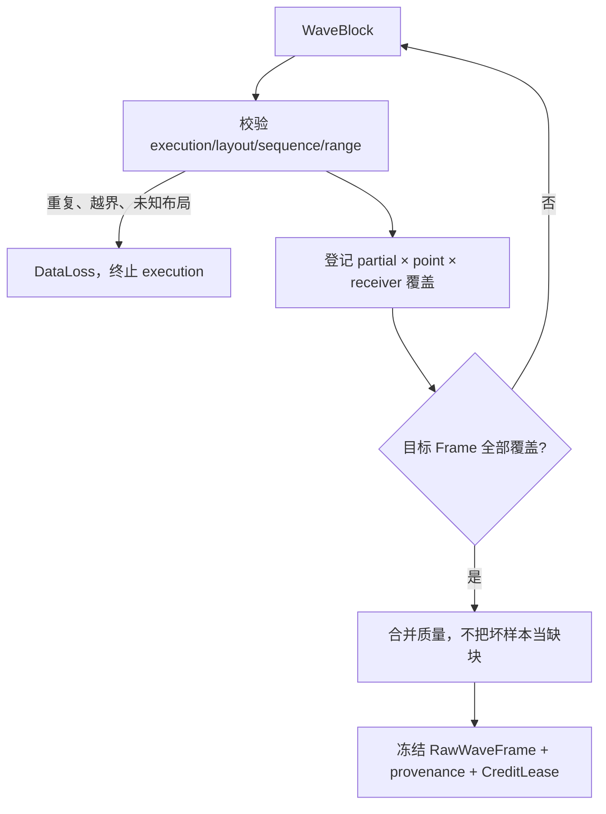

# 详细设计 01C：采集组帧

> **30 秒摘要**：L3 只负责一次物理执行的波块校验、乱序重排、完整覆盖证明和 RawWaveFrame 冻结；它不计算 S 参数、不调度 Channel，也不把跨 Sweep 平均藏进采集层。
>
> **阅读入口**：先看 [§5.1 保留与收缩](#51-保留与收缩)确定边界，再看 [§5.2 完整性](#52-完整性)理解封口与组帧，最后用 [§5.4](#54-线程资源与测试)核对并发和容量测试。
>
> 上一篇：[D1B：驱动边界与硬件](./01B-驱动边界与硬件.md) · [返回 D1 导航](./01-公共契约与硬件采集.md) · 下一篇：[D2A：统一数值契约与网络模型](./02A-统一数值契约与网络模型.md)

本篇承接 [D1B](./01B-驱动边界与硬件.md)，保留全局章节号 §5。L2 的 Execution、DataIngressSeal 和资源所有权以 [D1B](./01B-驱动边界与硬件.md) 为准。

## 5. L3：`VnaAcquisition`

### 5.1 保留与收缩

保留当前的块序列验证、布局映射、checked-size、完整性与质量分离、不可变 Prepared/Frame。收缩如下：

- 输入改为 `EffectiveExecutionPlan + ExecutionDataConsumerLease + 可重读 Execution terminal`，不再直接拥有可被其他调用者共享的 `IVnaHardware` 或 Abort 权。
- 只描述一次有效物理执行及其 Sweep/Partial 组帧；Finite/Continuous/Channel sequence 移交 Scheduler。
- 输出的具体 `RawWaveFrame` 实现 L0 `RawWaveFrameView`，含实际 AxisPoint、PointId 与 PointOrdinal、Partial/Source/Receiver、`WaveSchemaId` 和 D1 物理采集 provenance；[D3 §8.1](./03A-运行对象职责与端口.md#81-六个运行对象)在外层 envelope 追加 Initiation/AdvanceEvent/TargetBatch/Run 关系，L4 只见不可变 View。
- Frame 存储从无限可保留 `shared_ptr` 改成记账的 `FrameLease<const RawWaveFrame>`。

Point Detector 指同一个 Sweep point 的 detector measurement time 内，对多个硬件子结果做 detector 归约；它不是跨 Sweep Average。

V1 provider 每点只交付最终复数波，未声明 detector mode、子结果、窗口或归约语义，因此 L3 禁止从重复块或到达时序猜测 Point Detector。

未来只有 provider capability、EffectivePlan 和 WaveSchema 同时表达 detector mode/sub-result/measurement-time/quality 时，才新增明确 stage。普通跨 Sweep Average 由 L4 纯算子根据状态快照计算增量，[D3A 运行周期内状态存储](./03A-运行对象职责与端口.md#运行周期内状态存储普通扫频平均与迹线保持)在 L6 内单写状态；运行控制只按 ordinal/receipt 协调进度，不保存第二份 AverageState。

### 5.2 完整性

Prepare 必须同时给出 `FrameAssemblyPlan`，而不是让 Acquisition 从到达顺序猜 Frame 边界：

```text
FrameAssemblyKey
  ExecutionIdentity + PhysicalSliceOrdinal + SweepId + LogicalUnitId/LogicalUnitPlanOrdinal + FrameOrdinal

FrameAssemblyPlan
  EffectivePlanRevision + WaveSchemaId
  expectedFrameKeys[]
  perFrameExpectedCoverage       // partial × point range × receiver/source
  layoutMappings[]               // LayoutId → 共享的 plan-relative PointOrdinal[]
  orderingPolicy + maxReorderBlocks
  terminalPolicy                // controlled stop 时完整帧是否可发布
```

`PointId` 是稳定身份，`PointOrdinal` 是本 EffectivePlan 中的数组坐标，二者不得互换。一个 LayoutId 映射到排序、唯一、plan-relative 的 PointOrdinal 列表；同 layout 的多条 WaveSeries 共享这份不可变映射，不为每个 series 复制。Block 的 ordinal/range 也使用 EffectivePlan 坐标：只有连续 ordinal 才能用 first+count；跨 sparse 孔洞必须拆块，禁止把孔洞当作缺失样本或写入相邻位置。

Bind 冷路径预计算 `(LayoutId, WaveSeriesKey, block-local index) → Frame destination offset`，并验证所有 offset/end 的 checked arithmetic。热路径只做固定键查找、范围校验和连续/表驱动 copy，不构造字符串、不按 PointId 做逐点 map，也不重复展开 layout。

最小端口为 `consume(BlockLease) -> BlockDisposition` 和 `finish(ExecutionTerminalSnapshot{DataIngressSeal}) -> AcquisitionTerminalCandidate`。

`consume` 只接受匹配 Execution、layout、assembly key 和 `DataIngressSequence` 的块。ACK 表示内容已复制或 Lease 已转移；NACK 必须携带可查询原因。两者都要回写 L2/broker 的 ingress disposition ledger。

`finish` 是幂等的 seal/收口入口。它记录 seal 并进入 Finalizing，但仍接收所有 `beginSequence <= sequence < endSequenceExclusive` 的已封口块；区间外的新块立即是 `LateAfterIngressSeal/ProtocolError`。空区间直接通过序号收口，再按 terminal policy 判断是否应有 Frame。

Candidate 只有同时携带与 seal hash 一致、`outstandingBlockLeaseCount=0` 的 `IngressDrainReceipt`，才可经过 L2 `finalizeAcquisition` 成为公开 terminal。



“收到记录总数相同”不是完整性；必须证明期望键集合恰好覆盖一次。设备允许乱序时按键装配；不允许乱序时同时验证序列。

Assembler 状态是 `Collecting → Finalizing → Completed/Stopped/Failed`。ExecutionTerminalSnapshot 到达只证明 ingress 已封口，不证明所有已接纳回调都已被 assembler 消费。

Finalizing 在有界 deadline 内等待 `[beginSequence,endSequenceExclusive)` 全部得到 ACK/NACK disposition，并复核区间长度与 acceptedBlockCount。

deadline 时仍缺 seal 内序号，L3 先锁存 `DataLoss`，再请求 L2/broker 封死 delivery，并把缺项写成 `Quarantined`。在 IngressDrainReceipt 返回前，不得伪造块已释放或发布 AcquisitionTerminal。

序号和 lease 都闭合后，完整且满足发布策略的 Frame 才能冻结；expected coverage 缺失同样产生 DataLoss。受控 Stop 可按冻结 profile 丢弃不完整 Frame，但不得补零后标记成功。

坏样本、过载和解锁等设备质量属于 Quality。重复键、未知布局、CRC 错、seal 后新块或覆盖空洞属于协议或数据完整性错误；两类不能互换。

公开 AcquisitionTerminal 必须同时包含 `IngressDrainReceipt + SlotReleasedReceipt`。重复 finish/finalize 只读同一结果，不能二次释放。

### 5.3 终态

Acquisition terminal 只陈述：设备执行结束、组帧成功/失败、丢失块和已发布帧数。它不宣称 Observation、校准、Trace 或 Sink 已完成。

### 5.4 线程、资源与测试

每个 Execution 只有一个逻辑 assembler 写者。Driver 回调可以来自任意线程，但必须先经过 L2 有界 ingress 并取得 DataIngressSequence。

若 provider 声明乱序，assembler 按 key 重排，内存仍受 `maxReorderBlocks` 和 Frame Credit 限制。不得为等待 seal 内缺块无限扩容。

Execution terminal、最后一个 callback 和 Abort 并发时，不依赖跨线程“谁先入 assembler 队列”的偶然顺序。DataIngressSeal 决定合法集合，并由有界 deadline 收口。

块预算从 L2 Execution 转移到 assembler；完整 Frame 冻结时转换为 `FrameLease`，并计入 child Run。失败或丢弃立即归还。发布到数值流水线后，由下游 ACK 接管 Lease，Acquisition 不再保留裸 `shared_ptr`。

测试使用生成式 expected-key 集合，覆盖：

- 零 callback 的自然 terminal/Stop/Abort；
- 两个 Execution 的 callback 交错但各自 seal 零洞；
- 乱序、重复、缺失、重叠、越界、错误 layout、checked-size 溢出、CRC 错；
- terminal 已入队但最后 callback 尚未进入 ingress；
- seal 内块在 terminal 后到达、seal 后块、seal deadline；
- finalize response 丢失、超时、host-isolated receipt、受控 Stop；
- Block/Frame/HardwareSlot Lease 全部归零且无双释放。

容量门禁还包含 4-port × 10,000 effective points 的表驱动 sparse/dense layouts：`checkedFramePayload()` 计算的 exact budget 必须通过，少 1 byte 必须在接收首块前失败；多 WaveSeries 共享 layout mapping 的内存只计一次。测试同时断言热路径没有逐点关联容器和布局字符串分配。
