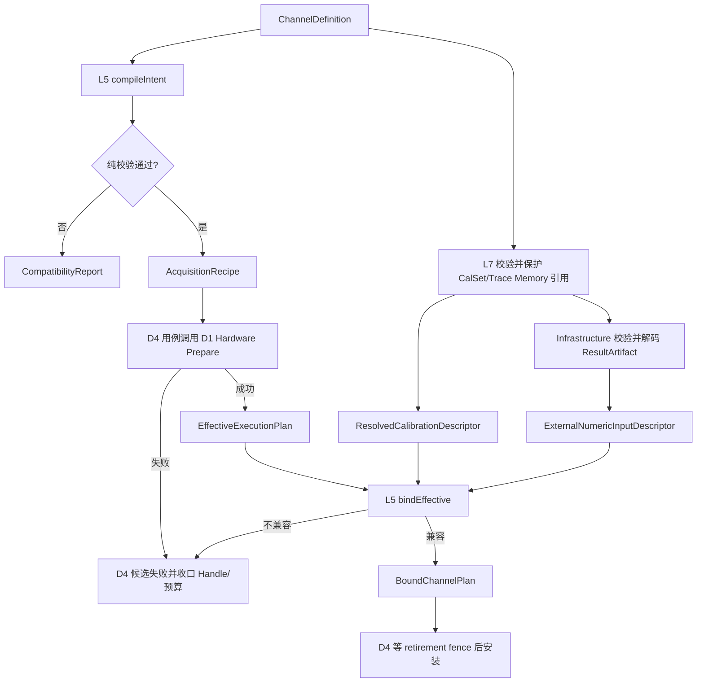
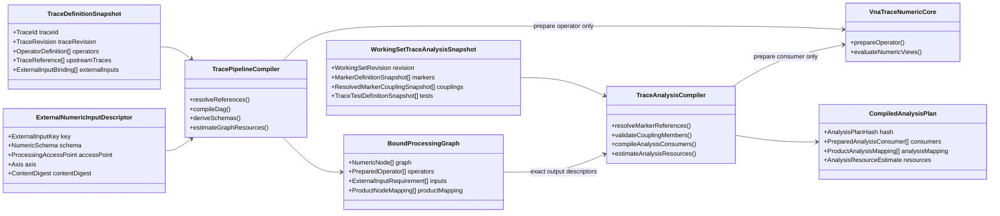
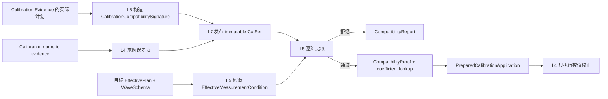
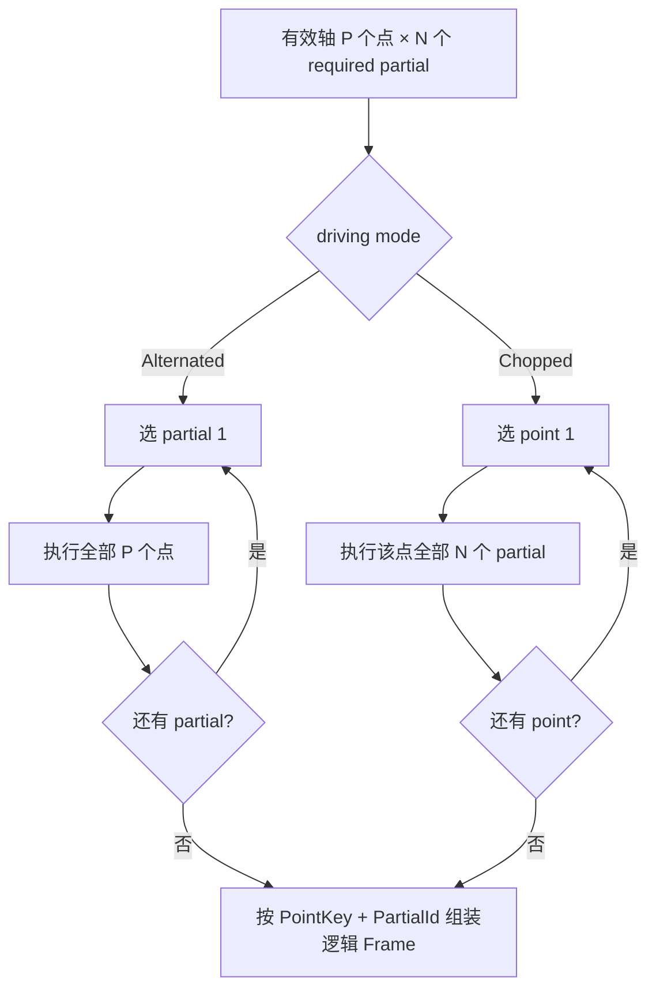

# 详细设计 02C：通道编译、绑定与失效

> **30 秒摘要**：L5 是把测量通道（`Channel`）、测量量（`Measurement`）和迹线（`Trace`）产品意图编译为采集配方（`Recipe`）、处理图和绑定通道计划（`BoundChannelPlan`）的唯一模块；它执行纯编译与兼容判断，不拥有设备句柄、持久化操作或运行恢复。
>
> **阅读入口**：先看 [§7.1–§7.3](#71-通道定义channel)理解 Channel 到可执行计划的转换，再看 [§7.4](#74-校准绑定与显示状态)理解校准绑定，最后用 [§7.5–§7.7](#75-局部测量执行顺序partial-measurement)核对执行顺序、失效传播和测试。
>
> 上一篇：[D2B：校准、变换、迹线与数值验证](./02B-校准变换迹线与数值验证.md) · [返回 D2 导航](./02-数值处理与通道编译.md) · 下一篇：[D3A：运行对象、运行职责与端口](./03A-运行对象职责与端口.md)

本篇保留全局章节号 §7。数值算子契约由 [D2A](./02A-统一数值契约与网络模型.md) 与 [D2B](./02B-校准变换迹线与数值验证.md)定义；本篇只负责编译、绑定和失效判定。

## 7. L5：通道编译核心（`VnaChannelCore`）

### 7.1 通道定义（`Channel`）

```text
ChannelDefinition
  StimulusDefinition      // linear/log/power/CW/segments
  PortConfiguration       // source/receiver/attenuator/reference impedance
  MeasurementSet          // independent MeasurementId definitions
  SweepPolicy             // stepped/swept, alternated/chopped, delay
  ChannelTriggerPolicy    // Continuous / Group(N) / Single、targetFailurePolicy
  SequenceExecutionRequirement // 本通道进入仪器序列时的顺序、粒度与结果映射要求
  AveragingPolicy         // accessPoint/mode/count/restart rules
  ChannelProcessing       // correction/offset/fixture/mixed/renorm
  UserCorrectionBinding  // Unbound | Bound{exact ref, enable, policy} | MissingUnresolved
```

`MeasurementSet` 的配置基数允许为 `0..N`，且 `MeasurementId` 在该测量通道内唯一。空集合表示测量通道仍在配置中，工作集（`WorkingSet`）、导入和召回可以保留它；但 `ChannelCompiler` 在任何硬件准备前必须返回字段级 `AtLeastOneMeasurementRequired`，不得生成可运行方案。删除最后一项只把测量通道标记为 `NotRunnable`，不隐式删除测量通道；增加第一个有效测量量并通过其余校验后才恢复运行资格。

`AveragingPolicy` 是测量通道级输入，对本测量通道的全部测量量生效；不能下沉成每条迹线各自的“通道平均”。这一作用域由 SNA 编程手册（PDF 273）的可观察行为支持；迹线最大值/最小值保持（Trace Max/Min Hold）是另一条数值状态链，二者不能共用设置或重启命令。

### 7.2 编译器

`ChannelCompiler` 是唯一把测量通道、测量量和迹线产品意图翻译成采集请求、处理图，再用硬件实际承诺和已解析外部数据绑定数值链的模块。它只有无 I/O 的纯编译入口：

- `compileIntent(ChannelDefinition, capability snapshot)`：展开默认值、推导 required quantities/partial measurements，输出 Recipe、仪器序列成员要求与 expected Schema/capability constraints。
- `compileTraceGraph(ChannelTraceSnapshot{exact ChannelId/ChannelRevision, owned TraceDefinition[]}, ExternalNumericInputDescriptor[], optional CrossChannelTraceProof[])`：先验证每条 Trace 的 owning Channel，再解析依赖并形成受限 DAG；外部输入已经由 L7/Infrastructure 解析，不含可供 L5 查询的 Repository port。默认拒绝跨通道 Trace 数值输入，只有能力和兼容证明齐全时才编译。
- `compileAnalysisPlan(WorkingSetTraceAnalysisSnapshot, BoundTraceOutputDescriptor[])`：把标记、标记耦合与迹线测试定义降为只含局部数值槽的不可变 `CompiledAnalysisPlan`；执行部分不暴露产品或显示类型。它只引用已完成迹线输出槽，由 L7 产品分析服务安装。
- `bindEffective(CompiledChannelIntent, CompiledTraceGraph, EffectiveExecutionPlan, ResolvedCalibrationDescriptor[])`：按实际轴、布局、slice、WaveSchema 和校准适用条件准备 L4 operators，输出兼容报告、证明与有界资源估算。

#### 7.2.1 L5 自有的纯数据

```text
CompiledChannelIntent
  ChannelRevision + AcquisitionRevision
  AcquisitionRecipe
  DeviceSequenceMemberRequirement
  InitiationCompletionContract
  expected WaveSchema/capability constraints
  intent content hash

ExternalNumericInputDescriptor
  ExternalInputKey
  NumericSchema + ProcessingAccessPoint + ordered Axis
  contentDigest + payloadBytes
  availability = Resolved

CompiledTraceGraph
  owning ChannelId + ChannelRevision
  TraceId/TraceRevision to NumericNodeKey mapping
  ordered NumericNodeSpec + typed edges
  ExternalInputKey requirements
  graph content hash + graph resource estimate

CompiledAnalysisPlan
  source WorkingSetRevision + exact BoundTraceOutputDescriptor refs
  ordered AnalysisEvaluationNodeSpec + local input/output slots
  affected TraceOutputSlot[] + coupling member-set digest
  evaluation plan hash
  resident/peak resource estimate

WorkingSetTraceAnalysisSnapshot
  exact WorkingSetRevision
  MarkerDefinitionSnapshot[]
  ResolvedMarkerCouplingSnapshot[]
  TraceTestDefinitionSnapshot[]

BoundChannelPlan
  ChannelRevision + ProcessingRevision
  EffectivePlanRevision
  executable selectors/slices
  BoundProcessingGraph + PreparedStage operators
  CompatibilityProof[]
  CompatibilityReport + ResourceEstimate
  BoundPlanContentHash

BoundChannelPlanDescriptor
  BoundPlanContentHash + EffectivePlanRevision
  executable selector/slice summary
  DeviceSequenceMemberDescriptor
  NumericSchema/processing graph/resource summary

RebindCandidate
  BaseDeploymentId/revision/hash
  new BoundChannelPlan + BoundPlanContentHash
  resident resource delta + CompatibilityReport
```

`DeviceSequenceMemberRequirement` 只描述“该测量通道作为单台仪器序列中的一个成员时需要什么”：精确的 `SequenceKind`、推进粒度、所需测量量、步骤顺序约束、计数提交边界和结果映射键。`bindEffective` 用设备实际承诺把它收窄为 `DeviceSequenceMemberDescriptor`。两者都不含 `DeviceSessionId`、路由目标、父测量运行任务或硬件句柄。

跨测量通道的物理执行拓扑不能由 L5 单独猜测。L6 在路由已经解析出目标、L7 已提供只读 `InstalledDeploymentDescriptor`、L2 已提供精确能力快照后，才按 [D3C §8.5.4](./03C-触发多通道调度与验证.md#854-触发路由订阅与目标通道选择)纯编译 `PhysicalExecutionTopology`。该编译只允许两个物理单元：

- `SingleInstrumentSequence`：一个 `DeviceSession` 上的一组有序通道步骤，由一次设备级 arm/start 执行并产生逐步骤结果；
- `MultiDeviceSynchronizedGroup`：两个或更多 `DeviceSession` 的设备成员序列，且产品明确要求同步物理激活。除真实共享硬件门和逐设备屏蔽就绪能力外，还必须冻结共同参考时钟或受证明的时钟域映射、逐触发路径最大偏斜、每台设备 `trigger→acquisition` latency/jitter 上界、产品允许的时间误差预算和实测证据；联合最坏误差不超过预算才可生成。

`TargetSelection` 只回答“选中了谁”，`TargetBatchAdmissionPolicy` 只回答“软件资源整批还是逐项接纳”，`PhysicalExecutionTopology` 只回答“设备怎样执行”。三者是正交输入；不能因为目标多、选择了 `AtomicAdmission`，或运行模式叫 `Group(N)`，就自动推导跨设备同步。只有共享门却没有完整时间误差证明的计划只能按多个非同步 `SingleInstrumentSequence` 执行；不得命名为 synchronized，也不得发布时间可比较结果。能力不足时返回字段级不兼容，不生成同步拓扑。

`WorkingSetTraceAnalysisSnapshot` 是 L7 从 [D4A 产品图](./04A-应用会话与事务.md#91-仪器会话instrumentsession)与当前 WorkingSet 冻结出的**一次性编译视图**，不是第二套持久化 schema：

- Marker 条目携带 exact identity/revision、owning Trace exact ref、mode、optional exact ReferenceMarker，以及搜索和采样策略。
- ResolvedMarkerCoupling 条目携带 L7 已规范化的有序 exact Trace/Marker 成员、原 selector digest、member-set digest 和兼容规则。Channel/DisplayPane selector 只留在 L7 产品关系中，不传入 L5。
- 迹线检查（TraceTest）条目携带所属迹线的精确引用、限值检查/纹波检查/带宽检查的精确修订和 `evaluationEnabled`。

L5 只把求值字段降为局部分析槽；L4 永远看不到产品身份、窗口或显示开关。`TraceAnalysisDisplayBinding` 完全属于 L7 产品关系，由 L8 呈现和预算；纯 visible/style 修改时 L5 调用数必须为 0。厂商提供的 trace-level show/hide 命令由 profile 在 L7 展开为该 Trace 当前显示绑定集合上的原子 visible 更新，不能反写测试求值定义。

`ExternalInputKey` 是本次编译快照内的局部键，不是 ResultRef。L7 保留 `Trace product binding ↔ exact ResultRef ↔ ExternalInputKey` 的产品映射和 pin；Infrastructure 负责把 ResultArtifact 校验、迁移并解码为 immutable dataset Lease；L5 只消费 descriptor，L6 通过已安装 deployment 的窄能力取得视图。

`bindEffective` 不接收、保存或释放 L2 Handle、ResultLease 或 Repository pin。`RebindCandidate` 只在 Recipe、EffectivePlan/WaveSchema、selector/slice、Point Detector/物理平均语义和所需 receiver/partial 集合均未变化时成立；任何物理输入扩大都必须重新 compile → Hardware Prepare → bind。

`InitiationCompletionContract` 是闭集，不允许 Runtime 从命令名、界面按钮或已完成 TargetBatch 数量猜测：

| 编译输入 | 冻结合同 | L6 自然完成条件 |
| --- | --- | --- |
| `Single` | `OneLogicalUnit`，每个 required primary sequence 的目标数固定为 1 | 全部 required key 恰好提交 1 个完整 logical unit，且没有可跨 boundary 的 reservation 后关闭自然 admission |
| `Group(N)` | `FixedLogicalUnits(N)`，`N` 必须在 `1..maxGroupCount` | 全部 required key 提交 N 个完整 logical unit，且没有可跨 boundary 的 reservation后关闭自然 admission |
| `Continuous` | `NoNaturalCompletion` | 永不由计数或某个 TargetBatch terminal 自然完成；只能由 Stop/Hold/Abort、失败、Close 或明确 reconfigure policy 结束 |

运行保持（Hold/Held）不进入 `ChannelTriggerPolicy`，也不是第四种完成合同；它只是 L7 的 `DesiredRunState`。Hold 结束旧 Initiation，Continue 以未改变的 Single、Group 或 Continuous 模式创建新 Initiation。它与迹线 Max/Min Hold 数值算子无关。L5 唯一负责把运行模式、primary/required sequence 集合和各自 `CountCommitBoundary` 编译成上述合同；L6 唯一负责维护 `SequenceProgress` 并求值。辅助序列可以参与结果但不能进入 required 集合，除非产品定义显式把它提升为 required。L7 只提交产品意图，不能在运行中改写 N 或把 Continuous 临时解释成 Group。

#### 7.2.2 跨层所有者边界（`owner`）

| 对象或动作 | 字段级事实源 | L5 能做什么 |
| --- | --- | --- |
| `AcquisitionRecipe` / `EffectiveExecutionPlan` / Hardware Prepare / move-only Prepared handle | [D1B §4.1 Hardware 端口](./01B-驱动边界与硬件.md#41-对外端口) | 生成 Recipe、消费只读 EffectivePlan；不调用设备、不持 Handle |
| TraceId/TraceRevision、Trace Memory ResultRef、Result pin 与 Repository 读取 | L7 产品用例；持久化事实见 [D4D §9.5](./04D-持久化结果与恢复.md#95-存储库) | 消费不可变 Trace 编译快照和已解析 descriptor；不查询 Repository、不持 pin |
| ResultArtifact 字节校验、Schema 迁移和 payload 解码 | Infrastructure Repository adapter | 只消费解码后的 descriptor；不解析字节 |
| Trace DAG、拓扑排序、环/断引用、跨节点 Schema 与整图资源 | [§7.3](#73-处理阶段顺序) | L5 是唯一编译 owner；L4 只准备单个 operator |
| Initiation Pin、child Lease、target admission、deployment retirement fence | [D3 §8](./03A-运行对象职责与端口.md#82-四类运行职责的实施契约) | 在 BoundPlan 声明资源需求；不发 Pin/Lease |
| candidate owner、deployment descriptor、installed record、Prepare journal、install CAS | [D4A §9.1 InstrumentSession](./04A-应用会话与事务.md#91-仪器会话instrumentsession) | 输出纯 plan/hash/report；不拥有安装状态机 |

`BoundChannelPlanDescriptor` 是 L5 对已绑定数值计划的公开纯值描述；它不含 DeploymentIdentity、产品状态或 Handle。`InstalledDeploymentDescriptor` 由 `VnaDeploymentAccessPorts` 合同定义，把 L0 的部署身份、L2 公开执行值与这份 L5 描述组合成运行可读视图。L7 只拥有 `CandidateOwnerRecord/InstalledDeploymentRecord`、Handle 和安装事务，不拥有或复制上述 descriptor 类型。[D3 §8.2](./03A-运行对象职责与端口.md#82-四类运行职责的实施契约)只按 `InstalledDeploymentDescriptor` 取得窄 Pin/Lease，不能由 ID 构造 Handle。

#### 7.2.3 正常活动



可选 Segment 列先继承 Channel 默认值，再扁平化；HAL 不接收“缺省表示继承”。V1 明确拒绝重叠 Segment，未来若支持必须保留 `SegmentId` 解决同频点歧义。

#### 7.2.4 失败、恢复与验证

L5 的失败只有纯 `CompatibilityReport{fieldPath, stageId, axisRange, expected, actual, severity}`，没有 Unknown、journal 或 startup recovery。其余失败与恢复责任分别归属：

- Hardware 调用未知、Prepare generation/terminal、Handle take/revoke：见 [D1B §4](./01B-驱动边界与硬件.md#4-l2vnahardware)；
- 候选 supersede、安装 CAS 和崩溃恢复：见 [D4A §9.1](./04A-应用会话与事务.md#91-仪器会话instrumentsession)；
- 旧父与 Run 的 Stop/排空：见 [D3B §8.3](./03B-测量生命周期与完成.md#83-测量运行任务生命周期initiation)；
- 旧 InstalledDeployment 的新 holder 关门与 Pin/Lease 归零回执：见 [D3A §8.2.1](./03A-运行对象职责与端口.md#821-运行职责间的端口与责任边界)。

测试覆盖 compile/bind 确定性、空 MeasurementSet 可保存但不能 Prepare、重复 MeasurementId、Segment 展开、capability 选择、EffectivePlan/WaveSchema span 变化、processing-only rebind 判定和资源 exact/少 1 byte。另用两个不同 ResultRef 解码出相同 descriptor，断言 L5 数值图 hash 相同而 L7 产品 lineage/pin 仍不同；缺失、损坏或版本不支持的 ResultArtifact 必须在进入 L5 前失败。

仪器序列成员测试要改变步骤顺序、推进粒度、测量量集合、计数边界和结果映射键，证明 descriptor/hash 精确变化；单纯改变 TargetSelection、批次资源接纳策略或目标数量，不得让 L5 凭空生成跨设备同步语义。完成合同另做闭集表驱动测试：Single 必为 1、Group 的 0/越界拒绝且合法 N 原样冻结、Continuous 必为 NoNaturalCompletion、辅助 sequence 不误入 required 集。跨进程 kill 点由对应唯一责任方文档验证。

### 7.3 处理阶段顺序

默认顺序服从 Quantity/Correction/ReferencePlane/AccessPoint 契约，不以界面菜单顺序决定。用户可调整夹具阶段时，编译器逐阶段推导 Schema；例如需要单端 S 矩阵的算子不能接在 formatted trace 后。非法序列在 Prepare 前拒绝，不能运行到一半才报错。

`TracePipelineCompiler` 是 Trace 数值 DAG 的唯一编译 owner；`TraceAnalysisCompiler` 是只读迹线分析计划的唯一编译 owner。两者消费同一冻结 WorkingSet revision：前者把数值节点降为 `NumericNodeKey`，后者只按 exact `BoundTraceOutputDescriptor` 把标记、耦合组和测试定义降为 `AnalysisSlot`。二者逐节点调用 L4 的单算子 `prepare()`；传给 L4 的任何对象都不得保留 TraceId、MarkerId、ResultRef 或 Repository capability。



编译顺序固定为：

1. 验证所有 Trace definition 来自同一 WorkingSet revision，TraceId 唯一，owning Channel 和引用目标都存在且 revision 精确；
2. 把测量量输出、上游迹线和外部参考数据分别映射为带类型输入边，禁止通过“最新迹线/结果”解析；
3. 做 Trace 数值 DAG 的拓扑排序、环检测、最大节点数、边数、扇入和跨 Trace 深度检查；
4. 沿拓扑逐节点推导 NumericSchema、访问点、Quantity、CorrectionState、ReferencePlane、完整度与 Quality policy；
5. 对 Trace Hold 只接受获准商用品证据覆盖的 `Off | MaxHold | MinHold`；Restart/Reset 编译为针对 exact state slot/revision 的独立状态控制，不编译成 `ClearWrite` 常驻模式。未获证据放行的扩展在字段级拒绝；
6. 数值节点逐项调用 L4 prepare，汇总 operator workspace、共享 buffer、FFT plan、外部输入视图和 Trace Hold state，输出 `BoundProcessingGraph` 与 exact `BoundTraceOutputDescriptor[]`；
7. `TraceAnalysisCompiler` 再验证分析快照来自同一 WorkingSet revision，Marker/Analysis identity 唯一，owning Trace 与 exact output descriptor 存在；随后解析 Marker 参考/差值。ReferenceMarker 缺失、差值标记自引用、引用环或 x/y 单位不兼容都在编译期拒绝，不能默认引用“Marker 1”或当前激活标记；
8. L7 先在同一 WorkingSet 快照中把 MarkerCoupling 的 ExplicitCompatibleTraceSet、Channel 或 DisplayPane selector 规范化展开为有序 exact Trace/Marker 成员，并计算 selector/member-set digest；L5 只核对 digest 对应的冻结成员、重复项、x 轴变量/单位和 profile 兼容证明，不读取 DisplayPane 或 TraceDisplayBinding。耦合只是已完成迹线的只读分析关系，不向 Trace 数值 DAG 增加等待边；
9. 冻结限值检查、纹波检查和带宽检查定义，分别验证分段数、搜索域、有限数值、重叠策略和产品配置上限。`evaluationEnabled` 进入已准备消费者；输入无效、缺失、非有限或交点不足时，消费者合同固定输出 `Indeterminate{reason}`；
10. 准备无产品身份的标记/检查消费者，汇总标记输出槽、联动成员/共享激励槽、限值线分段、纹波检查区间、带宽检查搜索/交点暂存区和四态输出的常驻/峰值上界；输出不可变 `CompiledAnalysisPlan` 和稳定求值计划哈希。窗口呈现关系不进入本步骤。

V1 虽用 DAG 表达依赖，执行能力仍限单输入主链加显式参考数据或已完成上游 Trace，不开放任意表达式或动态插件。一个 Trace 的 terminal 数据形成后才可作为另一 Trace 的完整输入；禁止两个 worker 通过当前值互相等待。

参考迹线数据的四段责任必须分开：L7 保存 exact ResultRef、取得 pin 并发起读取；Infrastructure 校验 ResultArtifact 格式、版本、长度、hash 和 NumericSchema 后解码不可变 payload；L5 用 descriptor 检查轴、访问点、Quantity 和 Schema 并分配 `ExternalInputKey`；L4 只执行 MemoryOp。任何层都不得用 contentDigest 反查 ResultRef，也不得在运行热路径重新打开 Repository。

迹线图测试至少覆盖：

- 成环、自环、断引用、跨工作集修订，以及相同 `TraceId` 不同修订；
- 最大节点、边、扇入和深度；
- 外部输入缺失，以及数值结构、读取位置、轴或内容摘要不匹配；
- 复数到格式化值的类型错误、完整扫描前置条件，以及整图资源恰好满足/少 1 字节。

分析计划另覆盖：

- 参考/差值标记缺失、自引用与成环；
- L7 选择器展开确定性与成员摘要，以及 L5 联动成员重复/跨通道兼容；
- 限值检查、纹波检查、带宽检查的分段数、搜索域和交点边界；
- `evaluationEnabled=false` 的 Disabled、所有窗口不可见时仍求值，以及无效输入只能得到 Indeterminate。

同一分析在窗口 A 隐藏、窗口 B 显示时，断言 L5 调用数为 0、求值哈希不变。还要做静态依赖检查，证明 L4/L5 公开头文件和目标产物不含 `DisplayPane`、`TraceDisplayBinding`、`TraceId`、`MarkerId`、`ResultRef` 或 `Repository` 符号。

<a id="dd-channel-calibration-binding"></a>

### 7.4 校准绑定与显示状态

L5 拥有 binding **值模型、实际条件签名、逐维比较和数值应用计划**，不拥有 Bind/Unbind、CatalogDelete、Save/Recall 或 Repository lineage 的事务状态机。L7 先按 exact CalSet ref 取得稳定保护并读取不可变 CalSet；L5 只消费 `ResolvedCalibrationDescriptor`，不调用 Repository。L4 最终只取得误差项、目标点映射和纯数值策略，不见 CalSet ref、binding 或产品身份。

#### 7.4.1 绑定值与版本化适用条件签名

```text
UserCorrectionBinding =
  Unbound
  | Bound {
      calSet: ExactCalSetRef { CalSetId, CalSetRevision, CalSetContentHash }
      enable: Enabled | DisabledByUser
      policy: InterpolationPolicy + ExtrapolationPolicy + WarningPolicy
      stimulusAdoption: PreserveChannel | AdoptCalSetStimulus
    }
  | MissingUnresolved {
      requested: ExactCalSetRef
      sourceProvenance
    }

CalibrationCompatibilitySignature
  SignatureSchemaId + SignatureSchemaVersion
  CanonicalizationId + CanonicalizationVersion
  ComparatorProfileId + ComparatorProfileVersion + ComparatorProfileDefinitionHash
  InstrumentCalibrationDomainFingerprint
  CalibrationMethodId + ErrorTermSchemaRevision + calibrated port/mode/term coverage
  input ProcessingAccessPoint + Quantity/CorrectionState
  connector/port mapping + ReferencePlaneDescriptor + wave convention + mathematical Zref
  ordered CalibrationConditionSpan[]
  EnvironmentConditionPolicy + observed condition/range
  SignatureContentHash

CalibrationConditionSpan
  calibrated term group + ordered effective-frequency coordinates
  source/receiver route and AnalogPathFingerprint
  actual source power + source/receiver attenuation/range
  IF bandwidth/filter equivalence class
  swept/stepped + dwell/settling + detector/physical point-average class
  ProviderConditioningState/revision/model fingerprint

EffectiveMeasurementCondition
  same SignatureSchema/Canonicalization/Comparator profile
  target required port/mode/term set
  values derived only from EffectiveExecutionPlan + WaveSchema
  ordered target condition spans + TargetConditionHash

CompatibilityProof
  calibration signature version/hash
  target condition version/hash
  comparator profile version/hash
  ordered DimensionComparison[]
  ordered CoefficientLookup[]
  CompatibilityResult + ApplyDecision + CorrectionWarnings[]
  CompatibilityProofHash

CalSetOriginProvenance =
  NativeSolved { CalibrationAttemptIdentity, SolverRevision, SolveReceipt }
  | ExternalProvided {
      sourceKind, sourceArtifactDigest, importerProfile/revision,
      optional editorRevision + parentProvenanceDigest
    }
```

`CalibrationCompatibilitySignature` 是“校准适用条件的规范记录与摘要”，不是密码学签名。它随 CalSet 一起不可变发布，并进入 CalSet 内容哈希。CalSet ID、目录名称、binding pin、Repository 位置和本次 ResultRef 不进入其语义内容；这些仍是 [D4A §9.1](./04A-应用会话与事务.md#91-仪器会话instrumentsession)与 [D4D §9.5](./04D-持久化结果与恢复.md#95-存储库)的引用与来源事实。

`StimulusAdoptionPolicy` 固定为两个显式分支：

- 默认且通用的 `PreserveChannel`：绑定 CalSet 只建立引用，并按当前 Channel 的实际条件做兼容性判断；绝不把 CalSet 记录的频率、功率、IF 带宽、Segment、衰减或采集方式暗中写回 Channel。
- `AdoptCalSetStimulus`：只有用户请求明确选择、精确产品 profile/revision 声明支持且该声明已有商用品证据回执时才可用。它不是 bind 的隐式副作用，而是 [D4A §9.2](./04A-应用会话与事务.md#92-事务与撤销undo) 的 `AtomicSettingsTransaction`：同一次提交写入明确 stimulus delta、产生新 ChannelRevision，并触发完整重编译以及需要时的 Hardware Prepare/Deployment handoff。

未知 profile、证据缺失或无法完整表达 CalSet stimulus 时必须 `StimulusAdoptionUnsupported`，不能退回“尽量采用”。

导入或编辑外部 CalSet 时，`CalSetOriginProvenance` 必须继续是 `ExternalProvided`，并通过 parent digest 记录变换来源；只有本机校准工作流实际产生匹配 `CalibrationAttemptIdentity + SolveReceipt` 时才可标记 `NativeSolved`。文件名、目录位置、用户改名或重新保存都不能把外部数据伪装成本机 solver 产物。origin、adoption policy、采用前后 stimulus digest 与 profile evidence receipt 都进入 CalSet/WorkingSet 保护 envelope 和结果 provenance；其中影响数值语义的 origin/policy 字段进入相应内容哈希。

签名必须从每份 Calibration Evidence 实际使用的 `EffectiveExecutionPlan + WaveSchema` 构造，不能从用户请求值、界面字段或当前 Channel 反推。机械 SOL 的三个标准以及独立 Check 先按 method/term group 比较实际条件；除标准角色和标准件模型外，任一硬条件不一致都拒绝组合或按 VerificationPolicy 形成精确 Check 失败，不能求平均后伪造一份共同签名。

规范化规则由 `(SignatureSchemaVersion, CanonicalizationVersion)` 唯一决定：所有物理值先换为 SI，拒绝 NaN/Inf，把 `-0` 规范为 `+0`；Axis、term group、port/mode 和 span 使用固定顺序，span 必须无重叠、无孔洞且覆盖其声明轴；字符串和枚举使用版本化闭集。旧 CalSet 只能由登记的 exact comparator 版本解释。未知 schema、canonicalization、comparator profile、definition hash、必需维度或枚举值一律 `Incompatible{UnsupportedSignatureOrPolicy}`，不尝试“尽量读取”，也不降级为 CalOff。

Comparator profile 是受版本和内容哈希约束的受信配置，不是用户可编辑容差。V1 默认除频率轴内插外，所有会影响校准的非频率条件都精确匹配规范值或 provider 声明的同一硬件等价类；只有取得对应设备/固件的商用品证据并签发新 profile 版本后才能放宽。用户 binding policy 只能进一步禁止插值或把 warning 升级为拒绝，不能放宽 comparator 的硬门。

#### 7.4.2 逐维比较策略

| 维度 | V1 比较规则 | 不满足时 |
| --- | --- | --- |
| 签名、规范化与比较器版本 | exact supported tuple + definition hash | `Incompatible/UnsupportedSignatureOrPolicy` |
| Instrument calibration domain、test-set 与 analog path | fingerprint 逐 term/span 精确相同 | `Incompatible/PhysicalPathChanged` |
| 校准方法、误差项和端口/模式覆盖 | CalSet coverage 必须包含 target required set；端口映射精确 | `Incompatible/InsufficientErrorTermCoverage` |
| input access point、Quantity、CorrectionState | 精确相同 | `Incompatible/NumericSemanticMismatch` |
| connector、reference plane、wave convention、数学 Zref | 精确相同；post-correction PortExtension 不反向改写本门 | `Incompatible/ReferenceDefinitionMismatch` |
| actual frequency | exact point 直接查表；同一连续条件区内允许 V1 插值 | 见[§7.4.3](#743-v1-频率插值) |
| actual source power | provider 规范化实际值或受信 power-equivalence class 精确相同 | `Incompatible/PowerChanged` |
| IF bandwidth/filter、source/receiver attenuation/range | provider 等价类精确相同；未知等价类不视为相同 | `Incompatible/FilterOrReceiverPathChanged` |
| swept/stepped、dwell/settling、detector、物理 point average | profile 声明的 acquisition class 精确相同 | `Incompatible/AcquisitionConditionChanged` |
| factory conditioning | operation/state/revision/model fingerprint 逐 span 精确相同 | `Incompatible/ConditioningChanged` |
| temperature 等环境量 | 只接受 profile 的 `RequiredWithinRange/Advisory/NotObservedAllowed` 闭集 | required 缺失/越界即拒绝；advisory 形成 warning |
| Segment 名称、产品 ID、Trigger source、Group count、DisplayPane/style | 不参与；实际有序频点和物理条件已由其他维度覆盖 | 不得用于误判 Cal Int/Off |
| 采集后的数字平均、format、显示平滑 | 不参与校准适用性；物理 detector/point average 已在 acquisition class 中 | 由 processing/result 兼容另行判断 |

比较器先取 calibration 与 target 的 span 边界并集，形成最小原子区间，再逐 term group 和原子区间比较。相同频率若因 Segment 或重复执行而出现多次，按有序 occurrence 和实际条件区分；不能只用 frequency 值合并。任何 path、power、filter、receiver range、conditioning 或 acquisition class 的边界都是插值硬断点。

#### 7.4.3 V1 频率插值

V1 只允许对 CalSet 的复数误差项沿**线性频率 Hz 坐标**做分段线性插值。它不按对数频率、幅相坐标或界面横轴插值，也不做 phase unwrap。若未来需要另一坐标或高阶算法，必须签发新的 comparator profile/algorithm version并新增独立 golden vectors。

对 target frequency `f`：

1. 若同一连续条件区内存在规范值完全相同的 calibration point，使用 exact coefficient，不插值；
2. 否则必须找到同一 term group、同一连续条件区内相邻且唯一的 `f0 < f < f1`；缺左端或右端即 `ExtrapolationRequired`，V1 直接 `RejectExtrapolation`；
3. 令 `gapHz=f1-f0`、`gapRatio=gapHz/max(abs(f0),abs(f1),frequencyScaleFloorHz)`、`nearestDistanceHz=min(f-f0,f1-f)`。三者分别不得超过 profile 冻结的 `maximumBracketGapHz`、`maximumBracketGapRatio` 和 `maximumNearestDistanceHz`；任一超限即 `Incompatible/InterpolationDistanceExceeded`；
4. 两端点到 target 的 path、power、filter、receiver range、conditioning、acquisition class 和 reference definition 必须落在同一个已证明连续的原子区间；不得跨断点，也不得对这些维度插值；
5. 令 `t=(f-f0)/(f1-f0)`。每个复数误差项 `c` 固定按直角坐标计算 `c(f)=(1-t)c(f0)+t*c(f1)`，即实部、虚部分别线性插值。A/B/C、SOLT/TRL 的每个已支持误差项都使用同一规则；不插值 solver rcond、Quality 或 provenance；
6. 插值结果和全部中间量必须有限，再按对应 Correction apply 数值门重验。失败即 `Incompatible/InterpolatedCoefficientInvalid`，不能退回最近点或钳制。

`maximum*` 阈值和 `frequencyScaleFloorHz` 是 comparator profile 的版本化字段，进入 profile definition hash、CompatibilityProof 和 BoundPlan hash。调用方不能临时改大阈值。V1 对 calibration 频率凸包外、跨断点、距离超限、重复端点系数冲突或 `f0==f1` 一律不产生数值应用计划。

#### 7.4.4 证明、应用与显示



`CompatibilityProof` 是 bind 的不可变输出。每个 `DimensionComparison` 保存 dimension、term/span、使用的 policy、calibration/target value digest、disposition 和精确 reason；每个 `CoefficientLookup` 是 exact source point，或 `{left point, right point, t, algorithm revision, distance checks}`。Proof 必须完整进入 `BoundPlanContentHash`，其 version/hash、逐维结论和 coefficient lookup 还必须进入结果 provenance。运行时或 Repository 不能重算、替换或删减 Proof；L4 只消费由 Proof 冻结的数值映射。

```text
CompatibilityResult       // Exact / Interpolatable /
                          // ExtrapolationRequired / Incompatible
ApplyDecision             // ApplyExact / ApplyInterpolated /
                          // BypassUnbound / BypassDisabled / RejectMissing /
                          // RejectInterpolation / RejectExtrapolation / RejectIncompatible
CandidateCorrectionStatus // Applicable / Rejected
DisplayedCorrectionState  // Cal / CalInt / CalOff；只属于已发布结果
CorrectionWarnings[]
```

这里的 `Exact` 表示所有硬条件适用且每个目标点都直接查到系数，不要求 calibration/target 整份签名字节相同。只有 Proof 真实包含至少一个 `InterpolationUsed` 才能 `ApplyInterpolated` 并在新发布结果上显示 Cal Int。`ExtrapolationRequired` 在 V1 永远映射 `RejectExtrapolation`，没有 `ApplyExtrapolated` 分支。

| binding | L5 bind/apply 决定 | 资源含义 |
| --- | --- | --- |
| `Unbound` | 明确 `BypassUnbound`；仍可 Prepare | 无 CalSet ref、pin 或 lineage |
| `Bound{Enabled}` | 对实际条件构造 target condition，与 CalSet signature 逐维比较；Proof 通过后才选择 ApplyExact/ApplyInterpolated | 必须已有 [D4A Bind/Unbind 责任协议](./04A-应用会话与事务.md#持久操作的责任交接)建立的稳定 pin 与 lineage；目录移除后再按 [D4E §9.1.4](./04E-产品对象删除与后台处理.md#914-校准数据集的目录移除)验证删除边界 |
| `Bound{DisabledByUser}` | `BypassDisabled`；不执行 compatibility/apply，但仍校验 exact ref 的产品完整性；显示 CalOff 只在新结果发布后派生 | 仍是 Bound，不能释放 ref/pin/lineage |
| `MissingUnresolved` | `RejectMissing`；在 Hardware Prepare/Run admission 前失败 | requested ref 只供诊断，不可解引用、不建 pin/lineage |

`DisplayedCorrectionState` 不是配置真相。Cal/CalInt/CalOff 必须从已发布结果的 ApplyDecision、CompatibilityProof 和 warning 派生；Recall/import candidate 本身不能把旧结果重标 CalOff。`Bound{Enabled}` 不兼容时在安装/Run admission 前拒绝，不生成一份未校正结果再冒充 CalOff。

#### 7.4.5 线性化点与目录来源链（`Catalog lineage`）

字段级协议以 [D4A 应用 Session](./04A-应用会话与事务.md#91-仪器会话instrumentsession)、[D4B Save/Recall](./04B-保存召回与运行切换.md#93-保存召回与运行切换事务)和 [D4D 存储库](./04D-持久化结果与恢复.md#951-测量结果的有界保留)为唯一事实源；本节只冻结 L5 必须依赖的安全不变量：

1. `Bound` 是唯一可建立 reverse-reference/RetentionPin 的变体，每份稳定 WorkingSet binding 还必须有 Repository 签发、不可由 payload 伪造的 `CatalogAdmissionLineageReceipt`。
2. CatalogDelete 的 tombstone 关闭其后的新 Bind/altered admission，但不抹掉删除前已经真实发布并受保护的 exact ref。合法 lineage 只能递归回到早于 `TombstoneOrder` 的 `VisiblePermitRoot` 或 `PreDeletePublicationRoot`；有界 checkpoint 也只能由 Repository 完整验链后签发。
3. Save 必须冻结 exact WorkingSet/BindingRevision、live source pin及其 revision、ExactCalSetRef 和 lineage proof。tombstone 后只有 Repository 验证 source 仍 live 且根早于 tombstone，才可签发 `GrandfatheredSaveOutgoingPin + CatalogAdmissionLineageReceipt`；source binding pin 不移动给 RecallSet。并发 Unbind/rebind 要么等待该 source claim 的 publication/no-commit receipt，要么先释放成功使 Save 稳定 NoCommit。
4. Recall 必须从 immutable outgoing pin 逐跳验证 exact ref、内容哈希、revision 顺序和 pre-delete root，再建立独立 candidate pin；源 RecallSet pin 不移动。删除后 import/altered/伪造 lineage、`MissingUnresolved → Bound`、错 BindingRevision 或非 live source pin 都不能通过 Save/Recall 洗白。

Bind/Unbind 的 gate、permit、Application product CAS、Repository facet CAS、cleanup/recovery、CatalogDelete gate closure 和 Ticket fence 分别属于 [D4A 持久操作责任交接](./04A-应用会话与事务.md#持久操作的责任交接)与 [D4E §9.1.4 目录移除协议](./04E-产品对象删除与后台处理.md#914-校准数据集的目录移除)；L5 不能通过“校准兼容”结果推进其中任何状态。

#### 7.4.6 失败、恢复与验证

L5 对缺失、签名/比较器版本不支持、覆盖空洞、reference plane/connector/analog-path/conditioning 不符、插值断点、距离超限、需外推或 lineage 未稳定只返回字段级 `CompatibilityReport` 和无副作用 `CompatibilityProof` 候选；它不重试 Repository、不创建 recovery record，也不从 tombstone/history 猜资格。

最低纯测试必须覆盖：

- 相同请求值但 L2 actual 值不同，断言只按 actual 条件比较；
- 每个 compatibility dimension 单独改变一次，以及 required dimension 缺失、unknown enum/version/profile/hash 全部失败关闭；
- exact target point、calibration point 子集、凸包内合法插值、凸包外、gap/ratio/nearest-distance 三个边界 exact/少一单位；
- 同一频率跨 power/path/filter/conditioning/acquisition discontinuity、重复频率不同 occurrence、端点冲突和 `f0==f1` 均不得插值；
- 复数实虚部 golden vector，并以独立实现证明没有使用幅相插值、phase unwrap、最近点或外推；
- CalSet term/port/mode 是超集时允许目标子集，缺任一必需 error term 时拒绝；
- 三份 SOL Evidence actual 条件不一致拒绝 candidate；Check 条件不一致按 Required/Advisory/None 得到精确结果；
- `Exact → ApplyExact/Cal`、真实插值 `→ ApplyInterpolated/CalInt`、Bound enabled 不兼容时无新结果、DisabledByUser 的新结果才是 CalOff；
- Proof 的任一 dimension、lookup、threshold 或 comparator version 改变都改变 Proof hash 与 BoundPlan hash；结果 provenance 可重算同一 Proof hash；
- 四种 Conditioning 决定与三种 UserCorrectionBinding/enable 的笛卡尔积，逐 span 断言 ApplyDecision、CorrectionState transition 和 UserCorrectionProvenance。
- `PreserveChannel` 对频率、功率、IFBW、Segment 等 Channel 字段零写入；`AdoptCalSetStimulus` 缺显式选择/profile evidence 时副作用前拒绝，具备证据时只经 AtomicSettingsTransaction 产生新 ChannelRevision、重编译和必要的 Prepare；
- 外部导入、编辑、另存和再次发布始终保留 `ExternalProvided` provenance 链，伪造或缺少本机 `SolveReceipt` 时不能变成 `NativeSolved`。

相关责任边界如下：

- Bind/Unbind 的保护引用、来源链、崩溃和竞态：由 [D4A 持久操作责任交接](./04A-应用会话与事务.md#持久操作的责任交接)承担；
- CatalogDelete 的目录关门与旧引用边界：由 [D4E §9.1.4](./04E-产品对象删除与后台处理.md#914-校准数据集的目录移除)承担；
- Save/Recall 及 `Bound → CatalogDelete → Save → Unbind → Recall` 反洗白用例：由 [D4B §9.3.7](./04B-保存召回与运行切换.md#937-设置保存与召回验证save--recall)承担；
- 全进程恢复门禁：由 [D4D §9.6](./04D-持久化结果与恢复.md#96-应用层验证门禁)承担。

本篇只验证相同冻结输入得到确定 signature、Proof、Prepared application 和 CompatibilityReport。

### 7.5 局部测量执行顺序（`Partial measurement`）

同一 `AcquisitionRecipe` 可在能力允许时选择不同 driving mode，但二者必须产生相同的逻辑 Frame schema：



Trigger 粒度可能把上述循环切成多个 execution step；Compiler 必须在计划中冻结切分点，Runtime 不能通过观察回调顺序猜测。

### 7.6 版本修订与失效传播（`Revision`）

Channel 的版本轴必须能回答“需要重算什么”，不能拿一个顶层 revision 代替全部判断：

| 版本 | 何时推进 | L5 用途 |
| --- | --- | --- |
| `BindingRevision` | UserCorrectionBinding 产品提交 | 冻结 binding 快照；事务与迟到 pin 核对归 [D4A 持久操作责任交接](./04A-应用会话与事务.md#持久操作的责任交接) |
| `AcquisitionRevision` | Recipe、物理输入或执行切分变化 | 强制重新 compile 与 Hardware Prepare |
| `ProcessingRevision` | 只改变数值处理链 | 可尝试 processing-only RebindCandidate |
| `ChannelRevision` | 任一 Channel 设置提交 | 作为顶层一致快照，不替代前三者 |
| `Trace revision` | Trace 数值或求值定义提交 | 只让受影响的 processing graph 或 AnalysisPlan 失效 |
| `DisplayPane/TraceDisplayBinding/TraceAnalysisDisplayBinding revision` | 布局、放置、visible/style 提交 | 只由 L7/L8 刷新视图；L5/L4 调用数为 0 |

失效矩阵如下：

| 修改 | 失效对象 | L5 输出 / owner 动作 |
| --- | --- | --- |
| DisplayPane layout、TraceDisplayBinding style、TraceAnalysisDisplayBinding visible/style | view refresh | 不改变数值图或求值结果，不触发 AnalysisPlan 或 deployment install；一个窗口隐藏不影响另一窗口，也不能代替 `evaluationEnabled` |
| 标记、标记联动、限值检查/纹波检查/带宽检查定义或求值开关 | 受影响的 `CompiledAnalysisPlan` | L5 纯编译候选；L7 `TraceAnalysisService` 在产品 CAS 中替换不可变计划，并主动重算当前迹线结果。零 L6/L2、零停止/准备 |
| Trace math、time transform/gate、numeric format、smooth/hold | Trace processing graph | L5 纯重编为 RebindCandidate；[D4A 部署交接](./04A-应用会话与事务.md#部署设备预备成功载荷到已安装记录)经原 retirement/install barrier 安装 |
| Trace Memory ResultRef | 对应 external input 与受影响 Trace graph | L7 先保护并解码新 exact ref；L5 只按 descriptor 重编。缺失/损坏时旧配置保持，新候选不安装 |
| Cal binding、CompatibilitySignature/Proof、post-correction transform/renorm、普通 Channel average | Channel processing/runtime | 默认 RebindCandidate；required input、设备实际条件或物理平均变化则升级完整 Prepare，并重新生成 Proof |
| 测量量/信号源/接收机/激励/分段/物理触发粒度 | 采集与全部下游 | `compileIntent` → [D1 硬件准备](./01B-驱动边界与硬件.md#41-对外端口) → `bindEffective` → [D4A 安装](./04A-应用会话与事务.md#部署设备预备成功载荷到已安装记录) |

#### 7.6.1 产品分析计划的原子替换与主动刷新

纯标记、标记联动、限值检查/纹波检查/带宽检查求值配置变化不改变采集配方、数值处理图、硬件部署或测量运行任务。L5 只负责纯编译；不可变计划的安装、当前结果快照、任务调度和发布都属于 L7 `TraceAnalysisService`，L6/L2 不参与。

```text
TraceAnalysisPlanCandidate
  expected WorkingSetRevision
  new AnalysisDefinitionRevision
  immutable CompiledAnalysisPlan + evaluation plan hash
  ordered local input/output slots + coupling member-set digest
  resident/peak bytes + plan/evaluation/input/output/scratch slot counts

TraceAnalysisPlanLease
  WorkingSetRevision + AnalysisDefinitionRevision + evaluation plan hash
  immutable plan ref + lease identity
```

提交顺序固定为：

1. L7 在同一 WorkingSet 快照中展开联动选择器；L5 纯编译候选。L7 在 `TraceAnalysisService` 的 plan、求值任务、输入快照、输出和 scratch 硬上限内预留完整资源；少一单位就在产品副作用前拒绝。
2. L7 应用单写者用 expected WorkingSetRevision 做一次产品 CAS，并在同一临界区提交 Marker/测试定义、推进 `WorkingSetRevision + AnalysisDefinitionRevision`、使旧输出发布资格失效、把 service 的 active immutable plan 指针替换为候选。它没有第二个生效步骤或第二份状态投影。
3. CAS 前已取得旧 `TraceAnalysisPlanLease` 的求值可以完成旧 revision；CAS 后的新任务只取得新 revision。发布时再次比较 `WorkingSetRevision + AnalysisDefinitionRevision + exact owner revision`，旧结果稳定丢弃，不能覆盖新结果或复活已删除对象。
4. CAS 后立即为新 plan 排入一次有界主动刷新。每次求值由 L7 在同一 `SessionLiveResultStore` 快照上冻结有序 current Trace 版本集合，得到 `AnalysisInputVersionSetDigest`；跨通道成员允许来自不同 Run/Sweep/ordinal，缺失或不兼容输入立即形成 `Indeterminate`。
5. 设备停止、Channel Held/Ready、从未创建测量运行任务或没有新 Sweep 都不阻止主动刷新。新迹线 current 只触发同 revision 的有界合并刷新；队列满时合并或明确 `ResourceExhausted`，不等待扫描、不临时扩容。

编译、预留或产品 CAS 失败时，产品与 active plan 都保持旧 revision。产品 CAS 成功即表示新 plan 已在 L7 生效；普通 Marker/测试修改是同步产品命令，不创建 durable Ticket/journal。进程重启从当前 WorkingSet 重新纯编译并建立内存 plan；不会恢复旧 worker、lease 或分析 current。

`TraceAnalysisDisplayBinding.visible/style` 不走上述协议：它是窗口级 view-only 产品提交，只推进该显示关系 revision 并通知 L8 刷新。厂商 trace-level show/hide 先由 profile 展开为该 Trace 当前全部显示绑定的确定集合，再做一次 L7 原子提交；L5/L4 调用数为 0。

#### 7.6.2 数值图与采集计划的正常路径

L5 的 compile、bind 和 rebind 都是纯函数，没有业务线性化点。真正的状态改变分属三个组件：

- [D1 §4](./01B-驱动边界与硬件.md#4-l2vnahardware)：在 DeviceSession control executor 接纳 Prepare/Start，并分配 generation/Execution；
- [D4A §9.1](./04A-应用会话与事务.md#91-仪器会话instrumentsession)：持久化 attempt/candidate、唯一拥有 Handle，并执行 deployment install CAS；
- L6：先由 [D3B §8.3–§8.4](./03B-测量生命周期与完成.md#83-测量运行任务生命周期initiation)关闭父运行准入并排空 Run，再由 [D3A §8.2.1](./03A-运行对象职责与端口.md#821-运行职责间的端口与责任边界)关闭旧 InstalledDeployment 的 Pin/Lease admission，并形成归零回执。

任何文档或实现都不得声称这些动作是一个跨进程 CAS。

processing-only 路径依次为：

1. L5 用旧 EffectivePlan 构造 RebindCandidate；
2. [D4A](./04A-应用会话与事务.md#部署设备预备成功载荷到已安装记录)校验 BaseDeployment 与资源 delta；
3. [D3B](./03B-测量生命周期与完成.md#83-测量运行任务生命周期initiation)关闭旧父运行准入并排空 Run；
4. [D3A](./03A-运行对象职责与端口.md#821-运行职责间的端口与责任边界)取得 `InstalledDeploymentAdmissionClosedReceipt + InstalledDeploymentPinLeaseDrainReceipt`；
5. [D4A](./04A-应用会话与事务.md#部署设备预备成功载荷到已安装记录)在安装 CAS 中唯一移动 Handle，并发布新 descriptor。

候选等待时，旧 Run 继续使用冻结的旧 pipeline；新 pipeline 不得提前解释旧 Frame。

#### 7.6.3 失败与恢复

- 纯 compile/bind 失败不接触硬件，旧 deployment 保持其 owner 文件定义的状态。
- Prepare unknown、晚到 terminal、Handle take/revoke、Host isolation 以 [D1B §4.1–§4.4](./01B-驱动边界与硬件.md#4-l2vnahardware)为准。
- candidate supersede、Close、install CAS、main-process restart 与 WorkingSet/descriptor 投影以 [D4A §9.1](./04A-应用会话与事务.md#91-仪器会话instrumentsession)为准。
- Stop/Abort、旧父 terminal、child Lease 与 processing/result 收口以 [D3B §8.3–§8.4](./03B-测量生命周期与完成.md#83-测量运行任务生命周期initiation)为准。

L5 不保存 `PrepareAttemptRecoveryRecord`、`CandidateOwnerRecord`、`InstalledDeploymentRecord` 或 cleanup receipt；它只需能用冻结输入重算相同 plan/hash/report。

#### 7.6.4 验证

表驱动测试逐字段断言 `no-op / view refresh / analysis-only recompile / Rebind / full Prepare`，并检查：

- 无关 DisplayPane 或另一 Trace 的修改不淘汰当前复数结果；相关 acquisition、Cal、upstream 或 external-input 修改必须改变对应 BoundPlan。
- MarkerCoupling 的成员或作用域变化让整个冻结成员组的分析计划失效；`TraceAnalysisDisplayBinding.visible/style` 变化时 L5 调用数为 0、求值 hash 不变，`evaluationEnabled` 或测试定义变化时分析计划 hash 必须变化。
- CompatibilitySignature、Comparator profile、DimensionComparison 或 coefficient lookup 改变必须改变 Proof 与 BoundPlan hash；纯布局变化不得改变。

跨层验收分别检查 [D1 §4](./01B-驱动边界与硬件.md#4-l2vnahardware) 的 generation/Handle single-owner、[D3B](./03B-测量生命周期与完成.md#83-测量运行任务生命周期initiation) 的运行排空、[D3A](./03A-运行对象职责与端口.md#821-运行职责间的端口与责任边界) 的 admission-close/PinLease-drain 回执，以及 [D4A 部署交接](./04A-应用会话与事务.md#部署设备预备成功载荷到已安装记录) 的 install CAS；L5 单测不伪造这些状态机。

### 7.7 错误、资源与测试

编译/绑定错误固定为 `CompatibilityReport{fieldPath, stageId, axisRange, expected, actual, severity}`，禁止只返回字符串。L5 在任何失败路径都不修改 Hardware、Application、Runtime 或 Repository 状态；调用者依据报告决定修正、保留旧 deployment，或启动 owner 文件定义的新 operation。

`ResourceEstimate` 必须覆盖绑定计划、迹线 DAG、索引映射、已准备阶段、外部输入视图、数值暂存区，以及标记输出槽、联动成员/共享激励槽、限值线分段、纹波检查区间、带宽检查搜索与交点暂存区、四态求值输出的常驻/峰值上界，并在任何大分配前用受检算术校验。`TraceAnalysisDisplayBinding.visible/style` 不进入 L4/L5 求值资源估算；绘图资源由 L8 另行预算。`evaluationEnabled=false` 可省略求值暂存区，但仍保留有界的 Disabled 输出。L5 只计算和预留声明，不持有硬件槽、`FrameLease`、`ResultLease`/固定引用、候选额度或结果令牌。

最低测试集：

- compileIntent/bindEffective/RebindCandidate 的确定性与内容哈希稳定；
- Segment 默认值展开、重叠拒绝、partial driving mode 与 slice 冻结；
- Trace DAG 环/断引用/跨 revision、external input 解析边界，以及每类 Schema/span/conditioning/CalSet/transform/Trace 兼容错误的字段路径；
- Trace Hold 仅 Off/Max/Min、独立 Restart/Reset 的 exact state revision，以及未获证据的 ClearWrite 在编译期拒绝；
- 参考/差值标记与联动组的精确引用、成环、跨迹线/通道兼容和成员排序；限值检查/纹波检查/带宽检查的 Disabled/Pass/Fail/Indeterminate、隐藏显示仍求值，以及每类分析资源恰好满足/少 1 字节；
- CalibrationCompatibilitySignature canonicalization、逐维 fail-closed、插值距离/断点、CompatibilityProof 与 BoundPlan/provenance hash；
- processing-only 判定的正反例，以及资源预算 exact/少 1 byte；
- 相同物理计划下 alternated/chopped 产生相同逻辑 Frame 需求；
- 纯函数故障后 Hardware 调用计数、Handle owner、Application revision 和 Runtime admission 均不变化。

故障注入责任分别为：

- Prepare/Handle/Host：[D1B §4](./01B-驱动边界与硬件.md#4-l2vnahardware)；
- Run/Trigger/state-result：[D3C §8.7](./03C-触发多通道调度与验证.md#87-线程与运行时验证)；
- Bind/Unbind：[D4A 持久操作责任交接](./04A-应用会话与事务.md#持久操作的责任交接)；
- CatalogDelete：[D4E §9.1.4](./04E-产品对象删除与后台处理.md#914-校准数据集的目录移除)；
- Save/Recall：[D4B §9.3.7](./04B-保存召回与运行切换.md#937-设置保存与召回验证save--recall)；
- adapter：[D5C §12.4](./05C-依赖验收与竞态.md#124-p0-竞态矩阵)。

端到端门禁汇总在 [D5C §12.4 P0 竞态矩阵](./05C-依赖验收与竞态.md#124-p0-竞态矩阵)。
