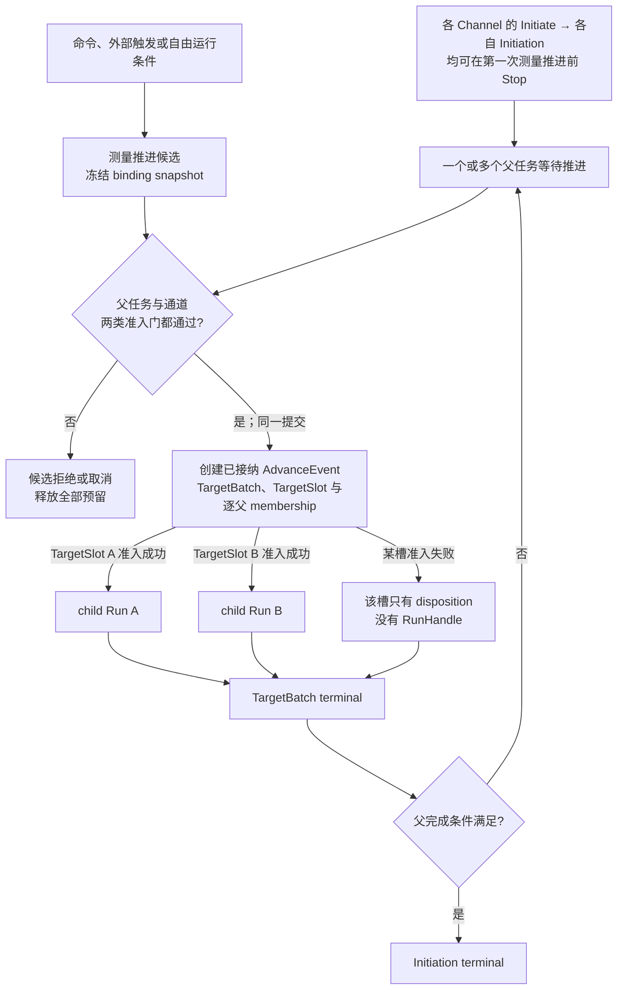
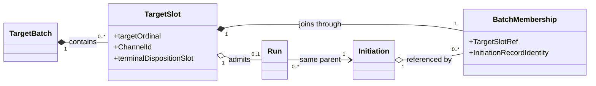
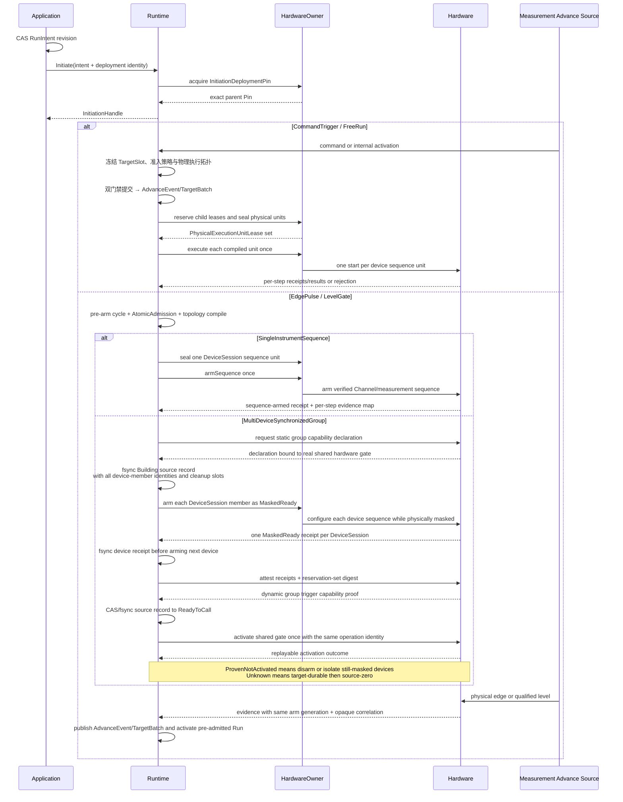
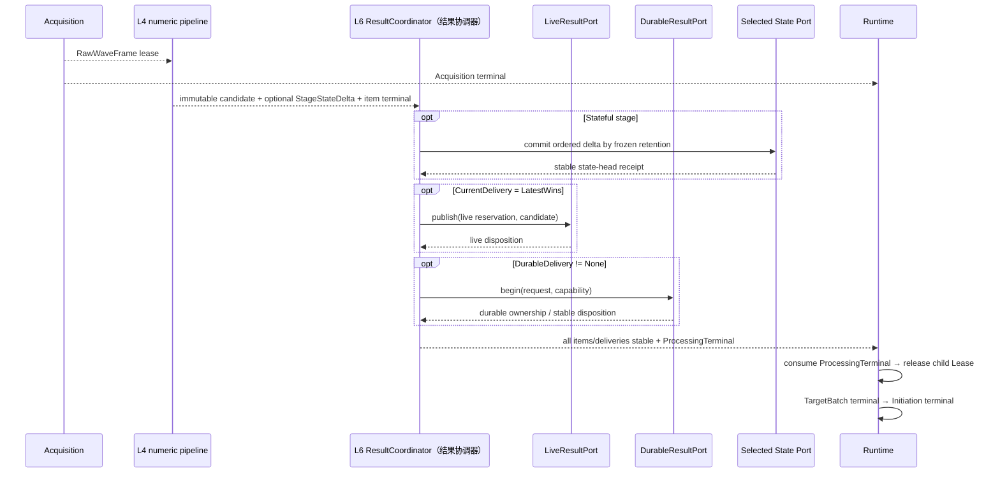

# 详细设计 03A：运行对象、运行职责与端口

## 30 秒摘要

本篇先把一次测量中的六类运行对象分清，再说明配置与当前结果、运行控制与触发调度、采集与数值处理、资源、状态与诊断四类职责如何协作。停止态仍可执行的产品迹线分析明确不属于 L6，详见 [D4A](./04A-应用会话与事务.md)。

- 想先分清“启动一次测量、接纳一次测量推进、冻结一批目标、运行一个通道任务、设备扫描一次”的区别，读 [§8.1](#81-六个运行对象)。
- 想确认唯一写者、跨层端口、资源准入和结果交付责任，读 [§8.2](#82-四类运行职责的实施契约)。
- 本篇只定义对象、责任与端口；父任务、单通道任务、停止和完成条件在 [D3B](./03B-测量生命周期与完成.md)，触发和多通道调度在 [D3C](./03C-触发多通道调度与验证.md)。

阅读入口：首次阅读按“§8.1 对象 → §8.2 职责 → §8.2.4 正常一次 Single Sweep”顺序；实现接口时再查 §8.2.1–§8.2.3。

> 上一篇：[D2C：通道编译、绑定与失效](./02C-通道编译绑定与失效.md) · [返回 D3 专题导航](./03-运行时触发与调度.md) · 下一篇：[D3B：测量生命周期、停止与完成](./03B-测量生命周期与完成.md)

> 编号说明：详设拆分后仍沿用全局章号；本篇承载第 8 章的 §8.1–§8.2。

## 8. 运行时（L6 `VnaRuntime`）

<a id="dd-runtime-objects"></a>

### 8.1 六个运行对象

运行时最容易误解的地方，是把“启动一次 Channel”“接纳一次命令、外部信号或自由运行条件”“执行一个目标”和“设备扫了一次”都叫 Run。这里强制拆开：

| 对象 | 何时创建 | 覆盖范围 | 谁拥有终态 |
| --- | --- | --- | --- |
| `RunIntentRecord` | 用户 Initiate/Continue/Restart/Stop/Hold/Abort | Channel 当前期望处于 Initiated、Ready 还是 Held | Application；它是产品意图，不是运行 Handle |
| `InitiationHandle` | 一个 Initiated intent 被接纳并取得 `InitiationDeploymentPin` | 从第一次测量推进前，到所有批次/子 Run 排空；父 Pin 同寿命 | Runtime 父对象 |
| `AdvanceEvent`（已接纳的测量推进事件） | 测量推进候选通过全部父任务与通道准入门，接纳事务提交成功 | 一份冻结的命令、外部触发或自由运行证据及其路由语义 | MeasurementAdvanceEngine |
| `TargetBatchHandle`（目标批次句柄） | 与对应 `AdvanceEvent` 在同一次接纳提交中创建，全部 pending membership 同时转为 Registered | 精确 `AdvanceEventRecordIdentity` 对应的 `0..N TargetSlot` 及其处置结果；Handle 携带完整 `TargetBatchRecordIdentity` | MeasurementAdvanceEngine/TargetBatch aggregator |
| `RunHandle` | 某个 `TargetSlot` 准入成功 | 一个测量通道目标的 acquisition + processing；只属于该槽关联的父测量运行任务 | RunEngine；准入失败不创建 Run |
| `SweepId` | 驱动开始一次物理扫 | 设备协议中的一次物理执行单元 | Hardware/Acquisition；不等于产品运行 |

`MeasurementAdvanceCandidate`（测量推进候选）是接纳前的有界协议对象，不计入上述六个正式运行对象。候选被拒绝或取消时不会创建 `AdvanceEvent` 或 `TargetBatch`。



一句话记忆：`Initiation` 是一个测量通道的一次测量运行任务，`AdvanceEvent` 是一个已接纳的推进事实，`TargetBatch` 是该事件的逻辑目标集合，`TargetSlot` 是批次内的一个测量通道目标，`Run` 是该槽成功准入后的单通道任务，`Sweep` 只是设备物理动作。一个 `TargetBatch` 可以通过不同 `BatchMembership` 引用多个测量通道的 `Initiation`，但它不拥有这些父任务。Stop/Hold 作用于精确父任务；Hold 将旧任务关门、排空并结束，Held 意图下没有可恢复的 live Initiation；Continue 创建全新的 Initiation。

Marker、限值检查、纹波和带宽在设备停止且没有 Initiation/Run 时仍须可用，因此不属于上述六个运行对象。它们由 L7 `TraceAnalysisService` 调用 L4 纯求值；本篇的 L6 状态机、完成屏障和硬件控制均不参与。

<a id="dd-runtime-four-planes"></a>

### 8.2 四类运行职责的实施契约

四类运行职责是一次测量的协作视角，不是四个 DLL 或四条线程。每份可变状态只能有一个写者；职责之间只传不可变快照、强类型 Handle/Lease 和终态通知。

| 运行职责 | 唯一状态写者 | 主要输入 | 主要输出 | 明确禁止 |
| --- | --- | --- | --- | --- |
| 配置与当前结果 | L7 `InstrumentSession` command executor | 带 ExpectedRevision/幂等键的用例命令 | Channel/Trace/Cal/期望运行状态快照、当前结果 | 保存 Execution/Run 可写指针、直接改设备 |
| 运行控制与触发调度 | L6 Runtime control executor；设备状态另由 L2 control executor 单写 | deployment descriptor/AccessPort、Initiation 命令、推进证据、子任务终态 | Pin/Lease、AdvanceEvent/TargetBatch/Run、ExecutionStartRequest、运行状态和唯一终态 | 读取可变 Channel、拥有厂商 ABI/Prepared Handle、承载产品分析 worker |
| 采集与数值处理 | L2 Execution、L3 assembler、L4 worker 各自单写其局部状态 | AdmittedRunContext、块/Frame Lease、PreparedStage | Raw/Observation/Network/Trace/Result、Acquisition/Processing terminal | 回写 routing/Channel、无 Credit 排队、隐藏算法状态 |
| 资源、状态与诊断 | 各服务自己的执行器或与调用者同事务的纯端口 | Credit 请求、状态事件、来源记录片段、时钟证据 | Lease、状态投影、审计、时钟相关证明 | 自行决定 Retry/Fail/Continuous 等业务策略 |

#### 8.2.1 运行职责间的端口与责任边界

L6 拥有消费方接口 `DeploymentAccessPort`。它单独放在稳定合同目标 `VnaDeploymentAccessPorts`，因为端口签名必须使用 L2 公开执行合同中的 `ExecutionStartRequest/HardwareTriggerArmRequest/ExecutionControlHandle`，以及 L5 公开编译输出 `BoundChannelPlanDescriptor`。

该合同目标自己定义 `InstalledDeploymentDescriptor`，把 L0 部署身份、L2 公开执行值与 L5 纯值描述组合起来。它还定义纯值的 `CompiledPhysicalExecutionPlanRef/PhysicalExecutionUnitRequest` 边界形状，供 L6 提交拓扑编译结果，不含产品对象或 Handle。

结果、状态、来源日志等不需要设备/通道类型的窄端口仍留在只依赖 L0 的 `VnaRuntimePorts`。

`VnaRuntime` 消费 `VnaDeploymentAccessPorts`，L7 出站基础设施适配器 `VnaApplicationHardwareOwner` 实现它。这个适配器同时实现 L7 的 `HardwarePreparationOwnerPort`，因而 Prepare、install、Pin/Lease 及窄 `start/arm` 调用始终命中同一份私有 `CandidateOwnerRecord/InstalledDeploymentRecord`。`VnaApplication` 核心只保存产品元数据和 opaque owner identity，不触及 L2 Handle。`VnaCompositionRoot` 只注入这两个接口视图，不执行业务步骤。

```cpp
class DeploymentAccessPort {
public:
    virtual Result<InitiationDeploymentPin>
    acquireInitiationPin(DeploymentIdentity expected, InitiationId) = 0;

    virtual Result<AtomicAdmissionChildLeaseReservation>
    reserveAtomicAdmissionChildLeases(RuntimeOperationRecordIdentity targetBatchIdentity,
                                      ArrayView<const ChildLeaseRequest>) = 0;

    virtual Result<PreparedDeploymentLease>
    acquirePerTargetChildLease(const ChildLeaseRequest&) = 0;

    virtual Result<PhysicalExecutionUnitLeaseSet>
    sealPhysicalExecutionUnits(RuntimeOperationRecordIdentity targetBatchIdentity,
                               CompiledPhysicalExecutionPlanRef,
                               ArrayView<const PhysicalExecutionUnitRequest>) = 0;

    virtual ReleaseReceipt
    releaseInitiationPin(PinId, ReleaseOperationIdentity) noexcept = 0;

    virtual ReleaseReceipt
    releasePreparedDeploymentLease(LeaseId, ReleaseOperationIdentity) noexcept = 0;

    virtual Result<InstalledDeploymentDescriptor>
    describe(DeploymentIdentity expected) const = 0;
};
```

**请求合同。** `ChildLeaseRequest` 必须携带 exact DeploymentIdentity、完整 Initiation/AdvanceEvent/TargetBatch `RuntimeOperationRecordIdentity`、`TargetSlotRef{TargetBatchRecordIdentity,targetOrdinal}`、PinId 和 Credit token。裸 `TargetBatchId` 只能用于日志展示，不能充当授权、去重或回收定位。

- AtomicAdmission 方法要么为全部 target 返回有序 `ReservedForBatch` Lease，要么返回零 Lease。
- PerTargetAdmission 每次只线性化一个 target。
- reservation 转 child Run 是 move，不复制 Lease。`PreparedDeploymentLease` 只保留方案/资源生存期，本身不暴露 start/arm；Runtime 再按已编译 `PhysicalExecutionTopology` 调用 `sealPhysicalExecutionUnits`，把一个或多个槽唯一的执行权封装为 `PhysicalExecutionUnitLease`。seal 只读已安装 descriptor 和能力，不 Prepare、不调用硬件。
- `SingleInstrumentSequence` 的 unit lease 只暴露一次设备级 `startSequence(DeviceSequenceExecutionRequest)` 或 `armSequence(DeviceSequenceArmRequest)`；L2 按冻结步骤产生逐槽结果。它不允许 L6 对每个通道分别 start/arm。
- `MultiDeviceSynchronizedGroup` 为每个 `DeviceSession` 形成一个设备成员 unit lease；每个成员可包含本机多通道序列。只有跨设备组协调端口能逐设备进入 `MaskedReady` 并打开真实共享硬件门。
- unit lease 是一次性执行权：start/arm 成功、明确拒绝或取消都会消费；它不能从 child Lease 重新导出。child Lease 仍各自保持到对应 Run 的 ProcessingTerminal，再按原 release 协议释放。
- 入口先验证 `TransferredToRun`、descriptor/slice、Run correlation 和 generation，再通过同一 `VnaApplicationHardwareOwner` 实现投递给 record 唯一拥有的 `PreparedExecutionHandle`；L7 核心和 L6 都不能中转 concrete Handle。
- `describe()` 只返回纯 descriptor。

**线性化点。** port 的 acquire 与 record retirement 使用同一 generation/CAS。

- acquire 先复核 Installed、admission open、三元组和父 Pin，再原子增加对应计数。失败 acquire 不改变计数或 Credit。
- retire 先 CAS 关闭新 Pin/Lease admission，随后只等待已成功线性化的 Pin/Lease 归零。
- release 是本地 registry ledger 的 no-fail、幂等线性化操作。它使用预留 control slot/tombstone，按 `PinId/LeaseId + ReleaseOperationIdentity{ReleaseOperationId, ReleaseOperationRetirableLocator}` 把 Live 恰好一次改成 Released，并返回稳定 `ReleaseReceipt`。
- locator 随 holder capability 一起签发。未 compact epoch/协商 retry horizon 内重试返回同一 receipt，不调用 Driver/Repository，也不允许因普通资源不足失败。teardown ACK 后按下段规则 compact。

**关闭与退役。** 稳定 receipt 不等于永久保存每一条明细。Pin/Lease ledger 按有界 `ReleaseLedgerEpoch` 发号，每个 holder 还记录 `RequesterProcessInstanceId/OwnerEpoch + terminalRouteRef`。

- 正常时，只有该 epoch 全部 holder 已 Released、对应 Initiation/Run terminal durable、requester teardown ACK，且不存在 recovery/quarantine claim，才能写 `RetiredReleaseEpoch{recordId, epoch, maxIssuedId, terminalDigest}` 并 crash-safe compact 明细。
- Continuous 达到固定 holder 上限时，先关闭旧 epoch admission，待 fence 后滚动新 epoch。
- 当前/最近窗口重放原 receipt；早于 watermark 只返回 ProtocolExpired/OwnerRetired，且绝不再次增加可用量。
- ID 含 record/epoch 且永不复用，所以 compact 后的迟到 release 也不能命中新 holder。

##### 部署所有权回执

重配置、路由切换和删除需要跨文档引用的两个证明，由本节统一定义；Application 的责任归属 revision 不能替代它们：

```text
InstalledDeploymentAdmissionClosedReceipt
  complete DeploymentAdmissionCloseOperationIdentity
    { DeploymentAdmissionCloseOperationId, DeploymentAdmissionCloseRetirableLocator }
  exact InstalledDeploymentIdentity
  DeploymentRecordRevisionBefore + DeploymentRecordRevisionAfter
  closeContext = ChannelReconfigure {
                   complete ChannelReconfigureOperationIdentity,
                   ReconfigureGeneration }
               | RoutingHandoff {
                   complete RoutingHandoffOperationIdentity,
                   RoutingHandoffGeneration }
               | ChannelDelete {
                   complete ChannelDeleteOperationIdentity }
  IssuedLivePinLeaseSetDigest
  admission = Open -> Closed

InstalledDeploymentPinLeaseDrainReceipt
  exact InstalledDeploymentIdentity
  InstalledDeploymentAdmissionClosedReceiptRef
  final Pin/Lease release-set digest
  matching Initiation/TargetBatch/Run terminal-set digest
  PinCount=0 + LeaseCount=0 + DrainRevision
```

第一张回执的 CAS 是“旧 deployment 不再签发新 Pin/Lease”的线性化点；`closeContext` 必须携带真实用例的完整 identity，ChannelDelete 不伪造 ReconfigureGeneration。第二张只证明已经签发的运行持有者全部收口。

它们不转移 Prepared Handle，也不决定新产品 revision 是否安装。通用 Handle 与安装事务由 [D4A](./04A-应用会话与事务.md#持久操作的责任交接)拥有，产品删除的最终提交由 [D4E §9.1.3](./04E-产品对象删除与后台处理.md#913-产品对象删除与结果责任收口)拥有。

完整旧 record 只有在 Handle/cleanup、requester ACK 与上述回执齐全后才能按本节规则退役并 compact。

**失败与恢复。** 若 requester 在 ACK 前消失，startup/Close 的 `AbandonedRuntimeCleanupOwner` 先核对 terminal route。

- 已 Released 项写 `RequesterGoneTeardownReceipt`。
- 仍 Live 项按原 ReleaseOperationIdentity release；无法证明则 Host-isolate/quarantine，随后同样允许 epoch 退役。
- 不能等待永远不会到来的旧进程 ACK。

若 release 校验发现 registry ledger/计数损坏，不能只写日志或让 retirement 永久等待。同一 executor 立即关闭该 InstalledDeploymentRecord 和 Session 的新 admission，并在**同一份仍未退役 record**内激活 admission 时预留的 `DeploymentQuarantineClaim{DeploymentIdentity/Revision, exact Handle claim, resident budget, issued/released holder journal refs, source/current owner revision, state, receipts}`。

- CAS 只把这段 durable record 的执行权交给 `QuarantineOwner`。move-only Handle 仍由该 record 唯一持有，不移入匿名内存账。
- 能证明的 holder 按同一 receipt 协议收口；无法证明时由 Close 隔离精确 Driver Host generation，最终发布 `RetiredQuarantined/ClosedWithQuarantinedHost`。
- startup 枚举全部未退役 InstalledDeploymentRecord 并继续 claim。claim、Handle 和 resident budget 收口前，record 不能退役或重新发 Lease。
- 父 Pin 和 child Lease 使用完全相同的收敛规则。正常终态不可被 teardown 改写，但其 teardown ticket 必须等 release receipt 或隔离终态，retirement 因而不会无限悬挂。

**R2 AdmissionRoot 边界。** V1/R2 的 Runtime control、`VnaApplicationHardwareOwner` 和 ResourceLedger 位于同一进程、同一故障域。R2 只实现单通道、单目标 Single；其 `RuntimeAdmissionRoot` 在一个本地线性化事务中拥有父 guard、退化为单目标的 TargetBatch/Run identity、Credit、child Lease reservation 与 terminal/cleanup slot。这里的“准入”只声称第一条 start 之前全部本地参与者已接纳、零半成品 Run 发布。R2 不实现多目标、`PerTargetAdmission`、外部硬件组激活或长期持久结果租约。

现有 `AdvanceEventAcceptanceRecord` 或本地 WAL 可帮助同一组件崩溃恢复，但不能被表述为跨组件分布式原子提交。若未来把 Runtime、Registry 或 Ledger 拆到不同进程/主机，必须由更高层新增 `CrossComponentDurableAdmissionRoot`：它在任何 participant 产生不可逆副作用前持久化完整 participant 集、prepare/commit/abort 决定、fencing token 和恢复责任方，并让每个 participant 可按同一 decision 幂等重放。该根未实现前，跨组件 AtomicAdmission profile 必须关闭，不能用 RPC 成功计数、超时补偿或“最终大概归还”冒充。

外部触发从 S1 开始分阶段解禁。S1 的单目标可以在设备声明的线性化点进入 `LiveArmed`，并以 evidence cursor 保留 receipt 返回途中到达的同代证据。S5 必须把两类多目标物理执行分开验收：

- 同一 `DeviceSession` 的 `SingleInstrumentSequence` 由一次设备级 arm/start 和已验证的通道/测量序列执行。L2 返回逐步骤、逐 `TargetSlot` 的证据与结果；这里没有 per-channel `MaskedReady`，也不建立组激活来源/决定日志。
- 只有跨 `DeviceSession` 且产品要求同步物理激活时，才可使用 `MultiDeviceSynchronizedGroup`。第一次 arm 前的静态声明除精确组、修订、协调器代次、防旧实例令牌、共享激活门和原子激活能力外，还要绑定共同参考时钟或时钟域映射、逐触发路径最大偏斜、每台设备 `trigger→acquisition` latency/jitter 上界、产品允许误差预算和实测证据。之后每个设备成员各取得一份 `MaskedReady`，而不是每个通道一份；全部设备就绪并复核联合最坏误差不超预算后，才取得动态证明并打开一次真实硬件门。

跨设备能力、时间误差证明或实机证据不足时，必须在第一次 arm 前拒绝；不能用软件依次 start、主机时间戳、仅有共享门或同一 TargetBatch 的逻辑原子性冒充同步。若只是共享门可用，最多按非同步设备序列处理，结果不得标记为时间可比较。动态证明失败时撤防或进入物理状态不可知隔离且零组激活，不得改写为“零 arm”。组激活结果未知或任何物理副作用已发生后，必须保留每个设备及其目标槽的 `PhysicalStartKnowledge + PhysicalDisposition`。

`L6 ResultCoordinator（结果协调器）` 是结果交付协调者的唯一正式名称，并且属于“运行控制与触发调度”职责。它接收采集/数值流水线产生的 immutable candidate、可选 `StageStateDelta` 和逐项处理终态，调用 L6 自己定义的结果/状态出站端口；全部处理项和计划内交付都稳定后，它形成唯一整体 `ProcessingTerminal` 并交给 Runtime control executor。结果交付不存在第二套协调者；L2/L3/L4 只产生 candidate/delta/逐项终态，不直接调用会话当前值或持久结果端口，也不发布整体 `ProcessingTerminal`。

| 边界 | 允许的消息 | 返回/终态 |
| --- | --- | --- |
| L7 Application → 控制 | `InitiationRequest`、冻结 deployment identity、交付计划与 trigger routing | L6 取得父 Pin/child Lease；返回接纳结果、运行投影和 Initiation terminal |
| 控制 → physical execution unit narrow port → L2 | `SingleInstrumentSequence` 每个设备序列只调用一次 start/arm，并取得逐槽结果映射；`MultiDeviceSynchronizedGroup` 逐设备进入 MaskedReady 后只通过真实共享硬件门激活一次 | `ExecutionControlHandle`、设备序列逐步骤 receipt，或跨设备组激活 receipt；数据 Lease 由 L2 只交 L3 |
| 控制 → 处理流水线 | `AdmittedRunContext`、完整 Frame、冻结 Stage plan 与不可变 `StageStateSnapshot` | immutable candidate/`StageStateDelta`、逐项处理 terminal |
| 采集与数值处理 → 运行控制 | per-Execution Acquisition terminal | 推进 slice 与 RunAcquisitionFence；不等待结果交付 |
| `L6 ResultCoordinator（结果协调器）` → `LiveResultPort` | 仅计划 `LatestWins` 时发送 live candidate、key、ordinal 与 opaque capability | `PublishedCurrent / SupersededByNewer / InvalidatedByControl / Conflict` |
| `L6 ResultCoordinator（结果协调器）` → `DurableResultPort` | 仅计划历史或工作流证据时发送 durable request 与 opaque capability | `Stored / Installed / RejectedBeforeOwnership / Rejected / OutcomeUnknownTransferred` |
| `L6 ResultCoordinator（结果协调器）` → `RuntimeEpochStatePort` | `StageStateRetention=RuntimeEpochEphemeral` 时发送带 base head revision 的 ordered delta | L6 运行周期内 state-head commit receipt；零 WAL、零 Repository |
| `L6 ResultCoordinator（结果协调器）` → `DurableStateContributionPort` | 仅显式可恢复状态发送 ordered state contribution | applied、proven-no-advance 或 unknown-transferred |
| `L6 ResultCoordinator（结果协调器）` → Runtime control executor | 逐项处理与计划内交付的稳定 disposition、唯一整体 `ProcessingTerminal` | 推进 Run/TargetBatch/Initiation |
| 任意运行职责 → 资源、状态与诊断 | 有界预算、状态变化、Clock/Provenance fragment | 结构化结果；保障服务不接管业务对象 |

**处理请求。** `AdmittedRunContext` 冻结：

- 完整 Initiation/AdvanceEvent/TargetBatch/Run record identities、snapshot ref 和 deployment lease；
- `PhysicalSlicePlan[]`、同长度 dispatch reservation、CreditSlice 与 ProgressReservation；
- 处理图及每个输出的稳定 key、plan ordinal、compatibility/lineage 输入；
- `ResultDeliveryPlan{CurrentDelivery, DurableDelivery}`；
- `CurrentDelivery=LatestWins` 时的有界 live slot/control capacity 与 opaque `LiveCurrentCapability`；
- `DurableDelivery!=None` 时的 durable terminal slot、candidate spool、冲突/未知移交、recovery capacity 与 opaque `DurableDeliveryCapability`；
- 每个有状态 Stage 的 `StageStateRetention`、稳定 `StageStateKey`、contribution ordinal 和由对应 state port 取得的不可变 `StageStateSnapshot`；
- `RuntimeEpochEphemeral` 只取得 `RuntimeEpochStateCapability`；仅产品明确要求跨重启恢复时才取得 `DurableStateContributionCapability`。

未计划的交付没有 obligation、capability 或资源占位。每个 slice、processing item 和 planned delivery 都有固定 identity/ordinal/disposition slot；不能在上一项完成后临时争抢容量。

**依赖反转。** 下列合同都定义在 L0-only 的 L6 稳定端口目标 `VnaRuntimePorts` 中，但实现位置不同。`LiveResultPort`、`DurableResultPort` 和 `DurableStateContributionPort` 是出站端口，分别由 [D4B 实时当前结果](./04B-保存召回与运行切换.md#934-会话内实时当前结果)与 [D4D 持久交付](./04D-持久化结果与恢复.md#955-持久交付的唯一提交与恢复协议)的 L7 适配器实现；`RuntimeEpochStatePort` 是 L6 内部端口，只由同一运行时目标内的 `RuntimeStageStateStore` 实现；`RuntimeStageStateControlPort` 是 L7 调用 L6 的入站控制合同：

```text
LiveResultPort
  tryReserve(liveKey, ordinal, opaqueLiveCapability)
  publish(reservation, liveCandidate)
  cancel(reservation, reason)

DurableResultPort
  begin(durableRequest, opaqueDurableCapability)
  observe(commitIdentity)
  transferUnknown(commitIdentity, recoveryTarget)

RuntimeEpochStatePort
  beginTurn(stageStateKey, runtimeEpoch, contributionOrdinal)
  commit(turnCapability, stageStateDelta)
  settleNoAdvance(turnCapability, reason)

RuntimeStageStateControlPort
  reset(RuntimeStageStateResetRequest)
    -> RuntimeStageStateResetReceipt
     | StaleRuntimeEpoch | StaleProductRevision | ResetConflict
  observe(complete StateResetOperationIdentity)

DurableStateContributionPort
  begin(stateRequest, opaqueStateCapability)
  settleNoAdvance(stateIdentity, reason)
```

L6 不导入 `SessionLiveResultStore`、Repository、WAL、ResultArtifact、ResultLease 或工作区类型。出站 opaque capability 只用于校验 SessionGeneration、RuntimeEpoch、Run、plan hash 和资源额度；持久 locator/revision 只由 L7 解释。`RuntimeEpochStateCapability` 则只引用 L6 当前运行周期内已经预留的内存槽，不能被 L7 解码或保存。

S5 的 `MultiDeviceSynchronizedGroup` 外部触发另使用 L6 自己定义的持久来源记录端口；它不是结果 WAL，也不改变 current-only 连续扫描的零持久化边界。同一设备的 `SingleInstrumentSequence` 明确不调用该端口：

```text
GroupActivationSourceJournalPort
  createBuildingBeforeFirstArm(complete GroupActivationOperationIdentity,
                               frozen device-member plans/Arm identities, evidence/cleanup reservations,
                               durable recovery owner, reserved slice)
  recordMaskedReadyBeforeNextArm(expected SourceRecordRevision, device member ordinal,
                                 exact MaskedReady receipt ref/digest and containment route)
  settleArmAndAbortBuilding(expected SourceRecordRevision, device member ordinal,
                            ArmKnownFailedNoPhysicalEffect
                              | DisarmedContained{PhysicalQuiescenceEvidence ref})
    -> BuildingAbortReceipt + state AbortedContained
  transferBuildingArmUnknown(expected SourceRecordRevision, target ordinal,
                             exact ArmOperationIdentity, durable recovery target,
                             known evidence/containment refs)
    -> TargetDurableOwnershipReceipt + SourceZeroReceipt
       + state RecoveryTransferred
  markReadyToCall(expected SourceRecordRevision, proof refs and digests)
  markCallInFlight(expected SourceRecordRevision)
  observe(complete GroupActivationOperationIdentity)
  transferResponsibility(expected SourceRecordRevision, durable recovery target)
  retire(expected terminal and requester acknowledgements)
```

该端口只由出站基础设施目标 `VnaRuntimeJournalAdapter` 实现。Runtime control executor 仍是来源记录语义和调用顺序的唯一责任方；适配器只执行 create、比较并交换、读取和持久化，不选择目标、不判断是否激活硬件。

第一台设备进入 `MaskedReady` 前，L6 必须已预留最坏记录空间，建立并 `fsync` `Building` 记录；每个设备成员的成功回执必须先持久到固定槽位，才能让下一设备进入就绪。

当前设备 arm 稳定失败或已完成撤防/隔离时，必须先写 `BuildingAbortReceipt` 并进入 `AbortedContained`；无法消歧时必须先 target-durable、后 source-zero 进入 `RecoveryTransferred`。两条分支都不允许继续处理后续设备或进入 `ReadyToCall`。

单目标触发、`SingleInstrumentSequence` 和只保存实时当前结果的连续扫描都不调用它。

**实时当前。** `LiveResultPort` 是纯会话内路径。reservation 只保护有界 live buffer；publish 对 exact key + ordinal 执行 latest-wins。Stop、Recall、Reconfigure、Close 或 RuntimeEpoch 变化可使旧 reservation 失效。该路径不分配 ResultCommitIdentity，不写 WAL，不创建 ResultArtifact/ResultLease，也不访问 Repository。

慢读者由 [D4B §9.3.4](./04B-保存召回与运行切换.md#934-会话内实时当前结果)的有界 read lease 与合流通知处理，不能让每个 sweep 排成无界队列。重启后 live slot 为空，不能用历史 latest 索引填回。

**持久目标。** 仅 `DurableDelivery=RetainHistory | WorkflowEvidence` 时调用 `DurableResultPort.begin`。调用本身是 L7 建立 durable owner 的边界；外部 Repository/workflow 副作用只能发生在 ownership receipt durable 之后。L6 只消费闭集 disposition：

| disposition | L6 看到的稳定事实 |
| --- | --- |
| `Stored` | 历史按同一 identity 接纳，receipt 已吸收 |
| `Installed` | 工作流证据已保存且已安装到冻结 workflow target |
| `RejectedBeforeOwnership` | 未建立 owner，外部调用数为零 |
| `Rejected` | 权威明确拒绝，token/root 已处置 |
| `OutcomeUnknownTransferred` | Run/source 已归零，独立 recovery target 已接管 |
| `DurableOwned / CommitInFlight / EvidenceStored` | 仍有 Run 侧责任，不是 terminal disposition |

`EvidenceStored` 只是中间态，不能冒充 Installed。实时 current 与持久处置互不回滚；恢复旧持久提交也不能更新新 RuntimeEpoch 的 live slot。

<a id="运行周期内状态存储普通扫频平均与迹线保持"></a>

#### 运行周期内状态存储：普通扫频平均与迹线保持

`StageStateRetention` 是独立闭集：普通扫频平均与迹线保持默认使用 `RuntimeEpochEphemeral`；只有产品明确要求跨重启续作的工作流状态才使用 `WorkflowDurable`。前者由 L6 `RuntimeStageStateStore` 唯一保存，后者才走 [D4D 持久交付协议](./04D-持久化结果与恢复.md#955-持久交付的唯一提交与恢复协议)。[D4A 产品作用域](./04A-应用会话与事务.md#普通扫频平均与迹线保持产品作用域)只规定策略属于哪个产品对象，不保存运行累计值。

```text
StageStateKey =
  ChannelSweepAverageStateKey {
    ChannelId, ChannelRevision, ChannelAveragePolicyRevision,
    ProcessingAccessPoint
  }
| TraceHoldStateKey {
    TraceId, TraceRevision, TraceHoldPolicyRevision
  }

RuntimeEpochStateHead
  InstrumentSessionId + SessionGeneration + RuntimeEpoch
  StageStateKey + StateGeneration + ResetRevision
  HeadRevision + NextContributionOrdinal
  StateSchemaId + StateContentHash + immutable StateBufferLease

RuntimeEpochStateTurn
  StageStateKey + StateGeneration + ResetRevision + ContributionOrdinal
  BaseHeadRevision + BaseStateContentHash
  State = Reserved | Begun | Committed | SettledNoAdvance

RuntimeStageStateResetRequest
  complete StateResetOperationIdentity
  InstrumentSessionId + SessionGeneration + requested RuntimeEpoch
  ExpectedWorkingSetRevision
  target = ChannelAverage{
             exact opaque Channel identity + ChannelRevision,
             ChannelAveragePolicyRevision + ProcessingAccessPoint }
         | TraceHold{
             exact opaque Trace identity + TraceRevision,
             TraceHoldPolicyRevision }
  expected StateGeneration + expected ResetRevision
  semanticRequestHash + fullOperationEnvelopeHash

RuntimeStageStateResetReceipt
  complete StateResetOperationIdentity + exact target
  stable ReceiptIdentity = hash(StateResetOperationIdentity)
  semanticEffect = EmptyAfterOperation
  disposition =
    ResetApplied{
      requested RuntimeEpoch,
      before StateGeneration/ResetRevision/HeadRevision/head digest,
      ResetCutoffContributionOrdinal,
      ordered in-flight turn dispositions,
      after StateGeneration=(before+1), ResetRevision=(before+1),
      empty head digest + next contribution ordinal }
  | AlreadyEmptyInNewRuntimeEpoch{
      requested old RuntimeEpoch + observed current RuntimeEpoch,
      PriorProcessIsolationEvidenceRef,
      current StateGeneration/ResetRevision unchanged,
      current empty head digest + next contribution ordinal }
```

`ChannelSweepAverageStateKey` 表示通道级复数测量结果的累计平均；一个通道内的多条迹线共享该通道平均结果，不能各建一份平均计数。`TraceHoldStateKey` 表示迹线级显示保持；最大值、最小值等保持状态只属于该迹线。两种 key 都包含策略和产品修订，重配置后不会错误续用旧累计值。

唯一写入规则如下：

1. `beginTurn` 只按同一 `StageStateKey` 的 `NextContributionOrdinal` 建立一枚未完成 turn；后一项不能越过前一项。
2. `load` 返回带精确 head revision/hash 的不可变 `StageStateSnapshot`；L4 只能据此计算 `StageStateDelta`。
3. `commit` 以 base revision/hash 和 contribution ordinal 做一次 CAS，成功时原子替换 head、推进 revision/ordinal，并返回 `StateCommitReceiptRef`。
4. 本次完整逻辑单位没有状态变化时，`settleNoAdvance` 仍按序关闭 turn；它不改写 state content，但推进 contribution ordinal。
5. 只有取得对应 receipt 后，L6 才推进 Single/Group 的完整逻辑单位计数。ResultCoordinator、控制执行器和 L7 都不得缓存或重建第二份 Average/Hold 状态。

**平均清除与迹线保持重启。** `Average Clear` 和 `Trace Hold Restart/Reset` 是对精确状态目标的一次性控制动作，不是 `ClearWrite` 之类常驻配置模式。L7 将完整 reset operation identity、当前 RuntimeEpoch、ExpectedWorkingSetRevision 和精确 ChannelAverage/TraceHold 目标送入 `RuntimeStageStateControlPort`；目标在 L6 合同中用 `kind + opaque product identity + exact product/policy revision` 表示，因而 `VnaRuntimePorts` 不导入 L7 产品类型。

reset 在 Runtime state-control executor 上按下列顺序单写线性化：

1. 首次执行时比较 SessionGeneration、requested RuntimeEpoch、产品/策略修订、`StateGeneration` 和 `ResetRevision`；产品/策略或 state revision 不同返回结构化 stale/conflict，不改状态。若 requested epoch 早于当前 epoch，则只允许进入第 5 步的跨 epoch 稳定处置；未来或无法证明世代关系的 epoch 返回 `StaleRuntimeEpoch`。
2. 关闭该 key 在旧 StateGeneration 的新 turn 准入，冻结 `ResetCutoffContributionOrdinal`。reset CAS 前已提交的 turn 记为 `CommittedBeforeResetThenCleared`；尚未提交的 turn 记为 `CancelledByStateReset`，释放 snapshot/delta/Credit，不再改写 head。
3. 在同一 CAS 中释放旧 state buffer、安装空 head，并各自递增 `StateGeneration/ResetRevision`。所有旧 turn capability 因 generation 不符稳定返回 `CancelledByStateReset/StaleStateGeneration`，不得恢复旧 head。
4. 同一 epoch 内，同一 operation identity 和两个 hash 重试只返回同一 `ResetApplied` 回执；同 identity 异 payload 返回 `ResetConflict`。只有回执稳定后才重开新 generation 的 turn 准入。
5. 进程崩溃后不重放旧 reset。新进程取得 `PriorProcessIsolationEvidence` 后，旧状态随进程终止，新 RuntimeEpoch 的 head 天然为空；查询可返回 `AlreadyEmptyInNewRuntimeEpoch`，但它不是原命令成功回执，也不递增新 epoch 的 `StateGeneration/ResetRevision`。调用方若仍需 reset，必须以新 ExpectedRevision 发出新命令。

跨 epoch 的 `AlreadyEmptyInNewRuntimeEpoch` 只说明“新 epoch 天然为空，且旧 epoch 不可能再贡献”，不能声称旧请求执行过。因此 L6 和 L7 都不为 Average Clear/Trace Hold Restart 增加 replay WAL；普通贡献、head、turn 和 reset 回执全部只在当前进程的有界内存中。

Native 边界按上述线性化和幂等回执执行。ZNB/SNA 在扫描忙、保持处理在途或外部触发等情况下的精确可观察外观，仍必须由型号、固件和选件绑定的真机 transcript 解禁；未取得证据时不得为兼容 profile 改变 Native 边界。

这份 store 在 `VnaRuntime` 内使用准入时预留的有界内存，只归属当前 `SessionGeneration + RuntimeEpoch`。它不写 WAL、不创建 Repository 工件，也不进入 [D4D 持久交付的启动扫描](./04D-持久化结果与恢复.md#955-持久交付的唯一提交与恢复协议)。切换 SessionGeneration、RuntimeEpoch 或关闭 Session 前，L6 先关闭旧接纳并让已登记 turn 提交、明确放弃或排空，再一次性使旧 capability 失效并释放全部 state buffer；进程崩溃后旧 store 消失，新运行周期从空状态按冻结产品策略重新起算。

实时当前结果更新与运行周期内状态提交不是跨存储原子事务。状态提交成功后，即使实时结果被新结果取代、因控制切换失效或发布失败，也不回滚已经成立的平均或保持状态。容量按 state head、turn、snapshot/delta 和 receipt 的最大数量与字节数在硬件启动前预留；不足时拒绝本次目标准入。

最低测试覆盖：同 key 乱序 worker 严格按 ordinal 提交、base revision/hash 冲突、重复 commit 幂等、同 ordinal 异 delta 拒绝、`settleNoAdvance`、Stop/Abort 时未跨边界 delta 不提交、Average Clear/Trace Hold Restart 与在途 turn 的全部先后次序、旧 generation 迟到 commit、重复/冲突 reset、通道平均与迹线保持互不串 key、重配置后旧 key 失效、RuntimeEpoch 切换和进程重启后空状态/重试回执，以及普通 Continuous 的 WAL/Repository/持久恢复端口调用数恒为零。

两类 state port 都按 `StageStateKey + baseHeadRevision + contributionOrdinal` 单写。只有 state-head commit receipt 稳定后，L6 才能提交对应 `CountCommitBoundary` 的 logical count；冲突、拒绝或 unknown 必须按冻结 policy 收口，不能让进度先于状态。只推进状态时不创建空 ResultArtifact。涉及“持久结果 + 状态”原子可见时，durable adapter 必须以同一 decision 覆盖 result publish 与全部 state-head CAS；部署不支持时在 admission 拒绝。

同一 `StageStateKey` 默认只允许一个未收口 turn：state port 按 contribution ordinal 签发不可变 snapshot 与 opaque turn capability，前一 turn 已 `commit` 或 `settleNoAdvance` 后才能签发下一项；不同 key 可以并行。Average/Trace Hold 的 delta 通常不可交换，禁止让多个 worker 基于同一旧 head 并行计算后再按到达顺序覆盖。未来只有算法契约证明可交换/可结合并冻结 merge profile 时，才可解禁同 key 并行归并。

**输出。** Run 返回 started Execution 的 Acquisition terminal、逐项 Processing terminal、`currentDisposition`、`durableDisposition`、适用的 `stateDisposition + StateCommitReceiptRef` 和聚合 terminal。未计划维度为 NotApplicable，而不是伪造成功 receipt。

<a id="dd-runtime-cardinality"></a>

#### 8.2.2 运行对象的数量关系与完成顺序

| 关系 | 基数与不变量 |
| --- | --- |
| Channel → Initiation | V1 policy：每个 Channel 最多一个 live Initiation；历史 terminal 可有多个。内部义务由 `GAP-RUN-SINGLE-LIVE-INTERNAL-001` 验收；`GAP-RUN-SINGLE-LIVE-COM-001` 只保留商用品来源边界 |
| MeasurementAdvanceCandidate → AdvanceEvent/TargetBatch | 候选接纳失败时为 0/0；接纳提交成功时恰好创建 1 个 AdvanceEvent 和 1 个 TargetBatch，包括 NoRoutableTargets TargetBatch |
| TargetBatch → TargetSlot | 组合 `0..N` 个有序槽；创建事务后集合不增不减 |
| Initiation → BatchMembership | 聚合 `0..N` 个成员关系；每一关系只代表一个槽引用该父任务，不代表父拥有整个 TargetBatch |
| TargetSlot → BatchMembership | 恰好 1；该关系引用恰好一个 Channel Initiation |
| TargetSlot → Run | admission 成功恰好 1；拒绝恰好 0，并必须有 terminal disposition |
| Run → parent/AdvanceEvent/TargetBatch/TargetSlot | 恰好引用一个 Initiation、一个 AdvanceEvent、一个 TargetBatch 和一个 TargetSlot；Run 的父必须等于该槽 membership 指向的 Initiation |
| Execution → Run | 一个 Execution 属于一个 child Run；一个 Run 可按 plan 含有一个或多个串行物理 slice，但同设备并发数受 capability 限制 |



图中的所有权方向是关键：`TargetBatch` 只组合 `TargetSlot`；`Initiation` 只登记指向自己的 `BatchMembership`。因此一个批次可以跨多个测量通道父任务，一个父任务也可以同时登记多个不同批次的槽；任何实现都不得把整个跨通道 `TargetBatch` 塞进某一个 `Initiation` 当作其子对象。

**正常路径。** 一个 Run 的 `PhysicalSlicePlan[]` 与同长度 `SliceDispatchReservationBundle` 在 admission 时一并冻结，不能在第一份数据到达后临时增减或再争 dispatch 容量。

- 每个 slot 只走 `Reserved → Dispatching → Started → AcquisitionTerminal`，或在没有创建 Execution 时走 `StartRejected/Cancelled`。
- started slot 必须引用唯一 Execution identity、`IngressDrainReceipt` 与 `SlotReleasedReceipt`。
- Run 内部按 frozen slice ordinal 串行推进。单个 AcquisitionTerminal 只释放该 Execution 的 hardware slot，并使**下一 slice**可 dispatch；它不能推进 TargetBatch 到下一 target。

**线性化点。** 只有以下条件全部满足，Runtime 才写 `RunAcquisitionFence{plannedSliceCount, startedExecutionCount, perSliceDispositionDigest, aggregateAcceptedFrameCount}`：

- 全部 planned slots 都有 terminal disposition；
- 全部 started Execution 已 finalize；
- 未启动 reservation 均已 Cancel/Release；
- 聚合 `acceptedFrameCount` 已冻结。

写入 fence 后，该 TargetSlot 的 acquisition disposition 才稳定，Run 才从 Acquiring 进入 Draining。TargetBatch 是否派发下一物理单元由冻结 topology-unit cursor 决定；同一 `SingleInstrumentSequence` 内的多个槽由一次设备级调用共同推进，不能按逐槽 start 顺序解释。

**一致性记录与可选恢复根。** AdvanceEvent acceptance 提交前，必须为每个冻结目标预留唯一 `TargetSlotRef{TargetBatchRecordIdentity,targetOrdinal}`。随后在精确父 WorkSet 安装一份 `PendingBatchMembership{TargetSlotRef,parentInitiationRecordIdentity}`，并在 batch 侧安装一一对应的 `BatchTargetReservation{TargetSlotRef,parentInitiationRecordIdentity,dispositionSlot}`。提交成功时 reservation 实体化为 TargetSlot，membership 转为 Registered；两者都引用完整 record identity。

记录保留策略是显式闭集：

- `RuntimeEpochEphemeral`：V1 唯一可执行值。record、pending 和 commit receipt 都在同一 Runtime control executor 的有界内存账本中原子提交，不 fsync、不写 WAL；崩溃后由新 RuntimeEpoch + 旧 executor isolation 使整组失效，不跨重启恢复旧事件。
- `CrossRestartAcceptance`：仅保留的未来能力名，V1 固定 `Unsupported/Disabled`。只有未来另行实现完整 durable Runtime participant、旧 epoch fencing/rebind、parent/registry/WorkSet/Credit 恢复协议并通过独立 Gate 后才能解禁；当前不得因 StageStateRetention=`WorkflowDurable` 或持久结果而自动选择。

任何 pending 安装前先在同一 executor 的有界内存账本建立 admission 时预留且自包含的 `AdvanceEventAcceptanceRecord`；V1 不对它 fsync，也不把它作为跨重启恢复根。字段为：

`{AcceptanceRetention, AdvanceEventAcceptanceRecordIdentity, MeasurementAdvanceCandidateIdentity, reserved AdvanceEventRecordIdentity, reserved TargetBatchRecordIdentity, ordered ParentAdmissionGuard[], ordered RuntimeChannelAdmissionGuard[], pending membership/target reservation refs, pending runtime-registration refs, cursor ref, state, optional TargetBatchCommitReceipt}`。

每个 parent guard 都冻结**完整**父 Initiation record identity 与当时的 `ParentAdmissionRevision`；每个 runtime guard 都冻结完整 registry key 与当时的 `RuntimeAdmissionRevision`。不能只保存裸 InitiationId、ChannelId 或“当时未 terminal”的布尔值。

**线性化点。** pending 安装与最终 acceptance commit 是两个都不可省略 guard 的阶段。两者都按 `ChannelId + parent InitiationRecordIdentity` 的同一固定顺序取得**全部**目标父 admission gate 和 Channel runtime-admission gate，并原子比较父 identity/revision/Open 以及 registry key/revision/Open。

`完整 parent identity 相等 && ParentAdmissionRevision == expectedAdmissionRevision && AdmissionState == Open`。

- 第一次全部命中，才原子安装全体 pending，并把 membership/target reservation 的 tagged ref 登记到对应 Channel registry。
- 第二次仍全部命中，才以同一个 executor 内存 commit 同时创建 TargetBatch record、把 pending 转 Registered、让 pending registration 取得 `CommittedToTargetBatch` 稳定处置、为每个目标登记同一 TargetBatch identity，并写本 RuntimeEpoch 可重读的 `AcceptedWithTargetBatch{TargetBatchRecordIdentity}` 和 `TargetBatchCommitReceipt`。
- 任一 parent 或 runtime guard 比较失败，整次 `MeasurementAdvanceCandidate` 稳定进入 `CancelledParentStopped/RejectedAdmissionRevisionChanged/RejectedChannelDeletionClosed`，回滚全部 pending/cursor/reservation/registration，且绝不创建 AdvanceEvent 或 TargetBatch。

`ParentAdmissionRevision` 是 admission cutoff 代次。普通 membership 增减不推进它；同一 Initiation 一旦关闭，也不得把原 revision 重新 Open，因而不存在 ABA。

**Stop 竞争。** Stop/Hold/Abort 的线性化点不是父 terminal，而是在同一父 gate 内把精确 `(parent identity, Open@R)` CAS 为 `Closed@(R+1)`；随后才进入 ControlClosing/Draining。

- Stop 先赢：即使 `RuntimeEpochEphemeral` record 已在内存登记，只要父仍未提交 acceptance，pending 安装或最终 commit guard 都必失败并稳定取消。
- acceptance commit 先赢：Stop 的关闭 CAS 必须看到 Registered membership，并等待其随 TargetBatchTerminal 释放。
- pending 未决可以由 Stop 协助回滚，但父 terminal 不得越过未决 record。

**失败与恢复。** Stop cleanup 在提交父 terminal 前扫描当前 epoch 的全部未退役 record。V1 startup 不恢复旧 acceptance/TargetBatch commit；旧内存账本随主进程终止而失效。新进程必须先取得 `PriorProcessIsolationEvidence`，确认旧软件已围栏，并取得“设备物理静止”或“物理状态不可知且已隔离”的稳定处置，再开放不涉及被隔离设备的新软件准入。

- 当前 RuntimeEpoch 内已有权威 `TargetBatchCommitReceipt`：acceptance 已在线性化点先胜出；Stop/cleanup 只按同序 gate 幂等补齐 Registered/index，不能因后来 Closed 而推翻。
- 当前 RuntimeEpoch 内没有 receipt：Stop/cleanup 只在同序 gate 回滚记录列出的全部 pending membership、target reservation/cursor，并按 guard 结果写稳定 `CancelledParentStopped/RejectedAdmissionRevisionChanged/CancelledCleanup`，绝不补造 TargetBatch。startup 不执行这两项。
- 崩溃位于 record 建立、逐 pending 安装、accept commit/receipt 或逐 rollback 任一点时，均整体丢弃旧 epoch pending/receipt；OS singleton 与旧 HostGeneration 的软件围栏使旧软件能力不能命中新 epoch，但不证明设备已经静止。`CrossRestartAcceptance` 请求在任何这些动作前稳定拒绝；物理状态不可知的精确设备继续隔离。

**关闭与退役。** 所有 refs 都有 disposition，且 AdvanceEvent/TargetBatch route ACK 和 requester teardown 齐全后，才按 acceptance locator 退役 record。V1 只有 Ephemeral 明细并在有界内存窗口滚动；CrossRestartAcceptance 不产生 record、watermark 或 compact 动作。

终态顺序固定：

1. 成功槽的 Run terminal 先写该 TargetSlot disposition。
2. 全部 TargetSlot 完成后发布唯一 TargetBatchTerminal。
3. 随后才能从各自父 Initiation 移除对应 BatchMembership。
4. 父 Initiation 仅在所有 membership、Run 和 acquisition 计数归零后发布 terminal。

因此，全拒绝 TargetBatch 仍先 Registered，后逐项拒绝并经 TargetBatchTerminal 释放 membership。零 target 的 guard/pending 数组为空，仍由同一 acceptance commit 创建 `NoRoutableTargets` TargetBatch。

这些可重读 terminal record 也必须有界。AdvanceEvent/TargetBatch/Run/Initiation 从创建起使用 `RuntimeOperationRecordIdentity{kind, opaqueId, RuntimeRetirableLocator}`。完整 identity 进入 Handle、parent/member 索引、queue envelope、provenance 和 terminal route。接纳前的 MeasurementAdvanceCandidate 使用自己的完整 identity 与 retirement locator，不冒充 RuntimeOperation。

各 kind 的字段形状固定。特别是 `TargetBatchRecordIdentity = RuntimeOperationRecordIdentity{kind=TargetBatch, opaqueId=TargetBatchId, RuntimeRetirableLocator}`。任何持久化或跨线程/跨层引用都必须带 locator，并验证 `kind=TargetBatch`；不能退化成裸 `TargetBatchId`。各类 retirement fence 固定为：

- Run：RunAcquisitionFence 与 ProcessingTerminal 已提交，全部 slice/progress/live/durable dispositions 收口，child Lease 与 Run credits 已 release/transfer，从 TargetBatch/Initiation WorkSet 移除且 terminal route/requester ACK；
- TargetBatch：完整 target dispositions 与 child fences、未转出的 ReservedForBatch 资源释放、全部 BatchMembership 移除、TargetBatch/queue credit 与 parent route ACK；全拒绝 TargetBatch 也走同一规则；
- Initiation：terminal后WorkSet/membership/subscription全空，InitiationDeploymentPin release/隔离receipt与Application/Ticket ACK；
- MeasurementAdvanceCandidate：Rejected/Cancelled 已释放 queue/latch/cursor credits，且关联 AdvanceEventAcceptanceRecord 已取得全 rollback receipt；Committed 已把责任移交给同一次提交创建的 AdvanceEvent/TargetBatch，并清除候选侧引用；
- AdvanceEvent：只存在 Accepted 路径；对应 TargetBatch fence 已接管，TargetBatchCommitReceipt/route ACK 齐全，且 acceptance record 可独立退役。

**退役。** fence 齐全且无 recovery/quarantine claim 后，Runtime ledger 按 locator 滚动写 `RetiredRuntimeOperationEpoch{kind, ledgerEpoch, maxIssuedSequence, terminalDigest}`，并删除高频明细。

- 窗口外同 identity 返回 `TerminalReceiptExpired`/摘要，绝不重做资源动作。
- requester 进程消失时，由 `AbandonedRuntimeCleanupOwner` 补 `RequesterGone` receipt。

**验证。** 24 h Continuous 测试必须证明 AdvanceEvent/TargetBatch/Run terminal、membership 和 receipt 数量围绕固定窗口波动，而非每次测量推进永久增加。

<a id="旧进程隔离证据"></a>

##### 旧进程隔离证据

V1 的 L6/L7 在同一主进程，因此不需要独立 Runtime supervisor、authority ledger 或签名信任链。主进程 bootstrap 在开放任何新 Session/Runtime 准入前取得 OS singleton，生成新的 `ProcessEpoch`，确认旧主进程已终止，并要求 L1/L2 分别给出旧软件围栏和设备物理状态处置。随后它组合一份普通内容寻址证据：

```text
PriorProcessIsolationEvidence
  EvidenceIdentity + contentHash
  old ProcessEpoch + new ProcessEpoch
  osProof = OldProcessTerminated + SingletonOwnershipTransferred
  scope = SessionClose{complete SessionCloseOperationIdentity, SessionGeneration}
        | ChannelDelete{complete ChannelDeleteOperationIdentity,
                        Channel identity/incarnation,
                        expected old RuntimeAdmissionRevision,
                        new gate = DeletionClosed}
  softwareFence = ExactDeviceSessionSoftwareClosed{DeviceSession identity, close receipt}
                | ExactHostGenerationSoftwareFenced{HostGeneration, SoftwareFenceEvidenceRef}
  physicalDisposition = PhysicalQuiescent{PhysicalQuiescenceEvidenceRef}
                      | PhysicalStateUnknownQuarantined{
                          exact device/quarantine identity,
                          SoftwareFenceEvidenceRef,
                          safetyActionAttemptDigest }
  driverHostObservation = NoMatchingRuntimeTakeoverForOldProcessEpoch
                        | MatchingOrUnknownRuntimeTakeoverIsolated
  disposition = InterruptedBeforeRuntimeTakeover
              | InterruptedByProcessRestart
```

OS singleton/进程终止证明负责覆盖旧 L6/L7 executor、matcher/queue、cursor、Credit 和所有内存 capability；L1/L2 的 `SoftwareFenceEvidence` 覆盖旧 DeviceSession/HostGeneration 的发命令与回调发布能力。

两者都不证明设备停止扫描、解除布防或进入射频安全状态。`InterruptedBeforeRuntimeTakeover` 只允许在旧 DriverHost 仍能按 `ProcessEpoch + HostGeneration` 明确证明没有接纳匹配控制/执行时使用。

DriverHost 已死、记录缺失或结果不确定时，旧业务任务记 `InterruptedByProcessRestart`，物理处置必须另取 `PhysicalQuiescent` 或 `PhysicalStateUnknownQuarantined`。后一分支可以结束旧软件责任，但精确设备仍禁止 Prepare/Arm/Start/复用。

新进程“没有看到旧对象”、PID 超时、空内存表或 Host isolation receipt 都不是物理静止证据。

这份证据由 bootstrap 组合和校验，不是可远程签发的 authority，也不暴露私钥、公钥证书或 generation-fence IPC。它只在 Session Close/Channel Delete 的崩溃恢复中持久引用；普通 Sweep、Candidate、TargetBatch、Run 和运行控制仍保持零 WAL。

Session Close 使用别名 `PriorProcessIsolatedRuntimeCloseEvidence = PriorProcessIsolationEvidence where scope=SessionClose`；ChannelDelete 使用别名 `PriorProcessIsolatedChannelDeleteEvidence = PriorProcessIsolationEvidence where scope=ChannelDelete`。别名只限制 scope，不复制字段或状态机。

##### 通道删除的运行准入截止端口

运行准入截止属于 L6 `RuntimeAdmissionRoot`，不是 L7 持久账本。Runtime control executor 单写当前 RuntimeEpoch 的有界易失登记表：

```text
RuntimeChannelAdmissionRegistry
  key = InstrumentSessionId + SessionGeneration + RuntimeEpoch + ChannelId
  RuntimeAdmissionRevision
  nextRegistrationOrdinal + retiredRegistrationWatermark
  gate = Open | DeletionClosed{ChannelDeleteOperationIdentity, CutoffOrdinal}
  liveRegistrations[] + fixedReplayRing[]

RuntimeWorkRegistration
  RegistrationOrdinal
  subject = RuntimeAdmissionSubjectRef
  expected Channel/RunIntent/Deployment revision
  state = Registered | StableDisposition

RuntimeAdmissionSubjectRef =
    EvidenceClaim {
      SourceBindingId, BindingGeneration, IngressEvidenceId,
      EvidenceClaimRetirableLocator }
  | MeasurementAdvanceCandidate {
      complete MeasurementAdvanceCandidateIdentity,
      reserved complete AdvanceEventRecordIdentity }
  | AdvanceEventCursorReservation {
      complete AdvanceEventCursorReservationIdentity }
  | AdvanceEventAcceptance { complete AdvanceEventAcceptanceRecordIdentity }
  | PendingBatchMembership {
      complete parent InitiationRecordIdentity,
      TargetSlotRef { complete TargetBatchRecordIdentity, targetOrdinal },
      PendingBatchMembershipRetirableLocator }
  | BatchTargetReservation {
      complete parent InitiationRecordIdentity,
      TargetSlotRef { complete TargetBatchRecordIdentity, targetOrdinal },
      BatchTargetReservationRetirableLocator }
  | RuntimeOperation {
      complete RuntimeOperationRecordIdentity where kind=Initiation|TargetBatch|Run }
```

`RuntimeAdmissionSubjectRef` 是显式判别联合；tag、所有 identity 字段和 locator 都进入序列化，不能把 EvidenceClaim、MeasurementAdvanceCandidate、cursor、acceptance、membership 或 reservation 强转成并不存在的 RuntimeOperation kind。

`PreBatchSetDigest/DrainSetDigest` 按 `ChannelId → RegistrationOrdinal → union tag → canonical subject bytes` 排序计算；同一语义输入顺序不同必须得到同一摘要，任何缺 locator、错 tag 或裸 ID 都必须拒绝。

只有 acceptance commit 才把 reserved AdvanceEvent identity 实体化并转入 TargetBatch；此后 pre-batch registration 以 `CommittedToTargetBatch` 收口，不能与正式 AdvanceEvent/TargetBatch 重复释放。

`registerRuntimeWork` 与 gate 检查在同一 Runtime 单写事务中完成。matcher/evidence、MeasurementAdvanceCandidate 及其 acceptance record、pending membership/target reservation，以及 Continuous/外部触发创建的每个新 TargetBatch/Run 都要登记或由同一有界索引反向引用，不能沿用之前读取的 RunIntent。stable registration 在 queue/cursor/credit、Run/Batch/delivery/requester 引用归零后推进 watermark；只在固定 replay ring 保留最小 terminal digest，因此 `liveRegistrations` 和内存字节均有硬上限。它不写 WAL、不访问 Repository，current-only Continuous 的磁盘字节增量保持为零。

L7 只可调用窄控制端口：

```text
closeAndFreezeRuntimeAdmission(
  complete ChannelDeleteOperationIdentity,
  InstrumentSessionId, SessionGeneration, RuntimeEpoch, ChannelId,
  expected RuntimeAdmissionRevision)
  -> RuntimeDeleteClosureReceipt
       = CutoffEstablished{RuntimeDeleteCutoffReceiptRef}
       | PriorProcessIsolated{
           PriorProcessIsolatedChannelDeleteEvidenceRef}
   | RuntimeCutoffConflict

resolveDeletePreBatch(
  complete ChannelDeleteOperationIdentity,
  RuntimeDeleteClosureReceiptRef)
  -> DeletePreBatchResolutionReceipt
   | RuntimeCutoffConflict
```

正常调用把 gate 从 Open CAS 为 DeletionClosed，以 `CutoffOrdinal = nextRegistrationOrdinal - 1` 冻结全部未稳定或仍被引用的 registration，并返回 `{RuntimeEpoch, before/after RuntimeAdmissionRevision, CutoffOrdinal, retiredRegistrationWatermark, ordered pre-batch refs, ordered live Initiation/TargetBatch/Run identities, PreBatchSetDigest, DrainSetDigest}`。

pre-batch 集覆盖仍可能解析到该 Channel 的 matcher/evidence claim、MeasurementAdvanceCandidate/cursor/acceptance、PendingBatchMembership 和 BatchTargetReservation；已越过 watermark 的项已经稳定且零引用，不进入集合。

完整 ChannelDeleteOperationIdentity 使重复调用只返回同一 receipt；L7 不能读取或改写 registry 内部结构。

与关闭竞态的注册只有两类结果：先取得 ordinal，因而在 cutoff 以内并出现在 live set 或已有可验证稳定处置；或看到 DeletionClosed 并稳定拒绝。

若 L7 已关闭产品入口，但进程在首次 L6 cutoff 前崩溃，新运行周期没有旧 cutoff 或 `PreBatchSetDigest`，因此禁止伪造空集合。bootstrap 先关闭该 Channel 的新运行准入，并取得上节 `scope=ChannelDelete` 的旧进程隔离证据后，L6 才可返回 `PriorProcessIsolatedChannelDeleteEvidence`：

```text
PriorProcessIsolatedChannelDeleteEvidence
  = PriorProcessIsolationEvidence
      where scope = ChannelDelete{
        complete original ChannelDeleteOperationIdentity,
        Channel identity/incarnation,
        expected old RuntimeAdmissionRevision,
        new Channel gate = DeletionClosed }
```

这份证据表示旧主进程及其软件执行能力已经整体围栏；它不是“新进程没看到对象”的推断，也不表示设备已经静止。V1 不建立跨崩溃执行全集索引，因而 cutoff 前崩溃必须围栏 entire exact DeviceSession/HostGeneration 的旧软件能力，并另行形成 `PhysicalQuiescent | PhysicalStateUnknownQuarantined` 处置。不得从已消失的 L6 内存账本重建“执行全集”。

`resolveDeletePreBatch` 是 L7 唯一可调用的事件前置责任收口端口，并显式处理两种 closure：

- `CutoffEstablished`：L6 按 cutoff receipt 的 ordered subject refs 逐项写 `RejectedAdmissionClosed | CancelledByChannelDelete` 和 queue/cursor/credit release receipt。若 cutoff 后进程崩溃，不恢复逐项内存清单；bootstrap 先围栏旧进程与 exact DeviceSession/HostGeneration 的软件能力，再形成物理状态处置，由 `PriorProcessIsolationEvidence` 覆盖剩余旧进程责任。最终 resolution 必须引用原 `PreBatchSetDigest` 和该联合证据。
- `PriorProcessIsolated`：L6 不构造不存在的 subject 清单或 `PreBatchSetDigest`；resolution 记录 `coverage=WholeOldProcessIsolation`，精确引用上述完整联合证据。OS singleton/旧进程终止、软件围栏或物理处置任一缺失，都返回冲突并保持删除围栏；状态不可知不会解除设备隔离。

`DeletePreBatchResolutionReceipt` 的覆盖字段因此是判别联合 `ExactCutoffSet{PreBatchSetDigest, dispositions}` 或 `WholeOldProcessIsolation{PriorProcessIsolationEvidenceRef}`，不能混用。

该端口以完整删除 identity 幂等，同一 cutoff 只能返回同一 resolution receipt。L7 只持久化回执，不能直接回滚 acceptance record、释放 cursor/queue Credit 或根据“新 epoch 看不到”自行推断已处置。

product delete 前，cutoff receipt 中每个 pre-batch ref 都必须得到 `RejectedAdmissionClosed | CancelledByChannelDelete` 及 queue/cursor/credit release receipt；已经提交为 TargetBatch 的责任只走 drain set，不能在 pre-batch 路径重复释放。一个 evidence/MeasurementAdvanceCandidate 冻结了多 Channel target 时，只要 TargetBatch 尚未提交，本次删除就取消该 frozen acceptance，不得临时删掉一个目标后把同一候选改路由到其余目标；新路由只适用于删除线性化点后的新候选。

多 Channel TargetBatch 不逐 Channel 随意注册。pending 安装和最终 `AdvanceEventAcceptanceTransaction` 继续按 ChannelId 固定顺序取得全部目标的父 admission gate 与 Channel runtime-admission gate，并把每个 TargetSlot 及其唯一 BatchMembership 与 `TargetBatchCommitReceipt` 一次提交。ChannelDelete 只 CAS 自己 Channel 的 runtime-admission gate：批次提交先胜，则所有槽的 registration 已在各自 cutoff 前可枚举；任一删除先胜，则整批 pending 回滚且不创建 AdvanceEvent/TargetBatch/TargetSlot。`PerTargetAdmission` 只影响批次已接纳后的槽资源 disposition，不能绕过这条全体 membership 提交边界。

该控制调用优先级高于新的 Arm/Start/CommandTrigger。回执之后的 Stop/Abort、旧工作排空和设备隔离仍由既有 L6 状态机负责；Prepare、Candidate 和 DeploymentInstall 的通用协议留在 [D4A](./04A-应用会话与事务.md#持久操作的责任交接)，ProductMutationFence 与删除操作票据留在 [D4E §9.1.3](./04E-产品对象删除与后台处理.md#913-产品对象删除与结果责任收口)。

#### 8.2.3 执行器和有界队列

| 执行位置 | 只负责 | 队列耗尽时 |
| --- | --- | --- |
| Adapter I/O | framing、序列化、连接背压 | 按协议拒绝/断开；不阻塞 Runtime |
| Session command executor | L7 aggregate、revision、事务、Ticket | 命令返回 `ResourceExhausted/Busy` |
| Runtime control executor | TriggeredAdvance matcher、TargetBatch/Run admission、terminal 聚合 | source evidence 按冻结 MeasurementAdvanceAdmissionPolicy 排队/拒绝 |
| Device control executor | L2 prepare/start/abort/close | start/prepare 不创建半对象，返回明确拒绝 |
| Acquisition ingress | 单 Execution 块校验、组帧 | 无块/Frame Credit 时 NACK 并终止或在启动前拒绝 |
| Bounded compute pool | L4 PreparedStage 求值 | 无 Stage Credit 时 admission 失败，不在 worker 内扩容 |
| Result/state coordination executor | 驱动 live、durable、当前运行周期内 state 与显式 durable-state port；当前运行周期内 head 只由同一 L6 目标内的 `RuntimeStageStateStore` 写，执行器本身不复制状态；实时结果与持久结果/状态仍由相应 L7 适配器实现 | 容量不足在 admission 拒绝；已接纳工作只用预留资源完成处理，不等待 UI 或临时存储空间 |

不同角色可以复用物理线程，但不能改变单写者关系。回调只投递事件；不得持有 state gate 等待另一执行器、Driver Host、用户或 Repository。必须跨多个父 gate 的 TargetBatchCreation 固定按 ChannelId 升序；routing handoff 固定“routing gate → ChannelId 升序 intent gate”，其余路径不得反向取锁。

Runtime/Device 的单写状态机可以共用线程，但控制 ingress 必须与 trigger/data 队列分离并预留容量。仲裁顺序固定为 `DeviceFault/HostIsolation > Close > Abort > Stop/Hold > Reconfigure/Disarm > Arm/Start > CommandTrigger > data terminal`；同一优先级再按 control revision、冻结 target ordinal 和完整 operation identity 排序。低优先级已开始的短临界区可以完成，不能再接纳新的低优先级工作来饿死控制命令。

每个产品 profile 冻结 `ControlCutoffDeadline`、`DriverControlAckDeadline` 和 `SafetyDispositionDecisionDeadline`，三者都是 [D1 §2.4.1](./01A-公共阅读规则与L0契约.md#241-时限不是裸时间戳) `DeadlineSpec` 的强类型包装。前两项分别要求父 admission gate 关闭和 Driver 明确 ACK；最后一项要求在上界内得到 `PhysicalQuiescent` 或 `PhysicalStateUnknownQuarantined` 的稳定处置，并不承诺设备一定静止。数据队列满载时仍必须满足这些上界。

#### 8.2.4 一次正常的单次扫描（Single Sweep）





**读图结论。** “配置与当前结果”职责先提交 desired-run-state，“运行控制与触发调度”职责再按部署三元组取得父 Pin。`TargetBatchAdmissionPolicy` 只控制软件资源接纳，设备调用必须服从另行编译的 `PhysicalExecutionTopology`。

同一仪器的多个通道由一个设备序列单元一次 start/arm，并把步骤结果映射回各 TargetSlot。只有跨 DeviceSession 且明确要求同步时，才逐设备 `MaskedReady` 后打开真实共享硬件门。物理布防线性化点之前的旧证据才记 `IgnoredBeforeArm`；已布防后、receipt 返回途中的同代证据必须有界保留。Acquisition terminal 只释放设备流水线，不表示 Run 已完成。

L4 只返回 candidate/delta；L6 通过自己定义的 outbound ports 交付，不调用 L7 concrete。实时 current 可在没有任何持久化的情况下完成；历史与工作流证据只有被计划时才进入 durable port。两条交付可以并行，稳定处置分别进入完成屏障。

Stop/Hold/Abort 同样先推进 `RunIntentRevision`，再关闭 L6 admission；“采集与数值处理”职责只排空已经接纳的 envelope。Hold 完成后旧 Initiation 已终态且 Held 意图下 live Initiation 数为零；Continue 只能以新的 revision 和新 Initiation identity 重新进入运行。

#### 8.2.5 错误和资源传播

| 首次证明失败的位置 | 局部 terminal | 向上影响 |
| --- | --- | --- |
| Driver/Host | Execution Failed | Acquisition 关闭输入；Run Failed；父按 targetFailurePolicy 处理 |
| Acquisition 完整性 | Acquisition Failed/DataLoss | 不完整 Frame 不进入 Core；Run Failed |
| Stage Schema/数值 | Processing Failed | 已完成 acquisition 不回滚；target=Failed |
| live/durable 交付拒绝 | 对应 delivery disposition 稳定 | 按冻结 policy 锁存 Failed 或明确丢弃；不得假装 Completed |
| target admission | 无 Run，写 rejection disposition | `AtomicAdmission` 其余 NotStarted；`PerTargetAdmission` 继续；父按 policy 处理 |

根因按[§8.4.2](./03B-测量生命周期与完成.md#842-故障根因的确定规则与控制命令分离)的确定性键选择；失败、Abort、Stop、自然完成的父终态优先级仍为“失败 > Abort > Stop/Hold > 完成”。低层错误不得直接修改父状态，必须以 terminal/disposition 投递到 Runtime control executor。Quality warning 只有冻结 policy 明确升级时才成为失败候选。

**Credit/Lease 正常转移。**

1. Session 预算预留 deployment 常驻资源。
2. TargetBatch admission 预留 TargetBatch/Run/Frame/Stage/Result 槽。
3. child admission 把精确 slice 转入 Run。
4. Frame 发布转为 FrameLease；Stage 逐段转移。
5. live candidate 的 buffer/reservation 在 Run 与 SessionLiveResultStore 之间 move，稳定 disposition 后 Run 归零；读租约由 [D4B §9.3.4](./04B-保存召回与运行切换.md#934-会话内实时当前结果)独立管理。
6. 只有持久目标才把 candidate/root/token 从 Run 转给 durable adapter；未知或冲突时凭 source-zero/target-one receipt 转给 recovery/claim owner。

Runtime 只验证 opaque capability、disposition 和 owner-transfer receipt 的 identity/revision，不解释 Repository 或工作区字段。每项资源只允许 acquire、transfer、release 一次。

**失败与恢复。** Stop/Abort/Failed 沿相反方向收口未转移资源。外部长期持有 ResultLease 只消耗 Session 配额，不阻塞旧 Run terminal。

#### 8.2.6 必须持续成立的不变量

1. 按 V1 single-live policy，一个 Channel 最多一个 live Initiation；Armed 父恰有一个 `InitiationDeploymentPin`。一个 Run 恰属一个 TargetSlot，并只属于该槽的 BatchMembership 所指向的父 Initiation；TargetBatch 不拥有跨通道父任务。
2. 没有 per-target `PreparedDeploymentLease` 的 successful admission 就没有 RunHandle，也没有硬件 start；父 Pin 不能替代 child Lease。
3. `AcceptedWithTargetBatch` 前，全部预留 TargetSlot 的 PendingBatchMembership/BatchTargetReservation 已在有序父 gate 与 Channel runtime-admission gate 下原子安装；每槽恰有一个 membership 指向一个父。pending 安装和 final commit 均校验完整 parent identity/revision/Open 及每个 Channel registry key/revision/Open；Stop 或 ChannelDelete cutoff 先胜时，候选不得创建 AdvanceEvent、TargetBatch 或 TargetSlot。
4. TargetBatchTerminal 先于 membership 移除，父 terminal 晚于 WorkSet 清空。
5. 所有 worker 只读冻结 deployment、routing snapshot 和 `StageStateSnapshot`；只产出 delta，不写 state head。
6. 所有队列入队前取得 Credit；总 Credit 在转移中守恒。
7. 每个 Operation/Execution/Run/TargetBatch/Initiation 恰有一个可重读 terminal；所有持久化/跨边界 runtime 引用使用完整 RuntimeOperationRecordIdentity。
8. Stop/Hold/Abort 作用于精确父，不通过“最近 Run”推断。
8a. Hold 使旧 Initiation 关门、排空并终态；Held 意图下 live Initiation 为零，Continue 必须创建全新 identity，不能重开旧父。
9. 设备槽只有在硬件确认的正常 Acquisition terminal 或有效物理静止证据后才能复用；软件合成 terminal 和物理状态不可知隔离不得复用。状态 delta 和结果仍等 Processing terminal。
10. routing/prepare 重配置不能复活被用户更新为 Ready/Held 的 intent。
11. 不可比较的时钟证据不得满足跨源表达式。
12. 每个失败候选只从其可证明位置向上投递，不由日志、UI 或回调到达顺序推断。
13. record retirement 必须同时等待父 Pin 和 child Lease 为零；rebind 的 move-only Handle transfer 只发生一次。
14. 测量推进候选接纳及 AdvanceEvent/TargetBatch 的基础记录预算，与 target execution 预算是两笔账：前者保证整批可处置、可恢复，不能冒充 Frame/Pipeline/Result/child Lease 容量。
15. `TargetBatchAdmissionPolicy` 与 `PhysicalExecutionTopology` 是两条正交轴。AtomicAdmission 在首次物理副作用前为整批取得完整 execution Credit/Lease；PerTargetAdmission 按冻结顺序取得槽资源。无论采用哪一种，同一个物理执行单元内会被一次 arm/start 同时推进的全部槽都必须在调用前就绪；否则只能拆成已证明等价的独立单元或拒绝。
16. `EdgePulse/LevelGate` 的合法 evidence 边界是物理布防或组激活线性化点，不是 L6 收到 receipt 的时刻；同代 pre-receipt evidence 有界保留，旧 generation evidence 永不进入新 latch。
17. `SingleInstrumentSequence` 必须只含一个 DeviceSession，由一次设备级 arm/start 执行冻结的有序步骤并产生逐槽结果；不得建立 per-channel MaskedReady 或组激活日志。`MultiDeviceSynchronizedGroup` 才要求逐设备 MaskedReady、真实共享硬件门，以及参考时钟/时钟域映射、触发路径偏斜、逐设备 trigger→acquisition latency/jitter、产品误差预算和实测证据组成的时间误差证明。任一项缺失时不得命名 synchronized、不得发布时间可比结果，并在第一次 arm 前拒绝同步方案。
18. 第一条 arm/start 已产生后，系统同时保留逻辑 `TargetDisposition` 和物理 `PhysicalStartKnowledge{Started|NotStarted|Unknown} + PhysicalDisposition{Live|PhysicalQuiescent|PhysicalStateUnknownQuarantined}`，不声称回滚物理世界；同一跨设备 GroupActivationOperationIdentity 的物理组激活次数至多一次，回执返回途中的同代证据不得丢失。
19. Stop/Hold/Abort/Close 的 cutoff、ACK 与安全处置决策必须满足冻结 DeadlineSpec；数据和普通命令队列不得占用其预留控制槽。软件围栏不能满足物理静止条件。
20. L6 只持 ExecutionControlHandle；ExecutionDataConsumerLease 只交 L3 且 move-only。二者不能经查询、转换或重放获得对方权利。
21. 根失败由确定性 RootCauseOrderKey 选择，不由回调、线程、队列或墙钟先后决定。
