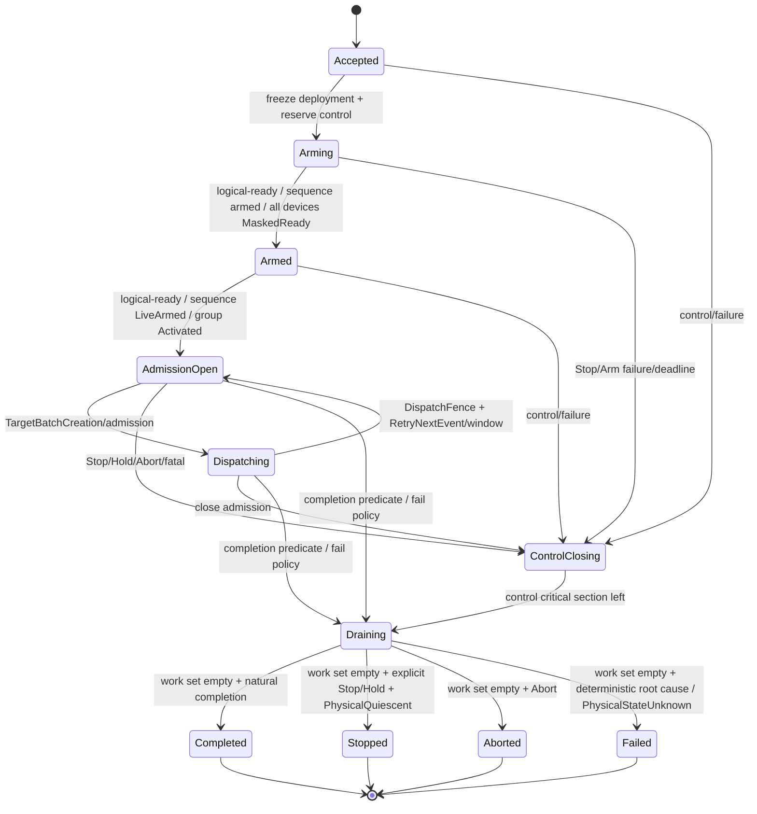
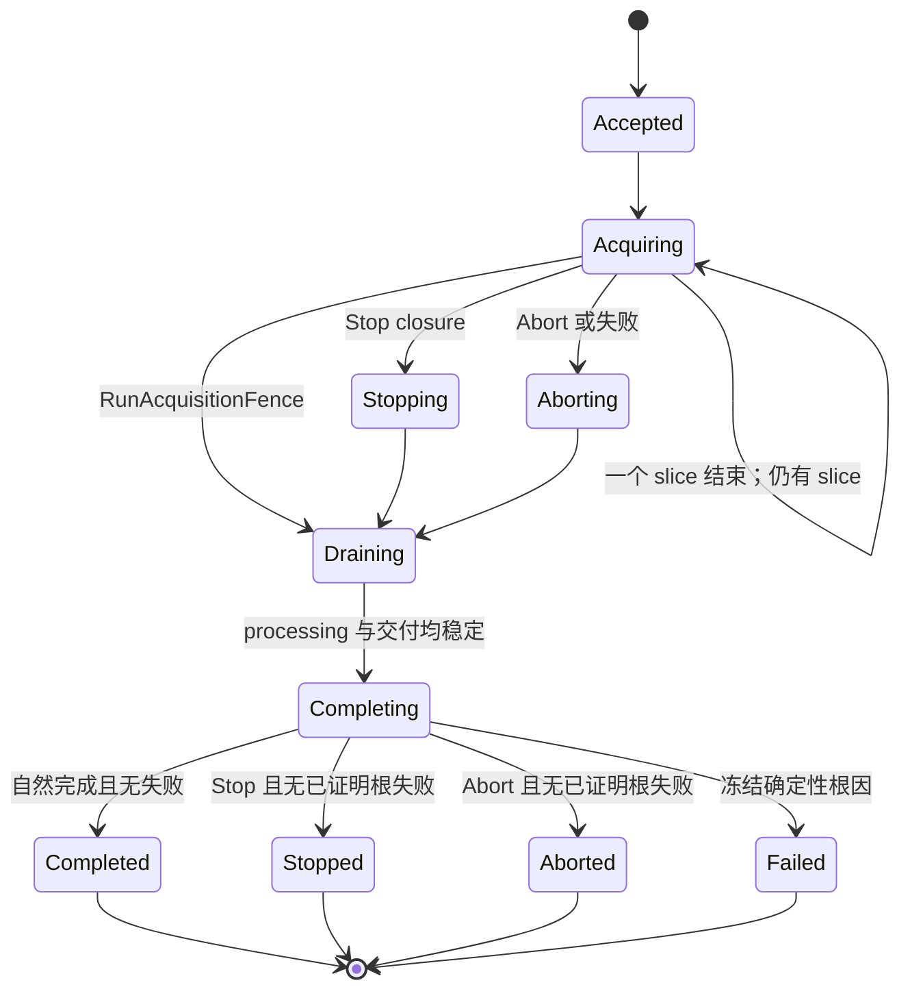

# 详细设计 03B：测量生命周期、停止与完成

## 30 秒摘要

本篇说明测量运行任务和单通道任务怎样从接纳走到唯一终态，重点回答“什么时候算完成”“Stop、Hold、Abort 怎样抢占”“资源何时可以释放”。

- [§8.3](#83-测量运行任务生命周期initiation) 定义父测量运行任务、运行意图、完成谓词和停止竞争。
- [§8.4](#84-通道运行实例vnarunengine) 定义单通道任务、采集完成屏障、处理完成屏障、确定性根因和关闭清理。
- 测量推进事件、目标批次和多通道派发的细节不在本篇，转到 [D3C](./03C-触发多通道调度与验证.md)。

阅读入口：先读 §8.3 的状态图和模式完成表，再读 §8.4.1 的完成屏障；排查失败后的完成处理时直接读 §8.4.2 和 §8.4.4。

> 上一篇：[运行对象、运行职责与端口](./03A-运行对象职责与端口.md) · [返回 D3 专题导航](./03-运行时触发与调度.md) · 下一篇：[触发、多通道调度与验证](./03C-触发多通道调度与验证.md)

> 编号说明：详设拆分后仍沿用全局章号；本篇承载第 8 章的 §8.3–§8.4。

<a id="dd-runtime-initiation"></a>

## 8.3 测量运行任务生命周期（`Initiation`）

**正常路径。** 每个 Channel 的一次 `Initiate`，以及从 Held 执行的 `Continue`，都创建新的 `InitiationId/InitiationHandle`。Continue 不是恢复旧 Handle；旧 Hold 必须已经让旧 Initiation 到达终态且 live 数为零。Accepted 之后、Armed 之前，Runtime 必须按 descriptor 三元组取得唯一 `InitiationDeploymentPin`；失败则不开放 admission，并使父 Failed。

这里的 Armed 是可验证状态，不是 UI 文案：`CommandTrigger/FreeRun` 要证明逻辑入口和首次目标准入可用；`EdgePulse/LevelGate` 还必须完成下一次外部触发周期的本地 AdmissionRoot，并冻结与资源准入正交的物理执行拓扑。

- `SingleInstrumentSequence` 只含一个 `DeviceSession`。无论其中有一个还是多个测量通道目标，都只调用一次设备级 arm/start；L2 按已验证的通道/测量序列给出逐 `TargetSlot` 的步骤证据和结果。它不产生 per-channel `MaskedReady`，也不使用组激活来源/决定日志。
- `MultiDeviceSynchronizedGroup` 只用于跨 `DeviceSession` 且产品明确要求同步物理激活的情况。第一次 arm 前必须已有绑定精确组、修订、代次、防旧实例令牌、真实共享硬件门和原子激活能力的静态声明；声明还必须包含共同参考时钟或时钟域映射、逐触发路径偏斜、每台设备 `trigger→acquisition` latency/jitter 上界、产品允许误差预算和实测证据。之后每个设备成员各取得一份 `MaskedReady`；全部设备就绪且联合最坏误差仍不超预算后，才签发动态证明并打开一次组门。缺任一项必须零 arm 拒绝同步方案。

父对象冻结以下内容，并从 Arm 前一直存活到自然完成、Stop、Abort 或失败：

- Channel/deployment revision；
- Single/Group/Continuous policy；
- `MeasurementAdvanceKind + MeasurementAdvanceOrigin`；
- `MeasurementAdvanceAdmissionPolicy`（Queue/Reject/Coalesce）与 `TargetBatchAdmissionPolicy`（AtomicAdmission/PerTargetAdmission）；
- 物理拓扑编译 profile 与允许的精确 capability revision；每个 AdvanceEvent 的实际 `CompiledPhysicalExecutionPlan` 随其 TargetSlot 集另行冻结；
- 停止策略；
- `RoutingSubscriptionSet{(SourceBindingId, BindingGeneration)...}`。

**关闭与退役。** 父 terminal 先提交且 WorkSet 已空，随后以 holder 随附的完整 `ReleaseOperationIdentity` 归还 Pin。本地 ledger release 是 no-fail/idempotent；取得 `ReleaseReceipt` 后 teardown 才完成。

**失败与恢复。** 若检测到 registry corruption，则 record/Session 关闭 admission 并进入 Quarantine/reconciliation。它不回写已经提交的父终态，但 Close/retirement 必须等待有界隔离终态，不能只记日志。

`RoutingRevision` 只审计整份配置，不作为订阅匹配键；修改无关 binding 不能让父失去订阅。L7 单写 `RunIntentRecord{InitiationIntentRevision, DesiredRunState, ResumePolicy}`。Initiate/Continue/Restart/Stop/Hold/Abort 在线性化点先更新 RunIntent，再控制精确 Handle。内部 reconfigure 只能向控制侧申请独立 SuccessorClaim；claim CAS 成功一次才可分配新 InitiationId。

运行意图转移固定为：`Initiate: Ready→Initiated + new Initiation`；`Hold: Initiated→Held + old Initiation→terminal`；`Continue: Held→Initiated + new Initiation`；`Stop/Abort/自然完成/失败: exact old Initiation→Ready`；`Restart` 终止旧父后仍为 Initiated，并创建新父。父 terminal 向 RunIntent 的投影必须比较完整旧 `InitiationRecordIdentity + expected intent revision`；迟到旧 terminal 不得覆盖较新的 Hold、Continue 或 Restart。进程崩溃不恢复 Held 下的旧父任务。

Hold/Continue 必换 `InitiationIdentity`，但不因这一动作单独切换 `RuntimeEpoch`。普通扫频平均与迹线保持等当前运行周期状态是否保留，只由 RuntimeEpoch、显式 reset 或重配置失效规则决定，不能从“新父任务”反推清空，也不能从 Held 反推跨进程恢复。

父对象维护有界 `InitiationWorkSet{pendingOrRegisteredBatchMembershipRefs[], observedBatchRecordIdentitiesViaMembership[], inFlightRunRecordIdentities[], activeAcquisitionCount, sequenceProgressTable}`。其中 batch identity 只是由本父的 membership 反向观察，用于等待同一批次终态，不表示所有权；同一个跨通道 TargetBatch 可以同时出现在多个父 WorkSet。所有 runtime 引用都是完整 `RuntimeOperationRecordIdentity`。

控制状态与计数正交。WaitingForAdvance/Running 只是投影：admission open 且无活动 acquisition 时显示 WaitingForAdvance；有 acquisition 或 processing 时显示 Running/Processing。

`EdgePulse/LevelGate` 额外维护一份有界 `ExternalTriggerArmCycleReservation`。它是“未来一次测量推进”的预布防资源保留，不是 AdvanceEvent、TargetBatch、TargetSlot 或 Run：

```text
ExternalTriggerArmCycleReservation
  ArmCycleIdentity + SourceBindingId + BindingGeneration + CorrelationEpoch
  reserved future AdvanceEvent/TargetBatch identities and record slots
  frozen ordered ProspectiveTargetDescriptor[] + parent/channel admission guards
  BatchMembershipReservation[]             // 未登记的未来 membership
  PreAdmittedRunReservation[]
  PhysicalExecutionTopology     // SingleInstrumentSequence | MultiDeviceSynchronizedGroup
  device execution unit/member plans + per-slot result mappings
  optional GroupActivationCapabilityDeclarationRef + declarationContentHash
  optional TimingAlignmentProofRef          // identity + exact revision + ContentHash
  PreReceiptEvidenceReservationSetDigest + ordered reservation refs/readiness receipts
  SingleInstrumentSequence: one sequence ArmOperationIdentity + sequence-armed receipt
  MultiDeviceSynchronizedGroup: per-device ArmOperationIdentity + MaskedReady receipt
  optional GroupTriggerCapabilityProofRef + proofContentHash
  optional GroupActivationOperationIdentity + GroupActivationSourceRecordRef
  optional CoordinatorGroupActivationDecisionRecordRef
  optional GroupActivationOutcome // Activated | ProvenNotActivated | UnknownTransferred
  EvidencePublicationGateState  // ClosedBeforeProof | OpenForProvenGeneration | ClosedConsumed
  state                         // Reserving | Arming | MaskedReady | ActivationPrepared | ActivationInvoking |
                                // Activated | ProvenNotActivatedClosing | RecoveryTransferred |
                                // LiveArmed | Consumed | Cancelled | Failed

PreAdmittedRunReservation
  prospective targetOrdinal + future TargetSlotRef
  reserved future RunRecordIdentity + Run record/terminal/cleanup slots
  exact parent Initiation identity + deployment triple + topology-unit/step ref
  RuntimeExecutionResourceReservationRef
    // Context/SliceDispatch/Frame/Pipeline/Progress/live/durable/state 精确最坏向量
  ChildPreparedDeploymentLeaseReservationRef
  conversionState              // ReservedBeforeArm | ConvertedAtAcceptance | ReleasedUnused
```

cycle 在第一个硬件 arm 前必须足额保留本次未来执行需要的完整资源向量、未来记录/identity 槽和 child Lease reservation，并且逐父、逐 Channel guard 首次全命中。这一时刻仅有 reservation 和 L2 布防产生的 Execution；`AdvanceEventCount == TargetBatchCount == TargetSlotCount == RunCount == 0`，membership 也尚未 Registered。任一维资源或 child Lease reservation 不足都必须在零 arm 时失败，不得布防后等资源。

- **单台仪器序列：** L6 把同一 DeviceSession 的一个或多个 TargetSlot 封装成一份设备序列执行单元，只调用一次 `armSequence`。arm 在硬件声明的线性化点进入 `LiveArmed`；从 receipt 中逐步骤 evidence cursor 开始的同代证据必须有界保留。L6 验证 receipt 后开放的是“事件发布门”，不是能阻止硬件的物理门。
- **跨设备同步前置：** 静态能力声明、本地整批准入和逐设备证据/清理槽齐全后，L6 必须在第一台设备进入屏蔽就绪前建立并 `fsync` 状态为 `Building` 的来源记录，冻结完整设备成员序列和每个设备的进入就绪身份。
- **逐设备就绪：** 每个 DeviceSession 的 `MaskedReady` 回执必须先持久化到固定槽位，才能让下一设备进入就绪；同一设备内多个通道仍由该设备的一份序列计划和一份回执覆盖。
- **全部设备就绪：** 全部设备成员进入硬件保证零启动的 `MaskedReady` 后，再校验每份回执回显的组、能力声明和唯一 `TimingAlignmentProofRef{identity, exact revision, ContentHash}`。动态证明必须绑定精确组、修订、代次、围栏、有序回执摘要、`PreReceiptEvidenceReservationSetDigest` 和同一 proof 三元组。L6 随后把完整来源记录推进为 `ReadyToCall` 并 `fsync`。
- **组执行与恢复：** 协调器另建唯一决策记录，持久化 `Prepared→Invoking` CAS 后才消费一次性执行权。恢复遇到 `Invoking` 只能查询或转交未知结果处理，绝不重发组门。
- **物理激活与证据：** 跨设备同步组的物理激活点同时冻结每个设备成员的 evidence cursor 和预留缓冲持有者。`EmitOneSynchronizedTrigger` 的 Activated receipt 可携带受控源 emission 和已实测的逐设备 arrival；`UnmaskAndAwaitExternalInput` 的回执只能携带 gate-open/unmask 证据与 cursor，不得携带或推导 trigger-arrival。回执返回途中的边沿/电平先进入预留槽，matching evidence 带回真实 `TargetTriggerArrivalTimingEvidence`。

共享门成功不自动产生“时间可比较”语义。结果 provenance 必须引用同一 `TimingAlignmentProofRef`、每台设备的真实 trigger-arrival 与 acquisition timing evidence ref/实测值；可选 emission 和 gate-open/unmask 时间都不得替代 arrival。只有联合复核结论为 `TemporalComparability=ProvenWithinBudget` 时才可发布。缺失、三元组错绑、过期或实测越界时，本次同步交付失败关闭；必要的取证原始结果可以保留为 `NotTimeComparable`，但不能进入 synchronized 产品结果槽。

`ProvenNotActivated` 说明跨设备组门未打开，不说明各设备从未 arm。cycle 必须按 `stillMaskedReceiptRefs` 撤防所有设备成员；只有带设备后置状态证明的回执可保存 `NotStarted + PhysicalQuiescent`。撤防失败后隔离 exact HostGeneration 只能保存 `NotStarted + PhysicalStateUnknownQuarantined`，不能以软件围栏直接进入“物理已收口”。

`UnknownTransferred` 必须先取得唯一 recovery target 的 `TargetDurableOwnershipReceipt`，再以 CAS 取得 source-zero receipt。恢复者持续拥有 decision ref、证据槽和逐设备、逐目标槽的物理处置，直到物理静止得到证明，或状态不可知隔离及其责任回执齐全。

匹配 evidence 到达时，Runtime control executor 在同一 acceptance commit 中完成以下动作：

1. 若物理拓扑为跨设备同步组，先验证每台设备的 `TargetTriggerArrivalTimingEvidence`；若 EmitOne 回执已实测 arrival，必须引用同一 ref。
2. 重验冻结的逐父、逐 Channel guard。
3. 同时创建 AdvanceEvent、TargetBatch 和全部 TargetSlot，并把每份 BatchMembership 直接登记为 Registered。
4. 将每份 `PreAdmittedRunReservation` 原子转换为对应 Run 和 child `PreparedDeploymentLease`。

只有此提交后，对象基数才从零变为已冻结的 `TargetBatch 1 → 0..N TargetSlot`、每个接纳槽 `1 Run`。提交前 Stop/ChannelDelete/generation cutoff 先胜，则不创建任何这些对象，释放未用预留，并对已布防的 L2 Execution 执行 disarm/物理处置。

单台仪器序列的 arm 或跨设备组激活若已成立或结果未知，必须保留真实证据，并为后续创建的每个 TargetSlot 分别记录 `PhysicalStartKnowledge + PhysicalDisposition`；跨设备屏蔽就绪失败还要区分“确认撤防”和“只完成软件围栏”。Stop/Hold/Abort/Close 或 generation 改变时，关闭未来发布与激活准入，再通过高优先级安全动作取得 `PhysicalQuiescent`，或稳定进入 `PhysicalStateUnknownQuarantined`。

one-shot cycle 消费后，Single 不再 re-arm；Group(N) 和 Continuous 只有在完成模式表规定的上一逻辑单位、仍未达到自然终点且控制 gate 仍 Open 时，才建立下一 cycle。DeclaredAutoRearm 可以复用同一硬件 Armed window，但每个 evidence 仍绑定该 window 和独立 AdvanceEvent identity，且不能越过 receipt 的最大计数。

`CommandTrigger/FreeRun` 按普通顺序执行：先以 acceptance commit 创建 AdvanceEvent/TargetBatch/TargetSlot 并登记 membership，再在 TargetBatch Registered 后取得执行资源、创建 Run 和 child Lease。它们不使用 `ExternalTriggerArmCycleReservation`。

External cycle 则因为必须先布防，只在 arm 前保留资源和未来槽，在 matching evidence 到达时才原子创建对象并转换所有权。两条路径共用完整 identity/revision/Open guard 和相同的提交后基数，但资源取得时点不同；不能混成“先排队 external edge，随后补 arm”，也不能把 arm 前 reservation 统计成 Run/TargetSlot 实例。

每个成功 admitted TargetSlot 创建同时引用该槽、完整父/AdvanceEvent/TargetBatch identity 的子 `RunHandle`。Run 的父必须与该槽唯一 BatchMembership 指向的 Initiation 相同。TargetBatchTerminal 发布后才从各自父任务移除对应 membership，并分别重新检查 Draining；全拒绝 batch 因而也先于任何受影响父 terminal 收口。TargetBatch 可以跨多个父任务，但不归其中任何一个父任务所有。

```text
RunIntentRecord
  InitiationIntentRevision
  DesiredRunState             // Ready / Held / Initiated
  ResumePolicy                // StayReadyAfterReconfigure / ResumeAfterReconfigure

SuccessorClaim                // L6 控制侧短生命周期；不写回 RunIntentRecord
  complete ClaimOperationIdentity
  ExpectedInitiationId
  ExpectedIntentRevision
  ExpectedDesiredRunState
  ReconfigureGeneration
  ClaimOwnerKind              // Prepare / RoutingHandoff / ChannelReconfigure
  ClaimRevision

SequenceProgressKey
  InitiationId
  SequenceKind

SequenceProgress
  GranularityCursor
  inFlightProgressReservations[]
  completedLogicalUnits
  latestStateContributionOrdinal
  optional StateCommitReceiptRef // 只引用 state-head owner 的稳定 receipt
  CountCommitBoundary          // profile 冻结：何时形成一个完整逻辑计数单位

ProgressReservation
  SequenceProgressKey
  LogicalUnitId
  CursorSlice                  // 本 child 推进的 Point/Segment/Partial/Sweep 范围
  reachesCountCommitBoundary

InitiationCompletionPredicate  // 冻结 Primary/AllRequired 序列及各自目标逻辑单位数
```

`SuccessorClaim` 只仲裁“谁可以关闭未来测量推进并建立后继代次”，不表示 attempt/recovery/Close 的持久责任已经移交。Application 的 attachment revision 只选择当前执行责任方；L6 必须另以 expected intent/claim revision 做 CAS，签发 `SuccessorClaimReceipt`，再关闭旧父的 MeasurementAdvanceCandidate 接纳以及新的 TargetBatch/Run 准入，并形成完整运行排空回执。责任方切换后继续使用同一 `ClaimOperationIdentity + ReconfigureGeneration`，不能重建 claim 或重开旧父。

两份跨层回执的字段闭集固定为：

```text
SuccessorClaimReceipt
  complete ClaimOperationIdentity
  complete old parent InitiationRecordIdentity
  ExpectedIntentRevision + exact RunIntentRevision
  ClaimRevisionBefore + ClaimRevisionAfter
  ParentAdmissionRevisionBefore + ParentAdmissionRevisionAfter
  ReconfigureGeneration + ClaimOwnerKind
  frozen PendingBatch/TargetBatch/Run identity-set digest
  parent admission = Open -> ClosedForReconfigure

OldParentRuntimeDrainReceipt
  complete ClaimOperationIdentity + SuccessorClaimReceiptRef
  complete old parent InitiationRecordIdentity
  RuntimeEpoch + ReconfigureGeneration
  frozen PendingBatch/TargetBatch/Run identity-set digest
  per-item terminal/release receipt-set digest
  queue/cursor/credit release-set digest
  final ParentAdmissionRevision
  WorkSetCount=0 + drain completion revision

PriorProcessIsolationNoOldParentEvidence
  complete ClaimOperationIdentity
  complete old parent InitiationRecordIdentity
  PriorProcessIsolationEvidenceRef
    { old/new ProcessEpoch,
      OS singleton ownership + old-process termination proof,
      exact DeviceSession/HostGeneration SoftwareFenceEvidence,
      PhysicalQuiescent | PhysicalStateUnknownQuarantined disposition }
  old RuntimeEpoch + observed new RuntimeEpoch
  ReconfigureGeneration
  old-parent frozen identity-set digest
  proof = no old parent, pending membership, TargetBatch or Run can execute
```

正常路径的两份回执覆盖全部字段计算回执摘要；隔离分支按上述字段计算内容哈希。相同身份重放返回同一结果；不同声明、旧 `ReconfigureGeneration`、前后修订不连续、冻结集合少一项，或终态/释放摘要不全，都必须失败并保持准入关闭。`OldParentRuntimeDrainReceipt` 不证明部署固定引用/租约已归零；后者只能由 [D3A 部署 Pin/Lease 合同](./03A-运行对象职责与端口.md#部署所有权回执)的 `InstalledDeploymentPinLeaseDrainReceipt` 证明。

L6 在关门或排空后、回执被 L7 持久化前崩溃时，新运行周期不重建旧 `SuccessorClaim`。

只有主进程 bootstrap 已取得 OS 单例所有权、旧进程终止证明、精确 `DeviceSession/HostGeneration` 的软件围栏证据，以及物理静止或物理状态不可知隔离处置，恢复扫描才可按原声明身份形成 `PriorProcessIsolationNoOldParentEvidence`，作为旧软件父任务截止与排空责任的恢复替代。

它不证明设备已经停止，也不授权在 `PhysicalStateUnknownQuarantined` 的同一物理设备上建立 successor；同时不替代 [D3A 部署 Pin/Lease 回执](./03A-运行对象职责与端口.md#部署所有权回执)。

无法证明精确身份集合或完成稳定物理处置时，必须保持上层 `ProductMutationFence` 并进入恢复/隔离，不能换身份重关。

一个 Point/Segment/Partial child `Completed` 只提交自己的 CursorSlice。当且仅当提交后跨过 `CountCommitBoundary`，才向冻结的 state port 提交对应完整逻辑单位的 `StageStateDelta`；取得精确 `StateCommitReceiptRef` 后，L6 才增加 `completedLogicalUnits`。L6 不持有 Average/Trace Hold 状态值。

`InitiationCompletionPredicate` 只能来自 L5 编译并冻结的 `InitiationCompletionContract`，合同是闭集：

| 模式 | required key 的目标 | 自然完成谓词 |
| --- | --- | --- |
| `Single` | 每个 required primary `targetLogicalUnits=1` | 所有 required key 都达到 1，且这些 key 没有可跨 boundary 的 reservation |
| `Group(N)` | 每个 required primary `targetLogicalUnits=N`，`1 <= N <= maxGroupCount` | 所有 required key 都达到 N，且这些 key 没有可跨 boundary 的 reservation |
| `Continuous` | 无有限目标，合同为 `NoNaturalCompletion` | 恒为 false；TargetBatch/Run 数量、平均窗口或某个 cursor 值都不能终结父对象 |

Held 产品意图不创建 live Initiation，因而不进入这张完成表。L6 是 `SequenceProgress` 和自然完成求值的唯一写者，但无权改变 required 集、N 或 completion kind。辅助序列不能误触发 Single/Group 终态；Continuous 只能由 Stop/Hold/Abort、失败、Close 或明确 reconfigure policy 结束。
拒绝、Stop 或失败不提交未完成 slice；terminal 事务必须 abandon 并移除对应 reservation。重试/丢弃规则由 profile/targetFailurePolicy 明确。



主图只画阶段；控制动作差异由下表冻结：

| 原因 | 进入 ControlClosing 的原子动作 | Draining 终因 |
| --- | --- | --- |
| Stop/Hold | 关闭 Trigger/child admission；保留已接纳 child 排空；Hold 同时把产品意图置 Held | 设备物理处置已证明时为 Stopped；状态不可知时为 Failed/Interrupted，设备继续隔离 |
| Abort | 关闭 admission；向全部 child/Execution 请求 Abort | Aborted，除非已有已证明根因 |
| fatal child/session error | 关闭 admission、登记根因候选、请求其余 child 收口 | Failed |
| Arm/Prepared/组激活失败 | 关闭未来激活与事件发布；单台仪器序列按设备处置，跨设备同步组按各设备撤防或隔离；保留已发生或未知的真实物理处置 | Failed |
| completion predicate | 不经 ControlClosing；关闭自然 admission | Completed |

**线性化点。** Stop/Hold 作用于精确 `InitiationHandle`，并与 AdvanceEventAcceptanceTransaction 使用同一父 admission gate。其 CAS 必须同时比较：

- 完整父 record identity；
- 当前 `ParentAdmissionRevision=R`；
- `AdmissionState=Open`。

成功后写 `Closed@(R+1)`，再进入 ControlClosing/Draining。关闭 admission 不是等到父 terminal 才生效。

Stop/Hold/Abort/Close 从预留的 `PriorityControlLane` 进入，不能排在 AdvanceEvent、TargetBatch dispatch、Frame terminal 或结果通知后。控制调用必须在 `ControlCutoffDeadline` 内关闭父 gate 和当前 ArmCycle ingress；External cycle 随后在 `DriverControlAckDeadline` 内取得 disarm/abort ACK，并在 `SafetyDispositionDecisionDeadline` 内得到带独立后置状态证据的 `PhysicalQuiescent`，或 `PhysicalStateUnknownQuarantined`。exact HostGeneration isolation receipt 只满足软件围栏，不满足物理静止。任一超界都锁存“控制命令超时故障”并升级隔离，但不能重开 admission。

优先级为 `DeviceFault/HostIsolation > Close > Abort > Stop/Hold > Reconfigure`。优先级只仲裁尚未提交的动作：已经 AcceptedWithTargetBatch 的事实不被高优先级命令回滚，已经发生的硬件 edge 也不能改写为“未触发”。高优先级命令只关闭未来 admission，并收口已接纳工作。

**正常收口。** 随后等待已经安装的 pending/registered BatchMembership、已接纳 TargetBatch 和子 Run 从 `InitiationWorkSet` 移除。

- Stop CAS 先胜出：持旧 revision 的 `MeasurementAdvanceCandidate` 即使 Ephemeral record 已内存登记，也只能 Rejected/Cancelled；V1 不存在 acceptance record fsync 分支。
- `AcceptedWithTargetBatch` commit 先胜出：Stop 能看见 membership，并等待 TargetBatch 收口；它不能越过 membership 发布父 terminal。
- 即使尚未发生第一次测量推进，或正处于两次测量推进之间，也必须到达唯一业务终态；物理静止得到证明时为 `Stopped`，物理状态不可知时为 `Failed/Interrupted` 且精确设备继续隔离。

**Abort 与终态。** Abort 除关闭 admission 外，还请求所有当前子 Run/硬件尽快终止。终态类别优先级固定为“已证明的根失败 > 显式 Abort > 显式 Stop/Hold > 自然完成”；多个失败之间使用[§8.4.2](#842-故障根因的确定规则与控制命令分离)的确定性根因排序，不使用线程到达顺序。完成通知可重读且只发布一次。父终态前不得释放冻结 revision 和 operation registry 记录。

每个 target admission 先从 snapshot 指定的 `SequenceProgressKey` 取得互斥 `ProgressReservation`。它保证 CursorSlice 不重叠、同一 LogicalUnit 不重复提交；有限 Single/Group 还必须满足 `completedLogicalUnits + 可跨 boundary 的在途 logical units <= targetLogicalUnits`。Continuous 没有这个父完成上界，但仍受固定 in-flight 窗口和每个 logical unit 的互斥 reservation 约束。

子 Run `Completed` 只提交其 slice；到达 CountCommitBoundary 才提交一个完整逻辑单位的 state contribution，并在 state-head receipt 稳定后推进 count。拒绝/失败按策略释放或结束父对象。target 最终 disposition 对父状态的影响固定如下：

| target disposition | 有限 Single/Group/Calibration 默认 | Continuous `PerTargetAdmission` 可选 |
| --- | --- | --- |
| `Completed` | 提交 CursorSlice；跨 CountCommitBoundary 后向 state-head owner 提交 delta，receipt 稳定后再提交 logical count；完成谓词满足才 Draining | 同样按 boundary 提交，未跨 boundary 只推进 cursor |
| `ResourceRejected/NotStartedBatchRejected` | 释放 ProgressReservation 后 `FailInitiation`，不无限等下一事件 | `RetryNextEvent` 可释放 reservation 并回 AdmissionOpen；也可显式 Fail |
| `CapabilityPlanConflict` | 原子预检的致因 target 写精确能力/方案冲突，其余 target 为 `NotStartedBatchRejected`；零 Run、零 start 后 `FailInitiation` | 当前 target 明确拒绝且不创建 Run；继续遍历当前已 Registered 批次，让其他匹配 target 正常建 Run，待全部 target 获得 disposition 后锁存 `FailInitiation{ReconfigureRequired}` |
| `SkippedStaleTarget` | `Failed{PreparedInvalidated}`；若已由 Reconfigure Stop，则服从 Stopped | 同左；不能永久回 WaitingForAdvance 重试失效 revision |
| `Stopped/Aborted` | 不提交未完成 CursorSlice，释放 reservation；跟随精确父控制原因进入 Draining | 同左 |
| `Failed` | 不提交未完成 CursorSlice，abandon 并移除 reservation；登记根因候选、关闭 admission 并 Draining | 同左 |

`TargetDisposition` 是闭集：`Completed/NotStartedBatchRejected/SkippedStaleTarget/ResourceRejected/CapabilityPlanConflict/Stopped/Aborted/Failed`。

`TargetDisposition` 只表示运行时怎样结束，不能承载外部硬件副作用是否已经发生。每个曾进入 arm 或组激活路径的目标还必须保存正交的：

```text
PhysicalEffectDisposition
  PhysicalStartKnowledge   // Started | NotStarted | Unknown
  PhysicalDisposition      // Live | PhysicalQuiescent | PhysicalStateUnknownQuarantined
  evidenceOrProofRefs[]
```

例如，跨设备同步组的激活响应丢失后可以得到逻辑 `TargetDisposition=Failed` 和物理 `Unknown + PhysicalStateUnknownQuarantined`；这只表示旧软件已被阻止继续发命令、精确设备已禁止复用，仍不知道设备是否启动或仍在扫描。TargetBatch、各自 Initiation terminal 与 provenance 都必须保留这两个维度，不能压成一个 `Isolated` 或 `Failed` 枚举。

Run terminal 在父 admission gate 内按固定顺序执行：

1. `Completed` 提交 CursorSlice；跨 boundary 时先取得 state-head commit receipt，再提交 logical count。其他终态把 reservation 标为 abandoned，不推进 cursor。
2. 移除 ProgressReservation，并在 ProcessingTerminal 已消费后释放 child PreparedDeploymentLease 与其余 Run 资源。
3. 写 target disposition。
4. `Failed` 在同一事务登记根因候选并关闭 admission。
5. 最后才从父 WorkSet 移除 Run。

`applyTargetDisposition(disposition, targetFailurePolicy)` 是改变父状态的唯一入口。只有 `RetryNextEvent` 可以释放未提交 reservation 后回到 AdmissionOpen；`FailInitiation/PreparedInvalidated` 关闭 admission 并进入 Draining。

`PerTargetAdmission` 中的 `CapabilityPlanConflict` 先在 TargetBatch-local accumulator 锁存 `ReconfigureRequired`，不得中断当前已 Registered target 的遍历。只有全部 target 已建 Run 或取得稳定 disposition 后，才通过上述唯一入口关闭未来 MeasurementAdvanceCandidate 接纳，并等已建 Run 排空。它不得映射为同一冻结 deployment 上的 `RetryNextEvent`，否则后续每次触发只会重复同一冲突。

后续重试重新预留当前未提交 slice，不能复用 terminal Run 的 reservation。`AtomicAdmission` 预检在创建第一个 child 前失败，也必须通过这个入口得到合法父转移。

<a id="dd-runtime-run"></a>

## 8.4 通道运行实例（`VnaRunEngine`）

一个 RunEngine 可同时跟踪有界的多个 child Run context；同一设备的 acquisition 按 capability 串行或有限并行，前一 Run 的 processing 可与后一 acquisition 重叠。其职责是：

- 接收已经由 `RunAdmissionService` 线性化创建的 `AdmittedRunContext`，不重复预留，不回读当前 routing；
- 通过 child Lease 的窄 start port 按冻结 `PhysicalSlicePlan[]` 启动 Execution，并记录每个 slice 的唯一 disposition；
- 驱动 Acquisition 与数值处理，登记根因候选，排空已接纳工作；
- 按冻结的两维交付计划分别调用 live/durable outbound port；
- 全部计划内 processing 与 delivery obligation 稳定后，生成唯一 Processing terminal。



**target admission 的唯一线性化点**同时完成：

1. 验证精确父 Pin、冻结 snapshot 与 `TargetAdmissionReadiness`；
2. 取得 child PreparedDeploymentLease、Credit、ProgressReservation 和全部 slice dispatch capacity；
3. 冻结处理图、`ResultDeliveryPlan`、live key/ordinal 和 durable semantic target；
4. 若计划 `LatestWins`，取得有界 live reservation/control capacity 与 `LiveCurrentCapability`；
5. 若计划历史或工作流证据，取得完整 durable identity、candidate spool、terminal、冲突/未知移交、recovery capacity 与 `DurableDeliveryCapability`；
6. 若含有状态 Stage，按 `StageStateRetention` 取得对应 capability、ordered contribution identity 和 terminal slot；`RuntimeEpochEphemeral` 只取得有界内存 head/receipt 容量，`WorkflowDurable` 另取得 head/gate、unknown transfer 与 recovery capacity；
7. 发布完整 Run record identity、RunHandle，绑定唯一 `TargetSlotRef`，并登记该槽 membership 所指向的 Initiation 与 TargetBatch WorkSet。

准入失败时不发布 RunHandle、不登记 WorkSet、不开硬件；已预分配但未发布的 identity 以 unused-before-run receipt 收口且永不复用。

`AtomicAdmission` 为全部 TargetSlot 一次取得完整向量后才发布任一 Run；任一维不足则零 Run。`PerTargetAdmission` 按 targetOrdinal 为当前槽取得完整局部向量，成功后才发布该 Run；后续失败不回滚已创建 Run。两种模式都不允许 RunEngine 二次预留，也不能把父 Pin 冒充 child Lease。

资源接纳完成后还要遵守物理单元边界：`SingleInstrumentSequence` 中会被一次设备级 arm/start 同时推进的槽必须一起形成可执行 unit，不能对每个 Run 单独调用硬件；`MultiDeviceSynchronizedGroup` 则先形成逐 DeviceSession 的成员序列，再由真实共享门统一激活。若 `PerTargetAdmission` 得到的成功槽无法组成已编译且语义等价的物理单元，只能让该单元全部保持 NotStarted 或在编译期拒绝，不能现场删步骤重写仪器序列。

```text
ResultDeliveryPlan
  CurrentDelivery        // Disabled | LatestWins
  DurableDelivery        // None | RetainHistory | WorkflowEvidence

PlannedDeliveryObligation
  RunRecordIdentity + planOrdinal
  deliveryKind           // LiveCurrent | DurableHistory | WorkflowEvidence
  stableResultKey
  optional opaqueCapability
  terminalSlot
```

**Live obligation 状态。**

`Pending → Reserved → PublishedCurrent | SupersededByNewer | InvalidatedByControl | Conflict`

`PublishedCurrent` 与 `SupersededByNewer` 是正常处置；`InvalidatedByControl` 只在匹配 Stop/Recall/Reconfigure/Close/epoch 失效证明时成立；`Conflict` 锁存 ProtocolError。live reservation 不进入 [D4D §9.5.5](./04D-持久化结果与恢复.md#955-持久交付的唯一提交与恢复协议)的 recovery，也不跨进程。

**Durable obligation 状态。**

`PendingBeforeBegin → DurableOwned → CommitInFlight → Stored | Installed | Rejected | OutcomeUnknownTransferred`

`RejectedBeforeOwnership` 可直接从 Pending 收口，但须证明外部调用数为零。`EvidenceStored` 是中间态，不是 terminal。`OutcomeUnknownTransferred` 允许 Run 归零，但必须锁存持久交付失败；后台恢复继续原 identity。

未计划维度没有 obligation。处理到达 boundary 却没有 candidate 时写 `NoResultFailed` 并登记根因候选；只有已提交 RunControlClosureReceipt 或冻结依赖图的强因果终态，才允许 `NoResultCancelled`。不能用“计划数和发射数都为零”伪造完成。

**有界预算。** current-only Run 只预留 live buffer/control slot，以及计划含状态 Stage 时的有界 `RuntimeEpochStatePort` head/receipt 容量；它不预留 durable identity、WAL、ResultLease 或 recovery node。持久 Run 的最坏 candidate、conflict、unknown transfer、forensic、terminal 与 recovery capacity 必须在硬件 start 前取得。已接纳工作只用预留容量收口，不能等待 UI 或 Repository 临时释放空间。

Continuous 父对象只持 `maxInFlightBatches/maxInFlightRuns/maxFrames/maxLiveBytes` 固定窗口。`LatestWins + None` 可无限产生 sweep，但每个 sweep 的持久端口/WAL/Repository 调用均为零。持久配额耗尽只拒绝新的持久 target；不能无界积累，也不能无故阻塞资源独立的实时 current 路径。

#### 8.4.1 数据帧版本固定与处理完成条件

每个入队 Frame 包装为不可变 `PipelineTaskEnvelope`：

```text
PipelineTaskEnvelope
  InstrumentSessionId + SessionGeneration + DeviceSessionId
  InitiationRecordIdentity + AdvanceEventRecordIdentity
  TargetBatchRecordIdentity + RunRecordIdentity
  ExecutionIdentity + PhysicalSliceOrdinal
  DeploymentId + DeploymentRevision + DeploymentContentHash
  WorkingSet/Channel/Processing revision
  EffectivePlanRevision + PreparedExecutionId
  FrameOrdinal + FrameContentHash + WaveSchemaId + provenance hash
  RawWaveFrameLease
  PreparedStagePipelineRef
  optional StageStateSnapshotRefs
```

入队前验证 Frame provenance、Execution/Run、deployment、EffectivePlan、Schema 和 generation。Worker 只能读 envelope；重配置产生新 envelope，旧任务按旧代完成或被精确 Stop/Abort 排空。

`ProcessingCompletionFence` 针对 admission 冻结的计划：

```text
runAcquisitionFencePresent
&& sliceTerminalDispositionCount == plannedPhysicalSliceCount
&& finalizedStartedExecutionCount == startedExecutionCount
&& processedFrameCount == acceptedFrameCount
&& processingItemTerminalCount == frozenProcessingItemCount
&& liveDispositionCount == plannedLiveDeliveryCount
&& durableDispositionCount == plannedDurableDeliveryCount
&& ephemeralStateDispositionCount == plannedEphemeralStateCount
&& durableStateDispositionCount == plannedDurableStateCount
&& runOwnedLiveReservationCount == 0
&& runOwnedDurableResponsibilityCount == 0
&& workerInFlight == 0
&& livePublishInFlight == 0
&& durableCommitInFlight == 0
&& stateCommitInFlight == 0
&& !processingTerminalCommitted
```

计数规则：

- `CurrentDelivery=Disabled` 时 plannedLiveDeliveryCount=0，不创建占位 receipt；
- `LatestWins` 每个 item 恰有一个稳定 disposition；慢读者的 read lease 不进入 Run fence；
- `DurableDelivery=None` 时 plannedDurableDeliveryCount=0，durable port/WAL/Repository 调用数为零；
- 历史只有 Stored、RejectedBeforeOwnership、Rejected 或 OutcomeUnknownTransferred 闭合；
- 工作流证据只有 Installed、RejectedBeforeOwnership、Rejected 或 OutcomeUnknownTransferred 闭合，EvidenceStored 不闭合；
- UnknownTransferred 只闭合 Run obligation，不释放恢复责任方的 roots；
- `RuntimeEpochEphemeral` Average/Hold 必须取得内存 state-head commit receipt 且 state turn 归零，但不计入 durableStateDispositionCount；只有 `WorkflowDurable` 才计入 durableStateDispositionCount。

自然 Completed 还要求 failed、cancelled、conflict 与 unknown-transfer 均为零。Stopped/Aborted 可包含原因匹配的 cancelled disposition，但不能含未锁错的 failed/unknown。最终 terminal 只消费已经闭合的 fence。

per-Execution Acquisition terminal 不是 Run acquisition fence。Runtime 只有在全部 slice disposition 闭合后才冻结 aggregate acceptedFrameCount。设备槽可在 Acquisition terminal 后复用，但 child Lease 要等 Processing terminal 后释放。

组合交付不是事务：live 已发布后 durable 失败不回滚 live；durable 已保存后被新 ordinal 取代也不删除历史。Run 摘要分别携带 current 与 durable disposition。

**验证。** 覆盖 slice 1 已 terminal 而 slice 2 未启动、RetryableBusy 达界、两 slice 间 Stop/Close、HostFault，以及 live/durable 任一先返回。不得提前冻结 aggregate、释放 child Lease 或发布 ProcessingTerminal。

#### 8.4.2 故障根因的确定规则与控制命令分离

RunContext 分开保存四类事实：

```text
hardwareTerminal                 // 设备真实终因
failureCandidates                // fence 前所有可证明的根因候选
controlAttemptLedger             // user Stop/Abort、fallback Stop、automatic Stop
postTerminalDiagnostic           // terminal 后回调/遥测失败，不改已提交终态
```

`FailureCandidate` 至少记录 `CauseIdentity`、可选 `CausalParentIdentity`、故障域、因果阶段序号、`targetOrdinal`、`physicalSliceOrdinal`、`executionOrdinal`、`stagePlanOrdinal`、`itemOrdinal`、稳定错误码、完整记录身份和证据 receipt。候选进入 admission 时预留的有界 accumulator；容量不足在首次物理副作用前拒绝 Run，不能退化成“只记最先回调的一个”。

根因选择先比较因果关系：若 A 是 B 的可证明祖先，A 胜出；互不可比的候选按下列 `RootCauseOrderKey` 升序选择：

```text
FailureDomainRank
CausalPhaseOrdinal
targetOrdinal
physicalSliceOrdinal
executionOrdinal
stagePlanOrdinal
itemOrdinal
StableErrorCode
FullRecordIdentity
```

`FailureDomainRank` 固定为安全隔离、设备/Host、布防、启动、采集、处理、结果交付、控制活性；它表达产品因果优先级，不表达回调到达时间。`CausalPhaseOrdinal` 来自冻结执行计划，所有 ordinal 和错误码都必须在 admission 时稳定。禁止把线程调度、回调先后、墙钟时间或日志写入顺序放进排序键。

候选只有在对应 Run 的全部计划槽已产生稳定 disposition、或已由 fence 证明不再可能产生候选后才冻结赢家。因此，较晚到达但排序更小的候选可以替换 accumulator 中的暂定赢家；terminal 提交后到达的事实只进入 `postTerminalDiagnostic`，不得改写终态。后续已接纳 Frame 不再启动新数值工作，只计数并释放。

任一需要停止采集的失败候选登记时，若 acquisition 尚未 terminal，Runtime 立即使用预留控制槽请求一次 automatic Stop，不等待最终根因排序。控制记录引用触发该请求的候选 identity；fence 后最终赢家可以是另一项，不能因已经发出 Stop 就锁死根因。Automatic Stop、用户 Abort 和 fallback Stop 使用不同 latch，互不遮蔽；automatic Stop 失败是控制活性候选，不能反过来覆盖触发它的已证明根因。

Abort 未接纳而 fallback Stop 成功时，Abort 错误只进入 `controlAttemptLedger`，不覆盖原失败，也不把受控排空改成 Failed。Stop/Abort 都未接纳时，`controlRequestError` 保留为独立活性故障；close 返回该稳定错误并保持可恢复 Closing，继续等待真实 terminal 或由 L2 deadline/Host termination 收口，绝不伪造 Completed/Stopped。

#### 8.4.3 预留最终状态槽与无动态分配唤醒

Admission 在调用 L2 `arm()/start()` 前预留 RunContext、Execution/Acquisition/Processing terminal slot、根因候选槽、automatic-control 槽、Result disposition 槽和必要 Credit。TargetBatchCreation 同样预留 TargetBatch terminal/target disposition storage。热路径 terminal 不依赖可能分配失败的 `post(std::function)`：

- 生产者只把小型且稳定的最终状态载荷移入独占槽，并用预先建立的事件、信号量或原子通知机制唤醒控制执行器；
- slot 的 `Empty → Committed → Consumed` 单向，重复写保留首个 terminal 并锁存 ProtocolError；
- 稳定 code、stage、强类型 ID 和计数必须可无分配写入；长 message/stack trace 进入有界 best-effort 诊断通道；
- terminal 可以早于 `start()` 返回，provisional RunContext 先安装，所以仍能精确归属；同步 start 失败却已收到事件属于协议违约并失败关闭；
- 用户/Adapter 回调在锁外执行，异常只写 return slot/诊断，不重发 terminal。

<a id="dd-runtime-close"></a>

#### 8.4.4 关闭与资源清理

本节只拥有 **L6 运行关闭子协议**：关闭测量推进入口，处置候选、批次和 Run，并向 L7 返回 `RuntimeCloseCutoffReceipt/RuntimeDrainReceipt`。会话级 `SessionCloseCoordinator`、`SessionCloseJournal`、Application 责任账、生产者封口、终态和退役的唯一字段源是 [D4A 会话关闭](./04A-应用会话与事务.md#关闭退役与验证)；本节不复制它的状态机或 ledger。

L6 只预留运行 cutoff、逐项处置、硬件停止/隔离和 `RuntimeDrainReceipt` 所需的有界子切片。每个 evidence、候选、cursor、TargetBatch、Run、Credit 和交付责任在准入时就登记进有界运行索引；因此关闭热路径只激活预留槽，不申请普通内存，也不反向枚举 Application 对象。L7 `TraceAnalysisService` 不属于这份运行索引或 drain receipt。

L7 完成自己的关门线性化事务后，用完整 Session close identity 调用 `closeAndFreezeSessionRuntimeAdmission`。L6 在 Runtime control executor 的单次事务中关闭外部触发 evidence、`MeasurementAdvanceCandidate`、`AdvanceEvent`、`TargetBatch` 和 Run，冻结 cutoff 与覆盖集摘要，返回 `RuntimeCloseCutoffReceipt`。随后 `drainSessionRuntime` 只处置该 cutoff 冻结的运行集合并返回 `RuntimeDrainReceipt`。两份回执由 L7 引用；L6 不写 Session journal 或 Session terminal。

**关闭期间。** 旧 Frame/terminal 仍按精确 envelope 归并，直到 CompletionFence 收口。已经 `AcceptedWithTargetBatch` 的 AdvanceEvent 继续由其唯一 TargetBatch 收口；尚在 matcher latch 或普通 MeasurementAdvanceCandidate queue 的对象不能越过 ClosingEpoch 再创建 AdvanceEvent/TargetBatch。pending 未决的 MeasurementAdvanceCandidate 必须先按 AdvanceEventAcceptanceRecord commit receipt 补 Registered 或全回滚，不能被容器清空跳过。

会话日志字段、Application 动态责任登记和生产者封口条件只查 [D4A 会话关闭](./04A-应用会话与事务.md#关闭退役与验证)。L6 在 `RuntimeDrainReceipt` 中只提供自己的 `RuntimeProducerSeal{RuntimeEpoch, maxRegistrationOrdinal, registrationDigest}`，供 L7 纳入唯一会话封口；它不定义第二个 `RegistrationSealed` 状态。

**处理策略。** Close policy 明确选择 `DrainAccepted` 或 `AbortAndDiscardUnprocessed`。

- `AbortAndDiscardUnprocessed` 只丢弃尚未开始处理的 Frame，逐份写 `DiscardedOnClose` disposition、推进 processed 计数并释放 Lease。
- 它不能依赖外部 ResultLease 归还，也不能把丢弃伪装成成功。

**失败与恢复。** 活动 Execution 请求 Abort/Stop。请求未接纳时，L6 只在 Runtime 子回执中锁存 control diagnostic，不发布 `SessionCloseTerminal`。`DeadlineSupervisor` 按冻结策略自动重试消歧，或升级到 `SoftwareFenceEvidence + PhysicalStateUnknownQuarantined`，直至形成唯一 `RuntimeDrainReceipt`。该回执可结束旧软件运行责任，但不证明物理静止、不授权设备复用。重复 Runtime 关闭调用只重读同一 cutoff/drain 回执，不得复活已终结的运行对象。

**Trigger 收口。** ClosingEpoch 后，每份未形成 TargetBatch 的 evidence/MeasurementAdvanceCandidate 只能取得已在线性化的 `Expired/Coalesced-final`，或由 Close 写 `CancelledByClose`。

- 未提交的 AdvanceEventCursorReservation 与无 TargetBatchCommitReceipt 的 pending refs，按同序父 gate 逐项回滚。
- 已有 receipt 的项补 Registered，并等待 TargetBatchTerminal。
- 已随 AcceptedWithTargetBatch 提交的 cursor 保持原决定。
- matcher 逐 binding 清空旧 epoch latch；普通 queue 逐 item 释放 Credit，分别产生 `MatcherResetReceipt` 与 `MeasurementAdvanceQueueDrainedReceipt`。
- WAI/response claim 也逐项写 ObservationCancelled/RequesterGone receipt，禁止只清容器计数。

会话级 WorkingSet/Calibration/Result/File/Adapter 责任和关闭终态均不属于 L6。它们的释放、隔离、持久责任移交和最终封口只查 [D4A 会话关闭](./04A-应用会话与事务.md#关闭退役与验证)以及该节链接的应用与适配器权威协议。L6 只在自己的 runtime receipt 中保留 opaque delivery disposition refs，不释放 Application pin，也不等待远程 Repository/File 操作。

L6 的排空顺序固定：

1. 关闭测量推进与新 Run 准入；逐份处置 matcher/evidence/`MeasurementAdvanceCandidate`/cursor，取得 `QueueDrained/MatcherReset` 回执。
2. 按冻结策略 Stop/Abort 全部 Initiation/Run；等待 TargetBatch、membership、采集/处理屏障和 terminal route 形成稳定处置。
3. 消费运行侧固定 terminal/return slot、触发队列与本地资源回执，停止 Runtime 执行器，返回 `RuntimeDrainReceipt + RuntimeProducerSeal`。L2 DeviceSession 的最终关闭与 L7 产品分析 worker 的取消/lease 排空不在此回执中。

**旧进程恢复。** L6 只按原运行时子操作身份重放已有截止/排空回执。

若崩溃发生在首次截止前，则必须使用 [D3A 旧进程隔离证据](./03A-运行对象职责与端口.md#旧进程隔离证据)中绑定原 `SessionCloseOperationIdentity` 的会话作用域、`operationKind=SessionClose` 分支，不得复用测量通道作用域。

证据由主进程 bootstrap 组合 OS 单例所有权、旧进程终止、精确软件围栏和物理状态处置；它不需要独立 Runtime 监督服务。关闭 DeviceSession 或隔离 HostGeneration 只证明旧软件整体无法继续执行，不证明设备静止。

物理状态不可知时必须保留设备隔离，不允许从新进程的空内存列表推断旧工作或物理动作已清空。这一关闭恢复事实不改变仅实时路径零 WAL。

**调用与验证。** Runtime worker、结果回调和 Runtime control executor 内部不得阻塞等待自己关闭；这些位置只发起异步控制请求。测试至少覆盖：

- cutoff 与 evidence/候选/pending/TargetBatch/Run 登记的所有先后次序；
- `DrainAccepted/AbortAndDiscardUnprocessed` 与迟到 Frame/terminal/结果处置回执；
- 设备 Stop/Abort 返回未知、deadline 升级、Host software fence 与旧 generation 迟到回调；并断言只隔离 Host 不得得到 `PhysicalQuiescent`、不得在同一物理设备新建 Prepare/Arm/Start；
- L7 关门后、首次 L6 cutoff 前崩溃，并分别验证 exact inventory 能力未开放时必须围栏整个 DeviceSession/HostGeneration 的旧软件能力，并形成物理静止或物理状态不可知隔离处置；
- 重复调用只返回同一 `RuntimeCloseCutoffReceipt/RuntimeDrainReceipt`，且所有 Runtime Credit/Pin/Lease/预留槽最终守恒。
