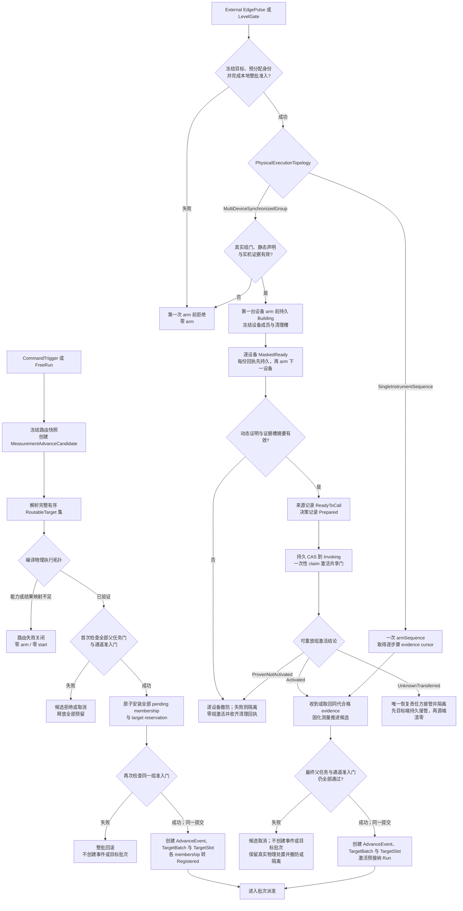
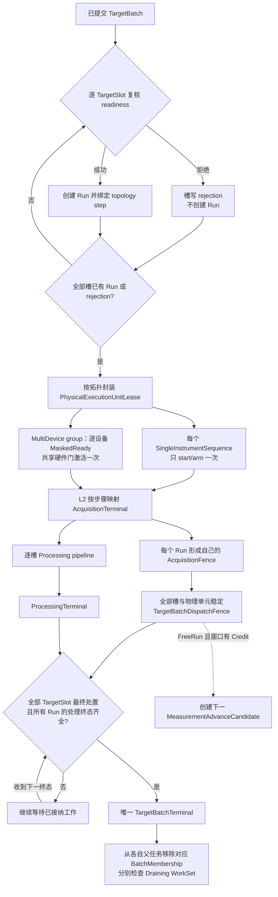

# 详细设计 03C：触发、多通道调度与验证

## 30 秒摘要

本篇定义命令、外部触发或自由运行条件怎样推进测量，怎样先布防再接纳外部触发，以及怎样冻结目标集合并调度多个通道。

- [§8.5](#85-触发与多通道调度) 说明测量推进方式、入口来源、时钟域、目标选择、批次准入和派发。
- [§8.6](#86-控制句柄与操作凭证) 给出各类控制权、数据权和可查询凭证的边界。
- [§8.7](#87-线程与运行时验证) 给出线程模型和必须覆盖的确定性验证场景。

阅读入口：产品行为评审先看 §8.5.1 的模式真值表；调度实现先看 §8.5.3、§8.5.6 和 §8.5.7；测试设计直接进入 §8.7。

> 上一篇：[测量生命周期、停止与完成](./03B-测量生命周期与完成.md) · [返回 D3 专题导航](./03-运行时触发与调度.md) · 下一篇：[应用会话与事务](./04A-应用会话与事务.md) · [D4 专题导航](./04-应用事务校准与存储.md)

> 编号说明：详设拆分后仍沿用全局章号；本篇承载第 8 章的 §8.5–§8.7。

<a id="dd-runtime-trigger"></a>

## 8.5 触发与多通道调度

```text
MeasurementAdvanceKind = EdgePulse | LevelGate | FreeRun | CommandTrigger

MeasurementAdvanceOrigin = ExternalTTL | FrontPanelManualTrigger | ScpiTrg | ScpiGet |
                       NativeApi | InternalScheduler | DriverInternal

TriggeredAdvanceInput
  SourceId
  MeasurementAdvanceKind        // EdgePulse | LevelGate | CommandTrigger
  MeasurementAdvanceOrigin
  optional DeviceInputId
  optional polarity/filter/debounce/levelQualifier

TriggerInputExpression
  kind                    // One / AllOf / AnyOf
  inputs[]                // TriggeredAdvanceInput；每个输入独立
  correlation/reset       // edge 组合的时间窗、latch 与消费后复位策略

FreeRunSpec
  MeasurementAdvanceKind        // 固定为 FreeRun
  MeasurementAdvanceOrigin      // InternalScheduler | DriverInternal
  pace/window policy

MeasurementAdvanceSpec = TriggeredAdvanceSpec{TriggerInputExpression}
                       | FreeRunSpec

TriggerOwnerKey
  kind                    // Instrument / Channel / ChannelSequence
  optional ChannelId
  optional ChannelSequenceId // 只标稳定配置 owner；不含执行语义

ExecutionSelector
  SequenceKind
  TriggerGranularity      // Sweep / Point / Segment / Partial 等 capability 值

TargetSelection
  kind                    // AllEligible / NextEligible / BoundChannel / ExplicitSet
  channelIds[]            // BoundChannel 恰一个；ExplicitSet 可多个

SourceBinding
  SourceBindingId
  BindingGeneration       // 仅本 binding 的语义改变时单调递增
  MeasurementAdvanceSpec  // 上述两个分支必须且只能选一个
  TriggerOwnerKey
  TargetSelection
  ExecutionSelector
  MeasurementAdvanceAdmissionPolicy // Queue / Reject / Coalesce / IgnoreWithDiagnostic
  TargetBatchAdmissionPolicy         // AtomicAdmission / PerTargetAdmission

RoutableTarget
  ChannelId + complete InitiationRecordIdentity
  InstalledDeploymentDescriptorRef
  DeviceSessionId
  DeviceSequenceMemberDescriptor
  targetOrdinal

PhysicalExecutionTopology =
    SingleInstrumentSequence {
      DeviceSessionId,
      DeviceSequencePlanRevision,
      ordered DeviceSequenceStep { targetOrdinal, selector, granularity, resultMappingKey }[] }
  | MultiDeviceSynchronizedGroup {
      ordered DeviceMemberSequence {
        DeviceSessionId,
        DeviceSequencePlanRevision,
        ordered DeviceSequenceStep[] }[],
      exact HardwareGroupGateIdentity,
      GroupActivationCapabilityDeclarationRef,
      TimingAlignmentProofRef }              // identity + exact revision + ContentHash

CompiledPhysicalExecutionPlan
  ordered PhysicalExecutionTopology[]
  source target-set digest + exact capability revision
  per-TargetSlot topology-unit/step mapping
  plan content hash

ResolvedSourceBindingSnapshot
  ResolvedSourceBindingSnapshotId + RoutingRevision + ContentHash
  SourceBindingId + BindingGeneration + TriggerOwnerKey
  MeasurementAdvanceSpec
  optional InitialSourceStateSnapshotId + hash // 仅触发输入分支
  MatchedSourceEvidence[] // 仅触发输入分支；SourceId + timestamp/state + ClockDomainId
    // 时间可比跨设备组还须逐设备携带 TargetTriggerArrivalTimingEvidenceRef
  optional ArmCycleIdentity + HardwareArmedReceiptRefs[]
  optional GroupActivationCapabilityDeclarationRef + GroupTriggerCapabilityProofRef
    // 仅 MultiDeviceSynchronizedGroup
  optional GroupActivationSourceRecordRef + CoordinatorGroupActivationDecisionRecordRef
    // 仅 MultiDeviceSynchronizedGroup；SingleInstrumentSequence 必须为空
  ClockCorrelationSnapshot[] // 跨域时间映射、revision、不确定度和有效期
  CorrelationEpoch
  TargetSelection + ChannelDispatchOrderSnapshot
  SequenceKind + TriggerGranularity
  MeasurementAdvanceAdmissionPolicy + TargetBatchAdmissionPolicy
  CompiledPhysicalExecutionPlan

ExternalTriggerArmCycleReservation
  ArmCycleIdentity + frozen ResolvedSourceBindingSnapshot
  reserved future AdvanceEvent/TargetBatch identities and record slots
  ordered ProspectiveTargetDescriptor[] + parent/channel admission guards
  BatchMembershipReservation[] + PreAdmittedRunReservation[]
  exact PhysicalExecutionTopology + pre-receipt evidence reservations
  state                    // Reserving | Armed | Consumed | Cancelled | Failed

PreAdmittedRunReservation
  prospective targetOrdinal + future TargetSlotRef + reserved future RunRecordIdentity
  Run record/terminal/cleanup slots + exact RuntimeExecutionResourceReservationRef
  ChildPreparedDeploymentLeaseReservationRef
  conversionState          // ReservedBeforeArm | ConvertedAtAcceptance | ReleasedUnused

MeasurementAdvanceCandidate
  complete MeasurementAdvanceCandidateIdentity
    { MeasurementAdvanceCandidateId, RuntimeRetirableLocator }
  reserved complete AdvanceEventRecordIdentity
  ResolvedSourceBindingSnapshot
  createdAt + candidateDisposition

AdvanceEvent
  complete AdvanceEventRecordIdentity
  complete source MeasurementAdvanceCandidateIdentity
  ResolvedSourceBindingSnapshot
  acceptedWith complete TargetBatchRecordIdentity

TargetSlotRef
  complete TargetBatchRecordIdentity + targetOrdinal

BatchMembership
  TargetSlotRef + complete parent InitiationRecordIdentity

NextEligibleDispatchCursor
  SourceBindingId + BindingGeneration
  dispatchOrderRevision + nextOrdinal
  optional AdvanceEventCursorReservation
  CursorAdvancePolicy            // compatibility profile 冻结并契约测试

AdvanceEventCursorReservation
  complete AdvanceEventCursorReservationIdentity
    { AdvanceEventCursorReservationId, RuntimeRetirableLocator }
  complete MeasurementAdvanceCandidateIdentity
  reserved complete AdvanceEventRecordIdentity + cursorBefore
  selected ChannelId + exact InitiationId
  state                          // Reserved / Committed / RolledBack

RoutingHandoffTransaction
  RoutingHandoffGeneration + RoutingIntentRevision
  ExpectedLifecycleOpen + ExpectedClosingEpoch
  StagedResolvedTriggerRoutingPlan
  AffectedExpectation[]   // ChannelId + ExpectedInitiationId + intent revision/state
  PerBindingIngressQueuePolicy[]
  PendingSuccessorsByChannel
  RollbackSuccessorsByChannel

RoutingHandoffTerminal
  kind                    // Applied / Superseded / FailedRestored /
                          // FailedWithChannelFaults / CancelledByClose
  AffectedHandoffOutcome[]
  BindingHandoffOutcome[]
  optional TransferredToHandoffGeneration
  optional deterministicRootCause

AffectedHandoffOutcome
  ChannelId + optional oldInitiationId
  finalIntentRevision + finalDesiredRunState
  outcome                 // SuccessorActivated / Ready / Held / RollbackActivated /
                          // FaultedResumeFailed / CancelledByClose
  optional successorInitiationId

BindingHandoffOutcome
  SourceBindingId + old/new BindingGeneration
  ingressDisposition      // ActivatedNew / RestoredPrevious /
                          // TransferredToNewHandoff / CancelledByClose
  queuedEvidenceOutcomes[]

QueuedEvidenceOutcome
  IngressEvidenceId       // 或无损的连续 sequence range
  disposition             // ReplayedNew / ReplayedRestored / Transferred /
                          // RejectedSuperseded / Expired / Overflow /
                          // NoSubscriber / ChannelFault / CancelledByClose
  optional AdvanceEventId / TransferredToHandoffGeneration
```

#### 8.5.1 测量推进方式、输入组合与时钟域

`MeasurementAdvanceKind` 是运行时闭集，不允许适配器用自由字符串增加第五种语义。`AdvanceEvent` 表示“运行时已接纳一次测量推进”，可由命令、外部触发或自由运行调度产生；它不等于一个物理触发信号。

四种测量推进方式的产品含义如下：

| 测量推进方式 | 含义 | 合法来源示例 | 接纳前置门 |
| --- | --- | --- | --- |
| `EdgePulse` | 每个合格边沿至多贡献一次计数 | 外部 TTL | 设备输入能力、极性/滤波能力、精确 `HardwareArmedReceipt` 和同代输入证据 |
| `LevelGate` | 有效电平允许继续，无效电平在下一逻辑单位边界暂停 | 外部 TTL | 电平采样/资格能力、精确 `HardwareArmedReceipt` 和同代门控证据 |
| `FreeRun` | 内部节拍在窗口资源额度允许时持续产生逻辑单位 | 内部调度器、驱动内部调度 | 设备/产品兼容配置明确支持，且不得伪装成外部输入证据 |
| `CommandTrigger` | 一个已接纳命令推进一个逻辑单位 | 前面板“手动触发”、SCPI `*TRG`、IEEE-488.2 GET、原生 API | 适配器能力、协议兼容配置、唯一责任作用域与执行粒度全部通过 |

入口来源只说明请求或外部证据从何处进入，不能改变测量推进方式。外部 TTL 只可编译为 `EdgePulse/LevelGate`；前面板上明确的“手动触发”动作、SCPI `*TRG`、GET 和原生 API 只可编译为 `CommandTrigger`；内部调度器/驱动内部调度只可编译为 `FreeRun`。`FrontPanelManualTrigger` 不包括单次、启动或运行保持等模式或控制动作。GET 只有在协议适配器已实现并验证对应总线触发语义时才解禁，不能仅因字符串相似就当成 `*TRG`。

结构上必须先分支：`TriggeredAdvanceSpec` 可持有 `One/AnyOf/AllOf` 输入组合；`FreeRunSpec` 不进入匹配器，不携带外部输入证据，只由内部调度器在窗口资源额度可用时产生 `MeasurementAdvanceCandidate`。候选通过接纳事务后才创建 `AdvanceEvent`。两个分支不得同时存在。

编译验收条件是“推进方式 × 推进来源 × 设备能力 × 协议兼容配置 × 唯一责任作用域 × 执行选择器”的全交集。未知值、未证明组合、外部输入与设备端口不匹配，均在发布路由前返回结构化不兼容；运行时不猜测、不降级，也不把不支持的电平门控改成边沿脉冲。

运行模式与测量推进方式的 Native 合同如下。表中的“单位”是由 `SequenceKind + TriggerGranularity + CountCommitBoundary` 冻结的一个逻辑计数单位，不等同于某次函数调用或任意 Frame：

| 运行模式 | `CommandTrigger`（Software） | `EdgePulse`（External） | `LevelGate`（External） | `FreeRun` |
| --- | --- | --- | --- | --- |
| Single | 一个已接纳命令执行 1 单位，随后自然完成 | one-shot 布防后，第一个同代合格边沿执行 1 单位，随后自然完成并 disarm | 布防后有效电平授权 1 单位；该单位完成即自然完成，持续高电平不得重复 | admission 后立即执行 1 单位，随后自然完成 |
| Group(N) | 每个已接纳命令推进 1 单位；第 N 个完整单位后自然完成 | 每个同代合格边沿推进 1 单位；one-shot 每次 re-arm，或使用有上界且明确声明的 auto-rearm；第 N 个后完成 | 有效电平期间连续推进；无效电平只在下一单位边界进入 `WaitingGate`，不截断当前单位；恢复有效后继续；第 N 个后完成 | 连续推进 N 个单位，第 N 个后自然完成 |
| Continuous | 每个已接纳命令推进 1 单位；命令间等待，不因次数自然完成 | 每个同代合格边沿推进 1 单位并按声明 re-arm；不因次数自然完成 | 有效电平期间连续推进；无效电平在下一单位边界进入 `WaitingGate`，恢复后继续；不因次数自然完成 | 在窗口 Credit 允许时连续推进，直到 Stop/Hold/Abort/Close、失败或重配置；不因次数自然完成 |

`WaitingGate` 是来源保持态，不是用户发起的运行保持，不得提交停止/保持终态。单次模式对电平门控恰好消费一次授权；组模式/连续模式的持续有效电平可以推进多个单位，但每个单位仍受窗口资源额度和完成边界约束。上述是 VnaPro 原生合同；产品兼容配置只有在商用对照证据和契约测试齐备时才可覆盖支持组合，不能隐式改变计数或完成语义。

外部硬件输入始终执行“先布防、后接收”，但合法边界是物理布防线性化点，不是 L6 收到 receipt 的时刻。目标数量不能决定布防协议；必须先看 `CompiledPhysicalExecutionPlan` 中的物理单元：

- **单台仪器序列（`SingleInstrumentSequence`）：** 一个物理单元恰好绑定一个 `DeviceSession`，可含一个或多个测量通道 TargetSlot。本地准入根稳定接纳该单元的全部步骤后，L6 只调用一次设备级 `armSequence`。`SequenceArmedReceipt` 公布一个设备布防代次，以及每个步骤的证据游标和结果映射键；L2 按已验证的 Channel/measurement sequence 执行并把结果归还到对应 TargetSlot。这里没有 per-channel `MaskedReady`、共享组门或组激活日志。
- **跨设备同步组（`MultiDeviceSynchronizedGroup`）：** 只在目标跨两个或更多 `DeviceSession`，且产品明确要求同步物理激活时使用。第一个设备进入就绪前，静态声明必须绑定精确组、修订、协调器代次、防旧实例令牌、真实共享硬件门、原子激活能力修订、物理拓扑与布线、电气方案，以及完整 `TimingAlignmentProof`。后者覆盖共同参考时钟或时钟域映射、逐触发路径最大偏斜、每台设备 trigger→acquisition latency/jitter 上界、产品误差预算和实测证据。缺任一项或联合最坏误差越界时，必须零 arm 拒绝。
- **逐设备屏蔽就绪：** 静态检查通过后，L6 在第一台设备 arm 前持久化 `Building` 来源记录。每个 DeviceSession 先准备自己的单台仪器成员序列，再产生一份设备级 `MaskedReady` 回执；回执必须先进入固定槽位，才能处理下一设备。一个设备内有多个通道也只产生一份设备成员回执。
- **一次打开硬件门：** 全部设备成员屏蔽就绪后，协调器才签发绑定静态声明、当前围栏、有序设备回执摘要、`PreReceiptEvidenceReservationSetDigest` 和同一 `TimingAlignmentProofRef{identity, exact revision, ContentHash}` 的动态证明。来源记录 `ReadyToCall` 和决定记录 `Prepared→Invoking` 都稳定后，才消费一次性执行权打开真实硬件门。
- **失败处置：** 动态证明或持久状态不齐时，必须按已持久回执撤防或隔离全部已就绪设备，并保持零组激活；不得把“已经 arm 后再撤防”写成“零 arm”。

跨设备不要求同步时，不得套用同步组。编译器应把目标按 DeviceSession 分成若干 `SingleInstrumentSequence` 物理单元；这些单元仍可属于同一逻辑 TargetBatch，但系统不作同起始时刻承诺。只有共享门而缺完整时间误差证明时也按此处理，结果不得进入时间可比较产品槽。阶段上，R2 不实现多目标触发，S1 只验单槽序列；两种多目标拓扑在 S5 分开验收。商用品手册可支持单机 Channel/measurement sequence 的可观察行为，却不能证明跨设备原子激活或时间对齐；后者必须依靠 VnaPro 自身能力合同、真实硬件门、计量化实测和故障注入。

只有物理布防/组激活线性化点之前到达的证据，或与 `DriverArmGeneration`、`BindingGeneration`、设备执行身份不匹配的证据，才分别记为 `IgnoredBeforeArm/StaleArmGeneration`，并且绝不排队到新代。单台仪器序列的 `LevelGate` 回执携带设备序列布防点的原子初始电平采样；跨设备同步组必须在真正硬件门激活点重新采样每个设备成员的当前电平。初始高电平只建立门控状态，不合成边沿脉冲。

`One/AnyOf/AllOf` matcher 仅服务于 `TriggeredAdvanceSpec`，以 `(SourceBindingId, BindingGeneration, CorrelationEpoch)` 为状态键，并只由 Runtime control executor 更新。每个输入有独立 edge/level/polarity/filter、去抖、latch 和超时；队列大小、重复 edge 合并以及消费后 reset 都由 binding profile 冻结。matcher 状态不是用户 Channel 状态，也不能跨 generation 复用。

组合 matcher 只接受编译期证明语义可组合的输入：`EdgePulse/CommandTrigger` 可按 correlation window 组合；`LevelGate` 表达门状态而非脉冲计数。`FreeRun` 不是 `TriggeredAdvanceInput`，类型系统必须让它无法出现在 `One/AnyOf/AllOf` 中，而不是依赖运行时补一个拒绝分支。

普通运行中不能“每来一份 evidence 就从空 latch 重新求值”。一个 binding generation 激活时只初始化一次 matcher：

- level 输入必须从同一原子采样轮次的 `InitialSourceStateSnapshot` 建立带 ClockDomain/时间/质量的初态。
- edge 输入在 Arm 后等待真实边沿，不能把“当前已为高”伪造成边沿。

之后，evidence 增量更新持久且有界的 latch。未匹配但仍在 correlation window 内的证据，保留到匹配、消费、超时或 profile reset。只有新 BindingGeneration、显式 reset、时钟 epoch 失效或 handoff rollback 才清除旧代 latch，并为每份被清除 evidence 写 disposition。

同一 `ClockDomainId` 的 evidence 可以直接比较。不同域只有在 `ClockService` 提供覆盖两份时间戳的 `ClockCorrelationSnapshot{from, to, transformRevision, uncertainty, validInterval}` 时才可比较；该快照必须嵌入 resolved binding snapshot。

routing compile 必须先证明 capability 支持所需映射、有效期可覆盖计划窗口，且总不确定度不超过 correlation window。否则整份 binding 以结构化兼容错误拒绝，不能留下“运行时再猜”的半有效配置。

运行时再次复核冻结映射。`AllOf` 的最早/最晚逻辑时间加上映射不确定度仍落入 correlation window 才算满足。无映射、映射过期、时钟跳变或不确定度过大都不能产生 MeasurementAdvanceCandidate，必须处置当前 latch/evidence 并写 `ClockIncomparable/CorrelationMissed` 诊断。禁止把不同域的裸 timestamp 或主机收包时间相减来猜同步。

`TriggerInputExpression` 满足与 latch 消费在同一事务：冻结全部 matched evidence、ClockCorrelationSnapshot 和 reset 决定，随后创建 MeasurementAdvanceCandidate。这样 routing 更新、时钟映射更新或后到 evidence 都不能改变旧候选的含义；只有接纳提交才把它实体化为 AdvanceEvent。

#### 8.5.2 轮询选择下一个可运行通道（`NextEligible`）

`NextEligible` 不是“每次临时找一个看起来能跑的 Channel”。每个 binding generation 有独立 `NextEligibleDispatchCursor`。测量推进候选的路由阶段在 routing gate 内依据 snapshot 的 dispatch order，从 cursor 开始寻找精确 live subscriber，并创建 `AdvanceEventCursorReservation`。

选中后，target 仍保留在完整 RoutableTarget 集合中。资源不足、父进入 Dispatching 或 Prepared 暂不可用，都不能换成另一 Channel。

游标何时前移由经商用对照验证的 `CursorAdvancePolicy` 冻结；未验证的产品兼容配置不得解禁 `NextEligible`。

无论策略选择目标批次提交还是目标终态，并发候选都必须先预留互斥游标位置：接纳提交成功后按策略提交，事务失败则回滚；通道测量任务资源被拒绝时，不得由临时代码自行决定回卷。目标批次的来源记录保存前一游标位置、选中的测量通道/测量运行任务，以及游标的最终处置。

dispatch order 改变会产生新 BindingGeneration；旧候选及其已经提交的 AdvanceEvent 继续使用旧 snapshot 和旧 cursor reservation。

#### 8.5.3 测量推进事件、目标批次与父任务登记状态

本节的“父任务”统一指测量运行任务（`Initiation`）；它承载 Single、Group 或 Continuous 的运行模式与最终状态，不是某一次通道测量任务（`Run`）。

| 对象 | 状态 | 关键规则 |
| --- | --- | --- |
| MeasurementAdvanceCandidate | Captured → Queued → Committed/Rejected/Cancelled，或 Captured 直接作同一决策 | pre-batch 对象；只预留 AdvanceEvent identity，不是已接纳事件。任一父/Channel gate 已关闭或代次失配，只能 Rejected/Cancelled |
| AdvanceEvent | Accepted → Consumed | acceptance commit 才与唯一 TargetBatch 一起创建；一经创建就代表已接纳，不存在 Rejected/Cancelled 状态 |
| TargetBatchAdmissionReservation | Reserved → PendingInstalled → Committed/RolledBack | precommit 只拥有预留 identity、记录/处置槽和 pending refs，不是 TargetBatch |
| ExternalTriggerArmCycleReservation | Reserving → Armed → Consumed/Cancelled/Failed | 只为未来对象保留足额执行资源、identity/记录槽与 child Lease reservation；arm 后、matching evidence commit 前仍然是零 TargetSlot、零 Run |
| TargetBatch | Dispatching → AwaitingProcessing → Terminal | acceptance commit 才创建；`AtomicAdmission` 可在创建后形成全拒绝 terminal |
| Parent admission cell | `Open@R → Closed@(R+1)` | 停止/运行保持/中止以完整测量运行任务身份的 CAS 关闭并推进修订，随后才排空；同一 `Initiation` 不再重开 |
| Channel runtime-admission gate | `Open@R → DeletionClosed@(R+1)` | ChannelDelete 以完整删除 identity 关闭；MeasurementAdvanceCandidate 接纳必须与父 gate 一起比较，不能只凭之前读取的 Channel 状态 |
| PendingBatchMembership | PendingAcceptance → Registered → Released，或 PendingAcceptance → RolledBack | 引用一个预留 `TargetSlotRef` 与恰好一个父 Initiation；acceptance commit 转 Registered，且只在 TargetBatchTerminal 后从该父 WorkSet 释放 |
| BatchTargetReservation | PendingAcceptance → FrozenTargetSlot → Released，或 PendingAcceptance → RolledBack | 与同 ordinal membership 一一对应；保存完整 TargetBatch/parent identity 和固定 disposition slot，提交时实体化为 TargetSlot |
| PreAdmittedRunReservation | ReservedBeforeArm → ConvertedAtAcceptance/ReleasedUnused | 保存 future TargetSlot/Run identity 槽和完整资源向量；它不在 Initiation WorkSet 登记，也不计入 Run 基数 |
| TargetSlot | Pending → Admitted/Rejected → terminal disposition | 属于一个 TargetBatch；经唯一 membership 指向一个 Channel Initiation；Admitted 创建 1 个 Run，Rejected 创建 0 个 |

数量关系固定为：`TargetBatch 1 *-- 0..N TargetSlot`、`Initiation 1 o-- 0..N BatchMembership`。每个 TargetSlot 通过恰好一个 BatchMembership 指向恰好一个父 Initiation，并产生 `0..1 Run`；Run 只能属于该父。一个 TargetBatch 可以引用多个 Initiation，一个 Initiation 也可以登记来自多个 TargetBatch 的 membership。调度器保存这种多对多的显式连接，不能把整个跨通道批次挂到任一“主父任务”下面。

`MeasurementAdvanceAdmissionPolicy` 需要列出有界 `Queue/Reject/Coalesce/IgnoreWithDiagnostic` 的合法组合：

| 策略 | 忙时稳定处置 |
| --- | --- |
| `Queue` | 进入预分配的有界队列；满时得到 `RejectedBusy` 或方案明确的忽略处置 |
| `Reject` | 不形成候选，命令入口返回结构化忙错误；电气输入登记拒绝诊断 |
| `Coalesce` | 只对同 binding generation、同 snapshot 语义且不破坏边沿计数的输入，保留一个待处理意图 |
| `IgnoreWithDiagnostic` | 不排队、不形成候选；写有界 `IgnoredBusy{SourceBindingId, BindingGeneration, source kind, diagnostic sequence}` 并释放输入 Credit |

命令输入的 `IgnoreWithDiagnostic` 必须通过错误或状态面让调用者看见；TTL 输入没有同步响应时，至少推进饱和丢弃计数并保留最近诊断摘要。每份被拒绝、取消、合并或忽略的来源证据都要有 `candidateDisposition` 或入口诊断，不能静默消失。SNA“未就绪前锁存一次”的行为只能用容量为一的 `Queue` 或明确的锁存配置表达，不能借 `Coalesce` 假装；ZNB/SNA 的精确忙时效果仍按型号、固件和选件真机记录解禁。

**基础记录预留。** 测量推进候选接纳先整体预分配完整 `TargetBatchRecordIdentity{kind=TargetBatch, opaqueId=TargetBatchId, RuntimeRetirableLocator}`、冻结 envelope/snapshot refs、TargetBatch terminal slot、逐 TargetSlot disposition 存储，以及全部 membership/target-reservation/acceptance-recovery/cleanup 记账容量。此时 AdvanceEvent、TargetBatch 和 TargetSlot 都尚未创建。

这一基础预留只保证 TargetBatch 在当前 RuntimeEpoch 的零 Run、全拒绝和 Stop 竞争中仍能留下完整处置并 terminal；进程崩溃后由旧 epoch isolation 证明整组失效，不保留旧 terminal。对 `CommandTrigger/FreeRun`，它不包含 target Context、SliceDispatch、Frame/Pipeline/Delivery Credit、ProgressReservation、live/durable delivery execution resources 或 child PreparedDeploymentLease；这些资源只能在 TargetBatch 已 Registered 后按[§8.5.6](#856-目标批次与逐目标准入)的 `AtomicAdmission/PerTargetAdmission` 策略取得。

`EdgePulse/LevelGate` 是唯一例外：硬件必须在真实 evidence 到来前 arm，因而系统在第一个 arm 前建立独立 `ExternalTriggerArmCycleReservation`，对预期目标一次足额保留上述完整执行向量和 child Lease reservation。保留不创建 Run、TargetSlot 或 Registered membership；它们在 matching evidence 的 acceptance commit 才出现。

在任何 pending 安装前，先在同一 executor 的有界内存账本建立唯一 `AdvanceEventAcceptanceRecord`。它冻结 `AcceptanceRetention=RuntimeEpochEphemeral`、完整 MeasurementAdvanceCandidate identity、预留的 AdvanceEvent/TargetBatch identities、逐父 `ParentAdmissionGuard{完整 identity, expectedAdmissionRevision}`、逐 Channel `RuntimeChannelAdmissionGuard{InstrumentSessionId, SessionGeneration, RuntimeEpoch, ChannelId, expectedRuntimeAdmissionRevision}` 和全部预定 refs。

两组 guard 都按 ChannelId 排序并写入记录摘要。V1 不写 WAL；未来名 `CrossRestartAcceptance` 固定 Unsupported，不能从 WorkflowDurable 状态或持久结果推导启用。

**线性化点。** 随后按“测量通道 ID + 父测量运行任务记录身份”取得同一排序的全部目标父准入门和通道运行时准入门。待提交项安装和最终目标批次提交都在同一个会话运行控制执行器事务中，比较完整父身份、两类预期修订、`ParentAdmissionState==Open` 与 `RuntimeAdmissionGate==Open`。

1. 第一次全命中，才为每个冻结 ordinal 原子安装一对 `PendingBatchMembership{TargetSlotRef,parent}` 与 `BatchTargetReservation{TargetSlotRef,parent}`，并将两类 tagged ref 登记到该父所属 Channel 的 `RuntimeChannelAdmissionRegistry`。
2. 第二次仍全命中，才以一个 executor 内存 commit 同时创建 TargetBatch 和全部 TargetSlot record、把各 membership 转 Registered、把 pending registration 稳定处置为 `CommittedToTargetBatch`、提交适用 cursor reservation，并写本 RuntimeEpoch 可重读的 `AcceptedWithTargetBatch{TargetBatchRecordIdentity} + TargetBatchCommitReceipt`。

上述两步是 `CommandTrigger/FreeRun` 的普通接纳路径；执行资源仍在 TargetBatch Registered 后取得。对已预布防的 `ExternalTriggerArmCycleReservation`，arm 前仅安装未来 identity/记录槽、`BatchMembershipReservation` 和 `PreAdmittedRunReservation`，不安装 PendingBatchMembership，不创建 TargetSlot/Run。matching evidence 到达时在同一 executor commit 重验全部 guard，同时创建 AdvanceEvent/TargetBatch/TargetSlot、把 membership 直接登记为 Registered，并将每份 pre-admitted reservation 转换为 Run 与 child Lease。提交前四类对象基数均为零；提交后才必须满足本节基数。

**Stop/ChannelDelete 竞争。** Stop 的 parent `Open@R → Closed@(R+1)` 或 ChannelDelete 的 runtime `Open@R → DeletionClosed@(R+1)` 只要在任一 guard 前先胜出，整个测量推进候选就稳定取消并释放全部预留；Ephemeral 已登记也绝不能 Accepted。acceptance commit 先提交时，每个受影响父任务都只看到指向自己 TargetSlot 的 membership，并据此等待同一 TargetBatchTerminal；TargetBatch 可跨多个 Initiation，但不归任何一个父所有。ChannelDelete 不允许只提交其余 Channel 的部分槽集合。

**失败与恢复。** V1 startup 不恢复旧 acceptance/TargetBatch；Ephemeral record 不跨 epoch，新 epoch 以旧 executor isolation 证明整组失效。当前 epoch 内仍可从 ordered guard、pending registration refs 和 TargetBatchCommitReceipt 证明 ChannelDelete 与批次提交谁先线性化。`CrossRestartAcceptance` 在 admission 前返回 Unsupported，不得尝试把旧 guard 重绑到新 RuntimeEpoch。

- 目标集合为空：没有父 gate/membership，但仍由同一 commit 创建 `NoRoutableTargets` TargetBatch。
- 集合非空但随后 readiness 全拒绝：全部 membership 已 Registered，仍经唯一 TargetBatchTerminal 释放。
- 无法预留基础资源：只能进入已冻结的有界 Queue、`RejectedBusy` 或 `IgnoredBusy`；不能临时改变策略。
- 重复 source evidence：同一 `MeasurementAdvanceCandidateIdentity` 不能创建第二组 AdvanceEvent/TargetBatch。

#### 8.5.4 触发路由、订阅与目标通道选择

MeasurementAdvanceEngine 消费 Application 编译的 `ResolvedTriggerRoutingPlan{sourceBindings[], channelDispatchOrder}`。`MeasurementAdvanceSpec`、`TriggerOwnerKey`、`TargetSelection` 与 `ExecutionSelector{SequenceKind, granularity}` 四者正交。

路由发布前，L6 的无状态 `PhysicalExecutionTopologyCompiler` 还要纯编译 `CompiledPhysicalExecutionPlan`。输入只能是有序 `RoutableTarget[]`、每个目标的只读 `InstalledDeploymentDescriptor`、L5 `DeviceSequenceMemberDescriptor` 和精确 L2 capability revision；不得读取 Credit、忙闲状态或当前 Run。L7 只编译产品路由并提供快照，不替 L6 猜物理调用边界。编译顺序固定：

1. 先按 `DeviceSessionId` 分组，并验证每个组能组成一份确定的商用仪器 Channel/measurement sequence；一个组输出一个 `SingleInstrumentSequence`，内含有序步骤和逐 TargetSlot 结果映射。
2. 若产品没有同步要求，多个设备组保持为多份独立 `SingleInstrumentSequence`；它们可以在同一逻辑 TargetBatch 内，但不产生同步承诺。
3. 只有产品明确要求跨设备同步，且精确能力快照与实机证据证明真实共享硬件门、逐设备 MaskedReady 和一次性激活语义时，才继续求值同步合同。合同必须绑定共同参考时钟或受证明的时钟域映射、逐触发路径最大偏斜、每台设备 `trigger→acquisition` latency/jitter 上界和产品允许误差预算；联合最坏误差不超过预算，才能把两个或更多设备成员序列合成为 `MultiDeviceSynchronizedGroup`。
4. 任一成员方案、能力 revision、设备映射、目标顺序或 timing proof 字段变化都改变 plan hash；缺能力、缺实机证据、时间误差越界或一个 TargetSlot 无唯一结果映射时整份同步路由失败关闭。

这一步与资源准入策略正交：`TargetBatchAdmissionPolicy` 决定软件资源整批还是逐槽取得，`PhysicalExecutionTopology` 决定一次设备控制调用覆盖哪些槽。`AtomicAdmission` 不等于跨设备同步，`PerTargetAdmission` 也不等于每个通道单独 start。若一次物理调用会推进多个槽，这些槽必须在调用前共同就绪；无法满足时只能使用编译期已证明等价的子序列，或拒绝该策略组合。

触发配置责任作用域（`TriggerOwnerKey`）只有三种合法形状：`Instrument{}`、`Channel{ChannelId}`、`ChannelSequence{ChannelId, ChannelSequenceId}`。`ChannelSequenceId` 只标识哪一组通道序列拥有配置，绝不携带或推导 `SequenceKind`。

不同责任作用域可以选择相同执行选择器，同一责任作用域的不同来源绑定也可显式选择不同选择器。`AllOf/AnyOf` 仍保留各输入条件；`AllEligible/NextEligible` 只决定目标测量通道。

每个 SourceBinding 有稳定 ID 和独立单调 BindingGeneration。修改无关 binding 只递增全局 RoutingRevision，不改变本 generation。`TriggerInputExpression` 满足，或 `FreeRunSpec` 取得一次窗口 Credit 时，冻结 binding snapshot；后续 admission、selection、RunEngine 和 provenance 只读快照。旧 MeasurementAdvanceCandidate 按旧快照继续接纳或显式 `CancelledReconfigured`；已经提交的 AdvanceEvent 按旧快照执行，二者都不能回读新 routing。

`TargetSelectionEligibility` 只按快照选择精确的活动测量运行任务，并验证父订阅含精确 `(SourceBindingId, BindingGeneration)`。它不读取准入状态、进度/窗口、部署/租约、资源额度或结果槽；这些属于执行就绪检查。

**逐目标准入资格门。** L5/L7 编译 `ResolvedTriggerRoutingPlan` 时，只有可选 Channel 域内每个目标都同时满足以下条件，才能冻结 `TargetBatchAdmissionPolicy=PerTargetAdmission`：

- completion contract 是 `Continuous/NoNaturalCompletion`；
- 产品策略对该 Channel 显式允许实时部分进展；
- 编译产物能用精确 Channel revision/contract hash 证明上述两项。

只要可选域含 Single、有限 Group、Calibration 或未授权 Continuous，编译器必须选择 `AtomicAdmission` 或返回结构化不兼容，不得保留“运行时再降级”的路径。Trigger 冻结目标后再次比对证明；任一项不匹配时以 batch cause `BatchPolicyIncompatible` 和逐 target `NotStartedBatchRejected` 在零 Run 时收口整批，不临时切换两种策略。

只有 L7 command ledger 判定完整 `CommandIdempotencyIdentity + semanticRequestHash` 一致，且 `fullOperationEnvelopeHash` 可重算时，才重放原 CommandResult 与完整 TicketIdentity；L6 不按裸 key 去重。

V1 单活动任务策略下，对同一精确活动父任务重复启动时返回 `AlreadyInitiated`。Hold 关闭并排空旧父，完成后 Held 意图下 live 父为零；Continue 必须以新的操作身份和 `InitiationIdentity` 创建新对象。只有 Restart 可在同一替换动作中终止旧父并建立 successor。

#### 8.5.5 运行中路由切换（Routing Handoff）

Routing 更新必须走 `RoutingHandoffTransaction`，V1 禁止原地改 live subscription 或隐式订阅多代：

1. 离线编译/验证新 plan；将受影响 ingress 置 Reconfiguring，并关闭旧父 admission。
2. 旧 snapshot 按策略排空或 CancelledReconfigured；gate 内 evidence 按逐 binding 的有界 QueueDuringHandoff/RejectReconfigured 处理。
3. 新 plan 对受影响 binding all-or-nothing。旧父 WorkSet terminal 后，为当前 Initiated intent 申请唯一 SuccessorClaim 并 Arm pending successor。Stop/Hold/Abort 使 claim 失效；Single/Group 默认 Ready，Continuous 仅显式策略恢复。
4. transaction 从 Gating 起冻结并复核 `Lifecycle=Open + ClosingEpoch`。final commit 按“routing gate → ChannelId 升序 intent gate”取锁，在 Arm 后再次 CAS handoff generation、routing intent、每个 intent/claim、Arm 状态、Lifecycle 和 ClosingEpoch。任一变化就释放过期 pending 并按最新 intent 或 Close 规则收口；全部匹配才一次性发布 plan、激活唯一 successor 和打开 admission。

Gating **之前**必须 fsync `RoutingHandoffJournal`。它包含：

`{RoutingHandoffIdentity + HandoffRetirableLocator, ProcessInstanceId/OwnerEpoch, old/staged plan refs+hash, ExpectedLifecycle/ClosingEpoch/RoutingIntentRevision, gate/evidence ledger与credits, pending successor/rollback claims, state, optional product-CAS receipt, per-resource receipts}`。

状态闭集为 `Staged → Gating → FinalCommitted | RolledBack | SupersededTransferred | CancelledByClose → CleanupDone`。final routing/intent CAS 与 `FinalCommitted + product-CAS receipt` 同一事务；不能先发布 plan 再补 journal。

**启动恢复。** 进程在开放新的测量推进准入前扫描 journal：

- 有匹配 product-CAS receipt：只补齐新 plan 的产品发布责任和旧 gate cleanup，不 Arm、不创建 successor；运行意图按进程重启规则归 Ready。
- 无 receipt：旧 committed plan 仍权威，逐份取消/处置 evidence，并收口为 RolledBack。不能按旧冻结 intent 恢复父任务；无法证明旧 capability 时，使受影响 Channel Fault，不能猜 Applied。
- 关闭周期已胜出：把责任交给会话关闭流程，并进入 `CancelledByClose`。

RunControl 是进程内易失合同，因此 startup 不恢复 Initiation，包括 Held 之前已经存在或 Hold 正在排空的父任务。用户后续 Continue/Initiate 必须创建全新 identity，且仅能使用未处于物理状态不可知隔离的设备。

Superseded 只有在同一 durable 事务已创建并 seal successor journal、双向链接 identity，并把 gate、逐 evidence ledger/credits 与 successor/rollback claims 原子转给它时才成立。否则不得用文字“新事务接管”。

Handoff terminal、逐 evidence disposition、claim/queue release 或 transfer receipt、OperationCompletionFence 和 requester teardown ACK 全部 durable 后，按 locator 滚动写 `RetiredHandoffEpoch{ledgerEpoch, maxIssuedSequence, terminalDigest}` 并删除明细；窗口外同 identity 只返回 ReceiptExpired。

模型测试覆盖 crash 于 Gating、evidence 入队、SuccessorClaim、final CAS 前后、supersede 双 journal transaction 以及 Close 接管，证明 routing 只发布一次，且 queue/claim/ticket 有界收口。

Handoff terminal 是 `Applied/Superseded/FailedRestored/FailedWithChannelFaults/CancelledByClose`，并含逐 Channel/逐 binding outcome。Applied 只表示 plan 发布，不暗示每个 Channel 都恢复运行。

失败时保持上一 committed plan，用同一二次 CAS 规则准备 rollback successor；旧 plan 也无法恢复要求运行的 Channel 时写 `Fault{ResumeFailed}`。被新 handoff supersede 时转移 gate/队列/恢复责任；无法转移则先 rollback 或显式 Fault。任何 terminal 都收口全部 pending、claim、ingress 和队列。

Close 与 handoff 由同一 InstrumentSession executor 仲裁。

- handoff final CAS 先提交：Close 按新 RoutingRevision/BindingGeneration 收口。
- 会话关闭先推进关闭周期：同一事务把路由门、有界证据队列、待发布后继和 `SuccessorClaim` 转给关闭流程的唯一责任方，逐份证据写 `CancelledByClose`；移交终态为 `CancelledByClose`。

此后 rollback/final CAS 都因 Lifecycle/ClosingEpoch 不匹配而不得重开 ingress、激活 successor 或重放旧 evidence。Close terminal 等待全部 transfer/cancel receipts。

每个进入 handoff ingress gate 的 `IngressEvidenceId` 在 terminal 前必须恰有一个最终处置，不能只写一个整队列摘要：

| Handoff terminal | Gate evidence 的合法最终处置 |
| --- | --- |
| Applied | 依接收序重放到新 generation，形成 `ReplayedNew{optional AdvanceEventId}`；过期、溢出或新计划无订阅分别写 `Expired/Overflow/NoSubscriber` |
| Superseded | 所有权与有界队列一起 `Transferred{newHandoffGeneration}`；无法转交的逐份写 `RejectedSuperseded`，不能让两个事务都重放 |
| FailedRestored | 依接收序重放到恢复的旧 generation，写 `ReplayedRestored`；恢复窗口已过期则 `Expired` |
| FailedWithChannelFaults | 对成功恢复的 binding 使用 `ReplayedRestored`；其余逐份写 `ChannelFault/NoSubscriber`，不得留在关闭的 gate |
| CancelledByClose | 全部逐份写 `CancelledByClose`；queue Credit 归还，禁止向任何 generation 重放 |

重放不是跨代复用 latch：目标 generation 先按其 `InitialSourceStateSnapshot` 初始化，再把队列 evidence 逐份送入新 matcher；每份可能产生至多一个新 EventId。terminal 的 `queuedEvidenceOutcomes[]` 数量/sequence 覆盖必须与 gate 的 accepted/overflow 计数守恒，只有 outcome 全部持久化并释放队列 Credit 后才能提交 terminal。

#### 8.5.6 目标批次与逐目标准入

`TargetAdmissionReadiness` 在线性化点复核：

- 精确 TargetSlot、其唯一 BatchMembership 所指向的父 Initiation、InitiationDeploymentPin、ExecutionSelector、ProgressReservation/window；
- deployment 三元组、child Lease 和 Prepared Handle capability；
- `CompiledPhysicalExecutionPlan` 的 source digest、capability revision、物理单元和逐槽步骤映射；
- Context、按 `PhysicalSlicePlan` 计数的 dispatch、Frame、Pipeline 与交付 Credit；
- 两维 `ResultDeliveryPlan` 及其所需 live/durable/state capability。

slice dispatch reservation 只保证未来可入有界 dispatch queue，不是 L2 活动物理槽。失败成为该 RoutableTarget 的稳定 disposition，不能把目标从冻结集合删除。

TargetBatchCreation 使用预分配的完整 `TargetBatchRecordIdentity`，为每个 ordinal 冻结一份 `TargetSlot{TargetSlotRef, Channel, parent identity/revision, deployment triple, topology-unit/step ref, disposition slot}`。批次只组合这些槽；父 Initiation 只通过 BatchMembership 登记自己的槽。外部触发 arm 前只有与这些字段对应的 `ProspectiveTargetDescriptor`，不存在 TargetSlot 实例。

**接纳线性化。** `CommandTrigger/FreeRun` 的 AdvanceEventAcceptanceTransaction 按固定顺序取得全部父 gate 和 Channel runtime-admission gate：第一次 CAS 安装 `PendingBatchMembership + BatchTargetReservation`；第二次 CAS 全部成功才创建 AdvanceEvent、TargetBatch 和全部 TargetSlot，把 membership 转 Registered。此后才执行资源准入并按策略创建 `0..1 Run/TargetSlot`。

`EdgePulse/LevelGate` 的 matching-evidence commit 使用 arm 前已足额保留的 `ExternalTriggerArmCycleReservation`：单次 CAS 内重验全部 guard，同时创建 AdvanceEvent/TargetBatch/TargetSlot、登记 membership，并把 `PreAdmittedRunReservation + ChildPreparedDeploymentLeaseReservation` 原子转成 Run/child Lease。任一父 Stop 或 ChannelDelete cutoff 先胜，整次 measurement advance 被拒绝，不创建上述对象；已 arm 的 L2 Execution 另按 disarm/物理状态处置收口。只有集合本来为空才是 NoRoutableTargets；资源不足不是空集合。

**整批准入的保证边界。** `AtomicAdmission` 在第一个 L2 `arm()` 或 `start()` 之前，为冻结的预期目标集一次取得全部软件资源预留、父 guard、child Lease reservation、进度 reservation、完成槽和关闭能力；任一项失败均为零 arm、零 start、零 Run。外部触发在 arm 前保留而不实体化 Run/TargetSlot；命令/自由运行则在 TargetBatch Registered 后以同一预算检查取得资源。`CommandTrigger/FreeRun` 的首次物理副作用是第一个物理执行单元的设备级 `start()`。

外部 `EdgePulse/LevelGate` 的软件准入与物理激活分开声明：`SingleInstrumentSequence` 一旦过了该 DeviceSession 的序列布防线性化点，真实边沿已可能启动整个仪器序列；`MultiDeviceSynchronizedGroup` 只有逐设备 `MaskedReady + AtomicExternalTriggerGroupActivation` 才能在组门打开前承诺零物理启动。依次 arm 多台无屏蔽设备时，一个 L6 source gate 不能阻止早到边沿启动部分设备，因而该方案不得编译成同步拓扑。

一旦第一个 arm/start 已产生物理副作用，`AtomicAdmission` 不再承诺回滚。此后失败除逻辑 `TargetDisposition` 外，还必须保存每个目标正交的 `PhysicalStartKnowledge{Started|NotStarted|Unknown}` 与 `PhysicalDisposition{Live|PhysicalQuiescent|PhysicalStateUnknownQuarantined}`，并按完成屏障收口；软件围栏不能冒充“从未启动”或“物理已静止”，禁止删除已建立事实后宣称“整批从未发生”。

**整批准入预算。** 对外部触发，以下向量在第一个 arm 前足额保留而不建 Run；对命令/自由运行，它们在 TargetBatch Registered 后、第一个 Run/start 前取得：

- TargetBatch/Run context、terminal 与 cleanup；
- 每目标的 slice dispatch、Frame、Pipeline、Progress 和 child Lease；
- 每个 `LatestWins` 输出的 live slot/control capacity；
- 每个持久目标的 durable identity、candidate bytes、terminal、conflict/unknown transfer/forensic/recovery capacity；
- 每个显式可恢复状态的 ordered identity、no-advance、head/gate 和 recovery capacity。

向量按冻结计划用 checked arithmetic 求和。exact 容量必须全部通过，任一维减一必须零 Run 失败并反向归还。`DurableDelivery=None` 的目标在全部 durable 维贡献零，不能为 current-only Continuous 预留“以后也许保存”的 WAL/Repository 容量。

**设备序列能力门。** 同一 DeviceSession 的多个 TargetSlot 必须在运行前已经绑定为一份 `DeviceSequenceExecutionPlan`：它冻结通道/测量步骤、选择器、推进粒度、每步结果映射和一个设备级执行能力。L6 取得的是该计划的窄 `PhysicalExecutionUnitLease`，只调用一次 start/arm；不能因为有多个 Run 就取得多个 Handle 或逐通道调用设备。

`MultiplePreparedHandles` 只说明设备可同时保存多个准备方案，不证明它们组成了商用网分的 Channel/measurement sequence，也不证明可同步启动。若多个槽没有共同的已验证设备序列，或序列中的任一步无法映射到唯一 TargetSlot，必须在零 Run、零 start 时返回 `CapabilityPlanConflict{NoVerifiedSingleInstrumentSequence}`。预检只读已安装 descriptor/能力，不发起 Prepare；TargetBatch 内禁止 Prepare、move/revoke Handle、安装 descriptor 或改写 target deployment 三元组。

跨设备同步组先为每个 DeviceSession 形成上述设备成员序列，再校验真实共享硬件门。一个设备成员可以包含多个槽，但只产生一个设备级 `MaskedReady`；缺组门、缺设备成员回执或缺实机证据时返回 `CapabilityPlanConflict{NoVerifiedMultiDeviceSynchronizedGroup}`，不得退化为软件循环 start。

**逐目标准入。** 按 targetOrdinal 为当前目标取得完整局部向量；全部成功才创建 Run。资源或 capability 不足时归还局部预留，保留 Registered membership 并写精确 rejection，再继续下一目标。它不能跳过失败目标，也不能把部分完成冒充完整 batch。

`PerTargetAdmission` 是 S5 才开放的多目标准入能力；即使产品声明实时 Continuous，也必须等到 S5 的多目标资格门和证据通过。S2 的 Continuous 固定为单 Channel、单目标。

若多个槽属于一次不可拆的设备序列或跨设备同步组，整份物理单元仍须在一次 arm/start 前全体就绪。逐目标准入只能跨相互独立的物理单元产生部分成功，或使用编译期已经证明等价的可选子序列。

跨方案轮转必须在 TargetBatch 外由 L7 执行：Stop/关闭准入 → 排空 TargetBatch/Run、child Lease 与父 Pin → 移交或撤销 → Prepare/install 新 descriptor → 新 Initiation/re-arm。中途失败不得重开或改写旧 TargetBatch。

#### 8.5.7 目标派发、批次完成与调度器

TargetBatch 有槽接纳、物理单元派发和完成三个单向游标；每个 Run 仍有自己的处理游标。`TargetSlot` 顺序用于稳定处置和结果映射，不等于硬件调用顺序。真正的调用边界来自冻结 `CompiledPhysicalExecutionPlan`。

**命令与自由运行路径。** admission 先为 TargetSlot 创建 Run，再按 topology-unit ref 封装 `PhysicalExecutionUnitLease`。每个物理单元冻结自己的 `DispatchDeadline + MaxDispatchAttempts + BackoffPolicy`；`SingleInstrumentSequence` 只调用一次设备级 `startSequence`，L2 按步骤把帧、AcquisitionTerminal 和结果映射回各 Run。多个独立设备单元可以按 capability 串行或有限并行，但不因此获得同步语义。

**外部触发路径。** `EdgePulse/LevelGate` 在 edge/level 到来前完成 `ExternalTriggerArmCycleReservation`：足额保留执行资源、未来 identity/记录槽与 child Lease reservation，但对外可见的 TargetSlot/Run 基数仍为零。`SingleInstrumentSequence` 持有一份 sequence control handle 和 sequence-armed receipt；一个设备内所有步骤从该 receipt 的逐步骤 cursor 接纳同代 evidence。matching evidence 的 acceptance commit 原子创建批次/槽/Run 并转换 child Lease，收到边沿后不得再对每个 Run 调用 start。

`MultiDeviceSynchronizedGroup` 才持有静态声明、唯一 `TimingAlignmentProofRef{identity, exact revision, ContentHash}`、第一台设备布防前已持久化的 `Building GroupActivationSourceRecord`、按设备顺序持久化的 MaskedReady 回执、绑定同一 proof 三元组的动态证明和唯一决定记录。

决定记录只在 `Prepared→Invoking` 持久 CAS 后签发一次性硬件门执行权；恢复见到 `Invoking` 时绝不重发。声明 request/receipt、动态 proof request/receipt 和激活 request/receipt 必须全链回显同一 proof 三元组。激活回执的 `ActivationSemanticsEvidence` 必须使用 tagged union：

- `EmitOneSynchronizedTriggerEvidence` 可返回实测 emission 和已测得的逐设备 trigger-arrival；
- `UnmaskAndAwaitExternalInputEvidence` 只返回 gate-open/unmask 证据与 evidence cursor，不得出现 trigger-arrival 字段。

两种语义都必须以 matching edge/level 最终产生或引用的逐设备 `TargetTriggerArrivalTimingEvidence`、后续 `TargetAcquisitionTimingEvidence` 和同一 `TimingAlignmentProofRef` 复核。可选 emission、gate-open 或主机时间都不是 arrival；只有联合结论 `ProvenWithinBudget` 才发布时间可比事件/结果，其余取证数据只能标成 `NotTimeComparable`。

`ProvenNotActivated` 按仍屏蔽的设备回执撤防或隔离；`UnknownTransferred` 先目标端持久接管、后来源清零；两者都不发布事件。

**失败与关闭。** 确定性 rejection、预算耗尽、deadline、DeviceSessionFault 或设备隔离写幂等的物理单元/TargetSlot disposition。Stop/Close 取消尚未调用的物理单元；已 start/arm 的单元走精确 Stop/Disarm/finalize。只有 L2 明确证明本次设备级调用没有创建 Execution 的 RetryableBusy，且单元预算未耗尽时，才可重试同一单元身份。

每个已创建 Run 只等待分配给自己的设备序列步骤全部得到 AcquisitionTerminal 后形成 RunAcquisitionFence；它不要求为该 Run 单独 start。全部 TargetSlot 已有 RunAcquisitionFence 或稳定 rejection，且所有物理单元的设备槽已释放后，发布 DispatchFence。completion aggregator 再等待全部 ProcessingTerminal，随后发布唯一 TargetBatchTerminal，并从每个父 Initiation 移除对应 BatchMembership、分别重新检查父 WorkSet。

Continuous FreeRun 可在 `DispatchFence + window credit` 后产生下一逻辑单位，不等上一 TargetBatchTerminal。CommandTrigger 只消费已接纳命令；External 只消费当前已布防 generation 的真实 evidence。每个父任务只通过自己的 membership/Run 等待相关工作，不把整个 TargetBatch 当成自己的子对象。

**图一：路由、拓扑与外部触发激活**



**图二：物理单元派发与批次完成**



RunEngine 不包含 OnePort SOL 状态；CalibrationWorkflow 只是它的客户端。

## 8.6 控制句柄与操作凭证

| 名称 | 所在边界 | 语义 |
| --- | --- | --- |
| `OperationHandle<T>` | L1–L6 进程内 | 拥有异步操作 control block，可取消/等待并重读唯一终态；不序列化 |
| `ExecutionControlHandle` | L2/L6 | 绑定精确物理 Execution，只提供 arm receipt、Stop/Disarm/Abort 和可重读 terminal；不提供帧读取权 |
| `ExecutionDataConsumerLease` | L2/L3 | 精确 Execution 的 move-only 单消费者数据权；不提供 Stop/Disarm/Abort，也不能转换成控制权 |
| `PreparedExecutionHandle` | L2 / L7 私有持有者 | 只可移动的物理准备能力；仅沿“成功载荷 → `CandidateOwnerRecord` → `InstalledDeploymentRecord`”唯一移动 |
| `InitiationDeploymentPin` | L6/L7 登记表 | 父测量运行任务进入触发就绪状态时取得，并贯穿等待测量推进与父任务终态；不转移、不提供子任务资源份额 |
| `PreparedDeploymentLease` | L6/L7 登记表 | 每个 TargetSlot 通过准入时取得并转入对应 Run，证明该槽方案与资源仍有效；自身不决定硬件调用次数 |
| `PhysicalExecutionUnitLease` | L2/L6/L7 窄执行边界 | 由同一物理单元内的槽 Lease 按已编译 topology 封装；`SingleInstrumentSequence` 只提供一次设备级 start/arm，跨设备组则提供逐设备成员控制和唯一共享门能力 |
| `InitiationHandle` | L6 | 产品级测量运行任务句柄；在第一次测量推进前和两次推进之间仍可精确停止/中止，并取得唯一父任务终态 |
| `TargetBatchHandle` | L6 | 一个已接纳测量推进事件的冻结 TargetSlot 集及唯一批次终态；可以跨多个父 Initiation，但不拥有或替代它们 |
| `RunHandle` | L6 | 单个已准入 TargetSlot 的采集/处理子句柄；父由该槽 membership 唯一确定，不拥有连续/组模式生命周期 |
| `OperationTicket` | L7/L8 | 可序列化稳定 ID，仅通过 OperationRegistry 查询/取消；不拥有内部对象或资源 |

## 8.7 线程与运行时验证

V1 使用每 InstrumentSession 一个 Runtime control executor、每 DeviceSession 一个 Hardware control executor、每 Execution 一个逻辑 Acquisition 写者，以及 Session 共享的有界计算池/Result delivery executor。

逻辑执行器可以复用线程，但同一状态机不得多写。外部适配器有自己的 I/O 线程；算法核心不感知线程。不得为每层固定创建线程，也不得在设备回调线程做 O(N) 网络处理。

Runtime 测试必须使用虚拟时钟、可控队列和确定性 interleaving，不依赖 `sleep` 碰竞态。门禁场景至少包括：

- ChannelDelete 与证据匹配、MeasurementAdvanceCandidate 接纳、PendingBatchMembership、BatchTargetReservation 分别在 L6 登记前后及 cutoff CAS 同时竞态；先胜者必须进入 `PreBatchSetDigest` 并逐项取得取消及 queue/cursor/credit 释放回执，后胜者必须在任何批次或 Run 发布前稳定拒绝；
- 一个 MeasurementAdvanceCandidate 同时解析到多个 Channel 时，让 ChannelDelete 与 pending 安装、TargetSlot/TargetBatch commit 分别竞态：批次先胜则 `TargetBatch 1 *-- 0..N TargetSlot` 全部建立，每槽恰有一份指向自己父 Initiation 的 BatchMembership；删除先胜则整批回滚、零 AdvanceEvent、零 TargetBatch、零 TargetSlot、零部分 membership。另断言 TargetBatch 可跨多个 Initiation、Run 只属自己槽的父，任何父 WorkSet 都不拥有整个批次；
- 分别在 L7 已关门但首次 L6 截止前、截止返回前、回执持久化前后和逐项批次前回滚前后崩溃，并切换新旧进程/运行周期、重试相同删除身份和以不同身份重关。
  - 已有截止时，剩余旧接纳、证据和游标责任只能由 `PriorProcessIsolationPreBatchEvidence{PriorProcessIsolationEvidenceRef, exact old RuntimeEpoch, cutoff receipt ref, subject-set digest}` 覆盖，并与 `PreBatchSetDigest` 形成完整且可重读的处置。
  - 截止前崩溃时，必须取得 `PriorProcessIsolationClosureEvidence{PriorProcessIsolationEvidenceRef, original delete identity, new gate=DeletionClosed}`；其中基础证据由 bootstrap 组合 OS 单例所有权、旧进程终止、精确 `DeviceSession/HostGeneration` 软件围栏，以及 `PhysicalQuiescent | PhysicalStateUnknownQuarantined` 处置，不引入独立 Runtime 监督服务。
  - 没有 L2 持久执行全集及完整性水位时，精确执行清单分支必须稳定拒绝，不得伪造空摘要，也不得在新运行周期重建旧声明或回执；
- RuntimeChannelAdmissionRegistry 达到 live-registration/replay-ring 上限、退役 watermark 推进与删除截止竞态；24 h current-only Continuous 后内存保持有界，WAL、Repository record 和磁盘字节增量均为零；
- Stop 在第一次测量推进前、两次测量推进之间、Ephemeral acceptance 内存登记后/pending安装前、pending安装后/final TargetBatch commit前、acceptance commit后，以及 final handoff CAS 前后。崩溃验证旧 epoch 整体隔离且零 WAL/持久 record；另验证 CrossRestartAcceptance 在任何记录或 pending 前稳定 Unsupported；
- 对 `Single/Group(N)/Continuous × CommandTrigger/EdgePulse/LevelGate/FreeRun` 的 12 格真值表逐格验收：精确触发次数、CountCommitBoundary、自然完成点、命令间等待、LevelGate source-held 暂停/恢复和 Continuous 无自然终态均与[§8.5.1](#851-测量推进方式输入组合与时钟域)一致；
- 对 ingress origin 支持门做闭集负例：External TTL 不得编译为 CommandTrigger，Manual/`*TRG`/GET 不得绕过协议与 scope 能力，Internal Scheduler 不得伪造外部 evidence，未知 kind/origin 必须在 routing 发布前拒绝；
- `SingleInstrumentSequence` 单独验收：一个和多个 TargetSlot 都只绑定同一 DeviceSession；改变通道步骤、measurement sequence、粒度或结果映射会改变拓扑 hash；一次逻辑推进只发生一次设备级 start/arm，L2 每个步骤结果恰好映射一个 TargetSlot。断言 per-channel MaskedReady 数、组激活 journal 调用数和共享门调用数全部为零；物理线性化点后的同代 pre-receipt evidence 有界保留，旧代证据不进入新代。
- `MultiDeviceSynchronizedGroup` 单独按两阶段验收：
  1. 第一台设备布防前缺有效静态声明、真实共享硬件门、逐设备 MaskedReady 能力、本地整批准入或证据槽时，必须零 arm 拒绝；同一逻辑批次或软件同时调用不算同步证据。
  2. 对唯一规范 `TimingAlignmentProof` 的共同参考时钟/时钟域映射、每条触发路径偏斜、逐设备 trigger→acquisition latency/jitter、产品误差预算、实测 bundle 和联合最坏误差做逐字段 mutation、过期与越界测试。声明、动态 proof、激活的 request/receipt 任一处改 proof identity/revision/ContentHash 均零门激活；仅有共享门、主机时间戳或手册描述时不得生成 synchronized 拓扑。
  3. 静态检查通过后、第一台设备 arm 前，必须已 `fsync` `Building` 来源记录并冻结完整设备成员序列、逐设备 Arm identity、证据/清理槽和恢复责任方。每个设备的 MaskedReady 回执先持久，才可处理下一设备；同一设备的多个通道不增加回执数。
  4. 全部设备成员 MaskedReady 后，缺动态证明、来源记录 ReadyToCall、证据预留集或与声明相同的 timing proof identity/revision/ContentHash 时，按已持久回执撤防或隔离，并保持零硬件门激活。
  5. 故障注入覆盖决定记录、`Prepared → Invoking`、一次性硬件门执行权、证据游标/电平样本、响应丢失、不重发、ProvenNotActivated 撤防和责任移交。断言同一身份硬件门激活次数 `<=1`；对 tagged union 做反分支字段 mutation：EmitOne 可有 emission/实测 arrival，Unmask 只有 gate-open/cursor，后者出现 arrival 字段必须拒绝。两种分支的 matching evidence 都须逐设备绑定真实 trigger-arrival，acquisition evidence 再绑定实测延迟/抖动；仅联合结论 `ProvenWithinBudget` 可比，主机/emission/gate-open 代替 arrival 或任一证据缺失时只能 `NotTimeComparable`。
- 在 MeasurementAdvanceCandidate、已接纳 AdvanceEvent、Frame terminal、结果通知和普通命令队列持续满载时注入 Stop/Hold/Abort/Close，分别断言 `ControlCutoffDeadline`、`DriverControlAckDeadline`、`SafetyDispositionDecisionDeadline` 上界和升级隔离路径；结论必须是独立证据证明物理静止，或物理状态不可知且设备隔离，不能只凭 HostGeneration 隔离通过；控制命令不能等待数据队列释放 Credit；
- 将同一组 `FailureCandidate` 的线程、callback、队列和墙钟到达顺序做全排列，`RootCauseOrderKey` 赢家及最终 terminal digest 必须相同；因果祖先优先于后果，terminal 后候选只能进入诊断；
- `AtomicAdmission` 在每个软件预留点失败都必须零 arm/零 start；外部触发在第一个 arm 前断言完整执行向量和 child Lease reservation 足额，且 `AdvanceEvent/TargetBatch/TargetSlot/Run` 实例数全为零。matching evidence commit 后再断言基数成立、membership Registered、reservation 恰好转成 Run/child Lease；任一资源减一都零 arm。第一个设备级调用后逐点失败则保留真实部分副作用。`SingleInstrumentSequence` 不得把一次设备序列拆成逐 Run 回滚；`MultiDeviceSynchronizedGroup` 在硬件门激活前可撤销设备级 MaskedReady，激活后或结果未知时只能用原操作身份查询和收口；
- 能力隔离门禁证明 L6 只能取得 `ExecutionControlHandle`、L3 只能一次取得 move-only `ExecutionDataConsumerLease`，任何转换/查询/重放均失败；R2 还要证明本地 `RuntimeAdmissionRoot` 可独立恢复，而未实现 durable participant decision/fencing 时跨组件 AtomicAdmission profile 恒为 disabled；
- WaitingForAdvance 父 Pin 持有/释放、`AtomicAdmission` child Lease 全有或全无、`PerTargetAdmission` acquire 与 retirement CAS 竞态，以及 ProcessingTerminal 前 child Lease 不得释放；
- 两道资源门：只提供 TargetBatch envelope/disposition/cleanup/terminal 记录预算、将 execution Credit/Lease 置零时，TargetBatch 仍能完整全拒绝并 terminal，且不建 Run。
  `AtomicAdmission` 对每个资源维度和 child Lease 数做 exact/减 1 测试：exact 必须全部通过，任一维度或 Lease 数减 1 必须零 Run 且全部归还。`PerTargetAdmission` 固定目标 A 完整资源可用、B 任一维度不可用，断言 A 的 Run 继续，B 只有精确 rejection disposition 且局部预留全归还；两种失败中未发布 Run/obligation identities 都有 unused-before-run receipt 且永不复用；
- 零 TargetSlot 仍得到唯一 `NoRoutableTargets` TargetBatch；全拒绝 batch 先为全部 TargetSlot 建立 Registered membership、再给完整 disposition，且仅在 TargetBatchTerminal 后从各自父任务释放；`AtomicAdmission` 第一个槽失败、`PerTargetAdmission` 部分成功；
- `PerTargetAdmission` 资格门做编译期表驱动测试：全部显式授权实时 Continuous 才通过；Single/Group/Calibration 与 Continuous 混合、或任一未授权 Continuous 只能明确编译为 `AtomicAdmission` 或返回不兼容。运行时冻结 proof 失配必须 `BatchPolicyIncompatible + 逐 target NotStartedBatchRejected + 零 Run`，不允许改策略；
- 冻结 TargetBatch 的拓扑门按三轴笛卡尔积测试：`TargetSelection × TargetBatchAdmissionPolicy × PhysicalExecutionTopology`。同一输入重复编译 hash 一致；只改资源策略不得从单台序列变成跨设备同步，只改目标数量不得自动建立共享门。一个设备的多个通道缺共同 sequence 时返回 `NoVerifiedSingleInstrumentSequence`；跨设备同步缺真实门、完整 TimingAlignmentProof 或实测证据时返回 `NoVerifiedMultiDeviceSynchronizedGroup`。两类都在零 Run、零 arm/start 时失败，并断言 TargetBatch 内 Prepare/move/revoke/install 调用数为零；
- L7 批次外轮转集成测试严格按 `Stop/关闭接纳 → 排空 TargetBatch/Run+child Lease+父 Pin → handoff/install → 新 Initiation/re-arm → 新 AdvanceEvent/TargetBatch` 逐边 kill/restart，断言任一时刻最多一个 Handle、中途失败不留永久 Awaiting，且旧 TargetBatch 永不重开；
- Single 在每个 required key 的第 1 个完整 logical unit 后自然收口，Group(N) 只在第 N 个后收口，Continuous 经过任意数量 TargetBatch 都不自然 terminal；每例覆盖辅助 sequence、boundary 前 Stop、最后 reservation 与完成谓词竞态；
- Point/Segment/Partial cursor 不重叠；只有 CountCommitBoundary 对应的 state-head receipt 稳定后才推进 Group count，L6 内存中不存在 `AverageState` 副本；
- Acquisition terminal 后下一 acquisition 已开始，而上一 Run 的 processing 仍未完成；
- Prepare late success、routing handoff supersede、rollback resume 失败和用户 Stop 胜过自动恢复；
- 跨 ClockDomain AllOf 的映射过期/不确定度超限、NextEligible 并发 cursor reservation；
- 每一级 Credit 耗尽、live port Conflict、durable Rejected、Driver Host death，以及重复/晚到 terminal；
- 依赖反转门禁：L6 用 fake `LiveResultPort/DurableResultPort/DurableStateContributionPort` 与真实或内存替身 `RuntimeStageStateStore` 完成测试；静态依赖禁止 Repository、WAL、ResultArtifact、ResultLease、SessionLiveResultStore 和工作区 concrete 类型进入 L6；
- 四种交付组合：Disabled+None 零结果调用；LatestWins+None 只发布 live；Disabled+持久目标只走 durable；LatestWins+持久目标分别处置且互不回滚；
- current-only Continuous 运行 24 小时：durable capability、port 调用、WAL、record、ResultArtifact/ResultLease 字节增量全为零；live slot、buffer、read lease 和通知队列保持有界；
- live latest-wins：N+1 先发布时 N 稳定 Superseded；Recall/Reconfigure/Close/epoch 变化使旧 reservation Invalidated；慢读者不形成无界积压；重启后 live 槽为空且历史 latest 不回填；
- 持久操作开始/未知/冲突：第一次外部调用前已有持久责任方；`RejectedBeforeOwnership` 的外部调用数为零；未知结果只有在责任原子移交完整完成后才闭合；身份/语义冲突只激活预留声明；
- 历史 Stored 不更新 current；工作流 EvidenceStored 不闭合，只有 Installed/Rejected/UnknownTransferred 闭合；恢复旧目标不更新新 epoch live 槽；
- live 与 durable 竞态：分别让两条路径先完成、失败或超时，断言已成立事实不被另一条回滚，Run 摘要保留两个 disposition；
- 状态保留路径：表驱动覆盖 `StageStateRetention` 闭集。普通 Average/Hold 只走 [D3A 运行周期内状态存储](./03A-运行对象职责与端口.md#运行周期内状态存储普通扫频平均与迹线保持)实现的 `RuntimeEpochStatePort`，重启清空，durable state/WAL/Repository 调用均为零；显式工作流状态才走 [D4D 持久交付协议](./04D-持久化结果与恢复.md#955-持久交付的唯一提交与恢复协议)对应的 `DurableStateContributionPort`。L4 只能读 snapshot、产 delta；L6 `RuntimeStageStateStore` 与持久交付 ledger 分别是对应 key 的唯一 head 写者。
- 状态提交顺序：同 key 的下一 turn 在前一 `commit/settleNoAdvance` 前不得取得 snapshot。不同 key 随机交换 worker 完成顺序后，各自 head 顺序、最终状态与 Group count 必须一致。结果+状态原子计划任一 head 未决时不得 Stored，unknown 移交包含全部 turns/roots。
- 状态 reset 竞态：对 `RuntimeStageStateControlPort` 表驱动覆盖 Average Clear/Trace Hold Restart × turn 未开始/计算中/提交 CAS 前后/回执丢失/Stop/Close/RuntimeEpoch 切换。
  - reset 前提交的贡献随旧 head 被清，未提交 turn 只得 `CancelledByStateReset`；同 epoch 的成功 reset 令 `StateGeneration/ResetRevision` 各增一，旧 capability 永不改写新 head，同 identity 重试同一 `ResetApplied` 回执。
  - 跨 epoch 重试必须保持原 requested epoch/identity/hash；在旧 epoch fence 与新 head 为空的联合证明下返回相同 ReceiptIdentity 和 `EmptyAfterOperation` 语义的 `AlreadyEmptyInNewRuntimeEpoch`，且不递增新 epoch generation/revision。
  - 普通 Continuous 仍零 WAL；ZNB/SNA 扫描忙时的精确外观未有真机 transcript 时不解禁；
- 任意路径结束后 terminal exactly-once、WorkSet 为空、StateDelta 无半提交且 ResourceLedger 守恒。
