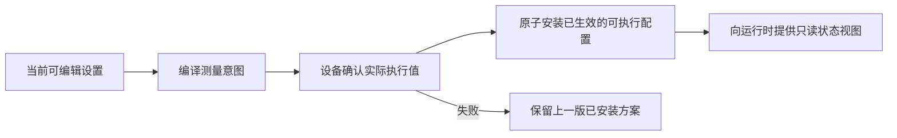
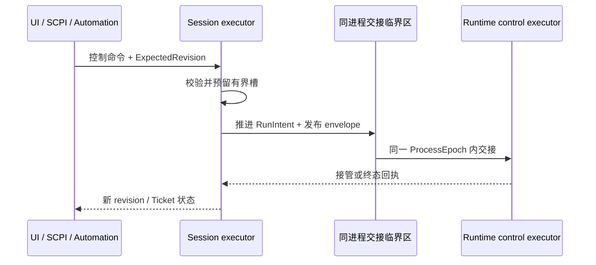

# 详细设计 04A：应用会话与事务

本篇定义 L7 会话、命令、操作票据（Ticket）、部署交接、校准绑定和通用事务的字段级协议。产品对象删除、校准数据集目录移除与后台查询已拆到 [D4E](./04E-产品对象删除与后台处理.md)。先看职责和关系时请从[详细设计 04 导航](./04-应用事务校准与存储.md)进入；本篇不承担总体架构说明。

> 上一篇：[D3C：触发、多通道调度与验证](./03C-触发多通道调度与验证.md) · [详细设计 04 导航](./04-应用事务校准与存储.md) · 下一篇：[D4E：产品对象删除、目录移除与后台处理](./04E-产品对象删除与后台处理.md) · [返回文档索引](../README.md)

> 编号说明：本篇沿用全局第 9 章编号，承载 §9.1.1–§9.1.2 与 §9.2；§9.1.3–§9.1.5 见 [D4E](./04E-产品对象删除与后台处理.md)。

## 阅读入口

### 30 秒摘要

- `InstrumentSession` 是产品状态的唯一入口，维护当前可编辑设置及其版本；运行状态只通过只读状态视图组合查询。
- 同步修改在唯一命令执行器中校验预期版本并原子提交；只有明确需要跨重启继续的外部或持久异步工作流，才在首次不可逆副作用前登记可恢复责任。普通运行控制不跨重启重放。
- 操作票据（Ticket）只让调用者查询进度和最终结果。业务已经成功或失败，不代表清理已经完成；票据按声明的完成屏障对外结束。

### 正常主线

1. 接收命令，校验会话身份、幂等身份、权限、预期版本和资源上限。
2. 纯产品修改直接提交一次原子版本更新；异步操作先建立完整操作身份、持久日志、恢复容量和 Ticket。
3. 只有持久责任建立成功，才允许第一次外部副作用；随后由唯一责任方推进部署、绑定或校准尝试；删除操作转入 [D4E 专用协议](./04E-产品对象删除与后台处理.md)。
4. 最终执行状态确定后继续释放或安全移交资源；完成屏障满足后，Ticket 才向 UI、SCPI 或自动化报告完成。

### 先理解的词与前置阅读

| 词 | 本篇中的白话含义 |
| --- | --- |
| `SessionWorkingSet` | 用户当前正在编辑的完整产品设置，不是保存文件，也不是运行中的可变对象 |
| Revision / CAS | Revision 是提交版本；CAS 表示只有预期版本仍匹配时，才原子写入新版本 |
| Ticket | 一次已接纳操作的稳定查询凭证，不拥有业务对象或资源 |
| 持久责任方 / journal | 崩溃后仍能找到的唯一责任方及其持久记录，不是进程内 future |
| receipt | 某一步已经发生的可验证证明；是否持久化由所属协议明确声明 |
| fence | 按类型分别表示“阻止后续准入或修改”“等待既有工作完成”或“证明旧身份可退役”，不能一律理解为完成条件 |

建议按需补齐三项前置阅读：

- 看[产品对象与关系](../架构设计/02-产品对象与关系.md)，理解 Session、Channel 和版本。
- 看[资源与故障恢复 §2、§4](../架构设计/05-资源与故障恢复.md#2-先理解三条可靠性规则)，先理解方案保护、资源上限和清理完成。
- 查 [D1 §1.2–§1.3](./01A-公共阅读规则与L0契约.md#12-易混术语速查)，理解 identity、owner、移交和退役的字段级读法。

### 本文不负责什么

本文不定义硬件执行和采集、数值算法、Run/Trigger 状态机、产品对象删除、Save/Recall 切换、校准 Workspace、结果提交恢复或外部协议顺序；这些内容分别由 [D1](./01-公共契约与硬件采集.md)、[D2](./02-数值处理与通道编译.md)、[D3](./03-运行时触发与调度.md)、[D4E](./04E-产品对象删除与后台处理.md)、[D4B](./04B-保存召回与运行切换.md)、[D4C](./04C-校准工作流.md)、[D4D](./04D-持久化结果与恢复.md)和 [D5](./05-适配器横切与验证.md)负责。本篇只定义 L7 会话、命令、Ticket、部署、校准绑定和通用事务的应用责任边界。

进入字段前，先用这条主线定位后文类型：



`SessionWorkingSet` 属于第一步，Prepare attempt 跨第二、三步，Installed record 是第四步完成后形成的安装事实。Runtime 对外只提供只读状态视图；内部类型仍可使用 projection snapshot 命名，但它不是第二份产品状态。后文的 identity、revision 和 owner 都是在防止这五个位置被并发操作混为一谈。

<a id="dd-app-session"></a>

## 9.1 仪器会话（`InstrumentSession`）

### 9.1.1 当前设置工作区、会话与版本（`WorkingSet` / `Session`）

#### 正常路径：会话产品快照

Session 维护以下应用级状态：live `SessionWorkingSet`、不可变 `LoadedRecallSetRef`、会话当前选择、`ProfileAddressBook`、`HardwarePreparationOwnerRef`、ResultRepository 引用以及应用状态。Session 不直接保存 `DeviceSessionLease` 或 `PreparedExecutionHandle`。

WorkingSet 内含跨 Instrument/Channel/ChannelSequence owner 的 `TriggerRoutingConfiguration`，以及 Channel/Measurement/Trace/Marker/分析定义/MarkerCoupling/DisplayPane/TraceDisplayBinding/TraceAnalysisDisplayBinding aggregate。它把 source expression、owner、target selection、execution selector 和 admission policy 编译为 Runtime 只读 `ResolvedTriggerRoutingPlan`。`ProfileAddressBook` 是同一 L7 产品事务域中的持久协议地址索引；它与产品图一起提交，但不取得产品对象所有权。

`PrepareChannelUseCase` 依次编排 L5 compileIntent → `HardwarePreparationOwnerPort` → L5 bindEffective。各组件的边界为：

- `HardwarePreparationOwnerPort` 由 L7 基础设施目标 `VnaApplicationHardwareOwner` 实现；它内部调用 L2 Hardware Prepare，并唯一保存 `DeviceSessionLease`、Candidate/Installed Handle owner。
- 同一适配器还实现独立合同目标 `VnaDeploymentAccessPorts` 中的 `DeploymentAccessPort`。L6 获取 Pin/Lease 和调用窄 `start/arm` 端口时，直接命中同一份私有 Installed record；无需也不允许 `VnaApplication` 核心中转 L2 Handle。
- `VnaRuntimePorts` 仍是 L0-only，不承载部署描述或 L2 执行类型。
- `VnaApplication` 只登记 attempt、CandidateRevision、opaque owner identity 和返回的 generation，并在发布前检查 fence。
- L2 DeviceSession control executor 分配 `PrepareGeneration`，并保证最多一个 Prepare 在途。
- `VnaCompositionRoot` 只注入同一对象的两个窄端口视图，不编排这些业务步骤。

Prepare success payload 的 take、Candidate owner、Installed owner 与崩溃恢复只采用[下文的持久操作责任交接协议](#持久操作的责任交接)，不能用进程内 future 或“当前 Handle”补齐所有权。

所有可变产品状态都通过应用命令产生新 revision，不把可变领域对象直接交给 UI。

```text
SessionWorkingSet                    // live、可编辑，不是持久化工件
  WorkingSetRevision
  WorkingSetContentHash
  Channel/Measurement/Trace/Marker/analysis/MarkerCoupling consistent graph
  DisplayPane/TraceDisplayBinding/TraceAnalysisDisplayBinding consistent graph
  AnalysisDefinitionRevision
  TriggerRoutingConfiguration + persistable display/system settings
  ProfileAddressBook                 // 与产品图同 revision 提交并进入 RecallSet

SessionCurrentSelection              // 会话级 UI/Native 选择，不是连接级 SCPI 选择
  SelectionRevision
  optional exact Channel/Measurement/Trace/DisplayPane refs

ProfileAddressBook
  ProductProfileKey + ProfileRevision + AddressBookRevision
  AddressEntry[] + AddressTombstone[]

LoadedRecallSetRef                   // 当前 WorkingSet 的不可变保存基线
  RecallSetId + RecallSetRevision + RecallSetContentHash

InstrumentSessionSnapshot
  InstrumentSessionId + SessionRevision + SessionGeneration
  SessionWorkingSet + SessionCurrentSelection + LoadedRecallSetRef
  dirty                              // 派生，不可直接写

RuntimeProjectionSnapshot              // 内部快照名；对外解释为“运行只读状态视图”
  InstrumentSessionId + SessionGeneration + RuntimeEpoch + RuntimeProjectionRevision
  runtime/status state views         // 不含实时 current 数据，不改 SessionRevision
```

`AnalysisDefinitionRevision` 随 Marker、MarkerCoupling、限值检查、纹波或带宽的数值定义提交而推进；纯显示关系变化不推进。L7 `TraceAnalysisService` 的内存 plan 始终绑定 `WorkingSetRevision + AnalysisDefinitionRevision`，并在同一个产品 CAS 临界区替换，因此不存在第二套分析状态投影。

#### 测量量、迹线、显示窗口与标记的权威结构

本节是产品身份、修订和引用关系的唯一字段级事实源；[D2C §7](./02C-通道编译绑定与失效.md#7-l5通道编译核心vnachannelcore)只定义送入编译器的不可变数值视图，[D5A §10](./05A-外部适配器.md#10-l8外部适配器)的 UI/SCPI 只维护外部地址到这些精确身份的映射，不得再复制一套产品对象。

```text
ChannelDefinition
  ChannelId + ChannelRevision
  stimulus/sweep/trigger/correction settings
  ChannelAveragePolicy{processing access point, count/mode, reset policy}

MeasurementDefinition
  MeasurementId + MeasurementRevision
  owning ChannelId
  quantity = SParameter{responsePort, sourcePort}
           | Ratio{numerator receiver, denominator receiver}
           | Receiver{receiver path}
           | supported profile extension{type id, version, canonical payload}
  enabled
  displayName                         // 不参与 quantity 等价判断

TraceDefinition
  TraceId + TraceRevision
  exact owning ChannelId + ChannelRevision
  source = LiveMeasurement{exact MeasurementId + MeasurementRevision, access point}
         | StoredResult{exact ResultRef, series key, access point}
         | DerivedTrace{ordered exact TraceId + TraceRevision inputs, operation graph revision}
  processingGraphRevision
  complex/formatted TraceSchema
  TraceHoldPolicy{mode=Off | MaxHold | MinHold, restart policy}
  MarkerDefinition[]                  // 按 MarkerId 规范排序
  LimitTestDefinition[] + RippleTestDefinition[] + BandwidthTestDefinition[] // 限值检查/纹波/带宽

MarkerDefinition
  MarkerId + MarkerRevision
  exact owning TraceId + TraceRevision
  optional exact ReferenceMarkerId + ReferenceMarkerRevision
  mode = FixedX | Peak | Minimum | Target | Bandwidth | Delta
  searchRange + trackingPolicy + Discrete | Interpolated
  searchStrategy + searchDomain
  x/y format + unit

MarkerCouplingDefinition
  MarkerCouplingId + MarkerCouplingRevision
  scope = ExplicitCompatibleTraceSet | Channel | DisplayPane
  ordered exact Trace/Marker refs + compatibility rule

LimitTestDefinition | RippleTestDefinition | BandwidthTestDefinition
  stable analysis id + revision + exact owning Trace ref
  evaluationEnabled
  analysis-specific ranges/thresholds/search policy

DisplayPaneDefinition
  DisplayPaneId + DisplayPaneRevision
  coordinateSystem + axis configuration
  layout + title

TraceDisplayBinding
  TraceDisplayBindingId + BindingRevision
  exact DisplayPaneId + DisplayPaneRevision
  exact TraceId + TraceRevision
  axis assignment + draw order + style

TraceAnalysisDisplayBinding
  TraceAnalysisDisplayBindingId + BindingRevision
  exact TraceDisplayBindingId + BindingRevision
  exact analysis id + analysis revision
  visible + presentation style/geometry policy
```

约束必须在形成 `WorkingSetRevision` 前一次验证：

- `Trace.source` 是判别联合，恰有一个分支；不能同时填写 Measurement、ResultRef，再让实现猜优先级；
- 每条 Trace 恰好有一个 owning Channel，且所有 Trace 类型都必须保留该归属；`StoredResult` 和 `DerivedTrace` 不能因为没有实时 Measurement 来源而成为无通道对象；
- `LiveMeasurement` 默认必须引用 owning Channel 内的 Measurement。DerivedTrace 允许多输入，但默认只接受同通道输入；跨通道数学只有显式 `CrossChannelTraceCapability`、冻结的兼容方案和轴/校正兼容证明齐全时才可用。所有引用必须来自同一 WorkingSet revision，图必须无环且不超过 profile 的节点、边、扇入和深度上限；
- Marker 只属于一条精确迹线修订；参考 Marker 、标记联动和迹线分析测试的每条引用也必须精确且无断链。迹线修订变化时，L7 要么在同一事务迁移并推进相关 revision，要么返回字段级不兼容，不能静默改绑；
- `ChannelAveragePolicy` 只属于 Channel，`TraceHoldPolicy` 只属于 Trace；不允许用一个含糊 `statePolicy.average` 让每条迹线各自定义“通道平均”。若某个厂商兼容配置确实提供逐迹线平均，必须作为另一个经证据放行的算子，不复用 Channel Average 名称；
- 测试定义的 `evaluationEnabled` 与 `TraceAnalysisDisplayBinding.visible` 是两个独立事实。前者决定是否产生判定，后者只决定某个具体窗口中的辅助线、纹波区域或带宽图形是否可见；隐藏一个窗口中的图形不得暗中停止数值判定，也不得改变其他窗口；
- 显示关系只存在于 `TraceDisplayBinding` 及其 `TraceAnalysisDisplayBinding` 子关系。删除窗口在产品图内删除这两类 Binding；删除迹线才处理 Marker、分析定义与全部显示 Binding。两者仍须在同一事务更新协议地址和失效的会话当前选择；
- ID、revision、判别项、所有影响测量/数值/显示语义的字段及 exact external refs 都进入 WorkingSet canonical bytes；名称和布局是否影响运行计划由失效矩阵明确判定，但不能从 hash 中省略。

规范编码固定按对象类型、强类型 ID 字节和 revision 排序；map/set 不使用容器迭代顺序，optional 必须编码 `Absent|Present`，浮点必须使用 [D1 §2.2.6](./01A-公共阅读规则与L0契约.md#226-通用哈希和验证边界)规定的业务规范编码。相同产品图必须在不同进程、编译器和重启后得到同一 `WorkingSetContentHash`；换判别分支、引用修订、单位、默认值或 `-0/NaN` 处置时必须改变 hash 或被拒绝。

普通编辑绝不原地修改 RecallSet artifact 或 `LoadedRecallSetRef`。

`WorkingSetContentHash` 与 `RecallSetContentHash` 使用同一 canonical 算法，只覆盖可持久配置 payload、ProfileAddressBook 和 exact external refs。运行计数、Result、Ticket、会话当前选择、窗口临时状态、artifact envelope、RecallSetId/revision、schemaVersion 和 save time 都不进入该 hash；`dirty` 只比较这两个 hash 派生。

- Save 冻结一个 WorkingSet revision，原子创建新的 RecallSet revision；Repository 成功后再 CAS 更新 LoadedRecallSetRef。
- Recall 发布候选 WorkingSet，并把 LoadedRecallSetRef 指向被验证的精确 artifact。

| 版本 | 表示什么 | 何时推进 |
| --- | --- | --- |
| `SessionGeneration` | Recall 整代隔离；与 InstrumentSessionId 组成 late-event gate | 仅 Recall final CAS 成功时推进 |
| `SessionRevision` | L7“配置与当前结果”职责的 InstrumentSession 快照版本 | 可持久配置、非持久但用户可观察的产品状态、Save baseline、Recall final CAS 各推进一次 |
| `WorkingSetRevision` | live 可持久配置图的成功提交版本 | 普通编辑和 Recall final CAS 推进；Save baseline CAS 不推进 |
| `AddressBookRevision` | 当前 profile 下协议地址到稳定产品对象实例的映射版本 | 只在创建、删除/重建、改名、重排、profile 变化或 Recall 改变地址拓扑时推进；频率、功率、显示样式等内容修订不改地址簿 |
| `SelectionRevision` | 会话当前选择的 exact refs 版本 | 显式选择、删除导致的 clear-to-None 和 Recall final CAS；连接级选择不推进它 |
| `RuntimeEpoch` | 一次可执行 Runtime 实例；进程重启或显式重建时改变 | 新 Runtime admission 前推进；旧 epoch token 永远失效 |
| `RuntimeProjectionRevision` | 当前 RuntimeEpoch 内的高频 Runtime/status 只读状态视图版本 | 每次内部状态视图发布推进；不改变 SessionRevision/WorkingSetRevision。实时 current 使用独立 SlotRevision |
| `AnalysisDefinitionRevision` | 当前 Marker/联动/限值检查/纹波/带宽数值定义集合版本 | 数值分析定义或 L7 展开的联动成员集成功提交时推进；纯显示关系变化不推进 |

因此，各类提交的版本推进规则固定为：

- 普通产品编辑同时推进 SessionRevision/WorkingSetRevision；若创建、删除或重排可寻址对象，同一事务再推进 AddressBookRevision。
- 仅改变会话当前选择时推进 SessionRevision/SelectionRevision，不推进 WorkingSetRevision；删除在同一产品事务内按实际变化推进这些 revision。
- Save 成功更新 baseline 只推进 SessionRevision。
- Recall final CAS 推进 SessionGeneration/SessionRevision/WorkingSetRevision。
- Runtime/status 只读状态视图只推进当前 epoch 的 RuntimeProjectionRevision；实时 current 槽只推进自己的 SlotRevision。
- Marker、MarkerCoupling 或测试判定配置在同一产品 CAS 中推进 `AnalysisDefinitionRevision` 并替换 L7 内存 plan。`TraceAnalysisDisplayBinding.visible/style` 不推进该 revision，也不调用 L5/L4。

查询 token 必须包含 `InstrumentSessionId + SessionGeneration + RuntimeEpoch`。新 epoch 可从 revision 1 开始，但旧 token 必须返回 `StaleRuntimeEpoch`，不能命中新投影。一次原子事务即使改多个对象，也只对每种 revision 各推进一次。

#### 普通扫频平均与迹线保持：产品作用域

本节只规定**产品配置的作用域**，不保存运行中的累计值：

- `ChannelAveragePolicy` 属于测量通道，规定本通道完整扫描如何参与扫频平均；同一通道的多条迹线不得各自复制一份扫频平均计数。
- `TraceHoldPolicy` 属于迹线，规定该迹线显示值采用最大值、最小值或其他已经批准的保持算法；它与通道扫频平均是两个不同处理阶段。
- L7 会话只交付冻结的策略修订和只读运行状态投影，不保存 `AverageState`、`HoldState`、state head、turn 或 delta。
- `Average Clear` 和 `Trace Hold Restart/Reset` 是一次性应用命令，不改写上述常驻策略。L7 冻结完整 reset operation identity、当前 RuntimeEpoch、ExpectedWorkingSetRevision 和 exact Channel/Trace+策略修订，再经 [D3A 状态重置合同](./03A-运行对象职责与端口.md#运行周期内状态存储普通扫频平均与迹线保持)的 `RuntimeStageStateControlPort` 取得幂等回执；L7 仍不保存或直接清空 state head。

普通扫频平均和迹线保持的累计状态属于当前 `RuntimeEpoch`，其字段、顺序、容量和清理合同统一由 [D3A 运行周期内状态存储](./03A-运行对象职责与端口.md#运行周期内状态存储普通扫频平均与迹线保持)定义。只有产品明确要求跨进程重启继续的工作流状态，才进入 [D4D 持久交付协议](./04D-持久化结果与恢复.md#955-持久交付的唯一提交与恢复协议)。实时当前结果、运行周期内累计状态和可恢复工作流状态是三个独立责任，不能因为都与“结果”有关就放入同一个存储。

#### 线性化点：会话从正在打开变为已打开（`Opening → Open`）

`InstrumentSession` 由一个 command executor 单写，状态为 `Opening → Open → Degraded/Fault → Closing → Closed`。

创建 admission 先预留基础 Close/control/quarantine 与 Opening-cleanup node，再以 `Lifecycle=Opening` fsync SessionAuthorityRecord。完整 DeviceOpenOperationIdentity、DeviceOpenRecoveryRecord/Host claim、初始 WorkingSet/pins 和预算均登记进该 cleanup node，不能只写 DeviceId/HostId。

外部可见的 Session handle 只允许在一个 authority CAS 同时完成以下写入后发布：

- `SessionOpenReceipt{InstrumentSessionId, SessionGeneration, WorkingSetContentHash, RuntimeOwner, ActiveDeviceSessionRecordRef, HostLeaseTransferredToActiveSessionReceipt, authorityRevision}`；
- `Lifecycle=Open`。

被引用的 ActiveDeviceSessionRecord 必含 source open identity、DeviceSessionId/HostGeneration、HostLeaseCapabilityRef 和 ownerRevision。不存在“receipt 已提交但 authority 仍合法停在 Opening”的中间态。

#### 失败与启动恢复

若进程死在 Opening，startup 重读上述 CAS：

- 已提交 receipt：按 Open 恢复，并且只按该 active record rebind。
- 未提交：使用预留 node create-if-absent AbandonedSessionCleanupJournal。该 journal 引用同一 DeviceOpenRecoveryRecord，精确 close/revoke 或隔离 Host claim/已转移但未发布的 active record，再释放 pins/预算并 tombstone。

恢复不得凭 authority 存在猜测 Open，也不得按 DeviceId 关闭设备。

Device/Driver 丢失通常进入 Degraded：保留配置、CalSet 和已完成结果，拒绝新 Prepare/Initiate，但允许查询、保存和显式重新绑定。若只有软件围栏而没有物理静止证明，精确物理设备必须保持 `PhysicalStateUnknownQuarantined`；显式重绑只能选择另一台已验证安全的设备，或先对原设备执行安全重连/复位并验证状态。只有领域不变量或主 Repository 无法恢复才进入 Fault。

#### 关闭、退役与验证

`SessionCloseCoordinator`、`SessionCloseJournal` 和 `SessionCloseTerminal` 的唯一责任方是 L7；L6 只实现运行准入截止与运行排空子协议，不能反向协调 Application 子责任或写会话终态。

```text
SessionCloseJournal
  complete SessionCloseOperationIdentity + InstrumentSessionId/SessionGeneration
  ClosingEpoch + expected SessionRevision
  frozen ClosePolicy + bounded CloseResourcePlan
  ApplicationAdmissionClosedReceipt
  optional RuntimeCloseCutoffReceipt | PriorProcessIsolatedRuntimeCloseEvidence
  optional RuntimeDrainReceipt
  ApplicationResponsibilityLedger[] + ClosingProducerSeal[]
  deployment/device/result/adapter release or transfer receipts
  state = Accepted → ApplicationAdmissionClosed → RuntimeClosing
          → ApplicationDraining → ApplicationRegistrationSealed
          → DeviceClosing → CleanupDone → Terminal → Retired
```

`PriorProcessIsolatedRuntimeCloseEvidence` 不是会话层另造的状态机；它是 [D3A 旧进程隔离证据](./03A-运行对象职责与端口.md#旧进程隔离证据) 中 `scope=Session、operationKind=SessionClose` 且绑定完整 `SessionCloseOperationIdentity` 的别名。主进程 bootstrap 取得 OS 单例锁和新 `ProcessEpoch` 后，组合“旧进程已终止”、exact DeviceSession/HostGeneration 的 `SoftwareFenceEvidence`，以及 `PhysicalQuiescent | PhysicalStateUnknownQuarantined` 处置；Application 不得把 Channel scope 的证据当作 Session Close 证据，也不得把 software fence 当作物理静止证明。

会话关闭的唯一线性化事务只在 L7 内完成三件事：关闭新的命令、运行意图、设备预备和 Application 子责任准入；推进 `ClosingEpoch`；持久化 `SessionCloseJournal + ApplicationAdmissionClosedReceipt`。它不声称同一事务已经关闭 L6 gate。

`CloseResourcePlan` 是关门时的冻结基线，不是“之后不会再产生责任”的假设。Session 创建和每次业务准入都预留关闭登记节点；关闭期间，已接纳工作新产生的结果处置、恢复责任或适配器子租约，必须在源事务中把预留节点移入 `ApplicationResponsibilityLedger`，不得留给第二次扫描“猜”。资源压力可以拒绝新业务，不能让已存在的 Session 因缺登记容量而无法关闭。

每个 Application producer 关闭自己的新工作入口后，向 L7 唯一日志提交 `ClosingProducerSeal{producerKind, generation, issuedCount, issuedDigest}`。只有全部 seal 齐全、ledger 再枚举无遗漏且 `lateRegistrationCount=0`，L7 才可进入 `ApplicationRegistrationSealed`。上界被突破时使用 Session 创建期预留的隔离槽，关闭相应 producer 并记录 `ProtocolError`；不允许临时扩容或伪造已完成。

`ClosePolicy` 只能选择 `DrainAccepted` 或 `AbortAndDiscardUnprocessed`。后者只允许丢弃尚未开始处理的数据帧，逐份记录 `DiscardedOnClose`并释放租约；已开始的处理、已建立的持久责任和外部操作仍必须得到稳定处置或完整责任移交回执。

提交后，L7 通过 [D3B §8.4.4](./03B-测量生命周期与完成.md#844-关闭与资源清理)的窄端口取得 `RuntimeCloseCutoffReceipt` 和 `RuntimeDrainReceipt`；随后分别向保存召回、校准、持久结果、产品删除与外部适配器的责任方请求释放或移交已接纳的工作。每个子责任只返回稳定处置回执，不取得会话关闭协调权。

应用子责任的精确协议仍由各篇拥有：[保存/召回](./04B-保存召回与运行切换.md)、[校准](./04C-校准工作流.md)、[持久结果](./04D-持久化结果与恢复.md)、[产品删除](./04E-产品对象删除与后台处理.md)、[文件和连接](./05A-外部适配器.md)。对已移交的操作，Close 只等待“新责任方已持久成立、Session 责任已归零”的本地回执，不等待远程 Repository、文件宿主或设备最终恢复。隔离/恢复责任可晚于 Session 析构继续，但不得回调已销毁 Session。

最后，L7 按 `ActiveDeviceSessionRecordRef` 请求撤销部署并关闭 DeviceSession。只有运行排空、全部 Application 子责任、设备和请求者交付都有明确回执，L7 才写唯一 `SessionCloseTerminal` 并进入 Closed。Closed 不可重新打开；重新连接产生新的 InstrumentSessionId。

重启时只由 L7 枚举未退役 `SessionCloseJournal`，并以 expected owner revision 接管；已有子回执不重做。

若进程死在 Application 关门后、首次 L6 调用前，新进程必须取得 [D3A 旧进程隔离证据](./03A-运行对象职责与端口.md#旧进程隔离证据)定义且绑定原 `SessionCloseOperationIdentity` 的 Session scope 证据。在 V1 没有 L2 持久执行全集索引时，bootstrap 必须同时做到：

- 围栏 exact DeviceSession/HostGeneration 的旧软件能力；
- 取得物理静止或物理状态不可知隔离处置。

不能把“看不到旧 Run”当作排空或物理停止证明。后一处置允许会话以中断/降级语义有界关闭，但精确设备仍不可复用。这些证据只在 Close/Delete 恢复路径持久，不为 current-only 每次测量建 WAL。

`Terminal` 后不得重做 release/transfer/seal；只有请求者 ACK 或离线证明、终态摘要和零 live claim 齐全，L7 才写退役水位、进入 `Retired` 并压缩明细。

故障注入覆盖以下边界：authority 创建、open recovery record、Host claim/独占成功、ActiveDeviceSessionRecord transfer、DeviceSession identity 回填、Open CAS、open attempt compact，以及 handle 发布前后。

会话关闭另覆盖 L7 关门事务两侧、首次 L6 cutoff 前崩溃、运行 cutoff/排空回执两侧、每类 Application 责任移交、设备关闭、终态与退役；每个点都必须证明只有 L7 一个会话关闭责任方。

- 未发布分支最终 tombstone，且精确 claim/资源归零。
- 已发布分支即使 attempt 已 compact，也只返回同一 Session/DeviceSession identity。

### 9.1.2 命令、操作凭证与外部完成（`Command` / `Ticket`）

所有修改命令使用统一信封：

```text
ApplicationCommand
  CommandId + optional CommandIdempotencyIdentity
  InstrumentSessionId
  ExpectedSessionRevision
  optional TargetId + ExpectedTargetRevision
  payload
```

#### 正常路径：版本检查、单写执行与原子提交

普通同步设置只使用三件机制：调用方提交 `ExpectedSessionRevision`/`ExpectedTargetRevision`，Session executor 串行验证业务规则，Repository 以一个原子 CAS 同时提交产品图和新 revision。ExpectedRevision 不匹配时返回当前 revision 和字段级冲突，不做部分修改；提交成功即返回新 revision。标记、显示、扫频设置及其他普通产品编辑不创建 Ticket、持久去重记录或重放日志。

SCPI adapter 只用 `ConnectionGeneration + MessageOrdinal` 保证同一连接内的解析与响应顺序。断线、进程重启或新连接都会开始新的 generation；ordinal 不是业务幂等键，不能跨连接或跨重启承诺 exactly-once。

#### 显式幂等只属于明确提出该语义的入口

API/Automation 只有在调用方显式提供 `CommandIdempotencyIdentity{ClientIdentity, ClientCommandEpoch, IdempotencyKey, CommandRetirableLocator}` 时，才建立有界去重记录。记录绑定完整语义摘要和原 `CommandResult/Ticket`；同 identity 异摘要返回 `IdempotencyConflict`。若操作本身是跨重启的外部或持久异步工作流，去重责任归该工作流已有的 operation journal；不得再为普通命令复制一份全局 command ledger。

显式去重窗口到期后返回 `IdempotencyExpired{terminalDigest}`。没有显式幂等键的调用方在响应不确定时，必须读取当前 revision/操作状态再决定是否发新命令，不能补造旧 key。Initiate、Continue、Restart、Stop、Hold、Abort 也不建立 durable replay journal；其崩溃语义见下文。

产品与运行状态查询先取得一致 `SessionSnapshot{SessionRevision, WorkingSetRevision, AnalysisDefinitionRevision, RuntimeEpoch, RuntimeProjectionRevision}`，再解析产品对象和运行只读状态视图。实时 current 另按完整 `LiveCurrentKey + SlotRevision` 查询 `SessionLiveResultStore`；分析 current 另按精确产品分析版本查询；历史 Result 查询另冻结 RepositorySnapshotRevision。各自 token 必须随响应返回，不能把不同 revision 拼成一次遍历；后续增量查询若 epoch 不同必须返回 StaleRuntimeEpoch 并要求全量刷新。

最小用例：

```text
Create/Configure/DeleteChannel
Create/Configure/DeleteMeasurement
Create/Configure/DeleteTrace
Create/Configure/DeleteMarker
Create/Configure/DeleteMarkerCoupling
Create/Configure/DeleteLimitTest/RippleTest/BandwidthTest
Create/Configure/DeleteDisplayPane
Create/Configure/DeleteTraceDisplayBinding  // 或 BindTrace/UnbindTrace，以 BindingId 定位
Create/Configure/DeleteTraceAnalysisDisplayBinding
PrepareChannel / Initiate / Continue / Stop / Abort
Start/Advance/Cancel/DiscardCalibrationSession
PublishCalSet / BindUserCorrection / UnbindUserCorrection
CatalogDeleteCalSet
Save/RecallSetup
QueryCompletedData / SubscribeLiveData
```

#### 产品分析服务：提交、主动刷新与迟到结果

Marker、MarkerCoupling、限值检查、纹波和带宽属于产品分析，不属于触发运行生命周期。L7 的轻量 `TraceAnalysisService` 保存不可变 plan 指针和有界 worker；L5 纯编译、L4 纯求值，L6/L2 完全不参与。

```text
TraceAnalysisService
  active TraceAnalysisPlanRef{WorkingSetRevision, AnalysisDefinitionRevision, plan hash}
  bounded plan/evaluation/input-snapshot/output/scratch/refresh resources
  retired plan refs pinned only by in-flight memory leases

TraceAnalysisEvaluation
  WorkingSetRevision + AnalysisDefinitionRevision
  exact analysis owner revisions
  AnalysisInputVersionSetDigest + ordered immutable input views
  output reservation + in-memory plan/input leases
```

正常顺序固定为：

1. L7 从同一 WorkingSet 快照把 `Channel/DisplayPane` 联动选择器展开为有序精确 Marker/Trace 成员集；L5 只校验数值兼容并纯编译候选，不读取 DisplayPane 或显示关系；
2. 首个产品副作用前，L7 为候选 plan、输入快照、求值任务、输出、scratch、刷新和旧 plan 退休预留最坏内存额度；不足即同步拒绝；
3. L7 应用单写者以 expected WorkingSetRevision 做一次 CAS，在同一临界区提交产品图、`AnalysisDefinitionRevision`、成员摘要、地址变化，使旧输出发布资格失效，并把 `TraceAnalysisService` 的 active immutable plan ref 替换为新版本；
4. CAS 前取得旧内存 lease 的求值可以完成；发布时必须再次匹配 `WorkingSetRevision + AnalysisDefinitionRevision + exact owner revision`。不匹配只释放候选并返回 `SupersededByProductRevision`，不能覆盖新结果或复活已删除对象；
5. CAS 后立即为新版本排入一次主动刷新。L7 在同一 `SessionLiveResultStore` 快照修订上冻结有序输入版本集合；跨通道成员允许不同 Run/Sweep/ordinal，缺失或不兼容成员立即形成 `Indeterminate`；
6. 设备从未启动、通道处于 Ready 或 Held、或已经停止且没有活动测量运行任务时，也照常使用现有 current 求值。全无 current 时仍立即产生明确的“暂无可判定输入”，不等待未来扫描。

普通 Marker/测试配置命令是同步产品事务：零 durable Ticket/journal、零 L6/L2 调用、零 Stop/Prepare/重新扫描。进程重启从当前 WorkingSet 重新纯编译 plan；旧 worker、lease 和分析 current 都不恢复。刷新队列只在同一产品分析版本内合并，所有内存资源都有硬上限。

Session Close 由 L7 先关闭新的分析刷新准入，使全部旧发布资格失效，再取消排队任务并排空在途内存 lease；这不进入 L6 `RuntimeDrainReceipt`。若 worker 未在本地 deadline 内归还，只能隔离该进程内 worker 池并丢弃其输出，不能因此调用硬件 Abort 或建立持久恢复记录。

#### 正常路径：操作凭证接纳边界

命令返回：

`CommandResult{status, optional newRevision, optional OperationTicket{OperationTicketIdentity}, optional TicketCompletionScope}`。

Prepare/DeleteChannel/Save/Recall/ECal/Close/ImportExport/RoutingHandoff，以及本文定义的 `BindUserCorrection/UnbindUserCorrection/CatalogDeleteCalSet`、需要 processing/full reconfigure 的 `DeleteTrace/DeleteMeasurement/CascadeDelete`，只有同时满足下列条件，才成为可跨重启的带 Ticket 异步操作。Initiate/Continue/Restart/Stop/Hold/Abort 可以为当前进程的观察者建立 Ticket，但不登记 durable owner/journal；进程重启时以中断终态结束。普通 Marker/MarkerCoupling/限值检查/纹波/带宽编辑和纯 DisplayPane、TraceDisplayBinding、TraceAnalysisDisplayBinding、布局或样式删除都是同步产品事务，不创建 Ticket：

1. 通过各自无副作用前置检查；
2. 完整 operation identity、durable owner/journal、恢复配额和 Ticket 已一起登记为 Accepted。

任何前置语义、capability 或有界 pool 检查失败都同步返回 `Rejected`，且不创建 Ticket。

特别地，V1 `UnsupportedExportCommitProfile/UnsupportedExportExecutionCapability` 在 ArtifactTransferIdentity、journal/pool/temp、File Host generation 和首次 source/target I/O 前返回。因此没有 `ArtifactImportExportTerminal` 或空 Ticket 需要退役；普通同步 setting 同样不制造空操作。

Ticket identity 是 `OperationTicketIdentity{TicketId, TicketRetirableLocator}`，完整进入 query/cancel、SCPI effect 捕获集和 Automation/UI handle。TicketId 与 locator 不能拆开替换。

`AcceptanceOnly` 只是同步 CommandResult 的接纳状态，不是异步 Ticket scope。任何有后续副作用的命令都不能借它提前完成。

三条校准引用命令的映射固定为：

- 前置语义校验或有界 pool 预留失败：同步返回 `CommandResult=Rejected`，不创建 Ticket，且不得触碰 binding/catalog gate。
- durable journal、完整 operation identity、OperationTicket 与恢复配额均登记成功：返回 `CommandResult=Accepted{exact OperationTicketIdentity}`。
- Bind/Unbind 的 Ticket：分别绑定 `UserCorrectionBindTerminal/UserCorrectionUnbindTerminal`。
- CatalogDelete 的 Ticket：绑定 `CatalogDeleteCalSetTerminal`。

Accepted 只说明该持久工作流的恢复责任已建立，不说明 binding 已切换或 catalog 已删除。显式携带幂等键的 API/Automation 重试返回同一 Ticket；SCPI 只在当前 ConnectionGeneration 内观察其 CompletionFence，不承诺跨连接或跨重启重放。

`TicketCompletionScope` 只有两种形状：

- `LeafOperationFence{OperationCompletionFenceId, BusinessTerminalTarget}`；
- `CompositeTerminalSet{CompositeTicketIdentity, policy=All|OrderedAll, CompositePlanSealed, bounded childSlots[]}`。

V1 不提供语义含混的 `Any`。首个 winner 之后如何取消并收口仍在运行的 losers，必须先由独立产品策略证明；不能让父 Ticket 吞掉它们。

#### 操作凭证取消的五种明确结果

`cancel(ticket)` 不能只有一个真假值。取消“等待响应”和取消“正在运行的业务”不是一回事；如果 Ticket 没有携带明确策略，UI、Automation 和协议适配器都不得自行把“取消”猜成 Stop 或 Abort。

Ticket 在 Accepted 事务中冻结 `TicketCancellationPolicy=CancelObservationOnly | RequestStop | RequestAbort | NotCancellable`。取消请求携带完整 `OperationTicketIdentity + ExpectedTicketRevision + TicketCancelRequestIdentity{CancelRequestId, TicketCancelRetirableLocator}`，并只返回下列五种稳定结果之一：

| 取消结果 | 含义 | 不允许的解释 |
| --- | --- | --- |
| `ObservationCancelled`（观察取消） | 只释放当前 requester 的等待/订阅 claim；业务 operation、其他等待者和 CompletionFence 继续运行 | 不能改 RunIntent，不能释放业务 owner |
| `StopRequested`（已请求 Stop） | 当前进程已把绑定精确目标的 Stop envelope 交给 L6，并返回当前进程内的控制回执 | 只说明 Stop 已接纳，不等于已经停稳；进程重启后不得重放 |
| `AbortRequested`（已请求 Abort） | 当前进程已把绑定精确目标的 Abort envelope 交给 L6，并返回当前进程内的控制回执 | 不能用作普通 Stop 的超时升级捷径；进程重启后不得重放 |
| `NotCancellable`（不可取消） | 该 operation 在 Accepted 时冻结为不可取消，并返回结构化原因 | UI 不能隐藏错误或改发别的命令 |
| `AlreadyTerminal`（已终态） | terminal CAS 先胜，返回原 terminal 与 CompletionFence 引用 | 不能重新建立 Stop/Abort，也不能改写原终态 |

取消 CAS 与业务 terminal CAS 在同一个 `TicketRevision` 上 first-wins。若取消先胜，L7 在当前 Session executor 次序内提交 `TicketCancelReceipt`，随后交接精确 Stop/Abort envelope；若 terminal 先胜，只返回 `AlreadyTerminal`。普通取消不创建 durable command dedupe 或运行动作日志。

同一 `TicketCancelRequestIdentity` 重试始终返回第一次结果，即使关联的 Stop/Abort 后来已经完成，也不能改写先前的 `StopRequested/AbortRequested`。一个业务取消 disposition 已提交后，其他 cancel request 也只返回该既有 receipt。若确需从 Stop 升级 Abort，必须发出绑定原 Stop 回执的显式 Abort 命令，不能靠重复 cancel 偷换语义。

逐操作默认值必须由用例写入 Ticket，而不是由前端推断：

- Initiate/Restart：`RequestStop`；
- Stop/Hold/Abort 的“取消等待”：`CancelObservationOnly`，不会反向恢复运行；
- 其他操作：只有设计已给出精确停止目标时才能选 `RequestStop/RequestAbort`；纯观察选 `CancelObservationOnly`，不可逆提交选 `NotCancellable`。

Ticket 查询响应始终返回冻结的 policy 和最近一次 cancel receipt。SCPI DCL、断线和 WAI 释放只撤销协议侧 `TicketObservationClaim`，固定返回观察取消，不调用 Ticket 的业务 Stop/Abort policy；这与 [D5A §10.1.3 优先控制](./05A-外部适配器.md#1013-优先控制设备清除dcl与证据边界)保持一致。

`BusinessTerminalTarget` 是判别联合，包含：

- `PrepareAttemptTerminal`、`DeploymentInstallTerminal`；
- `RunControlTerminal`、`InitiationTerminal`、`TargetBatchTerminal`、`ChildRunTerminal`；
- `RoutingHandoffTerminal`、`ChannelDeleteTerminal`、`ChannelReconfigureTerminal`；
- `UserCorrectionBindTerminal`、`UserCorrectionUnbindTerminal`、`CatalogDeleteCalSetTerminal`；
- `SaveTerminal`、`RecallTerminal`、`CalibrationAttemptTerminal`；
- 仅结束整个 workspace 的 `CalibrationSessionTerminal`；
- `SessionCloseTerminal`、`ArtifactImportExportTerminal`。

Application `PrepareChannel` 默认绑定 DeploymentInstall，低层诊断才绑定 PrepareAttempt。每次 ECal/采集/求解/验证/发布命令绑定新的 CalibrationAttempt，而非等待可重试 workspace 的最终销毁。

业务 terminal 与外部完成是两件事。业务 terminal payload exactly-once 提交后不可改写；`OperationCompletionFence{businessTerminalRef, mandatoryTeardownReceiptRefs[], state=AwaitingBusiness|AwaitingTeardown|Completed}` 还要证明本操作必须释放的资源已经 release，或已用稳定 receipt 唯一 transfer 给下一 owner。典型最小集合如下：

| leaf scope | fence 还必须等待 |
| --- | --- |
| PrepareAttempt / DeploymentInstall | attempt recovery/cleanup claim，candidate、旧 record 与 resident budget 的 release 或 Installed transfer receipt |
| RunControl | 当前进程 L6 接管回执；Stop/Hold/Abort 还要等精确旧目标终态、WorkSet 清空及 ProcessingCompletionFence；Hold 不存在可继续的暂停点。Continue 要求 Held 且零 live，再等待新目标 create-if-absent；Restart 还要等旧目标收口和新目标回执。进程重启则以中断终态、软件围栏和物理状态处置收口；状态不可知时设备仍不可复用 |
| ChildRun / Initiation | 对 frozen `PlannedDeliveryObligation` identity/digest 全覆盖的 ProcessingCompletionFence：live 与 durable 各自达到 [D3 §8.4](./03B-测量生命周期与完成.md#84-通道运行实例vnarunengine)规定的稳定 disposition，Run 侧 buffer/capability/持久交付责任归零；另等 Run resources、child Lease，父还要 WorkSet=0 与 InitiationPin release receipt |
| TargetBatch | 每个目标都有完整处置；每个子任务冻结的 `PlannedDeliveryObligation` 均由子任务完成屏障证明实时/持久交付处置已稳定；未转给子任务的 ReservedForBatch lease/credit/delivery/slice-dispatch reservation 释放，BatchMembership 移除并完成目标批次与队列额度清理；全拒绝目标批次同样 |
| RoutingHandoff | gate、successor/rollback claim及逐 evidence queue disposition/credit receipt |
| ChannelDelete | Initiation/TargetBatch/Run drain、candidate cleanup、deployment Handle revoke、`SessionLiveResultStore` 槽清除与 capability invalidation、旧 reader drain，以及产品 CAS receipts；历史 ResultArtifact 独立保留 |
| ChannelReconfigure | scoped ProductMutationFence、SuccessorClaim/旧父运行排空、InstalledDeployment admission-close/PinLease-drain、candidate/Prepared Handle、旧 result-key/reader/历史交付 cleanup；或完整 source-zero 转后台回执 |
| UserCorrectionBind | 新permit→binding-pin或cancel、旧pin/prior pending claim的cleanup/独立转移、BindingTransitionGate release、Repository facet与requester teardown receipts |
| UserCorrectionUnbind | binding CAS、旧pin/prior pending claim的cleanup/独立转移、BindingTransitionGate release与requester teardown receipts |
| CatalogDeleteCalSet：`CatalogRemoved` | gate-closure集合逐项收口、`CatalogTombstoneReceipt`、Repository facet与requester teardown receipts；只表示已从可选目录移除 |
| CatalogDeleteCalSet：`CatalogStillVisibleNoGate` | Repository 明确证明 gate 未生效、entry 仍是精确 Visible revision；recovery=`ResolvedNoGate`、Begun slice 由 recovery 唯一释放、requester teardown 完成 |
| CatalogDeleteCalSet：`TransferredToRecovery` | 本地`source=0`、精确recovery target durable、terminal delivery与requester teardown；Repository claimant/facet由恢复责任方继续承担，不阻塞原Ticket、`*OPC/*WAI`或Close |
| Save / Recall | pin transfer/release；Recall 还必须达到 journal `CleanupDone` |
| CalibrationAttempt / CalibrationSession | 本 attempt 的 Run/pin/budget release或Publication/Detached owner transfer；Session terminal只对应 Completed/Cancelled/Discarded cleanup |
| ArtifactImportExport | Repository publish或target replace receipt、isolated/temp artifact pins/bytes/handle cleanup或durable transfer receipt |
| SessionClose | frozen/late-registration plan全部 Released/Detached/Quarantined、Host/executor teardown与 CloseJournal CleanupDone |

`*OPC/*WAI`、UI 和 Automation 观察 OperationCompletionFence，不观察裸业务 terminal。这样 terminal 可保持审计不可变，而 cleanup 失败也不会让外部误以为同一 Session 已可继续；隔离/owner transfer receipt 可使失败路径有界完成，但不能伪装业务成功。

#### 运行意图控制动作（`RunIntent`）

V1 的 L6 与 L7 在同一主进程。Initiate、Continue、Restart、Stop、Hold、Abort 只走 Session executor 到 Runtime control executor 的同进程交接，不写 durable replay journal，也不承诺跨进程重放。这样正常 Single/Continuous 主路径只承担版本检查、内存队列预留与一次交接，不被恢复协议拖住。

```text
InProcessRunControlEnvelope
  ProcessEpoch + RuntimeEpoch + SessionGeneration
  ChannelId + CommandSequence
  actionKind = Initiate | Continue | Restart | Stop | Hold | Abort
  expectedIntent {RunIntentRevision, DesiredRunState, optional activeInitiationIdentity}
  newIntent      {RunIntentRevision, DesiredRunState}
  target = New | Replace{old} | Existing{exact} | NoLiveTarget
```

同一进程内的线性化顺序如下：

1. Session executor 校验 Lifecycle、ExpectedRevision、当前 live target，并预留 L6 ingress 和 terminal 槽；容量不足同步拒绝。
2. 一个同进程 handoff 临界区同时推进 `RunIntentRevision` 并把完整 envelope 发布给 L6。这里不声称跨进程原子；进程退出后这两者都不继续执行。
3. L6 对本进程 identity 执行 `create-if-absent` 或 `close-if-match`。Initiate 从 Ready 创建一个预分配父；Continue 只在 `expected Held + NoLiveTarget` 时创建全新父；Stop/Hold/Abort 只命中冻结的 exact target，其中 Hold 必须等旧父终态；Restart 先关闭 old target，再按同一 envelope 创建 successor。
4. 当前进程内重复 envelope 只返回已有内存回执；同 identity 异摘要返回冲突。外部若响应不确定，读取当前 revision 和运行投影，不跨重启重放旧命令。



对同一 live target，控制只能继续收紧：`Hold → Stop | Abort`、`Stop → Abort`；后到的 Hold 不能覆盖已经提交的 Stop/Abort。普通 Initiate 遇到 live target 返回 `AlreadyInitiated`。Hold 先关闭准入并让旧父终态，随后产品意图为 Held、live 父为零；Continue 创建新 identity，绝不重开旧父。Restart 是唯一可在旧父收口后保持 Initiated 并建立 successor 的替换动作。

##### 进程崩溃后的唯一语义：终止，不重放

主进程 bootstrap 先取得 OS singleton 和新的 `ProcessEpoch`，再取得旧 DriverHost 的 exact `HostGeneration/DeviceSession` 软件围栏证据，并形成设备物理状态处置。旧 DriverHost 只有能按 `ProcessEpoch + HostGeneration` 明确证明没有接纳匹配控制/执行时，才能判为接管前；记录缺失、Host 已死或结果不确定一律按已经接管处理。由此把旧控制命令归为两类终态：

- L6 接管前崩溃：`InterruptedBeforeRuntimeTakeover`；
- L6 已接管或无法排除已经接管：先取得 exact DeviceSession/HostGeneration 的 `SoftwareFenceEvidence`，再记录 `PhysicalQuiescent` 或 `PhysicalStateUnknownQuarantined`，并记 `InterruptedByProcessRestart`。

两类都把期望运行状态归为 `Ready`，不创建 Initiation、successor 或新的运行票据。恢复完成后必须由用户发出一条新命令才能再次运行；若设备物理状态不可知，新命令也不得使用该设备。重启后收到的 Stop/Hold/Abort 只返回相应中断终态；它们不能命中旧内存对象，不能创建 successor，Hold 也不能恢复成暂停状态。

这条规则刻意不区分旧进程内更多微小步骤：只要无法证明“接管前”，就先围栏旧软件并终止旧业务责任。它保证新进程不会重放或新发旧命令；但除非设备状态回读、硬件互锁/看门狗或独立安全通道证明后置状态，否则不能声称设备已经停止扫频或射频已安全，只能隔离该设备。

| 故障注入边界 | 重启后必须得到 | 禁止 |
| --- | --- | --- |
| L7 校验/预留前后，L6 接管前 | `InterruptedBeforeRuntimeTakeover`，期望状态 `Ready` | 重放 Initiate/Restart |
| L6 接管、设备下发或 ACK 丢失前后 | 软件围栏 + 物理静止或状态不可知隔离 + `InterruptedByProcessRestart` | 猜测未执行、创建 successor、把 Host 隔离当物理停止 |
| Stop/Hold/Abort 处理中 | 软件中断终态 + 独立物理处置 | 重新投递控制动作、Hold 恢复旧运行、隔离设备复用 |
| 新进程首次用户 Initiate/Continue | 仅在目标设备不处于隔离时，以新 ProcessEpoch、新 ExpectedRevision 建立全新运行 | 复用旧 identity、旧 target 或被隔离设备 |

Ticket 若用于观察当前进程的控制动作，可以绑定 `RunControlTerminal`；若用于观察有限测量结束，仍绑定精确 `InitiationTerminal/TargetBatchTerminal`。进程崩溃时前者以两个中断终态之一结束，后者也只能结束为重启中断，不能等待一个自动恢复的 successor。`*OPC/*WAI`、UI 和 Automation 因而不会把“进程已重启”误报为旧命令成功。

Session Close 与控制命令仍以 `Lifecycle + ClosingEpoch` first-wins：Close 先胜则拒绝新控制；控制先胜但随后进程崩溃，则 bootstrap 围栏旧软件、形成物理状态处置并用上述中断终态收口，Close 不重放控制动作。

<a id="dd-app-durable-operation-owner"></a>

#### 持久操作的责任交接

前面的 Ticket 规则只回答“调用者等待什么”，还不足以回答“进程恰好死在外部副作用后，谁继续收口”。本节补齐 Deployment、Binding 与 CalibrationAttempt 三类业务操作的唯一 owner 协议。

operation journal 是恢复协调者，也是其 owner ledger 中**已被唯一转入**的临时 pin、kind-specific candidate 和 cleanup 责任的 durable owner，但绝不是第二个并存 owner。

`PreparedExecutionHandle` 仍只沿 [D1 §4.1](./01B-驱动边界与硬件.md#41-对外端口)定义的 `L2 success payload → CandidateOwnerRecord → InstalledDeploymentRecord` 移动；父 Pin、child Lease 仍只登记在 [D3 §8.2](./03A-运行对象职责与端口.md#82-四类运行职责的实施契约)的 `InstalledDeploymentRecord`；binding pin 和 Calibration Evidence 也只能通过下述 source-zero/target-one receipt 改 owner。

先用白话理解三条链：

- Prepare 像交接一把唯一钥匙：硬件准备成功后，钥匙先放进“候选保险箱”，安装成功再移进“运行保险箱”；每次交接都留回执，所以崩溃后不会多出一把，也不会不知道钥匙在哪。
- Bind 像先拿临时保全再改合同：Repository 先保护新 CalSet，Application 才改 Channel；随后把临时保护转为长期 binding pin。中途崩溃时新引用仍受保护，但 Save/Prepare 会等待交接完成。
- Capture 像先登记采样任务再归档证据：Run 成功只产生候选结果，只有与 standard role 和 capture plan 都匹配的结果，才能用一次 Workspace CAS 变成 Evidence；回执之前不向用户宣称 Evidence 已接纳。

Capture 只是 CalibrationAttempt 的一个例子。校准 Prepare、Solve、Verify 和 Publish 使用同一 journal、attachment revision 与 owner 规则，但各自收口 recipe/resource candidate、solve candidate/report、validation report 或 publication responsibility；不能用 Capture 的“有无 Evidence”替代这些责任。

共同规则只有四条：

1. 在第一次可能产生外部副作用的调用前，Application 必须把完整 operation identity、canonical request、`semanticRequestHash`、`fullOperationEnvelopeHash`、expected product/owner revisions、预留的 recovery/cleanup 容量、OperationCompletionFence 和初始 owner 清单写入并 `fsync`。
   Deployment 的边界是首次 L2 `prepare`；Bind/Unbind 是首次 Repository permit/pin/gate 调用；每种 CalibrationAttempt 都必须在首次外部副作用或可见 Workspace CAS 前建立 journal，Capture 的具体边界是首次 Runtime/Result admission。记录失败就同步拒绝，不能创建空 Ticket，也不能调用外部端口。
2. journal 状态和资源 owner 状态分开，每项资源都保存唯一 `currentOwnerRef/ownerRevision`。对 Prepared Handle，journal 只引用既有 `CandidateOwnerRecord`、`InstalledDeploymentRecord`；对旧 binding pin 或任一 kind-specific candidate，journal 只有在 source-zero/target-one receipt 已提交后才成为当前 operation owner。不得把同一 Handle、pin、candidate 或 publication responsibility 同时记成“source 和 journal 都拥有”。
3. 每次 owner 改变都要有稳定 receipt，至少绑定 source identity/revision、target identity/revision、资源 identity/hash、`sourceResponsibility=0`、`targetResponsibility=1` 和新 owner revision。ACK 丢失只按完整 identity 查询同一 receipt；没有 receipt 时源 owner 继续负责，不能靠两边各写一个布尔值猜测成功。
4. 业务 terminal 只描述业务结果。OperationCompletionFence 还要等待本节列出的 transfer/release/隔离 receipt；因此 Close 或恢复可以有界接管 cleanup，但不能把 `TransferredToRecovery` 冒充 `Installed/Bound`，也不能冒充任一 CalibrationAttempt 已成功完成。

##### 部署：设备预备成功载荷到已安装记录

在首次 L2 `prepare` 前，Application 必须建立：

```text
DeploymentInstallOperationJournal
  complete DeploymentInstallOperationIdentity { opaqueId + DeploymentInstallRetirableLocator }
  complete PrepareOperationIdentity
  InstrumentSessionId + SessionGeneration + ChannelId
  expected WorkingSetRevision + expected deployment slot revision
  canonical intent/effective-plan request + semantic/full-envelope hashes
  designated CandidateOwnerRecordIdentity
  target InstalledDeploymentIdentity/revision + optional old InstalledDeploymentRecordRef
  reserved candidate/resident/cleanup budget
  ProcessInstanceId/OwnerEpoch + ownerRevision
  referenced Candidate/Installed owner revisions
  state + L2 terminal/take/install/old-record cleanup/terminal receipts
```

状态机固定为：

- 正常：`PreparedToCall → PrepareOutcomeUnknown → PreparedPayloadAvailable → CandidateOwned → InstallPending → Installed → CleanupDone → Retired`；同步取得成功 terminal 时可跳过 `PrepareOutcomeUnknown`。
- 已知 Prepare 失败：`PreparedToCall | PrepareOutcomeUnknown → PrepareKnownFailed → CleanupDone → Retired`。
- take 后无法 install、Close 先胜或 identity 冲突：`PreparedPayloadAvailable | CandidateOwned | InstallPending → CandidateCleanup → CleanupDone → Retired`；CandidateOwnerRecord 在 cleanup receipt 前仍是唯一 Handle owner。

- `PreparedToCall` 已 `fsync`，才允许首次调用 L2。响应未知时只用同一 `PrepareOperationIdentity` 和两个 hash 查询；不得分配第二个 PrepareGeneration。
- 在 take 前先按 [D1 §4.1](./01B-驱动边界与硬件.md#41-对外端口)已定义的 `CandidateOwnerRecord` 类型建立 `AwaitingTake{PrepareOperationIdentity, expected PreparedExecutionId/effectivePlanRevision/contentHash}` durable target。
  L2 的 `takePreparedHandleOnce()` 底层 payload CAS 只能把 owner 指向这个已存在的 target，并产生可查询的 `PreparedHandleTakenIntoCandidateReceipt`。
  receipt 同时证明 L2 success payload 不再拥有、CandidateOwnerRecord 恰拥有一份；重复 take 返回原 receipt/`AlreadyConsumed`，绝不返回第二份 Handle。
- [D1 §4.1](./01B-驱动边界与硬件.md#41-对外端口)展示的进程内 `takePreparedHandleOnce()` 返回形状不必携带这张 durable receipt；receipt 属于同一 Prepare operation record 的 payload disposition，Application 用原完整 `PrepareOperationIdentity` 查询并写入 journal。它不是另一份 Handle，也不能由调用方自行构造。
- crash 发生在 source CAS 后、进程内 Handle 交付或 target ACK 前时，CandidateOwnerRecord 已是指定唯一 owner。startup 只可在同一物理设备已有有效 `PhysicalQuiescenceEvidence` 时，按 exact PreparedExecutionId/HostGeneration 重新绑定这份 capability；否则围栏同一 HostGeneration、把物理设备置 `PhysicalStateUnknownQuarantined` 并让 Candidate 走 cleanup，不能重新 take、重新 prepare 或复用设备。
- final install 使用 `VnaApplicationHardwareOwner` 的单次 durable CAS：验证 expected deployment slot、Candidate owner revision、Handle identity/hash 和 resident budget，创建或推进**既有 [D3 §8.2](./03A-运行对象职责与端口.md#82-四类运行职责的实施契约)语义的** `InstalledDeploymentRecord`。这份记录同时是 `DeploymentAccessPort` 的后端，不再存在第二个只保存运行 Handle 的 Registry。
  同一 CAS 把 Handle/resident budget 从 Candidate move 入该 record，写 `PreparedHandleInstalledReceipt`，并把 Candidate 标成 `TransferredToInstalled`。只有 receipt durable 后才开放新 record 的 Pin/Lease admission并发布 `DeploymentInstallTerminal=Installed`。
- replacement 的旧 InstalledDeploymentRecord 先按 [D3A §8.2.1](./03A-运行对象职责与端口.md#821-运行职责间的端口与责任边界)取得 `InstalledDeploymentAdmissionClosedReceipt`，再以同节的 `InstalledDeploymentPinLeaseDrainReceipt` 证明已签发 holder 归零；旧父与 Run 的 Stop/排空仍由 [D3B §8.3](./03B-测量生命周期与完成.md#83-测量运行任务生命周期initiation)负责。旧 Handle 仍由旧 record 唯一拥有，直到 holder=0 后 revoke/release，或按同一 record 内的 quarantine claim 转移。Deployment operation journal 只等待这些 receipt，不接管旧 Handle。

这段协议不增加第四种 Handle owner。`DeploymentInstallOperationJournal` 只保存 `CandidateOwnerRecordRef/InstalledDeploymentRecordRef` 和 receipt；真正 capability owner 的闭集仍是 [D1 §4.1](./01B-驱动边界与硬件.md#41-对外端口)定义的三者。

##### 校准绑定与解绑：产品提交和保护引用

在首次 Repository 调用前，Application 必须建立：

```text
UserCorrectionBindingOperationJournal
  complete UserCorrectionBindOperationIdentity | UserCorrectionUnbindOperationIdentity
    { opaqueId + corresponding BindingOperationRetirableLocator }
  InstrumentSessionId + SessionGeneration + ChannelId
  expected WorkingSetRevision + expected BindingRevision
  old binding union + exact old pin/lineage revision
  requested binding union + ExactCalSetRef
  StimulusAdoptionPolicy = PreserveChannel | AdoptCalSetStimulus
  optional exact stimulus delta + expected ChannelRevision
    + adoption profile/revision/evidence receipt
    + candidate compile/Prepare/install identities
  CatalogBindingPermitIdentity + optional BindingPinTransferClaimIdentity
  expected catalog entry revision/generation
  reserved cleanup/quarantine route + ProcessInstanceId/OwnerEpoch + ownerRevision
  BindingTransitionGateRef + acquired holderRevision
  BindingGateReleaseOperationIdentity + designated BindingQuarantineIdentity
  BindingQuarantineIdentityReservationRef
  ownerLedger { permit/claim ref, optional old pin/lineage cleanup responsibility }
  state + permit/product-CAS/pin-transfer/old-pin cleanup/gate/terminal receipts
```

Bind/rebind 状态机固定为：

- 正常：`PreparedToAcquireGate → GateHeld → PermitOutcomeUnknown → PermitHeld → ProductCASPending → ProductCommittedProtectionPending → BindingProtected → OldProtectionCleanup → CleanupDone → Retired`；同步取得 permit 时可跳过 `PermitOutcomeUnknown`。
- gate/permit拒绝或产品 CAS 失败：`PreparedToAcquireGate | GateHeld | PermitOutcomeUnknown | PermitHeld | ProductCASPending → RejectedCleanup → CleanupDone → Retired`，产品值和旧 pin 不变；已经取得 gate 的分支仍必须有 gate release receipt。
- 产品 CAS 后无法完成 pin/旧保护收口：`ProductCommittedProtectionPending | BindingProtected | OldProtectionCleanup → TransferredToQuarantine → CleanupDone → Retired`，前提是已有 source-zero/target-one quarantine receipt。

Unbind 省略 permit/pin-transfer 两态：

`PreparedToAcquireGate → GateHeld → PreparedToCAS → ProductUnbound → OldProtectionCleanup → CleanupDone → Retired`。

- Repository 只为当前 `Visible` catalog revision 签发 `CatalogBindingPermit`，并同时建立临时 pin 与可枚举 `BindingPinTransferClaim`。permit/claim 是新 ref 在产品 CAS 前的唯一保护；Application journal 只是 claimant/coordinator，不复制 pin。
- `PreserveChannel` 是默认分支：Bind/rebind 对 Channel stimulus 的写集必须为空，只把当前 EffectiveExecutionPlan 与 CalSet signature 交给兼容性比较。不兼容就拒绝，不能通过暗改频率、功率、IFBW、Segment、衰减或采集方式让它“看起来兼容”。
- `AdoptCalSetStimulus` 只有请求显式携带该分支，且精确 product profile/revision 的商用品 evidence receipt 证明字段映射和采用后效果时才接纳。它必须先以 [§9.2](#92-事务与撤销undo) 的 `AtomicSettingsTransaction` 冻结完整 stimulus delta，产生新 ChannelRevision、重编译并建立需要的 Prepare/install candidate；binding 与 stimulus 在同一产品提交中全有或全无。缺字段、未知 profile 或证据未准入时稳定返回 `StimulusAdoptionUnsupported`，不得退回隐式部分采用。
- Bind/rebind 的产品 CAS 同时验证 expected WorkingSet/Binding revision，把 binding 值改为 `Bound`，并把内部保护引用写为 `TransferPending{BindingPinTransferClaimIdentity}`。同一事务把旧 binding pin/lineage 的 cleanup 责任从 WorkingSet source=0 转给本 operation journal target=1，写 `OldBindingProtectionMovedToOperationReceipt`。CAS 失败则取消新 permit/claim，旧 binding 完全不变。
- Repository 看到匹配的产品 CAS receipt 后，以同一 claim CAS 把临时 pin 转为 WorkingSet 的稳定 binding pin，签发唯一 `BindingPinCommittedToWorkingSetReceipt{operation identity, ChannelId, new BindingRevision, ExactCalSetRef, BindingPinId/pinRevision, CatalogAdmissionLineageReceipt, source permit/claim=0, target WorkingSet binding=1}`。Application 再按 exact BindingRevision 把 `TransferPending` 收口为该稳定 receipt；ACK 丢失只查询原 claim。
- `TransferPending` 期间内容始终由 permit 临时 pin 保护，但 Save、Prepare 和新 Result admission 必须等待 mandatory fence或返回 `BindingProtectionNotStabilized`；CatalogDelete closure 必须把这份 claim列入 route，不能把产品已 CAS 的 Bind 当作未发生。
- Unbind 的产品 CAS 把值改为 `Unbound`，并在同一事务把旧 pin/lineage cleanup 责任移入本 journal；随后按稳定 release operation identity 释放。rebind 只有在新 binding pin 已稳定后才释放旧 pin。释放失败时只能继续由本 journal负责，或 source-zero 转给既有 `BindingQuarantineRecord` 并取得 receipt，不能把 pin 从账上抹掉。

`UserCorrectionBindTerminal=Bound` 需要稳定 pin receipt；`UserCorrectionUnbindTerminal=Unbound` 需要产品 CAS receipt。两者的 CompletionFence 还要旧 pin/permit/claim、BindingTransitionGate和 requester teardown 全部 release，或已唯一转给 BindingQuarantineOwner。operation journal 只有取得 gate release/transfer receipt 后才可写 `CleanupDone`；业务 terminal 已提交不能替代这张 receipt。

CalSet 发布入口还要校验 `CalSetOriginProvenance`。外部导入或编辑的 CalSet 必须保存 `ExternalProvided{source artifact digest, importer/editor revision, parent provenance digest}`；只有本机 CalibrationAttempt 的精确 SolveReceipt 才能生成 `NativeSolved`。改名、另存或经过外部编辑器不能提升来源等级，来源链缺失/篡改时拒绝发布，也不能借一次 Bind 或 Adopt 操作补写成本机 solver 产物。

<a id="dd-binding-transition-owner"></a>

##### 校准绑定切换与异常接管

`BindingTransitionGate` 不是进程内 mutex。每个 `InstrumentSessionId + SessionGeneration + ChannelId` 只有一份 durable gate，由 Application binding store 单写，并与该 Channel 的 binding value/revision 位于同一事务域：

```text
BindingTransitionGate
  InstrumentSessionId + SessionGeneration + ChannelId
  gateRevision
  state = OpenFree
        | Held {BindingOperationIdentity, holderRevision,
                ProcessInstanceId, OwnerEpoch}
        | Quarantined {BindingQuarantineIdentity, holderRevision}
        | ClosedByClose {ClosingEpoch, closeReceipt}
        | Retired
  optional closeWaiter {SessionCloseOperationIdentity, ClosingEpoch}
  lastSettledOperationDigest
  release/transfer/close receipt ledger epoch
```

gate 的闭集迁移只有：

- `OpenFree → Held → OpenFree`：Bind/Unbind 正常收口并用稳定 release receipt 释放；
- 无 `closeWaiter` 时 `Held → Quarantined → OpenFree`：Repository cleanup 与 gate responsibility 一起移给 quarantine，后者完全解决后释放；
- `OpenFree → ClosedByClose`：Close 先封门；
- 有 `closeWaiter` 时 `Held → ClosedByClose`：holder release 或 cleanup transfer 的同一 CAS 完成封门，gate responsibility 不再移给 quarantine；
- `Quarantined → ClosedByClose`：quarantine 已持有 gate responsibility 后 Close 才到达，由 claim 的 disposition CAS 完成封门；
- `ClosedByClose → Retired`：只在 Channel/Session authority 已退役且无 holder/claim 时发生。`Retired` 不得重开。

**无副作用 acquire。** operation journal 已 `fsync` 后，Bind/Unbind 才能以完整 operation identity、expected gate/binding/WorkingSet revision 和 `RecallGate` absent guard做一次 gate CAS。成功只产生 `BindingGateAcquiredReceipt{gateRevision, holderRevision}`，不改产品 binding、不取得/释放 Repository pin，也不调用 Repository。

相同 identity 重放同一 receipt。不同 Bind/Unbind 同时竞争时只有一个从 `OpenFree` 胜出；失败者稳定返回 `BindingTransitionBusy` 或 `RevisionConflictBeforeSideEffect`，不得调用 permit/pin 端口。只有 acquire receipt durable 后，才允许首次 Repository permit/pin 调用。

**Bind/Unbind/Close first-wins。** Close 与 acquire 在同一 gate revision 上线性化。Close 先把 `OpenFree` 改成 `ClosedByClose` 时，后到的 Bind/Unbind 在任何外部副作用前拒绝。

Bind/Unbind 先取得 `Held` 时，Close 只以 expected holderRevision 登记一个 durable `closeWaiter`，不能覆盖 holder 或自己释放其 pin。holder 随后仍按原 operation identity 完成、取消或移交；最终 release CAS 观察到 waiter 时直接写 `ClosedByClose`，否则回到 `OpenFree`。第二个 Close 只能重放原 close disposition或返回明确 `CloseAlreadyInProgress`，不能替换 `ClosingEpoch`。

**release 与 transfer。** 普通 release 使用 acquisition 时预分配的 `BindingGateReleaseOperationIdentity`，CAS 精确匹配 holder identity/revision，写可重放 `BindingGateReleasedReceipt`；同一 receipt 既不能释放另一个 holder，也不能让 gateRevision 增加两次。cleanup 无法在 deadline 内完成时，必须先用预留 quarantine slice 建立下列 target：

```text
BindingQuarantineIdentityReservation
  complete BindingQuarantineIdentity + BindingQuarantineRetirableLocator
  source BindingOperationIdentity + reserved slice ref
  issuer ledger epoch/revision
  state = ReservedBeforeNeed
        | Begun {BindingQuarantineTransferReceiptRef}
        | Unused {BindingQuarantineUnusedReceiptRef, reason}

BindingQuarantineRecord
  complete BindingQuarantineIdentity + BindingQuarantineRetirableLocator
  kind = PinCleanupFailure | PermitOutcomeUnknown
       | BindingProtectionConflict | CloseTransfer
  InstrumentSessionId + SessionGeneration + ChannelId
  source BindingOperationIdentity + source journal ownerRevision
  exact WorkingSetRevision + BindingRevision + binding union
  BindingTransitionGateRef + expected holderRevision
  optional old BindingPinId/pinRevision + lineage receipt
  optional CatalogBindingPermitIdentity + BindingPinTransferClaimIdentity
  optional stable new-binding pin/product-CAS receipts
  CleanupCreditTokenId/amount/revision
  canonical cleanup operation identities
  reserved record/bytes/forensic budget
  ProcessInstanceId + OwnerEpoch + ownerRevision
  ownerLedger {Repository cleanup responsibility,
               optional gate responsibility} + source/target revisions
  state = PreparedTarget | Owned | Resolving | ForensicHold
        | ResolvedReleased | ResolvedToSuccessor
        | CleanupDone | UnusedTarget | Retired
  transfer/resource/gate/requester/terminal receipts
```

`ReservedBeforeNeed` 在 Bind/Unbind admission 创建 operation journal 时已经占住完整 identity、locator 和最坏 slice；deadline、Close 与恢复者不得临时发号。`PreparedTarget` 只能使用这份 reservation，包含恢复所需的全部 exact identity、hash、资源清单和预算，但尚不是 owner。

binding journal owner facet、gate、identity reservation 与 quarantine target owner facet 必须受同一个 Application 本地 transaction coordinator 覆盖；底层 Repository pin/claim 仍由其 receipt 独立证明。不能提供这一本地原子域的部署形态不支持可恢复 Bind/Unbind。

随后 Application 在一个 durable transaction 中同时验证 operation journal、identity reservation=`ReservedBeforeNeed` 与 gate holderRevision，把 journal ownerLedger 中列出的 permit/claim、旧 pin/lineage cleanup 全部清零，并把 target 改为 `Owned`、reservation 改为 `Begun`。

gate 分支由同一 CAS 的 `closeWaiter` 快照决定：无 waiter 时 gate 改为 `Quarantined{BindingQuarantineIdentity}` 且 gate responsibility 从 source=0 移到 target=1；已有匹配 waiter 时 gate 直接改为 `ClosedByClose`，gate responsibility 在 source=0 后终结且 target=0，claim 只接管 Repository cleanup。事务写：

`BindingQuarantineTransferReceipt{source operation identity/revision, target quarantine identity/revision, gate holderRevision, closeWaiter snapshot, canonical resource digest, repository sourceResponsibility=0/targetResponsibility=1, gate disposition=TransferredToClaim | ClosedByClose}`。

这张 receipt 是 operation 进入 `TransferredToQuarantine` 和 CompletionFence 释放 gate 条目的唯一依据。只建成 `PreparedTarget`、只写 journal 指针、Close 超时或收到 target ACK 都不算移交。若 source CAS 未胜出，源 operation 继续负责，target 只能进入 `UnusedTarget`；ACK 丢失时双方都按完整 identity 查询同一 transfer receipt。

record 的闭集迁移是 `PreparedTarget → Owned → Resolving → ResolvedReleased | ResolvedToSuccessor → CleanupDone → Retired`、`Resolving ↔ ForensicHold`，以及未胜出分支 `PreparedTarget → UnusedTarget → CleanupDone → Retired`。reservation 的闭集只有 `ReservedBeforeNeed → Begun | Unused`；不存在从 Owned 回到 PreparedTarget、从 resolved 回到 Resolving、从 Begun 回到 Unused 或绕过 CleanupDone 的路径。

Bind/Unbind 正常成功、Repository 拒绝、产品 CAS 前拒绝或产品 CAS 失败而无需 quarantine 时，gate release transaction 必须同时把 reservation 写成 `Unused{BindingQuarantineUnusedReceipt, reason}` 并归还未激活 slice。若 gate acquire 从未胜出，则在无副作用 rejection transaction 中写同一 Unused receipt；不得伪造 gate release。

若 target 曾 `PreparedTarget`，同一事实驱动其进入 `UnusedTarget → CleanupDone`。gate release 与 quarantine transfer 对 `ReservedBeforeNeed` first-wins；ACK 丢失只查询原 reservation，不能另建 target。

QuarantineOwner 只能以 expected `ownerRevision` 接管执行权。它按 record 中冻结的 stable release/query identity 处理 permit、claim、pin 与 lineage：

- 全部资源已幂等释放时写 `ResolvedReleased`；
- 资源确实应由当前 stable binding 或显式 successor 持有时，先取得另一张 source-zero/target-one receipt，再写 `ResolvedToSuccessor`；
- ledger 冲突或归属无法证明时进入 `ForensicHold`，保持 Channel 新 Bind/Unbind、Save/Prepare/Result admission 和 物理回收 关闭，不能猜测释放；人工/恢复决议后只能回到 `Resolving`。

每个 release 都使用 record 中唯一且不复用的 operation identity。只有 transfer receipt 的 gate disposition=`TransferredToClaim` 时，claim 才拥有 gate，并最后以 `BindingQuarantineGateDispositionReceipt` 收口：Session 仍 Open 且 revision 匹配时 `Quarantined → OpenFree`；后来出现 closeWaiter 时 `Quarantined → ClosedByClose`；Session authority 已消失时写 authority tombstone。transfer 时已选择 `ClosedByClose` 的 claim 不得再次释放 gate。

receipt 提交前 claim 仍拥有 gate，提交后不得再次释放。全部 Repository 资源和 gate 均有 disposition 后，才以唯一 `BindingCleanupCreditReleaseReceipt` 归还 cleanup Credit；source 在 transfer 后无权再归还。这样 permit/pin、gate 和 Credit 都不会因为 operation 与 quarantine 同时重试而双释。

**startup、Close 与 retirement。** startup 在开放本 Channel 的 Bind/Unbind、Save/Prepare/Result admission 或 物理回收 前，联合枚举 gate、binding journal、Repository permit/claim facet和全部未退役 quarantine record：

- `Held` 必须找到同 identity/revision 的 journal/acquire receipt；旧进程执行权只可用 ownerRevision CAS 转给新 OwnerEpoch；
- `Held` 且有 waiter 的 transfer receipt 必须对应 gate=`ClosedByClose`、claim gate owner=0；无 waiter 的 transfer receipt 才能对应 gate=`Quarantined`、claim gate owner=1。任何相反组合都是 ledger fault；
- `Quarantined` 必须找到匹配 transfer receipt、reservation=`Begun` 和 target ownerLedger；任一资源在 source 与 target 同时非零，或两边都为零但无 release/transfer receipt，均关闭 admission并进入 ledger-fault 处置；
- `PreparedTarget` 查询源 CAS：reservation=`Begun`且命中 transfer receipt则补成 `Owned`，reservation=`Unused`或证明 transfer 未胜出则写 `UnusedTarget`；仍为 `ReservedBeforeNeed` 且 source 未决时保持 admission关闭，不得创建第二个 target；
- `Resolved*`/`CleanupDone` 只补 gate、requester ACK、retirement，不重做 Repository release；`ClosedByClose` 只补 authority 退役，不接纳新 holder。

Close 遇到 `Held` 只登记 waiter并驱动原 operation 走取消/完成/上述 transfer；遇到 `Quarantined` 则把 close waiter绑定 exact claim。Close CompletionFence 可在 `BindingQuarantineTransferReceipt` 已证明 Repository cleanup唯一留在 claim，且 gate 已 `ClosedByClose`、claim gate owner=0 后完成，不等待 forensic repair；绝不能删除 claim或把 `Bound{TransferPending}` 当作 Unbound。

BindingQuarantine issuer 只接受两个退役分支：reservation=`Unused`、slice 已归还，且若曾有 target 则 target=`UnusedTarget/CleanupDone`；或 reservation=`Begun`、record=`CleanupDone`、permit/claim/pin/lineage/预算均有 release 或 successor transfer receipt、gate 已 OpenFree/ClosedByClose/authority tombstone、requester/Close ACK齐全且不存在 live recovery/forensic claim。

满足其一才可按 locator 写 `RetiredBindingQuarantineEpoch{ledgerEpoch, maxIssuedSequence, terminalDigest}` 并 compact。

`ForensicHold` 不能退役。最近固定窗口重放原 transfer/resource/gate receipt；越过 watermark 只返回 `BindingQuarantineReceiptExpired{terminalDigest}`，绝不再次释放资源。

gate 自己使用按 Channel generation 分区的有界 receipt epoch。只有 epoch 全部 holder 已 release/transfer、引用的 operation/quarantine locator 已退役且 Session authority 有明确 disposition，才能写 `RetiredBindingGateReceiptEpoch` 并 compact明细；旧 identity 永不复用，因此迟到 release 在窗口外也不能命中新 holder。

##### 校准单次尝试：共享操作记录与按类型收口

每个 Prepare/Capture/Solve/Verify/Publish attempt 都使用一份可独立枚举的 `CalibrationAttemptJournal`。Publish 还要遵循[D4C §9.4](./04C-校准工作流.md#94-校准工作流calibrationworkflow)的 `CalibrationPublicationRecoveryRecord`；它不是本 journal 的替代品。公共 journal 形状是：

```text
CalibrationAttemptJournal
  complete CalibrationAttemptIdentity + kind
  CalibrationSessionId + expected workspaceRevision
  exact kit/device/channel/Prepared deployment contract
  exact canonical request + semantic/full-envelope hash
  kindPayloadRef/hash
    Prepare: recipe/resource candidate manifest
    Capture: step/standard role/capture plan + Run/Result/Evidence slots
    Solve: ordered Evidence refs + candidate/report manifest
    Verify: candidate/check inputs + validation report manifest
    Publish: PublicationOperationIdentity + pre-existing PublicationRecovery ref
  reserved kind-specific pins, records/bytes, cleanup/quarantine capacity
  CalibrationAttemptAttachmentRevision
  ProcessInstanceId/OwnerEpoch + ownerRevision
  ownerLedger { kind-specific resource, currentOwnerRef/revision, disposition }
  state + admission/workspace/external-effect/cleanup/terminal receipts
```

`kindPayload` 是闭集，不是可选的说明文字；启动恢复、Recall、Close 和退役都先读 `kind`，再要求 [D4C §9.4.2](./04C-校准工作流.md#942-校准工作区状态机与重试workspace)定义的同类 disposition。下面只展开 Capture 独有的 Run→Evidence 子状态。五类 attempt 在正常运行时的 Workspace 状态以 [D4C §9.4.2 校准工作区状态机与重试](./04C-校准工作流.md#942-校准工作区状态机与重试workspace)为准；Recall/Close 抢占 attachment 后的五类唯一收口则以 [D4C Recall 围栏与按 attempt kind 收口](./04C-校准工作流.md#召回期间按校准尝试类型收口)为准，两张表不得交叉代用。

Capture 在首次 Runtime admission 前冻结 step、standard role、capture plan、指定 Run/ResultCommit slot、`CalibrationEvidenceOwnerKey`、目标 Evidence slot/revision 和可替换的旧 Evidence ref。它的子状态机固定为：

- 正常：`AcceptedDurable → RuntimeAdmissionPending → Running → ResultDispositionKnown → EvidenceInstallPending → EvidenceInstalled → CleanupDone → Retired`。
- admission/Run/Result/contract失败：对应活动态 `→ FailedNoEvidence → CleanupDone → Retired`。
- Close 先取得 attachment CAS：对应活动态 `→ TransferredByClose → CleanupDone → Retired`；必须先有 exact durable target receipt。

- `AcceptedDurable` 已包含 Ticket/Fence 和最坏 cleanup 容量，之后 Runtime 才可接纳 Run。Run obligation 以[D3](./03B-测量生命周期与完成.md#84-通道运行实例vnarunengine)为准，ResultCommit owner 以[D4D §9.5.5](./04D-持久化结果与恢复.md#955-持久交付的唯一提交与恢复协议)为准；CalibrationAttemptJournal 不复制 Run lease 或 Result token。
- 只有匹配 exact contract、standard role、capture plan、Run/ResultCommit receipt，且 `ResultOwnerKey=CalibrationEvidenceOwner` 的 immutable Result/Evidence candidate 才能进入 `EvidenceInstallPending`。失败、取消、ordinal不匹配或 contract 已变只能进入 `FailedNoEvidence/Invalidated`，不得留下半份 Evidence。
- Workspace 的单次 CAS 验证 expected workspace/Evidence slot revision，把 candidate pin、Evidence record/bytes从 attempt source=0 转入目标 Evidence slot target=1；替换旧 Evidence 时，同一 CAS 把旧 pin/bytes移入本 attempt cleanup。
  事务写唯一 `CalibrationEvidenceInstalledReceipt{CalibrationAttemptIdentity, RunIdentity, ResultCommitIdentity/receipt, EvidenceRef/hash, standard role, sourceAttemptOwnerRevision, targetWorkspaceRevision, sourceResponsibility=0, targetResponsibility=1}`。
- Evidence install CAS 还必须验证 `CalibrationAttemptAttachmentRevision` 未被 Recall/Close fence占用。fence 已胜出时不得改 Workspace；只能按冻结 disposition把 candidate 转 Historical/detached owner或释放，并留下 exact no-install receipt。
- receipt durable 后才发布 `CalibrationAttemptTerminal=Succeeded`。响应丢失按原 attempt/slot 查询 receipt；不得再次插入 Evidence。Result 已 durable 但 Evidence CAS 尚未完成时，它仍由 attempt 的 operation pin 保护，startup继续原 CAS或按策略保留为 Historical，不能因没有 UI Evidence 就删除。

##### 启动恢复、关闭与记录退役

startup barrier 在开放相应 admission 前分别执行：

- Deployment：枚举全部未退役 DeploymentInstallOperationJournal、L2 Prepare facet、CandidateOwnerRecord 和 InstalledDeploymentRecord；按 take/install receipt 重建唯一 owner。Candidate/Installed 的 Handle 或 resident budget 未收口前，不开放该 Channel 的新 Prepare/Pin/Lease admission。
- Bind/Unbind：按[Binding owner 协议](#校准绑定切换与异常接管)枚举每 Channel gate、全部未退役 binding journal、BindingQuarantineIdentityReservation/record、permit、BindingPinTransferClaim 和 Repository facet；先对齐 holder/ownerRevision，并把 `ProductCommittedProtectionPending` 收口为稳定 pin或隔离，再开放 Bind/Unbind、Save/Prepare/Result admission及 物理回收。
- Calibration：枚举全部未退役 CalibrationAttemptJournal、PublicationRecovery、其适用的 Run/ResultCommit recovery ref、DetachedWorkspaceRecord 和 CalibrationQuarantineRecord；按 `kind` 检查 Prepare candidate、Capture Evidence、Solve candidate/report、Verify validation 或 Publish publication responsibility 的唯一 disposition。任一 owner ledger 未归零或未稳定移交前，不开放冲突的下一 attempt、Recall/Close 完成或 物理回收。

恢复 executor 只能用 expected `ownerRevision` 把旧 `ProcessInstanceId/OwnerEpoch` 的执行权 CAS 给新 epoch。已 terminal record 只补 cleanup、requester ACK、retirement和 compact，不重做 prepare、产品 CAS、pin acquire或 Evidence install。

Session Close 先封住新 operation registration，再冻结上述已 Accepted journal 清单：

- Deployment 在 install 前可取消并清 Candidate；install 已胜出则只关闭新 Pin/Lease admission，并按 Installed record规则排空，不能把新 Handle移回 Candidate。
- Bind/Unbind 在产品 CAS 前可取消 permit；产品 CAS 已胜出则必须完成稳定 pin/旧 pin cleanup，或把 exact claim/source-zero 转给 BindingQuarantineRecord。Close 不得把 `Bound{TransferPending}` 当作 Unbound。
- CalibrationAttempt 的 Close 与 Recall、Workspace CAS 共用同一 `CalibrationAttemptAttachmentRevision` first-wins。
  - Close 只能执行或接管 [D4C 按 kind 收口表](./04C-校准工作流.md#召回期间按校准尝试类型收口)已经选定的 disposition；不能把 Prepare/Solve/Verify 当作 no-evidence，也不能为 Publish unknown 新建第二个恢复责任方。
  - Capture 在 Evidence CAS 前还要 Stop/排空 Run。
  - Evidence install 先胜时，Close 转移已安装 workspace 责任；Close 先胜时，把 operation pin/Evidence candidate/cleanup source-zero 转给既有 DetachedCalibrationWorkspaceRecord 或 CalibrationQuarantineRecord。
  - 任何 kind 没有 target durable 与 source-zero receipt，都不能完成 attempt Fence。

三类公开 operation identity 各由自己的 issuer ledger 退役，不能共用一个宽泛 watermark：

| ledger | 写 `Retired*Epoch` 前的最小 fence |
| --- | --- |
| DeploymentInstall | Prepare facet 已 terminal；take 未发生或已有唯一 take receipt；Candidate 已 release或已取得 Installed transfer receipt；旧 record的 Pin/Lease/Handle cleanup 已完成或稳定移交；业务 terminal、CompletionFence、requester ACK齐全 |
| UserCorrectionBind/Unbind | 产品值与稳定 protection状态一致；permit/claim/gate、旧 pin和quarantine route均有 disposition；Repository facet、业务 terminal、CompletionFence、requester ACK齐全 |
| CalibrationAttempt | 公共 attachment 已 terminal；按 kind 已取得 Prepare no-side-effect/candidate cleanup、Capture Run/Result 与 Evidence install/no-install、Solve candidate cleanup、Verify validation cleanup或 Publish no-request/known-decision/publication source-zero transfer；attempt持有的 pins/records/bytes 为零；Publish 另满足[D4C §9.4](./04C-校准工作流.md#94-校准工作流calibrationworkflow)的 publication 责任；业务 terminal、CompletionFence、requester ACK齐全 |

只有 identity issuer 可按各自 retirable locator 写 watermark并 compact。最近固定窗口重放原 receipt；窗口外完整 identity只返回对应 `ReceiptExpired{terminalDigest}`，绝不再次调用外部端口或改变 owner。

##### 故障注入点验收矩阵

| 链路 | 必须逐点 kill/restart 的边界 | 必须断言 |
| --- | --- | --- |
| `take → install` | journal fsync/L2 首次调用两侧；Prepare terminal/响应两侧；Candidate `AwaitingTake`；L2 take owner CAS；Handle交付；Candidate ACK；HardwareOwner install CAS；install receipt/新 admission；旧 record drain | 任一时刻只有 success payload、CandidateOwnerRecord、InstalledDeploymentRecord 三者之一拥有 Handle；重复 take/install只重放 receipt；无 receipt不开放新 Pin/Lease；旧 holder不被新 install 清零 |
| `gate → Bind CAS → pin` | journal/quarantine identity reservation/gate/permit/product CAS/pin transfer；有/无 closeWaiter 的 quarantine transfer；gate disposition 两侧 | acquire 前零外部副作用；并发 first-wins；Unused slice只归还一次；任一 `Bound` 有保护；无waiter transfer后claim gate owner=1，有waiter则 gate Closed且claim gate owner=0；pin/Credit 不双释 |
| `CalibrationAttempt shared fence` | 五类 journal fsync/admission；Workspace CAS 与 Recall/Close attachment first-wins；每类 disposition、source-zero、AttemptTerminal、retirement/compact 两侧 | Prepare/Capture/Solve/Verify/Publish 只消费自身 kindPayload 和 receipt；败者只读胜者选定的 cleanup target；任一 owner ledger 不丢失、不重复，旧 attempt 不复活 |
| `Capture accepted → Evidence` | attempt journal/Runtime admission两侧；Run accepted/terminal；ResultCommit disposition；Evidence CAS前后；install receipt/AttemptTerminal；旧 Evidence cleanup；Close first-wins CAS | 无匹配 Run/Result receipt就没有 Evidence；同 role/attempt最多一份 Evidence；source=0/target=1；crash后可继续或稳定转 Historical/Detached，旧 terminal不复活且 pins/bytes有界 |

连续故障注入还必须滚动各自 ledger epoch，证明 operation journal、Candidate、permit/claim、各类 Calibration pending 和 receipt 明细围绕固定窗口波动，而不是每次 Prepare、Bind 或任一 CalibrationAttempt 永久增加。

#### 复合操作的正常路径与验证

Composite 在父 Ticket 对外可见前，用一个 durable 注册事务完成以下动作：

1. 分配父 Ticket、全部 bounded child Ticket identities 与 terminal slots，初态均为 `NotStarted`；
2. 写 `CompositePlanSealed{childCount, orderedTargetDigest}`；sealed 集合此后不可增加。

`OrderedAll` 只激活第一个 slot。前序成功时把下一 slot 改为 Accepted；失败时把所有剩余 slot 原子写为 `NotStartedPredecessorFailed`。

Recall→Prepare 在注册前从 exact RecallSet payload 冻结有界 Channel target 清单，并预建 Recall 与每个 DeploymentInstall slot。无法解析完整清单时，整条命令在创建任何 Ticket 前拒绝。

父 Ticket 只在 sealed slots 全部已有 terminal disposition，且每个 child OperationCompletionFence 完成后提交唯一 terminal。因此不存在“Recall terminal 时空 child 列表抢先完成、随后又追加 child”的复活竞态。

查询读取一致 snapshot。Application 对外只返回强类型 identity，不返回内部对象可写指针。

## 产品对象删除协议已独立成篇

产品对象删除、校准数据集目录移除和删除后台状态查询统一在 [D4E：产品对象删除、目录移除与后台处理](./04E-产品对象删除与后台处理.md)维护。本篇只保留会话、命令、操作票据、部署、校准绑定和通用事务协议，不复制删除状态机。

## 9.2 事务与撤销（Undo）

UI Apply 使用全有或全无的 `AtomicSettingsTransaction`。这里的“原子”只指领域 draft 校验并提交为一个新 revision；若修改需要 Hardware Prepare，事务提交候选 intent 后启动异步 Prepare，旧 deployment 按切换策略继续、Hold 或排空。硬件失败不能伪装成已经回滚的物理副作用，必须使 Candidate 明确进入 PrepareFailed，同时保持已发布 revision/deployment 关系可查询。

`AdoptCalSetStimulus` 是必须使用本事务的显式复合设置修改：draft 同时包含 exact CalSet ref、完整 stimulus delta、`StimulusAdoptionPolicy` 和 evidence-gated profile revision；成功产生新的 ChannelRevision 并走正常失效传播/重编译，失败则旧 Channel stimulus 与 binding 都保持不变。普通 Bind 固定 `PreserveChannel`，任何 Repository 读取、兼容性检查或 CalSet 激活都无权在事务外改 Channel。

SCPI 的 pending dataset、syntax read-ahead、ordered effect cursor、`*WAI` 和 DCL 属于 L8 command-session 协议状态；L7 只提供“按 ordinal 冻结 SettingsSnapshot、校验/提交领域 delta、启动 Action、查询状态、捕获 Ticket scope”的语义端口。UI 与 SCPI 复用领域校验器，但不强行共享提交/恢复协议。Undo/Redo 如需实现，存领域命令或快照差异，不回放驱动命令，也不复活旧 Operation terminal。
