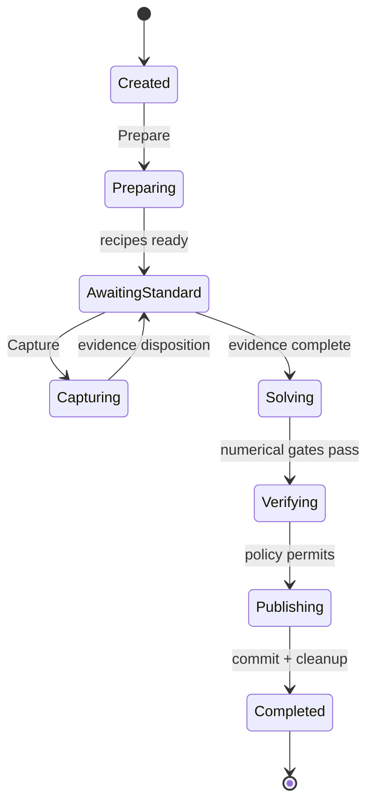

# 详细设计 04C：校准工作流

本篇定义 CalibrationWorkspace、单次 Attempt、发布、恢复、Close 与隔离的字段级协议。校准数学与兼容判定仍由[数值处理详设](./02-数值处理与通道编译.md)负责。

> 上一篇：[保存、召回与运行切换](./04B-保存召回与运行切换.md) · [详细设计 04 导航](./04-应用事务校准与存储.md) · 下一篇：[持久化结果与恢复](./04D-持久化结果与恢复.md) · [返回文档索引](../README.md)

> 编号说明：本篇沿用全局第 9 章编号，包含 §9.4。

## 阅读入口

### 30 秒摘要

- `CalibrationWorkspace` 是一轮校准从建步骤、采标准件、求解、验证到发布的完整工作区；其中某一步失败，通常只结束本次命令，不会自动销毁整个工作区。
- `CalibrationAttempt` 是一次 Prepare、Capture、Solve、Verify、Publish 或自动 ECal 命令的执行记录。每次重试都创建新 Attempt，已经结束的 Attempt 永不复活。
- 正常主线只有五步：Prepare → Capture → Solve → Verify → Publish。发布结果一旦暂时无法确认，既不能假装失败，也不能无限占住原命令；预先建立的 Publish recovery 会完整接管同一发布请求并继续消歧。

### 正常主线

1. **Prepare：**冻结校准件、方法、端口和设备/通道条件，生成有界步骤清单，并明确当前要连接哪个标准件。
2. **Capture：**按步骤采集标准件数据；一次成功采集形成一份不可变 Evidence。若采集失败，不留下“半份 Evidence”。
3. **Solve：**冻结完整 Evidence 集合，求解误差项，输出尚未发布的 candidate 和诊断报告；数值门禁失败时保留诊断，但禁止发布部分系数。
4. **Verify：**用独立检查判断 candidate 是否满足发布策略，不能把求解所用数据回代后当成独立验证。
5. **Publish：**以唯一发布身份提交 CalSet；提交成功后由长期 CalSet 引用接管依赖，再释放工作区的临时资源。若提交结果未知，只查询或重放同一请求，或由既有 Publish recovery 接管。

### 先理解的词与前置阅读

| 词 | 本篇中的白话含义 |
| --- | --- |
| `CalibrationWorkspace` | 用户正在完成的一整轮校准工作，保存步骤、采集证据、待发布结果和资源责任；它可以跨越多次命令与重试 |
| `CalibrationAttempt` | 一次具体命令的执行记录；成功、失败或责任移交都会结束这一次记录，重试必须另开一次 |
| Evidence | 某个标准件步骤已经成功采集并被工作区接纳的不可变测量证据，不是临时采样缓冲区 |
| candidate | Solve 生成、Verify 检查、但尚未发布成 CalSet 的候选校准结果和报告 |
| Publish recovery | Publish 第一次访问 Repository 前就建立的持久恢复责任；结果未知时，它接管原请求、引用、预算和清理责任，继续确认到底提交还是未提交 |
| terminal / receipt / source-zero transfer | terminal 是某个生命周期已经结束；receipt 是稳定事实证明；source-zero transfer 表示原责任方已归零且唯一接收方已完整接管 |

建议按顺序补齐四项前置阅读：

1. [核心业务流程 §3](../架构设计/03-核心业务流程.md#3-校准)：先看用户从建步骤到发布 CalSet 的产品流程。
2. [D4A 阅读入口](./04A-应用会话与事务.md#阅读入口)：理解 Session、Attempt、Ticket、完成屏障和持久责任。
3. [资源与故障恢复 §2、§4–§6](../架构设计/05-资源与故障恢复.md#2-先理解三条可靠性规则)：理解资源上限、责任移交与启动恢复。
4. [D2 数值处理](./02-数值处理与通道编译.md)：查看校准求解、数值门禁与兼容判定。

### 本文不负责什么

本文不定义校准数学、兼容性算法、硬件采集和 Run 状态机，也不重复定义通用 Attempt journal、Result/CalSet Repository 的发布账本或文件格式。

这些内容由各自责任方定义：

- 数值规则由 [D2 §6.5](./02B-校准变换迹线与数值验证.md#65-校准数值核心vnacalibrationcore)负责；
- 硬件与运行由 [D1](./01-公共契约与硬件采集.md)和 [D3](./03-运行时触发与调度.md)负责；
- 通用应用事务由 [D4A 持久操作责任交接](./04A-应用会话与事务.md#持久操作的责任交接)负责；
- 持久化发布与退役由 [D4D §9.5.4](./04D-持久化结果与恢复.md#954-反向引用发布记录与物理回收)负责；
- 具体存储和厂商格式由 [D5A §10.3](./05A-外部适配器.md#103-文件和自动化)负责。

本篇只定义校准 Workspace、单次 Attempt、Evidence/candidate、发布恢复、Close/Recall 与隔离的字段级协议。

<a id="dd-app-calibration"></a>

## 9.4 校准工作流（`CalibrationWorkflow`）

### 9.4.1 校准工作区与单次尝试是两个生命周期（`Workspace` / `Attempt`）

先区分两个生命周期，否则一次失败的 ECal ticket 会与“还可继续修正的工作区”互相矛盾：

**CalibrationWorkspace/CalibrationSessionState（长生命周期）**

- 拥有步骤、标准角色、操作员确认、Evidence、candidate、pins 和预算。
- 只有 `Completed/Cancelled/Discarded` 发布 `CalibrationSessionTerminal`。
- `FailedRetained/Invalidated/DetachedRetained` 都不是 Session terminal，仍可显式修正、恢复或丢弃。

**CalibrationAttempt（单次命令生命周期）**

- 每次 Prepare、Capture、Solve、Verify、Publish 或自动 ECal 命令都创建新的 `CalibrationAttemptIdentity{CalibrationAttemptId, CalibrationRetirableLocator}`，冻结 workspace revision 与 exact inputs。
- 每次恰有一个 `CalibrationAttemptTerminal{Succeeded, FailedRetained, Invalidated, Cancelled, OutcomeUnknownTransferred, TransferredByClose, NotStartedPredecessorFailed}`。
- 失败或责任转移都完成本次 Ticket；重试必须使用新 identity，旧 terminal 永不复活。

每个 attempt 在首个外部副作用前都必须建立 [D4A 持久操作责任交接定义的 CalibrationAttemptJournal](./04A-应用会话与事务.md#持久操作的责任交接)。该 journal 的 `kind + CalibrationAttemptAttachmentRevision` 是 Prepare/Capture/Solve/Verify/Publish 五类 attempt 共用的 Recall/Close first-wins 边界；Capture 的 Run/Result 到 Evidence owner transfer 以 [D4A 持久操作责任交接](./04A-应用会话与事务.md#持久操作的责任交接)的 receipt 为唯一协议，Publish 再叠加本节后文的独立 publication recovery。

自动 ECal 和机械校准复用同一 Workspace/Solver/Repository 边界，仅步骤提供者不同。自动 ECal 是在对外可见前已 `CompositePlanSealed` 的 bounded attempt chain：预建 Prepare、每个标准 Capture、Solve、Verify、Publish slots；任一步失败都终结自己的 attempt并把未开始 slots写 `NotStartedPredecessorFailed`，父 fence完成，不等待用户未来修正。

#### ECal 解禁前必须有独立的物理资源合同

上述只说明 ECal 可以复用工作流骨架，不表示“换一个 step provider”就已支持真实电子校准件。ECal 用例进入实施范围前，Driver/Hardware profile 必须能冻结并验证：

```text
ECalModuleDescriptor
  ProviderId + ModuleIdentityFingerprint
  model + serial + firmware + health snapshot
  connector/port topology + supported frequency/power/environment ranges
  exact CharacterizationRef + CharacterizationContentHash

ECalPortAssignment
  ordered module-port to analyzer-port/connector mapping
  orientation + adapter/reference-plane descriptors

ECalResourceLease
  module identity + HostGeneration + exclusive owner attempt
  lease revision + abort/close capability + retirement receipt
```

- Prepare attempt 在首次切换电子标准状态前，必须已取得与本次 Attempt 绑定的独占 `ECalResourceLease`；不能只在 UI 里记一个模块名。
- Characterization、端口方向、转接器与参考面都进入 exact calibration contract 和 provenance；任一变化都使旧 Evidence 失效。
- 模块断开、健康异常或 Characterization 不可验证时，已采集 Evidence 按明确原因进入 `Invalidated/FailedRetained`，绝不会退化为未校准数据继续发布。
- Close/Recall/崩溃只能按 exact lease identity 释放或隔离；资源责任未 source-zero 前，Attempt 不得报告 cleanup 完成。

当前切片没有 ECal 的真机 capability transcript、characterization 格式和故障注入证据，因而上述只是未来解禁门槛；对外 ECal 命令仍必须稳定返回 `UnsupportedPendingProfileEvidence`，不能用模拟 provider 通过代替真机验收。

### 9.4.2 校准工作区状态机与重试（`Workspace`）



上图只画正常主干，避免把例外线挤在一起。下面三张表只是把同一份协议按阅读场景拆开；三者合起来才是 **Workspace 唯一权威状态转移表**。实现、UI 和 SCPI 不得在表外自行增加“回到上一步”或复活 terminal。

#### 正常阶段

按 Prepare → Capture → Solve → Verify → Publish 阅读；Capture 可按标准件步骤重复，直到 required Evidence 完整。

| 源 WorkspaceState | 事件/守卫 | 目标 WorkspaceState | 必须同时完成 |
| --- | --- | --- | --- |
| `Created` | Prepare attempt 接纳 | `Preparing` | 冻结 kit/method/ports/device/channel contract |
| `Preparing` | recipe 成功 | `AwaitingStandard` | 发布有界步骤清单和当前 standard role |
| `AwaitingStandard` | Capture attempt 接纳 | `Capturing` | 绑定精确 step/Prepared/Run identities |
| `Capturing` | Evidence 接纳，或未改变 contract 的 Capture 失败 | `AwaitingStandard` | 成功时原子替换该 role Evidence；失败时不留部分 Evidence |
| `AwaitingStandard` | 全部 required Evidence 完整且 Solve 接纳 | `Solving` | 冻结 ordered Evidence refs/hash |
| `Solving` | 硬数值门禁通过 | `Verifying` | 发布不可变 candidate/report |
| `Verifying` | Policy 允许发布 | `Publishing` | 冻结 verification outcome 和 publication exact request |
| `Publishing` | PublicationReceipt 已 committed 且 cleanup fence 齐全 | `Completed` | 长期 outgoing pins 接管依赖，释放 workspace/candidate 临时资源 |

#### 失败与显式重试

失败只结束当前 Attempt；Workspace 是否保留、失效或已经成为不可再进入的 Session terminal，以本表为准。

| 源 WorkspaceState | 事件/守卫 | 目标 WorkspaceState | 必须同时完成 |
| --- | --- | --- | --- |
| `Preparing` | 已知失败 | `FailedRetained` | 写 Prepare AttemptTerminal/report；无部分 recipe 可运行 |
| `Solving` | incomplete/non-finite/rcond/backward-error 失败 | `FailedRetained` | 保留诊断，禁止发布部分系数 |
| `Verifying` | Required Check 缺失/失败 | `FailedRetained` | 保留 candidate/report，不用 SOL 回代自证 |
| `Publishing` | Repository 已知 NoCommit/VersionConflict | `FailedRetained` | 终结旧 attempt；重试分配新 attempt/publication identity |
| `Preparing/AwaitingStandard/Capturing/Solving/Verifying/FailedRetained` | exact kit/device/channel contract 变化 | `Invalidated` | active attempt 若存在则写 `Invalidated`；列出不可复用 Evidence |
| `FailedRetained` | 显式 Retry | `Preparing` | 新 CalibrationAttemptIdentity；旧 terminal 不复活 |
| `Invalidated` | 显式 Rebase 成功 | `Preparing` | 发布新 exact contract，释放不兼容 Evidence/pins，创建新 attempt |
| `Completed/Cancelled/Discarded` | 任意 workspace 命令 | 无转移 | 稳定返回 terminal；任何续跑都必须新建 CalibrationSessionId |

#### 会话关闭、设置召回与恢复（`Close` / `Recall`）

本表集中说明结果未知、责任移交、恢复、取消和丢弃；这些路径不会创造第二套 Workspace 状态机。

| 源 WorkspaceState | 事件/守卫 | 目标 WorkspaceState | 必须同时完成 |
| --- | --- | --- | --- |
| `Publishing/AttemptAttached` | transport/ACK unknown，且未到 resolution deadline | `Publishing/AttemptAttached` | attempt=`DecisionUnknown`；只查询/重放原 exact request，禁止 Cancel/Discard terminal |
| `Publishing/AttemptAttached` | resolution deadline 到期且仍 unknown | `Publishing/DetachedResolution{CalibrationPublicationRecoveryIdentity}` | 原子把 publication claim、pins、预算、cleanup 与 delivery 责任转给既有 recovery record，写 source-zero receipt；attempt=`OutcomeUnknownTransferred` 并完成自己的 fence/Ticket |
| `Publishing/DetachedResolution` | 独立 resolution terminal=`Committed` | `Completed` | 以原 PublicationReceipt 补长期 pins和cleanup；不得改写旧 attempt terminal |
| `Publishing/DetachedResolution` | 独立 resolution terminal=`NoCommit/Conflict` | `FailedRetained` | 释放或转移 recovery 资源；未来重试必须新建 attempt/publication identity |
| 任一非 terminal | Session Close + `DetachRetained` | `DetachedRetained` | 把 workspace/pins/budget/publication responsibility 原子转给 durable detached owner；active attempt 只可 `TransferredByClose` |
| `DetachedRetained` | ResumeToken 单次消费，exact contract 仍匹配 | `FailedRetained` | 转给新 Session/OwnerEpoch，后续用新 attempt 续跑 |
| `DetachedRetained` | Resume 需 rebase | `Invalidated` | 转给新 owner，但不复用未验证 Evidence |
| 任一非 terminal，且 publication 已证明 no-commit | `CancelCalibrationSession` | `Cancelled` | Stop/Abort active work；释放全部 Evidence/candidate/pins，terminal 只保留有界 `CancelledAuditSummary{step/evidence/candidate hashes, reason}` |
| 任一非 terminal，且 publication 已证明 no-commit | `DiscardCalibrationSession` / Close `DiscardUnpublished` | `Discarded` | Stop/Abort active work；释放全部未发布 Evidence/candidate/pins，只留 terminal digest |

`Cancelled` 与 `Discarded` 因而不可互换：两者都释放全部未发布 payload/pins；Cancelled terminal 额外保留有字节上限的 step/evidence/candidate hash 审计摘要，Discarded 只保留原因和 terminal digest。摘要不引用 Evidence/CalSet、不建 pin，随 CalibrationSession terminal ledger 的固定 retry window/watermark 一起 compact，不会新建永久 owner。两者都不修改已发布 CalSet。

Publish decision unknown 时，Cancel/Discard 请求不能把未知副作用伪装成 no-commit：deadline 前等待原 identity 消歧，deadline 后旧 attempt 已 `OutcomeUnknownTransferred`，但 Workspace 仍在 `Publishing/DetachedResolution`；committed 必须进 `Completed`，确认 no-commit 并回到 `FailedRetained` 后才可进入目标 terminal。

`DetachedResolution` 是 Publishing 的责任归属 tag，不是可绕过本表的新 WorkspaceState。

#### 单次尝试与工作区的最终状态对照（不是第二状态机）

下面只回答“某类 Attempt 怎样结束，以及结束时 Workspace 在哪里”。它不是另一张状态转移表，也不允许从 Attempt terminal 反推或新增 Workspace 转移；Workspace 的唯一状态机仍是上面三张表。每条命令先登记 attempt 及 OperationCompletionFence，随后才允许改变 workspace：

| attempt | AttemptTerminal / Workspace | 下一步 |
| --- | --- | --- |
| Prepare | `FailedRetained` / FailedRetained | 修改设置后创建新 Prepare attempt；不得复用旧 ticket |
| Capture | sample/Run/Evidence 失败 / AwaitingStandard；contract 已变则 `Invalidated` / Invalidated | 新建 Capture attempt，或 rebase 后新建attempt；失败 Run 不复活 |
| Solve | incomplete/non-finite/rcond/backward gate失败 / FailedRetained | 保留 report；修模型/重采后创建新 Solve attempt，禁止发布部分系数 |
| Verify | Required Check缺失/失败 / FailedRetained | 新采独立 Check；不能用 SOL 回代自证 |
| Publish transport/ACK unknown | deadline前本 attempt=DecisionUnknown；deadline后 attempt=`OutcomeUnknownTransferred`，Workspace=`Publishing/DetachedResolution` | 只用原完整PublicationOperationIdentity、canonical semantic request与两个hash查询/重放；旧attempt Ticket在source-zero transfer后完成，后续结果写独立resolution terminal |
| Publish `VersionConflict` | 旧 Publish attempt=`FailedRetained` / FailedRetained | 显式refresh/rebase expected revision，分配**新**CalibrationAttemptIdentity和PublicationOperationIdentity |
| Rebase | 旧 active attempt 若存在则 `Invalidated` / Preparing | 丢弃不兼容 Evidence并以新 attempt 重新冻结 contract |
| Cancel workspace | 未 terminal active attempt→`Cancelled` / Cancelled | 独立 Session-cleanup operation 写有界 audit summary，再释放全部 workspace payload/pins；已 terminal attempt 不改 |
| Discard workspace | 未 terminal active attempt→`Cancelled` / Discarded | 独立 Session-cleanup operation 释放全部未发布 payload/pins；已 terminal attempt 不改 |

重试必须明确是“重采当前标准”“替换某份 Evidence”“重新基于新 Channel/Device revision 编译”还是“查询同一 publication request”；设备或路径改变后不得自动复用旧 Evidence。FailedRetained/Invalidated 继续占用有界 CalibrationWorkspace 配额；Cancelled/Discarded 在全量 release receipt 后释放，Completed 在 publication cleanup 后释放。任何失败、取消、丢弃或失效都不修改已有 CalSet revision。

<a id="dd-calibration-recall-fence"></a>

#### 召回期间按校准尝试类型收口

Recall 不是只中断 Capture。Prepare、Capture、Solve、Verify 和 Publish 的 admission 都必须在登记 attempt 时检查 `RecallGate=absent`，并以 expected `CalibrationAttemptAttachmentRevision` 写入 `AttemptAttached`。之后每个可见 Workspace CAS、Evidence install 或 Repository 首次请求前，还必须在同一 Application 单写域中验证 attachment 仍为该 attempt 且没有 `RecallFence/CloseFence`。

任何会改变 Workspace 的 CAS 都要同时推进 attachment revision；因而 Workspace CAS 与 `AttemptAttached → RecallFenced{RecallOperationIdentity, old SessionGeneration}` 只能一个先胜：

- Workspace CAS 先胜时，Recall 看到 revision 冲突，重新冻结 Workspace 与 active-attempt 清单；
- RecallFence 先胜时，旧 attempt 不得再发起新外部副作用或改动 Workspace，只能完成下表的 kind-specific disposition。

Recall 成功建立围栏后，每个 attempt kind 有且只有下列可满足的 completion disposition：

| Attempt kind | 围栏后的唯一合法收口 | Attempt source 归零证明 |
| --- | --- | --- |
| Prepare | 首次外部调用尚未发生时写 `PrepareNoSideEffectReceipt`；已生成未发布 recipe/resource candidate 时停止计算，释放或转入有界 retained owner | `PrepareCandidateCleanupReceipt{Released\|Transferred, sourceResponsibility=0}`，或 no-side-effect receipt + 预留槽全部 `Unused` |
| Capture | Stop/排空已接纳 Run/ResultCommit；Evidence install 先胜则记 `EvidenceInstalledBeforeRecallFence`，围栏先胜则禁止 install，把 candidate 释放或转 Historical/detached owner | [D4A 持久操作责任交接](./04A-应用会话与事务.md#持久操作的责任交接)定义的 `CalibrationEvidenceInstalledReceipt`，或 `CaptureNoEvidenceDispositionReceipt{Released\|Transferred, sourceResponsibility=0}` |
| Solve | 停止或等待纯计算结束，不得发布 candidate；未发布 candidate/report 释放或转有界 retained owner | `SolveCandidateCleanupReceipt{NoCandidate\|Released\|Transferred, sourceResponsibility=0}` |
| Verify | 不得推进 verification outcome 或进入 Publish；已生成的 check/validation report 释放或转有界 retained owner | `VerifyValidationCleanupReceipt{NoValidation\|Released\|Transferred, sourceResponsibility=0}` |
| Publish | 未调 Repository 时写 `PublishNoRequestReceipt`；已知 Committed/NoCommit 时按原 decision cleanup；decision unknown 必须把 candidate/pins/bytes/cleanup 及 delivery 责任 source-zero 转给首次请求前已建立的 `CalibrationPublicationRecoveryRecord` | 已知 decision 的 publication/cleanup receipt，或 `PublicationResponsibilityTransferredReceipt{sourceAttemptOwnerCount=0}`；禁止 Recall 临时创建第二个恢复责任方 |

Prepare/Solve/Verify 的 `Transferred` 都必须指向已 durable 且有硬上限的 detached/quarantine record，并包含 target=1/source=0 receipt；一条日志指针、超时或 ACK 不是责任转移。未发布的 Prepare/Solve/Verify 计算结果不是 Evidence，不得用 `no-evidence` 统一充当这三类 cleanup receipt。

kind-specific disposition durable、attempt owner ledger 归零后，未成功的 Prepare/Capture/Solve/Verify attempt 写 `Invalidated{reason=RecallFence}` terminal 并完成 Ticket/Fence；已在围栏前完成的 Workspace CAS 保持原 terminal。Publish unknown 仅在 source-zero receipt durable 后写 `OutcomeUnknownTransferred`，独立 recovery terminal 永不回写旧 AttemptTerminal。

startup 在开放校准或 Recall admission 前，以 `kind + attachment revision` 枚举全部 `RecallFenced` attempt：先查询已经线性化的 Workspace/publication receipt，再只补同一 kind 的 disposition。不得把 Prepare/Solve/Verify 按 Capture 的 Evidence 空值收口，也不得为 Publish unknown 新建 recovery identity。

Close 与 Recall 在同一 attachment revision first-wins。CloseFence 先胜时 Recall Gating 失败并只读 Close transfer receipt；RecallFence 先胜时，Close 只能接管该 Recall transition 及其已选定的 kind-specific cleanup target，不得重新选择 disposition 或重复移动资源。

### 9.4.3 发布决定与责任转移

首次调用 CalSetRepository 之前，Publish attempt 必须无条件 fsync：

```text
CalibrationPublicationRecoveryRecord
  CalibrationPublicationRecoveryIdentity
  CalibrationAttemptIdentity + PublicationOperationIdentity
  CalibrationSessionId + workspaceRevision
  ClientProcessInstanceId + OwnerEpoch
  candidateContentHash + expectedRepositoryRevision
  canonical semantic request envelope
  semanticRequestHash + fullOperationEnvelopeHash
  candidate/evidence refs + recovery pins
  reserved record/bytes + publicationResolutionDeadline
  requesterClaimant = self
  attemptAttachment
  state = PreparedToSend
```

第一次Repository请求就声明`callerKind=CalibrationPublicationRecovery`和`currentRequesterOrRecoveryClaim=CalibrationPublicationRecoveryIdentity`，不允许先由Session/attempt持远端claim。发送后record只推进`DecisionUnknown/Committed/VersionConflict/Quarantined/CleanupDone`。

三种identity正交：CalibrationAttemptIdentity标识用户工作流attempt/Ticket，CalibrationPublicationRecoveryIdentity标识caller-side recovery record/retirement，PublicationOperationIdentity只标识Repository publication/receipt/retirement。建立record、pins或预留失败就不调用Repository。这个规则适用于普通进程崩溃，不以执行Close为前提。

`DecisionUnknown` 不能靠无限查询维持 attempt 活性。record 在首次发送前同时冻结最坏 transfer/cleanup slot；deadline 仍 unknown 时，Application 对本地 `CalibrationAttemptAttachmentRevision` 做一次 first-wins durable CAS：`AttemptAttached{CalibrationAttemptIdentity} → RecoveryDetached{CalibrationPublicationRecoveryIdentity}`。

同一事务验证record中首次请求的durable requester声明就是该RecoveryIdentity；若Repository已经留下claim receipt，其identity也必须匹配，但远端尚未建claim或完全不可达不阻塞本地CAS。

事务把仍属 attempt 的 candidate/Evidence观察refs、pins、records/bytes、cleanup 和 terminal-delivery子责任移入已存在且自包含的 recovery record，清空源清单，并写 `PublicationResponsibilityTransferredReceipt{source attempt, target recovery, sourceAttemptOwnerCount=0, targetPayloadDigest, optional repositoryRequesterClaimRevision}`。它不调用Repository；

只有这张 receipt durable 后才能发布 `OutcomeUnknownTransferred{RecoveryIdentity}` AttemptTerminal、完成 OperationCompletionFence 和 Ticket/WAI，CAS 失败者只读取胜者 receipt。此路径不要求 Session Close，也不创建第二个 publication executor。

之后只有 `CalibrationPublicationRecoveryOwner` 持 `OutcomeResolutionClaim`，并按原完整 identity/request 消歧。

它写独立且不可改写的 `CalibrationPublicationResolutionTerminal{Committed{PublicationReceipt}|NoCommit|Conflict|Quarantined}`。Application 以该 terminal 和 expected Workspace revision，把 `Publishing/DetachedResolution` 推进 Completed 或 FailedRetained；旧 AttemptTerminal 永不改写。

Repository 永久不可达时，record 保留在有硬上限的 pool 并关闭新 Publish admission。旧 Ticket 已经完成，Workspace 仍可被 Session Close 按既有 detach 协议整体转移，因此 `*WAI` 和 Close 都不依赖远端恢复。

`Publishing → Completed`不是只改一个枚举值。CalSetRepository的publication线性化事务使用record中的完整PublicationOperationIdentity、semantic hash与可重算full-envelope hash，原子写入immutable CalSet、稳定`PublicationReceipt{PublicationOperationIdentity,...}`和CalSet对Kit/Standard/CertificateModel/Evidence等exact refs的durable outgoing pins；

这里的 `Evidence` 不能含糊地解释为“永远 pin 全部标准件大数组”。发布前必须冻结一种校准证据保留策略：

```text
CalibrationEvidenceRetentionPolicy
  CompactAfterPublish
  | RetainFullForAudit{maximumArtifacts, maximumBytes, maxAge, legalHoldPolicy}

CalibrationEvidenceSummaryArtifact
  method + ordered standard/check roles
  exact capture evidence content hashes
  actual Axis/NumericSchema/condition-signature hashes
  Kit/Standard/CertificateModel exact refs
  per-role quality/completeness disposition
  solver/verification algorithm and threshold revisions
  solution/diagnostic digest + publication identity
```

`CompactAfterPublish` 是 V1 默认：同一 publication 事务创建不可变 Summary，CalSet 只对 Summary 与 Kit/Standard/CertificateModel 建长期 outgoing pins；`PublicationReceipt` 稳定后，workspace 才按原 Evidence identity 逐项释放完整 Capture Evidence pins。摘要用于来源审计，不承诺脱离完整 Evidence 重新求解。

`RetainFullForAudit` 只有在首次 Capture 前已经按最坏 `K × payload/index/pin/protected-bytes` 通过容量检查时才可选；发布后的 CalSet 同时 pin Summary 和 exact full Evidence，并由显式 retention/legal-hold 规则回收。容量不足必须在采集硬件前拒绝，不能在发布时静默降级到 Compact，也不能无上限永久保护。

相同完整identity/request的ACK丢失重放同一receipt，不重复建pin，同identity异request失败关闭。

Workflow取得或查询到receipt后，以原CalibrationAttemptIdentity执行terminal cleanup：先确认 Summary 及策略要求的长期依赖均已由CalSet pins接管，再幂等释放workspace/candidate transient pins、默认策略下的 full Evidence pins、Run/Evidence operation pins与CalibrationWorkspace/Candidate字节预算，写AttemptTerminal与`CalibrationSessionTerminal=Completed`，最后完成各自OperationCompletionFence。

cleanup ledger损坏时，必须先建立下述`CalibrationQuarantineRecord`，把唯一责任、稳定PublicationReceipt、publication requester claim及全部未释放资源原子移交并取得receipt，才允许caller recovery/attempt退出；这会关闭新的校准admission，但不回滚或隐藏已发布CalSet。

### 9.4.4 会话关闭、启动恢复与隔离（`Close`）

InstrumentSession Close 不得默默销毁或遗忘 FailedRetained/Invalidated。

默认 `DetachRetained` 在排空活动 Capture Run 后，以独立 `CalibrationDetachOperationIdentity` 原子写：

`DetachedCalibrationWorkspaceRecord{DetachedWorkspaceIdentity + CalibrationRetirableLocator, CalibrationSessionId, workflowRevision, exact kit/device/channel contract, evidence/candidate refs, pin ledger, budget, one-time ResumeToken identity, optional PublicationRecoveryRecordRef}`。

同一操作把 transient pins/预算及未决 publication record 从 Session owner 转给有硬上限的 `DetachedCalibrationWorkspaceOwner`。

Close只转 owner，不临时补造 publication envelope。只有 `Accepted/Running/DecisionUnknown` 的 active attempt才可在与deadline路径共享的`CalibrationAttemptAttachmentRevision`上做first-wins CAS，写唯一 `TransferredByClose{DetachedPublicationResolutionIdentity?}` terminal并在source-zero transfer receipt后完成自己的 fence。Prepare/Capture/Solve/Verify 转移各自的 recipe/Evidence/candidate/validation 责任；Publish unknown 只能使用首次请求前已 durable 的 CalibrationPublicationRecoveryRecord。

若 RecallFence 已先胜，Close 不得再在 attempt 上写 CloseFence；它只接管 RecallTransition 及已选定的 kind-specific disposition target。若 CloseFence 先胜，Recall Gating 只读 Close receipt 并稳定失败。

deadline先胜则Close只读取`OutcomeUnknownTransferred`及其recovery ref并转Workspace责任，Close先胜则deadline路径只读取`TransferredByClose`，两者绝不重复move。最后一个 attempt若早已 FailedRetained/Invalidated/Cancelled则绝不改写，无 active attempt时只由 detach operation/receipt承担转移。workspace进入 DetachedRetained但不发布 CalibrationSessionTerminal。

只有 caller显式选择 `DiscardUnpublished` 才等价于一次有审计记录的 Discard。

新Session只有以ResumeToken做单次CAS，把detached owner转给明确successor Session/OwnerEpoch并取得`TransferredToResumedOwner` receipt，且通过exact contract/rebase校验后才能接管；双重resume、resume×Close只有一个胜者。

进程启动在任何calibration/Recall admission与物理回收前扫描**全部**CalibrationAttempt journal、CalibrationPublicationRecoveryRecord、DetachedWorkspaceRecord和CalibrationQuarantineRecord，而非只扫执行过Close的记录。对 `RecallFenced` journal，先按 attachment revision 查询 Workspace CAS/fence 的 first-wins receipt，再依 kind 恢复 Prepare no-side-effect/candidate cleanup、Capture Evidence/no-install、Solve candidate cleanup、Verify validation cleanup或 Publish publication transfer；不得用统一 no-evidence 结论跳过某类 owner ledger。

未到deadline的DecisionUnknown按原完整PublicationOperationIdentity、semantic hash与可重算full-envelope hash查询；

到deadline则先补上述source-zero transfer与`OutcomeUnknownTransferred`，再只由RecoveryOwner消歧。已提交则重读同一PublicationReceipt并完成cleanup，确认未提交才写独立NoCommit resolution并回到FailedRetained，异identity/request冲突先建立`kind=PublicationConflict`的quarantine record；任何分支都不重复发布或丢candidate。

若原Publish attempt已经`OutcomeUnknownTransferred/TransferredByClose`，后续只写新的Calibration/Detached PublicationResolutionTerminal并据此推进workspace/CalibrationSession，绝不改旧AttemptTerminal。

`CalibrationQuarantineRecord` 是唯一 `CalibrationQuarantineOwner` 的自包含账：

```text
CalibrationQuarantineRecord
  CalibrationQuarantineIdentity
  kind = CloseDisposition | CleanupFailure | PublicationConflict
  source workspace/recovery/attempt identities
  exact kit/device/channel contract
  Evidence/candidate refs
  optional PublicationOperationIdentity/PublicationReceipt/requester claim
  pin ledger + records/bytes budget
  optional ResumeToken
  source owner/revision + state + receipts
```

建立隔离记录并移交责任时，使用预留的 `slice` 和 CAS，把 pin、容量、工作区和发布责任从原责任方一次移出。若 [D4D §9.5.4 的 PublicationLedgerRecord](./04D-持久化结果与恢复.md#954-反向引用发布记录与物理回收) 已有 claim，还必须确认新的 `CalibrationQuarantineIdentity`，原 `DetachedWorkspace`、`CalibrationPublicationRecovery` 或 attempt 才能凭责任移交回执退役。

隔离处理只能明确进入以下一种结果：

- 移入普通 `DetachedWorkspace` 后继；
- `DiscardReleased`；
- `RetainedForensic`。

每条路径都先移交长期 pin 和未完成责任，再释放原资源。

达到 `CleanupDone`，且 requester、`ResumeToken`、publication claim 和资源回执齐全后，按 `CalibrationQuarantineRetirableLocator` 写入 `RetiredCalibrationQuarantineEpoch` 并压缩记录。若在 `CleanupDone` 后重启，只补做退役；超过查询窗口只返回 `CalibrationQuarantineExpired`。

detached、cleanup 和 quarantine 三类资源池都有记录数和字节数硬上限。容量耗尽时，拒绝新的 workspace、Evidence 或 candidate 准入。

既有 workspace 的 Close 只激活其预留的 `CalibrationCloseDispositionSlice`。因此，即使普通 detached pool 已满，也必须能建立隔离记录并取得稳定的责任移交回执；不能让 Close 没有最终状态，也不能假装数据已经释放。

### 9.4.5 退役与故障注入

Calibration attempt、调用方发布恢复、Repository publication、detached workspace 和 calibration quarantine 各有完整且互不复用的退役身份，绝不能用一个宽泛的 OR 条件一起删除：

- Attempt ledger：普通 terminal 还要该 attempt 的 Run/pin/budget cleanup 与 Ticket/requester ACK。它必须已取得 Repository 侧 PublicationRetiredReceipt，或把完整 publication 责任移交给仍可独立枚举的 CalibrationPublicationRecoveryRecord/owner，并取得 PublicationResponsibilityTransferredReceipt。

  `OutcomeUnknownTransferred/TransferredByClose` 同样只有在完整 resolution claim 或 PublicationRecoveryRecordRef 已 durable、source owner count 为零，且 transfer receipt 证明旧 attempt 不再持 payload 后，才能写 `RetiredCalibrationAttemptEpoch`。

- Caller recovery ledger：CalibrationPublicationRecoveryRecord 只有在 `CleanupDone` 已证明 committed/nocommit/conflict 的长期 pins 与 candidate 预算归属，并取得 Repository 侧 PublicationRetiredReceipt 后，才能退役。

  另一合法分支是：完整 exact envelope/pins/claim 已原子 move 到另一个 durable resolution record，PublicationLedgerRecord 确认新 requester，且所有旧 ref 已清除。此时才可按 CalibrationPublicationRecoveryRetirableLocator 写 `RetiredCalibrationPublicationRecoveryEpoch`。DecisionUnknown record 绝不只因 attempt terminal 而退役；窗口外完整 CalibrationPublicationRecoveryIdentity 只返回 RecoveryReceiptExpired。
- Repository publication ledger：只有[D4D §9.5.4 定义的 Repository 侧 PublicationLedgerRecord](./04D-持久化结果与恢复.md#954-反向引用发布记录与物理回收)按PublicationRetirableLocator写统一`RetiredPublicationEpoch`；caller-side任何记录都无权推进该watermark。窗口外完整PublicationOperationIdentity只ReceiptExpired，绝不能被CalibrationPublicationRecoveryIdentity替代。
- Detached workspace ledger：只有 workspace已Resumed/Completed/Cancelled/Discarded，或已取得指向自包含CalibrationQuarantineRecord的transfer receipt，ResumeToken有Consumed/Expired/Transferred receipt，所有pins/budget已transfer/release，且 `PublicationRecoveryRecordRef/resolution claim == none`，才能写 `RetiredDetachedCalibrationEpoch`。
- Calibration quarantine ledger：只有record达到CleanupDone、全部workspace/candidate/pin/budget/publication/ResumeToken责任已release或transfer且无live claim，才能写RetiredCalibrationQuarantineEpoch；源record terminal或compact绝不能替代此条件。

五类ledger窗口外按各自identity稳定返回对应Expired结果；旧ResumeToken按watermark稳定返回Consumed/Expired，不永久保留逐token tombstone。测试至少覆盖：失败attempt使 `*OPC/*WAI`完成、同workspace新attempt成功而旧ticket不变；FailedRetained且无active attempt时Close；

Prepare/Capture/Solve/Verify/Publish 五类 attempt 各自在 admission、首个副作用、Workspace CAS、RecallFence CAS、kind-specific disposition receipt、source-zero transfer、AttemptTerminal 和 fence release 两侧 kill/restart；每类缺少自己的 receipt 时 startup 都必须保持 admission 关闭；

Recall×Close×startup 在同一 attachment revision 只能有一个胜者，失败者只读已选 cleanup target/transfer receipt；Publish unknown 断言 source attempt=0、既有 PublicationRecovery=1、旧 Ticket 完成，且迟到 resolution 不越过 Recall 后 Workspace revision；

DecisionUnknown在deadline/source-zero CAS/AttemptTerminal/独立resolution/Workspace CAS每一边界kill，Repository永久不可达时旧Ticket仍完成且publication envelope可恢复；publish commit/ACK两侧直接kill与Close后kill；committed/not-committed/version/hash conflict；caller recovery与Repository publication按任意顺序retire/compact；

Close/cleanup/publication三种quarantine在record建立、owner/Publication claim transfer、source compact、resolve与quarantine compact各点kill；双resume、resume×Close；反复成功/取消/丢弃/失败/detach/quarantine后的pin、预算和五类durable record有界守恒。
