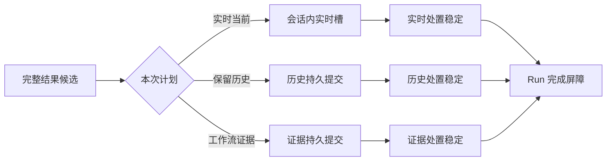
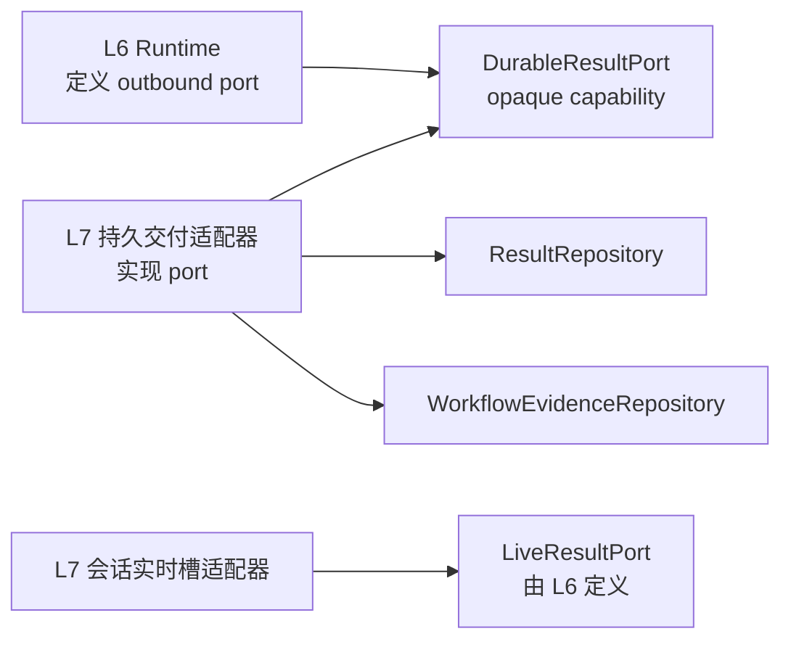
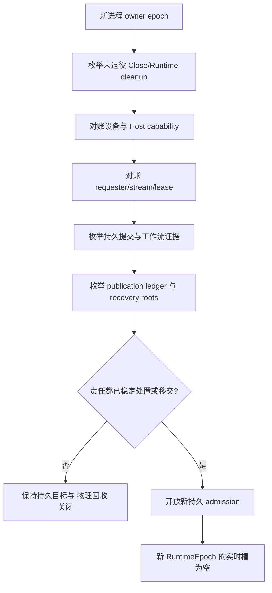
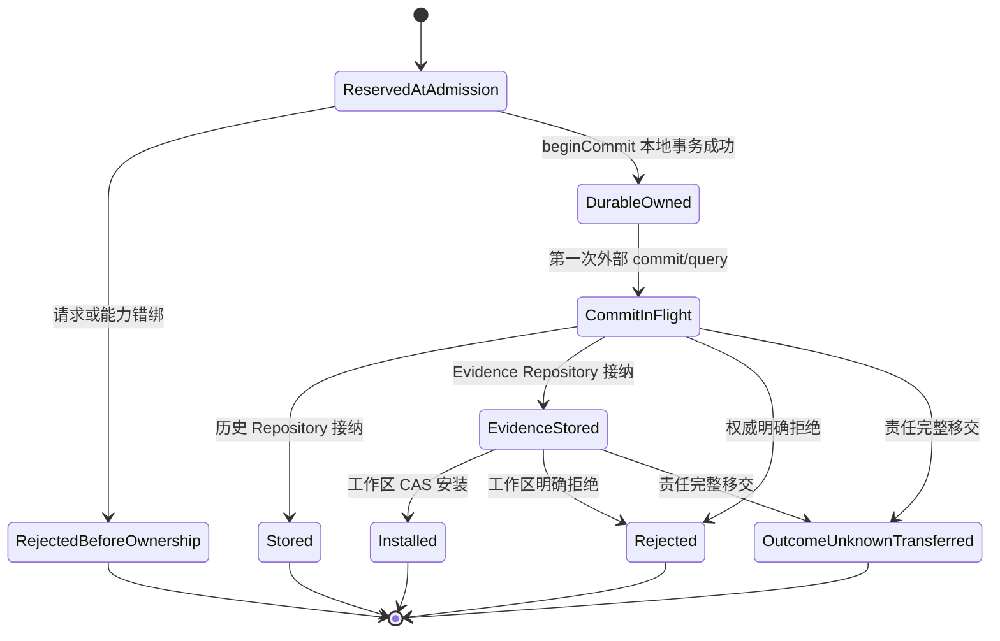
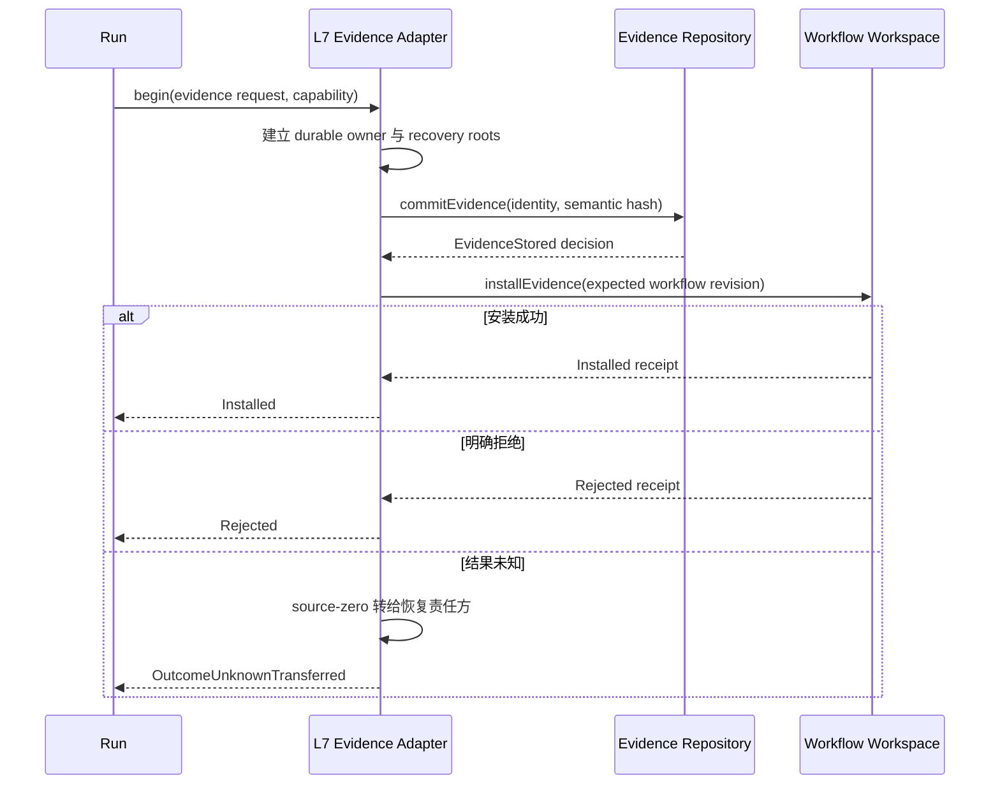
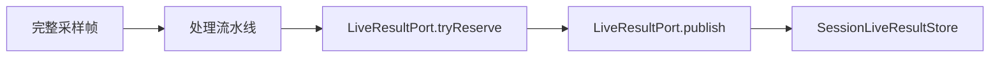

# 详细设计 04D：持久化结果与恢复

本篇只定义**需要跨进程保存**的测量交付：历史结果、工作流证据，以及产品明确要求可恢复的处理状态。会话内“实时当前结果”不属于本篇，唯一设计见 [D4B §9.3.4](./04B-保存召回与运行切换.md#934-会话内实时当前结果)。

> 上一篇：[校准工作流](./04C-校准工作流.md) · [详细设计 04 导航](./04-应用事务校准与存储.md) · 下一篇：[D5A 外部适配器](./05A-外部适配器.md) · [D5 专题导航](./05-适配器横切与验证.md) · [返回文档索引](../README.md)

> 编号说明：本篇沿用全局第 9 章编号，包含 §9.5–§9.6。

## 阅读入口

### 30 秒摘要

- 一次 Run 可以只更新实时当前、只保存历史、只提交工作流证据，也可以组合交付；三种交付的完成条件彼此独立。
- `Continuous + 仅实时当前` 的每个 sweep 只写会话内 latest-wins 槽，`DurableResultPort`、Repository 和 WAL 调用数必须为零。
- 只有历史或工作流证据被计划为目标时，L7 才签发持久交付能力；L6 通过自己定义的 outbound port 使用该能力，不依赖 L7 的 Repository 类型。
- 持久适配器在第一次外部副作用前建立恢复责任方。结果未知时，责任必须原子地从 Run 归零并转给该恢复责任方，不能靠超时假装失败。
- `ResultArtifact` 是不可变的已保存工件；`ResultLease` 只是有界使用责任。释放 lease 不等于删除工件。

### 三类交付先分开

| 交付 | 权威 owner | 是否跨进程 | 是否进入本篇 | Run 的稳定处置 |
| --- | --- | --- | --- | --- |
| 实时当前 | 会话内 `SessionLiveResultStore` | 否 | 否 | 已发布、被更新结果取代、被控制动作失效或明确冲突 |
| 保留历史 | `ResultRepository` | 是 | 是 | 已保存、明确拒绝或未知责任已移交 |
| 工作流证据 | 证据库与工作区单写事务 | 是 | 是 | 已安装、明确拒绝或未知责任已移交 |

“实时当前”不是“最近一条已保存历史”。重启后实时槽为空，应用不得扫描 Repository 的 latest 索引猜测当前结果。用户稍后执行“保存当前结果”时，那是新的 L7 应用事务：它从实时槽取得读租约，创建新的持久提交身份，再按本篇协议保存。

### 正常主线

1. [D3 §8.4](./03B-测量生命周期与完成.md#84-通道运行实例vnarunengine)在 Run admission 时冻结交付计划。仅持久目标申请持久能力和最坏恢复容量。
2. 数值处理完成后，实时目标交给 `LiveResultPort`；持久目标交给 `DurableResultPort`。两条路径没有先后依赖。
3. L7 持久适配器先原子建立本地提交 owner，再调用 Repository 或工作流存储。
4. 明确接纳、明确拒绝均形成稳定处置；无法确认时把完整责任移交给可枚举的恢复记录。
5. Run 只等待计划内交付各自达到稳定处置，不等待已经移交出去的后台恢复完成。



### 先理解的词

| 词 | 白话含义 |
| --- | --- |
| 持久交付能力 | L7 在准入时签发的不可伪造凭证，证明该 Run 已有身份、配额和恢复责任方 |
| 提交 owner | 当前唯一有权继续提交、查询结果或清理资源的一方 |
| Repository decision | 存储端对同一提交身份的稳定结论：接纳或拒绝 |
| 结果未知 | 调用已经可能产生副作用，但调用方暂时无法证明接纳还是拒绝 |
| source-zero transfer | 原责任方归零、目标恢复责任方完整接管在同一事务中成立 |
| recovery root | 未决提交为了防止候选、状态或依赖被回收而持有的稳定引用 |
| retirement | 关闭提交身份的公开重试窗口；之后只返回过期收据，不重做副作用 |

### 本文不负责什么

本文不计算测量数据，不调度 Run，不选择实时当前结果，也不规定 SQLite、JSON 或厂商文件格式。相关边界分别由下列文档定义：

- [D2A §6.1](./02A-统一数值契约与网络模型.md#61-统一处理阶段契约与显式状态stage)：数值候选的统一阶段契约；
- [D3 §8.4](./03B-测量生命周期与完成.md#84-通道运行实例vnarunengine)：交付 obligation 与完成屏障；
- [D4B §9.3.4](./04B-保存召回与运行切换.md#934-会话内实时当前结果)：会话内实时槽；
- [D5A §10.3](./05A-外部适配器.md#103-文件和自动化)：Repository 和 WAL adapter 的实现。

## 9.5 存储库

<a id="dd-app-result-retention"></a>

### 9.5.1 测量结果的有界保留

只有进入持久交付的结果才分配 `ResultArtifact` 与 `ResultLease`。实时槽中的 live buffer 不得为了复用 retention 机制而伪造 ResultArtifact、lease 或 recovery root。

创建 Session 时冻结：

```text
SessionResultRetentionPolicy
  latestPerOwnerCount
  historyCount
  historyBytes
  maxAge
  evictionBatchLimit
```

策略不含 `protectCurrent`。实时当前由 [D4B §9.3.4](./04B-保存召回与运行切换.md#934-会话内实时当前结果)的有界读租约保护；持久侧只保护以下精确引用：

- WorkingSet、LoadedRecallSet 或 Trace Memory 显式引用；
- 下游结果、校准证据或状态快照的 outgoing dependency；
- Session/Adapter 的 `ResultLease` 或 `ResultSublease`；
- legal hold、工作流安装记录、未决 recovery/forensic root。

保留执行器在同一 Repository snapshot 中读取 lease ledger、反向引用索引和 retention policy，以 expected revision 把 `SessionOwned → Released`，释放对应 pin 并写 eviction receipt。CAS 失败时保留对象并重新计算；不得先删 pin 再补收据。

Repository 的工件策略独立冻结：

```text
ResultArtifactRetentionPolicy
  perOwnerLatestCount
  historyCount
  historyBytes
  maxAge
  minimumAuditWindow
  markBatchLimit
```

标记过期不等于物理回收。Repository 物理回收（垃圾回收）必须在同一快照中重新证明全部 pin、lease、legal hold、recovery root 和 publication claim 均为零，并验证该工件种类自己的删除意图：ResultArtifact 需要已提交的 retention/eviction decision，CalSet 还需要精确目录墓碑，其他工件按各自 policy。竞态失败就保留。

持续扫描验收分两类：

- `Continuous + 仅实时当前`：运行 24 小时后 ResultArtifact、ResultLease、持久提交记录与 WAL 字节增量均为零；live buffer 和读租约保持在配置上限内。
- 显式保留历史或证据：artifact、lease、恢复记录和 publication ledger 均受独立硬配额约束；达到上限时拒绝新的持久目标，不得驱逐仍被引用的对象，也不得拖垮实时显示。

### 9.5.2 存储接口边界与工件分工（`Repository`）

- `CalDefinitionRepository`：Connector、Kit、Standard、CertificateModel 的不可变版本与精确引用。
- `CalSetRepository`：CalSet 不可变版本、目录 tombstone、反向引用和原子发布。
- `ResultRepository`：只保存“保留历史”目标形成的不可变 ResultArtifact，不承担实时 current 槽。
- `WorkflowEvidenceRepository`：保存校准、验证或自动化步骤要求的证据候选与稳定 decision；工作区安装仍由对应工作流的单写事务完成。
- `RecallSetRepository`：只保存不可变 RecallSetArtifact，不保存 live WorkingSet、实时结果或设备部署句柄。

ResultArtifact 的语义身份至少绑定：

```text
InstrumentSessionId + SessionGeneration
ResultOwnerKey + ResultCompatibilityFingerprint
ProcessingAccessPoint + NumericSchemaId
ResultCommitIdentity + ResultLineageHash + RunId
```

provenance 必须能重算输入 Frame、采集计划、部署版本、通道/处理版本、校准引用、上游 ResultRef 与状态快照。读取时 identity、schema、hash 或 lineage 任一不一致均按损坏处理，不能降级为“最近结果”。

普通 Repository CRUD 是 L7 应用能力；存储格式由 L8 实现。热路径依赖方向固定为：



L6 不导入 Repository、WAL、ResultArtifact 或工作区类型。L7 不能把持久 Repository adapter 塞进 `LiveResultPort`，也不能在 current-only Run 上偷偷创建持久记录。

### 9.5.3 会话崩溃恢复与启动屏障（`Session startup barrier`）

进程恢复只恢复**持久责任**，不恢复崩溃前线程，不把旧 Run 重新置为 Running，也不重建实时当前槽。



startup barrier 至少枚举：

- 未退役历史提交、证据提交和显式可恢复状态提交；
- 已有 Repository decision、但本地 ACK 或工作流安装 receipt 尚未完成的记录；
- Detached ResultLease、Adapter sublease、publication ledger；
- recovery/forensic root、反向引用 pin 与未完成 retirement；
- Session/Runtime cleanup 和设备能力移交记录。

每类记录都用完整 identity 和 expected owner revision 接管。已有最终执行状态的记录只能补 cleanup、requester ACK、retirement 与 compact，不得重做业务副作用。同一 scope 已存在未退役 journal 时，不得新建第二本。

若 durable authority 完整，恢复者继续同一身份的 query/replay；若 authority 损坏到无法证明唯一决定，则隔离记录并关闭新的持久 admission。只要 live buffer、设备和 Runtime 不依赖故障存储，就不得因 Repository 恢复阻塞 current-only Continuous。

Session 被恢复、放弃或关闭时，实时槽均按 [D4B §9.3.4](./04B-保存召回与运行切换.md#934-会话内实时当前结果)失效；不得从历史 latest 索引填回。未决历史/证据责任可移给独立恢复责任方，源 Session/Run 取得 source-zero receipt 后即可收口。

### 9.5.4 反向引用、发布记录与物理回收

`ReverseReferenceIndex` 是不可变工件回收的权威。键指向 exact `ArtifactId@Revision#Hash`，值记录 owner identity、owner revision 和 pin class。发布 CalSet、RecallSet、ResultArtifact、工作流 Evidence 或状态快照时，Repository 在同一原子事务中登记 outgoing durable pins。

引用域至少包括：

- WorkingSet、RecallSet、Trace Memory 和已保存历史之间的精确引用；
- CalSet 到 Connector、Kit、Standard、CertificateModel 的引用；
- ResultArtifact/Evidence 的输入 Frame、CalSet、上游结果、处理状态和定义版本；
- 未决持久提交对 candidate、request envelope、状态快照和 token ledger 的 recovery roots；
- 工作流 workspace/candidate 与 publication operation 的 pin；
- SessionOwned/Detached ResultLease 及 Adapter ResultSublease。

实时 current 槽及其 buffer 不登记 Repository pin。读者通过 [D4B §9.3.4](./04B-保存召回与运行切换.md#934-会话内实时当前结果)的有界 `LiveResultReadLease` 保护内存对象；会话、RuntimeEpoch 或控制版本失效时，槽和租约按内存规则释放。

Repository 写入顺序固定为：

1. 建立可枚举的 publication/commit owner 与 recovery roots；
2. 写候选内容或 prepared record；
3. 校验 content hash、semantic request、lineage 与 expected revision；
4. 原子发布 decision、索引和正式 outgoing pins；
5. 取得调用方 receipt 后释放 prepared roots；
6. requester、claim 和 recovery gate 归零后推进 retirement watermark，再 compact 大字段。

业务 journal 与 Repository publication ledger 的寿命正交。Save、Calibration 或 Run journal 已 compact，不能导致 Repository 遗失 replay identity；Repository ledger 已 terminal，也不能替业务 owner 伪造工作区安装完成。

校准数据集内容的物理回收由 `RepositoryGcCoordinator` 唯一拥有，内部动作名为 `CalSetRevisionGarbageCollection`。它不是 Application 用例：UI、SCPI、原生 API、Automation 都不能直接调用，也不创建 OperationTicket；公开删除入口只有 [D4E §9.1.4 `CatalogDeleteCalSet`](./04E-产品对象删除与后台处理.md#914-校准数据集的目录移除)。后台回收与其他物理回收一样，必须在一个 Repository snapshot 中证明：

```text
allCatalogRoutesForExactRevision == Tombstoned(CatalogTombstoneReceipt, TombstoneOrder)
&& noVisibleOrClosingCatalogEntryForExactRevision
&& durablePins == 0
&& transientPins == 0
&& resultLeasePins == 0
&& recoveryRootPins == 0
&& publicationClaims == 0
&& catalogAdmissionLineageDescendantClaims == 0
&& legalHold == false
&& retention == false
```

第一行要求精确匹配 [D4E 定义的同一 `CatalogTombstoneReceipt`](./04E-产品对象删除与后台处理.md#目录墓碑回执)；第二行要求该精确修订已不存在可见或正在关闭的目录路由。

后台回收另冻结当前 `GcLedgerSnapshot{RepositorySnapshotRevision, Catalog/BindingPermit/ReverseReference/Lineage/Token revisions}`，并遵守以下规则：

- 每个修订必须是墓碑回执中对应修订的可验证单调后继，当前快照中的保护引用、申领和来源链后继申领必须全部为零。
- 物理回收事务比较这组**当前修订**。墓碑后的正常解绑、保存或召回来源链释放可以推进账本，不能因它们不再等于墓碑时刻而永久阻塞。
- 修订回退、运行周期或代次改变却无迁移证明、ABA，或提交期间任一账本再次推进时，都必须保留内容并重读全量快照。
- 成功只产生存储库内部 `GarbageCollectionReceipt{ExactCalSetRef, CatalogTombstoneReceipt, TombstoneOrder, GcLedgerSnapshot, ContentHash}` 与审计事件，不生成业务终态。

后台回收无权改变 WorkingSet、Trace Memory、校准绑定或工作流状态，也无权把瞬时引用计数为零解释成用户删除意图。

最低正例必须覆盖 `CatalogRemoved → 旧 binding/RecallSet/lineage 继续有效 → Unbind/引用释放推进 ledger revisions → 当前引用归零 → GC CAS 成功`。负例覆盖使用墓碑旧快照直接回收、revision ABA/回退、当前 descendant claim 非零和 GC CAS 同时新建合法引用；这些情况均不得删除内容。

<a id="dd-result-persistence"></a>
<a id="dd-app-result-commit-canonical"></a>

### 9.5.5 持久交付的唯一提交与恢复协议

本节是历史结果、工作流证据和显式可恢复状态的字段级事实源。[D3 §8.4](./03B-测量生命周期与完成.md#84-通道运行实例vnarunengine)只拥有交付计划、outbound port 与 Run completion fence；[D5A §10.3](./05A-外部适配器.md#103-文件和自动化)只实现本节协议。

#### 交付计划不是三选一枚举

[D3 §8.4](./03B-测量生命周期与完成.md#84-通道运行实例vnarunengine)冻结两个正交维度：

```text
CurrentDelivery = Disabled | LatestWins
DurableDelivery = None | RetainHistory | WorkflowEvidence
```

V1 一个 Run 最多有一个 durable target。未来若需同时交付多个持久目标，应扩展为有界 target list，而不是把 current 与 persistence 重新揉成一个枚举。

组合交付没有分布式原子性：

- 实时 current 已发布后，持久提交失败不回滚用户已经看到的有效结果；
- 历史已保存后，较新的 current 把它取代也不删除历史；
- Evidence 已写入 Repository、但 workspace CAS 尚未安装时，不能报告工作流步骤成功；
- 恢复者完成旧历史或 Evidence 提交时，不更新新 RuntimeEpoch 的实时槽。

#### L6 持久交付出站端口与 L7 实现（`outbound port`）

接口在 L6 定义：

```text
DurableResultPort
  begin(request, opaqueCapability) -> BeginDisposition
  observe(commitIdentity) -> DurableDisposition
  transferUnknown(commitIdentity, transferTarget) -> TransferReceipt
```

`DurableResultRequest` 至少包含：

```text
DurableDeliveryKind
ResultCommitIdentity
RunId + ResultOwnerKey + ProcessingAccessPoint
candidateRef + CandidateContentHash
ResultCompatibilityFingerprint + NumericSchemaId
ResultLineage
optional WorkflowEvidenceTarget
```

L7 在 Run admission 时完成以下动作后，才签发 opaque `DurableDeliveryCapability`：

1. 冻结 durable kind、目标语义和最大候选字节；
2. 预留 commit record、candidate spool、冲突/未知移交、恢复责任方与 terminal receipt 容量；
3. 绑定 SessionGeneration、RuntimeEpoch、RunId、plan hash 和唯一提交 identity；
4. 验证 Repository/workflow policy 允许接纳。

L6 只校验 capability 与同一 Run/plan 的绑定，不解析 WAL locator、Repository revision 或工作区字段。L7 adapter 实现 port，并把 opaque capability 解析为本地 record 与 Repository 调用。

`DurableDelivery=None` 时不得签发 capability，[D3 §8.4](./03B-测量生命周期与完成.md#84-通道运行实例vnarunengine)不建立 durable obligation，也不得调用 `DurableResultPort`。这是 current-only Continuous “零 Repository/WAL”的结构保证，不是靠运行时 if 恰好绕过。

#### 提交开始前先建立本地责任方（`beginCommit`）



`beginCommit` 在同一本地 durable transaction 中：

- 写 commit record 与完整 semantic request hash；
- 把 issuer slot 从 `ReservedAtAdmission` 推进为 `Begun`；
- 登记 candidate、lineage、状态和 token 的 recovery roots；
- 把 Run 的 durable obligation 绑定为 `CommitInFlight`；
- 写 `LocalDurableOwnershipReceipt`。

只有 receipt 已 durable，adapter 才能第一次调用 Repository、工作流存储或远端 commit authority。若 capability、plan、identity、hash 或目标错绑，返回 `RejectedBeforeOwnership`，外部调用数为零，预留资源凭 unused receipt 释放。

Repository commit 以完整 `ResultCommitIdentity + semanticRequestHash` 幂等。相同 identity、相同语义重放同一 decision；相同 identity、任一语义字段不同进入冲突协议。

#### 历史结果的完成条件

| 处置 | 含义 | Run 是否可收口 |
| --- | --- | --- |
| `Stored` | ResultArtifact、索引、outgoing pins 与 ResultLease escrow 一次提交，receipt 已吸收 | 是 |
| `RejectedBeforeOwnership` | 没有 durable owner，也没有外部副作用 | 是 |
| `Rejected` | 权威明确未接纳，roots/token 已处置 | 是 |
| `OutcomeUnknownTransferred` | 源 Run 归零，独立恢复责任方完整接管 | 是 |
| `DurableOwned/CommitInFlight` | 仍由 Run owner 负责 | 否 |

`Stored` 不更新实时 current。是否同时更新 current，只由独立的 live obligation 决定。

#### 工作流证据的完成条件



`EvidenceStored` 只是中间态。只有 `Installed`、`Rejected` 或 `OutcomeUnknownTransferred` 才是稳定处置。恢复时若 Evidence 已保存而安装 ACK 丢失，必须用同一 identity 查询/重放 workspace CAS；不得新建 Evidence，也不得从 Repository 内容推测“已安装”。

#### 通道测量任务完成屏障（`Run`）

Run 为计划内每个输出建立一个 obligation：

- `CurrentDelivery=LatestWins`：等待 [D4B §9.3.4](./04B-保存召回与运行切换.md#934-会话内实时当前结果)返回 live 稳定处置；
- `DurableDelivery=RetainHistory`：等待历史稳定处置；
- `DurableDelivery=WorkflowEvidence`：等待证据稳定处置；
- 未计划的输出没有 obligation，也不预留资源。

```text
Run BusinessTerminal =
  采集终态
  && 全部计划内处理终态
  && 全部计划内交付 obligation 已稳定处置
  && 首错/Stop/Cancel 已锁存
```

资源清理与全局 retirement 可晚于 BusinessTerminal。`OutcomeUnknownTransferred` 只表示 Run 已无责任，不表示后台恢复已得出最终决定。Run 摘要分别报告 `currentDisposition` 与 `durableDisposition`，不能用一个“保存成功/失败”覆盖两者。

#### 连续扫描热路径

`Continuous + CurrentDelivery=LatestWins + DurableDelivery=None` 每个 sweep 只有：



该路径禁止出现 `DurableDeliveryCapability`、ResultCommitIdentity、ResultArtifact、ResultLease、durable record、WAL append/fsync，以及任何 Repository 调用。默认 Average/Hold 状态属于 RuntimeEpoch 内存单写状态，重启后按产品规则清空或重新起算。

#### 显式可恢复处理状态

| 类型 | 默认位置 | 崩溃语义 | 是否进入本篇 |
| --- | --- | --- | --- |
| 实时 Average/Hold | RuntimeEpoch 内存状态 | 重启清空或重新起算 | 否 |
| 工作流可恢复状态 | 持久 `StageStateHead` | 同一工作流 identity 恢复 | 是 |

显式可恢复状态通过 L6 定义、L7 实现的 `DurableStateContributionPort` 提交。每个 `StageStateKey` 按冻结 ordinal 单写；base、delta、next 与 head CAS 使用同一 commit decision。只推进状态、不产生结果时不得创建空 ResultArtifact。

若持久结果与状态变化要求原子可见，Repository decision 必须覆盖 result publish 与全部 state-head CAS；任一 key 未完成都不能报告 `Stored`。部署无法提供该原子边界时，capability admission 必须拒绝，不得用补偿事务冒充原子提交。

<a id="dd-result-commit-conflict-claim"></a>

#### 提交身份或令牌冲突

以下任一情况进入 conflict：同一 ResultCommitIdentity 对应不同 semantic hash；capability、Run、plan、candidate 或 owner token 错绑；两个来源声称拥有同一 move-only token；Repository decision 与本地 identity/lineage 不一致。

冲突处理必须：

1. 在预留容量内建立独立 claim；
2. 保存双方完整 identity、request digest、owner revision、candidate/root 和已观察 decision；
3. 原子把源责任与资源转给 claim，写 source-zero/target-one receipt；
4. 关闭该 scope 的新持久 admission，保留 forensic roots；
5. 只由 claim owner 查询、隔离或人工裁决。

claim 不得窃取另一 Run 的 token，不得释放不能证明归属的 root，也不得创建第二个 ResultArtifact。claim 建立失败时，原 Run 仍有责且不能 terminal。

#### 结果状态未知、会话关闭与恢复边界（`Close`）

超时、断线或进程退出不能把 `CommitInFlight` 直接改成失败。先用原 identity 查询；仍无法确认时，在一个本地事务中：

```text
创建/激活 DurableResultRecoveryRecord
移动完整 request、capability owner、candidate/state roots
移动 conflict/query/forensic 预留
写 sourceResponsibility=0
写 targetResponsibility=1
把 Run obligation 改为 OutcomeUnknownTransferred
```

任一字段、root、容量或 owner revision 无法完整转移时，事务不提交，Run 继续有责。Close 只能等待、重试或完成同一移交，不能丢弃记录。

恢复责任方只处理持久目标：历史查询/replay Repository decision；工作流证据先确认 Evidence decision，再查询/replay workspace 安装；显式可恢复状态补同一 decision 下的 state-head CAS。完成后写 terminal digest，释放 roots，等待 requester/claim 归零，推进唯一 retirement watermark，再 compact。窗口外完整 identity 只返回 `ReceiptExpired`，不得重新产生副作用。

## 9.6 应用层验证门禁

<a id="dd-app-validation"></a>
<a id="dd-app-validation-matrix"></a>

### 9.6.1 完整故障注入清单

在“动作前、durable 后但 ACK 前、source-zero 后、terminal 后但 retirement 前”逐点 kill/restart：

- beginCommit owner 建立；
- Repository/Evidence decision 与 ACK；
- ResultArtifact 索引、outgoing pins 与 lease escrow；
- EvidenceStored 到 workspace Installed；
- unknown transfer 与 conflict claim；
- 恢复责任方接管、query/replay；
- root/pin release、requester teardown；
- retirement watermark 与 compact；
- startup barrier 的逐类枚举和再次崩溃。

通用断言：

1. 一个 identity 最多产生一个权威 decision 和一个不可变工件；
2. 第一次外部副作用前一定存在 durable local owner；
3. source 与 target 责任守恒，绝不同时为零或同时为一；
4. 已有最终执行状态的恢复只补清理/退役，不重做副作用；
5. Repository latest、文件时间或内存缓存不能代替 identity query；
6. 恢复旧 durable target 永不更新新 RuntimeEpoch 的实时槽。

| Current | Durable | 期望 |
| --- | --- | --- |
| Disabled | None | 不产生结果交付调用 |
| LatestWins | None | live publish；Repository/WAL/ResultArtifact/ResultLease 全部为零 |
| Disabled | RetainHistory / WorkflowEvidence | 只走持久协议，不创建 live 槽 |
| LatestWins | RetainHistory / WorkflowEvidence | 两项分别处置，互不回滚 |

24 小时 current-only Continuous 压测还断言：durable port 调用数为零；WAL、record、artifact/lease 字节增量为零；live slot、buffer、reader lease 与通知队列不超过上限；慢读者只导致合流、超时或租约失效，不形成无界反压。

### 9.6.2 有状态测量结果的硬失败门禁

对每个“结果 + 可恢复状态”计划验证：

- 多个 StageStateKey 按固定顺序和 ordinal 单写；
- base/delta/next hash 错绑时外部提交数为零；
- decision 已 durable、state-head ACK 丢失后可幂等补齐；
- 任一 state-head 未达 decision 时不得返回 Stored；
- source-zero 移交包含全部 key、roots、token 和恢复容量；
- 仅实时 Average/Hold 不出现 durable state identity、WAL 或 Repository 调用。

缺少原子 commit coordinator 的部署必须在 admission 明确拒绝，不能运行后补偿。

### 9.6.3 仅提交处理状态阶段的硬失败门禁

Contributor-only 验证要求：

- 不分配 ResultCommitIdentity、ResultArtifact、ResultLease 或 live reservation；
- 只分配独立 StateContributionIdentity；
- 全部 ordered entry 与 head CAS 由同一 decision 覆盖；
- 明确拒绝时 state head 不推进；
- unknown transfer 后源 Run 无权重试或释放 roots；
- recovery、requester 归零和 retirement 后，identity/record/root 回到有界水位。

### 不可破坏的可靠性合同

1. **先 owner，后副作用**：没有 durable ownership receipt，不调用外部 commit/query。
2. **完整身份幂等**：相同 identity 只重放同一语义；不同语义必须冲突。
3. **责任守恒移交**：未知、冲突、Close 都必须 source-zero/target-one。
4. **最终执行状态、清理、退役分离**：terminal 不等于资源已释放，cleanup 不等于重试窗口已关闭。
5. **引用先建后发布**：可见工件出现前，内容、索引、outgoing pins 与 recovery 证据已原子成立。
6. **物理回收再核验**：每次回收都复核该工件的删除意图以及全部 pin、lease、hold、root 与 claim；只有 CalSet 额外要求精确 catalog tombstone 且无 Visible/Closing route，不能把目录条件误套给 ResultArtifact 等非目录工件。
7. **恢复不改产品语义**：恢复只完成原计划，不重写 delivery kind，不把历史猜成 current。
8. **实时与持久故障隔离**：存储背压只能拒绝新持久目标；具备独立预算的 current-only 热路径仍可运行。
