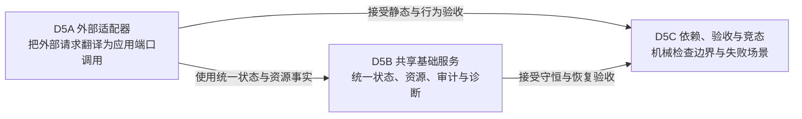

# 详细设计 05：适配器、共享基础服务与验证导航

本页只提供专题导航。协议和实现约束已经按职责拆到 [D5A](./05A-外部适配器.md)、[D5B](./05B-共享基础服务.md)、[D5C](./05C-依赖验收与竞态.md)，避免外部适配器、公共服务和验收规则挤在一篇长文里。

> [返回文档索引](../README.md) · 本页只做 D5 专题导航；连续阅读顺序是 [D4D](./04D-持久化结果与恢复.md) → [D5A](./05A-外部适配器.md) → [D5B](./05B-共享基础服务.md) → [D5C](./05C-依赖验收与竞态.md)。

## 30 秒摘要

D5 回答三类不同问题：外部请求怎样进入系统、多个功能共用的状态与资源怎样统一治理、架构约束怎样被机械验证。三类问题有关联，但责任不同，因此分别成篇。阅读协议入口时先看 [D5A](./05A-外部适配器.md)；定位资源或诊断所有者时看 [D5B](./05B-共享基础服务.md)；做合入与验收判断时看 [D5C](./05C-依赖验收与竞态.md)。

> **全局章节号说明**：详细设计共用连续章节号。本专题承接前文，从 §10 开始；拆篇后仍保留 §10、§11、§12，保证架构文档、评审记录和验收证据中的引用稳定。

## 阅读入口

| 你的问题 | 文档 | 核心内容 |
| --- | --- | --- |
| SCPI、UI、文件、自动化和数据服务怎样进入应用 | [D5A 外部适配器](./05A-外部适配器.md) | §10；协议翻译、顺序、副作用、断线与恢复 |
| 操作凭证、资源、审计、时钟和诊断由谁统一治理 | [D5B 共享基础服务](./05B-共享基础服务.md) | §11；共享事实、资源上限和诊断 |
| 哪些依赖、测试和并发条件不满足就必须阻断 | [D5C 依赖、验收与竞态](./05C-依赖验收与竞态.md) | §12；静态边界、自动门禁、验收范围登记和 P0 竞态 |
| 想从头连续阅读 | [从 D5A 开始](./05A-外部适配器.md) | [D5A](./05A-外部适配器.md) → [D5B](./05B-共享基础服务.md) → [D5C](./05C-依赖验收与竞态.md) |

## 三篇之间的关系

这张图表示依赖的检查关系，不新增生产代码层。[D5B](./05B-共享基础服务.md) 的共享基础服务不能绕过应用用例修改测量状态；[D5C](./05C-依赖验收与竞态.md) 是验证规则，不是运行时组件。

## 主要决策索引

| 主题 | 设计入口 | Decision ID | Evidence / GAP |
| --- | --- | --- | --- |
| SCPI 顺序、DCL、WAI/OPC 与状态 | [D5A §10.1](./05A-外部适配器.md#101-scpi) | `DEC-SCPI-ORDER-001`、`DEC-STATUS-001`、`DEC-SCPI-DCL-STATUS-001` | `EV-COM-SCPI-001`、`EV-COM-SCPI-DCL-BOUNDARY-001`、`EV-COM-STATUS-001`；`GAP-SCPI-INTERNAL-001`、`GAP-SCPI-DCL-STATUS-001` |
| File Import/Export、Save/Recall 外部边界 | [D5A §10.3](./05A-外部适配器.md#103-文件和自动化) | `DEC-PERSIST-001` | `EV-COM-PERSIST-001`；`GAP-PERSIST-RUNTIME-001` |
| Data API 访问点与结果类型 | [D5A §10.4](./05A-外部适配器.md#104-数据服务) | `DEC-DATA-ACCESS-001`、`DEC-NUM-SCHEMA-001` | `EV-COM-DATA-001`、`EV-COM-NUM-SCHEMA-001`、`EV-OSS-TYPE-001`；`GAP-DATA-ACCESS-INTERNAL-001`、`GAP-NUM-SCHEMA-INTERNAL-001` |
| 资源、背压与有界诊断 | [D5B §11.2](./05B-共享基础服务.md#112-资源账本resourceledger) | `DEC-RES-BOUND-001` | `EV-OSS-BOUND-001`、`EV-OSS-NANO-CAP-001`；`GAP-RES-INTERNAL-001` |
| 外部适配器、应用层与数值核心的依赖边界 | [D5C §12.1](./05C-依赖验收与竞态.md#121-静态边界) | `DEC-LAYER-PURECORE-001` | `EV-REV-FIXSIM-COUPLING-001`、`EV-REV-GRAPH-COUPLING-001`、`EV-OSS-COUPLING-001`；`GAP-LAYER-INTERNAL-001` |

## 推荐阅读顺序

1. 先读 [D5A 的 30 秒摘要与 Adapter 总表](./05A-外部适配器.md)，确认外部协议只做翻译。
2. 再读 [D5B 的资源账本](./05B-共享基础服务.md#112-资源账本resourceledger)，确认工作、资源和恢复责任有唯一所有者。
3. 最后读 [D5C 的架构验收门](./05C-依赖验收与竞态.md#123-架构验收门gate) 和 [P0 竞态矩阵](./05C-依赖验收与竞态.md#124-p0-竞态矩阵)，确认约束能被自动检查。
