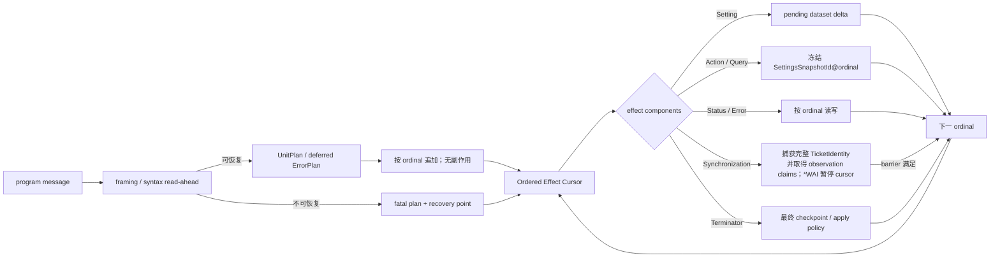
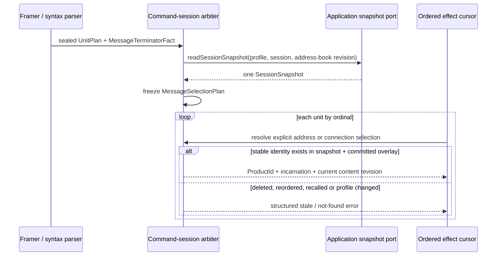
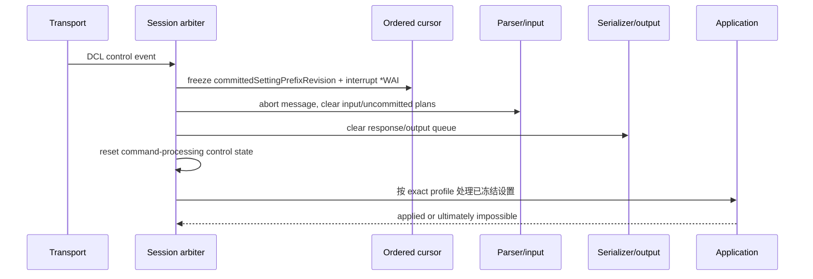
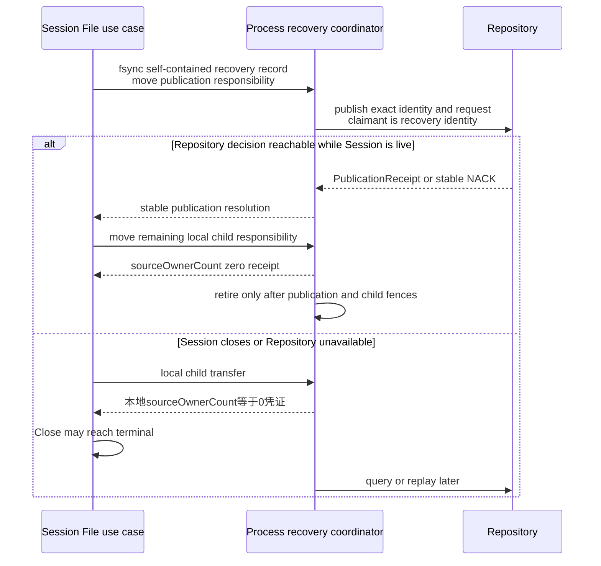

# 详细设计 05A：外部适配器

本篇细化 L8 外部适配器，保持全局章节号 §10 不变。

> 上一篇：[D4D 持久化结果与恢复](./04D-持久化结果与恢复.md) · 下一篇：[共享基础服务](./05B-共享基础服务.md) · [D5 专题导航](./05-适配器横切与验证.md) · [返回文档索引](../README.md)

## 30 秒摘要

外部适配器只负责把 SCPI、UI、文件、自动化和数据服务请求翻译为应用端口调用，不维护第二套业务状态。所有可观察副作用都必须受顺序、修订号、资源额度和恢复责任约束；断线、超时或重启后，已经接纳的工作仍须得到唯一且可证明的最终执行状态。

## 阅读入口

| 想确认的问题 | 直接阅读 |
| --- | --- |
| SCPI 如何保证命令顺序、DCL 和状态查询语义 | [§10.1 SCPI](#101-scpi) |
| UI 如何避免过期编辑覆盖新配置 | [§10.2 UI](#102-ui) |
| Import/Export 如何处理中断、恢复和外部副作用 | [§10.3 文件和自动化](#103-文件和自动化) |
| 数据流如何限制缓存、背压和断线恢复 | [§10.4 数据服务](#104-数据服务) |
| 适配器必须通过哪些测试 | [§10.5 外部适配器验证门禁](#105-外部适配器验证门禁) |

需要统一状态、资源和诊断语义时，转到 [D5B 共享基础服务](./05B-共享基础服务.md)；需要判断实现是否允许合入时，转到 [D5C 依赖、验收与竞态](./05C-依赖验收与竞态.md)。

## 10. L8：外部适配器

适配器只翻译协议和交互，不拥有第二套业务状态。共同边界如下：

| Adapter | 输入 | Application 端口/输出 | 本地状态 | 资源边界 |
| --- | --- | --- | --- | --- |
| SCPI | program message、DCL control event | ordinal command/query、response、Status/Error 视图 | command session、parser/cursor/output queue | message/unit/response/binary 上限 |
| UI | 用户 draft、selection、窗口事件 | ExpectedRevision command、Session/Result/Recovery snapshot | 视图 draft/selection | snapshot cache、绘图点数/刷新率 |
| File | 字节流、路径、格式 profile | Save/Recall/Import/Export artifact | 临时文件、迁移报告 | 文件大小、展开后大小、临时空间 |
| 原生 API / Automation | typed RPC/COM call | ApplicationCommand/Query/Ticket | client session、subscription cursor | request/rate/subscription queue |
| Data Service | Result query/subscription | immutable ResultSnapshot/binary block | stream cursor | block/window/retention Credit |

<a id="dd-scpi-adapter"></a>

### 10.1 SCPI

#### 10.1.1 正常路径：无副作用预解析与唯一副作用游标（`Effect Cursor`）

处理链拆为 Framer、无副作用 syntax pre-parser、Command Catalog、command-session pending settings、Ordered Command/Effect Cursor 和 Serializer。命令 Catalog 把 `SENS`、`CALC`、`DISP` 等映射到应用用例，不由命令树决定模块依赖。

普通 program message 只走下图。左侧可以预读，只有右侧 cursor 产生可观察副作用：



图中的 Terminator 节点表示 effect cursor 最终、幂等地消费 message checkpoint，不表示 `MessageTerminatorFact` 必须等 cursor 越过 `*WAI` 才存在；两种位置的区别见下方基准表。

<a id="dd-scpi-address-selection"></a>

#### 10.1.2 厂商编号、产品对象与连接选择

SCPI 的测量通道编号（Channel number）、测量量编号（Measurement number）、迹线编号（Trace number）和窗口编号（Window number）是**协议地址**，不是产品集合的下标，也不是产品 ID。编号到产品对象的持久对应由 L7 `ProfileAddressBook` 管理；L8 只能经应用查询端口取得只读快照，不能在命令会话内复制一份映射。地址簿随会话/召回集原子保存与召回，连接断开或适配器进程重启不会让编号重新按“当前顺序”生成。

```mermaid
classDiagram
    direction LR
    class ProfileAddressBook {
        +ProductProfileKey productProfileKey
        +ProfileRevision profileRevision
        +InstrumentSessionId instrumentSessionId
        +SessionGeneration sessionGeneration
        +AddressBookRevision addressBookRevision
        +AddressEntry[] entries
        +AddressTombstone[] tombstones
    }
    class AddressEntry {
        +AddressScopeKey key
        +ProductId productId
        +ObjectIncarnationId objectIncarnationId
        +EntryRevision entryRevision
    }
    class AddressScopeKey {
        +AddressKind addressKind
        +ScopeKind Session or Channel or DisplayPane
        +StableParentInstance parentScope
        +AddressAtom addressAtom
    }
    class StableParentInstance {
        +ProductId parentProductId
        +ObjectIncarnationId parentObjectIncarnationId
    }
    class AddressAtom {
        <<choice>>
        +NumericAddress
        +StringAddress
    }
    class NumericAddress {
        +unsignedInteger canonicalValue
    }
    class StringAddress {
        +canonicalText
        +comparisonProfileRevision
    }
    class ScpiSelectionContext {
        +AdapterSessionId adapterSessionId
        +ConnectionGeneration connectionGeneration
        +ProductProfileKey productProfileKey
        +ProfileRevision profileRevision
        +SessionGeneration sessionGeneration
        +AddressBookRevision addressBookRevision
        +ProfileSelectionBank selectionBank
    }
    class ProfileSelectionBank {
        +SelectionToken selectedChannel
        +SelectionTokenByChannel[] selectedMeasurementByChannel
        +SelectionTokenByChannel[] activeTraceByChannel
        +SelectionToken selectedDisplayPane
        +SelectionTokenByDisplayPane[] selectedWindowTraceSlotByPane
    }
    class SessionSnapshot {
        +SessionRevision sessionRevision
        +WorkingSetRevision workingSetRevision
        +SessionGeneration sessionGeneration
        +RuntimeEpoch runtimeEpoch
        +ProductGraphRevision productGraphRevision
        +AddressBookRevision addressBookRevision
    }
    ProfileAddressBook "1" o-- "0..*" AddressEntry
    AddressEntry *-- AddressScopeKey
    AddressScopeKey *-- StableParentInstance
    AddressScopeKey *-- AddressAtom
    AddressAtom <|-- NumericAddress
    AddressAtom <|-- StringAddress
    ScpiSelectionContext *-- ProfileSelectionBank
    ScpiSelectionContext --> ProfileAddressBook : pins exact revision
    SessionSnapshot --> ProfileAddressBook : contains one revision
```



协议地址的值域固定为 `AddressAtom = NumericAddress | StringAddress`。`NumericAddress` 保存规范化的无符号整数；`StringAddress` 保存解析 SCPI 字符串后的语义文本及比较规则 Profile 修订。是否区分大小写、允许哪些字符、唯一性作用域和改名外观都由精确产品 Profile 决定；通用 Adapter 不自行转大写、截断或重写名称。

每个地址项都是 `(ProductProfileKey, ProfileRevision, AddressScopeKey) ↔ (ProductId, ObjectIncarnationId, EntryRevision)` 的双向唯一对应。`AddressScopeKey` 必须把 `StableParentInstance` 和 `AddressAtom` 一起作为键；不能把父对象只当作查到条目后的校验字段，否则不同窗口或通道中的同号槽位会冲突。地址绑定只记录稳定对象身份和该对象实例，不记录会随频率、功率、格式或显示样式编辑而变化的内容修订。

| 厂商地址域 | 精确产品目标 | 额外一致性约束 |
| --- | --- | --- |
| 测量通道编号（Channel number） | `SessionScope{InstrumentSessionId} + NumericAddress ↔ ChannelId + ObjectIncarnationId` | 父会话实例必须相同；普通测量通道内容修改不改地址 |
| 测量量编号（Measurement number） | `ChannelScope{ChannelId + ObjectIncarnationId} + NumericAddress ↔ MeasurementId + ObjectIncarnationId` | 测量量必须仍属于该测量通道实例 |
| 测量量名称（Measurement name） | `ChannelScope{ChannelId + ObjectIncarnationId} + StringAddress ↔ MeasurementId + ObjectIncarnationId` | 容纳 SNA `<Mname>`；唯一性、比较和改名规则仍由精确产品配置决定 |
| 产品迹线编号（Product Trace number） | `ChannelScope{ChannelId + ObjectIncarnationId} + NumericAddress ↔ TraceId + ObjectIncarnationId` | 迹线的所属测量通道必须与地址作用域相同；不能由当前来源反推归属 |
| 窗口编号（Window number） | `SessionScope{InstrumentSessionId} + NumericAddress ↔ DisplayPaneId + ObjectIncarnationId` | 显示窗口必须属于同一会话实例 |
| 窗口迹线槽（Window Trace slot） | `DisplayPaneScope{DisplayPaneId + ObjectIncarnationId} + NumericAddress ↔ TraceDisplayBindingId + ObjectIncarnationId` | 绑定必须仍连接该窗口和一条迹线；槽号不直接标识产品迹线 |

- **只有地址拓扑变化才推进 `AddressBookRevision`。** 地址拓扑变化包括创建或删除可寻址对象、分配/撤销/重绑地址、改变父作用域，以及切换会改变地址规则的 Profile。频率、功率、处理参数、Marker 或显示样式等内容修改不推进它；Recall 只在实际安装的地址拓扑不同时推进。
- 删除在同一 L7 产品事务内写入携带旧 `ObjectIncarnationId + EntryRevision + AddressAtom` 的 tombstone。后续即使使用同一号码、名称甚至 ProductId 重建，也必须分配新 `ObjectIncarnationId`；旧选择不能穿过 tombstone 命中新对象。这是删除—重建的 ABA 防护，不是对厂商号码复用外观的猜测。
- `ProfileAddressBook` 只保存协议地址和稳定对象实例引用，不拥有测量通道、测量量、迹线或显示窗口；产品对象关系仍是唯一事实源。保存或召回时若任一双向映射、父子关系、产品配置或对象实例对不上，整个事务失败关闭。
- `ScpiSelectionContext` 是连接级易失状态，只记录已经成功选择的 `ProductId + ObjectIncarnationId + EntryRevision`；它不跨 `ConnectionGeneration` 恢复，也不充当地址簿。`ProfileSelectionBank` 至少能表示每个测量通道的活动迹线，以及每个显示窗口的窗口迹线槽。所有映射都由地址簿条目数设硬上限，不能随命令次数增长。
- 显式选择命令只有在应用层确认对应操作成功后才更新选择库，语法预读不得提前改选择。选择测量量是否联动测量通道、产品迹线是否改变每个测量通道的活动迹线、窗口迹线槽是否改变显示窗口，以及不同选择库之间如何联动，都是产品配置字段；Native 必须显式声明，ZNB/SNA 必须由真机记录证明。通用解析器只检查作用域和父子一致性，不自行补齐或联动选择。

底层表示现在就必须容纳商用品已经公开的层级：ZNB 远控存在逐 Channel active Trace，SNA 存在 `Window → Trace slot → TraceDisplayBinding` 地址。这里只采纳可观察结构，不声称厂商内部也使用 `AddressScopeKey` 或 `ProfileSelectionBank`；精确命令效果、默认选择和号码复用仍保持 `BlockedPendingEvidence`，等待型号、固件和选件绑定的真机记录。

每条 program message 只允许读取**一个** `SessionSnapshot`。具体顺序是：

地址解析只得到稳定产品身份；arbiter 必须从这份冻结的 SessionSnapshot 取得当前内容 revision，再冻结消息选择计划。地址簿不缓存内容修订。

1. syntax pre-parser 仍只认语法；
2. arbiter 在首个 effect 前取得一次快照；
3. arbiter 先用地址簿解析 `ProductId + ObjectIncarnationId`，再从这份冻结的 `SessionSnapshot` 取得当前内容 revision，并把结果固化为 `MessageSelectionPlan`；
4. 地址簿不缓存这个内容 revision；
5. 同一消息中前序已成功的选择或对象变更只进入有序 `CommittedMessageOverlay`，后序 unit 解析 `SessionSnapshot + overlay`；
6. 所有 Application 命令携带该快照和 overlay 的 ExpectedRevision。

禁止中途再读取“最新 Session”拼成混合 revision。若外部事务抢先提交，当前消息返回结构化 stale 错误，不能换一份新快照悄悄重试。



失败结果是闭集，不得降级成“取最近一个”：

- 显式地址在快照中不存在或已 tombstone：`ScpiAddressNotFound{AddressKind, AddressAtom, AddressBookRevision}`；
- 连接选择的 SessionGeneration、AddressBookRevision、EntryRevision 或 ObjectIncarnationId 已过期：`ScpiSelectionStale{expected, actual}`；仅内容 revision 改变不使稳定选择过期；
- 稳定对象实例已删除：`ScpiSelectionTargetDeleted{AddressKind, ProductId, ObjectIncarnationId, DeletionRevision}`；
- 命令要求选择而连接从未选择：`ScpiSelectionMissing{AddressKind}`；
- profile 没有获得该地址域的证据准入：`ScpiProfileAddressUnsupported{ProductProfileKey, AddressKind}`。

重排后的旧 context 必须返回 stale，删除后的隐式选择必须返回 target-deleted，Recall 后旧 `SessionGeneration` 必须返回 stale；三者都不能按当前数组位置、最小号码、“最近创建”或“最近使用”重新绑定。profile 若要规定隐式默认对象、号码复用、DCL 是否保留选择或缺失对象的具体 SCPI error code，也必须把该规则写入精确 profile，不能由通用 adapter 猜测。

| Profile 类别 | 编号与选择规则的准入证据 | 当前状态与允许行为 |
| --- | --- | --- |
| VnaPro Native | 本项目明确的 profile、契约测试和结构化错误基准 | 只作为 Native 合同启用，不产生厂商兼容声明 |
| `ZNB/{model}/{firmware}/{options}` | 覆盖编号、选择、删除、重排、Recall、默认值和错误外观的真机 transcript，并绑定精确发布回执 | `BlockedPendingEvidence`；当前不得启用 ZNB 厂商映射，不得声称兼容 |
| `SNA/{model}/{firmware}/{options}` | 覆盖同一行为面的真机 transcript，并绑定精确发布回执 | `BlockedPendingEvidence`；当前不得启用 SNA 厂商映射，不得借用 ZNB 或 Native 规则 |

手册中的命令示例只能证明该版本公开了相应命令，不能单独证明默认选择、编号重用、删除后回退或 Recall 后选择的真机外观。当前兼容状态表仍是 `BlockedPendingEvidence`；只有未来真实 transcript 与信任链均就绪后，exact profile 才能进入厂商映射准入。

#### 10.1.3 优先控制：设备清除（DCL）与证据边界

DCL 不进入普通 UnitPlan 队列，而是 command-session arbiter 的优先控制事务：



读图结论：pre-parser 不改 dataset/Status/Response；`*WAI` 只暂停普通 effect cursor；DCL 可打断它。图中表达输入/输出清理、command-processing 控制态复位和设置提交；ErrorQueue、ESR、STB 的外部外观必须按精确产品 profile 评价，不能把一个型号的表格推广到全部商用品。

厂商事实、页码、证据等级和未决 GAP 只在架构依据维护，本文不复制第二份证明范围：

- 命令识别、设置提交和 DCL 优先边界：[SCPI 命令提交](../架构依据/01-商用品行为证据.md#scpi-命令提交)；
- 错误队列、ESR、STB 与输出缓冲区的边界：[设备清除对状态与错误队列的处置范围](../架构依据/01-商用品行为证据.md#设备清除对状态与错误队列的处置范围)。

D5A 只消费上述 Decision，落实以下实现规则：

- syntax pre-parser 只做 framing/read-ahead；即使读到后续文本，也只能保存无副作用 UnitPlan；
- command session 分开保存 `recognizedThroughOrdinal` 与唯一 `effectCursorOrdinal`；前者只产生 UnitPlan/`MessageTerminatorFact`，后者才处理 Setting、Action、Query、Status/Error 和 synchronization；
- `INIT;*WAI;Setting2` 中，Setting2 在 barrier 满足前不能进入 pending dataset；
- DCL 不生成普通 UnitPlan。其优先事务按以下边界执行：
  1. 只冻结截至 DCL 线性化点已由 effect cursor committed 的 pending-setting prefix/`committedSettingPrefixRevision`；
  2. 中止 message，清 input/uncommitted plans/output，并复位 parser/cursor 控制态；
  3. recognized 但尚未 effect 的 Setting（包括 WAI 后 Setting2）随未承诺计划清除，绝不应用；
  4. 把每个 active WaiFence 原子改成 `ReleasedByDCL`，逐项释放 TicketObservationClaim 并写幂等 receipt。这只取消等待观察，不取消底层业务 operation；
  5. 清 response/output queue 时，同时取消普通文本/status response 的 Command response-delivery claim，以及所有尚未 ACK 的完整 AdapterStreamIdentity；
  6. 对已经进入 transport 的字节，先使 connection generation 失效，再由同一 receipt 归还 block/window/ResultLease，不能只丢队列节点。
  7. 不重新解析或改绑 `ScpiSelectionContext`。VnaPro Native 只保留原 exact token，并在下一条消息按当前 revision 返回有效或 stale；ZNB/SNA 的 `DclSelectionDisposition` 继续为 `Unverified`，没有真机 transcript 不得填入 Native 默认值。
- exact profile 决定是否以及何时请求应用冻结 Setting；只有已经由证据准入的 ZNB profile 才采用其已冻结规则，最终不可能时取消该次累计修改。
  - VnaPro 内部控制策略禁止把 DCL 偷换成执行 `*CLS`、`*RST` 或 device reset；Native 合同不显式清 ErrorQueue/ESR，并在 output 清理后按 MAV、ESB、ErrorQueue、Operation/Questionable 等来源重算 STB。这是本项目的故障隔离策略，不是 `EV-COM-SCPI-001` 已证明的商用品语义。
  - ZNB/SNA compatibility profile 的 `DclStatusDisposition{ErrorQueue, ESR, STB}` 初始必须为 `Unverified`。只有新 transcript 明确覆盖相应对象和前后状态后，才能冻结为具体行为；未解禁前不得对外声明该范围兼容。

Profile 可以定义 recognition boundary、DCL status disposition 和其他厂商差异，但 Adapter 只读取已经通过证据门禁的 exact profile。VnaPro Native 是本项目合同；ZNB、SNA 或其他商用品 profile 未取得精确 transcript 回执时一律 `Unverified/BlockedPendingEvidence`，不得借用另一 profile 或 Native 默认值填空。

#### 10.1.4 失败与恢复：等待完成（WAI）、操作凭证和请求者责任处置

```text
CommandSessionPositions
  RequesterDescriptor              // Client/Process + AdapterSession + ConnectionGeneration
  ScpiSelectionContextRevision     // exact profile/session/address-book revision + selected IDs
  optional ActiveMessageSnapshot   // one SessionSnapshot per program message
  optional MessageSelectionPlanHash
  recognizedThroughOrdinal          // 可领先；无 instrument side effect
  effectCursorOrdinal               // 唯一有序副作用位置
  optional MessageTerminatorFact    // MessageId + terminatorOrdinal
  optional MessageSealFence         // arbiter 校验 UnitEffectPlan 后由 fact 派生
  committedSettingPrefixRevision
  optional WaiFenceIdentity         // WaiFenceId + WaiFenceRetirableLocator
  bounded TicketObservationClaims[] // exact TicketIdentity + claim state/terminal digest
  WaiFenceState                     // Active/Satisfied/ReleasedByCursor|DCL|Disconnect
```

effect cursor 到达 `*WAI` 时，执行以下同步事务：

1. 捕获该 ordinal 之前已 committed effect 产生的**完整** OperationTicketIdentity 有序集；
2. 从预留的 bounded claim pool 全有或全无地取得 `TicketObservationClaim{WaiFenceIdentity, OperationTicketIdentity, claimOrdinal}`；
3. 容量不足时写稳定 WAI admission error 并推进 cursor，不得只取得部分 claim 后永久等待；
4. OperationRegistry 在对应 OperationCompletionFence 完成时，把最小 terminal digest 原子写入 claim/WaiFence，再释放 Ticket 侧 claim；
5. 全部 digest 齐全后，才把 Fence 置为 Satisfied 并唤醒 cursor。

Ticket 在 live claim 期间不得越过退役 fence；digest 移交后则不必等待 SCPI transport ACK。

DCL、connection disconnect、message abort 和 Session Close 与 Satisfied 竞争同一 WaiFence revision。胜者逐 claim 写 `ObservedTerminal` 或 `ObservationCancelled{DCL|Disconnect|Close|ProcessRestart}` receipt，再丢弃 Fence。

- Requester 进程消失时，由 startup/Close cleanup owner 补 RequesterGone receipt。
- V1 的 WaiFence 绑定 SCPI ConnectionGeneration，不跨连接 resume。重启后的同一客户端若要等待，必须在新连接重新发出同步命令并捕获当时可见 tickets。
- Fence 在 cursor teardown、全部 claim receipt 和 response-delivery claim 收口后，按 WaiFenceRetirableLocator 写 `RetiredWaiFenceEpoch` 并 compact。
- 窗口外完整 identity 只返回 ReceiptExpired，不重新捕获 Ticket，也不影响业务 operation。

Framer 识别 program message terminator 时只提交 `MessageTerminatorFact`，不直接改 dataset/硬件；但 effect cursor 不必先越过 `*WAI` 才知道消息已经完整。

这里不是三套 fence，而是一条派生链：

1. arbiter 用 fact 校验整份 `UnitEffectPlan`；
2. 由此派生唯一 `MessageSealFence{MessageId, terminatorOrdinal, planHash}`；
3. 每个 Action 的 `RequiredSettingApplyFence{MessageSealFenceId, prefixEndOrdinal}` 只是对该 seal 的前缀授权；
4. command-session arbiter 据此封口“effect cursor 已执行到 WAI 之前”的 setting prefix，并在同一有序事务里满足先前 Action 的 apply fence。

它不得执行 WAI 后尚未到达的 Setting，也不得把 recognition cursor 变成第二条副作用 cursor。

#### 10.1.5 验证基准：顺序号、检查点与兼容方案解禁

`Setting1;INIT;*WAI<PMT>` 的基准执行如下：

| 顺序 | recognition/effect 事实 |
| ---: | --- |
| 1 | read-ahead 识别 Setting1、INIT、WAI 和 PMT，建立 UnitPlan + MessageTerminatorFact；instrument data set 尚未改变 |
| 2 | effect cursor 执行 Setting1，形成 pending delta；INIT 冻结只含 Setting1 的 SettingsSnapshot，并注册 action Ticket/RequiredSettingApplyFence |
| 3 | effect cursor 到 WAI，捕获此前 Ticket 并暂停；它不等待自己尚未认识的“未来 busy” |
| 4 | arbiter 依据已存在的 PMT fact，仅封口并请求应用 WAI 前已执行的 Setting1 prefix；成功后才 dispatch INIT，失败则取消该 prefix alterations 并使 Ticket 明确失败 |
| 5 | INIT 达声明 terminal 后 WAI 解除；effect cursor 最后消费 terminator checkpoint，重复 apply fence 必须幂等 |

这条协议避免“WAI 等 INIT、INIT 又等 effect cursor 越过 WAI 才应用 Setting”的环。

对 `INIT;*WAI;Setting2<PMT>`，第 4 步绝不能包含 Setting2。它只有在 WAI 解除、effect cursor 真正执行该 ordinal 后，才由同一 PMT checkpoint 的剩余 prefix 处理。

具体 INIT apply/terminal scope 仍必须由 ZNB/SNA transcript 解禁，不能把本项目的 coordinator 当作厂商内部实现事实。

连续 Setting 在没有 observer 的区间可保留为 pending deltas。Action/Query/Barrier/terminator 或 DCL 路径冻结 `SettingsSnapshotId@ordinal`，保证 `Setting1;INIT;Setting2` 的 INIT 和 Query 绑定 ordinal snapshot，而不是最终值。

Ordinal snapshot 是项目内部确定性机制，不证明存在中途 hardware-apply boundary。Checkpoint 校验、Action/Query 延迟和 hardware apply 时机由 compatibility profile 冻结；ZNB profile 不得只因 Action/Query checkpoint 就提前应用。已经启动的 Action 或独立状态副作用不能伪装成可回滚。

`UnitEffectPlan` 是带局部顺序的可组合结构，不是五选一枚举：

- `*OPC?` 先捕获此前 Ticket 的 synchronization fence，满足后才写 response；
- `*ESR?` 先按协议读取/清状态，再写 response；
- `*WAI` 在自己的 ordinal 阻止后序 effect；`*OPC/*OPC?` 不能在 terminator 后统一补票；
- 每个异步 Catalog entry 声明 `TicketCompletionScope + target id`。

V1 待验证基线为：

- 有限 Single/Group 的 INIT 观察 InitiationTerminal；
- Continuous 的显式一次执行观察 TargetBatchTerminal，父仍存活；
- Hold/Abort 观察被控制的 InitiationTerminal；
- ChildRunTerminal 只供诊断；
- `*OPC?` 不推断“最近 Run”。

具体 recovery class、query snapshot、响应顺序和 Ticket 映射，在 ZNB/SNA compatibility test 通过前不解禁。二进制大数据由 Data Service 序列化，pre-parser 不复制 ResultRepository。

每个 SCPI session 冻结 compatibility profile，并独占 parser、recognition/effect positions、pending dataset、response queue 和 synchronization ledger；多 transport 不能共享一条 cursor。

输入字节、UnitPlan 数、未发送响应、binary block、WAI/观察 claim 和错误队列都有上限。达到上限时按 profile 产生协议错误或关闭连接，不能无界缓存，也不能让 I/O 线程持有 Application gate。

测试采用逐字节/分段输入 transcript，覆盖：

- header/parameter recovery 与混合 Setting/Action/Query；
- `ProfileAddressBook` 四类号码的双向唯一性、父子关系、Save/Recall 原子往返、删除 tombstone 和同代不复用；
- 每条 program message 恰好读取一次 `SessionSnapshot`，同消息前序 effect 只经 `CommittedMessageOverlay` 可见；并发产品提交只能得到 `ScpiSelectionStale`，不得二次读取后静默重试；
- 删除、重排、Recall、connection generation 与 profile revision 变化后的 `not-found/stale/target-deleted/missing/unsupported` 全闭集，以及“按数组位置、最近创建、最近使用猜目标”的负例；
- ZNB/SNA exact profile 在没有真机 transcript 与正式回执时始终 `BlockedPendingEvidence`，Native 规则不得解禁厂商映射；
- `Setting1;INIT;*WAI<PMT>` apply fence；
- `INIT;*WAI;Setting2<PMT>` 后序隔离；
- WAI 期间 DCL 只应用 committed prefix，且逐 claim 释放；
- Ticket terminal 与 DCL/expiry/disconnect 竞态；
- WAI claim 容量耗尽/进程重启，以及普通 response-delivery claim 取消；
- `*WAI/*OPC?`、DCL 到达每个 ordinal、响应顺序、队列溢出和断线重连。

### 10.2 UI

UI 订阅带 revision 的 Session/Result snapshots，编辑本地 draft，并以 ExpectedRevision Apply。冲突时显示字段级差异，不覆盖后台或其他客户端的新 revision。

- UI 不持有 DeviceSession、RunHandle 和数值 Core。
- DisplayPane 组件只消费 `DisplayPaneId`、`TraceDisplayBinding` 与 Trace snapshot；大 Trace 通过只读抽稀视图绘制，原结果仍由 Repository 拥有。
- UI 线程只做视图状态和绘制，命令、文件与数值工作都异步投递。
- 关闭窗口只改变布局，不隐式停止 Channel；断开订阅只释放 UI snapshot cache。
- `CatalogStillVisibleNoGate` 显示“未从可选目录移除，目录状态未改变”，不得与 `CatalogRemoved` 或“已转后台处理”共用成功图标。

#### 10.2.1 删除后台处理状态的呈现与原生 API 映射

删除 Ticket 返回 `TransferredToRecovery{DeleteRecoveryIdentity}` 时，适配器必须保留完整 identity，并调用 [D4E §9.1.5](./04E-产品对象删除与后台处理.md#915-删除后台处理状态查询)的 `QueryDeleteRecoveryStatus`。适配器不读取内部 journal，也不以轮询取得 owner lease。

| 入口 | 映射规则 | 用户可见结果 |
| --- | --- | --- |
| UI | 以完整 identity 查询；同一 `RecoveryObservationRevision` 合并刷新 | `RecoveryActive` 显示“已转后台处理”；`CatalogRemoved` 显示“已从可选目录移除，内容可能仍受引用保护”；ChannelReconfigure 分别显示“迹线处理已更新 / 通道配置已安装 / 通道当前无可运行测量”；Expired 显示“明细已过保留期”及 terminal digest；Active 不画成成功或失败 |
| VnaPro 原生 API | typed `queryDeleteRecoveryStatus(identity)` 原样返回闭集和 observation revision | 调用方可稳定区分 Active、Resolved、Expired、NotIssued，不解析日志文本 |
| Automation / COM | 映射同一 typed ApplicationQuery；沿用 client/session 授权、速率限制和幂等序列化 | 字段与原生 API 一致，不创建第二套恢复状态机 |

ZNB/SNA 厂商 SCPI 当前不映射这个查询。只有精确型号、固件、选件和运行配置的真机 transcript 证明了命令、错误码及结果外观，才能在对应 profile 增加映射；不得为了“功能齐全”发明厂商命令。未来若增加 VnaPro Native SCPI，也必须先在 Native profile 明确定义命令和契约测试，本节不能从 API 名称自动派生 SCPI header。

### 10.3 文件和自动化

File adapter 负责 schema 版本、校验和、临时文件 + fsync + 原子替换、迁移和导入兼容报告。

- 解析前检查文件/容器/展开后大小、条目数和路径，禁止目录穿越与压缩炸弹；
- 未知必需字段失败关闭；未知可选字段按版本策略保留或报告；
- 导入先构建隔离工件并通过领域校验，再由 Application 原子发布；
- 失败不覆盖现有 RecallSet/CalSet。

Import/Export 是异步 Ticket 时，必须复用同一恢复合同，不能只有“写临时文件”一句话。admission 顺序固定为：

1. Export 先做**纯能力检查**，不得分配 identity、journal、pool slice、temp、File Host generation，也不得执行任何 source/target I/O。
2. `RawPathOrSidecar/AtLeastOnceExport/NonTransactionalExport` 直接返回 `UnsupportedExportCommitProfile`。
3. 声称 managed commit、却不能证明下文 File Host 隔离或 backend hard deadline/fencing 的目标，返回 `UnsupportedExportExecutionCapability`。
4. 只有两项检查都通过后，Import/Export 才从有 records/bytes/temp-space 硬上限的 pool 一次预留本地 journal、最坏临时空间和 cleanup/Close-registration node。
5. Import 另预留 process-level publication-recovery slice；Export 另预留完整 process-level export-recovery、target gate/fence、File Host isolation 与 quarantine slice。
6. 完成预留后 fsync：

```text
ArtifactTransferJournal
  complete ArtifactTransferIdentity + RetirableLocator
  semanticRequestHash + fullOperationEnvelopeHash
  kind = Import | Export
  ProcessInstanceId / OwnerEpoch
  canonical source/target descriptor + sourceContentHash
  expectedRepositoryRevision | predecessorTargetGeneration
  temp-file capability + isolated artifact | immutable source refs
  SessionLocalResponsibility{resources, pins, bytes, ticket observation}
  optional ArtifactTransferRecoveryRecordRef   // Import进入publish前必需
  optional ExportRecoveryRecordRef             // Export首次目标I/O前必需
  state + terminal + local cleanup/transfer receipts
```

#### 导入：首次发布即切到稳定后台处理责任方

Import 在解析、迁移和领域校验完成前不调用 Repository。准备第一次 publish 时，必须在**同一个本地 durable transaction**中完成三件事：

1. 在已预留 slice 创建并 fsync 自包含的 `ArtifactTransferRecoveryRecord`。记录必须包含：
   - `ArtifactTransferRecoveryIdentity` 与源 `ArtifactTransferIdentity`；
   - `ProcessInstanceId/OwnerEpoch` 与完整 `PublicationOperationIdentity`；
   - 规范化 semantic publication request 与两个 hash；
   - durable isolated artifact refs/content hash/publication-source capability；
   - expected repository revision、pins、records/bytes/temp-space ownership、local-child slots；
   - `state=PreparedToPublish`。
2. 把全部 publication 重试权及完成 publish 所需资源，移交给有硬上限的 process-level `ArtifactPublicationRecoveryCoordinator`。
3. 在源 journal 写 `PublicationResponsibilityMoved{target RecoveryIdentity, sourcePublicationOwnerCount=0, targetPayloadDigest}`。

事务提交并 fsync 前，禁止任何 Repository 调用。崩溃恢复只按这一本地 commit record 决定 source 或 target 的唯一 owner，不允许二者并发 publish。提交后，Session journal 只保留不影响 publish 重放的本地子责任，禁止再直接调用 Repository。

Coordinator 发出的第一次 Repository 请求，已经声明 `callerKind=ArtifactImportRecovery` 和 `currentRequesterOrRecoveryClaim=ArtifactTransferRecoveryIdentity`。

Repository 在线性化事务中，以完整 PublicationOperationIdentity、semanticRequestHash 和 fullOperationEnvelopeHash 建立自包含 PublicationLedgerRecord，并原子发布隔离工件、正式 pins 与 PublicationReceipt。因此，不存在“先由 Session 持 claim，Close 时再远程 CAS 给恢复责任方”的窗口。

- 响应 unknown：只由 Coordinator 查询或重放原完整 identity 与同一 semantic request。
- 已知 VersionConflict：终结旧 attempt；新 attempt 必须同时更换 ArtifactTransferIdentity、ArtifactTransferRecoveryIdentity、PublicationOperationIdentity 和 expected revision。



Repository decision 到达后的普通完成，与 Session Close 共用同一个 `SourceLocalDispositionRevision` CAS；两者都不能绕过它直接退役 recovery record。

胜者在**一个本地 durable transaction**中：

1. 把仍属 Session-local 的 temp/parse cleanup capability、子 pins、records/bytes/temp-space 与 terminal-delivery 责任移入同一自包含 target；
2. 核对此前 publication payload 已经 `source=0`；
3. 写 `ArtifactTransferResponsibilityTransferredReceipt{source ArtifactTransferIdentity, target ArtifactTransferRecoveryIdentity, sourceOwnerCount=0, targetPayloadDigest, targetOwnerEpoch, LocalChildrenTransferredReceipt}`。

败者只读取同一 receipt，不重复 move/release。普通成功、稳定 NACK 与 Close 三条路最终都由同一 target 吸收剩余 child，不存在“Repository 先响应便提前删除 target”的特殊分支。

Close 与恢复按以下边界收口：

- Close 发生在第一次 publish 前：可以按冻结 policy 取消并本地清理。
- process record 已 durable：必须走上述 source-owner CAS。
- Close fence：只等待本地 `source=0` receipt 和 Session-local cleanup，不等待 Repository 通信、PublicationReceipt 或 PublicationRetiredReceipt。
- Close 先完成：Session 可见的旧 operation terminal 冻结为 `DetachedForRecovery`；后续 publication 结果写 Coordinator 自己的 resolution terminal，不回写已终结 Session。
- Repository 永久不可达：只占用已预留 recovery pool，并关闭新的 Import admission；不得阻塞 Session Close。

#### 导出：目标自身必须能回答“是否已经提交”

Export 若要承诺 exactly-once，目标 adapter 必须在 admission 时证明完整 `ExportCommitCapability`：

- `AtomicVersionOrReplace`；
- `ExpectedGenerationCASOrExclusiveLease`；
- `DurableFileFsync`；
- `DurableParentDirectoryFsync`；
- `AuthenticatedCommitMarker`；
- `RecoveryReadAfterCrash`。

推荐写不可变 version 文件，再用带 generation CAS 的原子 manifest pointer 切换。若文件格式允许，也可把 marker 与 payload 放在**同一个**原子替换文件中。独立 sidecar 与目标文件的两次 rename 不是一个提交点，禁止据此承诺 exactly-once。

“崩溃后可读”不等于“读取一定返回”。同一 adapter 还必须证明以下二选一的 `ExportExecutionCapability`。纯能力检查只验证签名/版本化 capability descriptor，不通过打开文件、读 target 或启动 Host 来探测能力：

- `IsolatableFileHost`
  - write、file/parent fsync、replace、marker read 和恢复读，全部经独立进程/故障域内的 `FileHostGeneration` 执行；
  - 每次请求带完整 recovery identity、`TargetGenerationLease/FenceEpoch`、`FileIoAttemptIdentity` 和硬 deadline；
  - 独立 Supervisor 可不等待该 Host 执行器，在硬 deadline 内撤销其 IPC/目标 mutation capability、推进 target fence，并写稳定 `FileHostIsolationReceipt`；
  - target 提交点必须校验 fence，因此 receipt 之后旧 generation 无权安装 manifest；
  - 仅“丢弃迟到回调”不算隔离。
- `HardDeadlineFencedBackend`
  - backend 契约本身保证每个写、fsync/commit 和恢复读均在 hard deadline 内返回；
  - 取消/超时后旧请求不可能再线性化；
  - 目标提交点以 fencing token 拒绝旧 generation，并提供可重读证明；
  - 只有 client-side timeout、线程取消或“通常会返回”均不成立。

普通 POSIX 路径、网络盘或 SDK，只要不能证明其中一种执行能力，即使支持 rename、marker 和崩溃后读取，也必须在任何 identity/journal/pool/temp/I/O 前以 `UnsupportedExportExecutionCapability{missing capabilities[]}` 拒绝。受管 profile 不是路径白名单，而是 commit 能力与 execution 能力的交集。

`AuthenticatedCommitMarker` 不是“再算一遍普通 checksum”。

- authenticationTag 必须由重启后仍可验证的 File-adapter 信任根签名/MAC，或由同等强度的受管 manifest 完整性机制提供；
- 只有内容 hash 正确且认证通过的 marker，才是 decision evidence；
- 密钥丢失、轮换记录缺失，或 marker 可被普通外部写者伪造时，capability 不成立并进入 `QuarantinedUnknown`。

| backend capability profile | 可承诺语义 | 约束 |
| --- | --- | --- |
| `ManagedVersionPointer` | exactly-once | immutable payload + 单一原子manifest/version pointer；pointer携带认证marker并对predecessor generation/fence做CAS，且满足一种ExportExecutionCapability |
| `AtomicSelfDescribingFile` | exactly-once | marker嵌入同一个目标文件，且原子replace、崩溃后稳定读取、跨所有合作写者的generation/独占lease及可撤销File Host mutation capability均可证明 |
| `RawPathOrSidecar` | V1 `RejectedBeforeIo` | 固定raw文件不含marker、marker放独立sidecar、外部写者不受lease约束或缺directory fsync；V1 capability check稳定返回`UnsupportedExportCommitProfile`，不创建journal、不触碰目标 |

两项能力检查通过后，必须在**首次目标 I/O 前的同一个本地 durable transaction**中：

1. 取得同 target 唯一 `ExportTargetAdmissionGate`；
2. 从固定 pool 签发本地 `TargetGenerationLease{ExportTargetKey, expected predecessor generation, TargetFenceEpoch, LeaseId}`；
3. 创建并 fsync 下述自包含 process record；
4. 让源 journal 引用该 record。

gate 只串行化同一 canonical target key；它不把缓存 generation 冒充目标事实。真正提交仍由 target CAS 验证 expected predecessor 和 fence。

```text
ExportRecoveryRecord
  complete ExportRecoveryIdentity + ExportRecoveryRetirableLocator
  source ArtifactTransferIdentity + semantic/full-envelope hashes
  canonical export request + immutable source artifact ref/hash + SourceArtifactPin
  ExportTargetKey + TargetGenerationLease + ExportTargetAdmissionGateRevision
  ExportCommitCapability snapshot + ExportExecutionCapability snapshot
  marker/temp/immutable-version capabilities and exact cleanup refs
  reserved records/bytes/temp-space/Host-isolation/quarantine/retirement slots
  SessionChildAttachment{source journal, Ticket, Close registration, attachment revision}
  ProcessInstanceId/OwnerEpoch
  current ExportExecutionGeneration{FileHostGeneration | BackendFenceGeneration}/attempt refs
  decision = Pending | Committed | ProvenNoCommit | ConcurrentConflict | QuarantinedUnknown
  attachment = Attached | SourceZeroTransferred | RequesterAcked
  execution = NotIssued | Active{FileIoAttemptIdentity, ExportExecutionGeneration, deadline}
              | AttemptTerminal{receipt} | IsolationRegistered | Isolated

ExportTargetAdmissionGate
  Open@FenceEpoch
    -> InFlight{ExportRecoveryIdentity, TargetGenerationLease}
    -> Open@committedGeneration                // Committed
       | Open@samePredecessor                  // ProvenNoCommit-cancelled
       | Open@authenticatedObservedGeneration  // ConcurrentConflict
       | QuarantinedUnknown{RecoveryIdentity, advanced FenceEpoch, IsolationRef}
```

事务还把以下责任直接交给 `ExportRecoveryCoordinator`：source artifact pin、目标执行权、最坏 temp/marker/cleanup 责任，以及 File Host 隔离配额。Session 只持 record 内的可 move attachment。

线性化边界如下：

1. 事务提交并 fsync 前，禁止 target read/write、lease 探测或 Host 请求；
2. 第一次目标请求的 caller/claimant 已经是稳定 `ExportRecoveryIdentity`，不存在“Session 先发 I/O，Close 再抢 owner”的窗口；
3. 任何目标 I/O 只能由 Coordinator 以 record 中的完整 identity、同一 semantic request 和当前 fence 发出；
4. Session、startup 线程和 Close executor 均不得直调 adapter。

每次调用 File Host/backend 前，Coordinator 必须先在 record 中以 CAS 写入并 fsync：

`NotIssued/AttemptTerminal → Active{new FileIoAttemptIdentity, ExportExecutionGeneration, TargetFenceEpoch, deadline}`

完成后才允许目标调用；返回后，以同一 attempt identity 写 `AttemptTerminal`。因此：

- 崩溃后的 `NotIssued` 可在本地证明没有目标副作用，并稳定走 `ProvenNoCommit-cancelled`；
- `Active` 只能按 unknown 隔离旧 generation；
- 两者不共用模糊的“可能发过”状态；
- 重试只增加有上限的 attempt slot，不更换 ArtifactTransferIdentity、ExportRecoveryIdentity 或 semantic request；
- attempt 上限耗尽时保持 target quarantine，不无界追加。

正常 decision 与 Close/deadline 共用 `ExportAttachmentRevision` first-wins CAS。

- 已取得稳定 target decision：Coordinator 写 decision receipt，并完成本地 cleanup。
- Close/deadline 先胜时，在一个本地事务中：
  1. 把 attachment 和尚属 Session 的 cleanup/terminal-delivery 责任移入现有 record；
  2. 证明 record 继续持有 source pin、target lease、marker/temp capability 和全部预算；
  3. 写 `ExportResponsibilityTransferredReceipt{source ArtifactTransferIdentity, target ExportRecoveryIdentity, sourceOwnerCount=0, targetRecoveryOwnerDurable=true, targetPayloadDigest, LocalChildrenTransferredReceipt}`。

原 Ticket 的不可变 business terminal 为 `TransferredForRecovery{ExportRecoveryIdentity}`。其 OperationCompletionFence 只等待上述 receipt、Session-local cleanup 及 requester delivery；因此 `*WAI` 和 Session Close 都能有界完成。

Transferred 不是 Committed。后续四态 resolution 写 process record 自己的 terminal，不能回写旧 Ticket。

每个目标 attempt 都有独立 hard deadline。当 write/fsync/replace/recovery-read 任一永久不返回时，Supervisor 不 join 旧 Host，而是用预留 slot 提交本地 fence 事务：

1. 将 `ExportTargetAdmissionGate InFlight@F → QuarantinedUnknown@(F+1)`；
2. 撤销旧 generation 的 target mutation capability；
3. 写 `FileHostIsolationRegistration + TargetAdmissionClosed + ExportQuarantineReceipt`；
4. 仅当 decision 仍为 Pending 时，才锁为 `QuarantinedUnknown`；已经 durable 的稳定 decision 不可改写。

隔离后的约束如下：

- File Host capability 必须保证 fence 提交后，旧 generation 在目标线性化点失败；
- 迟到 manifest 安装、迟到成功 receipt 和重开旧 gate，均是协议违约；
- 旧 Host 进程可以在隔离池中晚于 Session 退出被 reap，但不得阻塞 Ticket/WAI/Close/startup；
- quarantine 只拒绝同一 `ExportTargetKey` 的新 Export，其他 target 继续 admission；
- 只有显式修复流程用新安全 generation 获得认证 target 事实，并写 `ExplicitExportResolutionReceipt` 后，才可解封 target 或退役证据。

```text
ExportCommitMarker
  complete ArtifactTransferIdentity
  complete ExportRecoveryIdentity
  canonical semantic export request
  semanticRequestHash + fullOperationEnvelopeHash
  sourceContentHash + format/schema version
  predecessorTargetGeneration + committedTargetGeneration
  TargetGenerationLeaseId + TargetFenceEpoch
  committing ExportExecutionGeneration/FileIoAttemptIdentity
  immutableVersionRef                    // manifest方案
  targetProfile + authenticationTag
```

写入顺序固定为：

1. Coordinator 向当前 File Host generation 发出携带 target lease/fence 的请求。
2. Host 在目标同一受控文件系统写 payload 与 marker，或写 immutable version；校验后执行 `fsync(file)`。
3. version 方案先安装不可变 version，并执行第一次 `fsync(parent directory)`。
4. 写并 fsync 新 manifest pointer，通过 expected predecessor generation 与当前 fence 做 CAS/原子 replace，最后执行第二次 `fsync(parent directory)`。
5. 单文件方案在 `fsync(temp file)` 后，做带 expected generation/fence/独占 lease 的原子 replace，再执行 `fsync(parent directory)`。
6. 最后写本地 replace receipt；它允许晚于目录 fsync。

不得把“目录先 fsync、随后 rename”写成持久提交。在线运行的线性化点，是目标 pointer/file 对 generation 与 fence 的成功 CAS replace；崩溃后的权威事实，是安全恢复 Host 读到并认证通过的 marker。

上述每一个 write/fsync/replace/read 都受 attempt deadline 和 Host 隔离契约约束，不能在主进程文件线程补一条无 deadline 捷径。

没有本地receipt时，恢复器只按下表裁决，绝不凭“文件存在”或路径/mtime猜测：

| 恢复后目标事实 | 稳定裁决 | 后续动作 |
| --- | --- | --- |
| marker完整匹配两种identity、两个hash、content、predecessor/committed generation和有效commit-time fence | `Committed` | 从marker重建缺失receipt；不再写目标 |
| adapter证明当前仍是精确predecessor generation，旧Host generation已有隔离receipt，且不存在本identity的commit marker | `ProvenNoCommit` | 显式签发successor execution attempt/fence后，才可用原immutable candidate和原operation identity重试同一CAS replace，或稳定取消 |
| 当前是另一个认证通过的generation/identity | `ConcurrentConflict` | 稳定失败；禁止覆盖新目标或换identity偷重试 |
| marker缺失但adapter不能证明NoCommit、损坏/不匹配、认证失败或读后状态不稳定 | `QuarantinedUnknown` | 保留journal/temp/target evidence，关闭该target的新Export，等待显式修复 |

以下目标均不得声明 exactly-once：普通网络盘、无法 fsync 目录的文件系统、会被不合作外部写者任意覆盖的路径，以及不能提供 authenticated marker 与稳定 generation 读取的 adapter。

V1 的拒绝规则如下：

- 纯 capability check 在分配 ArtifactTransferIdentity、pool slice、journal/temp/File Host generation，或执行任何 source/target I/O 前，拒绝 `RawPathOrSidecar/AtLeastOnceExport/NonTransactionalExport`；
- 返回的 `UnsupportedExportCommitProfile{missing capabilities[]}` 是同步已知失败，不进入 Export 恢复 ledger；
- 声称 managed profile、但缺 IsolatableFileHost 或 HardDeadlineFencedBackend 的目标，在同一前置点返回 `UnsupportedExportExecutionCapability`，同样零 Ticket、零 record、零目标变化；
- 三种非事务名称仅为未来 ADR 保留，V1 不存在 `OutcomeUnknown` 业务 terminal；
- `TransferredForRecovery` 只表示原 requester 已 source-zero；`QuarantinedUnknown` 是独立 recovery resolution；
- 外部并发写一旦形成后继 generation，恢复器只能返回 `ConcurrentConflict`，不得覆盖该后继版本。

#### 启动、退役与验证

**启动接管顺序**

startup 在新 File admission 和 物理回收 前，分别枚举**全部未退役**的：ArtifactTransferJournal、ArtifactTransferRecoveryRecord、ExportRecoveryRecord、ExportTargetAdmissionGate、FileHostIsolationRecord/BackendFenceRecord，以及 Repository PublicationLedgerRecord。业务 terminal/CleanupDone、但尚未 watermark/compact 的记录也必须枚举。

接管按以下步骤执行：

1. 每条非终态 recovery record 先按 expected OwnerEpoch 做唯一 owner CAS 并 fsync；旧 epoch executor 随后无权调用 Repository 或 File adapter。
2. Import 只由获胜 Coordinator 按原 publication identity 与两个 hash 消歧。
3. 对旧 ProcessInstanceId 仍为 `Attached` 的 Export，获胜 Coordinator 先以同一 `ExportAttachmentRevision` 本地 CAS 写 `RequesterGone + TransferredForRecovery + sourceOwnerCount=0 + targetRecoveryOwnerDurable`，并把全部 Session child 移入原 record；这一接管不调用 target。
4. 使旧 ExportExecutionGeneration 失效：
   - `NotIssued` 且 decision Pending：可凭 durable issue guard 直接写 `ProvenNoCommit-cancelled`；
   - execution 仍 Active：一律推进 target fence、关闭精确 target gate、登记匹配 mode 的隔离/fence-expiry，并写 `StartupExportRecoveryRegisteredReceipt`；
   - 只有 decision 仍 Pending 的 Active record 才转 `QuarantinedUnknown`；已有稳定 decision 的 record 只补隔离/cleanup，不改 decision。
5. 最后，才把必要恢复读交给有固定 attempt/execution-generation/quarantine 上限的后台 Coordinator。

startup barrier 只等待上述本地 receipt，不等待 Host reap、marker read 或任何 target I/O。恢复读永不返回时，再次隔离该 attempt 并保持 `QuarantinedUnknown`；其他 target 与其他 Session 仍可开放。没有完成本地登记的精确 target 必须保持关闭，不能为追求可用性跳过。

**恢复执行边界**

- 已接纳 Export 只可能是两个 managed profile。
- 后台恢复读仍按上述四态裁决；每次读取都使用新的 `FileIoAttemptIdentity`，以及可隔离 Host generation 或 hard-deadline backend，绝不在 startup 线程同步打开目标。
- CleanupDone 分支只补 requester ACK、资源零证明、retired watermark 与 compact；不重做 publish、replace、target read 或 release。
- V1 前置拒绝的 raw/非事务/无执行能力 profile 没有 journal 可扫描。
- Host 隔离记录或 target gate 损坏时，关闭该 target 和新的 managed Export admission，并暴露 Fault；不得退化到直读路径。

**Import 退役条件**

- 原 Session journal 在以下条件齐全后，即可按 Artifact locator 退役：本地 terminal、`sourceOwnerCount=0`、target 自包含证明、ArtifactTransferResponsibilityTransferredReceipt/LocalChildrenTransferredReceipt，以及 requester terminal-delivery/teardown ACK。
- **远端 PublicationRetiredReceipt 只阻塞 ArtifactTransferRecoveryRecord 自己的 cleanup/retirement。**
- RecoveryRecord 必须等 source-zero/child receipt、全部 target 资源 cleanup/transfer、source/requester ACK 和 PublicationRetiredReceipt 齐全后，才能推进自己的 watermark。
- 普通成功/NACK 与 Close 完全共用这条栅栏。

**Export 退役条件**

Export 源 journal 与 process recovery record 分别退役：

- 源 journal 达到普通本地 terminal，或满足 `TransferredForRecovery + sourceOwnerCount=0 + targetRecoveryOwnerDurable + LocalChildrenTransferredReceipt + requester terminal-delivery/teardown ACK` 后，即可按 Artifact locator 推进自己的 watermark；它不等待目标四态 resolution。
- ExportRecoveryRecord 只有同时满足以下条件，才按 ExportRecoveryRetirableLocator 退役：
  1. decision 为 `Committed/ProvenNoCommit-cancelled/ConcurrentConflict` 之一；
  2. target gate 已按该 decision 安全打开或显式保持关闭；
  3. source pin/temp/marker/target lease/ExportExecutionGeneration 全部已有 cleanup 或 transfer receipt；
  4. OperationCompletionFence 和 recovery requester ACK 齐全。
- `QuarantinedUnknown` 必须保留到 `ExplicitExportResolutionReceipt`，不得滚过 recovery watermark；其完整 source pin/evidence/配额始终计入固定 pool。
- FileHostGeneration/IsolationRecord 或 BackendFenceRecord 只有在 target fence 已推进、mutation capability 已撤销或旧 backend request 已过证明的 hard deadline、所有 attempt terminal 或隔离且无 live claim 后，才独立退役。
- 旧 OS 进程未 reap 时，可继续占一个有上限的 host-quarantine slot，但不反向阻塞 Session/source journal 水位。

**有界资源与永久故障**

- Artifact/Import recovery、Export recovery、target gate 和 File Host generation 分别使用自己的 issuer locator 与 watermark，互不代替。
- 每个 pool 都同时限制 records、source bytes/pins、temp bytes、target gates、active/isolated Host generations 和 quarantine slots。
- 满载时拒绝新的 Import/Export 或新 target，不创建半条 record。
- 永久故障最多占满这些固定上限，并使对应 target 或 File admission fail-closed；不得让 startup worklist、线程、Host 进程或 retirement 明细无界增长。

**故障注入**

Import 必须覆盖：

- Save×Import 及 Import×Import 并发；
- 首次 publish 前后的 kill；
- Repository 永久不响应时，Close 仍在 deadline 内完成；
- source-zero 本地事务两侧 kill；
- Coordinator 再次崩溃；
- 三类 Import ledger 的任意 compact 顺序。

Managed Export 必须覆盖：

- file fsync、version 安装、第一次 directory fsync、pointer/file replace、第二次 directory fsync和本地 receipt 的每条边界 kill；
- write、两类 fsync、rename/replace 和 recovery-read 分别**永久不返回**；
- 逐点验证原 Ticket/`*WAI`/Close 在 deadline 内稳定 `TransferredForRecovery`、`sourceOwnerCount=0`、旧 Host generation 有隔离 receipt、同 target admission 关闭、其他 target 与 startup 继续；
- 最终只得到 `Committed/ProvenNoCommit/ConcurrentConflict/QuarantinedUnknown`；
- 测试 Host 在隔离后故意迟到回调并尝试安装 manifest；断言旧 fence 在目标线性化点拒绝它，且不改旧 Ticket。

此外还要验证：

- RawPath/sidecar/AtLeastOnce/NonTransactional，以及 managed commit 能力足够、但执行能力缺失的 backend，在 identity、journal、pool、temp、Host generation 和首次 source/target I/O 前全部稳定拒绝，且目标零变化；
- 外部并发改目标、marker 篡改、capability descriptor 伪造/版本漂移、隔离登记两侧 kill、startup 恢复读永久阻塞、显式 target repair；
- pool/target-gate/isolated-Host slot 满与反复断电；
- 所有 ledger/Host pool 满时只拒绝新 Import/Export，既有 record、target gate、Host generation 和 watermark 明细保持固定上界。

Automation/COM 与 SCPI 可以保留相似命名，但最终都映射 `ApplicationCommand/Query/OperationTicket`，不能把 COM 对象当内部对象图。每个调用携带 client/session 身份、ExpectedRevision 和可选 idempotency key；订阅用有界 cursor，慢客户端按明确 drop/coalesce/disconnect policy 处理，不能反压已经 terminal 的 Run。

<a id="dd-adapter-data-service"></a>

### 10.4 数据服务

Data Service 只导出 Repository 已接纳的不可变快照，或明确标记的 live preview。

- 查询键必须含 Channel/owner/access point/schema/revision 范围，禁止把“latest”作为不可追溯的内部索引；
- 二进制传输使用分块长度、endianness、numeric representation、schema/version、内容哈希和分页/stream cursor；
- 客户端 ACK 只管理其 ResultLease/网络窗口，不参与 Run completion。

SCPI binary response、Data Service 和 Automation stream 共用资源状态机，不各自发明断联语义：

```text
AdapterStreamLease
  AdapterStreamIdentity{StreamLeaseId, StreamRetirableLocator}
  AdapterSessionId + ConnectionGeneration + ProcessInstanceId/OwnerEpoch
  exact ResultRef/cursor/chunk range + ResultSubleaseId + window credit
  state = Queued → Sending → Acked
                  ↘ Cancelled
                  ↘ DetachedResume → TransferredToResumedLease | GraceExpiredReleased

ResumeRecord
  ResumeIdentity{unguessable ResumeToken, ResumeRetirableLocator}
  old AdapterStreamIdentity + exact cursor/ranges + expiry + old owner epoch
  detached block/window/sublease/pin owner + claim/terminal receipts
```

stream 终态与资源归还规则如下：

- `Acked/Cancelled/GraceExpiredReleased`：都以完整 AdapterStreamIdentity 幂等归还 block、window credit、Result sublease 及其 ResultLeaseRetentionPin。
- `TransferredToResumedLease`：不释放资源，只证明资源已原子换 owner。
- DCL、queue overflow、明确 cancel，以及不支持 resume 的断线：进入 Cancelled。
- 支持恢复的协议：只有在 ResumeRecord 已 fsync，且其完整 ResumeIdentity 对 caller 可见后，才可把 block/window/sublease/pin ownership 原子转入有硬上限的 `AdapterDetachedResumeOwner`/detached resume pool。
- `AdapterDetachedResumeOwner` 也是 RequesterClaimReconciler 允许使用的唯一 Adapter detached owner，不存在平行的 DetachedRequesterClaimOwner。
- opaque StreamLeaseId 或 ResumeToken 都不能脱离各自 locator 查询、ACK、Cancel 或 Resume。

重连使用一个 CAS，同时完成三件事：

1. 消费完整 old ResumeIdentity/claim，写 `ResumeClaimReceipt{old AdapterStreamIdentity, successor AdapterStreamIdentity, new AdapterSessionId, new ConnectionGeneration}`，并把旧 record 终结为 `TransferredToResumedLease{successor}`；
2. 创建具有**新**完整 identity 的 successor `AdapterStreamLease`，状态为 Queued 或 Sending；
3. 把 exact block/window credit、ResultSublease 和 retention pin 从 detached owner 移动给 successor。

该 CAS 还与 grace expiry、Session Close 竞争同一 expected revision，因此只有一个胜者。double resume 在保留窗口内稳定返回原 receipt，不能建立第二个 successor。

successor 最终由自己的 Acked/Cancelled 释放，也可在再次断线时用新 ResumeIdentity 进入新的 DetachedResume；旧 record/token 不复活。Session Close 可按冻结策略取消，或把 lease/pin 连同 deadline 转给 process-level detached owner，但 Close terminal 必须先拿到 transfer/release receipt。

进程启动或 connection generation 失效时，必须在任何新 Adapter admission 前扫描所有旧 owner stream/resume record：

1. `Queued/Sending`：先失效旧 transport generation。已有完整 durable ResumeRecord 时，补齐到 detached owner 的转移；否则使用 admission 时预留的 teardown node 写 Cancelled，并逐项释放。
2. `DetachedResume`：核对 exact block/window/sublease/pin 均由 detached owner 持有。
3. 已有 terminal：只补缺失 receipt，绝不改 terminal。
4. 身份或所有权无法证明：在对应**仍未退役**的 AdapterStreamLease 或 ResumeRecord 内，激活 admission 时预留的 `AdapterStreamQuarantineClaim`。claim 包含 source complete identity、exact block/window/sublease/pin refs、source owner/revision、ProcessInstanceId/OwnerEpoch、state 和 receipts。
5. 通过 CAS 把执行权交给有硬上限的 AdapterStreamQuarantineOwner，并关闭相关 Session/Data admission；它不是第二本匿名账。

startup 继续扫描同一 source record，逐项 release 或隔离并写稳定 receipt。claim 未解决时，source 不能越过各自 retirement fence。不能靠 Session ResultLease 总账代替 stream 级收口。

stream 与 resume 分别退役：

- Adapter stream 达到 Acked/Cancelled/GraceExpiredReleased；或者达到 Transferred，且 successor transfer receipt 已证明旧 owner 资源为零；再加 connection/requester teardown ACK、无 live resume/recovery/quarantine claim 后，按 StreamRetirableLocator 写 `RetiredAdapterStreamEpoch`。
- ResumeRecord 达到 Consumed/Expired，且对应 transfer/release receipt 与 claim teardown 齐全后，按 ResumeRetirableLocator 写 `RetiredResumeEpoch`。
- 两类 ledger 都只保留固定 retry window；watermark 外完整 identity 分别返回 `StreamReceiptExpired` 或 `ResumeConsumedOrExpired`，不再释放资源或创建 successor。

测试覆盖 double resume、resume×Close/grace、startup 在 Queued/Sending/Detached 各点、清理进程再次崩溃、successor ACK/Cancel/再次断线、迟到 identity，以及全套 block/window/sublease/pin 守恒。

Live preview 可以按 profile 丢弃旧帧，但每个被丢帧也必须使对应 AdapterStreamLease 进入明确 Cancelled/drop receipt；Calibration Evidence、SCPI 显式数据查询和持久化 ResultArtifact 不得静默降采样或 coalesce。访问上游 `AP_RAW_RECEIVER/AP_OBSERVATION` 先检查 Adapter capability 和结果实际可用性，不能从 formatted Trace 反推伪造。

### 10.5 外部适配器验证门禁

除 SCPI transcript 外，还必须覆盖：

- UI 慢渲染/过期 Apply、窗口关闭不 Stop；
- 文件截断/损坏/超限/迁移中断、原子替换恢复；
- Automation 幂等/订阅背压；
- Data endian/分页/hash、DCL 清 binary queue；
- SCPI/Data 断线在 Queued/Sending 各点、resume token 单次接管；
- grace timeout/Session Close 与 block/window/Result sublease 守恒；
- 所有 Adapter 无法越过 Application 直接调用 Hardware 或修改 Runtime 状态。
