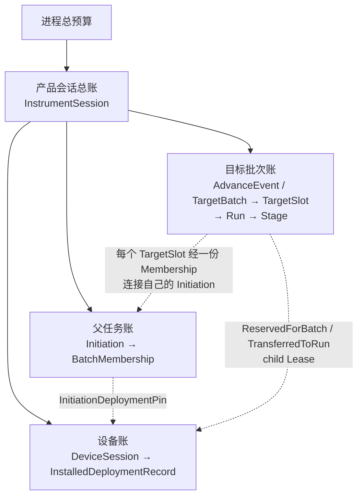

# 详细设计 05B：共享基础服务

本篇定义资源、状态、时钟、审计和诊断等多个功能共用的基础服务，保持全局章节号 §11 不变。

> 上一篇：[外部适配器](./05A-外部适配器.md) · 下一篇：[依赖、验收与竞态](./05C-依赖验收与竞态.md) · [D5 专题导航](./05-适配器横切与验证.md) · [返回文档索引](../README.md)

## 30 秒摘要

状态寄存器、错误队列、异步操作、资源账本、来源记录、时钟和诊断必须共享同一组权威事实。它们服务多个功能，但不构成新的业务层，也不能绕过应用用例直接改变测量配置或运行状态。这里最重要的约束是：资源有上限、责任有唯一所有者、完成与释放都有可核验记录。

## 阅读入口

| 想确认的问题 | 直接阅读 |
| --- | --- |
| 状态、错误和异步操作如何统一 | [§11.1 状态模型、错误队列与操作注册表](#111-状态模型错误队列与操作注册表statusmodel--errorqueue--operationregistry) |
| 内存、队列、句柄和票据如何守恒 | [§11.2 资源账本](#112-资源账本resourceledger) |
| 结果来源和审计记录保存什么 | [§11.3 来源记录与审计](#113-来源记录与审计provenance) |
| 时间戳与 Driver 信任边界是什么 | [§11.4 时钟服务与驱动时间戳信任边界](#114-时钟服务与驱动时间戳信任边界clockservice--driver-trust) |
| 如何观察高水位而不干扰测量 | [§11.5 可观测性、高水位和诊断](#115-可观测性高水位和诊断) |

外部协议的入口约束见 [D5A](./05A-外部适配器.md)；机械依赖检查和竞态验收见 [D5C](./05C-依赖验收与竞态.md)。

## 11. 共享基础服务

### 11.1 状态模型、错误队列与操作注册表（`StatusModel` / `ErrorQueue` / `OperationRegistry`）

- StatusModel 管理 Operation/Questionable 条件、事件、Enable 和汇总位。
- ErrorQueue 是有界 FIFO；溢出产生专门错误且保留可查询计数。
- OperationRegistry 关联完整 OperationTicketIdentity、Prepare/Initiation/TargetBatch/child Run/Bind/Unbind/CatalogDelete/Save 等异步操作、取消、业务 terminal 与 OperationCompletionFence；`*OPC` 观察 fence 而不是一枚全局 bool。
- GUI 诊断、日志、SCPI 状态寄存器读取同一事实源，但采用不同序列化。

StatusModel/ErrorQueue 由 Session status executor 单写，或在 Session command transaction 内原子更新；其他线程只投递预留的小型 `StatusEvent`。

状态寄存器的 condition、event、enable、summary 采用同一 revision snapshot，查询/清除是协议定义的原子动作。ErrorQueue 满时保留既有顺序并记录 overflow 计数/专用错误，不能为新错误无界分配。

OperationRegistry 状态为：

`Registered → Accepted/Running → BusinessTerminal → CompletionFenceCompleted → Retained → Expired`

- Ticket 注册先于外部可见的异步接纳。
- record 保存完整 RequesterDescriptor，以及逐 query/cancel/TicketObservation claim identity/revision。
- 业务 terminal exactly-once，且保存 scope、target identity 和稳定结果；之后只追加 teardown/transfer receipts，不改 terminal payload。
- `*OPC/*WAI`、UI 和 Automation 都捕获完整 OperationTicketIdentity 集，不扫描“当前是否忙”。

Ticket 本身只是观察索引，不拥有业务资源；但它的 retirement fence 必须引用已完成的 OperationCompletionFence。

只有满足以下任一收口条件，Registry 才可按 `TicketRetirableLocator` 滚动写 `RetiredTicketEpoch{issuer/session, ledgerEpoch, maxIssuedSequence, terminalDigest}` 并删除明细：

- business terminal、全部 mandatory receipt、composite child fence、requester teardown ACK，以及 cancel/query/TicketObservation claims 均已 durable 收口；
- terminal digest 已按 receipt 移入对应 WaiFence。

协商窗口内重放原结果。越过 watermark 的同一完整 identity 稳定返回 `ReceiptExpired{terminalDigest}`；伪造/未签发 identity 返回 InvalidIdentity。两者都不重发业务或 cleanup 动作。

特别约束：Recall 的 Ticket 不能在 `CleanupDone` 前完成；Close 的 Ticket 不能在 CloseJournal CleanupDone 前完成。

<a id="dd-resource-ledger"></a>

### 11.2 资源账本（`ResourceLedger`）

Process 只给每个 `InstrumentSession` 一个总上限。会话内部不按业务对象组成单父资源树，而是维护三套相互正交的账：父任务账、目标批次账和设备账。

#### 11.2.1 三套正交资源账



实线只表示同一账面内的额度归集。虚线表示显式登记、Pin 或 Lease，不表示对象隶属。

因此必须同时满足：

- 一个 `TargetBatch` 可以通过不同 `BatchMembership` 连接多个 `Initiation`；
- 同一批次的目标可以引用同一或不同 `DeviceSession/InstalledDeploymentRecord`；
- `TargetBatch` 不属于任何一个 `Initiation` 或 `DeviceSession`；
- 每份资源只在一个精确账户计费一次；Session 和 Process 只做向上汇总，不产生第二份 charge，跨账引用也不能复制额度。

#### 11.2.2 资源计费（Charge）

| 账面 | 计费内容 | 与其他账怎样连接 |
| --- | --- | --- |
| 产品会话总账 | 基础 `CloseJournal/control/quarantine` 容量，以及各子账上限 | 汇总三套账，但不代替子账释放 |
| 父任务账 | `Initiation` 记录、工作集、订阅、`BatchMembership` 和 `InitiationDeploymentPin` | Membership 指向一个 TargetSlot；Pin 指向精确 Deployment |
| 目标批次账 | `AdvanceEventAcceptanceRecord`、`AdvanceEvent/TargetBatch/TargetSlot`、处置槽、批次预留和未转出的 child Lease | 每个槽经 Membership 指向一个父；Lease 指向精确 Deployment |
| Run/Stage 子账 | 已转入 Run 的 child Lease、Context、Frame、Stage、进度和计划内交付容量 | Run 只属于自己的 TargetSlot，并引用该槽 Membership 指向的父 |
| 设备账 | Deployment 常驻字节、设备命令槽、硬件执行槽、驱动缓冲和隔离容量 | Pin/Lease 只阻止被引用资源退役，不把逻辑对象变成设备子对象 |

Session 创建时先预留基础关闭、控制和隔离容量。每个后续业务对象在外部可见前，也必须取得自己的关闭登记与清理容量。

`Prepared` 候选在提交前计入设备侧常驻预算。父任务进入 Armed 前，另在父任务账取得一份 `InitiationDeploymentPin`；它只保持精确 Deployment 可用，不能拆成 child Lease。

推进事件接纳时，批次账预留 acceptance record、逐槽 pending/rollback 和终态处置容量。`TargetBatch` 即使零目标或全拒绝，也有足够额度形成稳定终态。

`AtomicAdmission` 在任何目标执行前，为全部冻结 TargetSlot 一次取得：

- child `PreparedDeploymentLease`；
- `SliceDispatchReservationBundle` 及有界启动尝试槽；
- Context、Frame、Stage 和进度容量；
- 计划中实际存在的实时或持久交付容量；
- 对应的清理登记容量。

这次预留是一个跨多个父任务和设备账户的有序集合，不是任一父任务的子额度。任一目标无法取得完整资源时，整批在首个设备副作用前拒绝，并把已取得额度按原账户归还。

`PerTargetAdmission` 为每个 TargetSlot 独立取得或拒绝资源，不回滚此前已合法接纳的槽。槽准入在线性化点把精确 child Lease 和 `BatchCreditSlice` 从批次账户移动到 Run 账户；移动不复制资源。

交付容量按计划计费：

- `CurrentDelivery=LatestWins` 只取得有界 `LiveCurrentReservation/control slot` 和内存结果字节；
- `DurableDelivery=RetainHistory|WorkflowEvidence` 才取得持久身份、恢复记录、候选字节、结果或证据安装容量；
- `Continuous + LatestWins + None` 的持久维度必须为零，不能为“以后也许保存”预留存储资源。

Calibration 另在会话账预留与已接纳工作区上界一致的 `CloseDispositionSlice`。外部 `ResultLease` 继续在会话账计费，但不参与 Run 完成屏障。

#### 11.2.3 显式连接的资源转移规则

| 连接 | 计费账户与转移规则 | 不能推导出的关系 |
| --- | --- | --- |
| `BatchMembership` | 记录计入其父 Initiation；TargetSlot 只保存精确引用 | Initiation 拥有整个 TargetBatch |
| `InitiationDeploymentPin` | 计入 Initiation；Deployment 记录被 Pin 状态 | Initiation 拥有 DeviceSession 或 Deployment |
| `ReservedForBatch child Lease` | 准入前计入 TargetBatch；拒绝时由批次释放 | TargetBatch 属于 Deployment |
| `TransferredToRun child Lease` | 成功准入时从批次移动到 Run；ProcessingTerminal 后由 Run 释放 | Run 可以复制或从父 Pin 派生 Lease |
| `HardwareExecutionSlotLease` | 实际调用 L2 start 时计入精确 DeviceSession；对应采集终态唯一归还 | 软件批次预留已经占用了物理槽 |

无状态结果可以从 Run 直接交给 Session；需要跨故障继续确认的结果经既有 `RecoveryEscrow` 移交。交付路线不改变 Run、批次、父任务或设备账户之间的所有权。

#### 11.2.4 释放栅栏（Release Fence）与关闭责任

| 账户 / 资源 | 可以释放、退役或转入隔离账的条件 | 谁负责关闭 |
| --- | --- | --- |
| BatchMembership | 对应 TargetBatchTerminal 已发布，且登记已从父工作集移除 | 父 Initiation 关闭流程等待；批次流程先提供 terminal |
| Initiation 与父 Pin | admission 已关闭，membership、Run 和 acquisition 计数为零，Pin 已释放或设备已隔离 | 该 Initiation 的控制状态机 |
| TargetSlot / Run / Stage | 采集与处理终态已提交，进度和交付处置完成，转入 Run 的 Lease 与 Credit 已释放或移交 | 该 Run 的完成状态机 |
| TargetBatch 与批次预留 | 全部槽已有处置，全部 child fence 完成，未转出的预留已释放，并且各父 Membership 均已移除 | TargetBatch 协调流程 |
| DeviceSession / Deployment | 所有 Pin、child Lease、执行槽和句柄已释放，且物理后置状态可证明；否则把精确未决额度转入隔离账，不能增加可用量 | 设备资源持有与部署登记边界 |
| Session 基础容量 | 三套账分别达到各自 fence，或未决资源已明确进入隔离 | 产品会话 Close 流程与 CloseJournal |

关闭不能沿对象归属递归释放。它必须先关闭三套账的新接纳，再冻结各自未结束集合，并等待每个账户自己的 fence：

1. 父任务关闭 admission，等待属于自己的 Membership 和 Run 收口；它不替其他父任务关闭同一批次。
2. 批次完成全部 TargetSlot 处置并释放未转出的额度；它不关闭被引用的父任务或设备会话。
3. 设备故障只撤销未来使用，并让已取得的执行槽释放或隔离；它不能删除逻辑批次的真实处置。
4. 截止时间内无法证明释放时，只隔离精确账户和所引用设备，不把未知状态记作已释放。

`TargetBatchTerminal` 必须先于对应 Membership 移除；父 Initiation terminal 必须晚于自身工作集清空。这个顺序允许一个批次跨多个父任务，同时保持每个父任务都有唯一关闭责任。

#### 11.2.5 守恒操作、计数维度与准入顺序

| 操作 | 不变量 |
| --- | --- |
| acquire | 在创建可见对象或入队前完成；失败无副作用 |
| split | Lease 总量等于全部子 slice 加剩余量 |
| transfer | 发送方与接收方在同一事务中换 owner，总量不变 |
| release | 本地 no-fail、幂等收口；保留窗口内重复释放返回原 receipt，绝不增加可用量 |
| revoke | 只阻止未来使用；已转移资源仍由精确 holder 释放 |

release receipt 保留到对应 terminal、teardown ACK 和全释放 fence 完成。之后才可按 ledger epoch 压缩；过期重放返回 `ProtocolExpired`，仍不改变可用量。账本损坏进入 Quarantine/reconciliation，不能猜测已归还。

Ledger 同时统计数量和字节，至少分开以下维度：

- Deployment 常驻记录、Prepare/Start/Execution identity、父 Pin、批次预留 child Lease、Run 持有 child Lease 和物理执行槽；
- Trigger evidence、AdvanceEvent cursor/acceptance、Membership、TargetBatch/TargetSlot/Run/Initiation record 和完成槽；
- dispatch slot、block/mapping、Frame、Stage scratch/state，以及实时结果控制槽；
- 仅持久目标使用的恢复记录、候选字节、ResultLease、ResultArtifact、工作流证据和保留/回收记录；
- 保存召回、删除、校准、文件、适配器队列、流控恢复、关闭和隔离所需的专用池。

每种资源公开 `current/limit/highWater/rejectedCount`；持久池还公开 records、bytes、temp-space 和 oldest-unresolved-age。父 Pin、批次 Lease、Run Lease 与设备物理槽必须分别计数。

父任务已经独立取得 `InitiationDeploymentPin` 后，TargetBatch 的软件资源准入顺序固定为：

`Context → child DeploymentLease → SliceDispatchReservationBundle/Start-attempt slots → conditional LiveCurrentReservation → Frame → Stage → conditional DurableResult/Recovery → close-registration`

`AtomicAdmission` 先计算全部目标、slice 和最大 dispatch attempt 总量，再按冻结目标顺序取得资源。失败释放按每个预留集合的反向顺序回到原账户；这个顺序不形成 TargetBatch 对父任务或设备的所有权。

slice reservation 由 L6 控制状态机消费、恢复和释放，绝不按值传给 L2。`HardwareExecutionSlotLease` 不包含在整批软件资源中，只在实际调用 L2 start 时取得，并由对应 per-slice AcquisitionTerminal 唯一归还。

除原有单 active-slot 场景外，资源账本还必须覆盖一个跨两个 Initiation、两个 DeviceSession 的 TargetBatch：

1. 两个 TargetSlot 各通过一份 Membership 指向自己的父任务，并分别取得精确 Deployment 的资源；
2. 停止其中一个父任务不会释放另一个父任务的 Membership、Run 或设备资源；
3. 一个设备故障只隔离该设备侧账户，两个槽仍分别留下真实处置；
4. TargetBatchTerminal 后，各父分别移除自己的 Membership，再独立判断能否 terminal；
5. 全部 release fence 后会话总账回到基线，无双计费、双释放或遗留额度。

单 active-slot 设备的原有测试仍需覆盖多 slice 顺序、RetryableBusy 新身份、未知响应原身份重放、永久 Busy、slice 间 Stop/Close、设备故障和全部未启动预留的反向归还。

### 11.3 来源记录与审计（`Provenance`）

Provenance 是结果字段，不只是日志：

- 每个 Raw/Result 至少保存 `AdvanceEventId + ResolvedSourceBindingSnapshotId/SourceBindingId/BindingGeneration/RoutingRevision/hash + SequenceKind/granularity`。
- 持久化 ResultArtifact 要嵌入或内容寻址保存该不可变 snapshot 及 matched-source evidence，不能依赖当前 routing 配置解释旧结果。
- 日志记录状态转移、票据和错误，不打印大数组。
- Trace/CalSet/Result 文件保存内容哈希和生成软件版本。
- 真实驱动对照数据需去除设备敏感信息后进入测试资产。

Provenance schema 自身带版本，未知必需字段使旧 reader 明确不兼容；内容寻址对象必须校验 hash 后再使用。

审计记录 command/operation/terminal 的强类型 ID、revision、稳定状态和时间，不保存认证密钥或默认记录完整测量数组。脱敏测试资产保留必要的设备/固件/driver/factory-conditioning fingerprint 映射，但移除序列号等敏感字段。

### 11.4 时钟服务与驱动时间戳信任边界（`ClockService` / `Driver trust`）

ClockService 管理 `ClockDomainDescriptor`、单调性、跳变 epoch 和有有效期/不确定度的 `ClockCorrelationSnapshot`。它不直接产生 Trigger；MeasurementAdvanceEngine 只消费证明。时钟回拨、映射过期或同步质量下降发布新 epoch，使未来跨域 AllOf 失败关闭，旧 AdvanceEvent 仍由其冻结 snapshot 解释。

DriverTrustPolicy 在加载前校验来源、hash、ABI manifest、允许的设备/固件范围和隔离 profile。目录发现的未知二进制不能因“能打开”就进入 in-process。

Host IPC、File import、Automation/Data transport 都对长度、计数、路径、权限和速率做边界检查。任何外部标识都先解析为 Application 可验证的强类型 ID，不能成为内部指针或任意文件路径。

### 11.5 可观测性、高水位和诊断

每个 Session 提供可复制的小型 `RuntimeDiagnosticSnapshot`，不返回 payload 或可写内部引用：

```text
InstrumentSessionId/SessionGeneration、Device/Initiation/TargetBatch/Run、Deployment IDs/revisions/hashes
各状态机当前状态、terminal/fence/worker-in-flight 标志
各有界队列 current/highWater/rejectedCount/wait time
各 Credit current/limit/highWater、live InitiationPin/child Lease/generations、retained Result/Evidence bytes
accepted/processed/emitted/committed/discarded Frame 计数
firstPipelineError、controlAttempt summary、hardware terminal
```

指标至少按下表聚合：

| 类别 | 指标 |
| --- | --- |
| 冷路径 | compile、Prepare、bind、deployment install、start admission latency |
| Trigger | ingress/queue/correlation miss、ClockIncomparable、TargetBatch admission latency |
| 队列 | enqueue wait、residence、high-water、Credit wait/rejection |
| 处理 | 各 Stage P50/P95/P99、每 Frame 分配数、state commit latency |
| 交付 | Repository commit、Adapter send、ResultLease 持有时间 |
| 完成 | Acquisition terminal → Processing terminal → TargetBatch/Initiation terminal latency |
| 错误 | 按 stage/code 聚合首错、control fallback、协议矛盾、诊断截断 |

热路径不逐样本日志、不格式化大字符串。terminal/首错固定槽只保存稳定 code/ID/计数；日志线程在回调外展开 best-effort 文本。指标收集本身有固定容量，满时丢诊断并增加 dropped-diagnostic counter，绝不能阻断测量或覆盖业务错误。
